# Arquitectura del sistema

Este documento explica cómo está construido el sistema, con suficiente detalle para que otro desarrollador lo entienda sin tener que leer el código primero.

## Índice

1. [Principios de diseño](#principios-de-diseño)
2. [Arquitectura general](#arquitectura-general)
3. [Clean Architecture: las 4 capas](#clean-architecture-las-4-capas)
4. [Dominio: los cuatro juegos](#dominio-los-cuatro-juegos)
5. [Baloto y Revancha: por qué son juegos independientes](#baloto-y-revancha-por-qué-son-juegos-independientes)
6. [Conectores y adquisición de datos](#conectores-y-adquisición-de-datos)
7. [Flujo de sincronización](#flujo-de-sincronización)
8. [Resiliencia de la sincronización](#resiliencia-de-la-sincronización)
9. [Reprocesamiento desde HTML](#reprocesamiento-desde-html)
10. [Data Quality Report](#data-quality-report)
11. [Motor estadístico y caché persistido](#motor-estadístico-y-caché-persistido)
12. [Visualizaciones web de estadísticas](#visualizaciones-web-de-estadísticas)
13. [Flujo de una petición web (HTMX)](#flujo-de-una-petición-web-htmx)
14. [API REST](#api-rest)
15. [Base de datos](#base-de-datos)
16. [Decisiones de diseño y por qué](#decisiones-de-diseño-y-por-qué)

---

## Principios de diseño

1. **La dirección de las dependencias siempre apunta hacia adentro.** `domain` no conoce a nadie. `application` solo conoce a `domain`. `infrastructure` implementa los puertos que `application` define. `api` orquesta todo pero no contiene lógica de negocio.
2. **Los casos de uso son la única puerta a la lógica de negocio.** Ningún router (web o REST) valida reglas de juego, construye combinaciones, ni decide si un sorteo es válido — eso vive exclusivamente en `domain/games` y se invoca a través de casos de uso.
3. **El scraping nunca se mezcla con las reglas de negocio.** Un conector devuelve DTOs neutrales (`DrawDetail`); la decisión de si eso es un sorteo válido para PostgreSQL la toma `RegistrarSorteo`, el mismo caso de uso que usa el formulario manual del dashboard.
4. **Todo origen de datos es intercambiable.** `SincronizarSorteos` no sabe si detrás hay HTML scrapeado, un CSV, o una futura API oficial — todos implementan el mismo puerto `DrawSourceConnector`.

---

## Arquitectura general

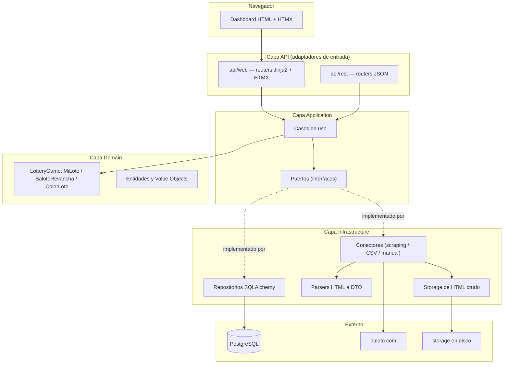

---

## Clean Architecture: las 4 capas

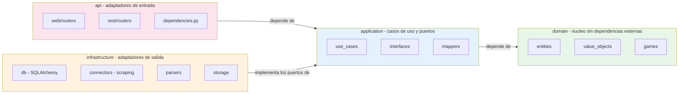

**Regla verificada activamente en la auditoría de Fase 2:** ningún archivo de `application/` importa de `infrastructure/`. La única forma en que `application/` usa infraestructura es a través de puertos (`SorteoRepository`, `DrawSourceConnector`, `UnitOfWork`, `HtmlStorage`), inyectados por `api/dependencies.py`.

---

## Dominio: los cuatro juegos

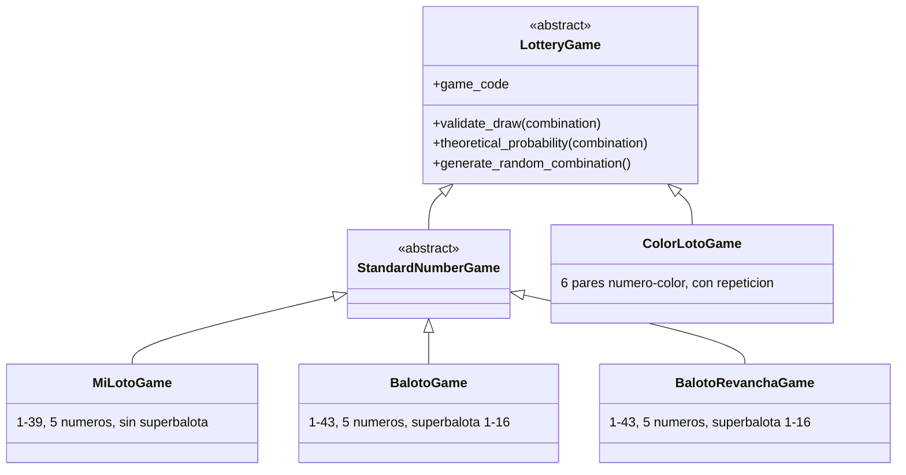

Cada juego encapsula sus propias reglas de validación y cálculo de probabilidades. `GameFactory` traduce la entidad persistida `Juego` (tabla `juegos`) a la instancia de dominio `LotteryGame` correspondiente. `BalotoGame` y `BalotoRevanchaGame` comparten exactamente la misma mecánica (misma clase base `StandardNumberGame`, mismos rangos), pero son juegos independientes -ver la siguiente sección.

---

## Baloto y Revancha: por qué son juegos independientes

**El problema real detectado:** hasta la revisión arquitectónica de agosto de 2026, el sistema solo modelaba `BALOTO_REVANCHA` -el resultado principal de Baloto clásico nunca se scrapeaba ni se guardaba. Al abrir un sorteo de la familia Baloto solo aparecía Revancha.

**Diagnóstico:** en `infrastructure/parsers/baloto_revancha_parser.py`, el filtro de listado (`_RE_DRAW_ID`) solo reconocía enlaces `/resultados-revancha/{id}`, descartando las filas de Baloto clásico. El conector solo pedía el detalle de Revancha. Fue una decisión de Fase 1 documentada pero incompleta: nunca se contempló capturar el resultado principal.

**Verificado contra el sitio real:** `/resultados-baloto/{id}` y `/resultados-revancha/{id}` son páginas de detalle *separadas*, cada una con solo su propio resultado y su propia tabla de premios -no existe una sola página con ambos. El listado (`/resultados`) sí trae ambas familias juntas, así que el descubrimiento de sorteos comparte un único recorrido de paginación; solo el detalle requiere una petición por familia.

**Decisión: Opción A — juegos independientes relacionados por `numero_sorteo`.** Se evaluaron dos alternativas:

| | Opción A (elegida): juegos independientes | Opción B (descartada): una entidad con dos resultados |
|---|---|---|
| Cambios de esquema | Ninguno -solo una fila nueva en `juegos` | Requiere romper la relación 1:1 `Sorteo` → `Combination`, o una tabla paralela completa |
| Reutilización de dominio | Total: `StandardNumberGame`, `RegistrarSorteo`, `ValidarIntegridadDatos`, paginación, Data Quality Report -todo funciona sin modificar | Ninguna: cada caso de uso tendría que saber manejar "uno o dos resultados" |
| Fidelidad al dominio real | Alta: Baloto y Revancha son productos regulatoriamente distintos (reglamentos y acumulados separados) | Baja: fusiona dos productos distintos en una sola entidad porque comparten fecha |
| Escalabilidad para Fase 3 | Cada juego es una serie temporal independiente, igual que MiLoto/ColorLoto -patrón ya probado | Cada consulta estadística tendría que desempaquetar la estructura combinada |

**Implementación:** `BalotoGame` (nuevo, `domain/games/baloto.py`) + fila `BALOTO` en `juegos` (migración `0004`, puramente de datos) + `BalotoConnector` (nuevo, comparte el listado con `BalotoRevanchaConnector` pero pide su propio detalle) + `ObtenerSorteoConPareja` (caso de uso que, dado un sorteo de cualquiera de las dos familias, busca el resultado del mismo `numero_sorteo` en el juego relacionado, para que la interfaz los muestre juntos).

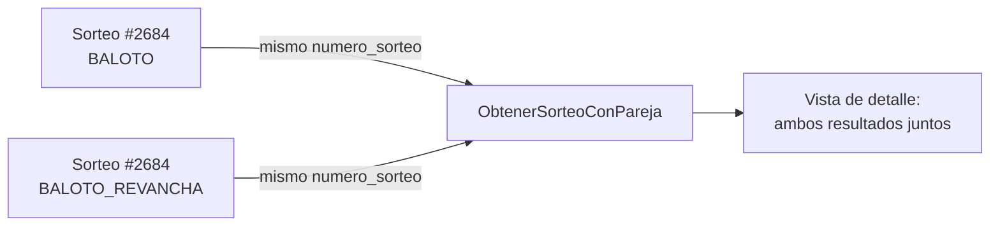

---

## Conectores y adquisición de datos

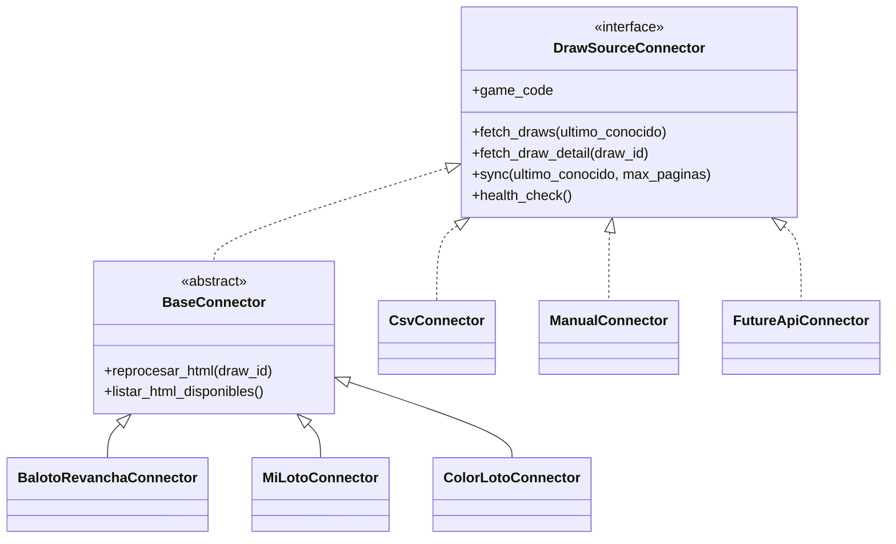

`BaseConnector` implementa una sola vez (patrón Template Method) la paginación, los reintentos con backoff exponencial, el guardado del HTML crudo y la tolerancia a fallos. Las subclases concretas solo aportan las URLs y delegan el parseo a un módulo de `infrastructure/parsers/` — así el conector responde "cómo llegar al dato" y el parser responde "qué significa el dato".

**Agregar un origen de datos nuevo no requiere tocar `SincronizarSorteos`:** basta con implementar `DrawSourceConnector` y registrar la clase en `ConnectorRegistry`.

---

## Flujo de sincronización

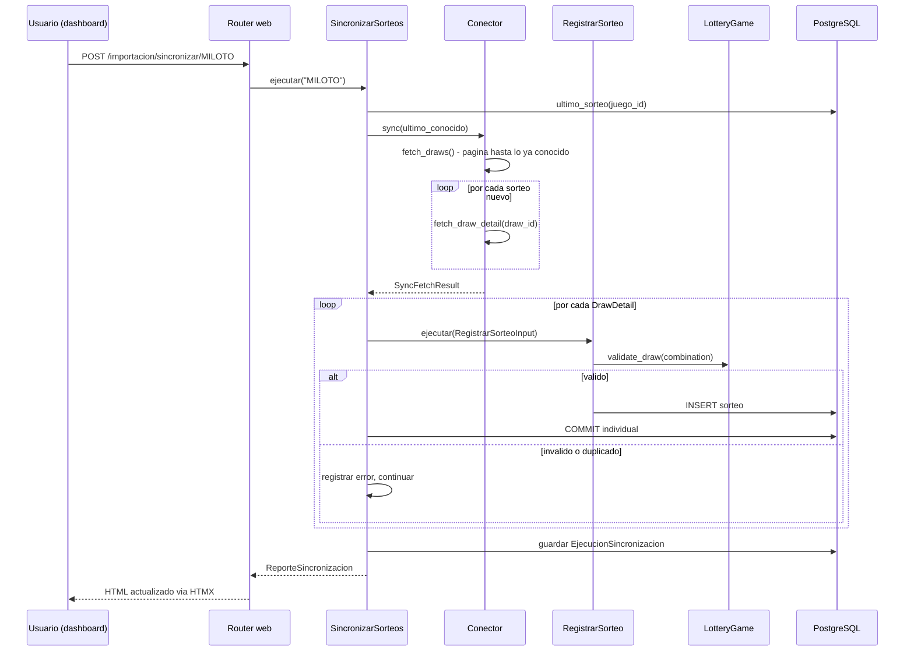

---

## Resiliencia de la sincronización

Documento completo: `backend/docs/resiliencia_sincronizacion.md`. Resumen:

- **El "último sorteo conocido" se recalcula desde PostgreSQL en cada corrida**, nunca desde el log de la corrida anterior.
- **Cada sorteo se confirma (commit) individualmente**, vía el puerto `UnitOfWork`. Antes de esta corrección, toda la sincronización corría en una sola transacción (una request = una Session = un commit al final); un fallo a mitad de camino habría revertido todo el lote. Ahora, si el sorteo 851 de 1000 falla, los 850 anteriores ya están confirmados y sobreviven.
- **Tres capas de protección contra duplicados**: el conector no vuelve a ofrecer lo ya conocido; `RegistrarSorteo` verifica `existe()` antes de escribir; la restricción UNIQUE de PostgreSQL es la última línea de defensa.
- **Un fallo individual nunca detiene el lote**: hay un catch-all deliberado además de los tipos de error anticipados.


---

## Reprocesamiento desde HTML

Permite reconstruir la base de datos usando únicamente los archivos ya guardados en `storage/html/`, sin volver a depender del sitio oficial.

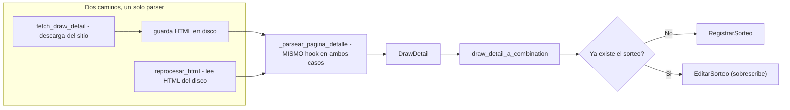

Reutiliza literalmente el mismo hook de parseo y el mismo mapper que la sincronización en vivo — no existe una segunda implementación que pueda desincronizarse de la primera.

---

## Data Quality Report

Combina dos fuentes a propósito:

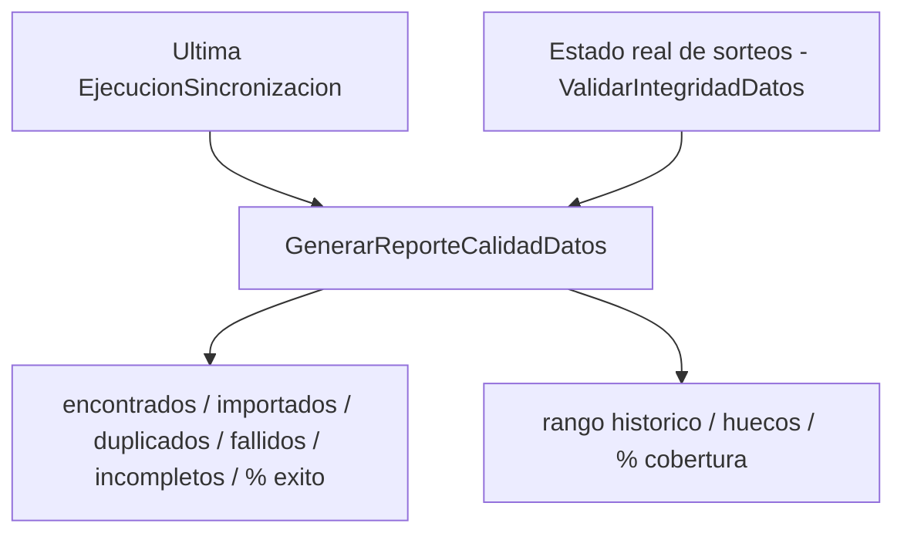

El rango histórico y la cobertura son propiedades del estado actual de los datos, no de una corrida puntual — por eso el reporte combina ambas fuentes en vez de fusionarlas en una sola entidad.

**Etapa AE-35 (validada) ejecutó realmente este reporte, con evidencia real del usuario sobre PostgreSQL -confirmando en la práctica lo que el docstring de `GenerarReporteCalidadDatos` ya declaraba desde su creación: es el gate real de entrada a Machine Learning, nunca la Fase 5 (estadísticas descriptivas).** Resultado real: BALOTO 625 sorteos (`2081`-`2705`), BALOTO_REVANCHA 625 sorteos (mismo rango numérico y de fechas, juego independiente), COLORLOTO 215 sorteos (`1`-`215`), MILOTO 70 sorteos (`532`-`601`) -los cuatro con 100% de cobertura y cero huecos en su rango real; once controles de integridad independientes (duplicados, cantidades, rangos, superbalota, colores, fechas, orden temporal) en cero incidencias. Decisión emitida: **GO CONDICIONAL** -GO para Baloto y Baloto Revancha (modelos independientes en AE-36, nunca mezclados pese a compartir fechas de sorteo), NO-GO temporal para MiLoto (70 sorteos, histórico insuficiente), pospuesto para ColorLoto (215 sorteos, representación del objetivo estructuralmente distinta a los juegos numéricos). `sorteos_incompletos` (contador de `EjecucionSincronizacion`) se incrementa por `DrawDetail.advertencias` no vacío -verificado directamente que esto nunca implica un sorteo inválido persistido: `RegistrarSorteo` ya desvía cualquier combinación inválida a `errores`, nunca a `importados`; el texto exacto de cada advertencia no queda persistido en `detalle_errores`, limitación real documentada, no inventada.

---

## Machine Learning -núcleo puro (`application/ml/`, Etapa AE-36, validada)

**Primera implementación real de Machine Learning del proyecto**, exclusivamente para Baloto y Baloto Revancha (conjunto cerrado `JUEGOS_AUTORIZADOS_AE36`, GO CONDICIONAL de AE-35) -MiLoto y ColorLoto se rechazan explícitamente antes de tocar cualquier repositorio.

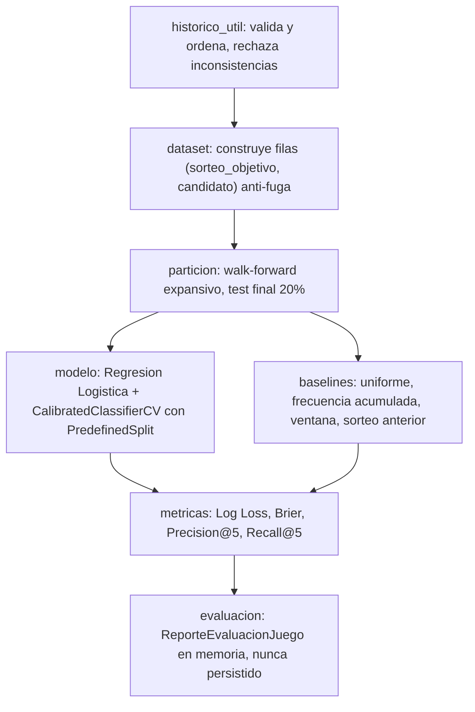

**Modulos puros** (`tipos.py`, `historico_util.py`, `features.py`, `dataset.py`, `particion.py`, `metricas.py`, `baselines.py`, `evaluacion.py`): cero importaciones de SQLAlchemy, FastAPI o Jinja2 -mismo criterio ya establecido por `application/estadisticas/motor/`. `modelo.py` es el UNICO archivo del paquete que importa scikit-learn, aislado del resto -si scikit-learn cambiara o se reemplazara, ningun otro modulo de `ml/` necesitaria cambios.

**Disciplina anti-fuga**: cada `FilaCandidato` valida en su propio `__post_init__` que `calculado_hasta_sorteo < sorteo_objetivo` -una fuga se detecta al CONSTRUIR el dato, no solo en una prueba externa. `dataset.py` es el unico modulo que decide que sorteo es "objetivo"; `features.py` nunca ve el sorteo objetivo, solo el prefijo de historico que `dataset.py` le entrega. Demostrado con pruebas adversariales reales (ver `tests/unit/ml/test_dataset.py::TestAntiFugaTemporal`): alterar el futuro no cambia el pasado calculado; alterar el propio objetivo solo cambia su etiqueta, nunca sus features.

**Calibracion cronologica**: `modelo.py` divide el conjunto de entrenamiento en un bloque base y un bloque de calibracion (por sorteo completo, el de calibracion siempre posterior) y pasa un `PredefinedSplit` explicito a `CalibratedClassifierCV` -nunca la validacion cruzada aleatoria por defecto.

**Union con infraestructura**: `EvaluarBaselineMLProbabilidadNumeros` (`application/use_cases/`) depende de `ResultadosHistoricosRepository`, `JuegoRepository` y `GameFactory` ya existentes -nunca de `EstadisticaRepository` (reservado al motor estadistico descriptivo, nunca reutilizado para experimentos ML). El reporte devuelto (`ReporteEvaluacionJuego`) existe unicamente en memoria durante la ejecucion; AE-36 no persiste nada en `modelos`, `metricas_modelo` ni `predicciones` -esas tablas, existentes desde la migracion `0001`, permanecen exactamente iguales.

**Validación real del usuario, ejecutada en Windows/Python 3.14.6/PostgreSQL real**: pipeline entrenado y evaluado sobre los 625 sorteos reales de Baloto y los 625 de Baloto Revancha (siempre por separado), dentro de transacciones de PostgreSQL de solo lectura -caché y tablas de ML confirmadas sin cambios antes/después. Resultado real: el baseline uniforme fue mejor que el modelo en Log Loss y Brier Score para ambos juegos -sin evidencia de mejora conjunta fuera de muestra. El test final real (`2591..2705`) queda consumido por esta evaluación y no debe reutilizarse como holdout intacto en etapas futuras. Alcance real de la implementación: 9 módulos funcionales en `application/ml/` (10 archivos contando `__init__.py`) más 1 caso de uso -10 archivos Python en total.

---

## Evaluación temporal anidada y ablación -Etapa AE-37, validada

**Motivada por el resultado científico negativo de AE-36**: no busca revertirlo, sino explorar honestamente si existe alguna señal exploratoria bajo regularización controlada y ablación de features. Extiende `application/ml/` de forma exclusivamente aditiva -confirmado con una comparación directa de bytes que el contenido original de `tipos.py` y `modelo.py` es un prefijo exacto del archivo resultante; ningún archivo protegido ni las 80 pruebas originales de AE-36 se modificaron.

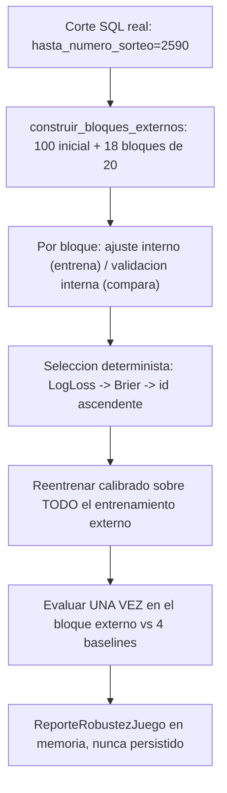

**Corrección arquitectónica de mantenimiento heredada de AE-36**: `evaluacion.py` importaba `sklearn` directamente solo para leer `sklearn.__version__`, contradiciendo la propia afirmación de este documento de que `modelo.py` era el único archivo de `application/ml/` con esa dependencia -defecto real, preexistente, detectado y corregido en esta etapa antes de cualquier validación del usuario. La corrección centraliza `VERSION_SKLEARN` en `modelo.py`; `evaluacion.py` ahora lo importa desde ahí, sin ningún cambio de comportamiento -confirmado real que `evaluar_juego` sigue devolviendo exactamente el mismo valor de `version_sklearn`, y que las 80 pruebas originales de AE-36 pasan sin ninguna modificación de su contenido. Se añadió una **prueba estructural real basada en AST** (`ast.Import`/`ast.ImportFrom`, nunca una búsqueda de texto superficial) que recorre `application/ml/` y falla si algún archivo distinto de `modelo.py` importa scikit-learn -verificado deliberadamente que la prueba falla si se reintroduce el import original, antes de confirmar que pasa con la corrección.

**Corte de desarrollo real (`CORTE_DESARROLLO_AE37 = 2590`)**: aplicado en la consulta SQL ya existente de `ResultadosHistoricosRepository.listar_resultados_numericos` -nunca se trae el histórico completo para filtrarlo despues en Python; la interfaz y su implementación SQLAlchemy no requirieron ningún cambio, ya soportaban `hasta_numero_sorteo` desde AE-36. Tres capas defensivas adicionales (`ResultadoPosteriorAlCorteError`) verifican el histórico recibido, cada fila del dataset y cada frontera de bloque externo -confirmado con una prueba adversarial real que simula un repositorio con un bug que ignora el corte.

**Protocolo anidado** (`evaluacion_anidada.py`, puro, sin SQLAlchemy/FastAPI/Jinja2): `construir_bloques_externos` reserva los primeros 100 sorteos elegibles como entrenamiento inicial externo y divide el resto en bloques consecutivos de 20 -un bloque parcial se rechaza explícitamente (`BloqueExternoParcialError`), nunca desaparece en silencio. Dentro de cada bloque, `_seleccionar_configuracion` entrena los seis `CANDIDATOS_PREREGISTRADOS` únicamente con el ajuste interno (usando `entrenar_modelo_generalizado`, sin calibrar) y los compara únicamente en la validación interna; el ganador se reentrena calibrado (`entrenar_modelo_calibrado_generalizado`, mismo patrón `PredefinedSplit` explícito de AE-36) sobre todo el entrenamiento externo y se evalúa una única vez sobre el bloque externo.

**Ablación**: `modelo.py` gana funciones generalizadas (`construir_pipeline_generalizado`, `entrenar_modelo_generalizado`, `entrenar_modelo_calibrado_generalizado`, `predecir_probabilidades_generalizado`) parametrizadas por `C` y por inclusión de las dos features de recencia -el índice de la columna one-hot del candidato se ajusta automáticamente (6 en el conjunto `completo`, 4 en `frecuencias`). Las funciones originales de AE-36 permanecen sin cambios y siguen siendo las que usa su caso de uso original.

**Unión con infraestructura**: `EvaluarRobustezMLProbabilidadNumeros` (`application/use_cases/`) es el único puente -mismo conjunto cerrado `{BALOTO, BALOTO_REVANCHA}` de AE-36, MiLoto y ColorLoto rechazados antes de consultar cualquier repositorio. **Confirmado real, verificado con la prueba estructural de AST**: únicamente `modelo.py` importa scikit-learn directamente entre todos los archivos de `application/ml/` -la versión se expone vía `VERSION_SKLEARN` para que ningún otro archivo del paquete, ni el caso de uso, necesiten su propia importación de scikit-learn. Ningún dato se persiste en `modelos`/`metricas_modelo`/`predicciones`; sin rutas, sin plantillas, sin migraciones.

**Validación real completa del usuario, ejecutada en Windows/Python 3.14.6/PostgreSQL real -evidencia atribuida al usuario, nunca ejecutada por Claude**: pipeline entrenado y evaluado sobre los 510 sorteos reales de cada juego bajo el corte `2590` (`460` elegibles, `19780` filas, `18` bloques externos, `2231`-`2590`), dentro de transacciones de PostgreSQL de solo lectura -caché y tablas de ML confirmadas sin cambios antes/después. **El protocolo validado produjo ausencia de señal agregada para ambos juegos**: BALOTO obtuvo Log Loss `0.35960515` frente al uniforme `0.35944515` (6/18 bloques ganados en ambas métricas); BALOTO_REVANCHA `0.35968580` frente a `0.35944515` (9/18 bloques, división que no revierte el resultado agregado negativo). Reproducibilidad real confirmada -dos ejecuciones por juego, semilla `42`, resultados idénticos. Baloto y Baloto Revancha se mantuvieron completamente separados en todo momento -nunca una sola fila, modelo, selección ni reporte mezclado entre ambos. El intervalo `2591..2705` (test final de AE-36) no fue cargado, consultado ni reutilizado; el próximo holdout genuino permanece intacto desde `2706`. Evidencia sintética previa de sandbox conservada por separado -claramente identificada como tal- en las secciones anteriores; nunca sustituida ni confundida con esta evidencia real.

---

## Comparación exploratoria de familias -Etapa AE-38, validada

**Motivada por el resultado negativo de AE-37**: comprueba si Random Forest aporta alguna señal exploratoria adicional frente a la Regresión Logística y al uniforme, reutilizando exclusivamente los mismos datos de desarrollo (`2081..2590`) ya permitidos. Extiende `application/ml/` de forma exclusivamente aditiva -confirmado con una comparación directa de bytes que el contenido original de `tipos.py`/`modelo.py` es un prefijo exacto; `evaluacion_anidada.py` y el caso de uso original de AE-37 **nunca fueron modificados**, confirmado con una prueba dedicada que los ejecuta sin cambios.

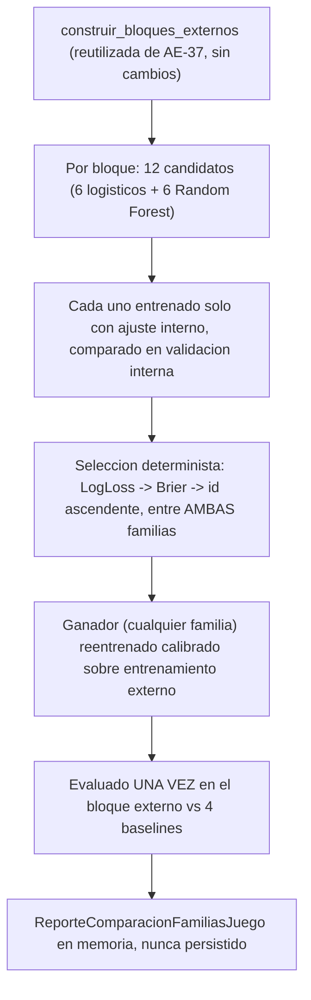

**Generalización por familia, nunca hardcodeo de modelo**: `modelo.py` gana `_construir_estimador_base(familia, hiperparametros, semilla)` -unico punto de todo `application/ml` donde se elige entre `LogisticRegression` y `RandomForestClassifier`, rechazando explícitamente cualquier familia desconocida. `construir_pipeline_familia`, `entrenar_modelo_familia` y `entrenar_modelo_calibrado_familia` generalizan el patrón exacto de AE-37 (mismo `CalibratedClassifierCV`+`PredefinedSplit` explícito) por familia, para que la comparación sea metodológicamente equivalente entre ambas.

**Doce candidatos preregistrados** (`comparacion_familias.py`): los seis logísticos exactos de AE-37, más `CANDIDATOS_RANDOM_FOREST_AE38` -exactamente seis, cuadrícula pequeña y finita fijada antes de cualquier experimento (profundidad `{5, 10, None}` × ensamble `{100, 200, 300}`, replicada en ambos conjuntos de features), `random_state=42` y `n_jobs=1` siempre. `evaluar_bloques_externos_ae38` reutiliza directamente `construir_bloques_externos` de `evaluacion_anidada.py` -nunca la duplica- generalizando únicamente la selección interna para comparar los doce candidatos de dos familias.

**Confirmado con AST, no solo documentado**: `modelo.py` sigue siendo el único archivo de `application/ml/` que importa scikit-learn -verificado con la misma disciplina de prueba estructural de AE-37, extendida a `comparacion_familias.py`.

**Limitación de escala real, medida directamente, no estimada**: una ejecución completa de los 18 bloques externos a escala real (510 sorteos) con doce candidatos por bloque -incluidos seis de Random Forest de hasta 300 árboles, sobre entrenamiento expansivo- excede el tiempo disponible por llamada en el sandbox. Medición real: los primeros 12 bloques (hasta 300 sorteos de entrenamiento) requirieron `223.7 s` acumulados solo en la selección interna, con coste creciente por bloque. Por esta razón, el experimento sintético completo (con reproducibilidad e invariancia post-corte) se ejecutó a una escala reducida real de 190 sorteos/2 bloques -mismos doce candidatos, protocolo sin simplificar-, mientras que la estructura de los 18 bloques a escala real (`460` elegibles, límites `2231`-`2590`) se confirmó por separado y de forma barata, reutilizando `construir_bloques_externos` -función pura, sin entrenar ningún modelo.

**Validación real completa del usuario, ejecutada en Windows/Python 3.14.6/PostgreSQL real -evidencia atribuida al usuario, nunca ejecutada por Claude**: comparación completa entre ambas familias a escala real de 18 bloques sobre los 510 sorteos reales de cada juego bajo el corte `2590` (`460` elegibles, `19780` filas, contiguos y sin solapamiento desde `2231` hasta `2590`), dentro de transacciones de PostgreSQL de solo lectura -caché y tablas de ML confirmadas sin cambios antes/después. **Reproducibilidad confirmada por hash exacto de reporte** en dos ejecuciones por juego -BALOTO `9ebdaa50f580f5e52d85d04a98162425372c51c57069e6d22b21a0ea4f23d08f`, BALOTO_REVANCHA `38d48657b1078d7970bd7d51972c669f2e34db8b81a366ae4eb55c4099bcca4f`. **El protocolo validado produjo ausencia de señal agregada para ambos juegos**: BALOTO obtuvo Log Loss `0.359581731744` frente al uniforme `0.359445147513` (2/18 bloques ganados, 15 perdidos, 1 mixto); BALOTO_REVANCHA `0.360092882013` frente a `0.359445147513` (5/18, 12/18, 1 mixto) -pese a que Random Forest fue la familia seleccionada con más frecuencia (15/18 y 14/18 respectivamente), nunca interpretado como evidencia de capacidad predictiva. Baloto y Baloto Revancha se mantuvieron completamente separados en todo momento. Tiempo y memoria reales, medición válida del árbol completo de procesos Python -corrige una medición inicial inválida de ~4.51 MB que solo observaba el proceso lanzador, expresamente descartada-: BALOTO `557.9587288999464 s` de tiempo Python, pico de Working Set del árbol `373.15234375 MB`; BALOTO_REVANCHA `568.4538222999545 s`, pico `374.2890625 MB`. El intervalo `2591..2705` (test final de AE-36) no fue cargado, consultado ni reutilizado; el próximo holdout genuino permanece intacto desde `2706`.

---

## Cuantificación de incertidumbre y regla de parada -Etapa AE-39, validada

**Motivada por tres resultados negativos consecutivos (AE-36, AE-37, AE-38)**: en vez de probar una familia adicional de modelos -lo que constituiría *model chasing*- AE-39 cuantifica la incertidumbre de las diferencias externas ya obtenidas por AE-38 y formaliza una regla de parada de desarrollo reproducible. No entrena ningún modelo nuevo.

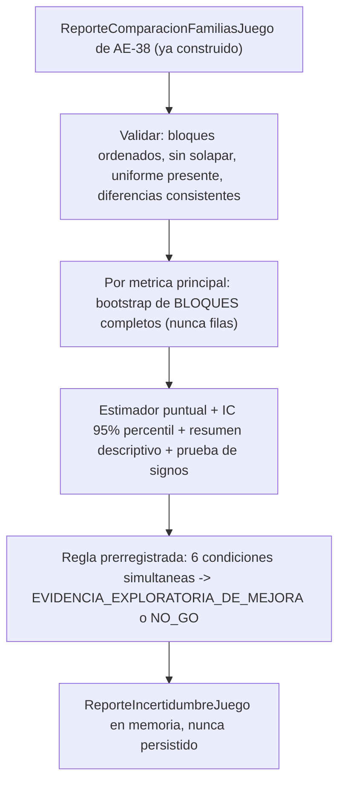

**Unidad de remuestreo -la decision arquitectonica central de esta etapa**: el bootstrap remuestrea con reemplazo los **18 bloques externos completos** de AE-38, nunca las 15480 filas candidato-sorteo -esas filas no son observaciones independientes entre si dentro de un mismo bloque. Cada replica calcula el promedio ponderado por `total_filas` de los bloques efectivamente seleccionados en esa replica -el codigo nunca asume silenciosamente que todos los bloques tienen igual tamano.

**Orientacion matematica reutilizada, nunca redefinida**: `incertidumbre.py` reutiliza directamente `DiferenciaFrenteAUniforme` (`uniforme - modelo`, positivo = mejora) ya calculada por AE-37/AE-38 en cada bloque -nunca recalcula las metricas desde cero, solo agrega y cuantifica la incertidumbre de las diferencias ya existentes.

**Bootstrap e inferencia con la biblioteca estandar unicamente** (`math`, `random`): `_bootstrap_diferencia_agregada` usa una instancia local de `random.Random` -nunca el modulo global `random`, nunca paralelismo-, con semilla `42` y `10000` replicas por defecto. `_percentil` reimplementa interpolacion lineal (mismo metodo que `numpy.percentile` con `interpolation='linear'`), documentado y probado con ejemplos manuales. `_prueba_signos_exacta` usa la distribucion binomial EXACTA via `math.comb` -nunca una aproximacion normal, apropiado con solo 18 bloques- y excluye unicamente los empates exactos.

**Regla de decision prerregistrada, representada como `DecisionContinuidadML` (Enum cerrado)**: `EVIDENCIA_EXPLORATORIA_DE_MEJORA` unicamente si las seis condiciones se cumplen simultaneamente (diferencia puntual positiva y limite inferior del IC 95% estrictamente mayor que cero, en Log Loss Y en Brier Score, mas ausencia de degradacion material en Precision@5/Recall@5, con una tolerancia explicita de `0.02` documentada en `TOLERANCIA_DEGRADACION_SECUNDARIA`); en cualquier otro caso, `NO_GO_SIN_EVIDENCIA_SUFICIENTE`. Nunca existe un estado positivo ambiguo como "aprobado" o "listo para produccion". Cada juego se decide de forma completamente independiente.

**Validaciones explicitas, nunca `assert`**: `ReporteIncertidumbreInvalidoError` cubre bloques ausentes/insuficientes/duplicados/desordenados/solapados, metricas o diferencias no finitas, tamanos no positivos, diferencia almacenada inconsistente con las metricas (tolerancia `1e-9`), ausencia o duplicidad del baseline uniforme, juego no autorizado, y parametros de bootstrap invalidos.

**Politica de reapertura, tipo cerrado**: `PoliticaReaperturaML` fija `proximo_holdout_inicio=2706` y `minimo_sorteos_nuevos_requeridos=100` -una decision NO-GO nunca demuestra imposibilidad matematica de predecir, solo ausencia de evidencia suficiente en el protocolo evaluado.

**Union con AE-38, nunca reentrenamiento**: `evaluar_incertidumbre_y_regla_parada` recibe un `ReporteComparacionFamiliasJuego` ya construido -nunca invoca `CompararFamiliasMLProbabilidadNumeros` (el caso de uso costoso de AE-38), nunca consulta repositorios, nunca lee archivos. **Confirmado con AST, no solo documentado**: `modelo.py` sigue siendo el unico archivo de `application/ml/` que importa scikit-learn; `incertidumbre.py` no importa SQLAlchemy, FastAPI ni Jinja2.

**Resultados reales, aplicados mediante script externo al proyecto sobre el JSON completo de AE-38 -nunca leido desde codigo de produccion**: BALOTO -Log Loss `-0.000136584231` IC95%`[-0.000217,-0.000051]`, Brier `-0.000026473413` IC95%`[-0.000044,-0.000008]`; BALOTO_REVANCHA -Log Loss `-0.000647734500` IC95%`[-0.001108,-0.000231]`, Brier `-0.000137653795` IC95%`[-0.000237,-0.000050]`. Ambos estimadores puntuales negativos en ambas metricas para ambos juegos -decision `NO_GO_SIN_EVIDENCIA_SUFICIENTE` en los dos, coincidente exactamente con la regla prerregistrada disenada antes de observar estos numeros. Reproducibilidad confirmada aplicando el analisis a las dos ejecuciones reales e identicas de AE-38 (mismo hash de reporte cada una).

**Validacion real completa del usuario, ejecutada en Windows/Python 3.14.6 -evidencia atribuida al usuario, nunca ejecutada por Claude**: suite completa `3681 passed`, `0` omitidas, `pip check` limpio, aislamiento de scikit-learn reconfirmado mediante AST. AE-39 no consulto PostgreSQL ni reentreno ningun modelo -analizo exclusivamente el JSON ya validado de AE-38. Cinco incidentes reales, exclusivamente en comandos auxiliares de PowerShell (fragmentacion de bloques `elseif`/`try`/`finally`, una expresion invalida al consultar una rama local, manejo de comillas en `python -c`, y un primer intento del auditor sin `PYTHONPATH` corregido con `PYTHONPATH=backend`) -ninguno cambio codigo, metricas, Git, PostgreSQL ni resultados cientificos.

---

## Gate operativo de elegibilidad para la reapertura -Etapa AE-40, validada

**Tras el NO-GO de AE-39 en ambos juegos**: AE-40 no reabre el desarrollo predictivo ni prueba ninguna familia de modelos. Implementa exclusivamente un gate determinista que responde una unica pregunta operativa -nunca cientifica: ¿existen al menos 100 sorteos nuevos, completos en numeracion y separados por juego, desde el sorteo `2706`? **La validacion confirma el funcionamiento metodologico y operativo del gate -el resultado del gate en si es negativo en la instantanea real evaluada.**

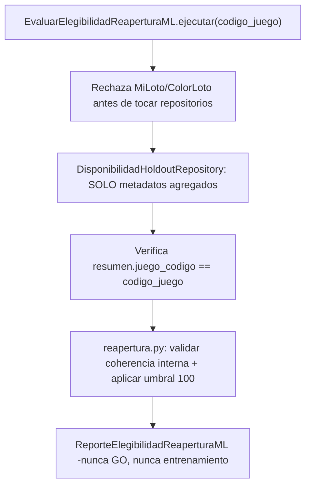

**Validacion real completa del usuario, ejecutada en Windows/Python 3.14.6/PostgreSQL real -evidencia atribuida al usuario, nunca ejecutada por Claude**: PostgreSQL real reutilizado (sin contenedor nuevo), revision Alembic `0006`, `transaction_read_only=on`. Confirmado directamente sobre la sentencia SQL compilada de produccion real: exactamente dos consultas agregadas totales (una por juego, cada caso de uso con dos consultas -resolucion del juego mas la consulta agregada), proyectando unicamente `COUNT`, `COUNT DISTINCT`, `MIN` y `MAX` sobre `numero_sorteo`, filtro exacto por `juego_id`, filtro `numero_sorteo >= 2706`, sin `JOIN`, sin ninguna columna de numeros ganadores, superbalota, colores, fechas como senal, features ni targets.

**Resultado real, negativo para ambos juegos -recalculado de forma independiente ejecutando la funcion real de produccion con los datos exactos reportados, coincidente exactamente**: BALOTO y BALOTO_REVANCHA obtuvieron `no_elegible_datos_insuficientes`, `0` sorteos nuevos, minimo y maximo `null`. **No existen sorteos cargados desde `2706` en la instantanea real evaluada** -no se alcanzo el minimo de 100, no existe todavia una secuencia `2706..2805`. `numeracion_contigua=true` con cero registros significa exclusivamente que no se detecto ninguna contradiccion de continuidad en un conjunto vacio -nunca que exista una secuencia real de sorteos.

**PostgreSQL real, sin cambios**: cache `estadisticas` `209 -> 209`; `modelos`/`metricas_modelo`/`predicciones` `0 -> 0` en los tres. No se persistieron modelos, metricas ni predicciones. No se generaron predicciones. No se observaron resultados ganadores. El holdout no fue consumido.

**Cierre exclusivamente de estado**: marcadores `PROVISIONAL` -> `validada` en comentarios/docstrings de los 5 archivos Python de AE-40 -AST ejecutable identico confirmado, ignorando unicamente docstrings; el contenido de cierre anadido a `tipos.py` permanece puramente LF, igual que en el parche provisional corregido, preservando intacto el prefijo CRLF original de AE-36/37/38/39. Las 63 pruebas de AE-40 y todas las pruebas anteriores permanecen byte a byte identicas. Los once archivos protegidos de AE-36/37/38/39 permanecen byte a byte identicos. **Confirmado con AST, no solo documentado**: `modelo.py` sigue siendo el unico archivo de `application/ml/` que importa scikit-learn.

**No se habilita todavia un nuevo prerregistro**: `ELEGIBLE_PARA_PRERREGISTRO` nunca significo GO, evidencia predictiva, autorizacion para entrenar, para mirar resultados, para consumir el holdout, ni para desplegar -y en esta instantanea real, ni siquiera se alcanzo ese estado. El desarrollo predictivo no se reabre.

**Limitaciones reales**: esta validacion cubre exclusivamente una instantanea puntual del holdout -cero sorteos nuevos disponibles al momento de la ejecucion real. Una ejecucion futura, cuando existan sorteos reales desde `2706`, podria producir un resultado distinto; eso no reabre automaticamente el desarrollo predictivo ni autoriza observar los resultados del holdout sin un prerregistro explicito previo, tal como esta documentado desde AE-39.

---

## Bloqueo operativo centralizado del desarrollo predictivo -Etapa AE-41, validada

Implementa una politica pura que traduce el resultado del gate ya validado de AE-40 en tres estados operativos explicitos. **La validacion real confirma el funcionamiento metodologico y operativo -ambos juegos permanecen bloqueados por ausencia de sorteos nuevos desde `2706` en la instantanea real evaluada.**

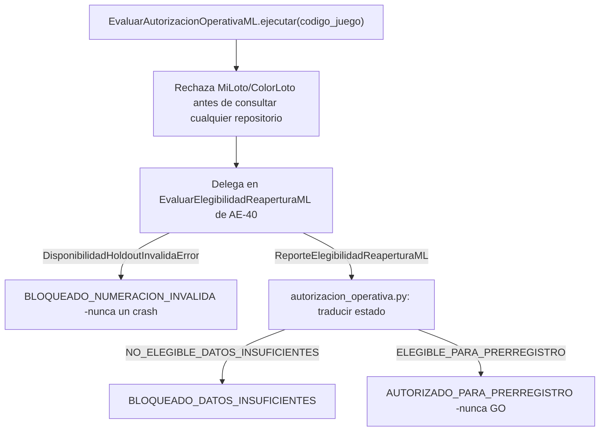

**Validacion real completa del usuario, ejecutada en Windows/Python 3.14.6/PostgreSQL real -evidencia atribuida al usuario, nunca ejecutada por Claude**: PostgreSQL real reutilizado (contenedor existente `loteria-predictor-fase2-final-postgres-1`, sin contenedor nuevo), revision Alembic `0006`, `transaction_read_only=on`. Confirmado directamente sobre el SQL registrado: exactamente `4` consultas totales (`2` por juego -resolucion del juego mas la consulta agregada), con el parametro de corte `2706` confirmado explicitamente; el SQL de disponibilidad proyecta unicamente `COUNT`, `COUNT DISTINCT`, `MIN` y `MAX` de `numero_sorteo`, filtra por `juego_id` y `numero_sorteo >= 2706`, sin `JOIN` ni columnas de resultados ganadores.

**Resultado real, negativo para ambos juegos -recalculado de forma independiente ejecutando la funcion real de produccion con los datos exactos reportados, coincidente palabra por palabra en el motivo**: BALOTO y BALOTO_REVANCHA obtuvieron `estado="bloqueado_datos_insuficientes"`, con el reporte de AE-40 anidado en `estado="no_elegible_datos_insuficientes"`, `total_sorteos_nuevos=0`, minimo y maximo `null`. `numeracion_contigua=true` con 0 registros es un resultado vacuo -nunca afirma que exista una secuencia `2706..2805` real.

**Distincion explicita entre evidencia de tablas/SQL y banderas del programa**: las consultas agregadas y las instantaneas de PostgreSQL (`estadisticas=209`, `modelos=0`, `metricas_modelo=0`, `predicciones=0`, identicas antes y despues) son evidencia directa de que no se leyeron numeros ganadores ni se escribio nada; las banderas `resultados_observados`, `modelos_entrenados`, `predicciones_generadas` y `holdout_consumido` -todas `False`- son afirmaciones del propio programa, corroboradas por pero distintas de la evidencia de las tablas. Medicion de tiempo (`0.1469 s` total) y Working Set (`78.52 MB` pico) corresponden al proceso que ejecuto la validacion, nunca al arbol completo de procesos.

**Consideracion CRLF en Windows, documentada explicitamente**: con `core.autocrlf=true`, el parche (generado con terminadores LF) fallo con `git apply` simple en los tres documentos -aplico limpio con `git apply --ignore-whitespace --whitespace=nowarn`; `git apply --reverse --check --ignore-whitespace --whitespace=nowarn` y `git diff --check` terminaron en codigo `0`. En Linux, sin `core.autocrlf`, el mismo parche aplica limpio con `git apply` simple y `git diff --check` estandar sin ninguna opcion adicional -confirmado directamente en las reconstrucciones de este cierre. La diferencia proviene de la conversion de linea que Windows aplica al extraer y confirmar el ZIP base, nunca de un defecto del parche.

**Reconciliacion honesta de pruebas -nunca `3789 passed` en una sola corrida del usuario**: una primera ejecucion completa del usuario dio `3739 passed, 50 skipped` -los 50 omitidos en `test_generalizacion_juegos.py` por falta de `httpx`; tras instalar `httpx==0.28.1`, ese archivo completo (incluidos los 50 antes omitidos) dio `1213 passed, 0 skipped`. Las `3789` pruebas recolectadas quedaron cubiertas entre ambas ejecuciones del usuario. En el sandbox de Claude, una particion completa sin superposicion (`45+63+47+142+1213+2279`) si sumo `3789 passed, 0 skipped` en una sola sesion, con `httpx==0.28.1` instalado explicitamente como dependencia de validacion temporal -`requirements.txt` permanece intacto.

**Cierre exclusivamente de estado**: marcadores `PROVISIONAL` -> `validada` en comentarios/docstrings de los 3 archivos Python de AE-41 -AST ejecutable identico confirmado, ignorando unicamente docstrings; el contenido de cierre anadido a `tipos.py` permanece puramente LF, preservando intacto el prefijo CRLF original de AE-36 a AE-40. El algoritmo de traduccion de numeracion invalida a bloqueo -incluida la delegacion completa al gate de AE-40- no fue modificado en este cierre. Las 45 pruebas de AE-41 y todas las pruebas anteriores permanecen byte a byte identicas. Los doce archivos protegidos de AE-36/37/38/39/40 permanecen byte a byte identicos. **Confirmado con AST, no solo documentado**: `modelo.py` sigue siendo el unico archivo de `application/ml/` que importa scikit-learn.

**Limitaciones reales**: esta validacion cubre exclusivamente una instantanea puntual del holdout -cero sorteos nuevos disponibles al momento de la ejecucion real. No se realizaron nuevas consultas a PostgreSQL desde el cierre; toda la evidencia proviene exclusivamente del JSON aportado por el usuario, identificados como tales.

---

## Auditoria ejecutable del bloqueo operativo -Etapa AE-42, validada

**Un comando de auditoria, de solo lectura, ejecutado UNICAMENTE por peticion explicita del operador** -nunca una tarea periodica, endpoint, pantalla ni disparador automatico. Invoca los casos de uso REALES de produccion de AE-40/41 para BALOTO y BALOTO_REVANCHA por separado, dentro de una transaccion PostgreSQL de solo lectura verificada explicitamente, y produce un reporte JSON externo al repositorio, versionado y con esquema estable. **No cambia la decision de AE-41 ni inventa una nueva regla de elegibilidad -unicamente la audita y la reporta.**

**Correccion -el parche AE-42 de SHA-256 `5960e20901844a04d46bae9596dd445dcc249b95082e8e51a2c6140fb85debbd` queda invalidado**: la revision del usuario detecto dos defectos en `construir_reporte_auditoria_operativa`, reproducidos primero con 11 pruebas sinteticas que fallaban sobre ese parche. (1) Prioridad del estado global: con un juego autorizado y el otro con numeracion invalida, en cualquier orden, el estado global era `autorizado_para_prerregistro_detectado`; ahora prevalece `bloqueado_numeracion_invalida`. (2) Identidad y coherencia exterior/anidado: un reporte exterior de AE-41 podia llevar un reporte de elegibilidad anidado de otro juego o con un estado incoherente; ahora `_verificar_coherencia_con_elegibilidad` lo rechaza con `ReporteAutorizacionInconsistenteError` (codigo `5`, sin JSON). Correccion minima en el nucleo puro -una importacion, una funcion de comprobacion, una llamada y el orden de dos ramas-; el script solo cambio en su docstring (AST ejecutable identico).

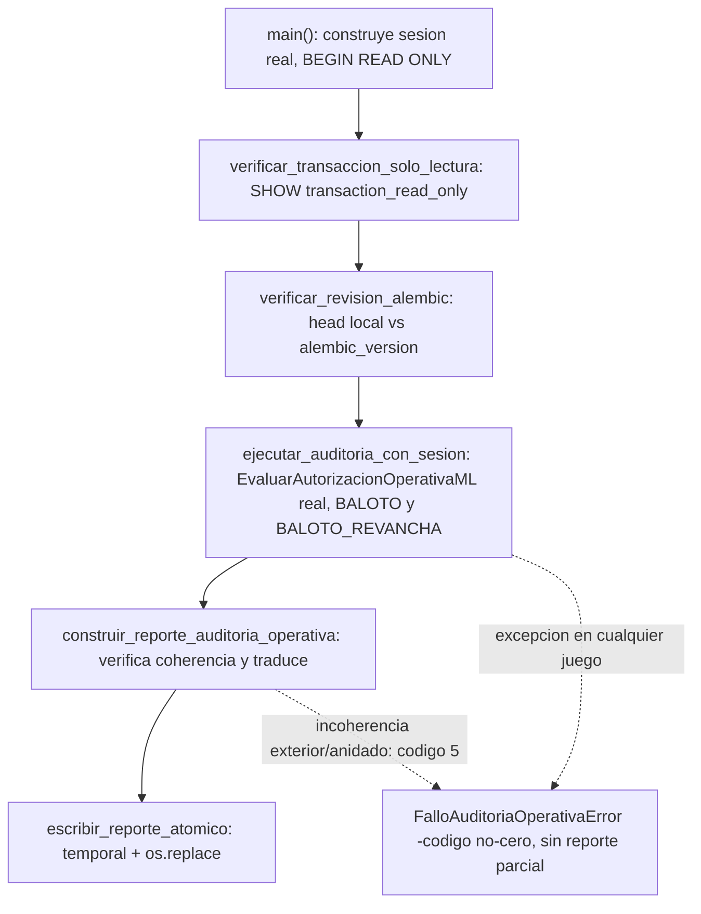

**Auditoria de codigo antes de disenar, no un objetivo asumido**: se leyeron README/ROADMAP/ARCHITECTURE, los modulos y pruebas de AE-40/41, y la configuracion de base de datos -no se encontro ningun comando equivalente ni objetivo concreto de AE-42 ya definido, por lo que no hay duplicacion que resolver ni contradiccion que reportar.

**Separacion deliberada entre logica comprobable y adaptador CLI/SQL**: el nucleo puro (`auditoria_operativa_bloqueo.py`, en `application/ml/`) recibe dos `ReporteAutorizacionOperativaML` YA CONSTRUIDOS y produce el diccionario JSON-serializable -nunca reevalua la regla de elegibilidad de AE-40 (para comprobar la coherencia reutiliza la unica funcion de traduccion de AE-41, `evaluar_autorizacion_operativa_desde_elegibilidad`, sin duplicar su mapeo), nunca abre una conexion, nunca consulta el reloj del sistema (recibe `instante_utc` ya construido por el llamador, permaneciendo determinista). La orquestacion comprobable (`ejecutar_auditoria_con_sesion`, en `scripts/auditoria_operativa_bloqueo.py`) recibe un `EvaluarAutorizacionOperativaML` YA CONSTRUIDO -con repositorios reales o fakes, segun quien la invoque- y NUNCA abre una sesion ni una conexion por su cuenta; confirmado con una prueba que inspecciona el AST de esa funcion especifica. Solo `main()` -el adaptador CLI/SQL, nunca ejercitado contra PostgreSQL real por Claude- construye la sesion real, verifica la transaccion de solo lectura y la revision Alembic, y siempre cierra con `ROLLBACK`, nunca `commit` ni `flush` de sesion.

**Confirmado que se invoca el caso de uso real de produccion, nunca una copia**: las pruebas instancian `EvaluarAutorizacionOperativaML` y `EvaluarElegibilidadReaperturaML` -las clases REALES importadas de `application/use_cases/`- con repositorios fake; el script nunca reimplementa la logica de elegibilidad ni de autorizacion operativa, solo construye los repositorios de infraestructura reales (`JuegoRepositorySQLAlchemy`, `DisponibilidadHoldoutRepositorySQLAlchemy`) y delega completamente.

**Transaccion de solo lectura verificada explicitamente, revision Alembic confirmada dinamicamente**: `SHOW transaction_read_only` se consulta y se compara literalmente contra `'on'` -nunca asumido por haber emitido `BEGIN TRANSACTION READ ONLY`. La revision Alembic esperada se deriva del propio `alembic/` del repositorio mediante `ScriptDirectory.get_current_head()` -nunca hardcodeada como un numero magico independiente que pudiera desincronizarse ante una migracion futura- y se compara contra `SELECT version_num FROM alembic_version` real.

**Siete codigos de salida (`0` a `6`), ninguno ambiguo** (`EXIT_OK=0`, `EXIT_FALLO_INESPERADO=1`, `EXIT_FALLO_CONEXION=2`, `EXIT_REVISION_ALEMBIC_INESPERADA=3`, `EXIT_TRANSACCION_NO_SOLO_LECTURA=4`, `EXIT_REPORTE_INCONSISTENTE=5`, `EXIT_FALLO_EVALUANDO_JUEGO=6`): `0` unicamente para una auditoria correctamente ejecutada -bloqueo, o autorizacion UNICAMENTE informada, nunca concedida. **Verificado que una excepcion al evaluar el segundo juego detiene todo el proceso y propaga el codigo correcto -nunca produce un reporte parcial con solo el primer juego.**

**`auditoria_correcta` nunca se confunde con `autorizacion_para_prerregistro_detectada`**: son dos campos booleanos independientes en el JSON -el primero es `true` siempre que el proceso completo se ejecuto sin errores (incluido el caso, esperado en la instantanea real conocida, de ambos juegos bloqueados); el segundo solo es `true` si algun juego alcanzo `AUTORIZADO_PARA_PRERREGISTRO`. Verificado con una prueba dedicada que ambos campos existen de forma explicita y no se colapsan en uno solo. Si ese estado apareciera, el comando UNICAMENTE lo informa -nunca inicia un prerregistro, nunca lee resultados, nunca construye datasets, nunca entrena ni predice. **Prioridad del estado global**: `bloqueado_numeracion_invalida` > `autorizado_para_prerregistro_detectado` > `bloqueado_datos_insuficientes` -si un juego queda autorizado y el otro con numeracion invalida, el estado global es `bloqueado_numeracion_invalida` y `autorizacion_para_prerregistro_detectada=true` es solo un dato informativo del otro juego: no hay autorizacion global ni accion automatica.

**Escritura atomica del JSON externo**: `escribir_reporte_atomico` escribe primero a un archivo temporal en el MISMO directorio destino (con `fsync` antes de cerrar) y luego reemplaza con `os.replace` -un fallo durante la serializacion o la escritura nunca deja un reporte parcial que parezca valido en la ruta destino. **Verificado deliberadamente**: se forzo un fallo de serializacion (un objeto no serializable) y se confirmo que no queda ningun archivo, ni siquiera temporal, en el directorio destino.

**Consultas auxiliares distinguidas explicitamente de las dos consultas del caso de uso por juego**: la verificacion de `transaction_read_only` y de la revision Alembic son consultas de metadatos separadas y documentadas como tales en el codigo -el reporte nunca afirma "cuatro consultas totales" incluyendolas; esa cifra, heredada de AE-41, sigue refiriendose exclusivamente a las dos consultas por juego del caso de uso.

**Sin datos prohibidos en el JSON**: nunca UUID de juego, numeros ganadores, superbalota, color, fechas como senal, features, targets, credenciales ni cadena de conexion -confirmado con una prueba dedicada que inspecciona la serializacion completa del reporte, no solo su forma superficial. `numeracion_contigua=true` con `total_sorteos_nuevos=0` se documenta explicitamente como vacuo -nunca como evidencia de una secuencia `2706..2805` real.

**Confirmado con AST, no solo documentado**: `modelo.py` sigue siendo el unico archivo de `application/ml/` que importa scikit-learn; `auditoria_operativa_bloqueo.py` y el script no importan scikit-learn, NumPy, SciPy, pandas, FastAPI ni Jinja2. Ningun endpoint, ruta ni plantilla nueva -confirmado con una prueba dedicada que ningun router del proyecto menciona la auditoria operativa. Quince archivos protegidos (los trece de etapas anteriores mas `autorizacion_operativa.py` y el caso de uso de AE-41, ahora tambien protegidos por ser dependencia directa de AE-42) permanecen byte a byte identicos.

**Validacion real del usuario, ejecutada en Windows/Python 3.14.6 contra su contenedor PostgreSQL existente -evidencia atribuida al usuario, no ejecutada por Claude**: `pg_isready` comprobado y salida `0`. JSON real `ae42-auditoria-real.json` (1820 bytes, SHA-256 `18707ea8d73bebd4a21126f3581dbdcd74a624f3679c7148c03cf8df4cdcff29`) auditado campo por campo: esquema `1.0`, revision Alembic `0006`, corte `2706`, exactamente BALOTO y BALOTO_REVANCHA, ambos `bloqueado_datos_insuficientes` con `total_sorteos_nuevos=0`, minimo/maximo `null`, `reporte_elegibilidad_disponible=true` y las cuatro banderas en `false`; `estado_global="bloqueado_datos_insuficientes"`, `auditoria_correcta=true`, `autorizacion_para_prerregistro_detectada=false`. Regenerado por Claude con el codigo real de produccion (casos de uso reales de AE-40/41, cero registros, mismo instante y mismo serializador): contenido identico salvo los 48 terminadores CRLF que Windows anade al escribir en modo texto -equivalencia por CRLF, no coincidencia byte a byte. `numeracion_contigua=true` con cero registros es vacuo.

**Que respalda cada afirmacion**: comportamiento del codigo (verificacion explicita de `transaction_read_only`, delegacion en la consulta agregada de AE-40, `ROLLBACK`, sin `commit` ni `flush`); banderas emitidas por el programa (las cuatro `false`, afirmaciones propias coherentes con el codigo); y mediciones directas registradas en el JSON (estados, metadatos agregados, revision Alembic leida de la base). El JSON no contiene la sentencia SQL, el valor de `transaction_read_only`, conteos de consultas, instantaneas de tablas antes/despues ni tiempos o memoria -esas afirmaciones no se atribuyen a la evidencia.

**Limitaciones reales**: Claude nunca ejecuto `main()` contra PostgreSQL real -solo con dobles de motor, conexion, sesion y repositorios. La descripcion de `--help` sigue diciendo "PROVISIONAL" porque es una cadena ejecutable (argumento de `ArgumentParser`) que este cierre, limitado a comentarios y docstrings, no puede modificar. En Windows con `core.autocrlf=true` el parche puede requerir `git apply --ignore-whitespace --whitespace=nowarn`; en Linux aplica con `git apply` simple.

**Motor puro (`application/estadisticas/motor/`):** un conjunto de módulos que calculan sobre `ResultadoNumerico` (DTO neutral: números, fecha, superbalota) sin importar nada de `infrastructure/` ni de `api/` — no conocen PostgreSQL, HTTP, ni de qué juego provienen los datos, solo reciben una secuencia de resultados y un rango. Esto los hace agnósticos por juego: el mismo código calcula frecuencias para MiLoto (1-39) o para Baloto/Revancha (1-43) sin ninguna rama condicional por juego. El motor incluye módulos para varios tipos de análisis (frecuencia, atrasos, distribuciones, coocurrencia, patrones temporales, entre otros); **solo un subconjunto de ellos está conectado al orquestador y expuesto en la web actualmente** (ver siguiente sección) — el resto existe como código de motor pero no forma parte de ninguna visualización todavía.

**Orquestador (`CalcularYPersistirEstadistica`, `application/use_cases/`):** único punto de entrada para calcular una estadística. Mantiene un catálogo cerrado de "recetas" (función de cálculo + función de serialización + fuente de histórico) por `tipo_estadistica`. Flujo: busca si ya existe una versión vigente (`EstadisticaRepository.buscar_vigente`) → si existe, la devuelve sin recalcular → si no, obtiene el histórico (`ResultadosHistoricosRepository`, con corte temporal aplicado tanto en SQL como de forma defensiva en Python — doble capa anti-fuga de datos futuros) → calcula con el motor puro → serializa → persiste (`EstadisticaRepository.guardar`).

**Fuente de histórico tipada (Etapas AE-1/AE-2/AE-3/AE-4/AE-5/AE-6/AE-7/AE-8/AE-9/AE-10/AE-11/AE-12/AE-13/AE-14/AE-15/AE-16/AE-17/AE-18/AE-19/AE-20/AE-21/AE-22/AE-23/AE-24/AE-25/AE-26/AE-27/AE-28/AE-29/AE-30/AE-31):** `_Receta.obtener_historico` es un campo `Callable` con default (`_obtener_historico_numerico`, reproduce exactamente el comportamiento anterior a esta extensión) — nunca un `if tipo_estadistica == ...` dentro del orquestador para elegir el repositorio. Las 9 recetas de juegos numéricos usan ese default sin ningún cambio de comportamiento; las treinta y una recetas de ColorLoto (`frecuencia_numeros_colorloto`, Etapa AE-1; `frecuencia_colores_colorloto`, Etapa AE-2; `frecuencia_pares_colorloto`, Etapa AE-3; `atrasos_numeros_colorloto`, Etapa AE-4; `atrasos_colores_colorloto`, Etapa AE-5; `atrasos_pares_colorloto`, Etapa AE-6; `repeticiones_entre_sorteos_colorloto`, Etapa AE-7; `distribucion_pares_impares_colorloto`, Etapa AE-8; `distribucion_altos_bajos_colorloto`, Etapa AE-9; `maximo_repeticion_color_por_sorteo_colorloto`, Etapa AE-10; `distribucion_pares_consecutivos_colorloto`, Etapa AE-11; `distribucion_racha_maxima_colorloto`, Etapa AE-12; `distribucion_trios_consecutivos_colorloto`, Etapa AE-13; `coocurrencia_pares_colorloto`, Etapa AE-14; `coocurrencia_trios_colorloto`, Etapa AE-15; `coocurrencia_pares_colores_colorloto`, Etapa AE-16; `coocurrencia_trios_colores_colorloto`, Etapa AE-17; `intervalos_historicos_colores_colorloto`, Etapa AE-18; `distribucion_sumas_colorloto`, Etapa AE-19; `intervalos_historicos_numeros_colorloto`, Etapa AE-20; `intervalos_historicos_pares_numero_color_colorloto`, Etapa AE-21; `frecuencia_colores_por_anio_colorloto`, Etapa AE-22; `frecuencia_colores_por_mes_colorloto`, Etapa AE-23; `frecuencia_colores_por_dia_semana_colorloto`, Etapa AE-24; `frecuencia_pares_numero_color_por_anio_colorloto`, Etapa AE-25; `frecuencia_pares_numero_color_por_mes_colorloto`, Etapa AE-26; `frecuencia_pares_numero_color_por_dia_semana_colorloto`, Etapa AE-27; `distribucion_conteo_color_colorloto`, Etapa AE-28; `comparacion_frecuencia_numeros_por_ventana_colorloto`, Etapa AE-29; `comparacion_frecuencia_colores_por_ventana_colorloto`, Etapa AE-30; `comparacion_frecuencia_pares_numero_color_por_ventana_colorloto`, Etapa AE-31) declaran `_obtener_historico_colorloto`, que trae en dos consultas totales (nunca una por sorteo) tanto el histórico de pares número-color como el catálogo completo de colores del juego (`ColorRepository.listar_todos`, Etapa AE-0), empaquetados en un objeto compuesto (`_HistoricoColorLoto`) que las treinta y una recetas reutilizan para validar integridad en memoria contra `Color.esta_vigente_en`, sin duplicar la regla — patrón Strategy: el propio catálogo declara su fuente, el orquestador nunca bifurca por el tipo de estadística.

**Persistencia (`EstadisticaRepository` puerto + `EstadisticaRepositorySQLAlchemy`):** la identidad de cada estadística calculada es la tupla `(juego_id, tipo_estadistica, hasta_numero_sorteo, parametros_hash)`. `parametros_hash` es un SHA-256 de los parámetros de cálculo (rango, cantidad de números, etc.) canonicalizados de forma determinista (claves ordenadas, separadores fijos) — dos cálculos con parámetros distintos nunca colisionan, y el mismo cálculo repetido siempre produce el mismo hash. La tabla `estadisticas` usa **dos índices únicos parciales** en vez de un `UNIQUE` convencional, porque PostgreSQL nunca considera `NULL = NULL` en una restricción `UNIQUE` (así que un `UNIQUE` normal habría permitido múltiples filas "duplicadas" para histórico completo): uno para `hasta_numero_sorteo IS NOT NULL` (los 4 campos completos), otro para `hasta_numero_sorteo IS NULL` (los 3 campos restantes, el corte ya fijo por el propio índice).

**Invalidación selectiva:** `RegistrarSorteo`, `EditarSorteo` y `EliminarSorteo` — los tres casos de uso que mutan sorteos — llaman a `EstadisticaRepository.invalidar_por_juego(juego_id, desde_numero_sorteo)` inmediatamente después de una escritura exitosa (nunca antes: si la validación de dominio falla, no se invalida nada). La semántica: se invalidan las estadísticas con histórico completo (siempre incluyen cualquier sorteo nuevo) y las que tienen un corte `>= desde_numero_sorteo` (sus datos alcanzaban o hubieran alcanzado el sorteo mutado); las que tienen un corte anterior al sorteo mutado se conservan intactas, por ser históricas congeladas por definición. La invalidación siempre está aislada por `juego_id` — mutar un sorteo de Baloto Revancha nunca invalida el caché de MiLoto ni de Baloto clásico.

**Upsert al recalcular:** cuando una identidad ya existe (vigente o previamente invalidada) y se calcula de nuevo, `guardar()` usa un `INSERT ... ON CONFLICT ... DO UPDATE` de PostgreSQL — con dos ramas de conflicto, una por cada índice único parcial — en vez de intentar un `INSERT` incondicional. Esto reemplaza la fila existente (mismo `id`, `resultado`/`calculado_en`/`valido_hasta` actualizados) en lugar de crear una segunda fila para la misma identidad: nunca queda más de una fila por `(juego_id, tipo_estadistica, hasta_numero_sorteo, parametros_hash)`. La operación comparte la misma sesión/transacción que la escritura del sorteo que la disparó (mismo patrón de `UnitOfWork` de la Fase 2): si esa transacción no se confirma, ni el sorteo ni la invalidación/upsert quedan persistidos — atómico junto con la mutación, no una operación aparte que pueda quedar a medias.

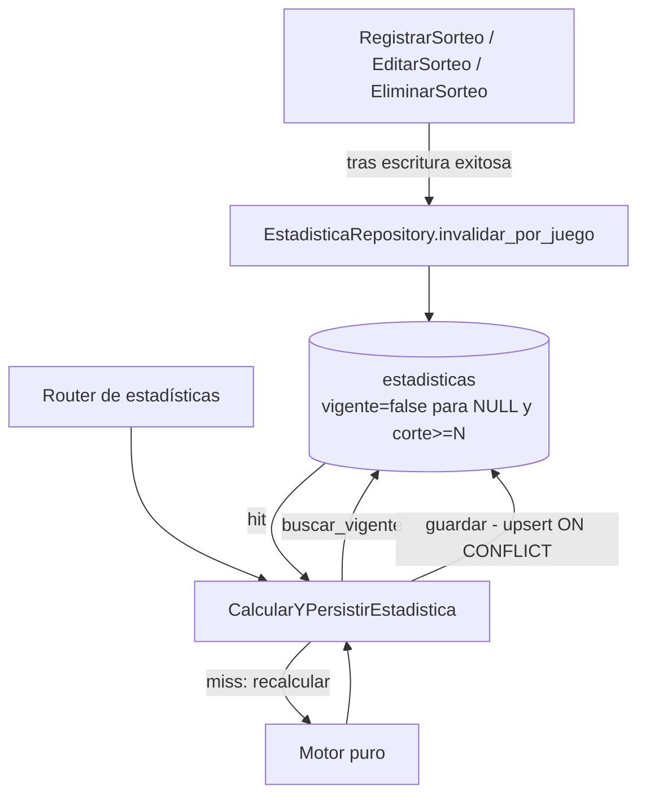

---

## Corte congelado de AE-36 -mantenimiento posterior a AE-42, validado

Una revisión del código tras la sincronización incremental informada por el operador detectó que `EvaluarBaselineMLProbabilidadNumeros` (AE-36) consultaba `listar_resultados_numericos(juego.id)` **sin** `hasta_numero_sorteo`. Recorrido: sin corte, el repositorio SQLAlchemy trae todo el histórico del juego; `evaluar_juego` construye el dataset y `construir_particion_walk_forward` reserva como test final el último 20% de los sorteos elegibles. Con `2081..2705` (625 sorteos, 575 elegibles) el test es `2591..2705`, el contrato validado; con `2081..2713` (633 sorteos, 583 elegibles) pasaría a ser `2597..2713`, evaluando modelo y baselines contra etiquetas del holdout desde `2706`. AE-37/AE-38 no estaban afectados (corte `2590` en SQL más comprobación en Python); AE-39 no consulta la base y AE-40/41/42 solo leen metadatos agregados. Ningún script, ruta ni tarea invocaba AE-36: el riesgo solo se materializaba con una ejecución manual.

**Corrección mínima**: nueva constante `CORTE_CONTRATO_AE36 = 2705` (último sorteo del contrato ya validado, no un valor nuevo), pasada como `hasta_numero_sorteo` para filtrar en SQL, y una segunda capa en Python que lanza `ResultadoPosteriorAlCorteError` antes de llamar a `evaluar_juego` si llega cualquier sorteo posterior -sin reporte parcial ni filtrado silencioso. Es una **excepción explícita y documentada** a la lista de archivos protegidos: solo cambia ese caso de uso; `evaluacion.py`, `particion.py`, `dataset.py`, `modelo.py`, `baselines.py`, `tipos.py`, el repositorio, las migraciones y las pruebas existentes no se tocan. **Los resultados de AE-36 a AE-42 no cambian**: la ejecución real validada de AE-36 usó exactamente `2081..2705`.

**Pruebas nuevas, todas sintéticas** (numeración `2081..2713` elegida solo para reproducir la forma del caso real): `tests/unit/test_evaluar_baseline_ml_corte_holdout.py` (corte `2705` solicitado y test final `2591..2705`; rechazo ante un repositorio que ignora el corte, sin llegar a `evaluar_juego`; reporte idéntico con `2081..2705` y `2081..2713`; regresiones) y `tests/unit/ml/test_corte_casos_uso_ml.py` (AST limitado a los tres casos de uso existentes: `CORTE_CONTRATO_AE36=2705`, `CORTE_DESARROLLO_AE37=2590`, `CORTE_DESARROLLO_AE38=2590`; no impone ningún corte a casos de uso futuros, cuyo contrato temporal se definirá en su propia etapa). Sobre `05e8041`, sin la corrección: `9 failed, 7 passed` en esas pruebas -el caso de uso pedía corte `None` y producía test `2597..2713`. Tras la corrección: `16 passed`. Suite completa en el sandbox de Claude (Linux, Python `3.11.15`, scikit-learn `1.9.1`, `httpx==0.28.1` solo en el entorno de verificación), una única corrida tras la corrección: `3859 passed, 0 skipped` (`3843 + 16`), cinco `DeprecationWarning` preexistentes de Alembic; `pip check` limpio.

**Evidencia atribuida al operador, no medida por Claude**: sincronización incremental oficial con 8 sorteos nuevos por juego (`2706..2713`, 0 fallidos) y nueva auditoría AE-42 `ae42-auditoria-real-tras-sincronizacion.json` (SHA-256 `3b5113252a5f422c64226d837d1449a00bec7d8143a5ffdc90228d0612954d82`) con `bloqueado_datos_insuficientes` en ambos juegos y `autorizacion_para_prerregistro_detectada=false`. Faltan 92 sorteos por juego para el mínimo de 100; alcanzarlo no garantiza mejora predictiva. No se consultó PostgreSQL ni se ejecutó ninguna evaluación real de ML. AE-39 sigue en NO-GO, MiLoto en NO-GO temporal, ColorLoto pospuesto. AE-43 no fue implementada.

**Validación real del operador -evidencia atribuida al usuario, no ejecutada por Claude**: fusionado en `main` y `develop` mediante `cc3273a25639b6c14be3f30b2b71f1adb6b9c214` (PR #40, commit `115551b`), cuyo diff coincide con el parche revisado (SHA-256 `84fd2f05ffab7350b06c79825a590326445437a0ea96c04bb0809505d04fe74d`). Windows/Python `3.14.6`: `16` pruebas nuevas y `32` existentes pasadas; `pip check` limpio. La suite completa `3859 passed` corresponde únicamente al sandbox de Claude. PostgreSQL, en transacción de solo lectura: BALOTO y BALOTO_REVANCHA tienen cada uno `625` números de sorteo distintos en `2081..2705` y `8` en `2706..2713` (solo metadatos). El repositorio real, llamado con `hasta_numero_sorteo=2705`, emitió en cada juego una consulta SQL con ese corte y devolvió `625` registros con máximo `2705`. No se ejecutó ML, no se reevaluó AE-36 y no se calcularon métricas sobre `2706..2713`. Con esta evidencia el mantenimiento queda **validado**: el caso de uso de AE-36 solicita el corte `2705` al repositorio y rechaza antes de evaluar cualquier sorteo posterior que este devuelva. AE-42 no cambia: ambos juegos siguen en `bloqueado_datos_insuficientes` con 8 de 100 sorteos. El NO-GO de AE-39 se mantiene; no se habilita prerregistro, entrenamiento ni predicción. MiLoto sigue en NO-GO temporal y ColorLoto pospuesto. AE-43 no fue implementada.

---

## Núcleo puro de inferencia bloqueada -Etapa AE-43, validada

Prepara dos piezas de la Fase 4 sin producir ninguna predicción. Tres módulos puros nuevos en `application/ml/`, sin conexión con repositorios, casos de uso, scripts ni rutas (confirmado con AST): `ventanas_temporales.py` (fuente única de tramos: `DESARROLLO` `2081..2590`, `CONSUMIDO_AE36` `2591..2705`, `HOLDOUT` desde `2706`; solo biblioteca estándar, y una prueba verifica que coincide con las constantes ya validadas de AE-36/37/38/39/40), `inferencia.py` (`construir_filas_inferencia`: filas `FilaCandidatoInferencia` **sin etiqueta**, mismas features que `dataset.py`) y `prediccion_bloqueada.py` (`resolver_prediccion`). `tipos.py` solo recibe un añadido al final.

**Tramo permitido -solo `DESARROLLO`**: objetivo `<= 2590` y corte `<= 2589`. Cualquier sorteo recibido `>= 2591` (tramo consumido de AE-36 o holdout) se **rechaza** con `CorteInferenciaInvalidoError`, nunca se filtra en silencio; también se rechazan sorteos posteriores al corte, huecos, históricos anteriores a `2081` o con menos de 50 sorteos. El `2705` del contrato de AE-36 solo aparece en la prueba de coherencia de constantes. Ningún objetivo ni feature de AE-43 usa `2591..2705` ni `2706` en adelante.

**Resolvedor bloqueado**: `EstadoPrediccionML` tiene exactamente cuatro estados, todos de bloqueo (`BLOQUEADO_NUMERACION_INVALIDA` > `BLOQUEADO_DATOS_INSUFICIENTES` > `BLOQUEADO_NO_GO_CIENTIFICO` > `BLOQUEADO_SIN_EVALUACION_HOLDOUT`); no existe ningún estado habilitado. `ReportePrediccionJuego` rechaza en su propio `__post_init__` combinaciones, números, probabilidades, confianza o banderas en `True`, y exige el disclaimer permanente. `motivos` lista todos los bloqueos aplicables. Con el estado actual (datos insuficientes + NO-GO de AE-39) el resultado es `BLOQUEADO_DATOS_INSUFICIENTES` con motivos datos insuficientes, NO-GO y sin evaluación del holdout. Limitación explícita: `DecisionContinuidadML` es solo un `Enum` sin identidad de juego, así que el resolvedor no verifica a qué juego corresponde la decisión.

**Pruebas, todas sintéticas** (108 nuevas en cuatro archivos de `tests/unit/ml/`): fronteras de tramos y topes; rechazo de lo que se pasa (`2590`, `2591`, `2705`, `2706`, `2713`, al principio o al final); invariancia ante lo que no se pasa -alterar en la fuente `2590`, `2591..2705` y `2706..2713` no cambia la salida-, con control positivo (alterar `2589` sí la cambia); campos sin etiqueta; paridad campo por campo con las filas etiquetadas de `construir_dataset_binario` para todos los objetivos `2131..2590`; etiqueta intocable, comparando solo las filas del mismo objetivo N; producto cartesiano de los 3 estados de AE-41 por las 2 decisiones de AE-39, construido con las funciones reales; y pureza estructural. Suite completa en el sandbox de Claude: `3967 passed, 0 skipped` (`3859 + 108`) en una única corrida (Linux, Python `3.11.15`, scikit-learn `1.9.1`, `httpx==0.28.1` solo en el entorno de verificación), cinco `DeprecationWarning` preexistentes de Alembic; `pip check` limpio.

No se consultó PostgreSQL, no se entrenó, no se evaluó el holdout ni se generaron predicciones. AE-42 y el corte congelado de AE-36 no cambian; AE-39 sigue en NO-GO, MiLoto en NO-GO temporal y ColorLoto pospuesto. Alcanzar 100 sorteos nuevos solo permitiría reconsiderar la elegibilidad de AE-40/41; cualquier evaluación futura deberá ser prospectiva, prerregistrada antes de observar sorteos posteriores a ese prerregistro, sin tratar `2706..2805` como un holdout ciego.

**Validación real del operador -evidencia atribuida al usuario, no ejecutada por Claude**: en Windows/Python `3.14.6`, las `108` pruebas nuevas de AE-43 y `493` pruebas focalizadas pasaron, con los cinco `DeprecationWarning` de Alembic ya conocidos; `pip check`, `git diff --check` y la comprobación de los `11` archivos del cambio fueron correctos. En Windows no se ejecutó la suite completa: la cifra `3967 passed` corresponde únicamente al sandbox de Claude. No se consultó PostgreSQL, no se entrenó ningún modelo, no se evaluó el holdout ni se generaron predicciones. Con esta evidencia, **AE-43 queda validada como núcleo puro de inferencia bloqueada**: las filas de inferencia solo admiten `DESARROLLO` (objetivo `<= 2590`) y el resolvedor solo produce estados bloqueados. No se habilita ningún estado de predicción, prerregistro ni evaluación. AE-42, el corte congelado de AE-36 y el NO-GO de AE-39 no cambian; MiLoto sigue en NO-GO temporal y ColorLoto pospuesto. AE-44 no fue implementada.

---

## Caso de uso `ResolverEstadoPrediccion` -Etapa AE-44, validada

Primer caso de uso de la Fase 4. Es el punto de entrada por juego que el roadmap nombra `GenerarPredicciones`; ese nombre queda reservado para una etapa futura con evidencia prospectiva. `ResolverEstadoPrediccion.ejecutar(codigo_juego)` une, sin reevaluarlos, el estado operativo real de AE-41 (`EvaluarAutorizacionOperativaML`, que solo consulta metadatos agregados desde `2706`), la decisión validada de AE-39 y el resolvedor puro de AE-43 (`resolver_prediccion`). Siempre devuelve un `ReportePrediccionJuego` bloqueado: no lee números ganadores, no construye filas de inferencia, no entrena, no predice ni persiste, y no está expuesto en rutas, plantillas ni scripts (confirmado con pruebas estructurales).

**Decisión de AE-39 por juego, sin valor por defecto**: `DECISIONES_CONTINUIDAD_AE39` es un registro inmutable (`MappingProxyType`) con `NO_GO_SIN_EVIDENCIA_SUFICIENTE` para BALOTO y BALOTO_REVANCHA. Su docstring documenta la procedencia: las diferencias de Log Loss y Brier con sus IC 95% de la sección de AE-39, calculadas sobre los 18 bloques externos de AE-38 (`2081..2590`). Si falta la clave de un juego autorizado se lanza `DecisionContinuidadAusenteError` antes de consultar AE-41; nunca se usa `.get()` ni una decisión por defecto. Como la decisión se toma por `codigo_juego` y se comprueba que AE-41 devolvió un reporte del mismo juego, este caso de uso cierra la limitación de identidad de juego documentada en AE-43 sin modificar el resolvedor.

**Resultado esperado con el estado actual informado** (8 sorteos nuevos por juego): `BLOQUEADO_DATOS_INSUFICIENTES` con motivos datos insuficientes, NO-GO y sin evaluación del holdout. Con 100 sorteos contiguos (`2706..2805`), AE-41 pasaría a `AUTORIZADO_PARA_PRERREGISTRO`, pero el resultado seguiría bloqueado por el NO-GO de AE-39 y por la ausencia de una evaluación prospectiva.

**Excepción estructural acotada en AE-43**: `tests/unit/ml/test_ae43_estructura.py` prohibía que cualquier archivo fuera de `application/ml/` importara los módulos de AE-43. Con autorización expresa del usuario, se añadió una única excepción: `use_cases/resolver_estado_prediccion.py` puede importar `prediccion_bloqueada`. Siguen prohibidos, para ese archivo, `inferencia` y `ventanas_temporales`, y para cualquier otro archivo, los tres módulos. Ningún archivo de `application/ml/` cambió.

**Pruebas, todas sintéticas** (26 nuevas en `tests/unit/test_resolver_estado_prediccion.py`, con las clases reales de AE-40/41 y repositorios fake de metadatos): seis escenarios por juego (0, 8, 99 y 100 sorteos, hueco en la numeración, inicio distinto de `2706`), todos bloqueados y sin salidas predictivas; registro exacto, inmutable y con procedencia; clave ausente sin consultar AE-41; rechazo de MiLoto y ColorLoto antes de consultar; juego inexistente; reporte de otro juego; constructor mínimo; pureza de importaciones y ausencia de exposición. Suite completa en el sandbox de Claude: `3993 passed, 0 skipped` (`3967 + 26`) en una única corrida (Linux, Python `3.11.15`, scikit-learn `1.9.1`, `httpx==0.28.1` solo en el entorno de verificación), cinco `DeprecationWarning` preexistentes de Alembic; `pip check` limpio.

**Validación del operador en Windows/Python `3.14.6`:** `26` pruebas nuevas y `519` focalizadas pasaron; aparecieron los cinco avisos conocidos de Alembic. `pip check` y `git diff --check` fueron correctos, y el cambio abarca los seis archivos previstos. La suite completa (`3993 passed, 0 skipped`) se ejecutó únicamente en el entorno Linux de Claude. En esta validación no se consultó PostgreSQL ni se ejecutó ML real. AE-44 queda validada como caso de uso que solo devuelve estados bloqueados.

No se consultó PostgreSQL, no se entrenó, no se evaluó el holdout ni se generaron predicciones. AE-39 sigue en NO-GO; AE-40 a AE-43 no cambian. MiLoto sigue en NO-GO temporal y ColorLoto pospuesto. Cualquier evaluación futura deberá ser prospectiva y prerregistrada; `2706` en adelante no se trata como un holdout ciego.

---

## Consulta manual de estado bloqueado -Etapa AE-45, validada

Primer adaptador manual del estado bloqueado de AE-44: `python -m scripts.consultar_estado_prediccion` desde `backend/`. Para BALOTO y BALOTO_REVANCHA, construye los repositorios reales de AE-40/41 y llama a `ResolverEstadoPrediccion` una vez por juego. Abre una transaccion PostgreSQL `READ ONLY`, confirma `transaction_read_only=on` y la revision Alembic mediante las comprobaciones existentes de AE-42, y termina con `ROLLBACK`. Solo entonces publica en stdout un JSON completo (esquema `1.0`, revision y dos juegos con estado, todos los motivos, explicacion y disclaimer). No imprime un reporte parcial si falla uno de los juegos; un bloqueo valido termina con codigo `0`, los fallos con codigos distintos de cero. No lee numeros ganadores, no produce combinaciones, probabilidades ni confianza, no entrena, no persiste y no se ejecuta automaticamente. No hay ruta web, API ni tarea periodica. El roadmap de la Fase 4 sigue sin cumplir sus criterios predictivos.

**Evidencia real anterior de AE-44, atribuida al operador:** en Windows/Python `3.14.6` y transaccion verificada como `transaction_read_only=on`, ambos juegos devolvieron `bloqueado_datos_insuficientes` con los tres motivos: datos insuficientes, NO-GO cientifico y ausencia de evaluacion prospectiva; no aparecieron salidas predictivas. AE-45 no consulta PostgreSQL en el sandbox; su ejecucion real, atribuida al operador, se registra mas abajo.

**Pruebas sinteticas nuevas:** `tests/unit/test_consultar_estado_prediccion_script.py` comprueba orden de los dos juegos, JSON sin campos predictivos, rechazo de tipo o juego incorrecto, segundo juego fallido sin JSON parcial, verificacion de solo lectura y Alembic antes de evaluar, y `ROLLBACK` incluso ante fallos. La prueba estructural de AE-44 autoriza exclusivamente `scripts/consultar_estado_prediccion.py` a importarlo; routers, plantillas y los otros scripts siguen sin acceso. Ningun archivo de `application/ml/` cambia. Suite completa en el sandbox: `4003 passed, 0 skipped` (`3993 + 10`) en una sola corrida (Linux, Python `3.12.14`, scikit-learn `1.9.1`, `httpx==0.28.1` solo en el entorno de verificacion), con cinco `DeprecationWarning` conocidos de Alembic; `uv pip check` limpio.

**Validacion real del operador -evidencia atribuida al usuario, no ejecutada por Claude**: en Windows/Python `3.14.6`, las `10` pruebas nuevas y `529` pruebas focalizadas pasaron, con los cinco `DeprecationWarning` conocidos de Alembic; `pip check` y `git diff --check` limpios, con exactamente seis archivos de AE-45. El operador ejecuto `python -m scripts.consultar_estado_prediccion` contra su PostgreSQL: termino con codigo `0` y un JSON valido con esquema `1.0` y revision Alembic `0006`. BALOTO y BALOTO_REVANCHA devolvieron cada uno `bloqueado_datos_insuficientes`, con los motivos en este orden: `bloqueado_datos_insuficientes`, `bloqueado_no_go_cientifico`, `bloqueado_sin_evaluacion_holdout`; ambos incluyeron el disclaimer. El JSON no registra el valor de `transaction_read_only`: que la transaccion fuera de solo lectura se deduce del codigo, que confirma `transaction_read_only=on` antes de cualquier consulta de negocio y sale con codigo `4` si no se cumple, junto con la salida `0` reportada. La suite completa `4003 passed` corresponde unicamente al sandbox; en Windows no se ejecuto la suite completa. No se entreno ni evaluo ML, no se leyeron numeros ganadores y no se generaron predicciones. Con esta evidencia, **AE-45 queda validada como consulta manual y de solo lectura del estado bloqueado**: no habilita predicciones, prerregistro ni evaluacion. AE-39 sigue en NO-GO y AE-40 a AE-44 no cambian. AE-46 no fue implementada.

---

## Diagnóstico estructurado del bloqueo -Etapa AE-46, validada

Concreta, en forma bloqueada, el entregable de la Fase 4 "explicación de cómo se obtuvo cada recomendación". Hasta AE-45 el bloqueo solo se explicaba con una frase de texto; AE-46 añade un diagnóstico por juego que dice qué condiciones faltan y cuánto progreso hay, sin habilitar ninguna predicción. Dos piezas nuevas, sin conexión con rutas, plantillas, scripts ni `main` (confirmado con pruebas estructurales): el módulo puro `application/ml/diagnostico_bloqueo.py` (`diagnosticar_bloqueo`) y el caso de uso `DiagnosticarEstadoPrediccion` (`application/use_cases/diagnosticar_estado_prediccion.py`). Ningún archivo validado cambia: ni `tipos.py`, ni los módulos o pruebas de AE-39 a AE-45.

**Contrato**: `DiagnosticoBloqueoJuego` lleva `estado` y `motivos` obtenidos llamando a `resolver_prediccion` de AE-43, de modo que nunca discrepan del reporte de AE-44; un `ProgresoSorteosNuevos` copiado del reporte de elegibilidad de AE-40 (total desde `2706`, mínimo requerido, objetivo `2805`), del que solo se deriva `faltantes = max(0, mínimo - total)`; y una condición por cada miembro del enum cerrado `CondicionDesbloqueoML`, en orden: numeración válida, mínimo de sorteos nuevos, evidencia científica de AE-39, protocolo prospectivo prerregistrado y evaluación prospectiva positiva. Las dos últimas no tienen mecanismo en AE-46 y su `__post_init__` impide marcarlas como cumplidas; `desbloqueable` es siempre `False`. Las invariantes exigen además coherencia entre condiciones, progreso y motivos, y el cumplimiento del mínimo se toma del estado de AE-40, no de una regla duplicada. No hay campos de números, combinaciones, probabilidades ni confianza.

**Caso de uso**: una sola llamada a AE-41 por ejecución (solo metadatos agregados). Reutiliza, sin copiarlos, el registro inmutable `DECISIONES_CONTINUIDAD_AE39` y los errores de AE-44, leyendo el registro del módulo de AE-44 en cada ejecución y sin decisión por defecto; rechaza MiLoto y ColorLoto antes de consultar y comprueba que AE-41 devuelva el mismo juego. Con el estado informado por el operador (8 sorteos nuevos por juego), el resultado esperado es `BLOQUEADO_DATOS_INSUFICIENTES`, `8` de `100`, faltan `92`, con cuatro condiciones pendientes. Con 100 sorteos el mínimo queda cumplido, pero el diagnóstico sigue bloqueado por el NO-GO de AE-39 y por las dos condiciones sin mecanismo.

**Pruebas, todas sintéticas** (66 nuevas: `tests/unit/ml/test_diagnostico_bloqueo.py` y `tests/unit/test_diagnosticar_estado_prediccion.py`, con las funciones y clases reales de AE-40/41/43/44 y repositorios fake de metadatos): progreso para 0, 8, 99, 100 y 130 sorteos y para numeración inválida; orden y conjunto cerrado de condiciones; alcanzar 100 no desbloquea; ni con toda condición evaluable cumplida se desbloquea; estado y motivos idénticos a `resolver_prediccion` y a `ResolverEstadoPrediccion` en todos los escenarios; invariantes; una sola consulta de metadatos por ejecución; reutilización del registro de AE-44 sin copia ni `.get()`; clave ausente sin consultar AE-41; aislamiento y ausencia de exposición. Suite completa en el sandbox de Claude: `4069 passed, 0 skipped` (`4003 + 66`) en una única corrida (Linux, Python `3.11.15`, scikit-learn `1.9.1`, `httpx==0.28.1` solo en el entorno de verificación), cinco `DeprecationWarning` conocidos de Alembic; `pip check` limpio.

En el sandbox de Claude no se consultó PostgreSQL; la ejecución real contra PostgreSQL la hizo el operador (ver abajo). En ningún caso se entrenó, se evaluó el holdout ni se generaron predicciones. AE-39 sigue en NO-GO y los bloqueos de AE-40 a AE-45 no cambian. MiLoto sigue en NO-GO temporal y ColorLoto pospuesto. Cualquier evaluación futura deberá ser prospectiva y prerregistrada; `2706` en adelante no se trata como un holdout ciego.

**Validación real del operador -evidencia atribuida al usuario, no ejecutada por Claude**: en Windows/Python `3.14.6`, las `66` pruebas nuevas y `595` pruebas focalizadas pasaron, con los cinco `DeprecationWarning` conocidos de Alembic; `pip check` y `git diff --check` limpios, con exactamente siete archivos de AE-46. El operador ejecutó el caso de uso real `DiagnosticarEstadoPrediccion` para ambos juegos contra su PostgreSQL, en una transacción verificada de solo lectura cerrada con `ROLLBACK`, con revisión Alembic `0006`. BALOTO y BALOTO_REVANCHA devolvieron cada uno `bloqueado_datos_insuficientes`, con los motivos en este orden: `bloqueado_datos_insuficientes`, `bloqueado_no_go_cientifico`, `bloqueado_sin_evaluacion_holdout`; `8` sorteos nuevos de un mínimo de `100`, faltan `92`, objetivo `2805`; cuatro condiciones pendientes: `minimo_sorteos_nuevos`, `evidencia_cientifica_ae39`, `protocolo_prospectivo_prerregistrado` y `evaluacion_prospectiva_positiva`; `desbloqueable=False`. La suite completa `4069 passed` corresponde únicamente al sandbox de Claude; en Windows no se ejecutó la suite completa. No se entrenó ni evaluó ML, no se leyeron números ganadores y no se generaron predicciones. Con esta evidencia, **AE-46 queda validada como diagnóstico estructurado del bloqueo**: no habilita predicciones, prerregistro ni evaluación. AE-39 sigue en NO-GO y los bloqueos de AE-40 a AE-45 no cambian. AE-47 no fue implementada.

---

## Diagnóstico en la consulta manual (JSON 1.1) -Etapa AE-47, validada

Amplía el único punto de consulta real, `python -m scripts.consultar_estado_prediccion` (AE-45), para que el operador vea también el diagnóstico de AE-46. No se crea un segundo script ni una ruta web. Por cada juego, el JSON pasa del esquema `1.0` al `1.1`: conserva `codigo`, `estado`, `motivos`, `explicacion` y `disclaimer`, y añade `progreso` (evaluable, desde `2706`, total, mínimo, faltantes y objetivo), `condiciones_pendientes` y `desbloqueable` (siempre `false`). No incluye combinaciones, números, probabilidades ni confianza.

**Una sola consulta agregada por juego**: el script envuelve el caso de uso real de AE-41 en un adaptador (`_AutorizacionUnaVezPorJuego`) que lo consulta una vez por juego y entrega el mismo reporte a `ResolverEstadoPrediccion` (AE-44) y a `DiagnosticarEstadoPrediccion` (AE-46). Ninguno de los dos casos de uso cambia, y el script sigue sin importar `prediccion_bloqueada`, `inferencia`, `modelo`, `dataset` ni repositorios de resultados. Antes de emitir el JSON, el script comprueba que el diagnóstico sea del tipo esperado y del mismo juego, que su `estado` y sus `motivos` coincidan exactamente con los del reporte de predicción bloqueada y que no sea desbloqueable; si no, sale con código `5` sin JSON. Se conservan la transacción `READ ONLY` verificada, la comprobación de la revisión Alembic, el `ROLLBACK`, la ausencia de reportes parciales y los siete códigos de salida (`0` a `6`).

**Cambios en pruebas validadas, acotados**: las pruebas de AE-45 se adaptan al esquema `1.1` y a la nueva firma `construir_reporte(resolver, diagnosticador, revision)`, conservando todas sus comprobaciones. La prueba estructural de AE-46 que prohibía a cualquier script mencionar su caso de uso autoriza ahora únicamente a `scripts/consultar_estado_prediccion.py`, con el mismo patrón que AE-45 aplicó a AE-44; rutas, plantillas, `main` y los demás scripts siguen sin acceso. Ningún archivo de `application/` cambia.

**Pruebas, todas sintéticas** (`tests/unit/test_consultar_estado_prediccion_script.py`, de 10 a 23 pruebas): esquema `1.1` completo con progreso `8` de `100`, faltan `92`, y las cuatro condiciones pendientes; ninguna clave predictiva en todo el JSON; una sola consulta agregada por juego con los casos de uso reales de AE-40/41/44/46 y un repositorio fake de metadatos que cuenta consultas; el adaptador comparte el mismo reporte y no guarda fallos; diagnóstico de otro tipo, de otro juego, con otro estado o con otros motivos se rechaza con código `5`; fallos del reporte o del diagnóstico en el segundo juego sin JSON parcial; `main()` mantiene el orden solo lectura, revisión y consultas, el `ROLLBACK` y los códigos; ausencia de exposición web. Suite completa en el sandbox de Claude: `4082 passed, 0 skipped` (`4069 + 13`) en una única corrida (Linux, Python `3.11.15`, scikit-learn `1.9.1`, `httpx==0.28.1` solo en el entorno de verificación), cinco `DeprecationWarning` conocidos de Alembic; `pip check` limpio. En el sandbox Linux de Claude, AE-47 no se ejecutó contra PostgreSQL; la ejecución real la hizo el operador (ver abajo).

Las validaciones reales de AE-45 y AE-46 son evidencia del operador, registrada en sus secciones. No se entrenó ni evaluó ML, no se leyeron números ganadores y no se generaron predicciones. AE-39 sigue en NO-GO y los bloqueos de AE-40 a AE-46 no cambian; `2706` en adelante no se trata como un holdout ciego.

**Validación real del operador -evidencia atribuida al usuario, no ejecutada por Claude**: el operador aplicó el parche original de AE-47 (`ae47-consulta-diagnostico-json-1-1.patch`, 41 950 bytes, SHA-256 `1db0395953453db4364a240bb430d434048343b0b04e6a5388aa8771d017c5a9`) sobre `54661c3` en Windows/Python `3.14.6`; los cambios locales fueron exactamente los seis archivos de AE-47. En Windows pasaron las `48` pruebas afectadas y `608` pruebas focalizadas, con los cinco `DeprecationWarning` conocidos de Alembic; `pip check` y `git diff --check` limpios. En Windows no se ejecutó la suite completa: la cifra `4082 passed` corresponde únicamente al sandbox Linux de Claude. El operador ejecutó `python -m scripts.consultar_estado_prediccion` contra su PostgreSQL: terminó con código `0` y produjo un JSON de esquema `1.1` con revisión Alembic `0006`. BALOTO y BALOTO_REVANCHA devolvieron cada uno `bloqueado_datos_insuficientes`, con los motivos datos insuficientes, NO-GO científico y sin evaluación del holdout; progreso `8` de `100`, faltan `92`, objetivo `2805`; cuatro condiciones pendientes (mínimo de sorteos nuevos, evidencia científica de AE-39, protocolo prospectivo prerregistrado y evaluación prospectiva positiva); `desbloqueable=false`; sin campos predictivos. El JSON no registra `transaction_read_only` ni el `ROLLBACK`: que la consulta fuera de solo lectura se deduce del código, que confirma `transaction_read_only=on` antes de cualquier consulta de negocio (sale con código `4` si no se cumple) y cierra siempre con `ROLLBACK`, junto con la salida `0` observada. No se entrenó ni evaluó ML, no se leyeron números ganadores y no se generaron predicciones. Con esta evidencia, **AE-47 queda validada como diagnóstico en la consulta manual (JSON 1.1)**: no habilita predicciones, prerregistro ni evaluación. AE-39 sigue en NO-GO y los bloqueos de AE-40 a AE-46 no cambian. AE-48 no fue implementada.

---

## Evidencia y comparación de la consulta manual -Etapa AE-48, validada

Añade dos flags opcionales a `python -m scripts.consultar_estado_prediccion`. Sin flags, la salida es idéntica a la de AE-47 (esquema `1.1`), comprobado con una prueba de regresión. No hay rutas web, tareas periódicas, tablas ni migraciones, y ningún archivo de `app/` cambia.

**`--salida RUTA`**: el JSON se serializa una sola vez en bytes UTF-8 con LF. Esos mismos bytes se guardan en el archivo, se escriben en stdout y se usan para la huella SHA-256, que se informa solo en stderr (`SHA-256 <hex>  <ruta>  (<n> bytes)`); stdout contiene únicamente el JSON. Para conservar evidencia exacta se usa `--salida`. La huella se verifica sobre el archivo guardado: en PowerShell con `Get-FileHash -Algorithm SHA256 <ruta>` y en Linux con `sha256sum <ruta>`. La publicación es exclusiva: los bytes se escriben en un temporal del mismo directorio (modo binario, `fsync`) y se publican con un enlace duro (`os.link`), que falla si el destino ya existe (POSIX `link`; en Windows, `CreateHardLinkW`). Nunca se sobrescribe un archivo existente, tampoco si aparece justo antes de publicar. Si el sistema de archivos no admite enlaces duros (por ejemplo FAT32, exFAT o algunos recursos de red), el script sale con código `8` sin publicar nada. Tras publicar, se relee el archivo y se comprueba la huella. No se reutiliza la escritura atómica de AE-42, porque escribe en modo texto (en Windows convierte LF en CRLF), serializa por su cuenta y sobrescribe el destino; AE-42 no cambia.

**`--comparar RUTA`**: antes de abrir la conexión se lee (UTF-8 estricto) y se valida un reporte anterior `1.1` o `1.2`, con claves exactas, los dos juegos en orden, estados y condiciones del catálogo real, progreso y condiciones coherentes, `desbloqueable=false` y ninguna clave predictiva en ningún nivel. En un `1.2` se valida también su `comparacion` (claves, tipos, coherencia con su propio reporte y nota fija), pero nunca se reutiliza ni se copia: la comparación nueva se recalcula siempre desde los juegos y la revisión de ambos reportes. El resultado es el esquema `1.2`: el `1.1` actual más `comparacion`, con sorteos nuevos anteriores y actuales, variación, faltantes, estados, condiciones resueltas y nuevas, `retroceso` (anomalía informada si baja el total, no corregida) y una nota fija. **La comparación es descriptiva**: una variación de sorteos nuevos no es evidencia predictiva ni modifica el NO-GO de AE-39, y alcanzar 100 sorteos solo resuelve la condición de mínimo; el estado sigue bloqueado. La cifra 8/100 de AE-47 es evidencia histórica del operador y no aparece en el código.

**Rutas y códigos de salida**: antes de abrir la conexión, `--salida` se rechaza con código `9` si apunta al mismo archivo que `--comparar` (misma ruta literal, relativa frente a absoluta, con `..`, enlaces simbólicos y, si ambos existen, enlaces duros), si ya existe o si su directorio no existe; el archivo anterior queda intacto. Un archivo anterior inválido da código `7` y un fallo al publicar la salida da código `8`, sin JSON en stdout. Los códigos `0` a `6` conservan su significado. Se mantienen la transacción `READ ONLY` verificada, la revisión Alembic, una consulta de AE-41 por juego, la coherencia entre diagnóstico y reporte y el `ROLLBACK`.

**Archivos**: nuevo `scripts/comparacion_estado_prediccion.py`, solo con biblioteca estándar, que recibe del script el catálogo de estados y condiciones construido desde los enums reales. Se amplía `scripts/consultar_estado_prediccion.py`. Las 23 pruebas existentes del script no cambian y se añaden pruebas al final del archivo. No hace falta ninguna excepción en las pruebas estructurales validadas.

**Pruebas, todas sintéticas** (`tests/unit/test_comparacion_estado_prediccion.py`, 73 pruebas, y pruebas añadidas a `tests/unit/test_consultar_estado_prediccion_script.py`): validación estricta de 1.1 y 1.2, con rechazo de mutaciones concretas, incluida una `comparacion.misma_revision_alembic` que no coincide con comparar `comparacion.revision_alembic_anterior` con el `alembic_revision` del mismo reporte (código `7` sin abrir la conexión); comparación de 8→8, 8→15, 8→100 (sigue bloqueado), 15→8 (retroceso) y evaluable a no evaluable; no copia de la comparación anterior; escritor atómico con destino existente, destino que aparece justo antes de publicar, sistema sin enlaces duros, fallo de `fsync`, verificación de la huella y fallo al releer el destino ya publicado (código `8` sin JSON en stdout ni traceback; el destino publicado no se borra); bytes de stdout capturados directamente de un proceso hijo iguales a los del archivo, con la huella de stderr igual al SHA-256 de los bytes guardados; códigos `7` y `9` sin abrir la conexión y con el archivo anterior intacto (SHA-256 y fecha de modificación); código `8` ante un destino concurrente. Suite completa en el sandbox Linux de Claude: `4166 passed, 0 skipped` (`4082 + 84`), medida únicamente con el parche v1 (`ae48-evidencia-comparacion.patch`, 76 292 bytes, SHA-256 `16bcea9855076bada70d3a6d067655833de9097f7c8cce12e0a65c199ff223b0`), anterior a estas dos correcciones, en una única corrida (Linux, Python `3.11.15`, scikit-learn `1.9.1`, `httpx==0.28.1` solo en el entorno de verificación), cinco `DeprecationWarning` conocidos de Alembic; `pip check` limpio. Las dos correcciones posteriores (coherencia de `misma_revision_alembic` y fallo al releer) añaden 5 pruebas (`84 + 5 = 89`) y solo cambian el módulo de comparación, que únicamente importan el script y sus dos archivos de pruebas; se validaron en el sandbox con esos archivos (`112 passed`) y las pruebas estructurales (`233 passed` y `99 passed`), sin repetir la suite completa: no existe una suite completa del parche v2. En el sandbox Linux de Claude, AE-48 no se ejecutó contra PostgreSQL ni en Windows; la validación real la hizo el operador (ver abajo).

**Validación real del operador -evidencia atribuida al usuario, no ejecutada por Claude**: el operador aplicó el parche completo v2 (`ae48-evidencia-comparacion-v2.patch`, 82 203 bytes, SHA-256 `9191dd88fa81253c7e03223ee87502cdd3c57de1cbcf80fddb29a86503c39d58`) sobre `effe31a` en Windows/Python `3.14.6`; `git apply --reverse --check` y `git diff --check` pasaron y los cambios locales fueron exactamente los siete archivos de AE-48. En Windows pasaron las `112` pruebas afectadas y `697` pruebas focalizadas, con los cinco `DeprecationWarning` conocidos de Alembic; `pip check`: `No broken requirements found`. En Windows no se ejecutó la suite completa, y tampoco existe una suite completa del parche v2: la cifra `4166 passed` corresponde únicamente al sandbox Linux de Claude con el parche v1. El operador ejecutó contra su PostgreSQL el script, que exige una transacción de solo lectura verificada:

- Con `--salida` obtuvo un JSON `1.1` en el que BALOTO y BALOTO_REVANCHA quedaron en `bloqueado_datos_insuficientes`, con `8` sorteos nuevos y `92` faltantes. La huella impresa en stderr y la calculada con `Get-FileHash` coincidieron: `bc6660fbae9e72c4a72f9e34473d64dd835dbfe445c52bcf98f8a47d6069be85` (`2414` bytes).
- Con `--comparar` sobre esa evidencia y una `--salida` nueva obtuvo un JSON `1.2` con variación `0` en ambos juegos, sin cambio de estado ni retroceso. La evidencia anterior conservó su huella y su fecha de modificación, y la segunda huella impresa coincidió con `Get-FileHash`: `937a40767ea0c2d317bedd4cdbb452b4c02d69a122149d0c0fff8f8abcaf3554` (`3641` bytes).
- Reutilizar un destino existente, o usar la misma ruta en `--salida` y `--comparar`, devolvió código `9` y conservó el archivo.
- Se simuló en Windows que otro proceso creaba el destino justo antes de `os.link`: la publicación falló, el destino conservó sus bytes y el temporal se eliminó. La evidencia no registra el tipo de sistema de archivos.
- Una copia `1.2` con `misma_revision_alembic` incoherente devolvió código `7`, con stdout vacío y la evidencia original intacta.

El fallo al releer el destino tras publicar (código `8`) solo está cubierto por la prueba sintética incluida en las `112`; no se provocó en una ejecución real. La variación `0` es una comparación descriptiva de metadatos, no evidencia predictiva. Con esta evidencia, **AE-48 queda validada como evidencia persistible y comparación descriptiva de la consulta manual (JSON 1.1 y 1.2)**: no habilita predicciones, prerregistro ni evaluación.

No se entrenó ni evaluó ML, no se leyeron números ganadores y no se generaron predicciones. AE-39 sigue en NO-GO y los bloqueos de AE-40 a AE-47 no cambian; `2706` en adelante no se trata como un holdout ciego.

---

## Referencia Monte Carlo exploratoria bajo azar uniforme -Etapa AE-49, validada

**Etapa AE-49 -referencia Monte Carlo exploratoria bajo azar uniforme, validada (primera etapa de la Fase 6):** `python -m scripts.simular_azar_uniforme`, ejecutado desde `backend/`, compara, para BALOTO y BALOTO_REVANCHA por separado, cuatro estadísticas descriptivas fijadas de antemano con su distribución bajo azar uniforme. Esa distribución se simula con el mismo mecanismo de sorteo (5 números sin reemplazo de 1..43 y superbalota de 1..16) y conservando la numeración observada. **Es un análisis exploratorio sobre datos reutilizados**: el rango `2081..2705` ya fue examinado en AE-36 a AE-39, así que el resultado no es confirmatorio, no está prerregistrado, no es evidencia prospectiva ni predictiva, no genera combinaciones ni recomendaciones y no modifica el NO-GO de AE-39.

**Rango fijo**: `2081..2705`, el contrato congelado de AE-36; una prueba lo ata a `ventanas_temporales` y no hay ninguna opción para cambiarlo. `2591..2705` se incluye, pero no se analiza por separado. `2706` en adelante no se lee (la consulta SQL corta en `2705`), no se simula y no entra en la huella: no es un holdout ciego y AE-49 no lo convierte en uno. El histórico leído debe ser exactamente `2081..2705`, con 625 sorteos, sin huecos ni duplicados, cada uno válido según el dominio y con superbalota. Además, los parámetros del juego en la base de datos deben coincidir con el dominio. Si algo de esto falla, el script devuelve el código `5`. **MiLoto queda fuera**: su rango (`532..601`, 70 sorteos) solo consta en la documentación de AE-35, sin una constante validada en el código ni una huella de contenido, y la serie sigue creciendo.

**Estadísticas y familia**: son cuatro por juego:
- `dispersion_frecuencia_numeros` (Σ(O−E)²/E). Bajo azar uniforme su media es n−k = 38, no 42, porque la chi-cuadrado clásica con gl = N−1 está mal calibrada cuando no hay reemplazo.
- `rango_frecuencia_numeros`.
- `media_repeticiones_entre_sorteos`, sobre transiciones estrictas N→N+1 (referencia 25/43).
- `dispersion_frecuencia_superbalota` (referencia 15).

Para cada una se publican el p-valor empírico bilateral con corrección +1 (nunca vale 0), el percentil y la media y la desviación simuladas. Bonferroni se aplica una sola vez sobre las ocho comparaciones de la ejecución (2 juegos × 4), con α = 0,05 y la función existente del motor. El resultado se publica en el campo `supera_umbral_exploratorio`: `true` señala una discrepancia descriptiva que hay que revisar, no un hallazgo establecido, y `false` no demuestra aleatoriedad. **El ajuste cubre solo estas ocho comparaciones; no corrige la selección ni la inspección previa de datos y análisis en AE-36 a AE-39.** La semilla (`20260926`) y las iteraciones (`10 000`) están fijas en el código.

**Reproducibilidad**: cada juego lleva `entrada_sha256`, calculada sobre la entrada normalizada (numeración, números ordenados y superbalota), sin fechas y sin publicar números ganadores. El generador es propio: un Fisher–Yates parcial que solo usa `Random(semilla).random()`, con una semilla derivada por juego mediante SHA-256. La aritmética es exacta, con enteros y `Fraction`, sin `sum()` de floats (que cambió en Python 3.12), y los valores solo se convierten a `float` al construir el reporte. Con la misma huella de entrada, los mismos parámetros y el mismo código se obtienen los mismos bytes **en las versiones verificadas**: la prueba de referencia SHA-256 de extremo a extremo (`99fb194bd0b94719bfbeb84526b2bc346f30b45140833fee4b38552083b2295f`) pasó en el sandbox Linux de Claude con Python `3.11.15`, `3.12.3` y `3.13.12`. No se promete esa identidad para otras plataformas, porque el cálculo usa `math.sqrt`; el operador la verificó después en Windows/Python `3.14.6` (ver abajo).

**Salida y códigos**: JSON `simulacion-azar-uniforme/1.0`, con `caracter: "exploratorio_sobre_datos_reutilizados"`, una nota fija y textos fijos de alcance y de cobertura del ajuste. El único argumento es `--salida RUTA`, con la publicación exclusiva y la huella de AE-48; cualquier otro argumento da el código `7` antes de abrir la conexión. Como en AE-45/47, se verifica la transacción `READ ONLY` y la revisión Alembic, y se cierra con `ROLLBACK`. Códigos de salida:

| Código | Significado |
|---|---|
| `0` | OK |
| `1` | Fallo inesperado |
| `2` | Conexión |
| `3` | Revisión Alembic |
| `4` | Transacción no `READ ONLY` |
| `5` | Entrada inválida |
| `6` | Fallo simulando |
| `7` | Argumentos inválidos |
| `8` | Fallo al escribir la salida |
| `9` | Ruta de salida no permitida |

No escribe en la base de datos (la tabla `simulaciones` todavía no se usa), no tiene web ni tareas automáticas y no necesita ninguna excepción estructural. En el sandbox, con los parámetros fijos y un histórico sintético de 625 sorteos por juego, tardó `96 s`; es una medición sintética, no el tiempo real.

**Archivos**: son nuevos `app/application/simulaciones/montecarlo_uniforme.py` (puro, sin SQLAlchemy ni `app.application.ml`), el caso de uso `SimularReferenciaAzarUniforme`, `scripts/simular_azar_uniforme.py` y sus pruebas. Reutiliza sin cambios:
- el dominio;
- las funciones del motor `calcular_frecuencia_numeros`, `calcular_frecuencia_superbalota`, `calcular_repeticiones_entre_sorteos` y `aplicar_correccion_bonferroni`;
- los repositorios;
- las verificaciones de AE-42;
- el escritor de AE-48.

**Pruebas, todas sintéticas** (`93` nuevas; históricos generados con fórmulas y repositorios fake): cubren
- el vínculo del rango con las ventanas de ML y el rechazo de cualquier desviación;
- la ausencia de flags de rango, semilla o iteraciones y la exclusión de MiLoto;
- la familia de 8 (con un p crudo que pasaría con 4 comparaciones y no pasa con 8) y las estadísticas fijadas;
- la huella de entrada (respuesta conocida, sensibilidad a cambios de datos e invariancia a fechas y orden);
- la calibración (media ≈ 38 y no 42, 25/43 y 15);
- la aritmética exacta, comprobada por AST, y la referencia de bytes independiente de `PYTHONHASHSEED`;
- la prueba anti-recomendaciones: solo descuenta las frases negativas fijas del disclaimer e incluye un control negativo;
- el script: solo lectura, `ROLLBACK`, códigos `2` a `9` y bytes de stdout iguales al archivo capturados de un proceso hijo.

Suite completa en el sandbox Linux de Claude (Python `3.11.15`), en una única corrida: `4264 passed, 0 skipped` (`4171 + 93`), código de salida de pytest `0`, cinco `DeprecationWarning` conocidos de Alembic; `pip check` código `0`. Las pruebas focalizadas (nuevas, ML, estadísticas y AE-40 a AE-48) dieron `1273 passed`. En el sandbox Linux de Claude, AE-49 no se ejecutó contra PostgreSQL ni sobre resultados reales; la validación real la hizo el operador (ver abajo).

**Validación real del operador -evidencia atribuida al usuario, no ejecutada por Claude**: el operador aplicó el parche original (`ae49-referencia-montecarlo-exploratoria.patch`, 103 048 bytes, SHA-256 `1a481f796afeabecb53de96bb9dfd2c97db8d0171b9736a8acb78a1c76b251f7`) sobre `eabbabd`, y el estado de Git mostró exactamente los 13 archivos previstos. En Windows/Python `3.14.6`:
- pasaron las `93` pruebas nuevas, incluida la referencia de bytes, así que el SHA-256 de referencia también coincide en esa plataforma y versión;
- pasaron `1273` pruebas focalizadas, con los cinco `DeprecationWarning` conocidos de Alembic;
- `pip check` y `git diff --check` salieron limpios.

En Windows no se ejecutó la suite completa: la cifra `4264 passed` corresponde únicamente al sandbox Linux de Claude.

El operador ejecutó dos veces `python -m scripts.simular_azar_uniforme --salida ...` contra su PostgreSQL, con archivos distintos fuera del repositorio:
- **Reproducibilidad:** ambas terminaron con código `0` y produjeron exactamente `5499` bytes con SHA-256 `b8b7b31a62ddb9bbdfd00936bf8ca8b846083c17e75d0de511baa35fbdafc4fb`. El SHA anunciado en stderr coincidió con `Get-FileHash`, y la primera evidencia quedó intacta tras la segunda ejecución.
- **Contenido:** cada reporte incluyó BALOTO y BALOTO_REVANCHA con `625` sorteos, `624` transiciones y cuatro estadísticas por juego, además de la familia de ocho comparaciones y `caracter: "exploratorio_sobre_datos_reutilizados"`.
- **Huellas de entrada:** BALOTO `09839571b3d9aab1e65de9823fe56ccbe4e119768e28b08e7835f47a7a246abe`; BALOTO_REVANCHA `42da6777ea61d859ddae762ea3baa03c14cb6d83173199192b2940c38b651f1c`.
- **Tiempos observados:** `128,6 s` y `129,0 s`, propios de ese equipo y de ese estado de datos.
- **Rechazos:** `--semilla 1` devolvió código `7` con stdout vacío, y reutilizar la primera ruta en `--salida` devolvió código `9` con stdout vacío; el archivo original conservó su SHA-256 y su fecha de modificación.

Esta documentación no transcribe los valores de las estadísticas ni de `supera_umbral_exploratorio`. El JSON no registra `transaction_read_only` ni el `ROLLBACK`. La lectura en solo lectura se deduce del código, que confirma `transaction_read_only=on` antes de leer (si no, sale con código `4`) y cierra siempre con `ROLLBACK`, junto con la salida `0` observada.

Estos resultados reales son exploratorios sobre datos reutilizados: no son evidencia confirmatoria ni prospectiva, no convierten `2706` en adelante en un holdout ciego y no modifican el NO-GO de AE-39. Con esta evidencia, **AE-49 queda validada como referencia Monte Carlo exploratoria y reproducible de la consulta manual**: no habilita predicciones, prerregistro ni evaluación.

No se entrenó ni evaluó ML y no se generaron predicciones. Claude no leyó números ganadores reales; la ejecución del operador leyó el histórico `2081..2705` solo para calcular estadísticas agregadas, y el JSON no publica números ganadores. AE-39 sigue en NO-GO y los bloqueos de AE-40 a AE-48 no cambian.

---

## Verificación local de evidencias Monte Carlo -Etapa AE-50, validada

**Etapa AE-50 -verificación local de evidencias de AE-49, validada (Fase 6, preparatoria):** `python -m scripts.verificar_evidencia_montecarlo EVIDENCIA [EVIDENCIA_2]`, ejecutado desde `backend/`, hace una **validación de formato y coherencia interna** de una o dos evidencias JSON producidas por AE-49. Funciona sin conexión, sin base de datos y en solo lectura: los archivos se leen en binario y nunca se modifican.

**No es prueba de autenticidad ni de procedencia**: el SHA-256 identifica los bytes examinados, pero sin firma ni fuente externa de confianza un archivo fabricado y serializado de forma canónica podría pasar. Tampoco confirma que los datos provengan de PostgreSQL, no recalcula las estadísticas y no ejecuta Monte Carlo. Una evidencia válida sigue siendo exploratoria sobre datos reutilizados y no modifica el NO-GO de AE-39; `2706` en adelante sigue sin ser un holdout ciego.

**Qué comprueba.** La regla es estricta: solo acepta los parámetros fijos de AE-49 (semilla `20260926`, B = `10 000`, rango `2081..2705` y familia de 8).
- **Lectura (código `3`):** UTF-8 estricto y JSON estándar. `NaN`, `Infinity` y `-Infinity` se rechazan al leer.
- **Formato (código `4`):**
  - claves duplicadas y claves exactas en todos los niveles;
  - finitud de todos los números;
  - textos, parámetros, rango y familia fijos de AE-49;
  - juegos en orden, con `625`/`624`/`625`;
  - `entrada_sha256` hexadecimal de 64 caracteres (no se exige que difiera entre juegos);
  - tipos y rangos de cada estadística y referencias analíticas;
  - ninguna clave predictiva ni texto de recomendación fuera del disclaimer fijo.
- **Coherencia interna (código `5`):**
  - forma canónica de AE-48/49 (`serializar_reporte`);
  - percentil y p-valor alcanzables con B y compatibles entre sí según la aritmética de AE-49;
  - Bonferroni sobre 8 y `supera_umbral_exploratorio`, recalculados con la función existente del motor.

**Dos rutas**: cada archivo se valida por separado. Si alguno falla, se devuelve su código (primero el del primer archivo). Solo si ambos son válidos se comparan sus bytes reales, no sus huellas (el SHA-256 es solo informativo): si son idénticos, código `0` con `archivos_identicos`; si difieren, código `6`. Que los bytes coincidan no demuestra por sí solo que el proceso sea reproducible.

**Salida**: JSON `verificacion-evidencia-montecarlo/1.0` en stdout, con el SHA-256 y el tamaño de cada archivo, el código y la `entrada_sha256` de cada juego, la lista fija de comprobaciones y un texto fijo de alcance. No copia valores estadísticos ni `supera_umbral_exploratorio`. En caso de error, stdout queda vacío. Códigos de salida:

| Código | Significado |
|---|---|
| `0` | Evidencia válida |
| `1` | Fallo inesperado |
| `2` | Argumentos inválidos |
| `3` | Archivo ilegible |
| `4` | Formato inválido |
| `5` | Incoherencia interna |
| `6` | Dos evidencias válidas pero distintas |

**Archivos**: son nuevos `scripts/verificacion_evidencia_montecarlo.py` (puro) y `scripts/verificar_evidencia_montecarlo.py` (CLI). Viven en `scripts/`, igual que el validador de AE-48, para reutilizar `serializar_reporte` y `CLAVES_PREDICTIVAS`. También reutilizan las constantes y los textos de `app/application/simulaciones/montecarlo_uniforme.py` y `aplicar_correccion_bonferroni`. No cambian `app/`, AE-48, AE-49, las migraciones ni la base de datos, y no hace falta ninguna excepción estructural. Una posible persistencia futura en la tabla `simulaciones` no está decidida ni implementada.

**Pruebas, todas sintéticas** (`104` nuevas; eran `97` en el parche anterior):
- evidencia válida construida con la función real `construir_reporte` de AE-49, sin simular;
- una mutación por invariante, cada una con su código `3`, `4` o `5`;
- `NaN`, `Infinity`, `-Infinity` y `1e999`, más una clave duplicada;
- cinco formas no canónicas;
- incoherencias: p no alcanzable, percentil no múltiplo, p y percentil incompatibles, `supera` invertido y ajustado distinto de 8·p;
- huellas iguales entre juegos, que se aceptan;
- una evidencia real del caso de uso de AE-49 con B = 20, que falla solo por `parametros` y es coherente con sus propios parámetros;
- con dos rutas:
  - el código `6` solo aparece con dos JSON canónicos y válidos que difieren en la revisión Alembic;
  - el fallo individual tiene prioridad;
  - un byte alterado que invalida el archivo da `3`, `4` o `5`;
  - regresión: dos archivos válidos con bytes distintos dan `6` aunque sus resúmenes presenten artificialmente el mismo SHA-256, y `construir_informe` no declara `archivos_identicos` solo porque dos resúmenes tengan la misma huella;
- archivos intactos (SHA-256 y fecha), bytes de stdout capturados de un proceso hijo e informe sin valores estadísticos.

Como medición adicional del sandbox, se generó con el caso de uso de AE-49 una evidencia con sus parámetros fijos (B = 10 000) sobre el histórico sintético (`5598` bytes), y el verificador la aceptó con código `0`.

Mediciones en el sandbox Linux de Claude (Python `3.11.15`): pruebas focalizadas `1377 passed` (`1273 + 104`), con código de salida de pytest `0`. La suite completa se ejecutó una sola vez con el parche anterior, que tenía `97` pruebas nuevas: `4361 passed, 0 skipped` (`4264 + 97`), con código de salida de pytest `0` y los cinco `DeprecationWarning` conocidos de Alembic, y `pip check` con código `0`. No se repitió tras la corrección de la comparación de bytes. En el sandbox Linux de Claude no se usaron evidencias reales ni PostgreSQL; la validación real la hizo el operador (ver abajo).

**Validación real del operador -evidencia atribuida al usuario, no ejecutada por Claude**: el operador aplicó el parche v2 (`ae50-verificacion-evidencia-montecarlo-v2.patch`, 75 506 bytes, SHA-256 `239fa458f077e8dc99651bc58a1a3d48c89737a6efa4c48041943d96472d2e06`) sobre `190b30d`; pasaron la comprobación inversa del parche y `git diff --check`, y solo quedaron modificados los ocho archivos previstos. En Windows/Python `3.14.6`:
- pasaron las `104` pruebas afectadas;
- pasaron `1377` pruebas focalizadas, con los cinco `DeprecationWarning` conocidos de Alembic;
- `pip check`: `No broken requirements found`.

El operador ejecutó el verificador **de forma local y sin PostgreSQL** sobre sus dos evidencias reales de AE-49:
- **`sim-1.json` sola:** código `0`, `formato_y_coherencia_interna_validos` y `no_aplica`; `5499` bytes con SHA-256 `b8b7b31a62ddb9bbdfd00936bf8ca8b846083c17e75d0de511baa35fbdafc4fb`. El archivo quedó intacto.
- **`sim-1.json` y `sim-2.json` juntas:** código `0` y `archivos_identicos`. Ambas tienen `5499` bytes y la misma huella, y conservaron su contenido y su fecha de modificación.

**Límites**: la verificación valida formato y coherencia interna, no autenticidad ni procedencia. Que los bytes coincidan no prueba de dónde vienen los archivos ni que el proceso sea reproducible, y el verificador no confirma que los datos provengan de PostgreSQL ni recalcula estadísticas. La cifra `4361 passed` de la suite completa pertenece solo al parche v1 en el sandbox Linux de Claude: la suite completa de v2 no se ejecutó ni en Windows ni en Linux.

Con esta evidencia, **AE-50 queda validada como verificación local de formato y coherencia interna de evidencias de AE-49**: no habilita predicciones, prerregistro ni evaluación, y una posible persistencia futura en `simulaciones` sigue sin decidir.

No se entrenó ni evaluó ML, no se generaron predicciones y no se leyeron números ganadores. AE-39 sigue en NO-GO y los bloqueos de AE-40 a AE-49 no cambian.

---

## Auditoría de evidencias Monte Carlo frente al histórico -Etapa AE-51, validada

**Etapa AE-51 -auditoría de una evidencia de AE-49 frente al histórico actual, validada (Fase 6):** `python -m scripts.auditar_evidencia_montecarlo EVIDENCIA`, ejecutado desde `backend/`, comprueba si una evidencia JSON de AE-49 corresponde a los datos que hay hoy en PostgreSQL para BALOTO y BALOTO_REVANCHA en `2081..2705`. El resultado es exploratorio sobre datos reutilizados y **no modifica el NO-GO de AE-39**.

**Flujo:**
1. Valida el archivo con AE-50 (formato y coherencia interna) **antes de abrir la conexión**. Si falla, devuelve el código de AE-50 (`3`, `4` o `5`).
2. Abre una transacción `READ ONLY`, la verifica y comprueba la revisión Alembic, reutilizando las funciones de AE-42.
3. Lee cada juego con corte `2705` en la consulta SQL; `2706` en adelante no se lee.
4. Exige con `verificar_rango_principal` de AE-49 que el histórico actual sea exactamente `2081..2705`, con sorteos válidos, y que los parámetros del juego en la base coincidan con el dominio.
5. Termina siempre con `ROLLBACK` y no escribe nada.

**Qué se compara** con la evidencia, por juego:
- la huella normalizada de entrada, calculada con `huella_entrada` de AE-49;
- los totales de sorteos, transiciones y superbalotas;
- las cuatro estadísticas **observadas**, recalculadas con `calcular_estadisticas` de AE-49 y serializadas igual que AE-49. La comparación distingue entero de real.

El informe (`auditoria-evidencia-montecarlo/1.0`) publica solo resultados booleanos por comprobación, junto con las huellas de la evidencia y actual, las listas fijas `comprobado` y `no_comprobado` y un texto fijo de alcance. No copia valores estadísticos. La revisión Alembic de la evidencia se compara con la actual solo a título informativo.

**Qué no se comprueba**: la auditoría **no repite Monte Carlo**. No verifica medias ni desviaciones simuladas, percentiles, p-valores ni Bonferroni frente a los datos, más allá de la coherencia interna de AE-50. Una coincidencia indica que los datos actuales producen la misma entrada y los mismos valores observados; **no prueba la procedencia histórica del archivo** ni cuándo se generó.

**Códigos de salida**:

| Código | Significado |
|---|---|
| `0` | Coincide |
| `1` | Fallo inesperado |
| `2` | Argumentos inválidos |
| `3` | Evidencia ilegible (AE-50) |
| `4` | Formato inválido (AE-50) |
| `5` | Incoherencia interna (AE-50) |
| `6` | Fallo de conexión |
| `7` | Revisión Alembic inesperada |
| `8` | Transacción no `READ ONLY` |
| `9` | Histórico actual o parámetros fuera del contrato de AE-49 |
| `10` | No coincide; el informe se publica igualmente en stdout |

Los códigos `3` y `4` de AE-42 se reasignan a `7` y `8` para no chocar con los de AE-50. En los demás errores, stdout queda vacío.

**Archivos**: son nuevos `scripts/auditoria_evidencia_montecarlo.py` (con repositorios inyectados, sin SQLAlchemy ni Monte Carlo) y `scripts/auditar_evidencia_montecarlo.py` (CLI). Reutilizan sin cambios:
- el validador de AE-50;
- las funciones de AE-49;
- las verificaciones de AE-42;
- los repositorios SQLAlchemy.

No cambian `app/`, AE-42, AE-49, AE-50, las migraciones ni la base de datos, y no hace falta ninguna excepción estructural. La comprobación de parámetros del juego frente al dominio replica en unas pocas líneas la del caso de uso de AE-49, que es privada, para no modificarlo.

**Pruebas, todas sintéticas** (`48` nuevas; repositorios, conexión y sesión fake, e históricos generados con fórmulas):
- evidencia que corresponde al histórico sintético: huella y observados calculados con AE-49, y p-valores coherentes fabricados sin simular;
- coincidencia completa;
- datos actuales distintos: huella y observados discrepan, con código `10` e informe;
- observado alterado con la huella intacta;
- huella alterada;
- distinción entre entero y real;
- histórico actual fuera de contrato, juego inexistente o parámetros distintos del dominio: código `9`;
- errores de AE-50 (`3`, `4` y `5`) y de argumentos (`2`) sin abrir la conexión;
- conexión (`6`) y fallos de AE-42 reasignados (`7` y `8`);
- fallo inesperado (`1`) sin informe parcial;
- orden solo lectura, revisión y consulta, seguido de `ROLLBACK`;
- archivo de evidencia intacto y bytes de stdout capturados de un proceso hijo;
- estructura: sin Monte Carlo, sin escrituras y nada en `app/` que lo mencione.

Como medición adicional del sandbox, la evidencia generada en AE-50 con el caso de uso real de AE-49 y sus parámetros fijos (B = 10 000) sobre el histórico sintético (`5598` bytes) se auditó con código `0` y `coincide` en ambos juegos.

Mediciones en el sandbox Linux de Claude (Python `3.11.15`): pruebas focalizadas `1425 passed` (`1377 + 48`); suite completa en una única corrida, `4416 passed, 0 skipped` (`4368 + 48`), con código de salida de pytest `0` y los cinco `DeprecationWarning` conocidos de Alembic; `pip check` con código `0`. En el sandbox Linux de Claude no se usaron PostgreSQL ni evidencias reales; la validación real la hizo el operador (ver abajo).

**Validación real del operador -evidencia atribuida al usuario, no ejecutada por Claude**: el operador aplicó el parche original (`ae51-auditoria-evidencia-montecarlo.patch`, 61 411 bytes, SHA-256 `19eee4ce3650f4c37889077ca832d637a589df36c2d81892f5051fe0f2e6d03c`) sobre `ab9f977`; pasaron la comprobación inversa y `git diff --check`, y solo cambiaron los ocho archivos previstos. En Windows/Python `3.14.6`:
- pasaron las `48` pruebas nuevas;
- pasaron `1425` pruebas focalizadas, con los cinco `DeprecationWarning` conocidos de Alembic;
- `pip check`: `No broken requirements found`.

En Windows no se ejecutó la suite completa: la cifra `4416 passed` corresponde solo al sandbox Linux de Claude.

El operador auditó `sim-1.json` frente a su PostgreSQL:
- código `0` y resultado `coincide`, con revisión Alembic `0006` tanto en la evidencia como en la base actual;
- en BALOTO y BALOTO_REVANCHA coincidieron la huella normalizada, los totales y las cuatro estadísticas observadas. Huellas de entrada: BALOTO `09839571b3d9aab1e65de9823fe56ccbe4e119768e28b08e7835f47a7a246abe`; BALOTO_REVANCHA `42da6777ea61d859ddae762ea3baa03c14cb6d83173199192b2940c38b651f1c`;
- `sim-1.json` conservó sus `5499` bytes, su SHA-256 `b8b7b31a62ddb9bbdfd00936bf8ca8b846083c17e75d0de511baa35fbdafc4fb` y su fecha de modificación.

**Límites**: la auditoría compara la evidencia con el histórico **actual**. No acredita cuándo ni de dónde se generó el archivo, no repite Monte Carlo y no verifica frente a los datos los valores simulados (medias, desviaciones, percentiles, p-valores ni Bonferroni). El JSON no registra `transaction_read_only` ni el `ROLLBACK`: la lectura en solo lectura se deduce del código, que verifica `transaction_read_only=on` antes de leer (si no, sale con código `8`) y cierra siempre con `ROLLBACK`, junto con la salida `0` observada.

Con esta evidencia, **AE-51 queda validada como auditoría de una evidencia de AE-49 frente al histórico actual `2081..2705`**. El resultado sigue siendo exploratorio sobre datos reutilizados, no habilita predicciones, prerregistro ni evaluación y no modifica el NO-GO de AE-39.

No se entrenó ni evaluó ML y no se generaron predicciones. Claude no leyó números ganadores reales; la auditoría del operador leyó el histórico `2081..2705` solo para calcular la huella y las estadísticas agregadas, y el informe no publica números ganadores. AE-39 sigue en NO-GO y los bloqueos de AE-40 a AE-50 no cambian.

---

## Registro prospectivo de ML -Etapa AE-52, validada

**Etapa AE-52 -registro prospectivo de ML (preparación de una evaluación prospectiva), validada:** primera etapa para poder evaluar una estrategia de ML de forma prospectiva, como exige el NO-GO de AE-39: una evaluación prerregistrada antes de observar los sorteos posteriores a ese prerregistro. AE-52 **no genera predicciones**, no entrena ni carga modelos, no evalúa resultados y **no modifica el NO-GO**. Tampoco activa recomendaciones, apuestas ni predicciones para usuarios. **AE-52 no acumula evidencia prospectiva**: el único registro real que admite es un borrador sin salidas, y ningún sorteo cuenta todavía para ningún mínimo.

**Revisión de AE-39 a AE-51 (hechos del repositorio):**
- **Estrategia congelable:** la única configuración fija existente es la Regresión Logística L2 calibrada de AE-36 (`entrenar_modelo_calibrado` y `predecir_probabilidades` en `ml/modelo.py`): semilla `42`, `C = 1.0`, `lbfgs`, `2000` iteraciones, calibración con el `20 %` final, siete features retrospectivas y calentamiento de `50` sorteos. AE-37 y AE-38 eligen su configuración, e incluso su familia, dentro de cada bloque, así que no son congelables sin una decisión adicional. Que sea la única congelable no significa que esté aprobada ni validada como predictiva: falló en AE-36 a AE-39.
- **Salida:** una probabilidad de aparición por cada número del rango (43) para el sorteo siguiente.
- **Referencia de azar y métricas:** `baseline_uniforme` = `5/43`; Log Loss y Brier como métricas principales y Precision@5 y Recall@5 como secundarias (AE-36); diferencia orientada como uniforme − estrategia y cada juego por separado (AE-39).
- **Qué impide usarla:**
  - el NO-GO de AE-39 en ambos juegos;
  - AE-40/41 solo autorizan un prerregistro con al menos `100` sorteos nuevos contiguos desde `2706` (objetivo `2805`) y tras validación humana expresa. **`8`/`100` en la última medición registrada**: evidencia del operador en la validación de AE-48 (JSON `1.1` de `consultar_estado_prediccion`, `2414` bytes, SHA-256 `bc6660fbae9e72c4a72f9e34473d64dd835dbfe445c52bcf98f8a47d6069be85`, y comparación `1.2` con variación `0`). Ese formato no registra la fecha de la medición, y AE-52 no volvió a medir el contador;
  - AE-43 solo construye features de inferencia con cortes de DESARROLLO (`≤ 2589`): predecir un sorteo `≥ 2706` exige un contrato nuevo y validado;
  - los modelos nunca se persisten, y el tramo de entrenamiento de una versión congelada no está decidido;
  - las condiciones «protocolo prospectivo prerregistrado» y «evaluación prospectiva positiva» de AE-46 no tienen mecanismo.

**¿Se pueden guardar salidas antes de cada sorteo próximo? No, sin relajar las reglas.** Hay tres autorizaciones distintas:
1. **Reabrir el desarrollo predictivo (AE-39):** solo con al menos `100` sorteos nuevos por juego desde `2706`, o con una hipótesis nueva y prerregistrada que no se seleccione a partir de estos resultados (sección de AE-39; `PoliticaReaperturaML` en `ml/tipos.py`, con `minimo_sorteos_nuevos_requeridos` y `requiere_hipotesis_nueva_prerregistrada=True`). Reabrir no es un GO. La segunda vía no tiene mecanismo en el código: el bloqueo operativo de AE-41 solo traduce el conteo de AE-40.
2. **Prerregistro formal (AE-40/41):** `evaluar_elegibilidad_reapertura_ml` devuelve `ELEGIBLE_PARA_PRERREGISTRO` solo con `100` o más sorteos contiguos desde `2706`, y AE-41 lo traduce a `AUTORIZADO_PARA_PRERREGISTRO`, que «nunca significa autorizacion para entrenar, para observar resultados, para generar predicciones, ni para desplegar -unicamente que una etapa FUTURA e INDEPENDIENTE podria iniciar un prerregistro experimental, tras validacion humana expresa» (`ml/autorizacion_operativa.py`).
3. **Registro experimental en segundo plano:** por debajo de `100`, AE-41 devuelve `BLOQUEADO_DATOS_INSUFICIENTES` con el motivo «ninguna operacion predictiva nueva queda autorizada» (`evaluar_autorizacion_operativa_desde_elegibilidad`). Calcular una probabilidad por número para el sorteo siguiente es una operación predictiva nueva. Además, AE-41 coloca el «prerregistro experimental» detrás de la autorización, no fuera de ella: llamarlo experimental o de segundo plano no lo saca del bloqueo. También hay bloqueos técnicos:
   - `construir_filas_inferencia` (AE-43) rechaza cortes `> 2589` y cualquier sorteo de `CONSUMIDO_AE36` o `HOLDOUT` como feature;
   - el caso de uso de AE-36 pide y comprueba el corte `2705` (`CORTE_CONTRATO_AE36`);
   - `ReportePrediccionJuego` rechaza probabilidades en `__post_init__`;
   - una salida para `2714` necesitaría como entrada `2706..2713`, y AE-40/41 no autorizan observar esos resultados.

Por eso AE-52 **no habilita una vía experimental**:
- un protocolo real solo puede ser el borrador, con los siete pendientes;
- los protocolos cerrados solo existen con `sintetico: true`, que nunca cuenta;
- `verificar` lo declara con `admite_salidas: false` y con el texto de alcance «no admite salidas y no acumula evidencia prospectiva».

**Dos esperas sucesivas con las reglas vigentes:**
- **Primera espera:** `100` sorteos nuevos desde `2706` para que AE-41 autorice un prerregistro (objetivo `2805`).
- **Segunda espera:** `100` sorteos **prospectivos** por juego, posteriores al protocolo, para la evaluación (`REGLAS_EVALUACION_AE52`, con la constante vigente de AE-39).

No pueden solaparse: sin autorización no hay protocolo cerrado, y sin protocolo no cuenta ningún sorteo. `2706..2805` no cuenta para la segunda espera, porque esos sorteos ocurren antes del prerregistro. Los sorteos históricos y Monte Carlo sirven para pruebas y exploración, pero no cuentan como sorteos futuros: el corte los excluye y los registros de prueba llevan `sintetico: true`.

La única vía que podría acortar la espera es la hipótesis nueva prerregistrada de AE-39. Exigiría una decisión científica expresa del operador y una etapa que modifique el bloqueo validado de AE-41. AE-52 no toma esa decisión.

**Siguiente trabajo que sí puede hacerse ahora** (sin predicciones ni lectura de números ganadores):
1. **Medir el contador actual.** El operador puede hacerlo con la consulta de solo lectura ya validada, contra su PostgreSQL:

   ```
   python -m scripts.consultar_estado_prediccion --salida NUEVA.json --comparar ANTERIOR.json
   ```

   Esa consulta (AE-45/47/48) compara el contador actual con la evidencia de `8`/`100`.
2. **Fijar antes de cualquier dato prospectivo las decisiones que no dependen de datos:**
   - la regla estadística de decisión (unidad de remuestreo, nivel y condiciones);
   - el tramo de entrenamiento;
   - el mecanismo de sellado temporal.

   Hoy el protocolo solo marca pendientes y no guarda el valor decidido. Una etapa siguiente añadiría esos valores y la regla como código puro, probado con datos sintéticos. Requiere que el operador tome esas decisiones.
3. **Contrato de inferencia prospectiva.** Ampliaría AE-43 más allá de `DESARROLLO`, siempre detrás del bloqueo de AE-41. Puede escribirse y probarse con datos sintéticos, pero toca un contrato validado y necesita autorización expresa.

**Qué añade AE-52:** un registro de **solo anexado**, con una entrada por archivo `NNNNNN.json` en JSON canónico, nombrada solo por su secuencia y encadenada con el hash de la anterior (`app/application/ml/registro_prospectivo.py`, puro). Tiene tres tipos de entrada, siempre separados:
1. **`protocolo`** (la primera y única): versión exacta de la estrategia (huella SHA-256 del código con fines de línea normalizados, parámetros leídos del código validado y entorno), corte temporal por juego, reglas fijas y decisiones pendientes. Con pendientes es un **borrador** y no admite salidas. Un protocolo real solo puede ser ese borrador.
2. **`prediccion`**: salida registrada **antes** del sorteo, con la huella de su entrada (histórico contiguo que termina exactamente en el sorteo anterior al objetivo) y una probabilidad por número. En AE-52 solo existe en registros sintéticos.
3. **`resultado`**: números del sorteo, incorporados **después**, en otra entrada que referencia el hash de su predicción.

Reglas que se aplican al anexar y al verificar:
- un protocolo real distinto del borrador se rechaza;
- no se acepta ningún sorteo igual o posterior al objetivo como entrada;
- no cuenta ningún sorteo ya conocido al registrar el protocolo;
- solo hay un protocolo por registro y cada predicción debe llevar su hash, así que nunca se mezclan versiones;
- no se repite ni se retrocede un objetivo;
- no hay un resultado sin su predicción previa ni dos resultados para la misma predicción;
- una predicción no puede llevar el resultado.

**Anexado concurrente:** cada entrada se publica con el enlace duro exclusivo de AE-48 en `NNNNNN.json`, así que la exclusividad por nombre es también exclusividad por secuencia.
- Si dos operaciones leen la misma cabeza y construyen entradas distintas con la misma secuencia, solo la primera que publica avanza la cadena.
- La otra recibe `SecuenciaOcupadaError` (código `8`), no escribe nada y el registro queda válido.
- La lectura ignora los temporales `.evidencia-ae48-*.tmp` de una publicación en curso, que nunca son entradas; cualquier otro archivo ajeno sigue siendo una inconsistencia (código `5`).

**Reglas fijadas** (`REGLAS_EVALUACION_AE52`; un protocolo con otras se rechaza):
- mínimo de `100` resultados prospectivos por juego, reutilizando la constante vigente de AE-39, que no se cambia retroactivamente;
- Log Loss y Brier como métricas principales y Precision@5 y Recall@5 como secundarias;
- referencia uniforme `k/n`, con la diferencia orientada como uniforme − estrategia;
- juegos por separado;
- sorteos consecutivos sin sustitución: las omisiones se informan y no se sustituyen;
- ningún agregado antes de alcanzar el mínimo.

El corte temporal es el último sorteo conocido de cada juego al cerrar el protocolo (`≥ 2705`); solo cuentan objetivos posteriores.

**Pendientes** (el borrador los lista y no se cierran en AE-52):
- `aprobacion_de_la_estrategia_a_congelar`: evaluar prospectivamente una estrategia que ya falló es una decisión científica del operador;
- `tramo_de_entrenamiento`: `2081..2590`, `2081..2705` u otro;
- `contrato_de_inferencia_prospectiva`: ampliar AE-43 con su propia validación;
- `autorizacion_ae41_para_prerregistro`: no se cumplía en la última medición registrada (`8`/`100`);
- `corte_temporal_por_juego`: se fija al cerrar el protocolo;
- `regla_estadistica_de_decision`: unidad de remuestreo, nivel y condiciones; una adaptación candidata de la regla de seis condiciones de AE-39 con los sorteos como unidad no está aprobada;
- `mecanismo_de_sellado_temporal_externo`.

**Anterioridad**: la cadena prueba el **orden** interno y detecta cualquier cambio en una entrada que tenga otra detrás, pero **no acredita la fecha**: un registro completo podría fabricarse después, y la última entrada solo se comprueba frente a una cabeza anclada. Para que la anterioridad sea verificable, el hash de cada predicción (o la cabeza de la cadena) debe anclarse **antes del sorteo** en una fuente externa de confianza, y compararse con la hora oficial del sorteo. Opciones posibles:
- un sello de tiempo RFC 3161 de una autoridad de sellado;
- OpenTimestamps;
- una publicación en un registro externo de solo anexado con hora del servidor, por ejemplo un commit firmado y enviado a un repositorio remoto antes del sorteo.

La elección queda pendiente. `verificar` publica todos los hashes y la cabeza para facilitar ese anclaje.

**CLI** `python -m scripts.registro_prospectivo_ml`, local y sin base de datos:
- **`iniciar-borrador DIRECTORIO`:** crea `000001.json` con el borrador real de la estrategia candidata, en un directorio existente y vacío, y nunca sobrescribe.
- **`verificar DIRECTORIO`:** es de solo lectura y publica el resumen: protocolo (con `admite_salidas`), hashes, cabeza, progreso por juego con omisiones y faltantes, y `evaluable: false` con sus motivos.

No existe un comando para registrar predicciones o resultados: `anexar_entrada` solo se usa en pruebas sintéticas. Códigos de salida:

| Código | Significado |
|---|---|
| `0` | Correcto |
| `1` | Fallo inesperado |
| `2` | Argumentos inválidos |
| `3` | Registro ilegible |
| `4` | Entrada inválida o regla incumplida |
| `5` | Cadena o nombres inconsistentes |
| `8` | Fallo al escribir, incluida una secuencia ya publicada por otra operación |
| `9` | Directorio no permitido |

**Qué puede ejecutarse ya y qué no**:
- **Ya, sin conexión:** iniciar el borrador y verificar registros. Ninguna de las dos operaciones acumula evidencia.
- **Ya, solo el operador:** medir el contador con la consulta de solo lectura de AE-45/47/48.
- **Requiere decisión del operador:**
  - aprobar la estrategia;
  - el tramo de entrenamiento;
  - la regla estadística;
  - el mecanismo de sellado;
  - si se sigue la vía de la hipótesis nueva de AE-39.
- **Requiere otra etapa validada:**
  - el contrato de inferencia prospectiva;
  - la generación de salidas;
  - la incorporación de resultados desde la base con solo lectura;
  - el cierre del protocolo con los cortes reales cuando AE-41 lo autorice;
  - la evaluación.

**Archivos**: son nuevos `app/application/ml/registro_prospectivo.py` y `scripts/registro_prospectivo_ml.py`, junto con sus pruebas. El módulo es puro: sin reloj, azar, archivos ni base de datos, y sin importar el modelo, la inferencia ni el resolvedor. No cambian AE-36 a AE-51, las migraciones ni la base de datos, y no hace falta ninguna excepción estructural. La condición de AE-46 sigue sin cumplirse y `desbloqueable` sigue en `false`.

**Pruebas, todas sintéticas** (`110` nuevas; históricos generados con fórmulas y salidas fabricadas solo para probar el formato):
- reglas fijas: un mínimo distinto de `100` se rechaza;
- juegos y cortes;
- borrador con sus pendientes;
- un protocolo real distinto del borrador se rechaza, tanto al construirlo como si se fabrica; el resumen incluye `admite_salidas`;
- forma canónica, `NaN` y claves duplicadas;
- cadena: modificar, quitar, reordenar o duplicar entradas se detecta; la última entrada solo se detecta frente a una cabeza anclada;
- un segundo protocolo o una predicción de otra versión se rechazan;
- resultados futuros como entrada, sorteos ya conocidos, huecos, borrador, duplicados, retrocesos y salidas mal formadas se rechazan;
- resultado sin predicción, duplicado o con números inválidos se rechaza;
- resumen con omisiones y faltantes, y evaluación nunca disponible;
- anexado concurrente: desde la misma cabeza se construyen dos entradas con secuencia `3` (la predicción de `2715` y el resultado de `2714`). Se prueba en el mismo proceso y con dos procesos reales sincronizados. Solo una se publica; la otra falla con `SecuenciaOcupadaError` y el registro queda válido con tres archivos. El temporal de una publicación en curso no se confunde con una entrada;
- CLI:
  - parámetros leídos del código y huella independiente del fin de línea;
  - no sobrescribir: directorio no vacío, archivo que aparece antes de publicar o entre la validación y la escritura;
  - verificación con códigos `3`, `4` y `5`;
  - bytes de stdout capturados de un proceso hijo;
  - estructura sin base de datos ni llamadas de entrenamiento o predicción.

**Historia de la corrección (v1 → v2)**: el primer parche (`ae52-registro-prospectivo-ml.patch`, 110 369 bytes, SHA-256 `628fd29e4c4c40645b2f3d021158ad1e08bb6ac8dbd539d60c7cce7fe106a823`) tenía tres defectos:
- nombraba las entradas `NNNNNN-tipo.json`, así que dos operaciones con la misma cabeza podían publicar `000003-prediccion.json` y `000003-resultado.json`;
- aceptaba un protocolo real cerrado, lo que habría permitido registrar salidas reales desde la biblioteca;
- afirmaba «hoy `8`/`100`» sin medirlo.

Sobre v1, las pruebas de regresión dieron `21 failed, 89 passed` (código de pytest `1`); incluyen las pruebas existentes adaptadas al nuevo nombre de archivo. La prueba con dos procesos terminó con códigos `[0, 0]` y dejó ambos archivos `000003-*`.

**Mediciones en el sandbox Linux de Claude** (Python `3.11.15`, sin PostgreSQL ni datos reales):
- pruebas de AE-52: `110 passed`, código de pytest `0`; la prueba de dos procesos pasó en 15 de 15 repeticiones;
- focalizadas: `1535 passed` (`1425 + 110`), código `0`;
- suite completa en una única corrida: `4526 passed, 0 skipped` (`4416 + 110`), código `0`, con los cinco `DeprecationWarning` conocidos de Alembic;
- `pip check`: código `0`;
- borrador real: `iniciar-borrador` y `verificar` terminaron con código `0`, con `admite_salidas: false` y `huella_codigo` `917abfbc824cc64d215739a515271c81a0d0dc246e04f083f3b933c7973c0d87`. La entrada `000001.json` tiene los mismos bytes que en v1 (`2276` bytes, SHA-256 `edc866d68f1cfef5625a41308180564a915dbc10650f52d53addbaf4cc67f5c4`); solo cambia el nombre del archivo. Repetir `iniciar-borrador` sobre el mismo directorio dio `9`.

La huella del código debería coincidir en Windows, porque normaliza los fines de línea. El SHA-256 de la entrada no coincidirá, porque incluye la versión de Python. La validación del operador en Windows/Python `3.14.6` se registra a continuación.

**Validación real del operador -evidencia atribuida al usuario, no ejecutada por Claude**: en Windows/Python `3.14.6`, el operador aplicó el parche v2 (`ae52-registro-prospectivo-ml-v2.patch`, 143 973 bytes, SHA-256 `7f7331884e7c4b87431119340b4541a7d52ea50bd7e2b347c436ef714115b545`) sobre `3cb593d458548f1005559ce877e1b321ea3ed739`. `git apply --reverse --check` y `git diff --check` fueron correctos, y los cambios locales fueron exactamente los siete archivos previstos.
- **Pruebas:** las `110` pruebas nuevas de AE-52 pasaron, incluidas las de dos procesos concurrentes. Las `1535` pruebas focalizadas pasaron, con los cinco `DeprecationWarning` conocidos de Alembic. `pip check` informó `No broken requirements found`. En Windows no se ejecutó la suite completa: la cifra `4526 passed` corresponde únicamente al sandbox Linux de Claude con v2.
- **Borrador real:** `iniciar-borrador` y `verificar` terminaron con código `0`. La entrada `000001.json` tiene `2275` bytes y SHA-256 `7f5d7b19c87b48b2bfc3124c04d0b0e6aa16f02994ee30e71e84aa1b14d268ae`; difiere de la del sandbox (`2276` bytes) porque incluye la versión de Python. El resumen dio estado `borrador`, `admite_salidas: false` y `evaluable: false`, y la huella de código `917abfbc824cc64d215739a515271c81a0d0dc246e04f083f3b933c7973c0d87` coincidió con la del sandbox.
- **Rechazos:** repetir `iniciar-borrador` devolvió código `9` con stdout vacío y el archivo original intacto. Tras añadir `nota.txt` al directorio temporal, `verificar` devolvió código `5` con stdout vacío y conservó el archivo inicial.
- **Contador medido ahora por el operador:** la consulta real de solo lectura `python -m scripts.consultar_estado_prediccion` terminó con código `0`. BALOTO y BALOTO_REVANCHA quedaron cada uno en `bloqueado_datos_insuficientes`, con `8` sorteos nuevos y `92` faltantes. Es una medición nueva, distinta de la «última medición registrada» de AE-48 citada arriba, aunque da la misma cifra. El JSON de AE-48 no contiene fecha y en esta consulta no se guardó un archivo de evidencia nuevo, así que la fecha de la medición no queda registrada en el repositorio.

**Límites de esta validación**: «validada» se refiere a la herramienta de borrador y verificación del registro, a sus reglas y a su anexado concurrente probado con datos sintéticos. No hay un protocolo formal aprobado, no se inició ningún registro de predicciones, no hay una evaluación prospectiva, positiva ni negativa, y ningún sorteo cuenta todavía para ningún mínimo. AE-41 sigue en `bloqueado_datos_insuficientes` y ninguno de los siete pendientes se cerró. La anterioridad sigue sin sellado temporal externo.

Con esta evidencia, **AE-52 queda validada como herramienta local de borrador y verificación del registro prospectivo**: no habilita predicciones, prerregistro ni evaluación, y no acumula evidencia prospectiva.

No se entrenó ni evaluó ML, no se generaron predicciones y no se leyeron números ganadores. AE-39 sigue en NO-GO y los bloqueos de AE-40 a AE-51 no cambian.

---

## Visualizaciones web de estadísticas

Cuarenta y tres visualizaciones implementadas: doce para los tres juegos numéricos ya soportados por esta sección (**Baloto**, **Baloto Revancha** y **MiLoto**, Etapa AE-32 validada, Etapa AE-33 validada, Etapa AE-34 validada), y treinta y una exclusivas de **ColorLoto** (Etapas AE-1/AE-2/AE-3/AE-4/AE-5/AE-6/AE-7/AE-8/AE-9/AE-10/AE-11/AE-12/AE-13/AE-14/AE-15/AE-16/AE-17/AE-18/AE-19/AE-20/AE-21/AE-22/AE-23/AE-24/AE-25/AE-26/AE-27/AE-28/AE-29/AE-30/AE-31) — ver semántica y aislamiento arquitectónico específico más abajo.

| Visualización | `tipo_estadistica` | Disponible para |
|---|---|---|
| Frecuencia de números principales | `frecuencia_numeros` | Baloto, Baloto Revancha, MiLoto |
| Frecuencia de superbalota | `frecuencia_superbalota` | Baloto, Baloto Revancha (MiLoto no tiene superbalota) |
| Frecuencia observada vs. esperada | `tabla_frecuencia_numeros` | Baloto, Baloto Revancha, MiLoto |
| Distancia desde la última aparición (Etapa W) | `atrasos_numeros` | Baloto, Baloto Revancha, MiLoto — números principales únicamente, sin superbalota en esta etapa |
| Distribución de números pares e impares (Etapa Y) | `distribucion_pares_impares` | Baloto, Baloto Revancha, MiLoto — números principales únicamente, sin superbalota |
| Distribución inferior/superior (Etapa Z) | `distribucion_altos_bajos` | Baloto, Baloto Revancha, MiLoto — números principales únicamente, sin superbalota |
| Distribución de pares consecutivos (Etapa AA) | `distribucion_pares_consecutivos` | Baloto, Baloto Revancha, MiLoto — números principales únicamente, sin superbalota |
| Racha máxima de números consecutivos (Etapa AB) | `distribucion_racha_maxima` | Baloto, Baloto Revancha, MiLoto — números principales únicamente, sin superbalota |
| Repeticiones entre sorteos consecutivos (Etapa AC) | `distribucion_repeticiones_entre_sorteos` | Baloto, Baloto Revancha, MiLoto — números principales únicamente, sin superbalota |
| Coocurrencia de pares de números (Etapa AE-32, validada) | `coocurrencia_pares` | Baloto, Baloto Revancha, MiLoto — reutiliza `calcular_coocurrencia_pares` (`motor/coocurrencia.py`) sin modificar, el mismo motor cuyo equivalente exacto para ColorLoto ya está conectado desde AE-14/AE-16; a diferencia de la versión de ColorLoto (que deja `frecuencia_esperada`/`lift` en `None` por la combinatoria con repetición sin verificar contra el reglamento oficial), este motor SÍ calcula ambos valores de forma segura vía distribución hipergeométrica, porque los tres juegos seleccionan sin reemplazo; reporta ÚNICAMENTE pares observados al menos una vez, ordenados por soporte descendente -el motor no garantiza desempate, así que el View Model fuerza explícitamente el orden ascendente por los propios números del par en caso de empate, nunca confiando en el orden implícito; identidad de caché de **tres claves** (`rango_min`, `rango_max`, `cantidad_numeros`), mismo contrato exacto ya validado por `distribucion_altos_bajos` (Etapa Z); **sin canvas ni gráfica** -decisión de producto explícita ante hasta 903 combinaciones en Baloto/Revancha (741 en MiLoto), tabla completa con cabecera fija y contenedor desplazable, sin paginación ni top-N; la ruta dedicada de ColorLoto (`coocurrencia-pares`, AE-14) permanece intacta y sin colisión real -al ser una ruta literal registrada antes del patrón genérico, Starlette la resuelve primero; grupo de sufijos ColorLoto "sin colisión con ninguna ruta genérica" pasa de veinticuatro a veintitrés, `coocurrencia-pares` sale de ese grupo (mismo caso ya establecido por `distribucion-pares-consecutivos`); coocurrencia de TRÍOS (hasta 12.341 combinaciones) queda deliberadamente fuera de esta etapa |
| Coocurrencia de tríos de números (Etapa AE-33, validada) | `coocurrencia_trios` | Baloto, Baloto Revancha, MiLoto — reutiliza `calcular_coocurrencia_trios` (`motor/coocurrencia.py`) sin modificar, misma función compartida `_tabular_coocurrencia` que ya usa `coocurrencia_pares` (Etapa AE-32); universo hasta `C(43,3)=12341` (Baloto/Revancha) y `C(39,3)=9139` (MiLoto) -entre 13 y 14 veces mayor que pares para el mismo rango, así que esta etapa introduce **paginación de 100 filas por página, exclusivamente de presentación**: la identidad de caché (idéntica a AE-32, tres claves `rango_min`/`rango_max`/`cantidad_numeros`) nunca conoce `pagina`, nunca se pasa al orquestador ni a la receta, y el resultado completo se persiste una única vez por identidad y corte; **orden global aplicado ANTES de paginar, nunca pagina por pagina** -mismo hallazgo real ya confirmado por AE-32 porque es literalmente la misma función compartida (`_tabular_coocurrencia` solo garantiza soporte descendente, sin desempate): el View Model ordena TODAS las filas (soporte descendente y, en empate, los tres números del trío en orden ascendente) antes de tomar cualquier segmento, confirmado real con una prueba que construye el peor orden de llegada posible (ascendente) y verifica que la página 1 trae los soportes más altos; `total_paginas` nunca es cero (`max(1, ceil(total_filas/100))`), así que la página 1 de un resultado vacío siempre es válida. `pagina` validado con `_pagina_lexica_estricta`, un helper pequeño y específico de esta etapa que nunca altera `_CorteOpcional` -auditado primero el comportamiento REAL de Pydantic (acepta silenciosamente `"1.0"`/`"01"`/`"+1"` por defecto, confirmado con `TestClient` antes de implementar) antes de escribir el validador; solo la forma canónica de un entero positivo es válida, ausencia y cadena vacía equivalen al valor por defecto `1`. Página fuera de rango: sin precedente real en el proyecto -se evitó deliberadamente una excepción de dominio de texto libre (el sistema de excepciones reserva ese patrón, con su enum CERRADO de razones, exclusivamente para inconsistencias reales del histórico); `PaginaFueraDeRangoError`, pequeña y específica, se traduce a `422` únicamente en el router, misma responsabilidad HTTP que ya tenía `_resolver_codigo` para `404`. Nuevo `tipo_estadistica`: `coocurrencia_trios` (**18 caracteres**, misma longitud que `coocurrencia_pares` pero cadena distinta, sin colisión). Sin canvas ni gráfica, misma decisión de producto que AE-32. Ruta genérica con mismo aislamiento exacto que AE-32: la ruta literal preexistente de ColorLoto (`/estadisticas/colorloto/coocurrencia-trios`, AE-15) responde `200` real a través de su propio handler -nunca `404`, nunca la receta genérica de esta etapa- porque Starlette resuelve las rutas literales, registradas antes, primero. Grupo de sufijos ColorLoto sin colisión: 23→22, `coocurrencia-trios` sale del grupo, mismo caso que `coocurrencia-pares` (AE-32) y `distribucion-pares-consecutivos`; corrección de mantenimiento textual (autorizada expresamente) aplicada tanto a esta plantilla como a la de `coocurrencia_pares.html` (AE-32): ambas afirmaban sin demostrar que los pares/tríos no observados eran mayoría, afirmación contradicha por la evidencia real de AE-32 -corregidas a una redacción neutral sin implicar proporción alguna, sin afectar ningún contrato funcional de AE-32 |
| Distribución de tríos consecutivos (Etapa AE-34, validada) | `distribucion_trios_consecutivos` | Baloto, Baloto Revancha, MiLoto — reutiliza `calcular_distribucion_trios_consecutivos` (`motor/consecutivos.py`) sin modificar, el mismo motor cuyo equivalente exacto para ColorLoto ya está conectado desde AE-13; **el motor de menor complejidad de todo el catálogo de capacidades pendientes**: devuelve `list[FrecuenciaObservada]` -el mismo tipo ya usado por `distribucion_altos_bajos`/`frecuencia_superbalota`- vía `tabular_conteo_por_sorteo`, que **garantiza por diseño** el orden ascendente (`range(valor_maximo + 1)`), sin ninguna ambigüedad de desempate que resolver en el View Model -a diferencia de AE-32/AE-33 (misma función compartida `_tabular_coocurrencia`, sin garantía de desempate), aquí no existe ningún hallazgo de "orden de caché frente a orden de presentación" que documentar. Solo **4 categorías reales** (`0` a `max(0, cantidad_numeros-2)`, es decir `0,1,2,3` para los tres juegos de 5 números) -decisión de producto explícita: tabla completa pura, **sin canvas, sin paginación, sin filtros ni límite de filas**, ninguna de esas complejidades se justifica con solo 4 filas. Identidad de caché con **exactamente tres claves**, idéntica a AE-32/AE-33: `{"rango_min", "rango_max", "cantidad_numeros"}`, obtenidas de `juego_dominio.number_range`/`numbers_to_pick`. Serializador genérico `_serializar_frecuencia_observada` (`dataclasses.asdict`) reutilizado sin ningún cambio -ya usado por dos recetas conectadas previamente. **Conservación de masa verificada con ejecución real directa** antes de esta entrega: `Σ apariciones = total_sorteos` y `Σ frecuencia_relativa = 1.0` (histórico no vacío); histórico vacío produce las 4 categorías en cero, sin división por cero, mismo contrato ya probado por el motor (`test_cero_sorteos`, sin modificar). Nuevo `tipo_estadistica`: `distribucion_trios_consecutivos` (**31 caracteres**, calculado con `len()` real). Ruta genérica con mismo aislamiento exacto que AE-32/AE-33: la ruta literal preexistente de ColorLoto (`/estadisticas/colorloto/distribucion-trios-consecutivos`, AE-13) responde `200` real a través de su propio handler -nunca `404`, nunca la receta genérica de esta etapa- porque Starlette resuelve las rutas literales, registradas antes, primero. Grupo de sufijos ColorLoto sin colisión: 22→21, `distribucion-trios-consecutivos` sale del grupo, mismo caso que `distribucion-pares-consecutivos`, `coocurrencia-pares` (AE-32) y `coocurrencia-trios` (AE-33) |
| Frecuencia de números (Etapa AE-1, validada) | `frecuencia_numeros_colorloto` | **ColorLoto** exclusivamente — cuenta números observados (1..7) ignorando color; magnitud "Apariciones promedio por sorteo", puede legítimamente superar 1.0 (repetición de número dentro de un mismo sorteo permitida por el dominio) |
| Frecuencia de colores (Etapa AE-2, validada) | `frecuencia_colores_colorloto` | **ColorLoto** exclusivamente — cuenta colores observados ignorando número; reutiliza el motor `calcular_frecuencia_colores` ya existente y la misma validación de integridad de AE-1, sin duplicarla; misma semántica de "Apariciones promedio por sorteo" |
| Frecuencia de pares número-color (Etapa AE-3, validada) | `frecuencia_pares_colorloto` | **ColorLoto** exclusivamente — cuenta cada par exacto (número, color) como unidad atómica, 42 categorías con el catálogo actual (7×6); reutiliza `calcular_frecuencia_pares_numero_color` ya existente, codificación `f"{numero}-{color}"` deserializada de forma inequívoca con `split("-", maxsplit=1)`; misma semántica de "Apariciones promedio por sorteo" |
| Atrasos de números (Etapa AE-4, validada) | `atrasos_numeros_colorloto` | **ColorLoto** exclusivamente — mide sorteos transcurridos desde la última aparición de cada número (1..7), ignorando color; reutiliza `calcular_atrasos_numeros_colorloto` y el serializador `_serializar_atrasos` ya existentes, sin modificarlos; el motor nunca recibe el corte directamente, mismo precedente ya validado por `atrasos_numeros` (Etapa W); magnitud distinta de "frecuencia"/"promedio", nunca llamada así |
| Atrasos de colores (Etapa AE-5, validada) | `atrasos_colores_colorloto` | **ColorLoto** exclusivamente — mide sorteos transcurridos desde la última aparición de cada color, ignorando número; reutiliza `calcular_atrasos_colores` y `_serializar_atrasos` ya existentes; reutiliza exactamente el contrato temporal de universo de colores ya validado por AE-4P (`_codigos_colores_vigentes_en_referencia`), sin política paralela; identidad de caché con el marcador estático de política, mismo criterio que AE-2/AE-3 |
| Atrasos de pares número-color (Etapa AE-6, validada) | `atrasos_pares_colorloto` | **ColorLoto** exclusivamente — mide sorteos transcurridos desde la última aparición del par exacto (número, color) como unidad atómica, distinto de atrasos de número y de color por separado; reutiliza `calcular_atrasos_pares_numero_color` y `_serializar_atrasos` ya existentes, sin modificar el motor; combina el patrón `rango_min`/`rango_max` de AE-4 con el helper temporal de colores ya validado por AE-4P/AE-5; 42 categorías (7×6); identidad de caché con el marcador estático de política, mismo criterio que AE-2/AE-3/AE-5 |
| Repeticiones entre sorteos (Etapa AE-7, validada) | `repeticiones_entre_sorteos_colorloto` | **ColorLoto** exclusivamente — cuenta cuántos números de las balotas (con multiplicidad, multiconjunto) coinciden entre cada par de sorteos numéricamente consecutivos, ignorando color por completo; reutiliza `calcular_repeticiones_entre_sorteos_colorloto` y `_serializar_frecuencia_observada` ya existentes, sin modificar el motor; 7 categorías fijas (0..6); `total_sorteos` del campo serializado representa transiciones válidas, no sorteos, presentado como "Transiciones analizadas"; identidad de caché de solo tres claves, **sin** el marcador de política de colores, porque la métrica nunca lee el color |
| Distribución de números pares e impares (Etapa AE-8, validada) | `distribucion_pares_impares_colorloto` | **ColorLoto** exclusivamente — cuenta cuántos de los 6 números de las balotas de cada sorteo son pares (2, 4, 6 en el dominio real 1-7), ignorando color por completo y con multiplicidad (un número par repetido vuelve a contar); reutiliza `calcular_distribucion_pares_impares_colorloto` y `_serializar_frecuencia_observada` ya existentes, sin modificar el motor; 7 categorías fijas (0..6); `total_sorteos` del campo serializado representa sorteos analizados, no transiciones; identidad de caché de **una sola clave** (`cantidad_numeros`), **sin** rango ni marcador de política de colores -el rango real y fijo de ColorLoto se usa como constante interna solo para la validación de integridad, ya que el resultado de paridad nunca depende de esos límites |
| Distribución de números bajos y altos (Etapa AE-9, validada) | `distribucion_altos_bajos_colorloto` | **ColorLoto** exclusivamente — cuenta cuántos de los 6 números de las balotas de cada sorteo son bajos (1, 2, 3 en el dominio real 1-7; el corte se calcula a partir de `rango_min`/`rango_max`), ignorando color por completo y con multiplicidad (un número bajo repetido vuelve a contar); reutiliza `calcular_distribucion_altos_bajos_colorloto` y `_serializar_frecuencia_observada` ya existentes, sin modificar el motor; 7 categorías fijas (0..6); `total_sorteos` del campo serializado representa sorteos analizados, no transiciones; identidad de caché de **tres claves** (`rango_min`, `rango_max`, `cantidad_numeros`), **sin** marcador de política de colores -a diferencia de AE-8, aquí el umbral bajos/altos sí depende materialmente del rango, por lo que ambos límites forman parte obligatoria de la identidad |
| Máximo color repetido por sorteo (Etapa AE-10, validada) | `maximo_repeticion_color_por_sorteo_colorloto` | **ColorLoto** exclusivamente — para cada sorteo, la mayor cantidad de balotas que compartieron un mismo color (usando `Counter` sobre los colores observados); reutiliza `calcular_maximo_repeticion_color_por_sorteo` y `_serializar_frecuencia_observada` ya existentes, sin modificar el motor; 6 categorías fijas (1..6, sin la categoría 0, filtrada por el propio motor); `total_sorteos` del campo serializado representa sorteos analizados; identidad de caché de **una sola clave** (`cantidad_numeros`), decisión M1 -**sin** marcador de política de colores: el motor sí lee y compara identidades de color, pero nunca construye su universo de categorías desde `colores_vigentes`, así que ningún cambio de política de universo de colores puede alterar el resultado matemático |
| Distribución de pares consecutivos (Etapa AE-11, validada) | `distribucion_pares_consecutivos_colorloto` | **ColorLoto** exclusivamente — para cada sorteo, cuántos pares de números adyacentes (diferencia exactamente 1) hay entre los números de las balotas, deduplicados antes de contar (comportamiento ya existente en el motor puro, no modificado por esta etapa) e ignorando color por completo; reutiliza `calcular_distribucion_pares_consecutivos_colorloto` y `_serializar_frecuencia_observada` ya existentes, sin modificar el motor; 6 categorías fijas (0..5, a diferencia de AE-10 SÍ incluye la categoría 0); `total_sorteos` del campo serializado representa sorteos analizados; identidad de caché de **una sola clave** (`cantidad_numeros`), decisión M1 -**sin** marcador de política de colores: a diferencia de AE-10, este motor sí exige `rango_min`/`rango_max` como argumentos posicionales, pero únicamente para su validación interna, nunca para el cálculo de categorías, conteos ni denominador |
| Distribución de racha máxima (Etapa AE-12, validada) | `distribucion_racha_maxima_colorloto` | **ColorLoto** exclusivamente — para cada sorteo, la longitud de su mayor racha de números consecutivos (diferencia exactamente 1), deduplicados antes de contar (comportamiento ya existente en el motor puro, no modificado por esta etapa) e ignorando color por completo; reutiliza `calcular_distribucion_racha_maxima_colorloto` y `_serializar_frecuencia_observada` ya existentes, sin modificar el motor; 6 categorías fijas (1..6, sin la categoría 0, igual que AE-10, a diferencia de AE-11); `total_sorteos` del campo serializado representa sorteos analizados; identidad de caché de **una sola clave** (`cantidad_numeros`), decisión M1 -**sin** marcador de política de colores: igual que AE-11, este motor sí exige `rango_min`/`rango_max` como argumentos posicionales, pero únicamente para su validación interna, nunca para el cálculo de categorías, conteos ni denominador |
| Distribución de tríos consecutivos (Etapa AE-13, validada) | `distribucion_trios_consecutivos_colorloto` | **ColorLoto** exclusivamente — para cada sorteo, cuántos tríos de números adyacentes (tres números con diferencia exactamente 1 entre cada par) hay entre los números de las balotas, deduplicados antes de contar (comportamiento ya existente en el motor puro, no modificado por esta etapa) e ignorando color por completo; los tríos superpuestos se cuentan por separado; reutiliza `calcular_distribucion_trios_consecutivos_colorloto` y `_serializar_frecuencia_observada` ya existentes, sin modificar el motor; 5 categorías fijas (0..4, incluye la categoría 0, igual que AE-11, a diferencia de AE-12); `total_sorteos` del campo serializado representa sorteos analizados; identidad de caché de **una sola clave** (`cantidad_numeros`), decisión M1 -**sin** marcador de política de colores: igual que AE-11/AE-12, este motor sí exige `rango_min`/`rango_max` como argumentos posicionales, pero únicamente para su validación interna, nunca para el cálculo de categorías, conteos ni denominador |
| Coocurrencia de pares (Etapa AE-14, validada) | `coocurrencia_pares_colorloto` | **ColorLoto** exclusivamente — a diferencia de las trece visualizaciones anteriores (todas distribuciones categóricas por sorteo), esta es una tabla de asociaciones agregada sobre TODO el histórico analizado: qué pares de números (dos números distintos presentes en el mismo sorteo, deduplicados antes de formar el par) coocurrieron y con qué soporte, ignorando color por completo; reutiliza `calcular_coocurrencia_pares_colorloto` sin modificar el motor; primera conexión del tipo `MetricaAsociacion` en todo el proyecto, con serializador dedicado nuevo `_serializar_metrica_asociacion` (convierte `elementos` a enteros reales, preserva `frecuencia_esperada`/`lift` como `None` sin sustituir por 0); reporta ÚNICAMENTE pares observados al menos una vez (nunca completa el universo teórico con soporte cero); máximo teórico C(7,2)=21 pares para ColorLoto; identidad de caché **VACÍA** (`{}`) -decisión M1 demostrada: `cantidad_balotas` nunca se usa matemáticamente en el cuerpo del motor, `rango_min`/`rango_max` solo alimentan la validación interna, ningún parámetro define la identidad matemática del resultado; sin canvas ni Chart.js -presentación tabular pura, una de las cuatro excepciones entre las 43 páginas estadísticas |
| Coocurrencia de tríos (Etapa AE-15, validada) | `coocurrencia_trios_colorloto` | **ColorLoto** exclusivamente — mismo patrón exacto que `coocurrencia_pares_colorloto` (AE-14), adaptado a tríos: tabla de asociaciones agregada sobre TODO el histórico analizado, qué tríos de números (tres números distintos presentes en el mismo sorteo, deduplicados antes de formar el trío) coocurrieron y con qué soporte, ignorando color por completo; reutiliza `calcular_coocurrencia_trios_colorloto` sin modificar el motor (ya existía en `motor/coocurrencia.py` desde antes de esta etapa); reutiliza `_serializar_metrica_asociacion` sin modificarlo (tres enteros reales por fila en `elementos`, `frecuencia_esperada`/`lift` preservados como `None`); reporta ÚNICAMENTE tríos observados al menos una vez; máximo teórico C(7,3)=35 tríos para ColorLoto, sin paginación ni truncamiento; identidad de caché **VACÍA** (`{}`), mismo criterio que AE-14; sin canvas ni Chart.js -presentación tabular pura, la segunda excepción entre las 43 páginas estadísticas |
| Coocurrencia de pares de colores (Etapa AE-16, validada) | `coocurrencia_pares_colores_colorloto` | **ColorLoto** exclusivamente — mismo patrón de tabla de asociaciones que AE-14/AE-15, esta vez sobre CÓDIGOS DE COLOR en vez de números: qué pares de colores (dos colores distintos presentes en el mismo sorteo, deduplicados antes de formar el par) coocurrieron y con qué soporte, ignorando los números de las balotas por completo; reutiliza `calcular_coocurrencia_pares_colores` sin modificar el motor (ya existía en `motor/coocurrencia.py` desde antes de esta etapa, con tests de motor propios); a diferencia de AE-14/AE-15, NO reutiliza `_serializar_metrica_asociacion` -esa función convierte cada elemento con `int()`, incompatible con códigos de color- sino un serializador nuevo y aislado, `_serializar_metrica_asociacion_texto` (`str()` en vez de `int()`, el serializador numérico permanece intacto y AE-14/AE-15 siguen produciendo enteros reales); reporta ÚNICAMENTE pares de colores observados al menos una vez; sin límite de filas fijo -la paleta de colores no está hardcodeada en el dominio (`ColorLotoGame`/`Color` permiten que el reglamento la modifique); identidad de caché **VACÍA** (`{}`), demostrado por la firma real del motor, que no acepta ningún parámetro de rango, cantidad ni catálogo; sin canvas ni Chart.js -presentación tabular pura, la tercera excepción entre las 43 páginas estadísticas |
| Coocurrencia de tríos de colores (Etapa AE-17, validada) | `coocurrencia_trios_colores_colorloto` | **ColorLoto** exclusivamente — mismo patrón de tabla de asociaciones que AE-16, esta vez con TRÍOS de códigos de color: qué tríos de colores (tres colores distintos presentes en el mismo sorteo, deduplicados antes de formar el trío) coocurrieron y con qué soporte, ignorando los números de las balotas por completo; reutiliza `calcular_coocurrencia_trios_colores` sin modificar el motor (ya existía en `motor/coocurrencia.py` desde antes de esta etapa, con tests de motor propios); reutiliza `_serializar_metrica_asociacion_texto` (Etapa AE-16) SIN NINGÚN CAMBIO -confirmado por hash AST idéntico antes/después de esta etapa- porque su comprensión de lista genérica acepta tres elementos igual que dos; reporta ÚNICAMENTE tríos de colores observados al menos una vez; sin límite de filas fijo en 20 -un histórico sintético con siete códigos distribuidos entre sorteos ya demostró 30 filas globales; identidad de caché **VACÍA** (`{}`); sin canvas ni Chart.js -presentación tabular pura, la cuarta excepción entre las 43 páginas estadísticas |
| Intervalos históricos de colores (Etapa AE-18, validada) | `intervalos_historicos_colores_colorloto` | **ColorLoto** exclusivamente — a diferencia de AE-14 a AE-17, estadísticos descriptivos de TODOS los intervalos históricos entre apariciones consecutivas de cada color (mínimo, máximo, promedio, mediana), ignorando los números de las balotas por completo; reutiliza `calcular_intervalos_historicos_colores` sin modificar el motor (vive en `motor/atrasos.py`, ya existía desde antes de esta etapa, con 6 tests de motor propios en `TestCalcularIntervalosHistoricosColores`); a diferencia de AE-14 a AE-17, SÍ deriva `colores_vigentes` -mismo patrón exacto ya validado por AE-5 (`_codigos_colores_vigentes_en_referencia`); reutiliza `_serializar_atrasos` (Etapa AE-4) SIN NINGÚN CAMBIO -confirmado por hash AST idéntico antes/después de esta etapa- porque `dataclasses.asdict` es genérico sobre cualquier dataclass, incluida la tupla `intervalos`, serializada como array JSON; identidad de caché `{"politica_universo_colores": POLITICA_UNIVERSO_COLORES_ACTUAL}`, demostrada -no copiada de AE-5, cuyo motor sí recibe rango/cantidad y por eso los incluye en su identidad, mientras este motor no los recibe en absoluto; **tabla Y gráfica**, mismo patrón que AE-5, no tabla pura como AE-14 a AE-17 -primer incremento de canvas desde AE-14, entre las 43 páginas estadísticas |
| Distribución de sumas (Etapa AE-19, validada) | `distribucion_sumas_colorloto` | **ColorLoto** exclusivamente — a diferencia de todas las etapas anteriores, estadísticos descriptivos (mínimo, máximo, media, mediana, desviación estándar, percentiles P10/P25/P50/P75/P90) de la suma de los NÚMEROS de las 6 balotas de cada sorteo, ignorando el color por completo -el color no influye en absoluto en el resultado, confirmado por ejecución real; reutiliza `calcular_distribucion_sumas_colorloto` sin modificar el motor (vive en `motor/distribuciones.py`, ya existía desde antes de esta etapa); a diferencia de AE-5/AE-18, NO deriva `colores_vigentes` -el motor no recibe ningún parámetro de color; identidad de caché **VACÍA** (`{}`), demostrada por ejecución real sin `KeyError`; `DistribucionSumas` es un objeto ÚNICO, no una lista de filas, por lo que requirió un serializador nuevo, `_serializar_distribucion_sumas` (NO usa `{"filas": [...]}"`, convierte las claves de `percentiles` a string explícitamente); reutiliza `_num_o_none` (Etapa AE-18) SIN NINGÚN CAMBIO -confirmado por hash AST idéntico antes/después de esta etapa- para normalizar `media`/`mediana`/`desviación_estándar` a `float` en el View Model; **tarjetas y gráfica**, distinto de la tabla pura de AE-14 a AE-17 y distinto también de la tabla-y-gráfica de filas de AE-5/AE-18: 7 tarjetas SIEMPRE visibles (incluso con histórico vacío) más 1 gráfica de percentiles condicionada a la existencia de datos -segundo incremento de canvas desde AE-14, entre las 43 páginas estadísticas |
| Intervalos históricos de números (Etapa AE-20, validada) | `intervalos_historicos_numeros_colorloto` | **ColorLoto** exclusivamente — para cada número (1 a 7), estadísticos descriptivos de TODOS los intervalos históricos entre apariciones consecutivas, ignorando el color por completo; reutiliza `calcular_intervalos_historicos_numeros_colorloto` sin modificar el motor (vive en `motor/atrasos.py`, ya existía desde antes de esta etapa, con 6 tests de motor propios); a diferencia de AE-14/AE-15/AE-16/AE-17/AE-19 (identidad VACÍA `{}`), este motor SÍ construye su universo de filas directamente desde `rango_min`/`rango_max` (`range(rango_min, rango_max+1)`, confirmado por lectura directa) -mismo criterio real ya demostrado por `frecuencia_numeros_colorloto` (AE-1) y `atrasos_numeros_colorloto` (AE-4); identidad `{"rango_min": 1, "rango_max": 7}`, construida por el router desde `juego.rango_min`/`juego.rango_max` (la entidad real, nunca la constante privada `_RANGO_REAL_COLORLOTO`, inaccesible fuera del caso de uso); `cantidad_numeros` excluida de la identidad -el motor no la recibe, solo se usa para validación defensiva; reutiliza `_validar_historico_colorloto_consistente` (18 de 19 recetas ColorLoto ya la usan, confirmado por AST) antes de invocar el motor; reutiliza `_serializar_atrasos` (Etapa AE-4) SIN NINGÚN CAMBIO -mismo tipo `list[IntervalosHistoricos]` exacto que AE-18; `cantidad_apariciones`/`cantidad_intervalos` son SIEMPRE enteros reales, nunca `None`; **tabla y gráfica**, mismo patrón que AE-5/AE-18: la tabla de 7 filas permanece siempre completa (universo fijo, no depende del histórico), el canvas se muestra siempre que existe conexión y estadística, sin condición adicional de "datos insuficientes" -tercer incremento de canvas desde AE-14, entre las 43 páginas estadísticas |
| Intervalos históricos de pares número-color (Etapa AE-21, validada) | `intervalos_historicos_pares_numero_color_colorloto` | **ColorLoto** exclusivamente — para cada PAR (número, color) como unidad atómica, estadísticos descriptivos de TODOS los intervalos históricos entre apariciones consecutivas del par completo; reutiliza `calcular_intervalos_historicos_pares_numero_color` sin modificar el motor (vive en `motor/atrasos.py`, ya existía desde antes de esta etapa, con 6 tests de motor propios); a diferencia de AE-20 (identidad solo con rango), este motor construye su universo con el producto cartesiano `range(rango_min, rango_max+1) × colores_a_reportar` (confirmado por lectura directa), por lo que la identidad `{"rango_min": 1, "rango_max": 7, "politica_universo_colores": "vigentes_ultimo_sorteo_mas_observados_v1"}` combina los criterios ya demostrados por AE-20 (rango, desde `juego.rango_min`/`juego.rango_max`) y AE-5/AE-18 (política de colores, desde `POLITICA_UNIVERSO_COLORES_ACTUAL`); `cantidad_numeros` excluida, el motor no la recibe; reutiliza `_validar_historico_colorloto_consistente` y `_codigos_colores_vigentes_en_referencia` (ambos protegidos, sin cambios) antes de invocar el motor -caracterización empírica con motor espiado realizada ANTES de escribir cualquier test, confirmando que un número fuera de rango es interceptado por la validación, el motor nunca se invoca; reutiliza `_serializar_atrasos` (Etapa AE-4) y `_deserializar_par_numero_color` (Etapa AE-6) SIN NINGÚN CAMBIO; `cantidad_apariciones`/`cantidad_intervalos` son SIEMPRE enteros reales, nunca `None`; **tabla y gráfica**, mismo patrón que AE-5/AE-18/AE-20: la tabla de 42 filas (7×6) permanece siempre completa, el canvas (1 dataset "Intervalo promedio", etiquetas `"<numero>-<color>"`) se muestra siempre que existe conexión y estadística -cuarto incremento de canvas desde AE-14, entre las 43 páginas estadísticas |
| Frecuencia de colores por año (Etapa AE-22, validada) | `frecuencia_colores_por_anio_colorloto` | **ColorLoto** exclusivamente — primera página con un control de interfaz adicional al corte temporal: selector visible de año, sin valor por defecto (decisión de producto autorizada tras auditoría exhaustiva de las diez candidatas pendientes, ninguna otra resoluble sin selector o agregador de motor en bucle); reutiliza `calcular_frecuencia_colores_por_anio` sin modificar el motor (vive en `motor/frecuencia_temporal.py`, ya existía desde antes de esta etapa, con 7 tests de motor propios); sin `anio`, la ruta responde `200` mostrando solo el formulario, sin ejecutar el orquestador ni el motor, sin consultar ni persistir caché -confirmado por AST real sobre la función del router: el bloque `if anio is None` no contiene ninguna llamada a `.ejecutar`; `anio` fuera de `1..9999` produce `422` nativo de FastAPI; año válido sin sorteos sigue siendo `200`, universo completo en cero, nunca `404`; identidad `{"anio": <entero>, "politica_universo_colores": "vigentes_ultimo_sorteo_mas_observados_v1"}` -primera receta ColorLoto que lee una clave real de `parametros` (`anio`), justificado por evidencia real: `ejecutar()` llama a `receta.calcular(historico, parametros_metrica)`, único canal por el que un valor variable por consulta puede llegar hasta la receta, confirmado por AST que lee únicamente esa clave; reutiliza `_validar_historico_colorloto_consistente`, `_codigos_colores_vigentes_en_referencia` y `_serializar_frecuencia_observada` (los tres protegidos, sin cambios) -mismo dataclass `FrecuenciaObservada` ya usado por `frecuencia_colores_colorloto` (AE-2); balotas físicas contadas individualmente, denominador = sorteos del año, universo = colores vigentes ∪ observados (mismo criterio semántico de AE-2, "apariciones promedio por sorteo", nunca "porcentaje"); **formulario y gráfica**: control HTML numérico con campo oculto de corte, el canvas (1 dataset `"Apariciones promedio por sorteo"` -corregido de una etiqueta inicial ambigua, `"Frecuencia relativa"`, que sugería incorrectamente una proporción acotada a `[0,1]` cuando el valor puede superar `1.0` legítimamente) solo se renderiza con año válido y estadística calculada -quinto incremento de canvas desde AE-14, entre las 43 páginas estadísticas |
| Frecuencia de colores por mes (Etapa AE-23, validada) | `frecuencia_colores_por_mes_colorloto` | **ColorLoto** exclusivamente — reutiliza exactamente el precedente de AE-22: selector visible de mes calendario, sin valor por defecto; "mes" combina el mismo mes calendario a través de TODOS los años del histórico, nunca un año-mes concreto (confirmado por lectura directa de `_filtrar_por_mes`, `r.fecha.month == mes`, y por ejecución real: marzo de 2022+2023 combinados en un único subconjunto, excluyendo correctamente un sorteo de junio); reutiliza `calcular_frecuencia_colores_por_mes` sin modificar el motor (vive en `motor/frecuencia_temporal.py`, ya existía desde antes de esta etapa); sin `mes`, la ruta responde `200` mostrando solo el formulario, sin ejecutar el orquestador ni el motor, sin consultar ni persistir caché -confirmado por AST real: el bloque `if mes is None` no contiene ninguna llamada a `.ejecutar`; `mes` fuera de `1..12` produce `422` nativo de FastAPI; mes válido sin sorteos sigue siendo `200`, universo completo en cero, nunca `404`; identidad `{"mes": <entero>, "politica_universo_colores": "vigentes_ultimo_sorteo_mas_observados_v1"}` -misma justificación exacta de AE-22 para leer `parametros["mes"]`, confirmado por AST que lee únicamente esa clave; reutiliza `_validar_historico_colorloto_consistente`, `_codigos_colores_vigentes_en_referencia` y `_serializar_frecuencia_observada` (protegidos, sin cambios); balotas físicas, denominador = sorteos del mes a través de todos los años, universo vigente ∪ observado, "apariciones promedio por sorteo", nunca "porcentaje"; **preservación bidireccional mes↔corte implementada desde el inicio** -mismo mecanismo exacto que `anio` en el partial compartido, ninguna página define ambos simultáneamente (confirmado por AST sobre las 32 funciones de router), el comportamiento año↔corte de AE-22 permanece intacto; **formulario y gráfica**: selector desplegable con los doce meses en español, sin preselección por defecto, el canvas (1 dataset `"Apariciones promedio por sorteo"`) solo se renderiza con mes válido y estadística calculada -sexto incremento de canvas desde AE-14, entre las 43 páginas estadísticas |
| Frecuencia de colores por día de semana (Etapa AE-24, validada) | `frecuencia_colores_por_dia_semana_colorloto` | **ColorLoto** exclusivamente — reutiliza exactamente el precedente de AE-22/AE-23: selector visible de día de la semana, sin valor por defecto; dominio real confirmado por auditoría: string literal en español, minúsculas, sin tildes (`{"lunes","martes","miercoles","jueves","viernes","sabado","domingo"}`, `_DIAS_SEMANA_VALIDOS`), NUNCA un entero -mismo dominio exacto ya almacenado en `ResultadoColorLoto.dia_semana`, poblado una única vez al registrar/editar un sorteo mediante `DIAS_SEMANA_ES[fecha.weekday()]` (`registrar_sorteo.py`/`editar_sorteo.py`, único uso real de `weekday()`, nunca dentro del motor de estadísticas); "día de la semana" agrega ese mismo día a través de TODOS los meses y años del histórico, nunca una fecha concreta (confirmado por lectura directa de `_filtrar_por_dia_semana`, `r.dia_semana == dia_semana`, y por ejecución real: lunes de 2022-03/2023-06/2024-01 agregados en 3 sorteos, excluyendo correctamente un martes); reutiliza `calcular_frecuencia_colores_por_dia_semana` sin modificar el motor (vive en `motor/frecuencia_temporal.py`, ya existía desde antes de esta etapa, con test de motor propio, `test_por_dia_semana`); `Literal[...]` en el tipo del `Query` produce `422` nativo de FastAPI para el dominio real, sin `ge`/`le`; sin `dia_semana`, la ruta responde `200` mostrando solo el formulario, sin ejecutar el orquestador ni el motor, sin consultar ni persistir caché -confirmado por AST real: el bloque `if dia_semana is None` no contiene ninguna llamada a `.ejecutar`; día válido sin sorteos sigue siendo `200`, universo completo en cero, nunca `404`; identidad `{"dia_semana": <string>, "politica_universo_colores": "vigentes_ultimo_sorteo_mas_observados_v1"}` -misma justificación exacta de AE-22/AE-23 para leer `parametros["dia_semana"]`, confirmado por AST que lee únicamente esa clave; reutiliza `_validar_historico_colorloto_consistente`, `_codigos_colores_vigentes_en_referencia` y `_serializar_frecuencia_observada` (protegidos, sin cambios); balotas físicas, denominador = sorteos del día a través de todos los meses y años, universo vigente ∪ observado, "apariciones promedio por sorteo", nunca "porcentaje"; **preservación bidireccional día↔corte implementada desde el inicio** -mismo mecanismo exacto que `anio`/`mes` en el partial compartido, ninguna página define más de uno de los tres simultáneamente (confirmado por renderizado Jinja2 real del partial en los cuatro contextos), los comportamientos año↔corte de AE-22 y mes↔corte de AE-23 permanecen intactos; **formulario y gráfica**: selector desplegable con los siete días en español, sin preselección por defecto, el canvas (1 dataset `"Apariciones promedio por sorteo"`) solo se renderiza con día válido y estadística calculada -séptimo incremento de canvas desde AE-14, entre las 43 páginas estadísticas |
| Frecuencia de pares número-color por año (Etapa AE-25, validada) | `frecuencia_pares_numero_color_por_anio_colorloto` | **ColorLoto** exclusivamente — reutiliza exactamente el precedente de selector de AE-22 (año) sobre el PAR (número, color) como unidad atómica, mismo formato `valor=f"{numero}-{color}"` ya usado por `frecuencia_pares_colorloto` (AE-3); motor real confirmado en `motor/frecuencia_temporal.py:181`, firma `(resultados, rango_min, rango_max, colores_vigentes, anio, hasta_numero_sorteo=None)`, 5 argumentos obligatorios, delega sin modificar en `calcular_frecuencia_pares_numero_color` (AE-3); a diferencia de `mes`/`dia_semana`, el motor NO valida `anio` internamente -confirmado por ejecución real con `0`/`-1`/`10000`, que no producen excepción propia, solo un universo en cero; el dominio real `1..9999` se aplica exclusivamente en el `Query` del router, mismo criterio de AE-22; el motor sí valida el rango de números (`_validar_rango`, `ValueError`), interceptado primero por la validación defensiva de la receta, mismo comportamiento de AE-20/AE-21; sin `anio`, la ruta responde `200` mostrando solo el formulario, sin ejecutar el orquestador ni el motor, sin consultar ni persistir caché -confirmado por AST real: el bloque `if anio is None` no contiene ninguna llamada a `.ejecutar`; año válido sin sorteos sigue siendo `200`, universo completo de 42 pares en cero, nunca `404`; **identidad con CUATRO claves** -a diferencia de AE-22/AE-23/AE-24-: `{"anio": <entero>, "rango_min": juego.rango_min, "rango_max": juego.rango_max, "politica_universo_colores": "vigentes_ultimo_sorteo_mas_observados_v1"}`, porque este motor sí construye su universo con el producto cartesiano rango×colores (mismo criterio de AE-20/AE-21), construida desde `juego.rango_min`/`juego.rango_max`, nunca la constante privada `_RANGO_REAL_COLORLOTO`; receta lee únicamente `parametros["anio"]`; reutiliza `_validar_historico_colorloto_consistente`, `_codigos_colores_vigentes_en_referencia`, `_serializar_frecuencia_observada` y `_deserializar_par_numero_color` (todos protegidos, sin cambios); balotas físicas, "apariciones promedio por sorteo", nunca "porcentaje"; **preservación bidireccional año↔corte reutilizando sin cambios el mecanismo ya validado por AE-22** -`control_corte_temporal.html` no fue modificado, el bloque `anio is defined` ya existente cubre esta etapa automáticamente; **formulario y gráfica**: control HTML numérico, VM replica de forma mínima el patrón de `frecuencia_pares_colorloto_a_vm` (AE-3, sin modificarlo): datasets agrupados dinámicamente por color, eje X con los números del rango real, el canvas solo se renderiza con año válido y estadística calculada -octavo incremento de canvas desde AE-14, entre las 43 páginas estadísticas |
| Frecuencia de pares número-color por mes (Etapa AE-26, validada) | `frecuencia_pares_numero_color_por_mes_colorloto` | **ColorLoto** exclusivamente — reutiliza exactamente el precedente de identidad con rango de AE-25 (pares) combinado con el selector de mes ya validado por AE-23; motor real confirmado en `motor/frecuencia_temporal.py:192`, firma `(resultados, rango_min, rango_max, colores_vigentes, mes, hasta_numero_sorteo=None)`, 5 argumentos obligatorios, delega sin modificar en `calcular_frecuencia_pares_numero_color` (AE-3/AE-25); a diferencia de `anio` (AE-25, sin validación interna), el motor de esta etapa SÍ valida `mes` internamente (`_validar_mes`, `ValueError` real confirmado con `0`/`-1`/`13`), independiente de la validación defensiva de la receta; el dominio real `1..12` se aplica también en el `Query` del router; sin `mes`, la ruta responde `200` mostrando solo el formulario, sin ejecutar el orquestador ni el motor, sin consultar ni persistir caché -confirmado por AST real: el bloque `if mes is None` no contiene ninguna llamada a `.ejecutar`; mes válido sin sorteos sigue siendo `200`, universo completo de 42 pares en cero, nunca `404`; **identidad con CUATRO claves** -mismo criterio de AE-25-: `{"mes": <entero>, "rango_min": juego.rango_min, "rango_max": juego.rango_max, "politica_universo_colores": "vigentes_ultimo_sorteo_mas_observados_v1"}`, construida desde `juego.rango_min`/`juego.rango_max`, nunca la constante privada `_RANGO_REAL_COLORLOTO`, confirmada por test real que el orden de las claves no afecta la identidad; receta lee únicamente `parametros["mes"]`; reutiliza `_validar_historico_colorloto_consistente`, `_codigos_colores_vigentes_en_referencia`, `_serializar_frecuencia_observada` y `_deserializar_par_numero_color` (todos protegidos, sin cambios); balotas físicas, "apariciones promedio por sorteo", nunca "porcentaje"; **preservación bidireccional mes↔corte reutilizando sin cambios el mecanismo ya validado por AE-23** -`control_corte_temporal.html` no fue modificado, el bloque `mes is defined` ya existente cubre esta etapa automáticamente, confirmado por diff completo del registro de hashes protegidos; **formulario y gráfica**: selector desplegable con los doce meses en español, sin preselección por defecto, VM replica de forma mínima el patrón de `frecuencia_pares_numero_color_por_anio_colorloto_a_vm` (AE-25, sin modificarlo) combinado con `_NOMBRES_MESES_ES` de AE-23: datasets agrupados dinámicamente por color, eje X con los números del rango real, el canvas solo se renderiza con mes válido y estadística calculada -noveno incremento de canvas desde AE-14, entre las 43 páginas estadísticas |
| Frecuencia de pares número-color por día de semana (Etapa AE-27, validada) | `frecuencia_pares_numero_color_por_dia_semana_colorloto` | **ColorLoto** exclusivamente — reutiliza exactamente el precedente de identidad con rango de AE-25/AE-26 (pares) combinado con el selector de día de la semana ya validado por AE-24; motor real confirmado en `motor/frecuencia_temporal.py:201`, firma `(resultados, rango_min, rango_max, colores_vigentes, dia_semana, hasta_numero_sorteo=None)`, 5 argumentos obligatorios, delega sin modificar en `calcular_frecuencia_pares_numero_color` (AE-3/AE-25/AE-26); mismo dominio real ya usado por AE-24 -string literal en español, minúsculas, sin tildes (`lunes`...`domingo`), NUNCA un entero; el motor de esta etapa SÍ valida `dia_semana` internamente (`_validar_dia_semana`, `ValueError` real confirmado con `"Lunes"`/`"miércoles"`/`"7"`), independiente de la validación defensiva de la receta, mismo comportamiento ya confirmado por AE-24 y AE-26; el dominio real se aplica también en el `Query` del router mediante `Literal[...]`; sin `dia_semana`, la ruta responde `200` mostrando solo el formulario, sin ejecutar el orquestador ni el motor, sin consultar ni persistir caché -confirmado por AST real: el bloque `if dia_semana is None` no contiene ninguna llamada a `.ejecutar`; día válido sin sorteos sigue siendo `200`, universo completo de 42 pares en cero, nunca `404`; **identidad con CUATRO claves** -mismo criterio de AE-25/AE-26-: `{"dia_semana": <string>, "rango_min": juego.rango_min, "rango_max": juego.rango_max, "politica_universo_colores": "vigentes_ultimo_sorteo_mas_observados_v1"}`, construida desde `juego.rango_min`/`juego.rango_max`, nunca la constante privada `_RANGO_REAL_COLORLOTO`, confirmada por test real que el orden de las claves no afecta la identidad; receta lee únicamente `parametros["dia_semana"]`; reutiliza `_validar_historico_colorloto_consistente`, `_codigos_colores_vigentes_en_referencia`, `_serializar_frecuencia_observada`, `_deserializar_par_numero_color` y `_NOMBRES_DIAS_SEMANA_ES` (todos protegidos, sin cambios); balotas físicas, "apariciones promedio por sorteo", nunca "porcentaje"; **preservación bidireccional día↔corte reutilizando sin cambios el mecanismo ya validado por AE-24** -`control_corte_temporal.html` no fue modificado, el bloque `dia_semana is defined` ya existente cubre esta etapa automáticamente, confirmado por diff completo del registro de hashes protegidos; **formulario y gráfica**: selector desplegable con los siete días en español, sin preselección por defecto, VM replica de forma mínima el patrón de `frecuencia_pares_numero_color_por_mes_colorloto_a_vm` (AE-26, sin modificarlo) combinado con `_NOMBRES_DIAS_SEMANA_ES` de AE-24: datasets agrupados dinámicamente por color, eje X con los números del rango real, el canvas solo se renderiza con día válido y estadística calculada -décimo incremento de canvas desde AE-14, entre las 43 páginas estadísticas |
| Distribución del conteo por color (Etapa AE-28, validada) | `distribucion_conteo_color_colorloto` | **ColorLoto** exclusivamente — primera etapa cuya auditoría inicial se DETUVO por contradicción material real (`calcular_distribucion_conteo_color` exige `color_objetivo: str` obligatorio, un selector de dominio genuinamente DINÁMICO -código de color real de la base de datos, a diferencia de `anio`/`mes`/`dia_semana`, cuyos dominios son estáticos y validables con `Query`/`Literal` nativos); autorizada explícitamente por el usuario con la Opción A (selector explícito), descartando la Opción B (receta agregadora en bucle sobre el motor, sin precedente en las 37 recetas conectadas); motor real confirmado en `motor/distribuciones.py:254`, firma `(resultados, color_objetivo, cantidad_balotas, hasta_numero_sorteo=None)`, 3 argumentos obligatorios, delega en `tabular_conteo_por_sorteo` (`motor/tabulacion.py`) sin modificar ninguno de los dos; **hallazgo semántico central, confirmado por ejecución real**: `frecuencia_relativa` aquí es una partición real de los sorteos (las 7 filas suman `1.0` con sorteos) -genuinamente distinta del "apariciones promedio por sorteo" de AE-2/AE-22 a AE-27 (que puede superar 1.0 y nunca sumaría 1.0); interfaz y VM usan deliberadamente lenguaje de "porcentaje/proporción de sorteos"; universo completo `0..cantidad_balotas` siempre presente, balotas físicas con multiplicidad real, histórico vacío y color sin apariciones ambos devuelven las 7 categorías en cero; **identidad con DOS claves, no tres** -corrección justificada del contrato candidato original: `{"color_objetivo": <string>, "cantidad_balotas": <entero>}`, `cantidad_balotas` construida desde `juego.cantidad_numeros` (mismo criterio ya establecido por AE-20/AE-21/AE-25/AE-26/AE-27 para rangos), `politica_universo_colores` EXCLUIDA con evidencia real: el motor de esta etapa nunca la recibe ni la consume, a diferencia de AE-2/AE-3/AE-5/AE-18/AE-21 a AE-27, que sí construyen un universo multi-color; **universo seleccionable dinámico construido en el router**: vigentes en la fecha de referencia (`_codigos_colores_vigentes_en_referencia`, protegida, sin cambios) unión observados dentro del corte -mismo criterio de unión ya usado internamente por los motores de AE-2/AE-3/AE-5/AE-18/AE-21 a AE-27, aplicado aquí para construir la lista de opciones del selector; esto exige que el router construya `historico` una vez para resolver el universo antes de invocar al orquestador -que construye su propio `historico` una segunda vez-, costo arquitectónico honesto y documentado, específico de este primer selector con dominio dinámico; sin `color_objetivo` se elige automáticamente el primero en orden alfabético del universo seleccionable (mismo criterio de orden de `sorted(...)` ya usado por `_codigos_colores_vigentes_en_referencia`), regla determinista y explícita, nunca se inventa un color; universo vacío responde `200` con estado explícito, sin invocar el orquestador; `color_objetivo` inválido (sin normalizar mayúsculas, tildes ni alias) produce `ColorNoVigenteError` -excepción de dominio protegida, ya existente en `exceptions.py` y ya mapeada a HTTP `422` en `main.py`, nunca antes utilizada en el código real, reutilizada sin ningún cambio a esos dos archivos; motor nunca invocado, caché nunca persistida en ese caso, confirmado por AST real; **`control_corte_temporal.html` NO se incluye en esta página, deliberadamente**: su formulario protegido no tiene ningún mecanismo para conservar `color_objetivo` al enviarse (reemplaza toda la query string con sus propios campos, y solo conoce `anio`/`mes`/`dia_semana`) -usarlo tal cual habría violado el requisito de conservar el color al aplicar o retirar el corte; la plantilla nueva construye en su lugar su propio formulario combinado (corte + color) en un único `<form method="get">`, con el mismo campo `hasta_numero_sorteo` y el mismo criterio de corte; confirmado por hash idéntico que el partial compartido permanece exactamente sin cambios, y por pruebas de regresión explícitas que AE-22 a AE-27 siguen intactas; **formulario y gráfica**: selector desplegable construido dinámicamente desde el universo real, nunca una lista fija de colores; el canvas (exactamente 1) usa un único dataset -no datasets agrupados por color como AE-25/AE-26/AE-27, porque aquí el color es un escalar ya elegido, no una dimensión de la gráfica: eje X = conteo de apariciones del color por sorteo (`0..cantidad_balotas`), eje Y = porcentaje de sorteos -undécimo incremento de canvas desde AE-14, entre las 43 páginas estadísticas |
| Comparación de frecuencia de números por ventana (Etapa AE-29, validada) | `comparacion_frecuencia_numeros_por_ventana_colorloto` | **ColorLoto** exclusivamente — primera etapa que conecta `motor/recencia.py`, hasta ahora sin integración web; reutiliza `comparar_frecuencia_numeros_colorloto_por_ventana` sin modificar (`motor/recencia.py:124`, firma real confirmada `(resultados, rango_min, rango_max, ventana, etiqueta_ventana, hasta_numero_sorteo=None) -> list[ComparacionRecencia]`, 5 argumentos obligatorios, llamada con exactamente 5 posicionales y cero kwargs); analiza el NÚMERO de la balota ignorando su color -nunca compara colores ni pares número-color, ambas etapas distintas y todavía sin conectar; decisiones de producto ya cerradas: selector cerrado de ventanas `{5, 10, 20, 50}` con valor por defecto `20`, etiqueta interna SIEMPRE derivada dentro de la receta (`f"ultimos_{ventana}"`), nunca aceptada desde HTTP, formulario ni VM, y nunca parte de `parametros_metrica` ni de la identidad de caché; **un parche provisional anterior de esta misma etapa fue auditado de forma independiente y quedó invalidado por dos defectos reales, ninguno cubierto correctamente por sus propias pruebas -ambos corregidos en esta versión, reconstruida directamente desde el ZIP base limpio**: **Defecto A -decimales enteros aceptados, afirmación falsa corregida**: la versión invalidada usaba `ventana: Annotated[int, AfterValidator(_validar_ventana), Query()]` y documentaba que "cualquier decimal produce 422" -afirmación FALSA, confirmada real con `TestClient` contra la versión real de FastAPI/Pydantic instalada en este sandbox (`fastapi 0.141.1`, `pydantic 2.13.5`): `ventana=5.0`, `ventana=5.00` y `ventana=20.0` respondían `200`, convertidos silenciosamente a `5`/`5`/`20`, porque `int` no es léxicamente estricto (Pydantic acepta primero como `float` y confirma que es un entero antes de convertir). **Corrección real aplicada**: `_validar_ventana` es ahora un `BeforeValidator` -corre ANTES de que Pydantic intente cualquier coacción de tipo, así que compara la representación LÉXICA exacta de la query string contra las cuatro cadenas canónicas `"5"`/`"10"`/`"20"`/`"50"`; cualquier otra representación de esos mismos números (`"5.0"`, `"05"`, `" 5"`, `"+5"`) se rechaza explícitamente con `422`, junto con `0`, negativos, texto, espacios y cadena vacía; los enteros `5`/`10`/`20`/`50` pasados directamente (uso interno de pruebas, nunca vía HTTP) también se aceptan mediante una rama separada del mismo validador; reverificado real y exhaustivamente tras la corrección, incluida una demostración explícita de que las pruebas nuevas fallan contra el código defectuoso antes de corregir. **Defecto B -la receta ignoraba dos claves de su propia identidad, corregido**: la identidad de caché guardaba correctamente `{"ventana", "rango_min", "rango_max"}`, pero la receta original leía únicamente `parametros["ventana"]` y rederivaba `rango_min`/`rango_max` desde la constante privada `_RANGO_REAL_COLORLOTO`, ignorando por completo los dos valores reales de la identidad -contradicción real: dos claves que supuestamente determinan matemáticamente la salida nunca eran consumidas por el cálculo, confirmado real con histórico vacío y `{"rango_min": 2, "rango_max": 3}`, que producía incorrectamente las 7 filas de `1` a `7` en vez de únicamente `2` y `3`. **Corrección real aplicada**: la receta lee ahora exactamente `parametros["rango_min"]`/`parametros["rango_max"]`, usados tanto para la validación defensiva (`_validar_historico_colorloto_consistente`) como para la llamada al motor -confirmado real con el mismo caso exacto de la auditoría, que ahora produce correctamente `["2", "3"]`; un motor espía confirma que recibe exactamente el rango suministrado en `parametros`, nunca la constante `1..7`; dos rangos distintos producen universos y resultados distintos, con identidades distintas; `_CANTIDAD_NUMEROS_COLORLOTO` se sigue usando exclusivamente para la validación de cantidad, nunca para el rango. Esta es la ÚNICA receta de ColorLoto que NO rederiva su rango desde la constante privada -a diferencia de AE-1/AE-4/AE-20/AE-21/AE-25/AE-26/AE-27/AE-28, cuya identidad y cálculo real coinciden siempre matemáticamente con `_RANGO_REAL_COLORLOTO` (así que rederivar es equivalente allí); aquí el contrato aprobado exige que la identidad sea la única fuente de verdad para el rango, así que rederivar sería estructuralmente incorrecto, no solo una preferencia de estilo -la justificación de "rederivar" que aplicaba a las 8 recetas anteriores NO se extiende a esta etapa. `frecuencia_relativa` es "apariciones promedio por sorteo" -puede superar 1.0, nunca se multiplica por 100 ni se le agrega "%"; la diferencia (`reciente - historica`) conserva signo y precisión completa, formateada con signo explícito solo para lectura (`+0.30`, `-0.10`), nunca una clasificación "subió/bajó" inventada. **Identidad de caché con TRES claves, las tres genuinamente consumidas por el cálculo**: `{"ventana": ventana, "rango_min": juego.rango_min, "rango_max": juego.rango_max}`, construida desde la entidad `Juego` real. `cantidad_numeros` y `politica_universo_colores` se excluyen deliberadamente -el motor de esta etapa no recibe la primera ni consume la segunda en ningún punto de su firma ni de su cuerpo. `hasta_numero_sorteo` permanece en su propia columna, nunca duplicado. **Formulario combinado ventana + corte, sin incluir `control_corte_temporal.html`** -ese partial no conoce `ventana`, mismo motivo exacto ya documentado en AE-28 para `color_objetivo`; "Histórico completo" retira únicamente el corte y conserva la ventana en la URL. Corrección textual menor en la plantilla: "Cada valor representa un promedio de apariciones por sorteo" (redacción gramatical corregida, sin rediseñar la página). **Un segundo parche corregido (273900 bytes, SHA-256 `7f9989fc...19e9aa83f`) también quedó invalidado por una auditoría independiente adicional**: seis docstrings que describían cuántas recetas/VM/rutas ANTERIORES existían decían incorrectamente "38" en vez de "37" -ya que AE-29 es el elemento número 38, no uno de los anteriores- una referencia a "38 VM anteriores", tres a "38 recetas anteriores" y dos a "38 rutas anteriores"; ninguna afirmación sobre el total posterior (38 rutas/recetas/páginas) estaba mal. Corregidas las seis frases exactas a "37", confirmado por AST real que las 37 recetas/VM/rutas anteriores permanecen byte a byte idénticas -la comparación independiente entre ambos parches corregidos confirmó exactamente seis bytes de diferencia textual y ningún otro cambio. Nuevo serializador `_serializar_comparacion_recencia` (`dataclasses.asdict` recursivo, confirmado real que preserva íntegramente los dos `FrecuenciaObservada` anidados sin aplanarlos) y nuevo View Model (ordena siempre ascendente por número independientemente del orden recibido, reconstruye cada fila desde el JSON serializado anidado, expone ambos denominadores/promedios/diferencia con signo explícito de solo lectura). **Formulario y gráfica**: selector cerrado con las cuatro ventanas fijas, gráfica de barras agrupadas con exactamente dos datasets fijos ("Histórico" y "Últimos N sorteos"), eje X número, eje Y apariciones promedio por sorteo -nunca "%", puede superar 1.0 por multiplicidad de balotas físicas- duodécimo incremento de canvas desde AE-14, entre las 43 páginas estadísticas |
| Comparación de frecuencia de colores por ventana (Etapa AE-30, validada) | `comparacion_frecuencia_colores_por_ventana_colorloto` | **ColorLoto** exclusivamente — segunda etapa que conecta `motor/recencia.py`, tras AE-29; analiza el COLOR ignorando el número, sin selector individual -se comparan TODOS los colores del universo real a la vez, a diferencia de AE-28 (`distribucion_conteo_color_colorloto`), que sí elige un único color; **precedida por una auditoría independiente que confirmó real un defecto material en el motor candidato, corregido antes de conectar esta receta (Opción B autorizada explícitamente por el usuario)**: `comparar_frecuencia_colores_por_ventana` y `comparar_frecuencia_pares_numero_color_por_ventana` construían universos DIVERGENTES entre la porción histórica y la reciente -causa raíz confirmada por lectura real del código: `calcular_frecuencia_colores`/`calcular_frecuencia_pares_numero_color` (`motor/frecuencia.py`) construyen su universo dependiendo de qué colores se observan en la porción específica recibida (`set(colores_vigentes) | set(observados-en-ESA-porción)`), y como `comparar_*_por_ventana` invoca a esas funciones DOS VECES con porciones distintas (`historico` completo vs. `reciente`, un subconjunto temporal siempre incluido en `historico`), un color observado en `historico` pero ausente de `colores_vigentes` Y ausente de `reciente` generaba universos divergentes entre ambas llamadas; reproducido real, en aislamiento, ANTES de escribir cualquier código de esta etapa: `KeyError: 'ROJO'` (colores) y `KeyError: '1-ROJO'` (pares), ambos con el caso mínimo real de dos sorteos y una ventana de tamaño uno. **Corrección real aplicada simétricamente a las DOS funciones de `motor/recencia.py`**: se calcula un ÚNICO universo compartido -`colores_vigentes` unido con TODOS los colores observados en `historico` (nunca en `reciente`, que es siempre un subconjunto del mismo `resultados` ya filtrado por el corte, así que `historico` ya lo cubre por completo)- y se pasa ESE MISMO universo, ordenado de forma determinista (`sorted(...)`), a AMBAS llamadas; como `reciente ⊆ historico`, el universo que `calcular_frecuencia_colores`/`calcular_frecuencia_pares_numero_color` calcularían internamente para la llamada reciente (`universo_compartido ∪ observados-en-reciente`) es siempre igual a `universo_compartido` -garantizando universos idénticos por construcción, sin modificar ninguna de las dos funciones de `frecuencia.py` ni `_construir_comparaciones`; un color histórico ausente de la ventana reciente obtiene correctamente `apariciones=0` con el `total_sorteos` reciente REAL, nunca inventado ni provocando un error. **`comparar_frecuencia_pares_numero_color_por_ventana` fue corregida como mantenimiento del módulo dentro de esta misma etapa -su página web NO se conecta todavía**, sigue siendo trabajo de una etapa posterior explícita (AE-31 o similar); esta es la única receta de esta etapa, pero la corrección del motor benefició a ambas funciones por igual. Se demostró primero, contra el motor SIN corregir reconstruido por separado, que las pruebas nuevas fallan genuinamente (7 de las 11 pruebas nuevas de `test_recencia.py`, incluidas ambas reproducciones exactas de `KeyError`) antes de aplicar la corrección real; reejecutadas sin ningún cambio las 32 pruebas preexistentes de `test_recencia.py` -ninguna de ellas cubría jamás el defecto real, porque sus datasets siempre pasaban `colores_vigentes` como superconjunto de absolutamente todo lo que aparecía en ambas porciones, confirmado real leyendo cada dataset uno por uno. **Identidad de caché con DOS claves, resolviendo con evidencia real una contradicción genuina entre dos precedentes existentes del propio código -nunca copiando ninguno de los dos ciegamente**: `{"ventana": ventana, "politica_universo_colores": POLITICA_UNIVERSO_COLORES_ACTUAL}`. AE-2 (`frecuencia_colores_colorloto`) SÍ incluye `rango_min`/`rango_max`/`cantidad_numeros` en su identidad, leyéndolos genuinamente desde `parametros` -confirmado real en su propio cuerpo- pese a que su motor tampoco los consume matemáticamente; AE-22/AE-23/AE-24 (`frecuencia_colores_por_anio/mes/dia_semana`), en cambio, EXCLUYEN esas tres claves y las rederivan desde las constantes privadas `_RANGO_REAL_COLORLOTO`/`_CANTIDAD_NUMEROS_COLORLOTO` -confirmado real en su propio cuerpo, con el propio docstring de AE-22 explicando la razón estructural real: `anio` (o `ventana`, aquí) es "un valor genuinamente variable por cada consulta", mientras que el rango numérico de ColorLoto nunca varía en la práctica y por eso se rederiva en vez de leerse de `parametros`. Esta etapa sigue el precedente de AE-22/23/24 -el mismo razonamiento estructural real que justifica su exclusión allí aplica idénticamente a `ventana` aquí- tratando a AE-2 como la excepción temprana, no como la norma. `politica_universo_colores` sí forma parte de la identidad porque versiona el algoritmo real que construye `colores_vigentes`; ninguna lista dinámica de códigos de color entra en la identidad -el marcador estático ya cubre cualquier cambio de algoritmo, y una mutación real de paleta se cubre por el mecanismo de invalidación explícita ya validado del proyecto. Motor real (`comparar_frecuencia_colores_por_ventana`) sin modificar su firma pública, llamado con exactamente 4 argumentos posicionales y cero kwargs. `etiqueta_ventana` se sigue derivando siempre internamente (`f"ultimos_{ventana}"`), nunca aceptada desde HTTP, formulario ni VM. **View Model específico para colores, deliberadamente NO compartido con el de AE-29 (`comparacion_frecuencia_numeros_por_ventana_colorloto_a_vm`)**: mismo formato real `ComparacionRecencia` con sus dos `FrecuenciaObservada` anidados, pero orden determinista distinto -AE-29 fuerza orden ascendente NUMÉRICO, esta VM fuerza orden ALFABÉTICO por código de color-, reutiliza `_color_hex_seguro` y el criterio `.title()` ya establecidos por AE-2 para nombre/color visual; confirmado por AST real que la VM de AE-29 permanece exactamente intacta, sin ningún cambio. Colores retirados realmente observados en el histórico permanecen visibles en el resultado -esta VM nunca filtra ni descarta ninguna fila; un color histórico ausente de la ventana reciente muestra frecuencia reciente en cero con el denominador real, nunca provoca un error, gracias a la corrección real del motor en esta misma etapa. Formulario combinado ventana + corte, sin incluir `control_corte_temporal.html` (mismo motivo exacto que AE-28/AE-29), reutilizando exactamente `_VentanaValida`/`_validar_ventana`/`_CorteOpcional` -mismos símbolos de módulo ya validados por AE-29, sin crear ningún alias nuevo ni relajar ninguna validación. Gráfica de barras agrupadas con exactamente dos datasets fijos ("Histórico" y "Últimos N sorteos"), eje X código de color, eje Y apariciones promedio por sorteo -nunca "%", puede superar 1.0 por multiplicidad de balotas físicas- decimotercer incremento de canvas desde AE-14, entre las 43 páginas estadísticas. **Un parche provisional original (300235 bytes, SHA-256 `1cfd0c01db5fce2400620f2501cb4e58cceab3ef9db5d28f594c4541192e7472`) quedó invalidado** por tres afirmaciones textuales desplazadas en una unidad -sus docstrings decían "39 VM anteriores" y "39 recetas anteriores" a AE-30, cuando en realidad, al ser AE-30 el elemento número 39, existían exactamente 38 elementos anteriores; el **parche corregido (300345 bytes, SHA-256 `d5f9c7c1a30a7b409b8ee93b5b7de90393cc02f5a1e35f79e4375b05cf8f01c9`) corrigió exclusivamente esas tres referencias** (`39`→`38`), confirmado por AST real que las demás recetas/VM anteriores (incluida AE-29 completa) permanecen byte a byte idénticas -las referencias históricas propias de AE-29 ("37 anteriores", correctas porque antes de AE-29 había 37 elementos) permanecen intactas y sin tocar |
| Comparación de frecuencia de pares número-color por ventana (Etapa AE-31, validada) | `comparacion_frecuencia_pares_numero_color_por_ventana_colorloto` | **ColorLoto** exclusivamente — tercera etapa que conecta `motor/recencia.py`, tras AE-29 y AE-30; analiza el PAR completo (número, color) -mismo alcance exacto que `frecuencia_pares_colorloto` (Etapa AE-3), ni el número ni el color por separado; **el motor ya contiene la corrección de universo compartido de AE-30, auditada y confirmada real ANTES de escribir cualquier código de esta etapa, sin volver a modificar `recencia.py` ni `test_recencia.py`**: `comparar_frecuencia_pares_numero_color_por_ventana` construye un único universo de colores -vigentes UNIÓN observados en el histórico ya filtrado- compartido entre la porción histórica y la reciente, eliminando el defecto real `KeyError: '1-ROJO'` que ya fue corregido en AE-30; **identidad de caché con CUATRO claves, corrigiendo deliberadamente el defecto real que AE-29 tuvo que corregir después de implementar (rederivar el rango desde una constante privada en vez de leerlo de la identidad)**: `{"ventana": ventana, "rango_min": juego.rango_min, "rango_max": juego.rango_max, "politica_universo_colores": POLITICA_UNIVERSO_COLORES_ACTUAL}` -a diferencia de AE-30 (dos claves, sin rango porque su motor no lo recibe), el motor de AE-31 SÍ recibe `rango_min`/`rango_max` como argumentos matemáticos reales, así que la receta los lee directamente de la identidad, nunca de `_RANGO_REAL_COLORLOTO` -confirmado real con el caso exacto de la auditoría (`{"rango_min": 2, "rango_max": 3}` produce exclusivamente ese rango multiplicado por los colores reales, nunca el rango completo 1..7, y demostrado real que 3 pruebas nuevas fallan genuinamente si se reintroduce el defecto de rederivar); `politica_universo_colores` se valida defensivamente contra `POLITICA_UNIVERSO_COLORES_ACTUAL` ANTES de invocar el motor -si no coincide, se rechaza con `ValueError` (nunca `ResultadoHistoricoInconsistenteError`, que describe exclusivamente inconsistencias del HISTÓRICO en sí, no de los parámetros de la identidad; `exceptions.py` permanece protegido y sin cambios); `cantidad_numeros`, `etiqueta_ventana` y cualquier lista dinámica de colores se excluyen deliberadamente de la identidad. Motor real sin modificar su firma pública, llamado con exactamente 6 argumentos posicionales y cero kwargs. **Nuevo identificador de 63 caracteres** (`comparacion_frecuencia_pares_numero_color_por_ventana_colorloto`) -el más largo del catálogo, desplazando al de AE-27 (54 caracteres); cabe ampliamente en `varchar(100)` sin necesitar ninguna migración nueva. **View Model específico para pares, deliberadamente NO compartido con los de AE-29/AE-30**: reutiliza `_deserializar_par_numero_color` como único punto de parseo (preserva códigos de color con guiones), orden determinista forzado por `(numero, codigo)` ascendente; un par histórico ausente de la ventana reciente permanece con `apariciones_recientes=0` y el denominador real. **Dos gráficos coordinados, decisión de producto cerrada -nunca un único gráfico con doce datasets superpuestos ni 42 etiquetas ilegibles**: `chart_datasets_historico`/`chart_datasets_reciente` construyen dinámicamente un dataset por color REAL, nunca fijando seis colores a mano, con el mismo orden de números y el mismo color visual en ambos gráficos -JavaScript solo renderiza, nunca reconstruye, agrupa ni recalcula la estadística. **Hallazgo real durante la implementación, corregido antes de esta entrega**: la primera versión de la plantilla usaba `height="220"` en ambos `<canvas>`, en vez de la convención real `height="180"` que toda la suite existente usa para detectar plantillas con gráfica -confirmado real por una prueba estructural que falló genuinamente antes de la corrección; corregido a `height="180"`, reverificado real. Formulario combinado ventana + corte, sin incluir `control_corte_temporal.html` (mismo motivo que AE-28/AE-29/AE-30), reutilizando exactamente `_VentanaValida`/`_validar_ventana`/`_CorteOpcional` sin duplicar ni relajar. Conteo estructural: 40 rutas/recetas/templates, 36 con canvas, 37 etiquetas `<canvas>` totales (AE-31 aporta las dos primeras en una sola plantilla), 31 pestañas, grupo sin colisión 23→24; antes de AE-31 había 39 rutas/recetas/páginas -confirmado real por AST antes de escribir cualquier docstring, nunca por aritmética textual; los docstrings propios de esta etapa dicen consistentemente "39 anteriores", nunca "40 anteriores" |

**Corrección obligatoria de AE-28 -defecto real del formulario combinado, descubierto por validación visual en el navegador:** enviar el formulario con el corte vacío producía `422` (`int_parsing`) porque `Query(default=None, ge=1)` nativo no acepta una cadena vacía explícitamente presente en la query string -y todo `<form method="get">` con un `<input name="hasta_numero_sorteo">` la envía siempre, incluso vacía, algo que ninguna prueba anterior reprodujo (construían la URL omitiendo el parámetro). **Corrección exclusivamente del lado del servidor, sin JavaScript**: nuevo `BeforeValidator` local `_corte_vacio_a_none` (normaliza SOLO la cadena vacía exacta a `None`, nunca `"0"`/`"-1"`/`"texto"`/`" "`) aplicado mediante un nuevo alias de tipo local `_CorteDesdeFormularioCombinado = Annotated[Annotated[int, Field(ge=1)] | None, BeforeValidator(_corte_vacio_a_none), Query()]`, usado ÚNICAMENTE en el parámetro `hasta_numero_sorteo` de esta ruta -confirmado por AST real que las otras 36 rutas conservan exactamente su declaración `Query(default=None, ge=1)` nativa; `int | None` y `ge=1` preservados. Regresión real demostrada: revertida temporalmente la corrección, 4 pruebas nuevas fallan genuinamente (incluida la reproducción HTTP exacta de `?color_objetivo=BLANCO&hasta_numero_sorteo=`); restaurada, las 16 pruebas nuevas de esta corrección pasan. Pruebas HTTP reales vía `TestClient` (`fastapi`/`httpx`, disponibles en este sandbox -`httpx` no es dependencia declarada del proyecto, las pruebas se omiten con `pytest.importorskip` si falta) confirmaron los cuatro escenarios reales de envío del formulario (solo color, solo corte, ambos simultáneos, "Histórico completo") en `200`, y que los valores realmente inválidos (`0`/`-1`/`"texto"`) y una ruta de control (AE-22) siguen en `422`. **El parche provisional original de AE-28 queda invalidado.** El parche corregido fue validado realmente por el usuario en Windows con PostgreSQL y navegador: pruebas específicas `16 passed`, suite completa `3101 passed`, PostgreSQL real con 215 sorteos de ColorLoto y revisión `0006`, los quince escenarios HTTP reales con el resultado exacto esperado, auditoría real de caché con corte antifuga real (`numero_sorteo=108`) confirmando identidad exacta, cache hit real, y cero filas inválidas cacheadas, y revisión visual real del usuario. Con esa evidencia real completada, **AE-28 queda validada.**

**ColorLoto no está incluido en estas visualizaciones numéricas** (estructura de datos distinta, par número-color en vez de números simples) — queda fuera del alcance de esta etapa.

**Corrección obligatoria de AE-27 -esquema físico de `estadisticas.tipo_estadistica` (Etapa AE-27, corrección):** la validación HTTP real del usuario descubrió que las tres solicitudes válidas con selector fallaban con HTTP `500` (`psycopg.errors.StringDataRightTruncation: value too long for type character varying(50)`) al persistir en `EstadisticaRepositorySQLAlchemy.guardar()`. `estadisticas.tipo_estadistica` se declaró como `sa.String(50)` en la migración `0001_initial_schema.py` (línea 104) y en el modelo `EstadisticaORM` (`backend/app/infrastructure/db/models.py`); el identificador real de AE-27, `frecuencia_pares_numero_color_por_dia_semana_colorloto`, mide 54 caracteres -4 más de lo que la columna admitía. Auditoría real del inventario completo de `tipo_estadistica` (36 valores en `_CATALOGO`): el segundo más largo, `intervalos_historicos_pares_numero_color_colorloto` (AE-21), mide exactamente 50 -el límite original ya no tenía margen incluso antes de AE-27; ninguna otra declaración física del proyecto usa ese límite. Ninguna prueba anterior lo detectaba porque los repositorios de prueba (`_EstadisticaRepositoryEnMemoria`, `fakes.py`) almacenan `tipo_estadistica` como `str` de Python sin restricción de longitud -el dominio físico de PostgreSQL nunca se comparó contra el catálogo real en ninguna prueba. **Corrección**: nueva migración aditiva `0006_amplia_tipo_estadistica.py` (`down_revision="0005"`, la head real confirmada de AE-26 mediante inspección del árbol completo de revisiones), que amplía la columna a `varchar(100)` mediante `ALTER COLUMN ... TYPE` -capacidad justificada por el máximo real actual (54) y el candidato futuro más largo ya existente como función de motor sin conectar que sigue el patrón de nombres establecido (`comparar_frecuencia_pares_numero_color_por_ventana_colorloto`, 60 caracteres, sin `tipo_estadistica` asignado). El modelo SQLAlchemy se actualizó en paralelo a `String(100)`, confirmado por inspección real de metadatos (`EstadisticaORM.__table__.columns["tipo_estadistica"].type.length == 100`, sin conexión a PostgreSQL). Los cuatro índices que incluyen esta columna (`ix_estadisticas_tipo` y `ix_estadisticas_juego_tipo_corte`/`uq_estadisticas_con_corte`/`uq_estadisticas_sin_corte`, migraciones `0001` y `0005`) permanecen exactamente intactos -ampliar la longitud de un `VARCHAR` en PostgreSQL nunca reescribe filas existentes ni invalida un índice btree ya construido sobre esa columna; las migraciones históricas `0001` a `0005` no fueron modificadas, confirmado por diff completo de hash contra una extracción limpia de AE-26. `downgrade()` reduce de vuelta a `varchar(50)` pero primero verifica explícitamente, mediante una consulta real, que ninguna fila exceda 50 caracteres, abortando con un `RuntimeError` accionable en caso contrario -en vez de delegar en el mismo `StringDataRightTruncation` críptico que motivó esta corrección o arriesgar una truncación silenciosa según el dialecto. **PostgreSQL no está disponible en este sandbox de cierre documental** (sin binario `psql`/`postgres`, sin servidor; el driver `psycopg` está instalado pero no hay ninguna base a la que conectarse) -en esta sesión, la validación de la corrección se repitió mediante metadatos reales de SQLAlchemy y revisión estática real del código de la migración (AST/regex, confirmando el encadenamiento de revisiones y la ausencia de cambios a índices). Nuevo archivo de pruebas `test_migracion_0006_amplia_tipo_estadistica.py` (17 pruebas, ninguno de estos archivos existía antes de esta corrección, reconfirmadas en verde en este sandbox): confirmado real que 3 de sus pruebas fallan si se revierte temporalmente el modelo a `String(50)`, demostrando que detectan la regresión real y no son pruebas vacías. Suite completa reconfirmada en este sandbox: `3024 passed` (`3007 + 17`), incluidas las 62 pruebas originales de AE-27 sin ningún cambio de comportamiento. Árbol final: 257 archivos, 176 Python, **6 migraciones**. **La migración real (`alembic upgrade head`, `0005 -> 0006`) y la validación HTTP/PostgreSQL de cierre ya fueron ejecutadas realmente por el usuario en Windows con PostgreSQL en Docker**: revisión `0005 -> 0006` en el contenedor `loteria-predictor-fase2-final-postgres-1`, longitud física `50 -> 100`, **146 cachés preexistentes preservadas sin pérdida** (`146 -> 146`), checksum de la información almacenada sin cambios, los cuatro índices protegidos (`ix_estadisticas_tipo`, `ix_estadisticas_juego_tipo_corte`, `uq_estadisticas_con_corte`, `uq_estadisticas_sin_corte`) intactos, respaldo previo verificado (`loteria-predictor-antes-migracion-0006-20260906-011142.dump`, 401777 bytes, SHA-256 `4a7c010d...e68f83a7a`); HTTP real después de la corrección con los cuatro escenarios en `200` y **cero errores 500**, siete rechazos `422` y cuatro aislamientos `404` reales, comparación SQL independiente en `(0 rows)`, y revisión visual real del usuario ("no vi errores en las paginas"). Con esa evidencia real completada, **AE-27 queda validada.**

**Semántica de "distancia desde la última aparición"** (`atrasos_numeros`, reutiliza `calcular_atrasos_numeros` del motor sin ninguna modificación): `distancia = numero_sorteo_referencia − numero_sorteo_de_última_aparición`, usando siempre `numero_sorteo` real, nunca la posición ordinal en una lista. La referencia es **el máximo `numero_sorteo` realmente presente en el histórico ya filtrado por el corte** — nunca el valor aritmético de un corte que no corresponda a ningún sorteo real. Esta decisión se tomó deliberadamente para que la receta **no necesitara** recibir `hasta_numero_sorteo` como argumento explícito: el orquestador ya filtra el histórico antes de invocar la receta (mismo paso que las demás), y la función del motor deriva la referencia de ese histórico filtrado por su cuenta — así, `_Receta.calcular` no requirió ninguna generalización de su firma, y el corte sigue siendo exclusivamente su propia columna de identidad de caché, nunca duplicado dentro de `parametros_metrica`. Un número nunca observado tiene `atraso=None` (nunca `-1` ni `0` artificiales). La página incluye un aviso explícito de que esta cifra es descriptiva, no predictiva.

**Semántica de "distribución de números pares e impares"** (`distribucion_pares_impares`, reutiliza `calcular_distribucion_pares_impares` del motor sin ninguna modificación): para cada sorteo se cuenta cuántos de los `K` números principales son pares (`numero % 2 == 0`); la salida tabula, sobre todo el histórico filtrado, cuántos sorteos tuvieron 0, 1, 2, ..., `K` números pares -siempre las `K+1` categorías, incluidas las de cero apariciones. No es frecuencia individual de números pares ni coocurrencia de pares de números. `K` se obtiene de `juego_dominio.numbers_to_pick`, nunca hardcodeado, y forma parte de `parametros_hash` (distinto `K` es una identidad de caché distinta).

**Semántica de "distribución inferior/superior"** (`distribucion_altos_bajos`, reutiliza `calcular_distribucion_altos_bajos` del motor sin ninguna modificación): para cada sorteo se cuenta cuántos de los `K` números principales son "inferiores" (`numero <= punto_de_corte`); la salida tabula, igual que pares/impares, 0..K categorías, siempre incluidas las de cero. El punto de corte particiona el rango del juego lo más equilibradamente posible; **cuando el rango tiene longitud impar (el caso real de los 3 juegos hoy), el número sobrante siempre queda del lado superior** -Baloto/Revancha (1-43): inferior 1-21 (21 valores), superior 22-43 (22 valores); MiLoto (1-39): inferior 1-19 (19 valores), superior 20-39 (20 valores). **Los grupos no son mitades iguales** -el valor esperado teórico de "inferiores" por sorteo es ligeramente menor que `K/2` (≈2.44 en vez de 2.5, tanto en Baloto como en MiLoto), consecuencia directa de que hay menos números disponibles del lado inferior. La página explica esta asimetría junto a la definición de los grupos, nunca la presenta como mitades iguales ni la oculta en una tarjeta aparte. `rango_min`, `rango_max` y `cantidad_numeros` (los tres desde `juego_dominio`, nunca hardcodeados) forman parte de `parametros_metrica`/`parametros_hash`.

**Validación defensiva de integridad histórica (Etapa Y, generalizada en Etapa Z):** antes de invocar el motor, tanto `distribucion_pares_impares` como `distribucion_altos_bajos` verifican, mediante un helper privado compartido (`_validar_historico_consistente` en `calcular_y_persistir_estadistica.py` -no una validación global en todas las recetas, ni una modificación del motor), que el histórico sea consistente: cantidad exacta de números, sin duplicados y (solo para `distribucion_altos_bajos`, que sí depende del rango) dentro del rango del juego. Si alguna fila del histórico falla cualquiera de estos chequeos, se rechaza el **cálculo completo** -nunca se descartan filas individuales ni se persiste una distribución parcial. Esto cubre casos reales (no solo teóricos) encontrados durante la auditoría: si un resultado tuviera más números de los esperados y su conteo superara `K`, esa fila caería fuera del rango `0..K` que tabula el motor y se perdería en silencio (`total_sorteos` correcto pero la suma de apariciones no cuadraría); y, específicamente para `distribucion_altos_bajos`, un número fuera de rango se clasificaría silenciosamente como "superior" sin ningún aviso, ya que el motor no valida rango internamente para esta función. `StandardNumberGame.validate_draw` ya impide ambos casos con datos reales -las recetas simplemente no confían en eso ciegamente, dado que el camino de lectura (reconstrucción del histórico desde PostgreSQL) es un código completamente distinto, sin ninguna validación propia.

`ResultadoHistoricoInconsistenteError` (`app/application/exceptions.py`) representa las inconsistencias mediante un tipo **cerrado** (`TipoInconsistenciaHistorica`: `CANTIDAD`/`DUPLICADOS`/`RANGO` para números principales, más `SUPERBALOTA_AUSENTE`/`RANGO_SUPERBALOTA` agregados de forma aditiva en Etapa AD para endurecer `frecuencia_superbalota` -un `Enum`) -nunca una razón de texto libre interpolada en el mensaje. La firma posicional original de Etapa Y (`ResultadoHistoricoInconsistenteError(numeros_sorteo, cantidad_esperada)`) sigue siendo válida y produce exactamente el mismo mensaje que antes (compatibilidad hacia atrás verificada explícitamente, incluida tras la extensión de Etapa AD); los demás tipos se construyen con `por_duplicados()`/`por_rango()`/`por_superbalota_ausente()`/`por_rango_superbalota()`. El mensaje nunca expone la lista real de números mal formados (el registro corrupto en sí) -solo `numero_sorteo` y metadatos pequeños (cantidad/rango esperados); para listas largas de sorteos afectados, se trunca a una muestra de 10 más el total, en vez de listar todos sin límite.

**Etapa AD -endurecimiento de integridad, no una décima visualización:** la auditoría confirmó que `superbalota=None` para un juego con superbalota (Baloto/Revancha) nunca puede surgir de una operación legítima del sistema -`StandardNumberGame.validate_draw` la exige siempre, en las tres rutas de escritura reales (`RegistrarSorteo`, `SincronizarSorteos`, `EditarSorteo`). El motor `calcular_frecuencia_superbalota` excluía ese estado silenciosamente del denominador (reduciendo `total_sorteos` sin avisar) y dejaba un valor fuera de rango como un `ValueError` sin capturar por ningún handler. Un helper específico, `_validar_historico_superbalota_consistente` (deliberadamente separado de `_validar_historico_consistente`, que valida una responsabilidad distinta: `numeros`/`cantidad_numeros`), rechaza el cálculo completo antes de invocar el motor -mismo criterio "todo o nada" ya usado para números principales, ausencia evaluada antes que rango. `frecuencia_superbalota` conserva exactamente su ruta, `tipo_estadistica`, `parametros_metrica`, serializador, View Model, template y navegación -solo se endureció la validación previa al motor.

`ResultadoHistoricoInconsistenteError` se maneja con el mecanismo ya existente (`manejar_error_dominio` en `app/main.py`, registrada en `_STATUS_POR_EXCEPCION` con **500**, no un handler nuevo) -**deliberadamente no** mediante un manejador global de `ValueError`. Un primer intento de la Etapa Y sí registró `@app.exception_handler(ValueError)` para cerrar el mismo vacío; una auditoría posterior encontró más de 40 sitios en el proyecto (dominio, repositorios, conectores, y prácticamente todo el motor estadístico) que lanzan `ValueError` por razones completamente ajenas a esta receta -un manejador global habría convertido cualquiera de esos errores, incluidos bugs de programación genuinos, en una respuesta 422 de "dato inválido", ocultando fallos reales del sistema. El manejador global fue eliminado; solo esta excepción específica, con este significado preciso, produce una respuesta controlada.

**500, no 422 -y no es el mismo tipo de caso que `JuegoSinSuperbalotaError`**, pese a compartir el mecanismo genérico de `DominioError`. `JuegoSinSuperbalotaError` es responsabilidad del *request*: el usuario pidió una combinación juego/métrica que no existe, y puede elegir otra -422 (Unprocessable Entity) describe exactamente eso. `ResultadoHistoricoInconsistenteError` es responsabilidad del *servidor*: el request pudo ser perfectamente válido, y lo que falló es que los datos históricos persistidos resultaron inconsistentes -una condición que el usuario no puede corregir cambiando su solicitud. Devolver 422 le habría atribuido incorrectamente el problema al request. La respuesta sigue siendo controlada (mismo `manejar_error_dominio`, sin traceback, sin exponer paths/SQL/internals), solo que con el código HTTP semánticamente correcto para un fallo de integridad server-side.

**Semántica de "distribución de pares consecutivos"** (`distribucion_pares_consecutivos`, reutiliza `calcular_distribucion_pares_consecutivos` del motor sin ninguna modificación): para cada sorteo se cuenta cuántos pares de números adyacentes (diferencia exactamente 1, p. ej. `(4,5)`) hay entre los `K` números principales; la salida tabula, 0..K-1, cuántos sorteos tuvieron esa cantidad de pares. Los pares pueden solaparse -una racha de 3 números seguidos (p. ej. `1,2,3`) aporta 2 pares, no 1. `K-1` (no `K`) es el máximo teórico, porque un par consecutivo requiere dos números.

**Doble defensa deliberada (Etapa AA):** a diferencia de `distribucion_pares_impares` (que no valida rango porque la paridad no depende de él), el motor de `calcular_distribucion_pares_consecutivos` **sí** valida rango internamente (`_validar_rango`, mismo mecanismo ya usado por `distribucion_altos_bajos`) -pero ese `ValueError` interno del motor no está capturado por ningún handler (no existe manejador global de `ValueError`, deliberadamente, desde la corrección de Etapa Y). Si Application confiara únicamente en la validación del motor, un histórico con un número fuera de rango produciría un 500 sin controlar. Por eso la receta llama a `_validar_historico_consistente` (cantidad, duplicados, rango) **antes** de invocar el motor -la misma validación del motor sigue viva como última línea de defensa, nunca eliminada ni debilitada, solo que en el flujo real de la receta nunca llega a dispararse porque Application ya rechazó el histórico inconsistente primero.

**Semántica de "racha máxima de números consecutivos"** (`distribucion_racha_maxima`, reutiliza `calcular_distribucion_racha_maxima` del motor sin ninguna modificación): para cada sorteo se identifica el bloque más largo de números consecutivos (diferencia 1 entre valores adyacentes) entre los `K` números principales; la salida tabula 1..K -**nunca 0**, ya que todo sorteo válido tiene al menos una racha de longitud 1 (un número aislado ya cuenta como racha de longitud 1). **Distinta de "pares consecutivos" (Etapa AA)**, aunque ambas se calculan sobre el mismo tipo de estructura subyacente: `1,2,3` tiene 2 pares consecutivos (dos enlaces adyacentes, pueden solaparse), pero su racha máxima es 3 (la longitud del bloque). Mismo mecanismo de doble defensa que `distribucion_pares_consecutivos`: el motor valida rango internamente, pero la receta valida primero (cantidad, duplicados, rango) para garantizar siempre una respuesta controlada. La validación de cantidad exacta cubre además un caso límite real identificado en la auditoría previa a esta etapa: un sorteo con `numeros=()` (nunca alcanzable con datos reales, dado que `StandardNumberGame.validate_draw` ya lo impide, pero posible si algún código futuro invocara el motor directamente) produciría una racha de longitud 0 que el motor recorta silenciosamente -sin aparecer en ninguna categoría 1..K, sin ningún aviso. La validación de `_validar_historico_consistente` rechaza ese sorteo antes de llegar al motor, evitando esa pérdida silenciosa.

**Semántica de "repeticiones entre sorteos consecutivos"** (`distribucion_repeticiones_entre_sorteos`, reutiliza `calcular_repeticiones_entre_sorteos` del motor sin ninguna modificación): para cada **transición** (par de sorteos numéricamente consecutivos, `numero_sorteo_actual == numero_sorteo_anterior + 1`, nunca por posición en una lista, fecha, ni adyacencia tras ordenar) se cuenta cuántos números principales coinciden entre ambos sorteos -intersección de conjuntos, la posición dentro de cada sorteo es irrelevante. Un hueco en la numeración (p. ej. `100→102` si el sorteo 101 no se importó) **nunca genera una transición** -se excluye silenciosamente en vez de fabricar una comparación entre sorteos que en la realidad no son consecutivos; esto no es una limitación, es la semántica correcta (otras herramientas ya detectan y reportan huecos de importación por separado, este módulo simplemente evita usarlos incorrectamente). Con cero o un sorteo, o cuando todos los pares posibles están separados por huecos, hay cero transiciones válidas.

**`FrecuenciaObservada.total_sorteos` tiene un nombre engañoso para esta métrica específica**: aquí representa la cantidad de **transiciones válidas** (sorteos consecutivos reales, no la cantidad de sorteos del histórico) -confirmado exhaustivamente en la auditoría previa a esta etapa (histórico vacío→0, un sorteo→0, dos consecutivos→1, tres consecutivos→2, tres con un hueco→1). El campo **no se renombra** en la dataclass ni en el motor (mismo contrato compartido con las demás recetas basadas en `FrecuenciaObservada`); el renombrado a "Transiciones analizadas" vive exclusivamente en el View Model (`distribucion_repeticiones_entre_sorteos_a_vm`), nunca "Sorteos analizados" para esta página específica -sería objetivamente engañoso, dado que N sorteos consecutivos producen N-1 transiciones, y menos aún con huecos.

Mismo mecanismo de doble defensa ya usado 3 veces: el motor valida rango internamente (`_validar_rango`), pero no valida cantidad ni duplicados -confirmado con ejecución real que una intersección mayor que K se pierde silenciosamente de las categorías `0..K` (mismo riesgo ya resuelto en las 3 recetas anteriores), y que duplicados dentro de un sorteo inflan artificialmente la intersección. La receta valida primero (cantidad, duplicados, rango) vía `_validar_historico_consistente`, sin necesitar ninguna validación adicional para `numero_sorteo` duplicado o ausente -ya garantizados estructuralmente por `UNIQUE(juego_id, numero_sorteo)` y la columna `NOT NULL` del esquema real, confirmado por lectura directa de la migración.

**Rutas (`api/web/routers/estadisticas.py`):** un slug de juego en la URL, siete funciones (no veintiuno — el juego es un parámetro de ruta, no una copia de la función):

```
/estadisticas/{juego_slug}/frecuencia-numeros
/estadisticas/{juego_slug}/frecuencia-superbalota
/estadisticas/{juego_slug}/frecuencia-observada-esperada
/estadisticas/{juego_slug}/atrasos-numeros
```

Slugs válidos: `baloto`, `baloto-revancha`, `miloto` — un conjunto cerrado definido en `api/web/estadisticas_slugs.py` (sin dependencia de FastAPI/SQLAlchemy, aislado deliberadamente para poder probarse sin infraestructura). Un slug fuera de ese conjunto produce `404` antes de tocar la base de datos. Pedir la superbalota de MiLoto produce `422` de forma controlada (`JuegoSinSuperbalotaError`, mismo mecanismo de excepciones de dominio ya usado en el resto del sistema) — nunca un error 500 ni una gráfica vacía fabricada.

**View Models dinámicos (`api/web/view_models.py`):** las funciones que transforman el resultado calculado en el diccionario que consume la plantilla reciben la entidad `Juego` real resuelta por el router — nunca asumen un juego fijo. `construir_navegacion_estadisticas` arma, en el servidor, la navegación de dos niveles (juego + métrica) que consumen las plantillas; si la métrica activa es superbalota y se cambia a un juego sin superbalota, el enlace generado redirige a números principales en vez de reproducir una ruta que fallaría.

**Corte por número de sorteo (Etapa X, extendido progresivamente hasta AE-15/AE-16/AE-17/AE-18/AE-19/AE-20/AE-21/AE-22/AE-23/AE-24/AE-25/AE-26/AE-27/AE-28, unificado en la corrección de mantenimiento previa a AE-29):** `hasta_numero_sorteo` es un query parameter -desde la corrección de mantenimiento previa a AE-29 (VALIDADA -pytest, PostgreSQL y HTTP reales del usuario en Windows: `1044 passed`/`3115 passed`, `37/37` rutas sin y con corte vacío en `200` byte a byte idénticas, `111/111` valores inválidos en `422`, caché estable en `166`), las 43 rutas reales comparten un único alias de tipo local, `_CorteOpcional = Annotated[Annotated[int, Field(ge=1)] | None, BeforeValidator(_corte_vacio_a_none), Query()]`, en vez de repetir `Query(default=None, ge=1)` de forma independiente en cada handler; `_corte_vacio_a_none` normaliza EXCLUSIVAMENTE la cadena vacía (`""`) a `None` -tratada de forma idéntica a la ausencia total del parámetro- antes de que Pydantic intente convertirla a `int`, corrigiendo un patrón que resultó estar latente en las 36 rutas que antes usaban el `Query` nativo desnudo (el mismo defecto ya corregido en AE-28 para su propio formulario combinado). `0` y negativos siguen produciendo `422` en JSON antes de que el handler siquiera se ejecute, así que nunca se calcula ni se persiste caché para un corte inválido -validación nativa de FastAPI/Pydantic, sin lógica duplicada en cada handler. `construir_navegacion_estadisticas` (usada exclusivamente por las 9 rutas numéricas, no por ColorLoto -ver aislamiento arquitectónico más abajo) decide, por diseño, **cuándo propagarlo y cuándo eliminarlo**: los enlaces de `metricas_nav` (cambiar de métrica dentro del mismo juego) lo conservan; los enlaces de `juegos_nav` (cambiar de juego) **nunca** lo llevan -la numeración de sorteos de Baloto/Baloto Revancha (p. ej. 2081-2695) no es comparable con la de MiLoto (p. ej. 532-589), son series temporales independientes, así que cambiar de juego siempre vuelve al histórico completo del juego destino. Esto no es una limitación accidental: es la semántica correcta dado que ambas numeraciones no son intercambiables. El formulario que aplica el corte (`templates/estadisticas/partials/control_corte_temporal.html`, incluido por `` en 39 de las 43 páginas -incluida ColorLoto, que reutiliza el mismo partial pese a tener su propia navegación aislada-, mismo patrón de partials ya usado en `sorteos/`/`colores/`/`importacion/`) es un `<form method="get">` sin JavaScript -un filtro de lectura no necesita `POST`. Desde AE-22, este partial compartido también preserva bidireccionalmente `anio` -campo oculto emitido únicamente cuando el contexto de la ruta actual lo define (`anio is defined and anio is not none`, comprobación que nunca lanza error en las páginas que jamás pasan `anio` en su contexto) -sin que el partial conozca ni propague ningún otro parámetro arbitrario, y sin alterar el comportamiento de las páginas que no lo definen; el enlace "Histórico completo" se construye en el propio router (nunca con `|safe` en la plantilla) añadiendo `anio` a la URL cuando corresponde, ya que el router siempre dispone de un entero ya validado por FastAPI en ese punto. Desde AE-23, el mismo mecanismo exacto se replica para `mes` (`mes is defined and mes is not none`) -ambos bloques son independientes; ninguna página real define `anio` y `mes` simultáneamente en su contexto, y el comportamiento de `anio` permanece exactamente intacto tras esta extensión (confirmado con una prueba de regresión explícita). Desde AE-24, un tercer bloque independiente replica el mismo mecanismo para `dia_semana` (`dia_semana is defined and dia_semana is not none`) -confirmado por AST real sobre las funciones de router que ninguna define más de una de las tres claves simultáneamente en su contexto, y por renderizado Jinja2 real del partial en los cuatro contextos posibles (sin selector, con `anio`, con `mes`, con `dia_semana`) que los comportamientos de `anio` y `mes` permanecen exactamente intactos (pruebas de regresión explícitas para ambos). AE-25 reutiliza el bloque de `anio` YA EXISTENTE desde AE-22 sin ningún cambio -mismo motivo por el que `control_corte_temporal.html` no forma parte del alcance de AE-25, confirmado por comparación de hash byte a byte antes/después de la etapa; las pruebas de regresión de AE-22/AE-23/AE-24 se repitieron y confirmaron intactas. AE-26 reutiliza el bloque de `mes` YA EXISTENTE desde AE-23 sin ningún cambio, mismo motivo exacto -confirmado por diff completo del registro de hashes protegidos (6 motores, `control_corte_temporal.html`, 11 recetas, 7 VM y 4 funciones de ruta) antes/después de la etapa, con exit `0`; las pruebas de regresión de AE-22/AE-23/AE-24/AE-25 se repitieron y confirmaron intactas. AE-27 reutiliza el bloque de `dia_semana` YA EXISTENTE desde AE-24 sin ningún cambio, mismo motivo exacto -confirmado por diff completo del registro de hashes protegidos (6 motores, `control_corte_temporal.html`, 11 recetas, 8 VM y 5 funciones de ruta) antes/después de la etapa, con exit `0`; las pruebas de regresión de AE-22/AE-23/AE-24/AE-25/AE-26 se repitieron y confirmaron intactas. **AE-28, AE-29, AE-30 y AE-31 son las cuatro únicas excepciones**: ninguna de sus páginas incluye este partial en absoluto -el formulario compartido no tiene ningún mecanismo para conservar `color_objetivo` (AE-28) ni `ventana` (AE-29/AE-30/AE-31) al enviarse (reemplaza toda la query string con sus propios campos, y solo conoce `anio`/`mes`/`dia_semana`), así que reutilizarlo tal cual habría perdido el color o la ventana elegidos al aplicar o retirar el corte; en su lugar, cada plantilla construye su propio formulario combinado (corte + color, o corte + ventana) en un único `<form>`, con el mismo campo `hasta_numero_sorteo` y el mismo criterio de corte -mismo comportamiento funcional exacto, sin depender del partial compartido. `control_corte_temporal.html` permanece confirmado sin cambios (hash idéntico), y las pruebas de regresión de AE-22 a AE-30 y del mantenimiento global se repitieron y confirmaron intactas. El corte sigue siendo exclusivamente su propia columna de identidad de caché (`hasta_numero_sorteo`), nunca una clave dentro de `parametros_metrica` -esto es independiente de que cada métrica defina sus propios `parametros_metrica` de identidad (por ejemplo, las tres claves de AE-9, `rango_min`/`rango_max`/`cantidad_numeros`, o el diccionario VACÍO de AE-14/AE-15/AE-16/AE-17, o el diccionario con solo `politica_universo_colores` de AE-18, el diccionario VACÍO de AE-19, el diccionario `rango_min`/`rango_max` de AE-20, el diccionario `rango_min`/`rango_max`/`politica_universo_colores` de AE-21, el diccionario `anio`/`politica_universo_colores` de AE-22 -cuyo `anio` es el primer caso de un valor genuinamente variable por consulta dentro de la identidad, no una constante de juego-, el diccionario `mes`/`politica_universo_colores` de AE-23, el diccionario `dia_semana`/`politica_universo_colores` de AE-24, el diccionario de CUATRO claves `anio`/`rango_min`/`rango_max`/`politica_universo_colores` de AE-25 -este último combina un valor variable por consulta (`anio`) con un rango matemáticamente determinativo del universo (mismo criterio de AE-20/AE-21), construido desde `juego.rango_min`/`juego.rango_max`, nunca la constante privada-, el diccionario de CUATRO claves `mes`/`rango_min`/`rango_max`/`politica_universo_colores` de AE-26, mismo criterio exacto que AE-25 aplicado a `mes`, el diccionario de CUATRO claves `dia_semana`/`rango_min`/`rango_max`/`politica_universo_colores` de AE-27, mismo criterio exacto aplicado a `dia_semana`, el diccionario de DOS claves `color_objetivo`/`cantidad_balotas` de AE-28 -sin `politica_universo_colores`, la primera identidad de ColorLoto en excluirla: el motor de esta etapa nunca la recibe ni la consume, a diferencia de todas las etapas anteriores que sí construyen un universo multi-color; `cantidad_balotas` se incluye por el mismo criterio ya establecido para los rangos -determina matemáticamente el universo `0..cantidad_balotas`-, construida desde `juego.cantidad_numeros`, nunca una constante privada, o el diccionario de TRES claves `ventana`/`rango_min`/`rango_max` de AE-29 -sin `cantidad_numeros` ni `politica_universo_colores`: el motor de esta etapa no recibe la primera ni consume la segunda en ningún punto de su firma ni de su cuerpo (ignora el color por completo); `rango_min`/`rango_max` construidos desde `juego.rango_min`/`juego.rango_max`, mismo criterio de AE-20/AE-21/AE-25/AE-26/AE-27, pero -a diferencia de esas ocho recetas anteriores, que rederivan un rango equivalente desde la constante privada `_RANGO_REAL_COLORLOTO`- la receta de AE-29 lee `rango_min`/`rango_max` DIRECTAMENTE de `parametros`, nunca de la constante privada: corrección real de un defecto encontrado por auditoría independiente, que confirmó que rederivar producía un universo incorrecto cuando la identidad recibía un rango distinto al de la constante; `ventana` forma parte de la identidad porque cambia materialmente la muestra reciente comparada, mientras que su etiqueta interna derivada (`etiqueta_ventana`) nunca forma parte de `parametros_metrica` ni de la identidad -es presentación derivada, no una dimensión matemática del resultado), o el diccionario de DOS claves `ventana`/`politica_universo_colores` de AE-30 -sin `rango_min`/`rango_max`/`cantidad_numeros`: el motor de esta etapa (`comparar_frecuencia_colores_por_ventana`) no los recibe como argumentos matemáticos en absoluto, así que se rederivan en la receta desde las constantes privadas, mismo criterio real de AE-22/AE-23/AE-24 -nunca el de AE-2, identificado como una excepción temprana por lectura real de su propio código, que sí lee esas tres claves desde `parametros` pese a que su motor tampoco las consume matemáticamente), o el diccionario de CUATRO claves `ventana`/`rango_min`/`rango_max`/`politica_universo_colores` de AE-31 -a diferencia de AE-30, cuyo motor no recibe rango en absoluto, el motor de AE-31 (`comparar_frecuencia_pares_numero_color_por_ventana`) SÍ recibe `rango_min`/`rango_max` como argumentos matemáticos reales, así que la receta los lee directamente de la identidad -nunca de `_RANGO_REAL_COLORLOTO`-, corrigiendo deliberadamente el defecto real que AE-29 tuvo que corregir después de implementar (rederivar el rango desde la constante privada en vez de leerlo de la identidad); confirmado real que 3 pruebas nuevas fallan genuinamente si se reintroduce ese mismo defecto): el corte y los parámetros propios de cada métrica son dos dimensiones separadas de la misma identidad de caché, y ninguna etapa mezcló una con la otra. Ninguna de estas etapas modificó `calcular_parametros_hash`, el motor, las recetas ya existentes, ni el upsert.

**Frontend:** las treinta y una plantillas (`templates/estadisticas/`) cargan Chart.js **localmente** desde `app/static/vendor/chartjs/chart.umd.min.js` (versión 4.4.4, licencia MIT conservada en el propio archivo) — no desde un CDN externo. Los datos de cada gráfica se serializan con el filtro `tojson` de Jinja2 dentro de un bloque `<script type="application/json">`, y se leen en el cliente con `JSON.parse` antes de pasarlos a Chart.js — nunca se interpola directamente en un `<script>` ejecutable.

**Aislamiento arquitectónico de ColorLoto (Etapas AE-1/AE-2/AE-3/AE-4/AE-5/AE-6/AE-7/AE-8/AE-9/AE-10/AE-11/AE-12/AE-13/AE-14/AE-15/AE-16/AE-17/AE-18/AE-19/AE-20/AE-21/AE-22/AE-23/AE-24/AE-25/AE-26/AE-27/AE-28/AE-29/AE-30/AE-31/AE-32/AE-33):** a diferencia de las 12 rutas numéricas, las treinta y una rutas de ColorLoto (`/estadisticas/colorloto/frecuencia-numeros`, `/estadisticas/colorloto/frecuencia-colores`, `/estadisticas/colorloto/frecuencia-pares-numero-color`, `/estadisticas/colorloto/atrasos-numeros`, `/estadisticas/colorloto/atrasos-colores`, `/estadisticas/colorloto/atrasos-pares-numero-color`, `/estadisticas/colorloto/repeticiones-entre-sorteos`, `/estadisticas/colorloto/distribucion-pares-impares`, `/estadisticas/colorloto/distribucion-altos-bajos`, `/estadisticas/colorloto/maximo-repeticion-color`, `/estadisticas/colorloto/distribucion-pares-consecutivos`, `/estadisticas/colorloto/distribucion-racha-maxima`, `/estadisticas/colorloto/distribucion-trios-consecutivos` y `/estadisticas/colorloto/coocurrencia-pares`, `/estadisticas/colorloto/coocurrencia-trios`, `/estadisticas/colorloto/coocurrencia-pares-colores`, `/estadisticas/colorloto/coocurrencia-trios-colores`, `/estadisticas/colorloto/intervalos-historicos-colores`, `/estadisticas/colorloto/distribucion-sumas`, `/estadisticas/colorloto/intervalos-historicos-numeros`, `/estadisticas/colorloto/intervalos-historicos-pares-numero-color`, `/estadisticas/colorloto/frecuencia-colores-por-anio`, `/estadisticas/colorloto/frecuencia-colores-por-mes`, `/estadisticas/colorloto/frecuencia-colores-por-dia-semana`, `/estadisticas/colorloto/frecuencia-pares-numero-color-por-anio`, `/estadisticas/colorloto/frecuencia-pares-numero-color-por-mes`, `/estadisticas/colorloto/frecuencia-pares-numero-color-por-dia-semana`, `/estadisticas/colorloto/distribucion-conteo-color`, `/estadisticas/colorloto/comparacion-frecuencia-numeros-por-ventana`, `/estadisticas/colorloto/comparacion-frecuencia-colores-por-ventana`, `/estadisticas/colorloto/comparacion-frecuencia-pares-numero-color-por-ventana`) son **fijas**, no parametrizadas por `{juego_slug}`, deliberadamente **fuera** de `SLUG_A_CODIGO`/`CLASE_POR_SLUG`/`CAPACIDAD_SUPERBALOTA_POR_SLUG` -agregar "colorloto" a esos diccionarios compartidos habría expuesto las 9 métricas numéricas a un tipo de dato incompatible (`ResultadoColorLoto` vs. `ResultadoNumerico`) y habría intentado leer `has_superballot` de `ColorLotoGame`, que no lo tiene (no hereda de `StandardNumberGame`). Ningún handler construye `GameFactory`/`ColorLotoGame`: `rango_min`/`rango_max`/`cantidad_numeros` se leen directamente de la entidad `Juego` ya persistida. Un acceso a una métrica numérica genuinamente incompatible bajo el slug `colorloto` (p. ej. `/estadisticas/colorloto/frecuencia-superbalota`, ya que ColorLoto no tiene superbalota) nunca coincide con ninguna ruta registrada, produciendo `404` nativo de FastAPI -nunca un `AttributeError` ni un `500` no controlado. Las treinta y una rutas se registran agrupadas, antes de cualquier ruta genérica -para `frecuencia-numeros`, `atrasos-numeros`, `repeticiones-entre-sorteos`, `distribucion-pares-impares`, `distribucion-altos-bajos`, `distribucion-pares-consecutivos` y `distribucion-racha-maxima` esto es **obligatorio** (las siete colisionan con su ruta genérica homónima, mismo sufijo exacto: si la genérica apareciera primero, capturaría `juego_slug='colorloto'` y `_resolver_codigo` devolvería un `404` controlado antes de alcanzar el handler literal, dejándolo completamente inalcanzable -defecto crítico ya corregido en AE-1/AE-4/AE-7/AE-8/AE-9/AE-11/AE-12, confirmado con simulación fiel del algoritmo de Starlette en cada caso -desde AE-11, además, con el motor real de `starlette.routing.Route` instalado en el entorno de auditoría; la ruta genérica de Baloto para estas siete métricas permanece intacta y sigue respondiendo `200`); para las veintitrés rutas restantes -`frecuencia-colores`, `frecuencia-pares-numero-color`, `atrasos-colores`, `atrasos-pares-numero-color` (Etapas AE-2/AE-3/AE-5/AE-6), `maximo-repeticion-color` (Etapa AE-10, otra más de este mismo grupo, no la primera: ningún juego numérico tiene el concepto de color, así que ninguna ruta genérica podría existir para ella, igual que para las cuatro anteriores), `coocurrencia-pares-colores` (Etapa AE-16: mismo caso exacto, no existe ningún motor numérico equivalente ya que los juegos numéricos no tienen concepto de color) `coocurrencia-trios-colores` (Etapa AE-17: mismo caso exacto) `intervalos-historicos-colores` (Etapa AE-18: mismo caso exacto, no existe ningún motor numérico equivalente ya que los juegos numéricos no tienen concepto de color) `distribucion-sumas` (Etapa AE-19: el motor numérico equivalente `calcular_distribucion_sumas` existe pero nunca fue conectado a `_CATALOGO` para ningún juego numérico, así que tampoco existe ninguna ruta genérica que pudiera colisionar) `intervalos-historicos-numeros` (Etapa AE-20: el motor numérico equivalente `calcular_intervalos_historicos_numeros` existe -a diferencia de las anteriores, sí recibe rango, mismo caso que `frecuencia-numeros`/`atrasos-numeros`- pero nunca fue conectado a `_CATALOGO` para ningún juego numérico bajo este sufijo, así que tampoco existe ninguna ruta genérica que pudiera colisionar) `intervalos-historicos-pares-numero-color` (Etapa AE-21: no existe ningún motor numérico equivalente ya que los juegos numéricos no tienen concepto de color) `frecuencia-colores-por-anio` (Etapa AE-22: no existe ningún motor numérico equivalente ya que los juegos numéricos no tienen concepto de color) `frecuencia-colores-por-mes` (Etapa AE-23: mismo caso exacto) `frecuencia-colores-por-dia-semana` (Etapa AE-24: mismo caso exacto) `frecuencia-pares-numero-color-por-anio` (Etapa AE-25: no existe ningún motor numérico equivalente ya que los juegos numéricos no tienen concepto de color) `frecuencia-pares-numero-color-por-mes` (Etapa AE-26: mismo caso exacto) `frecuencia-pares-numero-color-por-dia-semana` (Etapa AE-27: mismo caso exacto) `distribucion-conteo-color` (Etapa AE-28: no existe ningún motor numérico equivalente ya que los juegos numéricos no tienen concepto de color), `comparacion-frecuencia-numeros-por-ventana` (Etapa AE-29: el motor numérico equivalente `comparar_frecuencia_numeros_por_ventana` existe en `motor/recencia.py` pero nunca fue conectado a `_CATALOGO` para ningún juego numérico, así que tampoco existe ninguna ruta genérica que pudiera colisionar), `comparacion-frecuencia-colores-por-ventana` (Etapa AE-30: los juegos numéricos no tienen concepto de color, mismo motivo exacto que AE-28) e `comparacion-frecuencia-pares-numero-color-por-ventana` (Etapa AE-31: mismo motivo exacto que AE-30, ningún juego numérico tiene concepto de color)- se confirmó por simulación que ningún sufijo genérico coincide con ninguna de las veintiuno (`/estadisticas/baloto/maximo-repeticion-color`, `/estadisticas/baloto/coocurrencia-pares-colores`, `/estadisticas/baloto/coocurrencia-trios-colores`, `/estadisticas/baloto/intervalos-historicos-colores`, `/estadisticas/baloto/distribucion-sumas`, `/estadisticas/baloto/intervalos-historicos-numeros`, `/estadisticas/baloto/intervalos-historicos-pares-numero-color`, `/estadisticas/baloto/frecuencia-colores-por-anio`, `/estadisticas/baloto/frecuencia-colores-por-mes`, `/estadisticas/baloto/frecuencia-colores-por-dia-semana`, `/estadisticas/baloto/frecuencia-pares-numero-color-por-anio`, `/estadisticas/baloto/frecuencia-pares-numero-color-por-mes`, `/estadisticas/baloto/frecuencia-pares-numero-color-por-dia-semana`, `/estadisticas/baloto/distribucion-conteo-color`, `/estadisticas/baloto/comparacion-frecuencia-numeros-por-ventana`, `/estadisticas/baloto/comparacion-frecuencia-colores-por-ventana`, `/estadisticas/baloto/comparacion-frecuencia-pares-numero-color-por-ventana` y sus equivalentes de Revancha no coinciden con ningún patrón registrado, produciendo `404` nativo de FastAPI por ausencia de match, mismo mecanismo estructural que el resto de rutas sin equivalente), pero se mantiene la misma posición por prudencia y consistencia con el patrón establecido. **Etapa AE-32 (validada)** conectó el equivalente genérico exacto de `coocurrencia-pares` para los tres juegos numéricos -esa ruta de ColorLoto (Etapa AE-14) permanece intacta y sin colisión real (ruta literal, registrada antes del patrón genérico), pero `coocurrencia-pares` sale del grupo "sin ruta genérica equivalente" enumerado arriba, mismo caso ya establecido por `distribucion-pares-consecutivos`. **Etapa AE-33 (validada)** conectó el equivalente genérico exacto de `coocurrencia-trios` para los tres juegos numéricos -esa ruta de ColorLoto (Etapa AE-15) permanece intacta y sin colisión real (ruta literal, registrada antes del patrón genérico), pero `coocurrencia-trios` TAMBIÉN sale del grupo "sin ruta genérica equivalente", mismo caso ya establecido por `coocurrencia-pares` y `distribucion-pares-consecutivos`. **Etapa AE-34 (validada)** conectó el equivalente genérico exacto de `distribucion-trios-consecutivos` para los tres juegos numéricos -esa ruta de ColorLoto (Etapa AE-13) permanece intacta y sin colisión real (ruta literal, registrada antes del patrón genérico), pero `distribucion-trios-consecutivos` TAMBIÉN sale del grupo "sin ruta genérica equivalente", mismo caso ya establecido por `coocurrencia-pares`, `coocurrencia-trios` y `distribucion-pares-consecutivos`. Descubribilidad: un enlace estable en la navegación global (`base.html`) hacia ColorLoto, con una sub-navegación propia entre sus treinta y una métricas (`partials/navegacion_colorloto.html`) que preserva el corte temporal -independiente de `juegos_nav`/`metricas_nav`.

---

## Flujo de una petición web (HTMX)

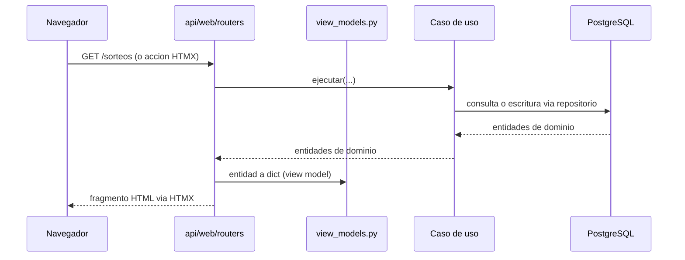

Las plantillas nunca reciben entidades de dominio directamente — siempre pasan por un view model (`api/web/view_models.py`).

---

## API REST

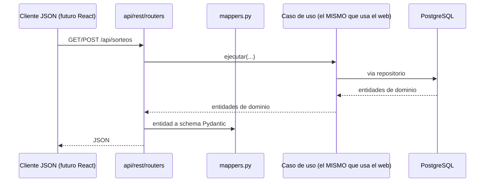

`api/web` y `api/rest` comparten exactamente los mismos casos de uso — reemplazar el frontend HTML por React en el futuro no requiere tocar `application/` ni `domain/`.

---

## Base de datos

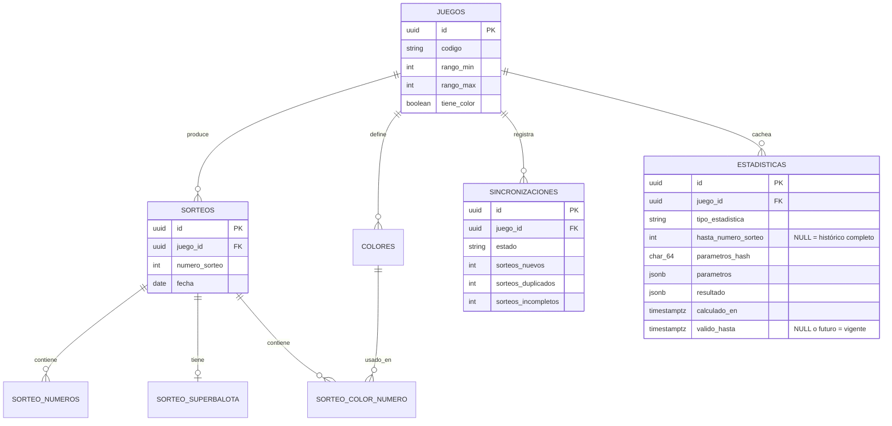

Tablas normalizadas (no `INTEGER[]`) para números y colores: permite indexar y consultar por número individual eficientemente a escala (necesario para el análisis de frecuencia de la Fase 3).

---

## Decisiones de diseño y por qué

| Decisión | Alternativa descartada | Por qué |
|---|---|---|
| UnitOfWork con commit por sorteo | Una transacción por sincronización completa | Un fallo a mitad de un lote de 1000 sorteos no debe perder los primeros 999 |
| Parsers separados de conectores | Parseo embebido en el conector | Testeable sin red; permite reprocesar HTML guardado con el mismo código |
| application/ nunca importa infrastructure/ | Logger de infraestructura importado directamente | logging.getLogger(nombre) es un registro global — se obtiene el mismo logger configurado sin la dependencia indebida |
| Tablas normalizadas para números/colores | INTEGER[] de PostgreSQL | Necesario para consultas de frecuencia por número individual a escala (Fase 3) |
| EjecucionSincronizacion separada del Data Quality Report | Todo en una sola entidad | El rango histórico y la cobertura son del estado actual de los datos, no de una corrida puntual |
| DrawSourceConnector como puerto único | Un cliente HTTP genérico sin abstracción | Permite intercambiar scraping por CSV o una futura API oficial sin tocar SincronizarSorteos |
| Baloto y Revancha como juegos independientes (Opción A) | Una entidad Sorteo con dos resultados embebidos (Opción B) | Cero cambios de esquema, reutiliza el 100% del dominio ya construido, fiel a que son productos regulatoriamente distintos -ver sección dedicada arriba |
| Dos índices únicos parciales en `estadisticas` | Un `UNIQUE` convencional sobre las 4 columnas | PostgreSQL nunca trata `NULL = NULL` como duplicado en un `UNIQUE` -el histórico completo (`hasta_numero_sorteo IS NULL`) habría podido duplicarse sin límite |
| Upsert (`ON CONFLICT DO UPDATE`) al recalcular una identidad existente | `INSERT` incondicional en cada cálculo | Recalcular una estadística previamente invalidada debe reemplazar esa fila, no intentar crear una segunda -evita `UniqueViolation` bajo concurrencia real, no solo en el caso feliz |
