# Arquitectura del sistema

Este documento explica cómo está construido el sistema, con suficiente detalle para que otro desarrollador lo entienda sin tener que leer el código primero.

## Índice

1. [Principios de diseño](#principios-de-diseño)
2. [Arquitectura general](#arquitectura-general)
3. [Clean Architecture: las 4 capas](#clean-architecture-las-4-capas)
4. [Dominio: los cuatro juegos](#dominio-los-cuatro-juegos)
5. [Baloto y Revancha: por qué son juegos independientes](#baloto-y-revancha-por-qué-son-juegos-independientes)
6. [Conectores y adquisición de datos](#conectores-y-adquisición-de-datos)
7. [Flujo de sincronización](#flujo-de-sincronización)
8. [Resiliencia de la sincronización](#resiliencia-de-la-sincronización)
9. [Reprocesamiento desde HTML](#reprocesamiento-desde-html)
10. [Data Quality Report](#data-quality-report)
11. [Motor estadístico y caché persistido](#motor-estadístico-y-caché-persistido)
12. [Visualizaciones web de estadísticas](#visualizaciones-web-de-estadísticas)
13. [Fase 5: estadísticas descriptivas completas](#fase-5-estadísticas-descriptivas-completas)
14. [Fase 3: modelos entrenados y versionados](#fase-3-modelos-entrenados-y-versionados)
15. [Fase 4: predicciones explicables y fiabilidad observada](#fase-4-predicciones-explicables-y-fiabilidad-observada)
16. [Flujo de una petición web (HTMX)](#flujo-de-una-petición-web-htmx)
17. [API REST](#api-rest)
18. [Base de datos](#base-de-datos)
19. [Decisiones de diseño y por qué](#decisiones-de-diseño-y-por-qué)
20. [Fase 6: actualización y operación automática](#fase-6-actualización-y-operación-automática)

Estado de las fases 1–11 e historial de los Productos 1–6: ver ROADMAP.md. Base de Fase 6: PR #95 (`2ac4d110b7d721e544f5588e9754230eef28184d`). La operación v3.4 está activada en Windows y las novedades automáticas de MiLoto y ColorLoto quedaron verificadas el 23 de octubre de 2026; Fase 6 se integró en PR #96 (Actions `39939306600`) y la limpieza histórica conserva su pendiente separado. Base de Fase 7: PR #97 (`605afe8c2bb3b38d0fa3abdb6a5d14ba2002b5a6`); ver [Fase 7: simulaciones](#fase-7-simulaciones). [Evidencias y salvedades](backend/docs/fase6_validacion_operativa_2026-10-23.md). La validación local de Fase 7 en Windows, PostgreSQL aislado y Brave está completada; [cierre del operador](backend/docs/fase7_validacion_operador_2026-10-24.md), con publicación manual y sus Actions pendientes.

---

## Principios de diseño

1. **La dirección de las dependencias siempre apunta hacia adentro.** `domain` no conoce a nadie. `application` solo conoce a `domain`. `infrastructure` implementa los puertos que `application` define. `api` orquesta todo pero no contiene lógica de negocio.
2. **Los casos de uso son la única puerta a la lógica de negocio.** Ningún router (web o REST) valida reglas de juego, construye combinaciones, ni decide si un sorteo es válido — eso vive exclusivamente en `domain/games` y se invoca a través de casos de uso.
3. **El scraping nunca se mezcla con las reglas de negocio.** Un conector devuelve DTOs neutrales (`DrawDetail`); la decisión de si eso es un sorteo válido para PostgreSQL la toma `RegistrarSorteo`, el mismo caso de uso que usa el formulario manual del dashboard.
4. **Todo origen de datos es intercambiable.** `SincronizarSorteos` no sabe si detrás hay HTML scrapeado, un CSV, o una futura API oficial — todos implementan el mismo puerto `DrawSourceConnector`.

---

## Arquitectura general

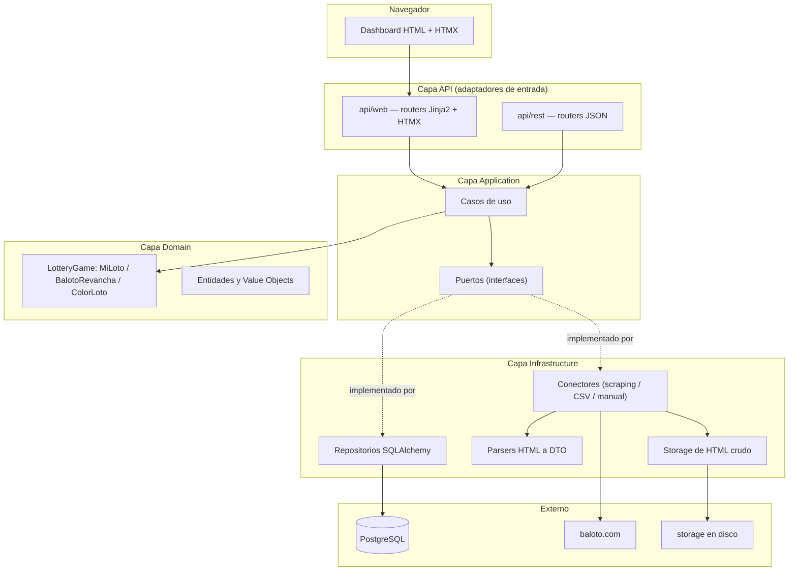

---

## Clean Architecture: las 4 capas

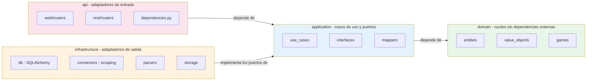

**Regla verificada activamente en la auditoría de Fase 2:** ningún archivo de `application/` importa de `infrastructure/`. La única forma en que `application/` usa infraestructura es a través de puertos (`SorteoRepository`, `DrawSourceConnector`, `UnitOfWork`, `HtmlStorage`), inyectados por `api/dependencies.py`.

---

## Dominio: los cuatro juegos

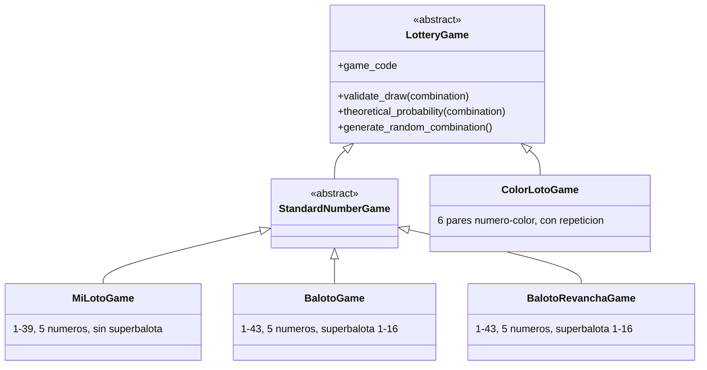

Cada juego encapsula sus propias reglas de validación y cálculo de probabilidades. `GameFactory` traduce la entidad persistida `Juego` (tabla `juegos`) a la instancia de dominio `LotteryGame` correspondiente. `BalotoGame` y `BalotoRevanchaGame` comparten exactamente la misma mecánica (misma clase base `StandardNumberGame`, mismos rangos), pero son juegos independientes -ver la siguiente sección.

---

## Baloto y Revancha: por qué son juegos independientes

**El problema real detectado:** hasta la revisión arquitectónica de agosto de 2026, el sistema solo modelaba `BALOTO_REVANCHA` -el resultado principal de Baloto clásico nunca se scrapeaba ni se guardaba. Al abrir un sorteo de la familia Baloto solo aparecía Revancha.

**Diagnóstico:** en `infrastructure/parsers/baloto_revancha_parser.py`, el filtro de listado (`_RE_DRAW_ID`) solo reconocía enlaces `/resultados-revancha/{id}`, descartando las filas de Baloto clásico. El conector solo pedía el detalle de Revancha. Fue una decisión de Fase 1 documentada pero incompleta: nunca se contempló capturar el resultado principal.

**Verificado contra el sitio real:** `/resultados-baloto/{id}` y `/resultados-revancha/{id}` son páginas de detalle *separadas*, cada una con solo su propio resultado y su propia tabla de premios -no existe una sola página con ambos. El listado (`/resultados`) sí trae ambas familias juntas, así que el descubrimiento de sorteos comparte un único recorrido de paginación; solo el detalle requiere una petición por familia.

**Decisión: Opción A — juegos independientes relacionados por `numero_sorteo`.** Se evaluaron dos alternativas:

| | Opción A (elegida): juegos independientes | Opción B (descartada): una entidad con dos resultados |
|---|---|---|
| Cambios de esquema | Ninguno -solo una fila nueva en `juegos` | Requiere romper la relación 1:1 `Sorteo` → `Combination`, o una tabla paralela completa |
| Reutilización de dominio | Total: `StandardNumberGame`, `RegistrarSorteo`, `ValidarIntegridadDatos`, paginación, Data Quality Report -todo funciona sin modificar | Ninguna: cada caso de uso tendría que saber manejar "uno o dos resultados" |
| Fidelidad al dominio real | Alta: Baloto y Revancha son productos regulatoriamente distintos (reglamentos y acumulados separados) | Baja: fusiona dos productos distintos en una sola entidad porque comparten fecha |
| Escalabilidad para Fase 3 | Cada juego es una serie temporal independiente, igual que MiLoto/ColorLoto -patrón ya probado | Cada consulta estadística tendría que desempaquetar la estructura combinada |

**Implementación:** `BalotoGame` (nuevo, `domain/games/baloto.py`) + fila `BALOTO` en `juegos` (migración `0004`, puramente de datos) + `BalotoConnector` (nuevo, comparte el listado con `BalotoRevanchaConnector` pero pide su propio detalle) + `ObtenerSorteoConPareja` (caso de uso que, dado un sorteo de cualquiera de las dos familias, busca el resultado del mismo `numero_sorteo` en el juego relacionado, para que la interfaz los muestre juntos).

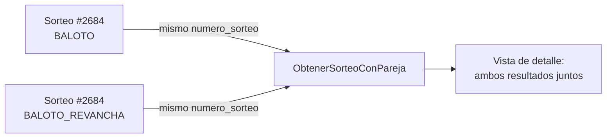

---

## Conectores y adquisición de datos

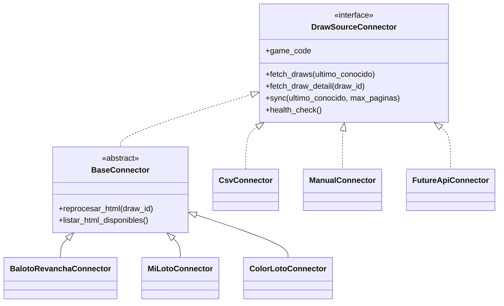

`BaseConnector` implementa una sola vez (patrón Template Method) la paginación, los reintentos con backoff exponencial, el guardado del HTML crudo y la tolerancia a fallos. Las subclases concretas solo aportan las URLs y delegan el parseo a un módulo de `infrastructure/parsers/` — así el conector responde "cómo llegar al dato" y el parser responde "qué significa el dato".

**Agregar un origen de datos nuevo no requiere tocar `SincronizarSorteos`:** basta con implementar `DrawSourceConnector` y registrar la clase en `ConnectorRegistry`.

---

## Flujo de sincronización

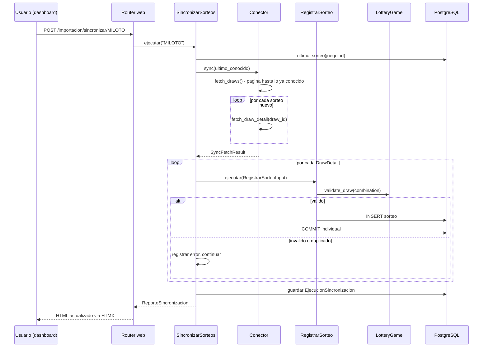

---

## Resiliencia de la sincronización

Documento completo: `backend/docs/resiliencia_sincronizacion.md`. Resumen:

- **El "último sorteo conocido" se recalcula desde PostgreSQL en cada corrida**, nunca desde el log de la corrida anterior.
- **Cada sorteo se confirma (commit) individualmente**, vía el puerto `UnitOfWork`. Antes de esta corrección, toda la sincronización corría en una sola transacción (una request = una Session = un commit al final); un fallo a mitad de camino habría revertido todo el lote. Ahora, si el sorteo 851 de 1000 falla, los 850 anteriores ya están confirmados y sobreviven.
- **Tres capas de protección contra duplicados**: el conector no vuelve a ofrecer lo ya conocido; `RegistrarSorteo` verifica `existe()` antes de escribir; la restricción UNIQUE de PostgreSQL es la última línea de defensa.
- **Un fallo individual nunca detiene el lote**: hay un catch-all deliberado además de los tipos de error anticipados.


---

## Reprocesamiento desde HTML

Permite reconstruir la base de datos usando únicamente los archivos ya guardados en `storage/html/`, sin volver a depender del sitio oficial.

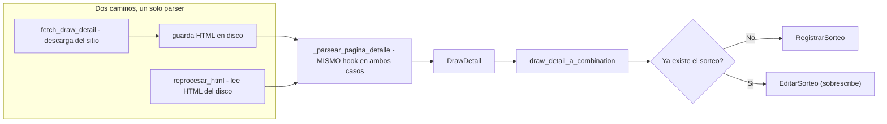

Reutiliza literalmente el mismo hook de parseo y el mismo mapper que la sincronización en vivo — no existe una segunda implementación que pueda desincronizarse de la primera.

---

## Data Quality Report

Combina dos fuentes a propósito:

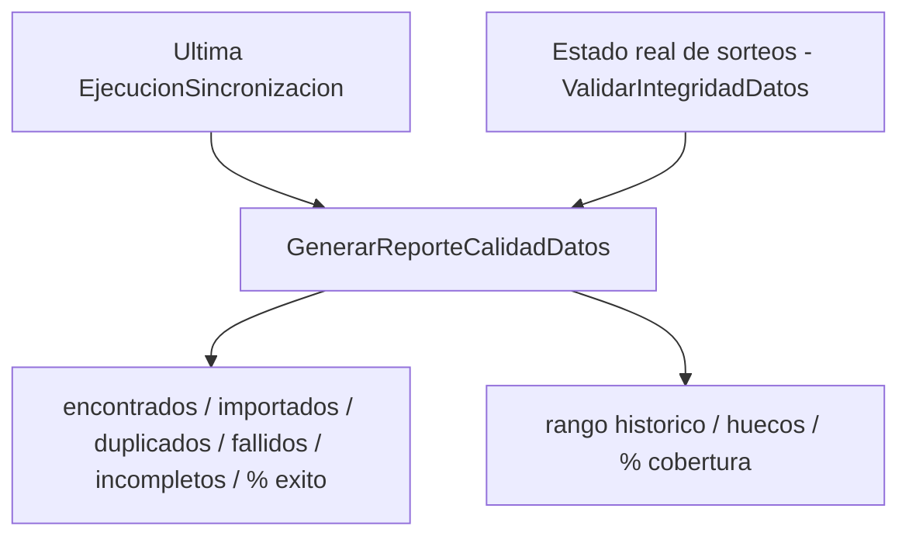

El rango histórico y la cobertura son propiedades del estado actual de los datos, no de una corrida puntual — por eso el reporte combina ambas fuentes en vez de fusionarlas en una sola entidad.

**Etapa AE-35 (validada) ejecutó realmente este reporte, con evidencia real del usuario sobre PostgreSQL -confirmando en la práctica lo que el docstring de `GenerarReporteCalidadDatos` ya declaraba desde su creación: es el gate real de entrada a Machine Learning, nunca la Fase 5 (estadísticas descriptivas).** Resultado real: BALOTO 625 sorteos (`2081`-`2705`), BALOTO_REVANCHA 625 sorteos (mismo rango numérico y de fechas, juego independiente), COLORLOTO 215 sorteos (`1`-`215`), MILOTO 70 sorteos (`532`-`601`) -los cuatro con 100% de cobertura y cero huecos en su rango real; once controles de integridad independientes (duplicados, cantidades, rangos, superbalota, colores, fechas, orden temporal) en cero incidencias. Decisión emitida: **GO CONDICIONAL** -GO para Baloto y Baloto Revancha (modelos independientes en AE-36, nunca mezclados pese a compartir fechas de sorteo), NO-GO temporal para MiLoto (70 sorteos, histórico insuficiente), pospuesto para ColorLoto (215 sorteos, representación del objetivo estructuralmente distinta a los juegos numéricos). `sorteos_incompletos` (contador de `EjecucionSincronizacion`) se incrementa por `DrawDetail.advertencias` no vacío -verificado directamente que esto nunca implica un sorteo inválido persistido: `RegistrarSorteo` ya desvía cualquier combinación inválida a `errores`, nunca a `importados`; el texto exacto de cada advertencia no queda persistido en `detalle_errores`, limitación real documentada, no inventada.

---

## Machine Learning -núcleo puro (`application/ml/`, Etapa AE-36, validada)

**Primera implementación real de Machine Learning del proyecto**, exclusivamente para Baloto y Baloto Revancha (conjunto cerrado `JUEGOS_AUTORIZADOS_AE36`, GO CONDICIONAL de AE-35) -MiLoto y ColorLoto se rechazan explícitamente antes de tocar cualquier repositorio.

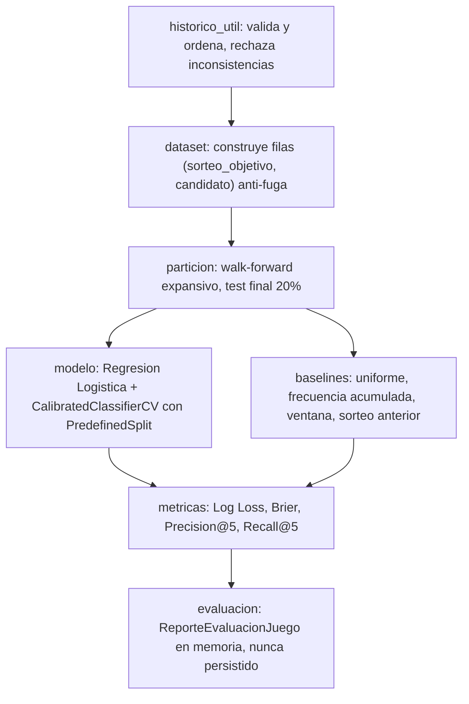

**Modulos puros** (`tipos.py`, `historico_util.py`, `features.py`, `dataset.py`, `particion.py`, `metricas.py`, `baselines.py`, `evaluacion.py`): cero importaciones de SQLAlchemy, FastAPI o Jinja2 -mismo criterio ya establecido por `application/estadisticas/motor/`. `modelo.py` es el UNICO archivo del paquete que importa scikit-learn, aislado del resto -si scikit-learn cambiara o se reemplazara, ningun otro modulo de `ml/` necesitaria cambios.

**Disciplina anti-fuga**: cada `FilaCandidato` valida en su propio `__post_init__` que `calculado_hasta_sorteo < sorteo_objetivo` -una fuga se detecta al CONSTRUIR el dato, no solo en una prueba externa. `dataset.py` es el unico modulo que decide que sorteo es "objetivo"; `features.py` nunca ve el sorteo objetivo, solo el prefijo de historico que `dataset.py` le entrega. Demostrado con pruebas adversariales reales (ver `tests/unit/ml/test_dataset.py::TestAntiFugaTemporal`): alterar el futuro no cambia el pasado calculado; alterar el propio objetivo solo cambia su etiqueta, nunca sus features.

**Calibracion cronologica**: `modelo.py` divide el conjunto de entrenamiento en un bloque base y un bloque de calibracion (por sorteo completo, el de calibracion siempre posterior) y pasa un `PredefinedSplit` explicito a `CalibratedClassifierCV` -nunca la validacion cruzada aleatoria por defecto.

**Union con infraestructura**: `EvaluarBaselineMLProbabilidadNumeros` (`application/use_cases/`) depende de `ResultadosHistoricosRepository`, `JuegoRepository` y `GameFactory` ya existentes -nunca de `EstadisticaRepository` (reservado al motor estadistico descriptivo, nunca reutilizado para experimentos ML). El reporte devuelto (`ReporteEvaluacionJuego`) existe unicamente en memoria durante la ejecucion; AE-36 no persiste nada en `modelos`, `metricas_modelo` ni `predicciones` -esas tablas, existentes desde la migracion `0001`, permanecen exactamente iguales.

**Validación real del usuario, ejecutada en Windows/Python 3.14.6/PostgreSQL real**: pipeline entrenado y evaluado sobre los 625 sorteos reales de Baloto y los 625 de Baloto Revancha (siempre por separado), dentro de transacciones de PostgreSQL de solo lectura -caché y tablas de ML confirmadas sin cambios antes/después. Resultado real: el baseline uniforme fue mejor que el modelo en Log Loss y Brier Score para ambos juegos -sin evidencia de mejora conjunta fuera de muestra. El test final real (`2591..2705`) queda consumido por esta evaluación y no debe reutilizarse como holdout intacto en etapas futuras. Alcance real de la implementación: 9 módulos funcionales en `application/ml/` (10 archivos contando `__init__.py`) más 1 caso de uso -10 archivos Python en total.

---

## Evaluación temporal anidada y ablación -Etapa AE-37, validada

**Motivada por el resultado científico negativo de AE-36**: no busca revertirlo, sino explorar honestamente si existe alguna señal exploratoria bajo regularización controlada y ablación de features. Extiende `application/ml/` de forma exclusivamente aditiva -confirmado con una comparación directa de bytes que el contenido original de `tipos.py` y `modelo.py` es un prefijo exacto del archivo resultante; ningún archivo protegido ni las 80 pruebas originales de AE-36 se modificaron.

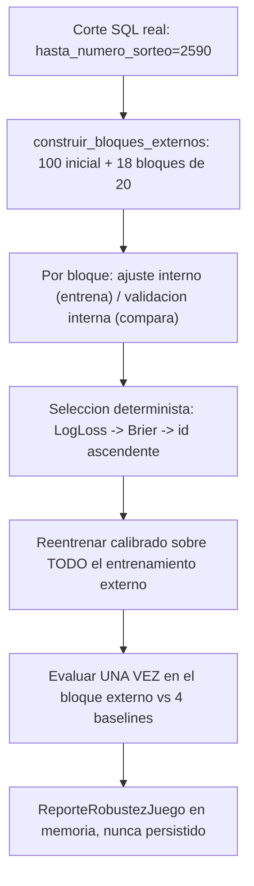

**Corrección arquitectónica de mantenimiento heredada de AE-36**: `evaluacion.py` importaba `sklearn` directamente solo para leer `sklearn.__version__`, contradiciendo la propia afirmación de este documento de que `modelo.py` era el único archivo de `application/ml/` con esa dependencia -defecto real, preexistente, detectado y corregido en esta etapa antes de cualquier validación del usuario. La corrección centraliza `VERSION_SKLEARN` en `modelo.py`; `evaluacion.py` ahora lo importa desde ahí, sin ningún cambio de comportamiento -confirmado real que `evaluar_juego` sigue devolviendo exactamente el mismo valor de `version_sklearn`, y que las 80 pruebas originales de AE-36 pasan sin ninguna modificación de su contenido. Se añadió una **prueba estructural real basada en AST** (`ast.Import`/`ast.ImportFrom`, nunca una búsqueda de texto superficial) que recorre `application/ml/` y falla si algún archivo distinto de `modelo.py` importa scikit-learn -verificado deliberadamente que la prueba falla si se reintroduce el import original, antes de confirmar que pasa con la corrección.

**Corte de desarrollo real (`CORTE_DESARROLLO_AE37 = 2590`)**: aplicado en la consulta SQL ya existente de `ResultadosHistoricosRepository.listar_resultados_numericos` -nunca se trae el histórico completo para filtrarlo despues en Python; la interfaz y su implementación SQLAlchemy no requirieron ningún cambio, ya soportaban `hasta_numero_sorteo` desde AE-36. Tres capas defensivas adicionales (`ResultadoPosteriorAlCorteError`) verifican el histórico recibido, cada fila del dataset y cada frontera de bloque externo -confirmado con una prueba adversarial real que simula un repositorio con un bug que ignora el corte.

**Protocolo anidado** (`evaluacion_anidada.py`, puro, sin SQLAlchemy/FastAPI/Jinja2): `construir_bloques_externos` reserva los primeros 100 sorteos elegibles como entrenamiento inicial externo y divide el resto en bloques consecutivos de 20 -un bloque parcial se rechaza explícitamente (`BloqueExternoParcialError`), nunca desaparece en silencio. Dentro de cada bloque, `_seleccionar_configuracion` entrena los seis `CANDIDATOS_PREREGISTRADOS` únicamente con el ajuste interno (usando `entrenar_modelo_generalizado`, sin calibrar) y los compara únicamente en la validación interna; el ganador se reentrena calibrado (`entrenar_modelo_calibrado_generalizado`, mismo patrón `PredefinedSplit` explícito de AE-36) sobre todo el entrenamiento externo y se evalúa una única vez sobre el bloque externo.

**Ablación**: `modelo.py` gana funciones generalizadas (`construir_pipeline_generalizado`, `entrenar_modelo_generalizado`, `entrenar_modelo_calibrado_generalizado`, `predecir_probabilidades_generalizado`) parametrizadas por `C` y por inclusión de las dos features de recencia -el índice de la columna one-hot del candidato se ajusta automáticamente (6 en el conjunto `completo`, 4 en `frecuencias`). Las funciones originales de AE-36 permanecen sin cambios y siguen siendo las que usa su caso de uso original.

**Unión con infraestructura**: `EvaluarRobustezMLProbabilidadNumeros` (`application/use_cases/`) es el único puente -mismo conjunto cerrado `{BALOTO, BALOTO_REVANCHA}` de AE-36, MiLoto y ColorLoto rechazados antes de consultar cualquier repositorio. **Confirmado real, verificado con la prueba estructural de AST**: únicamente `modelo.py` importa scikit-learn directamente entre todos los archivos de `application/ml/` -la versión se expone vía `VERSION_SKLEARN` para que ningún otro archivo del paquete, ni el caso de uso, necesiten su propia importación de scikit-learn. Ningún dato se persiste en `modelos`/`metricas_modelo`/`predicciones`; sin rutas, sin plantillas, sin migraciones.

**Validación real completa del usuario, ejecutada en Windows/Python 3.14.6/PostgreSQL real -evidencia atribuida al usuario, nunca ejecutada por Claude**: pipeline entrenado y evaluado sobre los 510 sorteos reales de cada juego bajo el corte `2590` (`460` elegibles, `19780` filas, `18` bloques externos, `2231`-`2590`), dentro de transacciones de PostgreSQL de solo lectura -caché y tablas de ML confirmadas sin cambios antes/después. **El protocolo validado produjo ausencia de señal agregada para ambos juegos**: BALOTO obtuvo Log Loss `0.35960515` frente al uniforme `0.35944515` (6/18 bloques ganados en ambas métricas); BALOTO_REVANCHA `0.35968580` frente a `0.35944515` (9/18 bloques, división que no revierte el resultado agregado negativo). Reproducibilidad real confirmada -dos ejecuciones por juego, semilla `42`, resultados idénticos. Baloto y Baloto Revancha se mantuvieron completamente separados en todo momento -nunca una sola fila, modelo, selección ni reporte mezclado entre ambos. El intervalo `2591..2705` (test final de AE-36) no fue cargado, consultado ni reutilizado; el próximo holdout genuino permanece intacto desde `2706`. Evidencia sintética previa de sandbox conservada por separado -claramente identificada como tal- en las secciones anteriores; nunca sustituida ni confundida con esta evidencia real.

---

## Comparación exploratoria de familias -Etapa AE-38, validada

**Motivada por el resultado negativo de AE-37**: comprueba si Random Forest aporta alguna señal exploratoria adicional frente a la Regresión Logística y al uniforme, reutilizando exclusivamente los mismos datos de desarrollo (`2081..2590`) ya permitidos. Extiende `application/ml/` de forma exclusivamente aditiva -confirmado con una comparación directa de bytes que el contenido original de `tipos.py`/`modelo.py` es un prefijo exacto; `evaluacion_anidada.py` y el caso de uso original de AE-37 **nunca fueron modificados**, confirmado con una prueba dedicada que los ejecuta sin cambios.

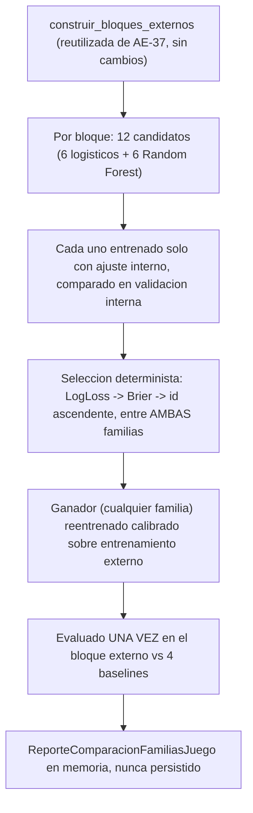

**Generalización por familia, nunca hardcodeo de modelo**: `modelo.py` gana `_construir_estimador_base(familia, hiperparametros, semilla)` -unico punto de todo `application/ml` donde se elige entre `LogisticRegression` y `RandomForestClassifier`, rechazando explícitamente cualquier familia desconocida. `construir_pipeline_familia`, `entrenar_modelo_familia` y `entrenar_modelo_calibrado_familia` generalizan el patrón exacto de AE-37 (mismo `CalibratedClassifierCV`+`PredefinedSplit` explícito) por familia, para que la comparación sea metodológicamente equivalente entre ambas.

**Doce candidatos preregistrados** (`comparacion_familias.py`): los seis logísticos exactos de AE-37, más `CANDIDATOS_RANDOM_FOREST_AE38` -exactamente seis, cuadrícula pequeña y finita fijada antes de cualquier experimento (profundidad `{5, 10, None}` × ensamble `{100, 200, 300}`, replicada en ambos conjuntos de features), `random_state=42` y `n_jobs=1` siempre. `evaluar_bloques_externos_ae38` reutiliza directamente `construir_bloques_externos` de `evaluacion_anidada.py` -nunca la duplica- generalizando únicamente la selección interna para comparar los doce candidatos de dos familias.

**Confirmado con AST, no solo documentado**: `modelo.py` sigue siendo el único archivo de `application/ml/` que importa scikit-learn -verificado con la misma disciplina de prueba estructural de AE-37, extendida a `comparacion_familias.py`.

**Limitación de escala real, medida directamente, no estimada**: una ejecución completa de los 18 bloques externos a escala real (510 sorteos) con doce candidatos por bloque -incluidos seis de Random Forest de hasta 300 árboles, sobre entrenamiento expansivo- excede el tiempo disponible por llamada en el sandbox. Medición real: los primeros 12 bloques (hasta 300 sorteos de entrenamiento) requirieron `223.7 s` acumulados solo en la selección interna, con coste creciente por bloque. Por esta razón, el experimento sintético completo (con reproducibilidad e invariancia post-corte) se ejecutó a una escala reducida real de 190 sorteos/2 bloques -mismos doce candidatos, protocolo sin simplificar-, mientras que la estructura de los 18 bloques a escala real (`460` elegibles, límites `2231`-`2590`) se confirmó por separado y de forma barata, reutilizando `construir_bloques_externos` -función pura, sin entrenar ningún modelo.

**Validación real completa del usuario, ejecutada en Windows/Python 3.14.6/PostgreSQL real -evidencia atribuida al usuario, nunca ejecutada por Claude**: comparación completa entre ambas familias a escala real de 18 bloques sobre los 510 sorteos reales de cada juego bajo el corte `2590` (`460` elegibles, `19780` filas, contiguos y sin solapamiento desde `2231` hasta `2590`), dentro de transacciones de PostgreSQL de solo lectura -caché y tablas de ML confirmadas sin cambios antes/después. **Reproducibilidad confirmada por hash exacto de reporte** en dos ejecuciones por juego -BALOTO `9ebdaa50f580f5e52d85d04a98162425372c51c57069e6d22b21a0ea4f23d08f`, BALOTO_REVANCHA `38d48657b1078d7970bd7d51972c669f2e34db8b81a366ae4eb55c4099bcca4f`. **El protocolo validado produjo ausencia de señal agregada para ambos juegos**: BALOTO obtuvo Log Loss `0.359581731744` frente al uniforme `0.359445147513` (2/18 bloques ganados, 15 perdidos, 1 mixto); BALOTO_REVANCHA `0.360092882013` frente a `0.359445147513` (5/18, 12/18, 1 mixto) -pese a que Random Forest fue la familia seleccionada con más frecuencia (15/18 y 14/18 respectivamente), nunca interpretado como evidencia de capacidad predictiva. Baloto y Baloto Revancha se mantuvieron completamente separados en todo momento. Tiempo y memoria reales, medición válida del árbol completo de procesos Python -corrige una medición inicial inválida de ~4.51 MB que solo observaba el proceso lanzador, expresamente descartada-: BALOTO `557.9587288999464 s` de tiempo Python, pico de Working Set del árbol `373.15234375 MB`; BALOTO_REVANCHA `568.4538222999545 s`, pico `374.2890625 MB`. El intervalo `2591..2705` (test final de AE-36) no fue cargado, consultado ni reutilizado; el próximo holdout genuino permanece intacto desde `2706`.

---

## Cuantificación de incertidumbre y regla de parada -Etapa AE-39, validada

**Motivada por tres resultados negativos consecutivos (AE-36, AE-37, AE-38)**: en vez de probar una familia adicional de modelos -lo que constituiría *model chasing*- AE-39 cuantifica la incertidumbre de las diferencias externas ya obtenidas por AE-38 y formaliza una regla de parada de desarrollo reproducible. No entrena ningún modelo nuevo.

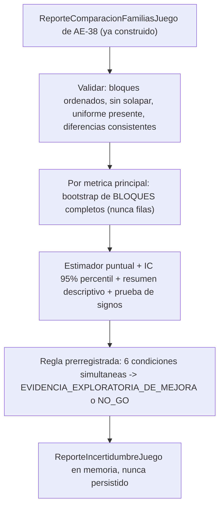

**Unidad de remuestreo -la decision arquitectonica central de esta etapa**: el bootstrap remuestrea con reemplazo los **18 bloques externos completos** de AE-38, nunca las 15480 filas candidato-sorteo -esas filas no son observaciones independientes entre si dentro de un mismo bloque. Cada replica calcula el promedio ponderado por `total_filas` de los bloques efectivamente seleccionados en esa replica -el codigo nunca asume silenciosamente que todos los bloques tienen igual tamano.

**Orientacion matematica reutilizada, nunca redefinida**: `incertidumbre.py` reutiliza directamente `DiferenciaFrenteAUniforme` (`uniforme - modelo`, positivo = mejora) ya calculada por AE-37/AE-38 en cada bloque -nunca recalcula las metricas desde cero, solo agrega y cuantifica la incertidumbre de las diferencias ya existentes.

**Bootstrap e inferencia con la biblioteca estandar unicamente** (`math`, `random`): `_bootstrap_diferencia_agregada` usa una instancia local de `random.Random` -nunca el modulo global `random`, nunca paralelismo-, con semilla `42` y `10000` replicas por defecto. `_percentil` reimplementa interpolacion lineal (mismo metodo que `numpy.percentile` con `interpolation='linear'`), documentado y probado con ejemplos manuales. `_prueba_signos_exacta` usa la distribucion binomial EXACTA via `math.comb` -nunca una aproximacion normal, apropiado con solo 18 bloques- y excluye unicamente los empates exactos.

**Regla de decision prerregistrada, representada como `DecisionContinuidadML` (Enum cerrado)**: `EVIDENCIA_EXPLORATORIA_DE_MEJORA` unicamente si las seis condiciones se cumplen simultaneamente (diferencia puntual positiva y limite inferior del IC 95% estrictamente mayor que cero, en Log Loss Y en Brier Score, mas ausencia de degradacion material en Precision@5/Recall@5, con una tolerancia explicita de `0.02` documentada en `TOLERANCIA_DEGRADACION_SECUNDARIA`); en cualquier otro caso, `NO_GO_SIN_EVIDENCIA_SUFICIENTE`. Nunca existe un estado positivo ambiguo como "aprobado" o "listo para produccion". Cada juego se decide de forma completamente independiente.

**Validaciones explicitas, nunca `assert`**: `ReporteIncertidumbreInvalidoError` cubre bloques ausentes/insuficientes/duplicados/desordenados/solapados, metricas o diferencias no finitas, tamanos no positivos, diferencia almacenada inconsistente con las metricas (tolerancia `1e-9`), ausencia o duplicidad del baseline uniforme, juego no autorizado, y parametros de bootstrap invalidos.

**Politica de reapertura, tipo cerrado**: `PoliticaReaperturaML` fija `proximo_holdout_inicio=2706` y `minimo_sorteos_nuevos_requeridos=100` -una decision NO-GO nunca demuestra imposibilidad matematica de predecir, solo ausencia de evidencia suficiente en el protocolo evaluado.

**Union con AE-38, nunca reentrenamiento**: `evaluar_incertidumbre_y_regla_parada` recibe un `ReporteComparacionFamiliasJuego` ya construido -nunca invoca `CompararFamiliasMLProbabilidadNumeros` (el caso de uso costoso de AE-38), nunca consulta repositorios, nunca lee archivos. **Confirmado con AST, no solo documentado**: `modelo.py` sigue siendo el unico archivo de `application/ml/` que importa scikit-learn; `incertidumbre.py` no importa SQLAlchemy, FastAPI ni Jinja2.

**Resultados reales, aplicados mediante script externo al proyecto sobre el JSON completo de AE-38 -nunca leido desde codigo de produccion**: BALOTO -Log Loss `-0.000136584231` IC95%`[-0.000217,-0.000051]`, Brier `-0.000026473413` IC95%`[-0.000044,-0.000008]`; BALOTO_REVANCHA -Log Loss `-0.000647734500` IC95%`[-0.001108,-0.000231]`, Brier `-0.000137653795` IC95%`[-0.000237,-0.000050]`. Ambos estimadores puntuales negativos en ambas metricas para ambos juegos -decision `NO_GO_SIN_EVIDENCIA_SUFICIENTE` en los dos, coincidente exactamente con la regla prerregistrada disenada antes de observar estos numeros. Reproducibilidad confirmada aplicando el analisis a las dos ejecuciones reales e identicas de AE-38 (mismo hash de reporte cada una).

**Validacion real completa del usuario, ejecutada en Windows/Python 3.14.6 -evidencia atribuida al usuario, nunca ejecutada por Claude**: suite completa `3681 passed`, `0` omitidas, `pip check` limpio, aislamiento de scikit-learn reconfirmado mediante AST. AE-39 no consulto PostgreSQL ni reentreno ningun modelo -analizo exclusivamente el JSON ya validado de AE-38. Cinco incidentes reales, exclusivamente en comandos auxiliares de PowerShell (fragmentacion de bloques `elseif`/`try`/`finally`, una expresion invalida al consultar una rama local, manejo de comillas en `python -c`, y un primer intento del auditor sin `PYTHONPATH` corregido con `PYTHONPATH=backend`) -ninguno cambio codigo, metricas, Git, PostgreSQL ni resultados cientificos.

---

## Gate operativo de elegibilidad para la reapertura -Etapa AE-40, validada

**Tras el NO-GO de AE-39 en ambos juegos**: AE-40 no reabre el desarrollo predictivo ni prueba ninguna familia de modelos. Implementa exclusivamente un gate determinista que responde una unica pregunta operativa -nunca cientifica: ¿existen al menos 100 sorteos nuevos, completos en numeracion y separados por juego, desde el sorteo `2706`? **La validacion confirma el funcionamiento metodologico y operativo del gate -el resultado del gate en si es negativo en la instantanea real evaluada.**

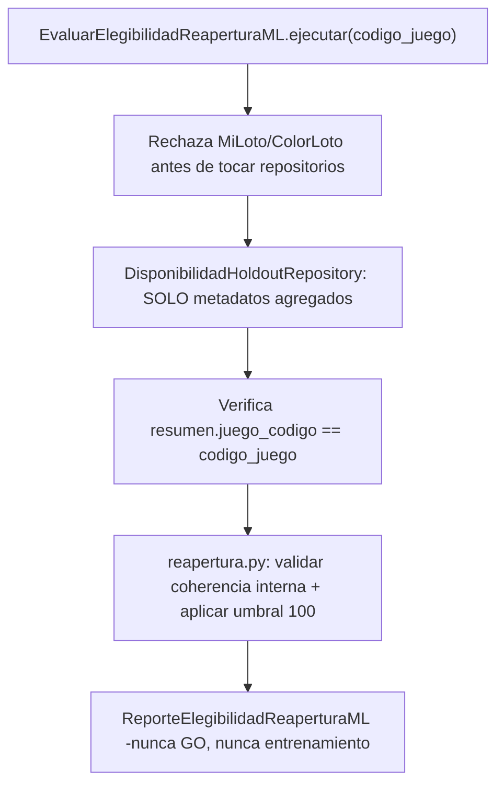

**Validacion real completa del usuario, ejecutada en Windows/Python 3.14.6/PostgreSQL real -evidencia atribuida al usuario, nunca ejecutada por Claude**: PostgreSQL real reutilizado (sin contenedor nuevo), revision Alembic `0006`, `transaction_read_only=on`. Confirmado directamente sobre la sentencia SQL compilada de produccion real: exactamente dos consultas agregadas totales (una por juego, cada caso de uso con dos consultas -resolucion del juego mas la consulta agregada), proyectando unicamente `COUNT`, `COUNT DISTINCT`, `MIN` y `MAX` sobre `numero_sorteo`, filtro exacto por `juego_id`, filtro `numero_sorteo >= 2706`, sin `JOIN`, sin ninguna columna de numeros ganadores, superbalota, colores, fechas como senal, features ni targets.

**Resultado real, negativo para ambos juegos -recalculado de forma independiente ejecutando la funcion real de produccion con los datos exactos reportados, coincidente exactamente**: BALOTO y BALOTO_REVANCHA obtuvieron `no_elegible_datos_insuficientes`, `0` sorteos nuevos, minimo y maximo `null`. **No existen sorteos cargados desde `2706` en la instantanea real evaluada** -no se alcanzo el minimo de 100, no existe todavia una secuencia `2706..2805`. `numeracion_contigua=true` con cero registros significa exclusivamente que no se detecto ninguna contradiccion de continuidad en un conjunto vacio -nunca que exista una secuencia real de sorteos.

**PostgreSQL real, sin cambios**: cache `estadisticas` `209 -> 209`; `modelos`/`metricas_modelo`/`predicciones` `0 -> 0` en los tres. No se persistieron modelos, metricas ni predicciones. No se generaron predicciones. No se observaron resultados ganadores. El holdout no fue consumido.

**Cierre exclusivamente de estado**: marcadores `PROVISIONAL` -> `validada` en comentarios/docstrings de los 5 archivos Python de AE-40 -AST ejecutable identico confirmado, ignorando unicamente docstrings; el contenido de cierre anadido a `tipos.py` permanece puramente LF, igual que en el parche provisional corregido, preservando intacto el prefijo CRLF original de AE-36/37/38/39. Las 63 pruebas de AE-40 y todas las pruebas anteriores permanecen byte a byte identicas. Los once archivos protegidos de AE-36/37/38/39 permanecen byte a byte identicos. **Confirmado con AST, no solo documentado**: `modelo.py` sigue siendo el unico archivo de `application/ml/` que importa scikit-learn.

**No se habilita todavia un nuevo prerregistro**: `ELEGIBLE_PARA_PRERREGISTRO` nunca significo GO, evidencia predictiva, autorizacion para entrenar, para mirar resultados, para consumir el holdout, ni para desplegar -y en esta instantanea real, ni siquiera se alcanzo ese estado. El desarrollo predictivo no se reabre.

**Limitaciones reales**: esta validacion cubre exclusivamente una instantanea puntual del holdout -cero sorteos nuevos disponibles al momento de la ejecucion real. Una ejecucion futura, cuando existan sorteos reales desde `2706`, podria producir un resultado distinto; eso no reabre automaticamente el desarrollo predictivo ni autoriza observar los resultados del holdout sin un prerregistro explicito previo, tal como esta documentado desde AE-39.

---

## Bloqueo operativo centralizado del desarrollo predictivo -Etapa AE-41, validada

Implementa una politica pura que traduce el resultado del gate ya validado de AE-40 en tres estados operativos explicitos. **La validacion real confirma el funcionamiento metodologico y operativo -ambos juegos permanecen bloqueados por ausencia de sorteos nuevos desde `2706` en la instantanea real evaluada.**

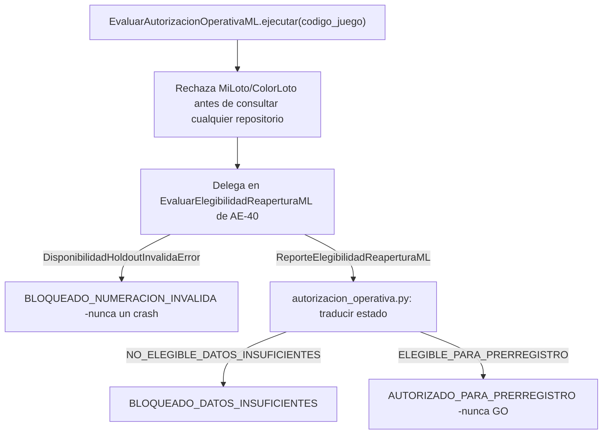

**Validacion real completa del usuario, ejecutada en Windows/Python 3.14.6/PostgreSQL real -evidencia atribuida al usuario, nunca ejecutada por Claude**: PostgreSQL real reutilizado (contenedor existente `loteria-predictor-fase2-final-postgres-1`, sin contenedor nuevo), revision Alembic `0006`, `transaction_read_only=on`. Confirmado directamente sobre el SQL registrado: exactamente `4` consultas totales (`2` por juego -resolucion del juego mas la consulta agregada), con el parametro de corte `2706` confirmado explicitamente; el SQL de disponibilidad proyecta unicamente `COUNT`, `COUNT DISTINCT`, `MIN` y `MAX` de `numero_sorteo`, filtra por `juego_id` y `numero_sorteo >= 2706`, sin `JOIN` ni columnas de resultados ganadores.

**Resultado real, negativo para ambos juegos -recalculado de forma independiente ejecutando la funcion real de produccion con los datos exactos reportados, coincidente palabra por palabra en el motivo**: BALOTO y BALOTO_REVANCHA obtuvieron `estado="bloqueado_datos_insuficientes"`, con el reporte de AE-40 anidado en `estado="no_elegible_datos_insuficientes"`, `total_sorteos_nuevos=0`, minimo y maximo `null`. `numeracion_contigua=true` con 0 registros es un resultado vacuo -nunca afirma que exista una secuencia `2706..2805` real.

**Distincion explicita entre evidencia de tablas/SQL y banderas del programa**: las consultas agregadas y las instantaneas de PostgreSQL (`estadisticas=209`, `modelos=0`, `metricas_modelo=0`, `predicciones=0`, identicas antes y despues) son evidencia directa de que no se leyeron numeros ganadores ni se escribio nada; las banderas `resultados_observados`, `modelos_entrenados`, `predicciones_generadas` y `holdout_consumido` -todas `False`- son afirmaciones del propio programa, corroboradas por pero distintas de la evidencia de las tablas. Medicion de tiempo (`0.1469 s` total) y Working Set (`78.52 MB` pico) corresponden al proceso que ejecuto la validacion, nunca al arbol completo de procesos.

**Consideracion CRLF en Windows, documentada explicitamente**: con `core.autocrlf=true`, el parche (generado con terminadores LF) fallo con `git apply` simple en los tres documentos -aplico limpio con `git apply --ignore-whitespace --whitespace=nowarn`; `git apply --reverse --check --ignore-whitespace --whitespace=nowarn` y `git diff --check` terminaron en codigo `0`. En Linux, sin `core.autocrlf`, el mismo parche aplica limpio con `git apply` simple y `git diff --check` estandar sin ninguna opcion adicional -confirmado directamente en las reconstrucciones de este cierre. La diferencia proviene de la conversion de linea que Windows aplica al extraer y confirmar el ZIP base, nunca de un defecto del parche.

**Reconciliacion honesta de pruebas -nunca `3789 passed` en una sola corrida del usuario**: una primera ejecucion completa del usuario dio `3739 passed, 50 skipped` -los 50 omitidos en `test_generalizacion_juegos.py` por falta de `httpx`; tras instalar `httpx==0.28.1`, ese archivo completo (incluidos los 50 antes omitidos) dio `1213 passed, 0 skipped`. Las `3789` pruebas recolectadas quedaron cubiertas entre ambas ejecuciones del usuario. En el sandbox de Claude, una particion completa sin superposicion (`45+63+47+142+1213+2279`) si sumo `3789 passed, 0 skipped` en una sola sesion, con `httpx==0.28.1` instalado explicitamente como dependencia de validacion temporal -`requirements.txt` permanece intacto.

**Cierre exclusivamente de estado**: marcadores `PROVISIONAL` -> `validada` en comentarios/docstrings de los 3 archivos Python de AE-41 -AST ejecutable identico confirmado, ignorando unicamente docstrings; el contenido de cierre anadido a `tipos.py` permanece puramente LF, preservando intacto el prefijo CRLF original de AE-36 a AE-40. El algoritmo de traduccion de numeracion invalida a bloqueo -incluida la delegacion completa al gate de AE-40- no fue modificado en este cierre. Las 45 pruebas de AE-41 y todas las pruebas anteriores permanecen byte a byte identicas. Los doce archivos protegidos de AE-36/37/38/39/40 permanecen byte a byte identicos. **Confirmado con AST, no solo documentado**: `modelo.py` sigue siendo el unico archivo de `application/ml/` que importa scikit-learn.

**Limitaciones reales**: esta validacion cubre exclusivamente una instantanea puntual del holdout -cero sorteos nuevos disponibles al momento de la ejecucion real. No se realizaron nuevas consultas a PostgreSQL desde el cierre; toda la evidencia proviene exclusivamente del JSON aportado por el usuario, identificados como tales.

---

## Auditoria ejecutable del bloqueo operativo -Etapa AE-42, validada

**Un comando de auditoria, de solo lectura, ejecutado UNICAMENTE por peticion explicita del operador** -nunca una tarea periodica, endpoint, pantalla ni disparador automatico. Invoca los casos de uso REALES de produccion de AE-40/41 para BALOTO y BALOTO_REVANCHA por separado, dentro de una transaccion PostgreSQL de solo lectura verificada explicitamente, y produce un reporte JSON externo al repositorio, versionado y con esquema estable. **No cambia la decision de AE-41 ni inventa una nueva regla de elegibilidad -unicamente la audita y la reporta.**

**Correccion -el parche AE-42 de SHA-256 `5960e20901844a04d46bae9596dd445dcc249b95082e8e51a2c6140fb85debbd` queda invalidado**: la revision del usuario detecto dos defectos en `construir_reporte_auditoria_operativa`, reproducidos primero con 11 pruebas sinteticas que fallaban sobre ese parche. (1) Prioridad del estado global: con un juego autorizado y el otro con numeracion invalida, en cualquier orden, el estado global era `autorizado_para_prerregistro_detectado`; ahora prevalece `bloqueado_numeracion_invalida`. (2) Identidad y coherencia exterior/anidado: un reporte exterior de AE-41 podia llevar un reporte de elegibilidad anidado de otro juego o con un estado incoherente; ahora `_verificar_coherencia_con_elegibilidad` lo rechaza con `ReporteAutorizacionInconsistenteError` (codigo `5`, sin JSON). Correccion minima en el nucleo puro -una importacion, una funcion de comprobacion, una llamada y el orden de dos ramas-; el script solo cambio en su docstring (AST ejecutable identico).

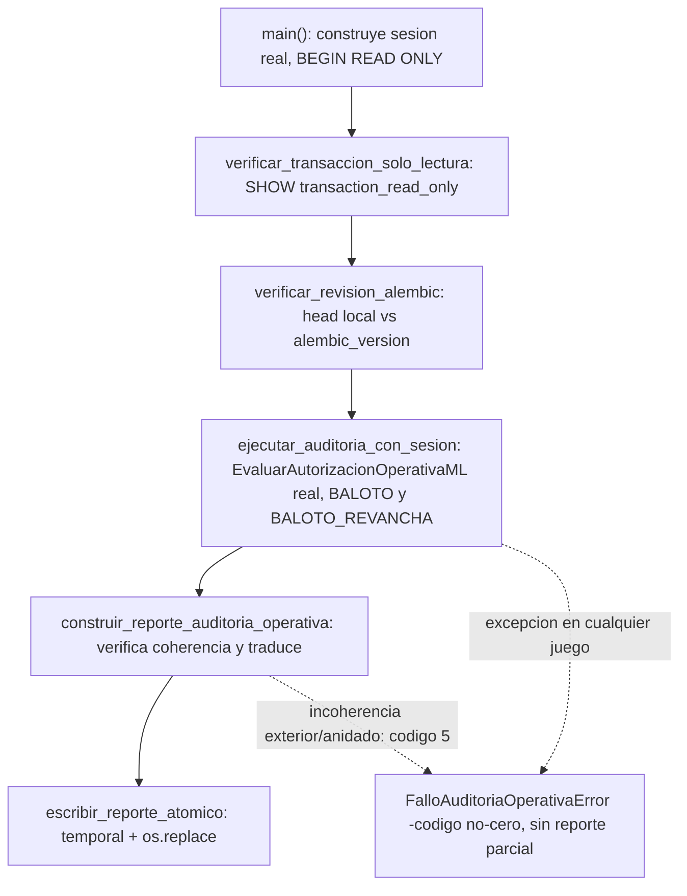

**Auditoria de codigo antes de disenar, no un objetivo asumido**: se leyeron README/ROADMAP/ARCHITECTURE, los modulos y pruebas de AE-40/41, y la configuracion de base de datos -no se encontro ningun comando equivalente ni objetivo concreto de AE-42 ya definido, por lo que no hay duplicacion que resolver ni contradiccion que reportar.

**Separacion deliberada entre logica comprobable y adaptador CLI/SQL**: el nucleo puro (`auditoria_operativa_bloqueo.py`, en `application/ml/`) recibe dos `ReporteAutorizacionOperativaML` YA CONSTRUIDOS y produce el diccionario JSON-serializable -nunca reevalua la regla de elegibilidad de AE-40 (para comprobar la coherencia reutiliza la unica funcion de traduccion de AE-41, `evaluar_autorizacion_operativa_desde_elegibilidad`, sin duplicar su mapeo), nunca abre una conexion, nunca consulta el reloj del sistema (recibe `instante_utc` ya construido por el llamador, permaneciendo determinista). La orquestacion comprobable (`ejecutar_auditoria_con_sesion`, en `scripts/auditoria_operativa_bloqueo.py`) recibe un `EvaluarAutorizacionOperativaML` YA CONSTRUIDO -con repositorios reales o fakes, segun quien la invoque- y NUNCA abre una sesion ni una conexion por su cuenta; confirmado con una prueba que inspecciona el AST de esa funcion especifica. Solo `main()` -el adaptador CLI/SQL, nunca ejercitado contra PostgreSQL real por Claude- construye la sesion real, verifica la transaccion de solo lectura y la revision Alembic, y siempre cierra con `ROLLBACK`, nunca `commit` ni `flush` de sesion.

**Confirmado que se invoca el caso de uso real de produccion, nunca una copia**: las pruebas instancian `EvaluarAutorizacionOperativaML` y `EvaluarElegibilidadReaperturaML` -las clases REALES importadas de `application/use_cases/`- con repositorios fake; el script nunca reimplementa la logica de elegibilidad ni de autorizacion operativa, solo construye los repositorios de infraestructura reales (`JuegoRepositorySQLAlchemy`, `DisponibilidadHoldoutRepositorySQLAlchemy`) y delega completamente.

**Transaccion de solo lectura verificada explicitamente, revision Alembic confirmada dinamicamente**: `SHOW transaction_read_only` se consulta y se compara literalmente contra `'on'` -nunca asumido por haber emitido `BEGIN TRANSACTION READ ONLY`. La revision Alembic esperada se deriva del propio `alembic/` del repositorio mediante `ScriptDirectory.get_current_head()` -nunca hardcodeada como un numero magico independiente que pudiera desincronizarse ante una migracion futura- y se compara contra `SELECT version_num FROM alembic_version` real.

**Siete codigos de salida (`0` a `6`), ninguno ambiguo** (`EXIT_OK=0`, `EXIT_FALLO_INESPERADO=1`, `EXIT_FALLO_CONEXION=2`, `EXIT_REVISION_ALEMBIC_INESPERADA=3`, `EXIT_TRANSACCION_NO_SOLO_LECTURA=4`, `EXIT_REPORTE_INCONSISTENTE=5`, `EXIT_FALLO_EVALUANDO_JUEGO=6`): `0` unicamente para una auditoria correctamente ejecutada -bloqueo, o autorizacion UNICAMENTE informada, nunca concedida. **Verificado que una excepcion al evaluar el segundo juego detiene todo el proceso y propaga el codigo correcto -nunca produce un reporte parcial con solo el primer juego.**

**`auditoria_correcta` nunca se confunde con `autorizacion_para_prerregistro_detectada`**: son dos campos booleanos independientes en el JSON -el primero es `true` siempre que el proceso completo se ejecuto sin errores (incluido el caso, esperado en la instantanea real conocida, de ambos juegos bloqueados); el segundo solo es `true` si algun juego alcanzo `AUTORIZADO_PARA_PRERREGISTRO`. Verificado con una prueba dedicada que ambos campos existen de forma explicita y no se colapsan en uno solo. Si ese estado apareciera, el comando UNICAMENTE lo informa -nunca inicia un prerregistro, nunca lee resultados, nunca construye datasets, nunca entrena ni predice. **Prioridad del estado global**: `bloqueado_numeracion_invalida` > `autorizado_para_prerregistro_detectado` > `bloqueado_datos_insuficientes` -si un juego queda autorizado y el otro con numeracion invalida, el estado global es `bloqueado_numeracion_invalida` y `autorizacion_para_prerregistro_detectada=true` es solo un dato informativo del otro juego: no hay autorizacion global ni accion automatica.

**Escritura atomica del JSON externo**: `escribir_reporte_atomico` escribe primero a un archivo temporal en el MISMO directorio destino (con `fsync` antes de cerrar) y luego reemplaza con `os.replace` -un fallo durante la serializacion o la escritura nunca deja un reporte parcial que parezca valido en la ruta destino. **Verificado deliberadamente**: se forzo un fallo de serializacion (un objeto no serializable) y se confirmo que no queda ningun archivo, ni siquiera temporal, en el directorio destino.

**Consultas auxiliares distinguidas explicitamente de las dos consultas del caso de uso por juego**: la verificacion de `transaction_read_only` y de la revision Alembic son consultas de metadatos separadas y documentadas como tales en el codigo -el reporte nunca afirma "cuatro consultas totales" incluyendolas; esa cifra, heredada de AE-41, sigue refiriendose exclusivamente a las dos consultas por juego del caso de uso.

**Sin datos prohibidos en el JSON**: nunca UUID de juego, numeros ganadores, superbalota, color, fechas como senal, features, targets, credenciales ni cadena de conexion -confirmado con una prueba dedicada que inspecciona la serializacion completa del reporte, no solo su forma superficial. `numeracion_contigua=true` con `total_sorteos_nuevos=0` se documenta explicitamente como vacuo -nunca como evidencia de una secuencia `2706..2805` real.

**Confirmado con AST, no solo documentado**: `modelo.py` sigue siendo el unico archivo de `application/ml/` que importa scikit-learn; `auditoria_operativa_bloqueo.py` y el script no importan scikit-learn, NumPy, SciPy, pandas, FastAPI ni Jinja2. Ningun endpoint, ruta ni plantilla nueva -confirmado con una prueba dedicada que ningun router del proyecto menciona la auditoria operativa. Quince archivos protegidos (los trece de etapas anteriores mas `autorizacion_operativa.py` y el caso de uso de AE-41, ahora tambien protegidos por ser dependencia directa de AE-42) permanecen byte a byte identicos.

**Validacion real del usuario, ejecutada en Windows/Python 3.14.6 contra su contenedor PostgreSQL existente -evidencia atribuida al usuario, no ejecutada por Claude**: `pg_isready` comprobado y salida `0`. JSON real `ae42-auditoria-real.json` (1820 bytes, SHA-256 `18707ea8d73bebd4a21126f3581dbdcd74a624f3679c7148c03cf8df4cdcff29`) auditado campo por campo: esquema `1.0`, revision Alembic `0006`, corte `2706`, exactamente BALOTO y BALOTO_REVANCHA, ambos `bloqueado_datos_insuficientes` con `total_sorteos_nuevos=0`, minimo/maximo `null`, `reporte_elegibilidad_disponible=true` y las cuatro banderas en `false`; `estado_global="bloqueado_datos_insuficientes"`, `auditoria_correcta=true`, `autorizacion_para_prerregistro_detectada=false`. Regenerado por Claude con el codigo real de produccion (casos de uso reales de AE-40/41, cero registros, mismo instante y mismo serializador): contenido identico salvo los 48 terminadores CRLF que Windows anade al escribir en modo texto -equivalencia por CRLF, no coincidencia byte a byte. `numeracion_contigua=true` con cero registros es vacuo.

**Que respalda cada afirmacion**: comportamiento del codigo (verificacion explicita de `transaction_read_only`, delegacion en la consulta agregada de AE-40, `ROLLBACK`, sin `commit` ni `flush`); banderas emitidas por el programa (las cuatro `false`, afirmaciones propias coherentes con el codigo); y mediciones directas registradas en el JSON (estados, metadatos agregados, revision Alembic leida de la base). El JSON no contiene la sentencia SQL, el valor de `transaction_read_only`, conteos de consultas, instantaneas de tablas antes/despues ni tiempos o memoria -esas afirmaciones no se atribuyen a la evidencia.

**Limitaciones reales**: Claude nunca ejecuto `main()` contra PostgreSQL real -solo con dobles de motor, conexion, sesion y repositorios. La descripcion de `--help` sigue diciendo "PROVISIONAL" porque es una cadena ejecutable (argumento de `ArgumentParser`) que este cierre, limitado a comentarios y docstrings, no puede modificar. En Windows con `core.autocrlf=true` el parche puede requerir `git apply --ignore-whitespace --whitespace=nowarn`; en Linux aplica con `git apply` simple.

**Motor puro (`application/estadisticas/motor/`):** un conjunto de módulos que calculan sobre `ResultadoNumerico` (DTO neutral: números, fecha, superbalota) sin importar nada de `infrastructure/` ni de `api/` — no conocen PostgreSQL, HTTP, ni de qué juego provienen los datos, solo reciben una secuencia de resultados y un rango. Esto los hace agnósticos por juego: el mismo código calcula frecuencias para MiLoto (1-39) o para Baloto/Revancha (1-43) sin ninguna rama condicional por juego. El motor incluye módulos para varios tipos de análisis (frecuencia, atrasos, distribuciones, coocurrencia, patrones temporales, entre otros); **solo un subconjunto de ellos está conectado al orquestador y expuesto en la web actualmente** (ver siguiente sección) — el resto existe como código de motor pero no forma parte de ninguna visualización todavía.

**Orquestador (`CalcularYPersistirEstadistica`, `application/use_cases/`):** único punto de entrada para calcular una estadística. Mantiene un catálogo cerrado de "recetas" (función de cálculo + función de serialización + fuente de histórico) por `tipo_estadistica`. Flujo: busca si ya existe una versión vigente (`EstadisticaRepository.buscar_vigente`) → si existe, la devuelve sin recalcular → si no, obtiene el histórico (`ResultadosHistoricosRepository`, con corte temporal aplicado tanto en SQL como de forma defensiva en Python — doble capa anti-fuga de datos futuros) → calcula con el motor puro → serializa → persiste (`EstadisticaRepository.guardar`).

**Fuente de histórico tipada (Etapas AE-1/AE-2/AE-3/AE-4/AE-5/AE-6/AE-7/AE-8/AE-9/AE-10/AE-11/AE-12/AE-13/AE-14/AE-15/AE-16/AE-17/AE-18/AE-19/AE-20/AE-21/AE-22/AE-23/AE-24/AE-25/AE-26/AE-27/AE-28/AE-29/AE-30/AE-31):** `_Receta.obtener_historico` es un campo `Callable` con default (`_obtener_historico_numerico`, reproduce exactamente el comportamiento anterior a esta extensión) — nunca un `if tipo_estadistica == ...` dentro del orquestador para elegir el repositorio. Las 9 recetas de juegos numéricos usan ese default sin ningún cambio de comportamiento; las treinta y una recetas de ColorLoto (`frecuencia_numeros_colorloto`, Etapa AE-1; `frecuencia_colores_colorloto`, Etapa AE-2; `frecuencia_pares_colorloto`, Etapa AE-3; `atrasos_numeros_colorloto`, Etapa AE-4; `atrasos_colores_colorloto`, Etapa AE-5; `atrasos_pares_colorloto`, Etapa AE-6; `repeticiones_entre_sorteos_colorloto`, Etapa AE-7; `distribucion_pares_impares_colorloto`, Etapa AE-8; `distribucion_altos_bajos_colorloto`, Etapa AE-9; `maximo_repeticion_color_por_sorteo_colorloto`, Etapa AE-10; `distribucion_pares_consecutivos_colorloto`, Etapa AE-11; `distribucion_racha_maxima_colorloto`, Etapa AE-12; `distribucion_trios_consecutivos_colorloto`, Etapa AE-13; `coocurrencia_pares_colorloto`, Etapa AE-14; `coocurrencia_trios_colorloto`, Etapa AE-15; `coocurrencia_pares_colores_colorloto`, Etapa AE-16; `coocurrencia_trios_colores_colorloto`, Etapa AE-17; `intervalos_historicos_colores_colorloto`, Etapa AE-18; `distribucion_sumas_colorloto`, Etapa AE-19; `intervalos_historicos_numeros_colorloto`, Etapa AE-20; `intervalos_historicos_pares_numero_color_colorloto`, Etapa AE-21; `frecuencia_colores_por_anio_colorloto`, Etapa AE-22; `frecuencia_colores_por_mes_colorloto`, Etapa AE-23; `frecuencia_colores_por_dia_semana_colorloto`, Etapa AE-24; `frecuencia_pares_numero_color_por_anio_colorloto`, Etapa AE-25; `frecuencia_pares_numero_color_por_mes_colorloto`, Etapa AE-26; `frecuencia_pares_numero_color_por_dia_semana_colorloto`, Etapa AE-27; `distribucion_conteo_color_colorloto`, Etapa AE-28; `comparacion_frecuencia_numeros_por_ventana_colorloto`, Etapa AE-29; `comparacion_frecuencia_colores_por_ventana_colorloto`, Etapa AE-30; `comparacion_frecuencia_pares_numero_color_por_ventana_colorloto`, Etapa AE-31) declaran `_obtener_historico_colorloto`, que trae en dos consultas totales (nunca una por sorteo) tanto el histórico de pares número-color como el catálogo completo de colores del juego (`ColorRepository.listar_todos`, Etapa AE-0), empaquetados en un objeto compuesto (`_HistoricoColorLoto`) que las treinta y una recetas reutilizan para validar integridad en memoria contra `Color.esta_vigente_en`, sin duplicar la regla — patrón Strategy: el propio catálogo declara su fuente, el orquestador nunca bifurca por el tipo de estadística.

**Persistencia (`EstadisticaRepository` puerto + `EstadisticaRepositorySQLAlchemy`):** la identidad de cada estadística calculada es la tupla `(juego_id, tipo_estadistica, hasta_numero_sorteo, parametros_hash)`. `parametros_hash` es un SHA-256 de los parámetros de cálculo (rango, cantidad de números, etc.) canonicalizados de forma determinista (claves ordenadas, separadores fijos) — dos cálculos con parámetros distintos nunca colisionan, y el mismo cálculo repetido siempre produce el mismo hash. La tabla `estadisticas` usa **dos índices únicos parciales** en vez de un `UNIQUE` convencional, porque PostgreSQL nunca considera `NULL = NULL` en una restricción `UNIQUE` (así que un `UNIQUE` normal habría permitido múltiples filas "duplicadas" para histórico completo): uno para `hasta_numero_sorteo IS NOT NULL` (los 4 campos completos), otro para `hasta_numero_sorteo IS NULL` (los 3 campos restantes, el corte ya fijo por el propio índice).

**Invalidación selectiva:** `RegistrarSorteo`, `EditarSorteo` y `EliminarSorteo` — los tres casos de uso que mutan sorteos — llaman a `EstadisticaRepository.invalidar_por_juego(juego_id, desde_numero_sorteo)` inmediatamente después de una escritura exitosa (nunca antes: si la validación de dominio falla, no se invalida nada). La semántica: se invalidan las estadísticas con histórico completo (siempre incluyen cualquier sorteo nuevo) y las que tienen un corte `>= desde_numero_sorteo` (sus datos alcanzaban o hubieran alcanzado el sorteo mutado); las que tienen un corte anterior al sorteo mutado se conservan intactas, por ser históricas congeladas por definición. La invalidación siempre está aislada por `juego_id` — mutar un sorteo de Baloto Revancha nunca invalida el caché de MiLoto ni de Baloto clásico.

**Upsert al recalcular:** cuando una identidad ya existe (vigente o previamente invalidada) y se calcula de nuevo, `guardar()` usa un `INSERT ... ON CONFLICT ... DO UPDATE` de PostgreSQL — con dos ramas de conflicto, una por cada índice único parcial — en vez de intentar un `INSERT` incondicional. Esto reemplaza la fila existente (mismo `id`, `resultado`/`calculado_en`/`valido_hasta` actualizados) en lugar de crear una segunda fila para la misma identidad: nunca queda más de una fila por `(juego_id, tipo_estadistica, hasta_numero_sorteo, parametros_hash)`. La operación comparte la misma sesión/transacción que la escritura del sorteo que la disparó (mismo patrón de `UnitOfWork` de la Fase 2): si esa transacción no se confirma, ni el sorteo ni la invalidación/upsert quedan persistidos — atómico junto con la mutación, no una operación aparte que pueda quedar a medias.

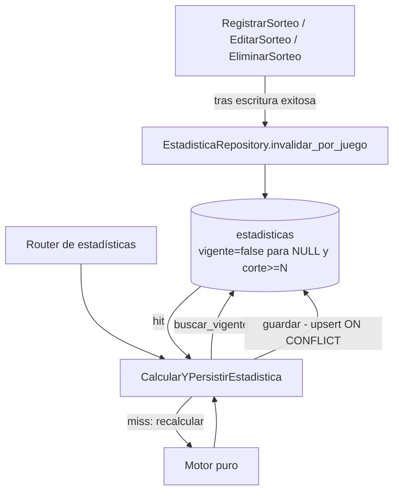

---

## Corte congelado de AE-36 -mantenimiento posterior a AE-42, validado

Una revisión del código tras la sincronización incremental informada por el operador detectó que `EvaluarBaselineMLProbabilidadNumeros` (AE-36) consultaba `listar_resultados_numericos(juego.id)` **sin** `hasta_numero_sorteo`. Recorrido: sin corte, el repositorio SQLAlchemy trae todo el histórico del juego; `evaluar_juego` construye el dataset y `construir_particion_walk_forward` reserva como test final el último 20% de los sorteos elegibles. Con `2081..2705` (625 sorteos, 575 elegibles) el test es `2591..2705`, el contrato validado; con `2081..2713` (633 sorteos, 583 elegibles) pasaría a ser `2597..2713`, evaluando modelo y baselines contra etiquetas del holdout desde `2706`. AE-37/AE-38 no estaban afectados (corte `2590` en SQL más comprobación en Python); AE-39 no consulta la base y AE-40/41/42 solo leen metadatos agregados. Ningún script, ruta ni tarea invocaba AE-36: el riesgo solo se materializaba con una ejecución manual.

**Corrección mínima**: nueva constante `CORTE_CONTRATO_AE36 = 2705` (último sorteo del contrato ya validado, no un valor nuevo), pasada como `hasta_numero_sorteo` para filtrar en SQL, y una segunda capa en Python que lanza `ResultadoPosteriorAlCorteError` antes de llamar a `evaluar_juego` si llega cualquier sorteo posterior -sin reporte parcial ni filtrado silencioso. Es una **excepción explícita y documentada** a la lista de archivos protegidos: solo cambia ese caso de uso; `evaluacion.py`, `particion.py`, `dataset.py`, `modelo.py`, `baselines.py`, `tipos.py`, el repositorio, las migraciones y las pruebas existentes no se tocan. **Los resultados de AE-36 a AE-42 no cambian**: la ejecución real validada de AE-36 usó exactamente `2081..2705`.

**Pruebas nuevas, todas sintéticas** (numeración `2081..2713` elegida solo para reproducir la forma del caso real): `tests/unit/test_evaluar_baseline_ml_corte_holdout.py` (corte `2705` solicitado y test final `2591..2705`; rechazo ante un repositorio que ignora el corte, sin llegar a `evaluar_juego`; reporte idéntico con `2081..2705` y `2081..2713`; regresiones) y `tests/unit/ml/test_corte_casos_uso_ml.py` (AST limitado a los tres casos de uso existentes: `CORTE_CONTRATO_AE36=2705`, `CORTE_DESARROLLO_AE37=2590`, `CORTE_DESARROLLO_AE38=2590`; no impone ningún corte a casos de uso futuros, cuyo contrato temporal se definirá en su propia etapa). Sobre `05e8041`, sin la corrección: `9 failed, 7 passed` en esas pruebas -el caso de uso pedía corte `None` y producía test `2597..2713`. Tras la corrección: `16 passed`. Suite completa en el sandbox de Claude (Linux, Python `3.11.15`, scikit-learn `1.9.1`, `httpx==0.28.1` solo en el entorno de verificación), una única corrida tras la corrección: `3859 passed, 0 skipped` (`3843 + 16`), cinco `DeprecationWarning` preexistentes de Alembic; `pip check` limpio.

**Evidencia atribuida al operador, no medida por Claude**: sincronización incremental oficial con 8 sorteos nuevos por juego (`2706..2713`, 0 fallidos) y nueva auditoría AE-42 `ae42-auditoria-real-tras-sincronizacion.json` (SHA-256 `3b5113252a5f422c64226d837d1449a00bec7d8143a5ffdc90228d0612954d82`) con `bloqueado_datos_insuficientes` en ambos juegos y `autorizacion_para_prerregistro_detectada=false`. Faltan 92 sorteos por juego para el mínimo de 100; alcanzarlo no garantiza mejora predictiva. No se consultó PostgreSQL ni se ejecutó ninguna evaluación real de ML. AE-39 sigue en NO-GO, MiLoto en NO-GO temporal, ColorLoto pospuesto. AE-43 no fue implementada.

**Validación real del operador -evidencia atribuida al usuario, no ejecutada por Claude**: fusionado en `main` y `develop` mediante `cc3273a25639b6c14be3f30b2b71f1adb6b9c214` (PR #40, commit `115551b`), cuyo diff coincide con el parche revisado (SHA-256 `84fd2f05ffab7350b06c79825a590326445437a0ea96c04bb0809505d04fe74d`). Windows/Python `3.14.6`: `16` pruebas nuevas y `32` existentes pasadas; `pip check` limpio. La suite completa `3859 passed` corresponde únicamente al sandbox de Claude. PostgreSQL, en transacción de solo lectura: BALOTO y BALOTO_REVANCHA tienen cada uno `625` números de sorteo distintos en `2081..2705` y `8` en `2706..2713` (solo metadatos). El repositorio real, llamado con `hasta_numero_sorteo=2705`, emitió en cada juego una consulta SQL con ese corte y devolvió `625` registros con máximo `2705`. No se ejecutó ML, no se reevaluó AE-36 y no se calcularon métricas sobre `2706..2713`. Con esta evidencia el mantenimiento queda **validado**: el caso de uso de AE-36 solicita el corte `2705` al repositorio y rechaza antes de evaluar cualquier sorteo posterior que este devuelva. AE-42 no cambia: ambos juegos siguen en `bloqueado_datos_insuficientes` con 8 de 100 sorteos. El NO-GO de AE-39 se mantiene; no se habilita prerregistro, entrenamiento ni predicción. MiLoto sigue en NO-GO temporal y ColorLoto pospuesto. AE-43 no fue implementada.

---

## Núcleo puro de inferencia bloqueada -Etapa AE-43, validada

Prepara dos piezas de la Fase 4 sin producir ninguna predicción. Tres módulos puros nuevos en `application/ml/`, sin conexión con repositorios, casos de uso, scripts ni rutas (confirmado con AST): `ventanas_temporales.py` (fuente única de tramos: `DESARROLLO` `2081..2590`, `CONSUMIDO_AE36` `2591..2705`, `HOLDOUT` desde `2706`; solo biblioteca estándar, y una prueba verifica que coincide con las constantes ya validadas de AE-36/37/38/39/40), `inferencia.py` (`construir_filas_inferencia`: filas `FilaCandidatoInferencia` **sin etiqueta**, mismas features que `dataset.py`) y `prediccion_bloqueada.py` (`resolver_prediccion`). `tipos.py` solo recibe un añadido al final.

**Tramo permitido -solo `DESARROLLO`**: objetivo `<= 2590` y corte `<= 2589`. Cualquier sorteo recibido `>= 2591` (tramo consumido de AE-36 o holdout) se **rechaza** con `CorteInferenciaInvalidoError`, nunca se filtra en silencio; también se rechazan sorteos posteriores al corte, huecos, históricos anteriores a `2081` o con menos de 50 sorteos. El `2705` del contrato de AE-36 solo aparece en la prueba de coherencia de constantes. Ningún objetivo ni feature de AE-43 usa `2591..2705` ni `2706` en adelante.

**Resolvedor bloqueado**: `EstadoPrediccionML` tiene exactamente cuatro estados, todos de bloqueo (`BLOQUEADO_NUMERACION_INVALIDA` > `BLOQUEADO_DATOS_INSUFICIENTES` > `BLOQUEADO_NO_GO_CIENTIFICO` > `BLOQUEADO_SIN_EVALUACION_HOLDOUT`); no existe ningún estado habilitado. `ReportePrediccionJuego` rechaza en su propio `__post_init__` combinaciones, números, probabilidades, confianza o banderas en `True`, y exige el disclaimer permanente. `motivos` lista todos los bloqueos aplicables. Con el estado actual (datos insuficientes + NO-GO de AE-39) el resultado es `BLOQUEADO_DATOS_INSUFICIENTES` con motivos datos insuficientes, NO-GO y sin evaluación del holdout. Limitación explícita: `DecisionContinuidadML` es solo un `Enum` sin identidad de juego, así que el resolvedor no verifica a qué juego corresponde la decisión.

**Pruebas, todas sintéticas** (108 nuevas en cuatro archivos de `tests/unit/ml/`): fronteras de tramos y topes; rechazo de lo que se pasa (`2590`, `2591`, `2705`, `2706`, `2713`, al principio o al final); invariancia ante lo que no se pasa -alterar en la fuente `2590`, `2591..2705` y `2706..2713` no cambia la salida-, con control positivo (alterar `2589` sí la cambia); campos sin etiqueta; paridad campo por campo con las filas etiquetadas de `construir_dataset_binario` para todos los objetivos `2131..2590`; etiqueta intocable, comparando solo las filas del mismo objetivo N; producto cartesiano de los 3 estados de AE-41 por las 2 decisiones de AE-39, construido con las funciones reales; y pureza estructural. Suite completa en el sandbox de Claude: `3967 passed, 0 skipped` (`3859 + 108`) en una única corrida (Linux, Python `3.11.15`, scikit-learn `1.9.1`, `httpx==0.28.1` solo en el entorno de verificación), cinco `DeprecationWarning` preexistentes de Alembic; `pip check` limpio.

No se consultó PostgreSQL, no se entrenó, no se evaluó el holdout ni se generaron predicciones. AE-42 y el corte congelado de AE-36 no cambian; AE-39 sigue en NO-GO, MiLoto en NO-GO temporal y ColorLoto pospuesto. Alcanzar 100 sorteos nuevos solo permitiría reconsiderar la elegibilidad de AE-40/41; cualquier evaluación futura deberá ser prospectiva, prerregistrada antes de observar sorteos posteriores a ese prerregistro, sin tratar `2706..2805` como un holdout ciego.

**Validación real del operador -evidencia atribuida al usuario, no ejecutada por Claude**: en Windows/Python `3.14.6`, las `108` pruebas nuevas de AE-43 y `493` pruebas focalizadas pasaron, con los cinco `DeprecationWarning` de Alembic ya conocidos; `pip check`, `git diff --check` y la comprobación de los `11` archivos del cambio fueron correctos. En Windows no se ejecutó la suite completa: la cifra `3967 passed` corresponde únicamente al sandbox de Claude. No se consultó PostgreSQL, no se entrenó ningún modelo, no se evaluó el holdout ni se generaron predicciones. Con esta evidencia, **AE-43 queda validada como núcleo puro de inferencia bloqueada**: las filas de inferencia solo admiten `DESARROLLO` (objetivo `<= 2590`) y el resolvedor solo produce estados bloqueados. No se habilita ningún estado de predicción, prerregistro ni evaluación. AE-42, el corte congelado de AE-36 y el NO-GO de AE-39 no cambian; MiLoto sigue en NO-GO temporal y ColorLoto pospuesto. AE-44 no fue implementada.

---

## Caso de uso `ResolverEstadoPrediccion` -Etapa AE-44, validada

Primer caso de uso de la Fase 4. Es el punto de entrada por juego que el roadmap nombra `GenerarPredicciones`; ese nombre queda reservado para una etapa futura con evidencia prospectiva. `ResolverEstadoPrediccion.ejecutar(codigo_juego)` une, sin reevaluarlos, el estado operativo real de AE-41 (`EvaluarAutorizacionOperativaML`, que solo consulta metadatos agregados desde `2706`), la decisión validada de AE-39 y el resolvedor puro de AE-43 (`resolver_prediccion`). Siempre devuelve un `ReportePrediccionJuego` bloqueado: no lee números ganadores, no construye filas de inferencia, no entrena, no predice ni persiste, y no está expuesto en rutas, plantillas ni scripts (confirmado con pruebas estructurales).

**Decisión de AE-39 por juego, sin valor por defecto**: `DECISIONES_CONTINUIDAD_AE39` es un registro inmutable (`MappingProxyType`) con `NO_GO_SIN_EVIDENCIA_SUFICIENTE` para BALOTO y BALOTO_REVANCHA. Su docstring documenta la procedencia: las diferencias de Log Loss y Brier con sus IC 95% de la sección de AE-39, calculadas sobre los 18 bloques externos de AE-38 (`2081..2590`). Si falta la clave de un juego autorizado se lanza `DecisionContinuidadAusenteError` antes de consultar AE-41; nunca se usa `.get()` ni una decisión por defecto. Como la decisión se toma por `codigo_juego` y se comprueba que AE-41 devolvió un reporte del mismo juego, este caso de uso cierra la limitación de identidad de juego documentada en AE-43 sin modificar el resolvedor.

**Resultado esperado con el estado actual informado** (8 sorteos nuevos por juego): `BLOQUEADO_DATOS_INSUFICIENTES` con motivos datos insuficientes, NO-GO y sin evaluación del holdout. Con 100 sorteos contiguos (`2706..2805`), AE-41 pasaría a `AUTORIZADO_PARA_PRERREGISTRO`, pero el resultado seguiría bloqueado por el NO-GO de AE-39 y por la ausencia de una evaluación prospectiva.

**Excepción estructural acotada en AE-43**: `tests/unit/ml/test_ae43_estructura.py` prohibía que cualquier archivo fuera de `application/ml/` importara los módulos de AE-43. Con autorización expresa del usuario, se añadió una única excepción: `use_cases/resolver_estado_prediccion.py` puede importar `prediccion_bloqueada`. Siguen prohibidos, para ese archivo, `inferencia` y `ventanas_temporales`, y para cualquier otro archivo, los tres módulos. Ningún archivo de `application/ml/` cambió.

**Pruebas, todas sintéticas** (26 nuevas en `tests/unit/test_resolver_estado_prediccion.py`, con las clases reales de AE-40/41 y repositorios fake de metadatos): seis escenarios por juego (0, 8, 99 y 100 sorteos, hueco en la numeración, inicio distinto de `2706`), todos bloqueados y sin salidas predictivas; registro exacto, inmutable y con procedencia; clave ausente sin consultar AE-41; rechazo de MiLoto y ColorLoto antes de consultar; juego inexistente; reporte de otro juego; constructor mínimo; pureza de importaciones y ausencia de exposición. Suite completa en el sandbox de Claude: `3993 passed, 0 skipped` (`3967 + 26`) en una única corrida (Linux, Python `3.11.15`, scikit-learn `1.9.1`, `httpx==0.28.1` solo en el entorno de verificación), cinco `DeprecationWarning` preexistentes de Alembic; `pip check` limpio.

**Validación del operador en Windows/Python `3.14.6`:** `26` pruebas nuevas y `519` focalizadas pasaron; aparecieron los cinco avisos conocidos de Alembic. `pip check` y `git diff --check` fueron correctos, y el cambio abarca los seis archivos previstos. La suite completa (`3993 passed, 0 skipped`) se ejecutó únicamente en el entorno Linux de Claude. En esta validación no se consultó PostgreSQL ni se ejecutó ML real. AE-44 queda validada como caso de uso que solo devuelve estados bloqueados.

No se consultó PostgreSQL, no se entrenó, no se evaluó el holdout ni se generaron predicciones. AE-39 sigue en NO-GO; AE-40 a AE-43 no cambian. MiLoto sigue en NO-GO temporal y ColorLoto pospuesto. Cualquier evaluación futura deberá ser prospectiva y prerregistrada; `2706` en adelante no se trata como un holdout ciego.

---

## Consulta manual de estado bloqueado -Etapa AE-45, validada

Primer adaptador manual del estado bloqueado de AE-44: `python -m scripts.consultar_estado_prediccion` desde `backend/`. Para BALOTO y BALOTO_REVANCHA, construye los repositorios reales de AE-40/41 y llama a `ResolverEstadoPrediccion` una vez por juego. Abre una transaccion PostgreSQL `READ ONLY`, confirma `transaction_read_only=on` y la revision Alembic mediante las comprobaciones existentes de AE-42, y termina con `ROLLBACK`. Solo entonces publica en stdout un JSON completo (esquema `1.0`, revision y dos juegos con estado, todos los motivos, explicacion y disclaimer). No imprime un reporte parcial si falla uno de los juegos; un bloqueo valido termina con codigo `0`, los fallos con codigos distintos de cero. No lee numeros ganadores, no produce combinaciones, probabilidades ni confianza, no entrena, no persiste y no se ejecuta automaticamente. No hay ruta web, API ni tarea periodica. El roadmap de la Fase 4 sigue sin cumplir sus criterios predictivos.

**Evidencia real anterior de AE-44, atribuida al operador:** en Windows/Python `3.14.6` y transaccion verificada como `transaction_read_only=on`, ambos juegos devolvieron `bloqueado_datos_insuficientes` con los tres motivos: datos insuficientes, NO-GO cientifico y ausencia de evaluacion prospectiva; no aparecieron salidas predictivas. AE-45 no consulta PostgreSQL en el sandbox; su ejecucion real, atribuida al operador, se registra mas abajo.

**Pruebas sinteticas nuevas:** `tests/unit/test_consultar_estado_prediccion_script.py` comprueba orden de los dos juegos, JSON sin campos predictivos, rechazo de tipo o juego incorrecto, segundo juego fallido sin JSON parcial, verificacion de solo lectura y Alembic antes de evaluar, y `ROLLBACK` incluso ante fallos. La prueba estructural de AE-44 autoriza exclusivamente `scripts/consultar_estado_prediccion.py` a importarlo; routers, plantillas y los otros scripts siguen sin acceso. Ningun archivo de `application/ml/` cambia. Suite completa en el sandbox: `4003 passed, 0 skipped` (`3993 + 10`) en una sola corrida (Linux, Python `3.12.14`, scikit-learn `1.9.1`, `httpx==0.28.1` solo en el entorno de verificacion), con cinco `DeprecationWarning` conocidos de Alembic; `uv pip check` limpio.

**Validacion real del operador -evidencia atribuida al usuario, no ejecutada por Claude**: en Windows/Python `3.14.6`, las `10` pruebas nuevas y `529` pruebas focalizadas pasaron, con los cinco `DeprecationWarning` conocidos de Alembic; `pip check` y `git diff --check` limpios, con exactamente seis archivos de AE-45. El operador ejecuto `python -m scripts.consultar_estado_prediccion` contra su PostgreSQL: termino con codigo `0` y un JSON valido con esquema `1.0` y revision Alembic `0006`. BALOTO y BALOTO_REVANCHA devolvieron cada uno `bloqueado_datos_insuficientes`, con los motivos en este orden: `bloqueado_datos_insuficientes`, `bloqueado_no_go_cientifico`, `bloqueado_sin_evaluacion_holdout`; ambos incluyeron el disclaimer. El JSON no registra el valor de `transaction_read_only`: que la transaccion fuera de solo lectura se deduce del codigo, que confirma `transaction_read_only=on` antes de cualquier consulta de negocio y sale con codigo `4` si no se cumple, junto con la salida `0` reportada. La suite completa `4003 passed` corresponde unicamente al sandbox; en Windows no se ejecuto la suite completa. No se entreno ni evaluo ML, no se leyeron numeros ganadores y no se generaron predicciones. Con esta evidencia, **AE-45 queda validada como consulta manual y de solo lectura del estado bloqueado**: no habilita predicciones, prerregistro ni evaluacion. AE-39 sigue en NO-GO y AE-40 a AE-44 no cambian. AE-46 no fue implementada.

---

## Diagnóstico estructurado del bloqueo -Etapa AE-46, validada

Concreta, en forma bloqueada, el entregable de la Fase 4 "explicación de cómo se obtuvo cada recomendación". Hasta AE-45 el bloqueo solo se explicaba con una frase de texto; AE-46 añade un diagnóstico por juego que dice qué condiciones faltan y cuánto progreso hay, sin habilitar ninguna predicción. Dos piezas nuevas, sin conexión con rutas, plantillas, scripts ni `main` (confirmado con pruebas estructurales): el módulo puro `application/ml/diagnostico_bloqueo.py` (`diagnosticar_bloqueo`) y el caso de uso `DiagnosticarEstadoPrediccion` (`application/use_cases/diagnosticar_estado_prediccion.py`). Ningún archivo validado cambia: ni `tipos.py`, ni los módulos o pruebas de AE-39 a AE-45.

**Contrato**: `DiagnosticoBloqueoJuego` lleva `estado` y `motivos` obtenidos llamando a `resolver_prediccion` de AE-43, de modo que nunca discrepan del reporte de AE-44; un `ProgresoSorteosNuevos` copiado del reporte de elegibilidad de AE-40 (total desde `2706`, mínimo requerido, objetivo `2805`), del que solo se deriva `faltantes = max(0, mínimo - total)`; y una condición por cada miembro del enum cerrado `CondicionDesbloqueoML`, en orden: numeración válida, mínimo de sorteos nuevos, evidencia científica de AE-39, protocolo prospectivo prerregistrado y evaluación prospectiva positiva. Las dos últimas no tienen mecanismo en AE-46 y su `__post_init__` impide marcarlas como cumplidas; `desbloqueable` es siempre `False`. Las invariantes exigen además coherencia entre condiciones, progreso y motivos, y el cumplimiento del mínimo se toma del estado de AE-40, no de una regla duplicada. No hay campos de números, combinaciones, probabilidades ni confianza.

**Caso de uso**: una sola llamada a AE-41 por ejecución (solo metadatos agregados). Reutiliza, sin copiarlos, el registro inmutable `DECISIONES_CONTINUIDAD_AE39` y los errores de AE-44, leyendo el registro del módulo de AE-44 en cada ejecución y sin decisión por defecto; rechaza MiLoto y ColorLoto antes de consultar y comprueba que AE-41 devuelva el mismo juego. Con el estado informado por el operador (8 sorteos nuevos por juego), el resultado esperado es `BLOQUEADO_DATOS_INSUFICIENTES`, `8` de `100`, faltan `92`, con cuatro condiciones pendientes. Con 100 sorteos el mínimo queda cumplido, pero el diagnóstico sigue bloqueado por el NO-GO de AE-39 y por las dos condiciones sin mecanismo.

**Pruebas, todas sintéticas** (66 nuevas: `tests/unit/ml/test_diagnostico_bloqueo.py` y `tests/unit/test_diagnosticar_estado_prediccion.py`, con las funciones y clases reales de AE-40/41/43/44 y repositorios fake de metadatos): progreso para 0, 8, 99, 100 y 130 sorteos y para numeración inválida; orden y conjunto cerrado de condiciones; alcanzar 100 no desbloquea; ni con toda condición evaluable cumplida se desbloquea; estado y motivos idénticos a `resolver_prediccion` y a `ResolverEstadoPrediccion` en todos los escenarios; invariantes; una sola consulta de metadatos por ejecución; reutilización del registro de AE-44 sin copia ni `.get()`; clave ausente sin consultar AE-41; aislamiento y ausencia de exposición. Suite completa en el sandbox de Claude: `4069 passed, 0 skipped` (`4003 + 66`) en una única corrida (Linux, Python `3.11.15`, scikit-learn `1.9.1`, `httpx==0.28.1` solo en el entorno de verificación), cinco `DeprecationWarning` conocidos de Alembic; `pip check` limpio.

En el sandbox de Claude no se consultó PostgreSQL; la ejecución real contra PostgreSQL la hizo el operador (ver abajo). En ningún caso se entrenó, se evaluó el holdout ni se generaron predicciones. AE-39 sigue en NO-GO y los bloqueos de AE-40 a AE-45 no cambian. MiLoto sigue en NO-GO temporal y ColorLoto pospuesto. Cualquier evaluación futura deberá ser prospectiva y prerregistrada; `2706` en adelante no se trata como un holdout ciego.

**Validación real del operador -evidencia atribuida al usuario, no ejecutada por Claude**: en Windows/Python `3.14.6`, las `66` pruebas nuevas y `595` pruebas focalizadas pasaron, con los cinco `DeprecationWarning` conocidos de Alembic; `pip check` y `git diff --check` limpios, con exactamente siete archivos de AE-46. El operador ejecutó el caso de uso real `DiagnosticarEstadoPrediccion` para ambos juegos contra su PostgreSQL, en una transacción verificada de solo lectura cerrada con `ROLLBACK`, con revisión Alembic `0006`. BALOTO y BALOTO_REVANCHA devolvieron cada uno `bloqueado_datos_insuficientes`, con los motivos en este orden: `bloqueado_datos_insuficientes`, `bloqueado_no_go_cientifico`, `bloqueado_sin_evaluacion_holdout`; `8` sorteos nuevos de un mínimo de `100`, faltan `92`, objetivo `2805`; cuatro condiciones pendientes: `minimo_sorteos_nuevos`, `evidencia_cientifica_ae39`, `protocolo_prospectivo_prerregistrado` y `evaluacion_prospectiva_positiva`; `desbloqueable=False`. La suite completa `4069 passed` corresponde únicamente al sandbox de Claude; en Windows no se ejecutó la suite completa. No se entrenó ni evaluó ML, no se leyeron números ganadores y no se generaron predicciones. Con esta evidencia, **AE-46 queda validada como diagnóstico estructurado del bloqueo**: no habilita predicciones, prerregistro ni evaluación. AE-39 sigue en NO-GO y los bloqueos de AE-40 a AE-45 no cambian. AE-47 no fue implementada.

---

## Diagnóstico en la consulta manual (JSON 1.1) -Etapa AE-47, validada

Amplía el único punto de consulta real, `python -m scripts.consultar_estado_prediccion` (AE-45), para que el operador vea también el diagnóstico de AE-46. No se crea un segundo script ni una ruta web. Por cada juego, el JSON pasa del esquema `1.0` al `1.1`: conserva `codigo`, `estado`, `motivos`, `explicacion` y `disclaimer`, y añade `progreso` (evaluable, desde `2706`, total, mínimo, faltantes y objetivo), `condiciones_pendientes` y `desbloqueable` (siempre `false`). No incluye combinaciones, números, probabilidades ni confianza.

**Una sola consulta agregada por juego**: el script envuelve el caso de uso real de AE-41 en un adaptador (`_AutorizacionUnaVezPorJuego`) que lo consulta una vez por juego y entrega el mismo reporte a `ResolverEstadoPrediccion` (AE-44) y a `DiagnosticarEstadoPrediccion` (AE-46). Ninguno de los dos casos de uso cambia, y el script sigue sin importar `prediccion_bloqueada`, `inferencia`, `modelo`, `dataset` ni repositorios de resultados. Antes de emitir el JSON, el script comprueba que el diagnóstico sea del tipo esperado y del mismo juego, que su `estado` y sus `motivos` coincidan exactamente con los del reporte de predicción bloqueada y que no sea desbloqueable; si no, sale con código `5` sin JSON. Se conservan la transacción `READ ONLY` verificada, la comprobación de la revisión Alembic, el `ROLLBACK`, la ausencia de reportes parciales y los siete códigos de salida (`0` a `6`).

**Cambios en pruebas validadas, acotados**: las pruebas de AE-45 se adaptan al esquema `1.1` y a la nueva firma `construir_reporte(resolver, diagnosticador, revision)`, conservando todas sus comprobaciones. La prueba estructural de AE-46 que prohibía a cualquier script mencionar su caso de uso autoriza ahora únicamente a `scripts/consultar_estado_prediccion.py`, con el mismo patrón que AE-45 aplicó a AE-44; rutas, plantillas, `main` y los demás scripts siguen sin acceso. Ningún archivo de `application/` cambia.

**Pruebas, todas sintéticas** (`tests/unit/test_consultar_estado_prediccion_script.py`, de 10 a 23 pruebas): esquema `1.1` completo con progreso `8` de `100`, faltan `92`, y las cuatro condiciones pendientes; ninguna clave predictiva en todo el JSON; una sola consulta agregada por juego con los casos de uso reales de AE-40/41/44/46 y un repositorio fake de metadatos que cuenta consultas; el adaptador comparte el mismo reporte y no guarda fallos; diagnóstico de otro tipo, de otro juego, con otro estado o con otros motivos se rechaza con código `5`; fallos del reporte o del diagnóstico en el segundo juego sin JSON parcial; `main()` mantiene el orden solo lectura, revisión y consultas, el `ROLLBACK` y los códigos; ausencia de exposición web. Suite completa en el sandbox de Claude: `4082 passed, 0 skipped` (`4069 + 13`) en una única corrida (Linux, Python `3.11.15`, scikit-learn `1.9.1`, `httpx==0.28.1` solo en el entorno de verificación), cinco `DeprecationWarning` conocidos de Alembic; `pip check` limpio. En el sandbox Linux de Claude, AE-47 no se ejecutó contra PostgreSQL; la ejecución real la hizo el operador (ver abajo).

Las validaciones reales de AE-45 y AE-46 son evidencia del operador, registrada en sus secciones. No se entrenó ni evaluó ML, no se leyeron números ganadores y no se generaron predicciones. AE-39 sigue en NO-GO y los bloqueos de AE-40 a AE-46 no cambian; `2706` en adelante no se trata como un holdout ciego.

**Validación real del operador -evidencia atribuida al usuario, no ejecutada por Claude**: el operador aplicó el parche original de AE-47 (`ae47-consulta-diagnostico-json-1-1.patch`, 41 950 bytes, SHA-256 `1db0395953453db4364a240bb430d434048343b0b04e6a5388aa8771d017c5a9`) sobre `54661c3` en Windows/Python `3.14.6`; los cambios locales fueron exactamente los seis archivos de AE-47. En Windows pasaron las `48` pruebas afectadas y `608` pruebas focalizadas, con los cinco `DeprecationWarning` conocidos de Alembic; `pip check` y `git diff --check` limpios. En Windows no se ejecutó la suite completa: la cifra `4082 passed` corresponde únicamente al sandbox Linux de Claude. El operador ejecutó `python -m scripts.consultar_estado_prediccion` contra su PostgreSQL: terminó con código `0` y produjo un JSON de esquema `1.1` con revisión Alembic `0006`. BALOTO y BALOTO_REVANCHA devolvieron cada uno `bloqueado_datos_insuficientes`, con los motivos datos insuficientes, NO-GO científico y sin evaluación del holdout; progreso `8` de `100`, faltan `92`, objetivo `2805`; cuatro condiciones pendientes (mínimo de sorteos nuevos, evidencia científica de AE-39, protocolo prospectivo prerregistrado y evaluación prospectiva positiva); `desbloqueable=false`; sin campos predictivos. El JSON no registra `transaction_read_only` ni el `ROLLBACK`: que la consulta fuera de solo lectura se deduce del código, que confirma `transaction_read_only=on` antes de cualquier consulta de negocio (sale con código `4` si no se cumple) y cierra siempre con `ROLLBACK`, junto con la salida `0` observada. No se entrenó ni evaluó ML, no se leyeron números ganadores y no se generaron predicciones. Con esta evidencia, **AE-47 queda validada como diagnóstico en la consulta manual (JSON 1.1)**: no habilita predicciones, prerregistro ni evaluación. AE-39 sigue en NO-GO y los bloqueos de AE-40 a AE-46 no cambian. AE-48 no fue implementada.

---

## Evidencia y comparación de la consulta manual -Etapa AE-48, validada

Añade dos flags opcionales a `python -m scripts.consultar_estado_prediccion`. Sin flags, la salida es idéntica a la de AE-47 (esquema `1.1`), comprobado con una prueba de regresión. No hay rutas web, tareas periódicas, tablas ni migraciones, y ningún archivo de `app/` cambia.

**`--salida RUTA`**: el JSON se serializa una sola vez en bytes UTF-8 con LF. Esos mismos bytes se guardan en el archivo, se escriben en stdout y se usan para la huella SHA-256, que se informa solo en stderr (`SHA-256 <hex>  <ruta>  (<n> bytes)`); stdout contiene únicamente el JSON. Para conservar evidencia exacta se usa `--salida`. La huella se verifica sobre el archivo guardado: en PowerShell con `Get-FileHash -Algorithm SHA256 <ruta>` y en Linux con `sha256sum <ruta>`. La publicación es exclusiva: los bytes se escriben en un temporal del mismo directorio (modo binario, `fsync`) y se publican con un enlace duro (`os.link`), que falla si el destino ya existe (POSIX `link`; en Windows, `CreateHardLinkW`). Nunca se sobrescribe un archivo existente, tampoco si aparece justo antes de publicar. Si el sistema de archivos no admite enlaces duros (por ejemplo FAT32, exFAT o algunos recursos de red), el script sale con código `8` sin publicar nada. Tras publicar, se relee el archivo y se comprueba la huella. No se reutiliza la escritura atómica de AE-42, porque escribe en modo texto (en Windows convierte LF en CRLF), serializa por su cuenta y sobrescribe el destino; AE-42 no cambia.

**`--comparar RUTA`**: antes de abrir la conexión se lee (UTF-8 estricto) y se valida un reporte anterior `1.1` o `1.2`, con claves exactas, los dos juegos en orden, estados y condiciones del catálogo real, progreso y condiciones coherentes, `desbloqueable=false` y ninguna clave predictiva en ningún nivel. En un `1.2` se valida también su `comparacion` (claves, tipos, coherencia con su propio reporte y nota fija), pero nunca se reutiliza ni se copia: la comparación nueva se recalcula siempre desde los juegos y la revisión de ambos reportes. El resultado es el esquema `1.2`: el `1.1` actual más `comparacion`, con sorteos nuevos anteriores y actuales, variación, faltantes, estados, condiciones resueltas y nuevas, `retroceso` (anomalía informada si baja el total, no corregida) y una nota fija. **La comparación es descriptiva**: una variación de sorteos nuevos no es evidencia predictiva ni modifica el NO-GO de AE-39, y alcanzar 100 sorteos solo resuelve la condición de mínimo; el estado sigue bloqueado. La cifra 8/100 de AE-47 es evidencia histórica del operador y no aparece en el código.

**Rutas y códigos de salida**: antes de abrir la conexión, `--salida` se rechaza con código `9` si apunta al mismo archivo que `--comparar` (misma ruta literal, relativa frente a absoluta, con `..`, enlaces simbólicos y, si ambos existen, enlaces duros), si ya existe o si su directorio no existe; el archivo anterior queda intacto. Un archivo anterior inválido da código `7` y un fallo al publicar la salida da código `8`, sin JSON en stdout. Los códigos `0` a `6` conservan su significado. Se mantienen la transacción `READ ONLY` verificada, la revisión Alembic, una consulta de AE-41 por juego, la coherencia entre diagnóstico y reporte y el `ROLLBACK`.

**Archivos**: nuevo `scripts/comparacion_estado_prediccion.py`, solo con biblioteca estándar, que recibe del script el catálogo de estados y condiciones construido desde los enums reales. Se amplía `scripts/consultar_estado_prediccion.py`. Las 23 pruebas existentes del script no cambian y se añaden pruebas al final del archivo. No hace falta ninguna excepción en las pruebas estructurales validadas.

**Pruebas, todas sintéticas** (`tests/unit/test_comparacion_estado_prediccion.py`, 73 pruebas, y pruebas añadidas a `tests/unit/test_consultar_estado_prediccion_script.py`): validación estricta de 1.1 y 1.2, con rechazo de mutaciones concretas, incluida una `comparacion.misma_revision_alembic` que no coincide con comparar `comparacion.revision_alembic_anterior` con el `alembic_revision` del mismo reporte (código `7` sin abrir la conexión); comparación de 8→8, 8→15, 8→100 (sigue bloqueado), 15→8 (retroceso) y evaluable a no evaluable; no copia de la comparación anterior; escritor atómico con destino existente, destino que aparece justo antes de publicar, sistema sin enlaces duros, fallo de `fsync`, verificación de la huella y fallo al releer el destino ya publicado (código `8` sin JSON en stdout ni traceback; el destino publicado no se borra); bytes de stdout capturados directamente de un proceso hijo iguales a los del archivo, con la huella de stderr igual al SHA-256 de los bytes guardados; códigos `7` y `9` sin abrir la conexión y con el archivo anterior intacto (SHA-256 y fecha de modificación); código `8` ante un destino concurrente. Suite completa en el sandbox Linux de Claude: `4166 passed, 0 skipped` (`4082 + 84`), medida únicamente con el parche v1 (`ae48-evidencia-comparacion.patch`, 76 292 bytes, SHA-256 `16bcea9855076bada70d3a6d067655833de9097f7c8cce12e0a65c199ff223b0`), anterior a estas dos correcciones, en una única corrida (Linux, Python `3.11.15`, scikit-learn `1.9.1`, `httpx==0.28.1` solo en el entorno de verificación), cinco `DeprecationWarning` conocidos de Alembic; `pip check` limpio. Las dos correcciones posteriores (coherencia de `misma_revision_alembic` y fallo al releer) añaden 5 pruebas (`84 + 5 = 89`) y solo cambian el módulo de comparación, que únicamente importan el script y sus dos archivos de pruebas; se validaron en el sandbox con esos archivos (`112 passed`) y las pruebas estructurales (`233 passed` y `99 passed`), sin repetir la suite completa: no existe una suite completa del parche v2. En el sandbox Linux de Claude, AE-48 no se ejecutó contra PostgreSQL ni en Windows; la validación real la hizo el operador (ver abajo).

**Validación real del operador -evidencia atribuida al usuario, no ejecutada por Claude**: el operador aplicó el parche completo v2 (`ae48-evidencia-comparacion-v2.patch`, 82 203 bytes, SHA-256 `9191dd88fa81253c7e03223ee87502cdd3c57de1cbcf80fddb29a86503c39d58`) sobre `effe31a` en Windows/Python `3.14.6`; `git apply --reverse --check` y `git diff --check` pasaron y los cambios locales fueron exactamente los siete archivos de AE-48. En Windows pasaron las `112` pruebas afectadas y `697` pruebas focalizadas, con los cinco `DeprecationWarning` conocidos de Alembic; `pip check`: `No broken requirements found`. En Windows no se ejecutó la suite completa, y tampoco existe una suite completa del parche v2: la cifra `4166 passed` corresponde únicamente al sandbox Linux de Claude con el parche v1. El operador ejecutó contra su PostgreSQL el script, que exige una transacción de solo lectura verificada:

- Con `--salida` obtuvo un JSON `1.1` en el que BALOTO y BALOTO_REVANCHA quedaron en `bloqueado_datos_insuficientes`, con `8` sorteos nuevos y `92` faltantes. La huella impresa en stderr y la calculada con `Get-FileHash` coincidieron: `bc6660fbae9e72c4a72f9e34473d64dd835dbfe445c52bcf98f8a47d6069be85` (`2414` bytes).
- Con `--comparar` sobre esa evidencia y una `--salida` nueva obtuvo un JSON `1.2` con variación `0` en ambos juegos, sin cambio de estado ni retroceso. La evidencia anterior conservó su huella y su fecha de modificación, y la segunda huella impresa coincidió con `Get-FileHash`: `937a40767ea0c2d317bedd4cdbb452b4c02d69a122149d0c0fff8f8abcaf3554` (`3641` bytes).
- Reutilizar un destino existente, o usar la misma ruta en `--salida` y `--comparar`, devolvió código `9` y conservó el archivo.
- Se simuló en Windows que otro proceso creaba el destino justo antes de `os.link`: la publicación falló, el destino conservó sus bytes y el temporal se eliminó. La evidencia no registra el tipo de sistema de archivos.
- Una copia `1.2` con `misma_revision_alembic` incoherente devolvió código `7`, con stdout vacío y la evidencia original intacta.

El fallo al releer el destino tras publicar (código `8`) solo está cubierto por la prueba sintética incluida en las `112`; no se provocó en una ejecución real. La variación `0` es una comparación descriptiva de metadatos, no evidencia predictiva. Con esta evidencia, **AE-48 queda validada como evidencia persistible y comparación descriptiva de la consulta manual (JSON 1.1 y 1.2)**: no habilita predicciones, prerregistro ni evaluación.

No se entrenó ni evaluó ML, no se leyeron números ganadores y no se generaron predicciones. AE-39 sigue en NO-GO y los bloqueos de AE-40 a AE-47 no cambian; `2706` en adelante no se trata como un holdout ciego.

---

## Referencia Monte Carlo exploratoria bajo azar uniforme -Etapa AE-49, validada

**Etapa AE-49 -referencia Monte Carlo exploratoria bajo azar uniforme, validada (primera etapa de la Fase 6):** `python -m scripts.simular_azar_uniforme`, ejecutado desde `backend/`, compara, para BALOTO y BALOTO_REVANCHA por separado, cuatro estadísticas descriptivas fijadas de antemano con su distribución bajo azar uniforme. Esa distribución se simula con el mismo mecanismo de sorteo (5 números sin reemplazo de 1..43 y superbalota de 1..16) y conservando la numeración observada. **Es un análisis exploratorio sobre datos reutilizados**: el rango `2081..2705` ya fue examinado en AE-36 a AE-39, así que el resultado no es confirmatorio, no está prerregistrado, no es evidencia prospectiva ni predictiva, no genera combinaciones ni recomendaciones y no modifica el NO-GO de AE-39.

**Rango fijo**: `2081..2705`, el contrato congelado de AE-36; una prueba lo ata a `ventanas_temporales` y no hay ninguna opción para cambiarlo. `2591..2705` se incluye, pero no se analiza por separado. `2706` en adelante no se lee (la consulta SQL corta en `2705`), no se simula y no entra en la huella: no es un holdout ciego y AE-49 no lo convierte en uno. El histórico leído debe ser exactamente `2081..2705`, con 625 sorteos, sin huecos ni duplicados, cada uno válido según el dominio y con superbalota. Además, los parámetros del juego en la base de datos deben coincidir con el dominio. Si algo de esto falla, el script devuelve el código `5`. **MiLoto queda fuera**: su rango (`532..601`, 70 sorteos) solo consta en la documentación de AE-35, sin una constante validada en el código ni una huella de contenido, y la serie sigue creciendo.

**Estadísticas y familia**: son cuatro por juego:
- `dispersion_frecuencia_numeros` (Σ(O−E)²/E). Bajo azar uniforme su media es n−k = 38, no 42, porque la chi-cuadrado clásica con gl = N−1 está mal calibrada cuando no hay reemplazo.
- `rango_frecuencia_numeros`.
- `media_repeticiones_entre_sorteos`, sobre transiciones estrictas N→N+1 (referencia 25/43).
- `dispersion_frecuencia_superbalota` (referencia 15).

Para cada una se publican el p-valor empírico bilateral con corrección +1 (nunca vale 0), el percentil y la media y la desviación simuladas. Bonferroni se aplica una sola vez sobre las ocho comparaciones de la ejecución (2 juegos × 4), con α = 0,05 y la función existente del motor. El resultado se publica en el campo `supera_umbral_exploratorio`: `true` señala una discrepancia descriptiva que hay que revisar, no un hallazgo establecido, y `false` no demuestra aleatoriedad. **El ajuste cubre solo estas ocho comparaciones; no corrige la selección ni la inspección previa de datos y análisis en AE-36 a AE-39.** La semilla (`20260926`) y las iteraciones (`10 000`) están fijas en el código.

**Reproducibilidad**: cada juego lleva `entrada_sha256`, calculada sobre la entrada normalizada (numeración, números ordenados y superbalota), sin fechas y sin publicar números ganadores. El generador es propio: un Fisher–Yates parcial que solo usa `Random(semilla).random()`, con una semilla derivada por juego mediante SHA-256. La aritmética es exacta, con enteros y `Fraction`, sin `sum()` de floats (que cambió en Python 3.12), y los valores solo se convierten a `float` al construir el reporte. Con la misma huella de entrada, los mismos parámetros y el mismo código se obtienen los mismos bytes **en las versiones verificadas**: la prueba de referencia SHA-256 de extremo a extremo (`99fb194bd0b94719bfbeb84526b2bc346f30b45140833fee4b38552083b2295f`) pasó en el sandbox Linux de Claude con Python `3.11.15`, `3.12.3` y `3.13.12`. No se promete esa identidad para otras plataformas, porque el cálculo usa `math.sqrt`; el operador la verificó después en Windows/Python `3.14.6` (ver abajo).

**Salida y códigos**: JSON `simulacion-azar-uniforme/1.0`, con `caracter: "exploratorio_sobre_datos_reutilizados"`, una nota fija y textos fijos de alcance y de cobertura del ajuste. El único argumento es `--salida RUTA`, con la publicación exclusiva y la huella de AE-48; cualquier otro argumento da el código `7` antes de abrir la conexión. Como en AE-45/47, se verifica la transacción `READ ONLY` y la revisión Alembic, y se cierra con `ROLLBACK`. Códigos de salida:

| Código | Significado |
|---|---|
| `0` | OK |
| `1` | Fallo inesperado |
| `2` | Conexión |
| `3` | Revisión Alembic |
| `4` | Transacción no `READ ONLY` |
| `5` | Entrada inválida |
| `6` | Fallo simulando |
| `7` | Argumentos inválidos |
| `8` | Fallo al escribir la salida |
| `9` | Ruta de salida no permitida |

No escribe en la base de datos (la tabla `simulaciones` todavía no se usa), no tiene web ni tareas automáticas y no necesita ninguna excepción estructural. En el sandbox, con los parámetros fijos y un histórico sintético de 625 sorteos por juego, tardó `96 s`; es una medición sintética, no el tiempo real.

**Archivos**: son nuevos `app/application/simulaciones/montecarlo_uniforme.py` (puro, sin SQLAlchemy ni `app.application.ml`), el caso de uso `SimularReferenciaAzarUniforme`, `scripts/simular_azar_uniforme.py` y sus pruebas. Reutiliza sin cambios:
- el dominio;
- las funciones del motor `calcular_frecuencia_numeros`, `calcular_frecuencia_superbalota`, `calcular_repeticiones_entre_sorteos` y `aplicar_correccion_bonferroni`;
- los repositorios;
- las verificaciones de AE-42;
- el escritor de AE-48.

**Pruebas, todas sintéticas** (`93` nuevas; históricos generados con fórmulas y repositorios fake): cubren
- el vínculo del rango con las ventanas de ML y el rechazo de cualquier desviación;
- la ausencia de flags de rango, semilla o iteraciones y la exclusión de MiLoto;
- la familia de 8 (con un p crudo que pasaría con 4 comparaciones y no pasa con 8) y las estadísticas fijadas;
- la huella de entrada (respuesta conocida, sensibilidad a cambios de datos e invariancia a fechas y orden);
- la calibración (media ≈ 38 y no 42, 25/43 y 15);
- la aritmética exacta, comprobada por AST, y la referencia de bytes independiente de `PYTHONHASHSEED`;
- la prueba anti-recomendaciones: solo descuenta las frases negativas fijas del disclaimer e incluye un control negativo;
- el script: solo lectura, `ROLLBACK`, códigos `2` a `9` y bytes de stdout iguales al archivo capturados de un proceso hijo.

Suite completa en el sandbox Linux de Claude (Python `3.11.15`), en una única corrida: `4264 passed, 0 skipped` (`4171 + 93`), código de salida de pytest `0`, cinco `DeprecationWarning` conocidos de Alembic; `pip check` código `0`. Las pruebas focalizadas (nuevas, ML, estadísticas y AE-40 a AE-48) dieron `1273 passed`. En el sandbox Linux de Claude, AE-49 no se ejecutó contra PostgreSQL ni sobre resultados reales; la validación real la hizo el operador (ver abajo).

**Validación real del operador -evidencia atribuida al usuario, no ejecutada por Claude**: el operador aplicó el parche original (`ae49-referencia-montecarlo-exploratoria.patch`, 103 048 bytes, SHA-256 `1a481f796afeabecb53de96bb9dfd2c97db8d0171b9736a8acb78a1c76b251f7`) sobre `eabbabd`, y el estado de Git mostró exactamente los 13 archivos previstos. En Windows/Python `3.14.6`:
- pasaron las `93` pruebas nuevas, incluida la referencia de bytes, así que el SHA-256 de referencia también coincide en esa plataforma y versión;
- pasaron `1273` pruebas focalizadas, con los cinco `DeprecationWarning` conocidos de Alembic;
- `pip check` y `git diff --check` salieron limpios.

En Windows no se ejecutó la suite completa: la cifra `4264 passed` corresponde únicamente al sandbox Linux de Claude.

El operador ejecutó dos veces `python -m scripts.simular_azar_uniforme --salida ...` contra su PostgreSQL, con archivos distintos fuera del repositorio:
- **Reproducibilidad:** ambas terminaron con código `0` y produjeron exactamente `5499` bytes con SHA-256 `b8b7b31a62ddb9bbdfd00936bf8ca8b846083c17e75d0de511baa35fbdafc4fb`. El SHA anunciado en stderr coincidió con `Get-FileHash`, y la primera evidencia quedó intacta tras la segunda ejecución.
- **Contenido:** cada reporte incluyó BALOTO y BALOTO_REVANCHA con `625` sorteos, `624` transiciones y cuatro estadísticas por juego, además de la familia de ocho comparaciones y `caracter: "exploratorio_sobre_datos_reutilizados"`.
- **Huellas de entrada:** BALOTO `09839571b3d9aab1e65de9823fe56ccbe4e119768e28b08e7835f47a7a246abe`; BALOTO_REVANCHA `42da6777ea61d859ddae762ea3baa03c14cb6d83173199192b2940c38b651f1c`.
- **Tiempos observados:** `128,6 s` y `129,0 s`, propios de ese equipo y de ese estado de datos.
- **Rechazos:** `--semilla 1` devolvió código `7` con stdout vacío, y reutilizar la primera ruta en `--salida` devolvió código `9` con stdout vacío; el archivo original conservó su SHA-256 y su fecha de modificación.

Esta documentación no transcribe los valores de las estadísticas ni de `supera_umbral_exploratorio`. El JSON no registra `transaction_read_only` ni el `ROLLBACK`. La lectura en solo lectura se deduce del código, que confirma `transaction_read_only=on` antes de leer (si no, sale con código `4`) y cierra siempre con `ROLLBACK`, junto con la salida `0` observada.

Estos resultados reales son exploratorios sobre datos reutilizados: no son evidencia confirmatoria ni prospectiva, no convierten `2706` en adelante en un holdout ciego y no modifican el NO-GO de AE-39. Con esta evidencia, **AE-49 queda validada como referencia Monte Carlo exploratoria y reproducible de la consulta manual**: no habilita predicciones, prerregistro ni evaluación.

No se entrenó ni evaluó ML y no se generaron predicciones. Claude no leyó números ganadores reales; la ejecución del operador leyó el histórico `2081..2705` solo para calcular estadísticas agregadas, y el JSON no publica números ganadores. AE-39 sigue en NO-GO y los bloqueos de AE-40 a AE-48 no cambian.

---

## Verificación local de evidencias Monte Carlo -Etapa AE-50, validada

**Etapa AE-50 -verificación local de evidencias de AE-49, validada (Fase 6, preparatoria):** `python -m scripts.verificar_evidencia_montecarlo EVIDENCIA [EVIDENCIA_2]`, ejecutado desde `backend/`, hace una **validación de formato y coherencia interna** de una o dos evidencias JSON producidas por AE-49. Funciona sin conexión, sin base de datos y en solo lectura: los archivos se leen en binario y nunca se modifican.

**No es prueba de autenticidad ni de procedencia**: el SHA-256 identifica los bytes examinados, pero sin firma ni fuente externa de confianza un archivo fabricado y serializado de forma canónica podría pasar. Tampoco confirma que los datos provengan de PostgreSQL, no recalcula las estadísticas y no ejecuta Monte Carlo. Una evidencia válida sigue siendo exploratoria sobre datos reutilizados y no modifica el NO-GO de AE-39; `2706` en adelante sigue sin ser un holdout ciego.

**Qué comprueba.** La regla es estricta: solo acepta los parámetros fijos de AE-49 (semilla `20260926`, B = `10 000`, rango `2081..2705` y familia de 8).
- **Lectura (código `3`):** UTF-8 estricto y JSON estándar. `NaN`, `Infinity` y `-Infinity` se rechazan al leer.
- **Formato (código `4`):**
  - claves duplicadas y claves exactas en todos los niveles;
  - finitud de todos los números;
  - textos, parámetros, rango y familia fijos de AE-49;
  - juegos en orden, con `625`/`624`/`625`;
  - `entrada_sha256` hexadecimal de 64 caracteres (no se exige que difiera entre juegos);
  - tipos y rangos de cada estadística y referencias analíticas;
  - ninguna clave predictiva ni texto de recomendación fuera del disclaimer fijo.
- **Coherencia interna (código `5`):**
  - forma canónica de AE-48/49 (`serializar_reporte`);
  - percentil y p-valor alcanzables con B y compatibles entre sí según la aritmética de AE-49;
  - Bonferroni sobre 8 y `supera_umbral_exploratorio`, recalculados con la función existente del motor.

**Dos rutas**: cada archivo se valida por separado. Si alguno falla, se devuelve su código (primero el del primer archivo). Solo si ambos son válidos se comparan sus bytes reales, no sus huellas (el SHA-256 es solo informativo): si son idénticos, código `0` con `archivos_identicos`; si difieren, código `6`. Que los bytes coincidan no demuestra por sí solo que el proceso sea reproducible.

**Salida**: JSON `verificacion-evidencia-montecarlo/1.0` en stdout, con el SHA-256 y el tamaño de cada archivo, el código y la `entrada_sha256` de cada juego, la lista fija de comprobaciones y un texto fijo de alcance. No copia valores estadísticos ni `supera_umbral_exploratorio`. En caso de error, stdout queda vacío. Códigos de salida:

| Código | Significado |
|---|---|
| `0` | Evidencia válida |
| `1` | Fallo inesperado |
| `2` | Argumentos inválidos |
| `3` | Archivo ilegible |
| `4` | Formato inválido |
| `5` | Incoherencia interna |
| `6` | Dos evidencias válidas pero distintas |

**Archivos**: son nuevos `scripts/verificacion_evidencia_montecarlo.py` (puro) y `scripts/verificar_evidencia_montecarlo.py` (CLI). Viven en `scripts/`, igual que el validador de AE-48, para reutilizar `serializar_reporte` y `CLAVES_PREDICTIVAS`. También reutilizan las constantes y los textos de `app/application/simulaciones/montecarlo_uniforme.py` y `aplicar_correccion_bonferroni`. No cambian `app/`, AE-48, AE-49, las migraciones ni la base de datos, y no hace falta ninguna excepción estructural. Una posible persistencia futura en la tabla `simulaciones` no está decidida ni implementada.

**Pruebas, todas sintéticas** (`104` nuevas; eran `97` en el parche anterior):
- evidencia válida construida con la función real `construir_reporte` de AE-49, sin simular;
- una mutación por invariante, cada una con su código `3`, `4` o `5`;
- `NaN`, `Infinity`, `-Infinity` y `1e999`, más una clave duplicada;
- cinco formas no canónicas;
- incoherencias: p no alcanzable, percentil no múltiplo, p y percentil incompatibles, `supera` invertido y ajustado distinto de 8·p;
- huellas iguales entre juegos, que se aceptan;
- una evidencia real del caso de uso de AE-49 con B = 20, que falla solo por `parametros` y es coherente con sus propios parámetros;
- con dos rutas:
  - el código `6` solo aparece con dos JSON canónicos y válidos que difieren en la revisión Alembic;
  - el fallo individual tiene prioridad;
  - un byte alterado que invalida el archivo da `3`, `4` o `5`;
  - regresión: dos archivos válidos con bytes distintos dan `6` aunque sus resúmenes presenten artificialmente el mismo SHA-256, y `construir_informe` no declara `archivos_identicos` solo porque dos resúmenes tengan la misma huella;
- archivos intactos (SHA-256 y fecha), bytes de stdout capturados de un proceso hijo e informe sin valores estadísticos.

Como medición adicional del sandbox, se generó con el caso de uso de AE-49 una evidencia con sus parámetros fijos (B = 10 000) sobre el histórico sintético (`5598` bytes), y el verificador la aceptó con código `0`.

Mediciones en el sandbox Linux de Claude (Python `3.11.15`): pruebas focalizadas `1377 passed` (`1273 + 104`), con código de salida de pytest `0`. La suite completa se ejecutó una sola vez con el parche anterior, que tenía `97` pruebas nuevas: `4361 passed, 0 skipped` (`4264 + 97`), con código de salida de pytest `0` y los cinco `DeprecationWarning` conocidos de Alembic, y `pip check` con código `0`. No se repitió tras la corrección de la comparación de bytes. En el sandbox Linux de Claude no se usaron evidencias reales ni PostgreSQL; la validación real la hizo el operador (ver abajo).

**Validación real del operador -evidencia atribuida al usuario, no ejecutada por Claude**: el operador aplicó el parche v2 (`ae50-verificacion-evidencia-montecarlo-v2.patch`, 75 506 bytes, SHA-256 `239fa458f077e8dc99651bc58a1a3d48c89737a6efa4c48041943d96472d2e06`) sobre `190b30d`; pasaron la comprobación inversa del parche y `git diff --check`, y solo quedaron modificados los ocho archivos previstos. En Windows/Python `3.14.6`:
- pasaron las `104` pruebas afectadas;
- pasaron `1377` pruebas focalizadas, con los cinco `DeprecationWarning` conocidos de Alembic;
- `pip check`: `No broken requirements found`.

El operador ejecutó el verificador **de forma local y sin PostgreSQL** sobre sus dos evidencias reales de AE-49:
- **`sim-1.json` sola:** código `0`, `formato_y_coherencia_interna_validos` y `no_aplica`; `5499` bytes con SHA-256 `b8b7b31a62ddb9bbdfd00936bf8ca8b846083c17e75d0de511baa35fbdafc4fb`. El archivo quedó intacto.
- **`sim-1.json` y `sim-2.json` juntas:** código `0` y `archivos_identicos`. Ambas tienen `5499` bytes y la misma huella, y conservaron su contenido y su fecha de modificación.

**Límites**: la verificación valida formato y coherencia interna, no autenticidad ni procedencia. Que los bytes coincidan no prueba de dónde vienen los archivos ni que el proceso sea reproducible, y el verificador no confirma que los datos provengan de PostgreSQL ni recalcula estadísticas. La cifra `4361 passed` de la suite completa pertenece solo al parche v1 en el sandbox Linux de Claude: la suite completa de v2 no se ejecutó ni en Windows ni en Linux.

Con esta evidencia, **AE-50 queda validada como verificación local de formato y coherencia interna de evidencias de AE-49**: no habilita predicciones, prerregistro ni evaluación, y una posible persistencia futura en `simulaciones` sigue sin decidir.

No se entrenó ni evaluó ML, no se generaron predicciones y no se leyeron números ganadores. AE-39 sigue en NO-GO y los bloqueos de AE-40 a AE-49 no cambian.

---

## Auditoría de evidencias Monte Carlo frente al histórico -Etapa AE-51, validada

**Etapa AE-51 -auditoría de una evidencia de AE-49 frente al histórico actual, validada (Fase 6):** `python -m scripts.auditar_evidencia_montecarlo EVIDENCIA`, ejecutado desde `backend/`, comprueba si una evidencia JSON de AE-49 corresponde a los datos que hay hoy en PostgreSQL para BALOTO y BALOTO_REVANCHA en `2081..2705`. El resultado es exploratorio sobre datos reutilizados y **no modifica el NO-GO de AE-39**.

**Flujo:**
1. Valida el archivo con AE-50 (formato y coherencia interna) **antes de abrir la conexión**. Si falla, devuelve el código de AE-50 (`3`, `4` o `5`).
2. Abre una transacción `READ ONLY`, la verifica y comprueba la revisión Alembic, reutilizando las funciones de AE-42.
3. Lee cada juego con corte `2705` en la consulta SQL; `2706` en adelante no se lee.
4. Exige con `verificar_rango_principal` de AE-49 que el histórico actual sea exactamente `2081..2705`, con sorteos válidos, y que los parámetros del juego en la base coincidan con el dominio.
5. Termina siempre con `ROLLBACK` y no escribe nada.

**Qué se compara** con la evidencia, por juego:
- la huella normalizada de entrada, calculada con `huella_entrada` de AE-49;
- los totales de sorteos, transiciones y superbalotas;
- las cuatro estadísticas **observadas**, recalculadas con `calcular_estadisticas` de AE-49 y serializadas igual que AE-49. La comparación distingue entero de real.

El informe (`auditoria-evidencia-montecarlo/1.0`) publica solo resultados booleanos por comprobación, junto con las huellas de la evidencia y actual, las listas fijas `comprobado` y `no_comprobado` y un texto fijo de alcance. No copia valores estadísticos. La revisión Alembic de la evidencia se compara con la actual solo a título informativo.

**Qué no se comprueba**: la auditoría **no repite Monte Carlo**. No verifica medias ni desviaciones simuladas, percentiles, p-valores ni Bonferroni frente a los datos, más allá de la coherencia interna de AE-50. Una coincidencia indica que los datos actuales producen la misma entrada y los mismos valores observados; **no prueba la procedencia histórica del archivo** ni cuándo se generó.

**Códigos de salida**:

| Código | Significado |
|---|---|
| `0` | Coincide |
| `1` | Fallo inesperado |
| `2` | Argumentos inválidos |
| `3` | Evidencia ilegible (AE-50) |
| `4` | Formato inválido (AE-50) |
| `5` | Incoherencia interna (AE-50) |
| `6` | Fallo de conexión |
| `7` | Revisión Alembic inesperada |
| `8` | Transacción no `READ ONLY` |
| `9` | Histórico actual o parámetros fuera del contrato de AE-49 |
| `10` | No coincide; el informe se publica igualmente en stdout |

Los códigos `3` y `4` de AE-42 se reasignan a `7` y `8` para no chocar con los de AE-50. En los demás errores, stdout queda vacío.

**Archivos**: son nuevos `scripts/auditoria_evidencia_montecarlo.py` (con repositorios inyectados, sin SQLAlchemy ni Monte Carlo) y `scripts/auditar_evidencia_montecarlo.py` (CLI). Reutilizan sin cambios:
- el validador de AE-50;
- las funciones de AE-49;
- las verificaciones de AE-42;
- los repositorios SQLAlchemy.

No cambian `app/`, AE-42, AE-49, AE-50, las migraciones ni la base de datos, y no hace falta ninguna excepción estructural. La comprobación de parámetros del juego frente al dominio replica en unas pocas líneas la del caso de uso de AE-49, que es privada, para no modificarlo.

**Pruebas, todas sintéticas** (`48` nuevas; repositorios, conexión y sesión fake, e históricos generados con fórmulas):
- evidencia que corresponde al histórico sintético: huella y observados calculados con AE-49, y p-valores coherentes fabricados sin simular;
- coincidencia completa;
- datos actuales distintos: huella y observados discrepan, con código `10` e informe;
- observado alterado con la huella intacta;
- huella alterada;
- distinción entre entero y real;
- histórico actual fuera de contrato, juego inexistente o parámetros distintos del dominio: código `9`;
- errores de AE-50 (`3`, `4` y `5`) y de argumentos (`2`) sin abrir la conexión;
- conexión (`6`) y fallos de AE-42 reasignados (`7` y `8`);
- fallo inesperado (`1`) sin informe parcial;
- orden solo lectura, revisión y consulta, seguido de `ROLLBACK`;
- archivo de evidencia intacto y bytes de stdout capturados de un proceso hijo;
- estructura: sin Monte Carlo, sin escrituras y nada en `app/` que lo mencione.

Como medición adicional del sandbox, la evidencia generada en AE-50 con el caso de uso real de AE-49 y sus parámetros fijos (B = 10 000) sobre el histórico sintético (`5598` bytes) se auditó con código `0` y `coincide` en ambos juegos.

Mediciones en el sandbox Linux de Claude (Python `3.11.15`): pruebas focalizadas `1425 passed` (`1377 + 48`); suite completa en una única corrida, `4416 passed, 0 skipped` (`4368 + 48`), con código de salida de pytest `0` y los cinco `DeprecationWarning` conocidos de Alembic; `pip check` con código `0`. En el sandbox Linux de Claude no se usaron PostgreSQL ni evidencias reales; la validación real la hizo el operador (ver abajo).

**Validación real del operador -evidencia atribuida al usuario, no ejecutada por Claude**: el operador aplicó el parche original (`ae51-auditoria-evidencia-montecarlo.patch`, 61 411 bytes, SHA-256 `19eee4ce3650f4c37889077ca832d637a589df36c2d81892f5051fe0f2e6d03c`) sobre `ab9f977`; pasaron la comprobación inversa y `git diff --check`, y solo cambiaron los ocho archivos previstos. En Windows/Python `3.14.6`:
- pasaron las `48` pruebas nuevas;
- pasaron `1425` pruebas focalizadas, con los cinco `DeprecationWarning` conocidos de Alembic;
- `pip check`: `No broken requirements found`.

En Windows no se ejecutó la suite completa: la cifra `4416 passed` corresponde solo al sandbox Linux de Claude.

El operador auditó `sim-1.json` frente a su PostgreSQL:
- código `0` y resultado `coincide`, con revisión Alembic `0006` tanto en la evidencia como en la base actual;
- en BALOTO y BALOTO_REVANCHA coincidieron la huella normalizada, los totales y las cuatro estadísticas observadas. Huellas de entrada: BALOTO `09839571b3d9aab1e65de9823fe56ccbe4e119768e28b08e7835f47a7a246abe`; BALOTO_REVANCHA `42da6777ea61d859ddae762ea3baa03c14cb6d83173199192b2940c38b651f1c`;
- `sim-1.json` conservó sus `5499` bytes, su SHA-256 `b8b7b31a62ddb9bbdfd00936bf8ca8b846083c17e75d0de511baa35fbdafc4fb` y su fecha de modificación.

**Límites**: la auditoría compara la evidencia con el histórico **actual**. No acredita cuándo ni de dónde se generó el archivo, no repite Monte Carlo y no verifica frente a los datos los valores simulados (medias, desviaciones, percentiles, p-valores ni Bonferroni). El JSON no registra `transaction_read_only` ni el `ROLLBACK`: la lectura en solo lectura se deduce del código, que verifica `transaction_read_only=on` antes de leer (si no, sale con código `8`) y cierra siempre con `ROLLBACK`, junto con la salida `0` observada.

Con esta evidencia, **AE-51 queda validada como auditoría de una evidencia de AE-49 frente al histórico actual `2081..2705`**. El resultado sigue siendo exploratorio sobre datos reutilizados, no habilita predicciones, prerregistro ni evaluación y no modifica el NO-GO de AE-39.

No se entrenó ni evaluó ML y no se generaron predicciones. Claude no leyó números ganadores reales; la auditoría del operador leyó el histórico `2081..2705` solo para calcular la huella y las estadísticas agregadas, y el informe no publica números ganadores. AE-39 sigue en NO-GO y los bloqueos de AE-40 a AE-50 no cambian.

---

## Registro prospectivo de ML -Etapa AE-52, validada

**Etapa AE-52 -registro prospectivo de ML (preparación de una evaluación prospectiva), validada:** primera etapa para poder evaluar una estrategia de ML de forma prospectiva, como exige el NO-GO de AE-39: una evaluación prerregistrada antes de observar los sorteos posteriores a ese prerregistro. AE-52 **no genera predicciones**, no entrena ni carga modelos, no evalúa resultados y **no modifica el NO-GO**. Tampoco activa recomendaciones, apuestas ni predicciones para usuarios. **AE-52 no acumula evidencia prospectiva**: el único registro real que admite es un borrador sin salidas, y ningún sorteo cuenta todavía para ningún mínimo.

**Revisión de AE-39 a AE-51 (hechos del repositorio):**
- **Estrategia congelable:** la única configuración fija existente es la Regresión Logística L2 calibrada de AE-36 (`entrenar_modelo_calibrado` y `predecir_probabilidades` en `ml/modelo.py`): semilla `42`, `C = 1.0`, `lbfgs`, `2000` iteraciones, calibración con el `20 %` final, siete features retrospectivas y calentamiento de `50` sorteos. AE-37 y AE-38 eligen su configuración, e incluso su familia, dentro de cada bloque, así que no son congelables sin una decisión adicional. Que sea la única congelable no significa que esté aprobada ni validada como predictiva: falló en AE-36 a AE-39.
- **Salida:** una probabilidad de aparición por cada número del rango (43) para el sorteo siguiente.
- **Referencia de azar y métricas:** `baseline_uniforme` = `5/43`; Log Loss y Brier como métricas principales y Precision@5 y Recall@5 como secundarias (AE-36); diferencia orientada como uniforme − estrategia y cada juego por separado (AE-39).
- **Qué impide usarla:**
  - el NO-GO de AE-39 en ambos juegos;
  - AE-40/41 solo autorizan un prerregistro con al menos `100` sorteos nuevos contiguos desde `2706` (objetivo `2805`) y tras validación humana expresa. **`8`/`100` en la última medición registrada**: evidencia del operador en la validación de AE-48 (JSON `1.1` de `consultar_estado_prediccion`, `2414` bytes, SHA-256 `bc6660fbae9e72c4a72f9e34473d64dd835dbfe445c52bcf98f8a47d6069be85`, y comparación `1.2` con variación `0`). Ese formato no registra la fecha de la medición, y AE-52 no volvió a medir el contador;
  - AE-43 solo construye features de inferencia con cortes de DESARROLLO (`≤ 2589`): predecir un sorteo `≥ 2706` exige un contrato nuevo y validado;
  - los modelos nunca se persisten, y el tramo de entrenamiento de una versión congelada no está decidido;
  - las condiciones «protocolo prospectivo prerregistrado» y «evaluación prospectiva positiva» de AE-46 no tienen mecanismo.

**¿Se pueden guardar salidas antes de cada sorteo próximo? No, sin relajar las reglas.** Hay tres autorizaciones distintas:
1. **Reabrir el desarrollo predictivo (AE-39):** solo con al menos `100` sorteos nuevos por juego desde `2706`, o con una hipótesis nueva y prerregistrada que no se seleccione a partir de estos resultados (sección de AE-39; `PoliticaReaperturaML` en `ml/tipos.py`, con `minimo_sorteos_nuevos_requeridos` y `requiere_hipotesis_nueva_prerregistrada=True`). Reabrir no es un GO. La segunda vía no tiene mecanismo en el código: el bloqueo operativo de AE-41 solo traduce el conteo de AE-40.
2. **Prerregistro formal (AE-40/41):** `evaluar_elegibilidad_reapertura_ml` devuelve `ELEGIBLE_PARA_PRERREGISTRO` solo con `100` o más sorteos contiguos desde `2706`, y AE-41 lo traduce a `AUTORIZADO_PARA_PRERREGISTRO`, que «nunca significa autorizacion para entrenar, para observar resultados, para generar predicciones, ni para desplegar -unicamente que una etapa FUTURA e INDEPENDIENTE podria iniciar un prerregistro experimental, tras validacion humana expresa» (`ml/autorizacion_operativa.py`).
3. **Registro experimental en segundo plano:** por debajo de `100`, AE-41 devuelve `BLOQUEADO_DATOS_INSUFICIENTES` con el motivo «ninguna operacion predictiva nueva queda autorizada» (`evaluar_autorizacion_operativa_desde_elegibilidad`). Calcular una probabilidad por número para el sorteo siguiente es una operación predictiva nueva. Además, AE-41 coloca el «prerregistro experimental» detrás de la autorización, no fuera de ella: llamarlo experimental o de segundo plano no lo saca del bloqueo. También hay bloqueos técnicos:
   - `construir_filas_inferencia` (AE-43) rechaza cortes `> 2589` y cualquier sorteo de `CONSUMIDO_AE36` o `HOLDOUT` como feature;
   - el caso de uso de AE-36 pide y comprueba el corte `2705` (`CORTE_CONTRATO_AE36`);
   - `ReportePrediccionJuego` rechaza probabilidades en `__post_init__`;
   - una salida para `2714` necesitaría como entrada `2706..2713`, y AE-40/41 no autorizan observar esos resultados.

Por eso AE-52 **no habilita una vía experimental**:
- un protocolo real solo puede ser el borrador, con los siete pendientes;
- los protocolos cerrados solo existen con `sintetico: true`, que nunca cuenta;
- `verificar` lo declara con `admite_salidas: false` y con el texto de alcance «no admite salidas y no acumula evidencia prospectiva».

**Dos esperas sucesivas con las reglas vigentes:**
- **Primera espera:** `100` sorteos nuevos desde `2706` para que AE-41 autorice un prerregistro (objetivo `2805`).
- **Segunda espera:** `100` sorteos **prospectivos** por juego, posteriores al protocolo, para la evaluación (`REGLAS_EVALUACION_AE52`, con la constante vigente de AE-39).

No pueden solaparse: sin autorización no hay protocolo cerrado, y sin protocolo no cuenta ningún sorteo. `2706..2805` no cuenta para la segunda espera, porque esos sorteos ocurren antes del prerregistro. Los sorteos históricos y Monte Carlo sirven para pruebas y exploración, pero no cuentan como sorteos futuros: el corte los excluye y los registros de prueba llevan `sintetico: true`.

La única vía que podría acortar la espera es la hipótesis nueva prerregistrada de AE-39. Exigiría una decisión científica expresa del operador y una etapa que modifique el bloqueo validado de AE-41. AE-52 no toma esa decisión.

**Siguiente trabajo que sí puede hacerse ahora** (sin predicciones ni lectura de números ganadores):
1. **Medir el contador actual.** El operador puede hacerlo con la consulta de solo lectura ya validada, contra su PostgreSQL:

   ```
   python -m scripts.consultar_estado_prediccion --salida NUEVA.json --comparar ANTERIOR.json
   ```

   Esa consulta (AE-45/47/48) compara el contador actual con la evidencia de `8`/`100`.
2. **Fijar antes de cualquier dato prospectivo las decisiones que no dependen de datos:**
   - la regla estadística de decisión (unidad de remuestreo, nivel y condiciones);
   - el tramo de entrenamiento;
   - el mecanismo de sellado temporal.

   Hoy el protocolo solo marca pendientes y no guarda el valor decidido. Una etapa siguiente añadiría esos valores y la regla como código puro, probado con datos sintéticos. Requiere que el operador tome esas decisiones.
3. **Contrato de inferencia prospectiva.** Ampliaría AE-43 más allá de `DESARROLLO`, siempre detrás del bloqueo de AE-41. Puede escribirse y probarse con datos sintéticos, pero toca un contrato validado y necesita autorización expresa.

**Qué añade AE-52:** un registro de **solo anexado**, con una entrada por archivo `NNNNNN.json` en JSON canónico, nombrada solo por su secuencia y encadenada con el hash de la anterior (`app/application/ml/registro_prospectivo.py`, puro). Tiene tres tipos de entrada, siempre separados:
1. **`protocolo`** (la primera y única): versión exacta de la estrategia (huella SHA-256 del código con fines de línea normalizados, parámetros leídos del código validado y entorno), corte temporal por juego, reglas fijas y decisiones pendientes. Con pendientes es un **borrador** y no admite salidas. Un protocolo real solo puede ser ese borrador.
2. **`prediccion`**: salida registrada **antes** del sorteo, con la huella de su entrada (histórico contiguo que termina exactamente en el sorteo anterior al objetivo) y una probabilidad por número. En AE-52 solo existe en registros sintéticos.
3. **`resultado`**: números del sorteo, incorporados **después**, en otra entrada que referencia el hash de su predicción.

Reglas que se aplican al anexar y al verificar:
- un protocolo real distinto del borrador se rechaza;
- no se acepta ningún sorteo igual o posterior al objetivo como entrada;
- no cuenta ningún sorteo ya conocido al registrar el protocolo;
- solo hay un protocolo por registro y cada predicción debe llevar su hash, así que nunca se mezclan versiones;
- no se repite ni se retrocede un objetivo;
- no hay un resultado sin su predicción previa ni dos resultados para la misma predicción;
- una predicción no puede llevar el resultado.

**Anexado concurrente:** cada entrada se publica con el enlace duro exclusivo de AE-48 en `NNNNNN.json`, así que la exclusividad por nombre es también exclusividad por secuencia.
- Si dos operaciones leen la misma cabeza y construyen entradas distintas con la misma secuencia, solo la primera que publica avanza la cadena.
- La otra recibe `SecuenciaOcupadaError` (código `8`), no escribe nada y el registro queda válido.
- La lectura ignora los temporales `.evidencia-ae48-*.tmp` de una publicación en curso, que nunca son entradas; cualquier otro archivo ajeno sigue siendo una inconsistencia (código `5`).

**Reglas fijadas** (`REGLAS_EVALUACION_AE52`; un protocolo con otras se rechaza):
- mínimo de `100` resultados prospectivos por juego, reutilizando la constante vigente de AE-39, que no se cambia retroactivamente;
- Log Loss y Brier como métricas principales y Precision@5 y Recall@5 como secundarias;
- referencia uniforme `k/n`, con la diferencia orientada como uniforme − estrategia;
- juegos por separado;
- sorteos consecutivos sin sustitución: las omisiones se informan y no se sustituyen;
- ningún agregado antes de alcanzar el mínimo.

El corte temporal es el último sorteo conocido de cada juego al cerrar el protocolo (`≥ 2705`); solo cuentan objetivos posteriores.

**Pendientes** (el borrador los lista y no se cierran en AE-52):
- `aprobacion_de_la_estrategia_a_congelar`: evaluar prospectivamente una estrategia que ya falló es una decisión científica del operador;
- `tramo_de_entrenamiento`: `2081..2590`, `2081..2705` u otro;
- `contrato_de_inferencia_prospectiva`: ampliar AE-43 con su propia validación;
- `autorizacion_ae41_para_prerregistro`: no se cumplía en la última medición registrada (`8`/`100`);
- `corte_temporal_por_juego`: se fija al cerrar el protocolo;
- `regla_estadistica_de_decision`: unidad de remuestreo, nivel y condiciones; una adaptación candidata de la regla de seis condiciones de AE-39 con los sorteos como unidad no está aprobada;
- `mecanismo_de_sellado_temporal_externo`.

**Anterioridad**: la cadena prueba el **orden** interno y detecta cualquier cambio en una entrada que tenga otra detrás, pero **no acredita la fecha**: un registro completo podría fabricarse después, y la última entrada solo se comprueba frente a una cabeza anclada. Para que la anterioridad sea verificable, el hash de cada predicción (o la cabeza de la cadena) debe anclarse **antes del sorteo** en una fuente externa de confianza, y compararse con la hora oficial del sorteo. Opciones posibles:
- un sello de tiempo RFC 3161 de una autoridad de sellado;
- OpenTimestamps;
- una publicación en un registro externo de solo anexado con hora del servidor, por ejemplo un commit firmado y enviado a un repositorio remoto antes del sorteo.

La elección queda pendiente. `verificar` publica todos los hashes y la cabeza para facilitar ese anclaje.

**CLI** `python -m scripts.registro_prospectivo_ml`, local y sin base de datos:
- **`iniciar-borrador DIRECTORIO`:** crea `000001.json` con el borrador real de la estrategia candidata, en un directorio existente y vacío, y nunca sobrescribe.
- **`verificar DIRECTORIO`:** es de solo lectura y publica el resumen: protocolo (con `admite_salidas`), hashes, cabeza, progreso por juego con omisiones y faltantes, y `evaluable: false` con sus motivos. *Precisión de AE-58:* `faltantes` es un recuento descriptivo (100 menos todos los resultados incorporados, incluidos los posteriores a una omisión), no elegibilidad; `omisiones` son solo los huecos anteriores al último objetivo registrado.

No existe un comando para registrar predicciones o resultados: `anexar_entrada` solo se usa en pruebas sintéticas. Códigos de salida:

| Código | Significado |
|---|---|
| `0` | Correcto |
| `1` | Fallo inesperado |
| `2` | Argumentos inválidos |
| `3` | Registro ilegible |
| `4` | Entrada inválida o regla incumplida |
| `5` | Cadena o nombres inconsistentes |
| `8` | Fallo al escribir, incluida una secuencia ya publicada por otra operación |
| `9` | Directorio no permitido |

**Qué puede ejecutarse ya y qué no**:
- **Ya, sin conexión:** iniciar el borrador y verificar registros. Ninguna de las dos operaciones acumula evidencia.
- **Ya, solo el operador:** medir el contador con la consulta de solo lectura de AE-45/47/48.
- **Requiere decisión del operador:**
  - aprobar la estrategia;
  - el tramo de entrenamiento;
  - la regla estadística;
  - el mecanismo de sellado;
  - si se sigue la vía de la hipótesis nueva de AE-39.
- **Requiere otra etapa validada:**
  - el contrato de inferencia prospectiva;
  - la generación de salidas;
  - la incorporación de resultados desde la base con solo lectura;
  - el cierre del protocolo con los cortes reales cuando AE-41 lo autorice;
  - la evaluación.

**Archivos**: son nuevos `app/application/ml/registro_prospectivo.py` y `scripts/registro_prospectivo_ml.py`, junto con sus pruebas. El módulo es puro: sin reloj, azar, archivos ni base de datos, y sin importar el modelo, la inferencia ni el resolvedor. No cambian AE-36 a AE-51, las migraciones ni la base de datos, y no hace falta ninguna excepción estructural. La condición de AE-46 sigue sin cumplirse y `desbloqueable` sigue en `false`.

**Pruebas, todas sintéticas** (`110` nuevas; históricos generados con fórmulas y salidas fabricadas solo para probar el formato):
- reglas fijas: un mínimo distinto de `100` se rechaza;
- juegos y cortes;
- borrador con sus pendientes;
- un protocolo real distinto del borrador se rechaza, tanto al construirlo como si se fabrica; el resumen incluye `admite_salidas`;
- forma canónica, `NaN` y claves duplicadas;
- cadena: modificar, quitar, reordenar o duplicar entradas se detecta; la última entrada solo se detecta frente a una cabeza anclada;
- un segundo protocolo o una predicción de otra versión se rechazan;
- resultados futuros como entrada, sorteos ya conocidos, huecos, borrador, duplicados, retrocesos y salidas mal formadas se rechazan;
- resultado sin predicción, duplicado o con números inválidos se rechaza;
- resumen con omisiones y faltantes, y evaluación nunca disponible;
- anexado concurrente: desde la misma cabeza se construyen dos entradas con secuencia `3` (la predicción de `2715` y el resultado de `2714`). Se prueba en el mismo proceso y con dos procesos reales sincronizados. Solo una se publica; la otra falla con `SecuenciaOcupadaError` y el registro queda válido con tres archivos. El temporal de una publicación en curso no se confunde con una entrada;
- CLI:
  - parámetros leídos del código y huella independiente del fin de línea;
  - no sobrescribir: directorio no vacío, archivo que aparece antes de publicar o entre la validación y la escritura;
  - verificación con códigos `3`, `4` y `5`;
  - bytes de stdout capturados de un proceso hijo;
  - estructura sin base de datos ni llamadas de entrenamiento o predicción.

**Historia de la corrección (v1 → v2)**: el primer parche (`ae52-registro-prospectivo-ml.patch`, 110 369 bytes, SHA-256 `628fd29e4c4c40645b2f3d021158ad1e08bb6ac8dbd539d60c7cce7fe106a823`) tenía tres defectos:
- nombraba las entradas `NNNNNN-tipo.json`, así que dos operaciones con la misma cabeza podían publicar `000003-prediccion.json` y `000003-resultado.json`;
- aceptaba un protocolo real cerrado, lo que habría permitido registrar salidas reales desde la biblioteca;
- afirmaba «hoy `8`/`100`» sin medirlo.

Sobre v1, las pruebas de regresión dieron `21 failed, 89 passed` (código de pytest `1`); incluyen las pruebas existentes adaptadas al nuevo nombre de archivo. La prueba con dos procesos terminó con códigos `[0, 0]` y dejó ambos archivos `000003-*`.

**Mediciones en el sandbox Linux de Claude** (Python `3.11.15`, sin PostgreSQL ni datos reales):
- pruebas de AE-52: `110 passed`, código de pytest `0`; la prueba de dos procesos pasó en 15 de 15 repeticiones;
- focalizadas: `1535 passed` (`1425 + 110`), código `0`;
- suite completa en una única corrida: `4526 passed, 0 skipped` (`4416 + 110`), código `0`, con los cinco `DeprecationWarning` conocidos de Alembic;
- `pip check`: código `0`;
- borrador real: `iniciar-borrador` y `verificar` terminaron con código `0`, con `admite_salidas: false` y `huella_codigo` `917abfbc824cc64d215739a515271c81a0d0dc246e04f083f3b933c7973c0d87`. La entrada `000001.json` tiene los mismos bytes que en v1 (`2276` bytes, SHA-256 `edc866d68f1cfef5625a41308180564a915dbc10650f52d53addbaf4cc67f5c4`); solo cambia el nombre del archivo. Repetir `iniciar-borrador` sobre el mismo directorio dio `9`.

La huella del código debería coincidir en Windows, porque normaliza los fines de línea. El SHA-256 de la entrada no coincidirá, porque incluye la versión de Python. La validación del operador en Windows/Python `3.14.6` se registra a continuación.

**Validación real del operador -evidencia atribuida al usuario, no ejecutada por Claude**: en Windows/Python `3.14.6`, el operador aplicó el parche v2 (`ae52-registro-prospectivo-ml-v2.patch`, 143 973 bytes, SHA-256 `7f7331884e7c4b87431119340b4541a7d52ea50bd7e2b347c436ef714115b545`) sobre `3cb593d458548f1005559ce877e1b321ea3ed739`. `git apply --reverse --check` y `git diff --check` fueron correctos, y los cambios locales fueron exactamente los siete archivos previstos.
- **Pruebas:** las `110` pruebas nuevas de AE-52 pasaron, incluidas las de dos procesos concurrentes. Las `1535` pruebas focalizadas pasaron, con los cinco `DeprecationWarning` conocidos de Alembic. `pip check` informó `No broken requirements found`. En Windows no se ejecutó la suite completa: la cifra `4526 passed` corresponde únicamente al sandbox Linux de Claude con v2.
- **Borrador real:** `iniciar-borrador` y `verificar` terminaron con código `0`. La entrada `000001.json` tiene `2275` bytes y SHA-256 `7f5d7b19c87b48b2bfc3124c04d0b0e6aa16f02994ee30e71e84aa1b14d268ae`; difiere de la del sandbox (`2276` bytes) porque incluye la versión de Python. El resumen dio estado `borrador`, `admite_salidas: false` y `evaluable: false`, y la huella de código `917abfbc824cc64d215739a515271c81a0d0dc246e04f083f3b933c7973c0d87` coincidió con la del sandbox.
- **Rechazos:** repetir `iniciar-borrador` devolvió código `9` con stdout vacío y el archivo original intacto. Tras añadir `nota.txt` al directorio temporal, `verificar` devolvió código `5` con stdout vacío y conservó el archivo inicial.
- **Contador medido ahora por el operador:** la consulta real de solo lectura `python -m scripts.consultar_estado_prediccion` terminó con código `0`. BALOTO y BALOTO_REVANCHA quedaron cada uno en `bloqueado_datos_insuficientes`, con `8` sorteos nuevos y `92` faltantes. Es una medición nueva, distinta de la «última medición registrada» de AE-48 citada arriba, aunque da la misma cifra. El JSON de AE-48 no contiene fecha y en esta consulta no se guardó un archivo de evidencia nuevo, así que la fecha de la medición no queda registrada en el repositorio.

**Límites de esta validación**: «validada» se refiere a la herramienta de borrador y verificación del registro, a sus reglas y a su anexado concurrente probado con datos sintéticos. No hay un protocolo formal aprobado, no se inició ningún registro de predicciones, no hay una evaluación prospectiva, positiva ni negativa, y ningún sorteo cuenta todavía para ningún mínimo. AE-41 sigue en `bloqueado_datos_insuficientes` y ninguno de los siete pendientes se cerró. La anterioridad sigue sin sellado temporal externo.

Con esta evidencia, **AE-52 queda validada como herramienta local de borrador y verificación del registro prospectivo**: no habilita predicciones, prerregistro ni evaluación, y no acumula evidencia prospectiva.

No se entrenó ni evaluó ML, no se generaron predicciones y no se leyeron números ganadores. AE-39 sigue en NO-GO y los bloqueos de AE-40 a AE-51 no cambian.

## Contrato preparatorio de evaluación prospectiva -Etapa AE-53, validada

**Etapa AE-53 -contrato preparatorio de evaluación prospectiva, validada:** prepara, antes de que exista cualquier dato prospectivo, tres piezas verificables en `app/application/ml/especificacion_evaluacion_prospectiva.py`, un módulo puro: sin reloj, azar, archivos ni base de datos.
- una especificación candidata;
- la clasificación de la secuencia de objetivos de un juego;
- las métricas de un único sorteo.

Queda **fuera** de AE-53: no hay bootstrap, prueba de signos, intervalos, agregados entre sorteos ni veredictos estadísticos. Los sorteos son independientes, pero eso no implica que lo sean las diferencias de pérdida entre predicciones sucesivas, porque cada predicción depende del histórico anterior. Tampoco puede presuponerse que un bootstrap iid o una prueba de signos exacta conserven su interpretación. La inferencia la elegirá y justificará una etapa posterior, antes de implementarla.

AE-53 no cierra ningún pendiente del borrador de AE-52, incluido `regla_estadistica_de_decision`. No modifica el NO-GO de AE-39, el bloqueo de AE-41 ni las condiciones de AE-46. No activa recomendaciones, apuestas ni predicciones para usuarios.

**Qué fija ya el repositorio** (AE-53 lo referencia y no lo redefine):
- `REGLAS_EVALUACION_AE52` (`registro_prospectivo.py`):
  - Log Loss y Brier como métricas principales; Precision@5 y Recall@5 como secundarias;
  - referencia uniforme `k/n`, con la diferencia orientada como uniforme − estrategia;
  - juegos por separado;
  - mínimo de `100` resultados por juego;
  - sorteos consecutivos sin sustitución;
  - ningún agregado antes del mínimo.
- Las definiciones de las métricas en `metricas.py` y de la referencia uniforme en `baselines.py`.
- Los siete pendientes del borrador de AE-52.
- Las seis condiciones de AE-39 (`incertidumbre.py`), que son **históricas**: se aplicaron a los 18 bloques de AE-38 y no forman parte de este contrato.

**Equivalencia Precision@5 = Recall@5** (`metricas.py`): en cada sorteo, Precision@5 es `aciertos / 5` (top-5 de 43 números) y Recall@5 es `aciertos / 5` (5 números extraídos). Son la misma cantidad sorteo a sorteo, y también en sus promedios; AE-39 ya las informó con un único valor. En la práctica, las condiciones 5 y 6 de AE-39 eran la misma desigualdad: **cinco condiciones distintas**, no seis. No cambia ninguna decisión histórica y AE-39 no se reescribe. `metricas_por_sorteo` comprueba esta identidad y lanza un error si no se cumple.

**Especificación candidata** (`ESPECIFICACION_CANDIDATA_AE53`, `estado: "candidata_no_aprobada"`). Tiene tres grupos separados:
- **`fijado_por_ae52`:** copia de `REGLAS_EVALUACION_AE52` tomada de la constante.
- **`propuestas`**, todas con `estado: "propuesta_no_aprobada"`:
  - `horizonte`: los primeros `100` objetivos posteriores al corte, con un único análisis al completarlos;
  - `omisiones`: cualquier omisión dentro del horizonte haría no evaluable ese juego, sin sustituirla ni ampliar la ventana;
  - `referencia_secundaria`: la definición vigente, es decir, la uniforme con el desempate determinista, lo que equivale al boleto `1..5`, pareada en los mismos sorteos. Reemplazarla por la esperanza analítica `5/43` compararía una realización con un valor poblacional.
- **`pendientes`**, todos con `valor: null`: `unidad_y_metodo_inferencial`, `tratamiento_dependencia_serial`, `nivel_y_umbral`, `efecto_minimo`, `multiplicidad_entre_juegos` y `mecanismo_de_sellado_temporal_externo`.

`huella_especificacion()` es el SHA-256 del JSON canónico, con el mismo formato que las entradas de AE-52. **Identifica la especificación exacta y detecta cambios, pero no es un sello temporal**: no prueba cuándo se fijó. La anterioridad exige un anclaje externo antes del primer dato prospectivo, y ese mecanismo sigue pendiente.

**`validar_secuencia_objetivos(corte, ultimo_sorteo_ocurrido, objetivos_con_prediccion, objetivos_con_resultado)`**, para un juego, clasifica la ventana `corte+1..corte+100` así:
- **resueltos:** con predicción y resultado;
- **resultado pendiente:** el sorteo ya se celebró y tiene predicción, pero falta su resultado;
- **futuros:** el sorteo aún no se celebró, tenga o no predicción; **nunca cuentan como omisión**. *Precisión de AE-58:* bajo AE-52 solo el sorteo `ultimo_sorteo_ocurrido + 1` puede tener predicción sin haber ocurrido; la función acepta un dominio más amplio que los estados posibles de AE-52;
- **omisiones:** el sorteo ya se celebró y no tiene predicción;
- **fuera de horizonte:** predicciones posteriores a la ventana, que no la extienden.

`ultimo_sorteo_ocurrido` (el último sorteo celebrado, tenga o no resultado incorporado) es la entrada que permite distinguir de forma inequívoca un objetivo futuro de una omisión. Por eso el contrato lo exige, además de las dos listas de objetivos.

El estado es estructural: `incompleta`, `completa` o `no_evaluable_por_omision`. `reglas_aplicadas` indica que el horizonte y las omisiones son propuestas no aprobadas.

Se rechazan:
- objetivos iguales o anteriores al corte;
- duplicados, `bool` o valores no enteros;
- resultados sin predicción;
- resultados de sorteos que aún no se celebraron;
- un `ultimo_sorteo_ocurrido` anterior al corte.

La función no puede comprobar que una predicción se registrara antes de su sorteo: eso depende del registro de AE-52 y de un sellado externo. Tampoco puede comprobar que `ultimo_sorteo_ocurrido` sea cierto.

**`metricas_por_sorteo(codigo_juego, sorteo_objetivo, probabilidades, numeros)`**:
- **qué calcula:** Log Loss, Brier y Precision@5/Recall@5 de la estrategia y de la uniforme para un único sorteo de BALOTO o BALOTO_REVANCHA, más las diferencias uniforme − estrategia de ese sorteo;
- **cómo:** con las funciones vigentes `metricas.evaluar` y `baselines.baseline_uniforme`, sin redefinirlas. El rango y la cantidad salen del dominio del juego, porque la identidad Precision@5 = Recall@5 solo vale con 5 de 43;
- **qué rechaza:** probabilidades que no sean exactamente 43 valores reales en `(0, 1)`, y números repetidos, fuera de rango o en cantidad distinta de 5;
- **qué no hace:** agregar entre sorteos; los valores son descriptivos.

**Procedencia**: el módulo no puede saber si los valores que recibe son sintéticos o reales. La barrera es estructural, no una etiqueta. No hay ningún llamador fuera de sus pruebas, ni conexión con el registro, los repositorios, los scripts o las rutas. Del registro solo importa la constante `REGLAS_EVALUACION_AE52`, y no importa `incertidumbre` ni sus funciones privadas.

**Archivos**: son nuevos `app/application/ml/especificacion_evaluacion_prospectiva.py` y `tests/unit/ml/test_especificacion_evaluacion_prospectiva.py`. No cambia ningún archivo de AE-39 a AE-52, y no hace falta ninguna excepción estructural.

**Pruebas, todas sintéticas y deterministas** (`59` nuevas, con números y probabilidades construidos a mano):
- **especificación:** grupos, estados, pendientes sin valor, ningún estado aprobado ni claves de inferencia, huella estable y sensible a cambios, nota sobre la huella, y siete pendientes de AE-52 intactos;
- **secuencia:**
  - ventana exacta, e `incompleta` con 0, 50 o 99 resueltos;
  - `completa` con 100;
  - un objetivo futuro con o sin predicción es pendiente, no omisión, y un sorteo celebrado con predicción sin resultado queda con resultado pendiente;
  - un sorteo celebrado sin predicción es omisión, incluso con el resto completo, y lo posterior al horizonte no amplía la ventana;
  - informe inmutable y rechazos;
- **métricas:** igualdad con `metricas.evaluar` y `baseline_uniforme` sobre filas construidas a mano, Log Loss y Brier analíticos de la uniforme, Precision@5 de la uniforme igual a la del boleto `1..5`, identidad Precision@5 = Recall@5 y error ante una discrepancia forzada, diferencias orientadas, rechazos y ausencia de agregados;
- **estructura:** sin sklearn, base de datos, reloj ni azar; sin importar `incertidumbre`, la inferencia, el resolvedor, el diagnóstico, el modelo ni nombres privados; sin bootstrap, percentiles, signos, intervalos ni veredictos; nada fuera de `ml/` lo usa.

**Mediciones en el sandbox Linux de Claude** (Python `3.11.15`, sin PostgreSQL ni datos reales): antes de implementar, las pruebas nuevas fallaron al recolectarse porque el módulo no existía (código de pytest `2`); después, `59 passed` (código `0`). Focalizadas: `318 passed` (código `0`), que son las nuevas más métricas, baselines, registro de AE-52 y su CLI, incertidumbre, diagnóstico, predicción bloqueada y estructura de AE-43. Suite completa en una única corrida: `4526 + 59 = 4585 passed`, `0 skipped`, código `0`, con los cinco `DeprecationWarning` conocidos de Alembic. `pip check` y `git diff --check`: código `0`. La validación del operador en Windows/Python `3.14.6` se registra a continuación.

**Validación real del operador -evidencia atribuida al usuario, no ejecutada por Claude**: el operador aplicó en Windows el parche completo `ae53-contrato-evaluacion-prospectiva.patch` (60 260 bytes, SHA-256 `7ce4f66745c1ab85f8c26c944b53dd1460646760c5d00ee17e39af1616824a56`) sobre `fa2df137b262501972e881a8fdef1405c766c673`. `git apply --check`, la aplicación, `git apply --reverse --check` y `git diff --check` fueron correctos, y los cambios locales fueron exactamente los cinco archivos previstos. En Windows/Python `3.14.6`, con el entorno virtual del proyecto:
- `59` pruebas nuevas de AE-53: `59 passed`, código `0`;
- conjunto focalizado: `318 passed`, código `0`;
- `pip check`: `No broken requirements found`, código `0`.

La suite completa `4585 passed, 0 skipped` corresponde únicamente al sandbox Linux de Claude con Python `3.11.15`; en Windows no se ejecutó completa. Un primer intento en Windows usó por error el Python global, sin pytest, y no llegó a ejecutar pruebas; fue un problema del entorno de la orden, no un fallo del código. En esta validación no se consultó PostgreSQL, no se entrenó ni cargó ningún modelo, no se generaron predicciones y no se leyeron números ganadores.

**Límites de esta validación**: «validada» se refiere a AE-53 como **herramienta preparatoria**, es decir, al contrato del módulo (especificación, huella, clasificación de la secuencia y métricas por sorteo) y a sus pruebas sintéticas.
- La especificación candidata sigue en `candidata_no_aprobada`.
- Sus propuestas (horizonte de `100`, efecto de las omisiones y referencia secundaria) siguen en `propuesta_no_aprobada`.
- Sus seis decisiones pendientes siguen sin valor.
- La huella no es un sello temporal y ninguna huella se ha anclado externamente.
- No se eligió ningún método inferencial.
- Los siete pendientes del borrador de AE-52 siguen abiertos, incluido `regla_estadistica_de_decision`.
- El NO-GO de AE-39, el bloqueo de AE-41 y las condiciones de AE-46 no cambian.

Con esta evidencia, **AE-53 queda validada como contrato preparatorio de evaluación prospectiva**: no aprueba una regla estadística, no habilita predicciones, prerregistro ni evaluación, y no acumula evidencia prospectiva.

No se entrenó ni evaluó ML, no se generaron predicciones y no se leyeron números ganadores. AE-39 sigue en NO-GO, AE-41 bloqueado, los siete pendientes de AE-52 abiertos y los bloqueos de AE-40 a AE-52 sin cambios.

## Banco de exploración sintética de inferencia -Etapa AE-54, validada

**Etapa AE-54 -banco de exploración sintética de métodos de inferencia, validada:** AE-53 dejó sin valor `unidad_y_metodo_inferencial` y `tratamiento_dependencia_serial`. La razón es que predicciones sucesivas pueden compartir histórico, así que las diferencias de pérdida por sorteo pueden tener dependencia serial. AE-54 aporta información para elegir **después** un método: un banco sintético y reproducible, en Python puro, que describe cómo reaccionan varios métodos **candidatos** sobre series `d_t` (uniforme − estrategia, positivo a favor de la estrategia) con `n = 100`, en escenarios cuya dependencia se conoce.

Lo que AE-54 no hace:
- **No elige ni aprueba ningún método.**
- No cierra `regla_estadistica_de_decision`.
- No cambia el borrador de AE-52 ni aprueba la especificación de AE-53.
- No modifica el NO-GO de AE-39 ni los bloqueos de AE-41 y AE-46.

Todas las hipótesis, niveles y reglas de rechazo que siguen son **experimentales, propias del banco**. Los resultados son exploratorios: no establecen el error tipo I real, la cobertura real ni la potencia del modelo, y no autorizan un GO.

**Hechos del repositorio que motivan el banco:**
- **AE-39.** Remuestreó 18 bloques externos completos, con un bootstrap iid de bloques y un percentil bilateral del 95 %. Su prueba de signos exacta se informó, pero no entró en la decisión. Nada de eso es trasladable tal cual a 100 sorteos prospectivos.
- **AE-49.** Compara cuatro estadísticas descriptivas observadas con su distribución simulada bajo el mecanismo de sorteo uniforme, y publica p-valores empíricos exploratorios sobre datos reutilizados. No establece ni prueba la compatibilidad con el azar, ni trata pérdidas de predicción ni la calibración de una prueba prospectiva.
- **AE-50 y AE-51.** Verifican y auditan esa evidencia, sin aportar nada a la inferencia prospectiva.
- **Log Loss y Brier son reglas de puntuación estrictamente propias.** Si los sorteos son uniformes, ninguna estrategia distinta de la uniforme tiene `E[d_t] ≥ 0`. Por eso la frontera `E[d] = 0` solo se estudia con series construidas.

**Parámetros fijos del banco** (`PARAMETROS_AE54`, solo exploratorios): `n = 100`, `B = 999`, `R = 2000` en cada escenario E, `R = 500` en cada escenario L, semilla `20261001`, `ℓ = 5` y `10`, `m = 4`.
- **Semillas:** se derivan con `semilla_por_juego` de AE-49 para cada escenario, réplica, métrica y método. Todos los métodos se aplican a la misma serie.
- **Innovación:** `z = (2k + 1 − 2⁵³) / 2⁵³ · √3`, con `k = int(random() · 2⁵³)`. Tiene soporte exactamente simétrico, así que **la media cero es una propiedad del generador**; ninguna muestra se centra.

**Escenarios:**

| Id | Generador | Media cero por construcción | H0 condicional de M4 |
|---|---|---|---|
| E1 | iid, `d_t = z_t` | sí | verdadera |
| E2 | iid con colas pesadas: factor 5 con probabilidad 0,1 | sí | verdadera |
| E3 | AR(1) con φ = 0,3 (200 pasos de calentamiento) | sí | falsa |
| E4 | AR(1) con φ = 0,6 | sí | falsa |
| E5 | MA de 5 ventanas solapadas | sí | falsa |
| E6 | heterocedástico sin autocorrelación, `√(0,2 + 0,7·d²_{t−1})·z_t` | sí | verdadera |
| L1 | sorteos uniformes sintéticos (5 de 43); estrategia fija `0,9·5/43 + 0,1·q` | no: nula interior, `E[d] < 0` | falsa |
| L2 | ídem con estrategia adaptativa: frecuencias de los 20 sorteos anteriores | no: nula interior | falsa |

En L, `d_t` (Log Loss y Brier por separado) se calcula con `metricas_por_sorteo` de AE-53. Los sorteos se generan con el mismo Fisher–Yates parcial de AE-49, reimplementado: la prueba compara su salida con el original privado, que solo importa la prueba.

**Métodos candidatos** (experimentales; en los direccionales, nivel unilateral `α = 0,025`, que es la convención del criterio histórico de AE-39):
- **M1, bootstrap iid percentil.** H0: `E[d] ≤ 0` frente a `E[d] > 0`. Estadístico: `d̄`. Intervalo: estadísticos de orden `(B+1)·0,025 = 25` (extremo inferior) y `(B+1)·0,975 = 975` (extremo superior) de las `999` medias bootstrap. Rechaza si el extremo inferior es > 0. La «anchura media del intervalo» que se informa es superior − inferior.
- **M2a y M2b, bootstrap de bloques circulares** con `ℓ = 5` y `ℓ = 10`, fijados de antemano. Mismas hipótesis, intervalo y regla que M1.
- **M3a, Diebold–Mariano con la corrección HLN a un paso.** `S = √((n−1)/n)·d̄/√(γ̂₀/n)`. Rechaza si `S > t₉₉;0,975 = 1,98422`.
- **M3b, Diebold–Mariano con HAC de Newey–West** (Bartlett, `m = ⌊4(n/100)^{2/9}⌋ = 4`). `S = d̄/√(V̂/n)`. Rechaza si `S > 1,98422`; ese valor crítico es una convención de muestra pequeña, no una distribución exacta.
- **M4, Giacomini–White condicional**, con `h = (1, d_{t−1})`. H0: `E[d_t | pasado] = 0`, que **no es direccional**. Rechaza si `GW > χ²₂;0,95 = 5,99146`. Una `Ω̂` singular se registra aparte y no cuenta como rechazo.
- **Excluidas:** la prueba de signos y Wilcoxon, porque exigen independencia (Wilcoxon, además, simetría) y contrastan la mediana.

**Supuestos y límites de cada método:**
- **M1** exige `d_t` independientes o intercambiables.
- **M2** exige dependencia débil, estacionariedad y una memoria menor que `ℓ`. Con `n = 100` solo hay 20 o 10 bloques.
- **Diebold–Mariano (M3a y M3b):**
  - compara pronósticos dados; con un modelo congelado, la incertidumbre de estimación (West, 1996) no entra;
  - supone estacionariedad en covarianza;
  - la corrección HLN a un paso presupone `d_t` sin autocorrelación;
  - la varianza HAC depende del ancho de banda;
  - ninguna de las dos correcciones garantiza el tamaño nominal con `n = 100`.
- **Giacomini–White (M4):**
  - contrasta una hipótesis condicional distinta de la de M1–M3, pensada para métodos de pronóstico adaptativos;
  - supone estimadores de memoria limitada o parámetros congelados; las features de AE-36 incluyen una frecuencia acumulada, cuya compatibilidad con ese marco está por analizar;
  - depende de la función de prueba `h`;
  - usa una aproximación asintótica χ²₂;
  - no indica dirección;
  - no garantiza el tamaño con `n = 100`;
  - sus frecuencias solo se leen en E1, E2 y E6, donde su H0 es verdadera.

**Salida:** `python -m scripts.explorar_inferencia_prospectiva [--salida RUTA]`. No usa base de datos y no admite opciones de parámetros. Publica el JSON en stdout y, con `--salida`, lo guarda en un archivo nuevo sin sobrescribir, con el escritor de AE-48. Códigos de salida: `0` correcto, `1` fallo inesperado, `2` argumentos inválidos, `8` fallo al escribir, `9` ruta no permitida.

El JSON contiene:
- `esquema` `exploracion-inferencia-prospectiva/1.0`;
- `caracter: "exploratorio_sintetico"`;
- los parámetros y la definición de cada método;
- por escenario: las hipótesis verdaderas y un diagnóstico (media y desviación de `d̄`, y autocorrelación media en los retardos 1 a 5);
- por método: rechazos, frecuencia `r̂`, error Monte Carlo `√(r̂(1−r̂)/R)` y casos degenerados.

**No contiene veredictos ni tiempos.** La duración se informa en stderr. **La reproducción byte a byte solo se espera en el mismo entorno de ejecución** (misma versión de Python y misma plataforma); no se promete igualdad entre plataformas ni entre versiones.

**Archivos**: son nuevos `app/application/simulaciones/exploracion_inferencia_prospectiva.py` (puro: sin numpy, scipy, base de datos ni reloj), `scripts/explorar_inferencia_prospectiva.py` y sus dos archivos de pruebas. No cambia ningún archivo de AE-39 a AE-53.

**Pruebas**: `55` nuevas, sintéticas y deterministas. Verifican la aritmética y la reproducibilidad, **no la validez estadística**; ninguna afirma tasas de rechazo, tamaño, cobertura ni potencia.
- **Métodos:** autocovarianzas, Diebold–Mariano con HLN y con HAC, y Giacomini–White, comparados con cálculos exactos en `Fraction`; casos degenerados y singulares; estadísticos de orden; índices de bloques circulares; valores críticos frente a `scipy.stats`.
- **Generadores:** simetría exacta del soporte de `z`; E1–E6 son los filtros declarados; igualdad del Fisher–Yates con el de AE-49; la estrategia de L2 solo usa sorteos previos; las series L coinciden con `metricas_por_sorteo`.
- **Reproducibilidad:** misma salida en el mismo entorno y sensibilidad a la semilla.
- **Reporte:** estructura e hipótesis por escenario, sin veredictos.
- **Estructura:** módulo puro, sin exposición web.
- **CLI:** bytes de stdout iguales a los del archivo, y los códigos `1`, `2`, `8` y `9`, con parámetros mínimos inyectados solo en las pruebas.

**Ejecución exploratoria única, sandbox Linux de Claude** (Python `3.11.15`; resultado **exploratorio sintético**, no evidencia sobre el modelo real): `python -m scripts.explorar_inferencia_prospectiva --salida …` terminó con código `0` en `662,9 s` y produjo un JSON de `22 938` bytes con SHA-256 `7d699f090e7dfdb4665e0aa048858f59d2f5ee07edcb049540a26cc5075facb0`, idéntico byte a byte a su stdout. Ese SHA-256 solo es reproducible en el mismo entorno de ejecución. Frecuencias de rechazo `r̂ ± error Monte Carlo` (`R = 2000` en E, `R = 500` en L) y autocorrelación media de retardo 1 de `d_t`:

| Escenario | ACF₁ media | M1 | M2a (ℓ=5) | M2b (ℓ=10) | M3a | M3b | M4 |
|---|---:|---:|---:|---:|---:|---:|---:|
| E1 | `-0.012` | `0.0260 ± 0.0036` | `0.0320 ± 0.0039` | `0.0375 ± 0.0042` | `0.0245 ± 0.0035` | `0.0315 ± 0.0039` | `0.0460 ± 0.0047` |
| E2 | `-0.010` | `0.0335 ± 0.0040` | `0.0365 ± 0.0042` | `0.0445 ± 0.0046` | `0.0265 ± 0.0036` | `0.0335 ± 0.0040` | `0.0435 ± 0.0046` |
| E3 | `+0.276` | `0.0730 ± 0.0058` | `0.0410 ± 0.0044` | `0.0430 ± 0.0045` | `0.0700 ± 0.0057` | `0.0385 ± 0.0043` | `0.7335 ± 0.0099` |
| E4 | `+0.564` | `0.1645 ± 0.0083` | `0.0690 ± 0.0057` | `0.0605 ± 0.0053` | `0.1555 ± 0.0081` | `0.0670 ± 0.0056` | `1.0000 ± 0.0000` |
| E5 | `+0.773` | `0.1900 ± 0.0088` | `0.0545 ± 0.0051` | `0.0445 ± 0.0046` | `0.1860 ± 0.0087` | `0.0550 ± 0.0051` | `1.0000 ± 0.0000` |
| E6 | `-0.007` | `0.0280 ± 0.0037` | `0.0335 ± 0.0040` | `0.0385 ± 0.0043` | `0.0250 ± 0.0035` | `0.0275 ± 0.0037` | `0.0400 ± 0.0044` |
| L1 LL | `-0.009` | `0.0000 ± 0.0000` | `0.0040 ± 0.0028` | `0.0060 ± 0.0035` | `0.0020 ± 0.0020` | `0.0060 ± 0.0035` | `0.0940 ± 0.0131` |
| L1 Brier | `-0.008` | `0.0000 ± 0.0000` | `0.0060 ± 0.0035` | `0.0060 ± 0.0035` | `0.0000 ± 0.0000` | `0.0060 ± 0.0035` | `0.0960 ± 0.0132` |
| L2 LL | `-0.011` | `0.0000 ± 0.0000` | `0.0000 ± 0.0000` | `0.0040 ± 0.0028` | `0.0000 ± 0.0000` | `0.0000 ± 0.0000` | `0.0900 ± 0.0128` |
| L2 Brier | `-0.011` | `0.0000 ± 0.0000` | `0.0000 ± 0.0000` | `0.0040 ± 0.0028` | `0.0000 ± 0.0000` | `0.0000 ± 0.0000` | `0.0980 ± 0.0133` |

Lectura descriptiva, sin elegir método. En E1, E2 y E6 (media cero, sin autocorrelación) las frecuencias de M1–M3 quedaron entre `0,0245` y `0,0445`. En E3–E5 (autocorrelación positiva conocida), M1 y M3a rechazaron entre `0,070` y `0,190`, mientras que M2a, M2b y M3b quedaron entre `0,0385` y `0,069`; ninguna variante reprodujo exactamente `0,025` en todos los escenarios. M4 contrasta otra hipótesis: en E1, E2 y E6, donde su H0 es verdadera, rechazó `0,040`–`0,046`; en E3–E5 su H0 es falsa y rechazó `0,73`–`1,00`, lo cual no es un tamaño. En L1 y L2 la nula es interior (`E[d] < 0`, media de `d̄` negativa en las cuatro series) y la estrategia adaptativa de L2, con contracción `0,1` y ventana `20`, no produjo autocorrelación apreciable en `d_t` (ACF₁ ≈ `−0,01`); esto describe solo esta configuración sintética y no indica cómo se comportaría la estrategia de AE-36. Estas cifras dependen de los escenarios, parámetros y `n = 100` fijados de antemano; no establecen el error tipo I real, la cobertura, la potencia ni la validez de ningún método para una evaluación prospectiva.

**Mediciones de pruebas en el sandbox Linux de Claude** (Python `3.11.15`): antes de implementar, las pruebas nuevas fallaron al recolectarse (código `2`); después, `55 passed` (código `0`). Focalizadas: `529 passed` (código `0`): las nuevas, `tests/unit/simulaciones`, los scripts de AE-49 a AE-51, la especificación de AE-53, el registro de AE-52, métricas, baselines, incertidumbre, estructura de AE-43 y comparación de AE-48. Suite completa en una única corrida: `4585 + 55 = 4640 passed`, `0 skipped`, código `0`, con los cinco `DeprecationWarning` conocidos de Alembic. `pip check` y `git diff --check`: código `0`. La validación del operador en Windows/Python `3.14.6` se registra a continuación.

**Validación real del operador en Windows/Python `3.14.6` -evidencia atribuida al usuario, no ejecutada por Claude**: el operador verificó el SHA-256 del parche completo `ae54-exploracion-inferencia-prospectiva.patch` (85 799 bytes, `d7bc9b393ad6b12583ac6e2b1a600e161ef47f0206515db2a69ac37f180b2ef8`) aplicado sobre `9ecdf9821f60f9f6a23d120bcee33dba79e38848`. `git apply --check`, la aplicación, `git apply --reverse --check` y `git diff --check` fueron correctos, y los cambios locales fueron exactamente los siete archivos previstos.
- **Pruebas nuevas:** las `55` de AE-54 pasaron.
- **Focalizadas:** una selección focalizada más amplia que la del sandbox dio `579 passed` en `26,54 s`.
- **`pip check`:** `No broken requirements found`.

La exploración completa **no se repitió en Windows**.

**Separación por entorno:**
- **Sandbox Linux de Claude (Python `3.11.15`):** `529` focalizadas, la suite completa `4640 passed, 0 skipped` y la ejecución exploratoria única de `662,9 s` (JSON de `22 938` bytes, SHA-256 `7d699f09…acb0`).
- **Windows:** no se ejecutó ni la suite completa ni la exploración.

**Límites de esta validación**: «validada» describe AE-54 como **herramienta**: el banco sintético, sus generadores, sus métodos implementados, el CLI, la reproducibilidad en el mismo entorno y sus pruebas. **No** aprueba ningún método candidato (M1–M4), ninguna longitud de bloque, ancho de banda, nivel, efecto mínimo ni regla de multiplicidad. Tampoco aprueba ninguna regla prospectiva, `regla_estadistica_de_decision` ni la especificación de AE-53. Las frecuencias de la exploración siguen siendo exploratorias y sintéticas: no establecen el error tipo I real, la cobertura, la potencia ni la validez de un método, y no autorizan un GO.

Con esta evidencia, **AE-54 queda validada como banco de exploración sintética de métodos de inferencia**; la elección del método de inferencia sigue pendiente.

No se usaron datos reales, PostgreSQL, entrenamiento ni predicciones reales. AE-39 sigue en NO-GO, AE-41 bloqueado, los siete pendientes de AE-52 abiertos, la especificación de AE-53 no aprobada y los bloqueos de AE-40 a AE-53 sin cambios.

## Factibilidad de una regla prospectiva -Etapa AE-55, validada

**Etapa AE-55 -auditoría de factibilidad de una regla estadística prospectiva, validada:** establece qué información y qué supuestos faltan para que una regla prospectiva con `100` sorteos consecutivos por juego sea defendible. Añade una calculadora analítica pura, `app/application/simulaciones/factibilidad_regla_prospectiva.py`, sin simulación ni datos.

Lo que AE-55 no hace:
- no elige ni aprueba una regla, un método, un nivel, un efecto mínimo ni una regla de multiplicidad;
- no cierra `regla_estadistica_de_decision` ni ninguno de los siete pendientes de AE-52;
- no aprueba la especificación candidata de AE-53;
- no modifica el NO-GO de AE-39 ni los bloqueos de AE-41 y AE-46.

En lo que sigue, **[lit]** marca los resultados tomados de la literatura verificada al final de la sección; el resto son inferencias propias para este repositorio. El JSON exploratorio de AE-54 no forma parte del repositorio y AE-55 no depende de él.

**Tres preguntas que no son equivalentes.** «Modelo congelado» significa código, configuración y parámetros fijados; las predicciones `p_t` siguen cambiando con el histórico disponible antes de cada sorteo.
- **P1, mejora media incondicional.** El objetivo es el promedio de la ventana: `μ_W = (1/100)·Σ_{t∈W} E[d_t]`, con `d_t` = pérdida uniforme − pérdida estrategia y `W` los 100 objetivos del horizonte. H1: `μ_W > 0`, direccional.
  - Tratar `μ_W` como un parámetro constante, o extenderlo fuera de la ventana, exige supuestos adicionales como la estacionariedad, que el código congelado no garantiza.
  - Diebold–Mariano contrasta igual precisión con pérdidas dadas **[lit]**.
- **P2, capacidad predictiva condicional.** H0: `E[d_t | F_{t−1}] = 0` **[lit: Giacomini–White]**. No es direccional: rechazarla no implica mejora, porque también ocurre si la estrategia es peor en algunos estados.
- **P3, evidencia contra un mecanismo uniforme.** Es una pregunta sobre el proceso de sorteo, sin estrategia. AE-49 fue una exploración de ese tipo sobre datos reutilizados.

**Relación entre P1, P2 y P3.** Log Loss y Brier son reglas de puntuación estrictamente propias **[lit: Gneiting–Raftery]**. Aplicándolo aquí (salvo el recorte `1e-6` de LL): si los sorteos son uniformes y `p_t` se fija antes del sorteo, entonces `E[d_t | F_{t−1}] ≤ 0`, con igualdad solo cuando `p_t` es la uniforme. De ahí se sigue que:
- «P1 verdadera» implica un mecanismo no uniforme, pero lo contrario no se cumple;
- con una estrategia no uniforme, H0 de P2 es falsa aunque la estrategia sea peor;
- un rechazo en P3 no demuestra que exista una estrategia útil.

**Unidad y dependencia.** La unidad es el sorteo, cada juego por separado. Las 43 filas de un mismo sorteo no son independientes.
- **Descomposición:** `d_t = g_t + ε_t`, con `g_t = E[d_t | F_{t−1}]`. Con sorteos independientes y `p_t` conocida antes del sorteo, `ε_t` es una diferencia de martingala.
- **Dependencia serial bajo P1:** depende de cómo varíe y persista `g_t`. Las features solapadas de AE-36 **pueden** inducir persistencia, pero no la garantizan. La estacionariedad y la varianza de largo plazo son **supuestos**.
- **Reentrenamiento:** si se reentrenara, habría que tratar la incertidumbre de estimación **[lit: West]**.
- **Supuestos de cada método de AE-54:**
  - M1: independencia;
  - M2: estacionariedad, dependencia débil y memoria menor que `ℓ` **[lit: Künsch; Politis–Romano]**;
  - M3a: sin autocorrelación **[lit: Harvey–Leybourne–Newbold]**;
  - M3b: estacionariedad en covarianza y ancho de banda **[lit: Newey–West]**;
  - M4: función de prueba, memoria limitada o parámetros congelados, y aproximación asintótica **[lit: Giacomini–White]**.

  Diagnosticar esos supuestos con los mismos 100 sorteos evaluados sería elegir el método a posteriori.

**Qué aporta AE-54 y qué no.** Sus escenarios muestran el comportamiento de los métodos con `n = 100` y una dependencia **construida**: con autocorrelación positiva, M1 y M3a rechazaron por encima de `0,025`, y M2 y M3b se quedaron más cerca sin reproducirlo en todos los escenarios. No informan del proceso real de `d_t`, de la estrategia de AE-36, del tamaño, de la cobertura ni de la potencia reales, ni de P3. **No se elige el método con la tasa observada más baja**: sería una selección a posteriori, y una tasa baja puede reflejar un método conservador.

**Efecto mínimo detectable, en unidades de σ** (aproximación normal; σ es la desviación típica marginal de `d_t` y `κ` el cociente entre la varianza de largo plazo y σ², que es un supuesto). La fórmula es `EMD/σ ≈ (z_{1−α} + z_{potencia})·√(κ/n)`. Con `n = 100` y `α = 0,025` unilateral por métrica (la convención histórica de AE-39, no aprobada para uso prospectivo):

| Potencia | `κ = 1` (sin dependencia) | `κ ≈ 1,857` (AR(1) con ρ = 0,3) | `κ = 4` (AR(1) con ρ = 0,6) |
|---|---:|---:|---:|
| `0,8` | `0,2802` | `0,3818` | `0,5603` |
| `0,9` | `0,3242` | `0,4417` | `0,6483` |

`κ = (1+ρ)/(1−ρ)` solo vale si `d_t` fuera un AR(1) estacionario; es una aproximación bajo ese supuesto. La función `efecto_minimo_detectable` está definida para `n ≥ 2`, `0 < α < 0,5`, `α < potencia < 1` y `κ > 0`; en ese dominio el EMD es positivo. Rechaza una potencia igual o inferior a `α`, porque esa potencia ya la alcanza un efecto nulo o negativo. σ, κ y el efecto real son desconocidos. El efecto mínimo de interés, en unidades del problema, debe fijarlo el operador antes de ver datos, y AE-55 no lo traduce a un valor.

**Métricas principales y multiplicidad:**
- Exigir LL **y** Brier es un contraste de intersección-unión **[lit: Berger]**: la conjunción mantiene el nivel `α` de cada prueba y pierde potencia.
- Si solo se afirma algo por juego, cada juego se informa por separado. Si se quiere afirmar algo conjunto («en al menos un juego»), la probabilidad de error conjunta puede llegar a unos `2α`, y haría falta una corrección como la de Holm **[lit]**. Es una decisión abierta.

**Secundaria Precision@5 = Recall@5** (una sola condición; cálculo exacto bajo sorteos uniformes):
- **Aciertos del top-5:** siguen una hipergeométrica con `N = 43`, `K = 5` y `n = 5`, con probabilidades de 0 a 5 aciertos `11951/22919`, `17575/45838`, `14060/160433`, `3515/481299`, `95/481299` y `1/962598`.
- **Medias:** `E[aciertos] = 25/43` y **`E[P@5] = 5/43`**; la varianza de aciertos es `18050/38829`.
- **Diferencia pareada por sorteo.** La P@5 de la estrategia se compara con la de la uniforme de AE-53 (el boleto `1..5`). Su varianza depende del solape `j` entre los dos top-5:
  - en aciertos, `(5−j)·190/903`;
  - en P@5, `(5−j)·38/4515`, es decir, `38/903 ≈ 0,0421` sin solape, `0,0337`, `0,0253`, `0,0168`, `0,0084`, y `0` con solape total.

  Con solape total, los dos top son idénticos y la función devuelve `0` exacto sin evaluar la covarianza, que no está definida con un rango de 1 número.

  El solape puede cambiar de un sorteo a otro. La tabla describe esta variación **sin juzgar la tolerancia histórica de `0,02`**.

**Horizonte, omisiones, anterioridad, procedencia y sellado.** El horizonte de 100 y el efecto de las omisiones siguen siendo propuestas no aprobadas de AE-53. Qué garantiza cada mecanismo, y con qué condiciones:

| Mecanismo | Qué garantiza | Qué no garantiza, o qué falta |
|---|---|---|
| Cadena de hashes de AE-52 | Integridad y orden relativo **si la cabeza se ancla externamente** | Sin anclaje, el registro completo puede recrearse; no da fecha |
| `huella_codigo` (AE-52) | Identifica el contenido de los archivos de la estrategia | No cubre dependencias, plataforma, datos ni tramo de entrenamiento, ni el modelo resultante |
| `huella_entrada` (AE-52) | Identifica el histórico usado como entrada | No prueba que fuera el disponible antes del sorteo |
| Recomputación determinista | Una salida igual es consistente con ese código y esas entradas, en ese entorno | Exige un contrato de inferencia prospectiva, que **no existe**, más datos y tramo de entrenamiento con huella, semilla y entorno fijados; la coma flotante puede variar entre plataformas; no da fecha |
| Commit firmado y enviado | Autoría de la clave firmante | La fecha la fija el autor; **no es un sello temporal suficiente** |
| Sello RFC 3161 | Una autoridad de sellado atesta que el hash existía en el instante `T` | Depende de la confianza en la autoridad y su certificado; hay que conservar el token |

Para acreditar la anterioridad y la procedencia de cada predicción faltan:
- el contrato de inferencia;
- un manifiesto con las huellas de código, entorno, datos de entrenamiento, configuración, entrada y salida;
- un sello externo del manifiesto o de la cabeza antes de la hora oficial del sorteo, conservado y verificable;
- el registro de esa hora oficial.

**Factibilidad frente a autorización.** La factibilidad responde a «¿puede diseñarse una regla defendible e informativa?». La **autorización operativa** depende de AE-41 (al menos 100 sorteos nuevos más validación humana), del NO-GO de AE-39 y de AE-46, y AE-55 no la cambia.
- **Continuar hacia un preregistro** si el operador:
  - fija la pregunta;
  - acepta explícitamente los supuestos de un método;
  - fija un efecto mínimo de interés y juzga aceptable el EMD para valores plausibles de `κ`;
  - elige el sellado y los requisitos anteriores.
- **Rediseñar** si el EMD resulta inaceptable (ampliar el horizonte, nunca reducirlo, o cambiar la pregunta o las métricas) o si los supuestos no son defendibles.
- **Mantener el bloqueo** en cualquier caso hasta que AE-41 y la validación humana lo permitan.

**Decisiones abiertas tras AE-55:**
- la pregunta (P1, P2 o P3);
- el método, con `ℓ` o ancho de banda;
- `α` y dirección;
- el efecto mínimo de interés y la potencia objetivo;
- los supuestos sobre `κ` y la estacionariedad;
- la multiplicidad entre juegos;
- el papel y la tolerancia de la secundaria;
- el horizonte y las omisiones;
- el sellado y su manifiesto;
- el tramo de entrenamiento y el contrato de inferencia;
- `regla_estadistica_de_decision`;
- la autorización de AE-41 y la validación humana.

**Literatura verificada.** Claude comprobó el título, la revista, el volumen y las páginas en fuentes bibliográficas públicas. Se omitieron las fuentes que no pudo verificar.
- Diebold, F. X. y Mariano, R. S. (1995). «Comparing Predictive Accuracy». *Journal of Business & Economic Statistics*, 13(3), 253–263.
- Harvey, D., Leybourne, S. y Newbold, P. (1997). «Testing the equality of prediction mean squared errors». *International Journal of Forecasting*, 13(2), 281–291.
- Giacomini, R. y White, H. (2006). «Tests of Conditional Predictive Ability». *Econometrica*, 74(6), 1545–1578.
- West, K. D. (1996). «Asymptotic Inference about Predictive Ability». *Econometrica*, 64(5), 1067–1084.
- Newey, W. K. y West, K. D. (1987). «A Simple, Positive Semi-Definite, Heteroskedasticity and Autocorrelation Consistent Covariance Matrix». *Econometrica*, 55(3), 703–708.
- Künsch, H. R. (1989). «The Jackknife and the Bootstrap for General Stationary Observations». *The Annals of Statistics*, 17(3), 1217–1241.
- Politis, D. N. y Romano, J. P. (1994). «The Stationary Bootstrap». *Journal of the American Statistical Association*, 89(428), 1303–1313.
- Gneiting, T. y Raftery, A. E. (2007). «Strictly Proper Scoring Rules, Prediction, and Estimation». *Journal of the American Statistical Association*, 102(477), 359–378.
- Berger, R. L. (1982). «Multiparameter hypothesis testing and acceptance sampling». *Technometrics*, 24, 295–300.
- Holm, S. (1979). «A Simple Sequentially Rejective Multiple Test Procedure». *Scandinavian Journal of Statistics*, 6(2), 65–70.
- Adams, C., Cain, P., Pinkas, D. y Zuccherato, R. (2001). RFC 3161, «Internet X.509 Public Key Infrastructure Time-Stamp Protocol (TSP)». IETF.

**Archivos**: son nuevos `app/application/simulaciones/factibilidad_regla_prospectiva.py` (puro: solo `math`, `fractions` y `statistics`; sin simulación, base de datos, reloj ni azar) y `tests/unit/simulaciones/test_factibilidad_regla_prospectiva.py`. No cambia ningún archivo de AE-39 a AE-54, y no hay CLI ni rutas.

**Pruebas** (`49` nuevas, deterministas; verifican cálculos bajo supuestos declarados, no la validez de ninguna regla):
- la hipergeométrica, comprobada por enumeración exhaustiva de todos los sorteos en rangos pequeños, y la forma exacta para 43/5;
- la varianza de la diferencia pareada, comprobada por enumeración exhaustiva para cada solape y con la forma cerrada `(5−j)·190/903`;
- los cuantiles frente a `scipy.stats`, el EMD de referencia, su monotonía y que la potencia en el EMD sea la objetivo;
- la inflación AR(1) frente a la suma de autocorrelaciones;
- casos límite: el solape total da `0` exacto, incluido el rango unitario `(1, 1, 1)`; una potencia no mayor que `α` se rechaza; el EMD es positivo en todo el dominio;
- el rechazo de entradas inválidas;
- una tabla determinista y sin veredictos;
- un módulo puro, sin exposición web ni en scripts.

**Mediciones en el sandbox Linux de Claude** (Python `3.11.15`, sin datos reales): antes de crear el módulo, las pruebas nuevas fallaron al recolectarse (código de pytest `2`); después, `49 passed` (código `0`). Focalizadas: `404 passed` (código `0`): nuevas, `tests/unit/simulaciones`, CLI de AE-54, especificación de AE-53, registro de AE-52, métricas, baselines, incertidumbre, estructura de AE-43 y diagnóstico. Suite completa en una única corrida sobre el código final: `4640 + 49 = 4689 passed`, `0 skipped`, código `0`, con los cinco `DeprecationWarning` conocidos de Alembic. `pip check` y `git diff --check`: código `0`. La validación del operador en Windows/Python `3.14.6` se registra a continuación.

**Historia de la corrección (v1 → v2)**: la auditoría del operador del primer parche (`ae55-factibilidad-regla-prospectiva.patch`, 60 765 bytes, SHA-256 `445653a2707126a97d54e3c11d120f321fac51864d83e6539790209d73460d01`) detectó dos casos límite:
- `varianza_diferencia_aciertos(1, 1, 1)` dividía entre cero;
- `efecto_minimo_detectable` devolvía un EMD negativo o nulo cuando la potencia no superaba `α`.

Sobre v1, las 6 pruebas de regresión fallaron (`6 failed, 43 passed`, código `1`). La tabla 43/5 no cambia: su JSON es idéntico al de v1.

**Validación real del operador en Windows/Python `3.14.6` y pytest `9.1.1` -evidencia atribuida al usuario, no ejecutada por Claude**: rama `feature/ae55-factibilidad-regla-prospectiva`, con HEAD base `80d4ef2634d4ecb06171dd59057bbd394b017246`.
- **Parche aplicado:** el parche completo v2 `ae55-factibilidad-regla-prospectiva-v2.patch`, con SHA-256 verificado `924dddc3d4a6a43ee4af3e9e4f408f41ac4cfc672fa5377a7646b88f396c6376`.
- **Comprobaciones:** `git apply --check`, la aplicación, `git apply --reverse --check` y `git diff --check` fueron correctos.
- **Archivos:** exactamente cinco (el módulo y la prueba nuevos, README, ROADMAP y ARCHITECTURE).
- **Pruebas nuevas:** `49 passed` en `9,53 s`, código `0`.
- **Focalizadas:** `404 passed` en `16,20 s`, código `0`.
- **`pip check`:** `No broken requirements found`, código `0`.

**En Windows no se ejecutó la suite completa.** La cifra `4689 passed, 0 skipped` sobre v2 corresponde únicamente al sandbox Linux de Claude (Python `3.11.15`).

**Límites de esta validación**: «validada» se refiere a la **calculadora analítica** de AE-55 y a sus pruebas: el EMD en unidades de σ con su dominio, la inflación AR(1) como aproximación, la hipergeométrica exacta, la varianza pareada según el solape y la tabla fija. No aprueba `α`, potencia, efecto mínimo, supuestos sobre `κ`, método inferencial, regla de multiplicidad ni ninguna regla prospectiva. Tampoco cierra `regla_estadistica_de_decision`.

Siguen igual:
- los siete pendientes de AE-52, abiertos;
- la especificación candidata de AE-53, sin aprobar;
- el NO-GO de AE-39 y los bloqueos de AE-41 y AE-46.

Con esta evidencia, **AE-55 queda validada como calculadora analítica de factibilidad**; la factibilidad no equivale a autorización operativa.

No se usaron datos reales, PostgreSQL, entrenamiento ni predicciones reales. AE-39 sigue en NO-GO, AE-41 bloqueado, los siete pendientes de AE-52 abiertos, la especificación de AE-53 sin aprobar y los bloqueos de AE-40 a AE-54 sin cambios.

## Contrato de coherencia del diseño de la regla prospectiva -Etapa AE-56, validada

**Etapa AE-56 -contrato de coherencia del diseño de una regla prospectiva, validada:** es un contrato preparatorio, **sin inferencia**, en `app/application/ml/diseno_regla_prospectiva.py`. Tiene dos piezas:
- un catálogo de las dimensiones de diseño de la futura regla;
- un validador que comprueba **solo la consistencia de los campos que declara** una especificación candidata.

AE-56 no elige ni aprueba ninguna pregunta, método, parámetro, nivel, horizonte ni mecanismo. No verifica supuestos, procedencia, sellado, token, manifiesto, hora oficial, custodia, anterioridad, autorización ni validez inferencial. No cierra `regla_estadistica_de_decision` ni ninguno de los siete pendientes de AE-52, y no modifica el NO-GO de AE-39 ni los bloqueos de AE-41 y AE-46.

**Por qué es preparatorio.** Con lo disponible no es defendible implementar una prueba ni fijar la regla:
- los supuestos de dependencia de `d_t` no son verificables antes de tener datos;
- no existe contrato de inferencia prospectiva;
- la cadena de procedencia está incompleta, porque no hay manifiesto ni sello externo;
- α, el efecto mínimo y la multiplicidad son decisiones humanas.

El manifiesto de procedencia queda como candidato para una etapa posterior. Un contraste formal queda descartado por ahora.

**Catálogo `DIMENSIONES_AE56`.** Es profundamente inmutable: `Dimension` es una `dataclass(frozen=True)` que solo contiene textos y tuplas ordenadas.

Cada dimensión puede pertenecer a **varias** categorías:
- `justificable_antes_de_datos`;
- `pendiente_bloqueado`;
- `requiere_decision_humana_o_mecanismo_externo`;
- `supuesto_no_verificable`.

Además, cada dimensión lleva:
- su base: `lit:<referencia>` para la literatura verificada en AE-55, o `inferencia_propia`;
- sus fuentes: los pendientes de AE-52 y AE-53 y las decisiones de AE-55. Todos los pendientes de AE-52 y AE-53 quedan cubiertos;
- sus dependencias, sin ciclos.

Las dimensiones son: pregunta, dirección y nivel, familia de método, parámetros, supuestos, métricas principales, secundaria, multiplicidad entre juegos, horizonte, omisiones, efecto mínimo y potencia, sellado, hora oficial, modelo congelado y autorización.

`huella_diseno()` es el SHA-256 de la serialización canónica del catálogo. Identifica el catálogo, pero no prueba cuándo se fijó.

**Especificación candidata y reglas.** Cada regla comprueba solo la forma y la consistencia de lo declarado.
- **R1, pregunta:** `P1`, `P2` o `P3`. P3 es incoherente con el registro de AE-52, porque trata del mecanismo de sorteo y no evalúa estrategias.
- **R2, nivel y dirección según la pregunta:**
  - P1: `nivel_unilateral` en (0, 0,5) y `direccion = "mejora"`;
  - P2: `nivel_contraste` en (0, 1) y `direccion = "no_direccional"`;
  - usar el campo de nivel de la otra pregunta es incoherente.
- **R3, familia de método:** se declara una familia descriptiva, no una variante del banco:
  - `remuestreo_iid_media`;
  - `remuestreo_bloques_media`;
  - `t_media_sin_autocorrelacion`;
  - `t_media_varianza_hac`;
  - `contraste_condicional`.

  P1 solo admite familias de media, y P2 solo `contraste_condicional`. Esta compatibilidad se deriva de las hipótesis de Diebold–Mariano y Giacomini–White **[lit]**. Las variantes M1–M4 de AE-54 son exploratorias y **no** forman un catálogo de métodos autorizados: el campo `referencia_banco_ae54` solo las anota y nunca decide.
- **R4, parámetros:** se valida solo su presencia, tipo y rango, **nunca su adecuación**:
  - remuestreo: `replicas` es un entero ≥ 1 y `semilla` un entero;
  - bloques: además, `variante` es un texto y `longitud_bloque` un entero ≥ 1;
  - HAC: `kernel` es un texto y `ancho_banda` un entero ≥ 0;
  - contraste condicional: `funcion_prueba` es una lista no vacía de nombres de instrumentos distintos. No es un entero, y su pertinencia no se juzga.
- **R5, supuestos:** `supuestos_declarados` debe incluir los que exige la familia según AE-55. Declararlos **no los verifica**.
- **R6, métricas principales:** exactamente LL y Brier en conjunción, como fija AE-52. Es un contraste de intersección-unión **[lit: Berger]**.
- **R7, secundaria:** una sola condición `precision_en_5`, porque P@5 = R@5 en cada sorteo, con un papel declarado. La identidad se cumple porque los juegos autorizados extraen 5 números y el top es de 5 (precisión de AE-57).
- **R8, multiplicidad:** si se declara una afirmación conjunta entre juegos, hace falta `holm` o `bonferroni` **[lit: Holm]**.
- **R9, horizonte.** Distingue tres casos:
  - **mínimo de AE-52:** al menos 100 objetivos, sin reducción retroactiva. Es una condición **necesaria, no suficiente**, del mínimo de 100 resultados **resueltos** (precisión de AE-58);
  - **propuesta de AE-53:** 100 objetivos con un solo análisis se informa en `coincide_con_propuesta_ae53`, sin aprobarla. Es una **coincidencia parcial**: no se comprueba desde qué objetivo empieza la ventana ni cuándo se analiza (aclaración de AE-57);
  - **cualquier otra ventana:** se informa como alternativa sin aprobar. Con **más de un análisis** exige además una decisión sobre análisis repetidos y control del error (`analisis_repetidos_y_control_de_error`), y mientras no se tome el diseño queda incompleto. Nunca se trata con el nivel de un único análisis.
- **R10, efecto mínimo y potencia:**
  - el efecto es > 0, con unidad `sigma` o `unidad_de_metrica`;
  - `calculado_con = "emd_ae55"` solo es coherente con P1 y una familia de media, y exige `nivel < potencia_objetivo < 1`, que es el **dominio de esa función de AE-55**, no una regla universal. Con P2 es incoherente;
  - `potencia_objetivo`, si se declara, está en (0, 1).
- **R11 y R12, sellado y hora oficial:** son textos declarados. Un commit firmado como único mecanismo es incoherente. No existe ninguna lista de mecanismos aprobados, y **nada de esto verifica** el sello, el token, el manifiesto, la hora oficial, la custodia ni la anterioridad.

**Semántica de estados** (`validar_especificacion_diseno` devuelve un `InformeDiseno` inmutable):
- **`incompleta`:** falta un campo requerido, vale `None` o queda una decisión adicional requerida. Por ejemplo, que falte `longitud_bloque`, `supuestos_declarados`, la fuente de hora, `efecto_minimo.unidad` o la `correccion` de una afirmación conjunta.
- **`incoherente`:** un campo **presente** tiene tipo, valor o combinación contradictorios. Incluye un `bool` donde se espera un número, `NaN` o infinito, una unidad o corrección no admitidas, y una lista de supuestos que omite uno exigido. Tiene prioridad sobre `incompleta`.
- **`coherente_no_aprobada`:** los campos declarados son consistentes entre sí, **y nada más**.

El informe incluye las violaciones, las decisiones sin tomar, las decisiones adicionales, la coincidencia con la propuesta de AE-53, las alternativas sin aprobar y la lista fija de lo que no verifica. También incluye `bloqueos_de_la_base_documentada`: el NO-GO de AE-39, AE-41 y AE-46 según la base documentada, sin consultar sus módulos, y los siete pendientes de AE-52 tal cual.

**Canonicidad de la candidata:**
- Solo se admiten objetos con claves textuales, listas, textos, enteros, reales, booleanos y `None`. Un `set`, bytes, otros objetos o claves no textuales se rechazan con `DisenoReglaInvalidoError`.
- La huella de la candidata es el SHA-256 de su JSON canónico y no depende del orden de las claves.
- Con valores que impiden la huella, el informe es `incoherente` y `huella = None`: no se serializa ese valor ni se inventa una huella. Impiden la huella `NaN`, los infinitos y los enteros que superan el límite de AE-57, que es de **más de 640 dígitos decimales** con cualquier configuración de CPython. En v2 el umbral era de más de 4300 dígitos, y no «4300 o más», como decía esta sección por error; AE-57 lo sustituye.
- Un entero es siempre finito. No se pasa por `math.isfinite`, que desborda con enteros enormes: `10**400` es un real válido y se compara exactamente con los rangos.
- Un valor **presente con tipo inválido** da siempre `incoherente` y nunca lanza `TypeError` ni `OverflowError`. Es el caso de una lista, un objeto o un número donde se espera un texto de un conjunto cerrado, o de elementos no textuales en las métricas. Las pertenencias a conjuntos cerrados solo se evalúan sobre textos, y las métricas solo se ordenan si todas son textos.
- Un anidamiento mayor que `PROFUNDIDAD_MAXIMA_CANDIDATA = 32` (la raíz es 0) se rechaza con `DisenoReglaInvalidoError`, en lugar de agotar la recursión.

**Límites**:
- La coherencia no es aprobación ni verificación de supuestos, procedencia, autorización o validez inferencial.
- El validador no juzga si una familia o sus parámetros son apropiados para el proceso real.
- Las frecuencias sintéticas de AE-54 y la factibilidad de AE-55 no intervienen en ninguna regla.
- La huella no es un sello temporal.

**Archivos**: son nuevos `app/application/ml/diseno_regla_prospectiva.py`, puro (solo biblioteca estándar y lectura de las constantes de AE-52 y AE-53), y `tests/unit/ml/test_diseno_regla_prospectiva.py`. No cambia ningún archivo de AE-39 a AE-55, y no hay CLI, rutas ni scripts.

**Pruebas** (`125` nuevas, sintéticas y deterministas): verifican la consistencia de los campos, no la validez estadística.
- **Catálogo:**
  - categorías ordenadas y múltiples;
  - inmutabilidad profunda;
  - dependencias sin ciclos;
  - cobertura de los pendientes de AE-52 y AE-53;
  - huella estable y sensible a cambios.
- **Canonicidad:**
  - rechazo de tipos no canónicos;
  - `bool` en campos numéricos tratado como incoherente; al ser serializable, el informe conserva su huella;
  - `NaN`, infinito y enteros por encima del límite (más de 4300 dígitos en v2; más de 640 desde AE-57) tratados como incoherentes, con `huella = None`;
  - regresiones v2: los cinco casos de la auditoría de v1, enteros enormes finitos, enteros por encima del límite y anidamiento excesivo;
  - barrido que sustituye cada campo de cuatro candidatas completas, y cada campo raíz, por 17 valores canónicos de tipo inesperado, sin excepción.
- **Ausencia frente a contradicción:** cada caso de ausencia da `incompleta`; cada contradicción da `incoherente`, con prioridad cuando conviven.
- **Reglas:** un caso incoherente por regla, de R1 a R12.
- **Distinciones:**
  - propuesta de AE-53 frente a alternativa sin aprobar, y dos análisis como decisión adicional;
  - la referencia a AE-54 no decide;
  - el EMD solo con P1 y familias de media;
  - el sellado declarado sigue sin verificarse.
- **Invariantes:**
  - estados cerrados, sin estado aprobado;
  - informe inmutable;
  - AE-52 y AE-53 intactos tras validar.
- **Estructura:** módulo aislado, sin exposición web ni en scripts.

**Historia de la corrección (v1 → v2).** El operador auditó el parche v1 (`ae56-diseno-regla-prospectiva.patch`, 81 154 bytes, SHA-256 `9a84b19aa3081d75b2eaa52f5937fca85ed92ec033755055180112300afa482c`) antes de aplicarlo en Windows. Reprodujo cinco excepciones con entradas canónicas:
- `TypeError` al ordenar métricas principales con un elemento no textual;
- `TypeError` por un valor no hashable en `referencia_banco_ae54`;
- lo mismo en `multiplicidad.correccion`;
- lo mismo en `efecto_minimo.unidad`;
- `OverflowError` de `math.isfinite` con `nivel_unilateral = 10**400`.

Al revisar las operaciones similares aparecieron dos fallos más de la misma clase: un entero de más de 4300 dígitos producía `ValueError` al calcular la huella, y un anidamiento profundo producía `RecursionError`. Las regresiones se escribieron antes de corregir. Sobre el código v1 dieron `17 failed, 108 passed` (código de pytest `1`). v2 no cambia el alcance estadístico, las reglas R1–R12, los estados ni los bloqueos.

**Mediciones en el sandbox Linux de Claude** (Python `3.11.15`, sin datos reales):
- **v1:** antes de crear el módulo, las pruebas nuevas fallaron al recolectarse (código de pytest `2`).
- **v2, sobre el código final:** `125 passed` (código `0`). Además, un barrido aleatorio ad hoc, que no forma parte de la suite, con unas 37 000 candidatas mutadas no produjo ninguna excepción.
- **Focalizadas:** `569 passed` (código `0`): nuevas, registro de AE-52 y su CLI, especificación de AE-53, `tests/unit/simulaciones` (AE-49, AE-54 y AE-55), CLI de AE-54, métricas, baselines, incertidumbre, estructura de AE-43 y diagnóstico. Suite completa en una única corrida: `4689 + 125 = 4814 passed`, `0 skipped`, código `0`, con los cinco `DeprecationWarning` conocidos de Alembic. `pip check` y `git diff --check`: código `0`.

**Validación real del operador en Windows/Python `3.14.6` y pytest `9.1.1` -evidencia atribuida al usuario, no ejecutada por Claude**: rama `feature/ae56-diseno-regla-prospectiva`, con HEAD base `ec3b5d69ecc089f7bdf94dc7e65327b74824ed09`.
- **Parche aplicado:** el parche completo v2 `ae56-diseno-regla-prospectiva-v2.patch`, con SHA-256 verificado `bc9b4b78a9df780b31052eeaf86c11f4f9cfe24de6cb713d45fd7529e1a0b7c9`.
- **Comprobaciones:** `git apply --check`, la aplicación, `git apply --reverse --check` y `git diff --check` fueron correctos.
- **Archivos:** exactamente cinco (el módulo y la prueba nuevos, README, ROADMAP y ARCHITECTURE).
- **Pruebas nuevas:** `125 passed` en `0,88 s`.
- **Focalizadas:** `569 passed` en `20,91 s`.
- **`pip check`:** sin problemas.

**En Windows no se ejecutó la suite completa.** La cifra `4814 passed, 0 skipped` sobre v2 corresponde únicamente al sandbox Linux de Claude (Python `3.11.15`).

**Límites de esta validación**: «validada» se refiere únicamente al **contrato preparatorio**, al **validador de coherencia** y a sus pruebas: el catálogo `DIMENSIONES_AE56`, las reglas R1–R12, la semántica de estados, la canonicidad y la huella. No aprueba ninguna pregunta, familia de método, parámetro, nivel, horizonte, efecto mínimo, mecanismo de sellado ni fuente de hora. Tampoco aprueba ninguna regla prospectiva, inferencia ni autorización. `coherente_no_aprobada` sigue significando solo consistencia de los campos declarados, y no se cierra `regla_estadistica_de_decision`.

Siguen igual:
- los siete pendientes de AE-52, abiertos;
- la especificación candidata de AE-53, sin aprobar;
- el NO-GO de AE-39 y los bloqueos de AE-41 y AE-46.

Con esta evidencia, **AE-56 queda validada como contrato preparatorio de coherencia del diseño**; la coherencia no equivale a aprobación ni a autorización operativa.

No se usaron datos reales, PostgreSQL, entrenamiento ni predicciones reales. AE-39 sigue en NO-GO, AE-41 bloqueado, los siete pendientes de AE-52 abiertos, la especificación de AE-53 sin aprobar y los bloqueos de AE-40 a AE-55 sin cambios.

## Auditoría del diseño prospectivo -Etapa AE-57, validada

**Etapa AE-57 -auditoría del diseño prospectivo (AE-52 a AE-56), validada:** audita el estado real de AE-52 a AE-56, con especial atención al catálogo y al validador de AE-56 frente a sus pruebas y su documentación. Corrige solo los **defectos verificables**, cada uno reproducido primero con un caso mínimo. Clasifica el resto de hallazgos sin resolverlos. **No aprueba** ninguna pregunta, método, nivel, potencia, efecto, horizonte, tratamiento de omisiones ni regla prospectiva. No cambia el catálogo `DIMENSIONES_AE56` ni su huella, `huella_diseno() = 6743293d4e247c17ed5f9c098824caf4f740873f00a04d4e223f334874f8de3c`.

**Clase 1: defectos verificables, corregidos o aclarados en AE-57.** Cada caso se reprodujo sobre la base `0bdaf0bc`.
- **D1:** con `supuestos_declarados = 5` y sin `metodo`, el estado era `incompleta`, porque la regla retornaba antes de validar el tipo. **Ahora es `incoherente`.**
- **D2:** con `metodo = {"parametros": 5}` y sin familia, el estado era `incompleta`. **Ahora un `parametros` presente que no es un objeto es `incoherente`.** Sin una familia válida siguen sin juzgarse los valores de los parámetros.
- **D3:** sin pregunta, con `nivel_unilateral = -1`, el estado era `incompleta`: solo se comprobaba el tipo, mientras que `potencia_objetivo` sí tenía rango sin contexto. **Ahora, sin una pregunta válida, cada nivel presente se compara con el rango de su propio campo:** `nivel_unilateral` en (0, 0,5) y `nivel_contraste` en (0, 1). Un nivel dentro de rango sin pregunta sigue en `incompleta`.
- **D4:** `calculado_con = "emd_ae55"` con `unidad = "unidad_de_metrica"` daba `coherente_no_aprobada`. Sin embargo, el EMD de AE-55 se expresa «en unidades de sigma, nunca del problema», según el docstring de `efecto_minimo_detectable`. **Ahora es `incoherente`.** Si falta la unidad, sigue en `incompleta`.
- **D5 (texto):** la documentación, el comentario, el mensaje y el docstring de la prueba de AE-56 decían «4300 dígitos o más». El umbral de v2 era en realidad **más de 4300**: un entero de 4300 dígitos conservaba la huella. Fue un error de redacción, que se corrige.
- **D6 (comportamiento):** con `python -X int_max_str_digits=640`, un entero de 1000 dígitos hacía escapar un **`ValueError`**. El umbral fijo de v2 suponía el límite por defecto de CPython. **AE-57 define un límite propio, conservador y estable:**
  - un entero de **hasta 640 dígitos decimales** se admite con huella;
  - con **más de 640**, el informe es `incoherente` y `huella = None`, **con cualquier configuración de CPython** (la de por defecto, `640` o `0`);
  - 640 es el menor límite no nulo que CPython permite configurar (`sys.int_info.str_digits_check_threshold`). Es un límite de contrato, no una imposibilidad de serializar: con la configuración por defecto muchos enteros más largos sí se serializan;
  - la constante pública es `DIGITOS_MAXIMOS_ENTERO_CANDIDATA = 640`, y el mensaje, «entero con mas de 640 digitos decimales: fuera del limite de AE-57 para calcular la huella»;
  - **cambio deliberado:** los enteros de 641 a 4300 dígitos, que v2 admitía con huella, pasan a `incoherente` con `huella = None`.
- **D7 (aclaración documental; el código no cambia):** `coincide_con_propuesta_ae53` compara solo la cantidad de objetivos (100) y el número de análisis (1). La propuesta de AE-53 tiene tres componentes: `objetivos`, `desde = "primer_objetivo_posterior_al_corte"` y `analisis = "unico_al_completar_el_horizonte"`. La candidata no puede declarar desde qué objetivo empieza la ventana ni cuándo se analiza, y hacerlo es un campo desconocido, `incoherente`. Por eso la coincidencia es **parcial**: no certifica la propuesta completa ni la aprueba. **Límite residual:** el nombre público del campo se conserva por compatibilidad, aunque sugiere más de lo que comprueba.

**Clase 2: decisiones de diseño que requieren elección humana.** AE-57 no las resuelve.
- **Omisiones:** la dimensión `omisiones` existe en el catálogo, pero la candidata no tiene campo para ella. Una candidata puede quedar `coherente_no_aprobada` sin declarar cómo trata las omisiones.
- **Objetivos frente a resueltos:** R9 compara `ventana.objetivos` con el mínimo de AE-52, que cuenta sorteos **resueltos**. Con omisiones, 100 objetivos pueden dar menos de 100 resueltos. Solo coinciden bajo la propuesta de AE-53, que no está aprobada.
- **Contradicciones sin pregunta:** sin pregunta no se detectan combinaciones como `direccion = "mejora"` con `nivel_contraste`, ni que se declaren ambos niveles.
- **R11:** compara el literal exacto `commit_firmado`, sin distinguir mayúsculas. Variantes como `"commit firmado"` pasan. Normalizar texto libre sería heurístico.
- **Huella sintáctica:** `1` y `1.0`, o un texto en NFC y en NFD, dan huellas distintas. La huella identifica la declaración JSON, no su semántica.
- **Texto del catálogo:** la propuesta de horizonte del catálogo (`primeros_100_objetivos_un_analisis`) parafrasea la de AE-53. Cambiarla alteraría `huella_diseno`.

**Clase 3: cuestiones inferenciales que necesitan justificación posterior.**
- La validez de cada familia bajo la dependencia real de `d_t`: estacionariedad, κ, longitud de bloque y ancho de banda.
- La aproximación normal del EMD y los valores de σ y del efecto.
- El nivel de error con análisis repetidos.
- El papel y la tolerancia de la secundaria.
- Si la conjunción LL y Brier es la afirmación deseada.
- La identidad P@5 = R@5, que se cumple porque los juegos autorizados (BALOTO y BALOTO_REVANCHA) extraen 5 números y el top es de 5. No se cumpliría en un juego con otra cantidad.

**Clase 4: requisitos externos de anterioridad, procedencia o autorización.**
- Sellado temporal externo, token, manifiesto, hora oficial y custodia.
- Autorización de AE-41 con validación humana, el NO-GO de AE-39 y `desbloqueable=False` de AE-46.
- Los siete pendientes de AE-52, que siguen abiertos.

**Literatura:** no se añade. Ningún defecto de la clase 1 depende de ella, y D4 se apoya solo en el docstring de AE-55.

**Archivos:**
- `app/application/ml/diseno_regla_prospectiva.py`: correcciones D1–D4 y D6, docstrings y comentario de R9.
- `tests/unit/ml/test_diseno_regla_prospectiva.py`: solo la prueba de límite de enteros, ajustada a 640 por D6. Es la única aserción de AE-56 que cambia.
- `tests/unit/ml/test_auditoria_diseno_prospectivo.py`: nuevo.
- README, ROADMAP y ARCHITECTURE: esta sección y correcciones puntuales en la de AE-56 (umbral, coincidencia parcial y condición de P@5 = R@5).

No hay CLI, rutas ni scripts, y AE-39 a AE-55 no cambian.

**Pruebas** (`66` nuevas, sintéticas y deterministas):
- **D1–D4:** casos contradictorios que dan `incoherente` y sus variantes con el campo ausente, que siguen en `incompleta`.
- **Límite exacto:** 640 dígitos (y su negativo) conservan la huella; 641, 4300, 4301 y 5001 dígitos dan `incoherente` con `huella = None` y el mensaje exacto.
- **Independencia de la configuración:** subprocesos con la configuración por defecto, con `-X int_max_str_digits=640` y con `-X int_max_str_digits=0` dan el mismo resultado, sin excepción.
- **D7:** la coincidencia sigue siendo parcial y no aprueba nada; `desde` o el momento del análisis no pueden declararse, y el docstring dice «parcial».
- **Invariantes:**
  - `huella_diseno()` no cambia;
  - las huellas de las candidatas pequeñas de referencia (P1, P2, EMD y bloques), calculadas sobre la base antes de corregir, no cambian;
  - no hay ningún estado aprobado;
  - los siete pendientes, el mínimo de 100 y la especificación de AE-53 siguen intactos.

**Mediciones en el sandbox Linux de Claude** (Python `3.11.15`, sin datos reales):
- **Sobre la base, antes de corregir:** las regresiones (archivo nuevo y prueba de límite ajustada) dieron `48 failed, 143 passed` (código de pytest `1`). Un primer intento falló al recolectarse (código `2`), porque pytest intentaba mostrar `10**5000` como identificador; se corrigió con `ids` explícitos antes de corregir el módulo.
- **Sobre el código final:** `66 passed` en las pruebas nuevas y `191 passed` junto con las de AE-56 (código `0`).
- **Focalizadas:** `635 passed` (código `0`): las de AE-56 más las `66` nuevas.
- **Suite completa en una única corrida:** `4814 + 66 = 4880 passed`, `0 skipped`, código `0`, con los cinco `DeprecationWarning` conocidos de Alembic.
- `pip check` y `git diff --check`: código `0`.

**Validación real del operador en Windows/Python `3.14.6` y pytest `9.1.1` -evidencia atribuida al usuario, no ejecutada por Claude**: rama `feature/ae57-auditoria-diseno-prospectivo`, con HEAD base `0bdaf0bc9df50bee462d2b4b6f11008ee61fc013`.
- **Parche aplicado:** el parche completo `ae57-auditoria-diseno-prospectivo.patch`, con SHA-256 verificado `b61e761b8efc575a75177e0dd4b39916572a751aa0b1358b5ba3f094cd794736`.
- **Comprobaciones:** `git apply --check`, la aplicación, `git apply --reverse --check` y `git diff --check` fueron correctos.
- **Archivos:** exactamente seis (el módulo, las dos pruebas, README, ROADMAP y ARCHITECTURE).
- **Pruebas de AE-57 junto con AE-56:** `191 passed` en `1,74 s`.
- **Focalizadas:** `635 passed` en `21,37 s`.
- **`pip check`:** sin problemas.

**En Windows no se ejecutó la suite completa.** La cifra `4880 passed, 0 skipped` corresponde únicamente al sandbox Linux de Claude (Python `3.11.15`).

**Límites de esta validación**: «validada» se refiere únicamente a **esta auditoría**, a sus correcciones D1–D6, a la aclaración D7 y a sus pruebas. No aprueba ningún diseño, pregunta, familia de método, parámetro, nivel, potencia, efecto, horizonte, tratamiento de omisiones ni regla prospectiva, y no cierra `regla_estadistica_de_decision`. Quedan explícitos:
- **Cambio deliberado del límite de enteros:** hasta 640 dígitos decimales se admite la huella; con más de 640 el informe es `incoherente` con `huella = None`, con cualquier configuración de CPython. Los enteros de 641 a 4300 dígitos, que AE-56 v2 admitía, ya no tienen huella.
- **Coincidencia solo parcial con AE-53:** `coincide_con_propuesta_ae53` compara únicamente la cantidad de objetivos y el número de análisis. No comprueba desde qué objetivo empieza la ventana ni cuándo se analiza, y no certifica ni aprueba la propuesta de AE-53.
- **Nombre público residual:** `coincide_con_propuesta_ae53` se conserva por compatibilidad, aunque sugiere más de lo que comprueba.
- **Decisiones pendientes:** siguen abiertas las de las clases 2 (omisiones, objetivos frente a resueltos, contradicciones sin pregunta, literal de R11, huella sintáctica, texto del catálogo), 3 (inferenciales) y 4 (anterioridad, procedencia y autorización).

Siguen igual:
- el catálogo `DIMENSIONES_AE56` y `huella_diseno()`;
- los siete pendientes de AE-52, abiertos;
- la especificación candidata de AE-53, sin aprobar;
- el NO-GO de AE-39 y los bloqueos de AE-41 y AE-46.

Con esta evidencia, **AE-57 queda validada como auditoría del diseño prospectivo con sus correcciones verificables**; la auditoría no equivale a aprobación de ningún diseño ni a autorización operativa.

No se usaron datos reales, PostgreSQL, entrenamiento ni predicciones reales. AE-39 sigue en NO-GO, AE-41 bloqueado, los siete pendientes de AE-52 abiertos, la especificación de AE-53 sin aprobar y los bloqueos de AE-40 a AE-56 sin cambios.

## Semántica de omisiones prospectivas -Etapa AE-58, validada

**Etapa AE-58 -semántica de omisiones prospectivas, validada:** audita la relación entre tres piezas:
- el mínimo de AE-52 de 100 sorteos **resueltos**;
- la propuesta **no aprobada** de AE-53: los primeros 100 **objetivos** tras el corte, con cualquier omisión dejando el juego no evaluable;
- `validar_secuencia_objetivos` de AE-53 y R9 de AE-56 con las precisiones de AE-57.

Formaliza cuatro nociones distintas:
- **objetivo:** posición `C+1..C+100` de la ventana propuesta;
- **predicción registrada;**
- **sorteo ocurrido:** `≤ ultimo_sorteo_ocurrido`;
- **resultado resuelto.**

Con ellas, informa los hechos y las **consecuencias hipotéticas** de cada alternativa ante una omisión, **sin elegir, aprobar ni recomendar ninguna** y **sin autorizar ninguna evaluación**.

**Qué está fijado, qué está propuesto y qué sigue sin decidir:**
- **Fijado por AE-52** (`REGLAS_EVALUACION_AE52`):
  - mínimo de 100 resultados resueltos por juego, sin reducción retroactiva;
  - «sorteos consecutivos sin sustitución: las omisiones se informan y no se sustituyen»;
  - ningún agregado antes del mínimo;
  - además, por código, predecir el sorteo `o` exige una entrada que termina en `o − 1`, así que `o − 1` ya ocurrió, y los objetivos son estrictamente crecientes.
- **Propuesto por AE-53, sin aprobar:**
  - ventana de los primeros 100 objetivos tras el corte con un único análisis;
  - cualquier omisión en la ventana deja el juego no evaluable, sin sustituir ni ampliar.
- **Sin decidir:**
  - el tratamiento de omisiones;
  - si ampliar la ventana equivale a sustituir;
  - si podría contar una serie consecutiva que empiece después del corte.

**Casos sintéticos** (corte `C = 2713`), reproducidos antes de implementar:
- **C1:** 100 predicciones, 97 resueltos y 3 pendientes → `incompleta`. Todavía no hay 100 resueltos, pero puede haberlos.
- **C2:** `ultimo = C+60` y predicciones de 1 a 61 → 60 resueltos y 40 futuros. Los futuros no son omisiones.
- **C3:** `ultimo = C` con predicciones de 1 a 100. AE-53 lo clasifica como 100 futuros, pero es **imposible bajo AE-52**, que rechaza predecir `C+5` sin la entrada hasta `C+4`. **Defecto verificable de dominio:** AE-53 acepta estados que AE-52 no puede producir y los llama «aún no ocurridos». AE-53 no se modifica, porque una aserción validada fija ese dominio amplio; el módulo nuevo rechaza esas entradas.
- **C4:** omisión en `C+50` y resultados de 1 a 101 salvo 50. AE-53 da `no_evaluable_por_omision`. En el resumen de AE-52, BALOTO da `resultados_incorporados = 100`, `omisiones = [C+50]` y **`faltantes = 0`**. Ese contador incluye `C+101`: **no significa que el mínimo se alcance sin sustitución**. Es una afirmación excesiva de texto; AE-52 no cambia.
- **C5:** última predicción en `C+50` y `ultimo = C+60` → AE-53 ve las omisiones `C+51..C+60`. AE-52 da `omisiones = []`, porque solo ve huecos anteriores a su último objetivo; la anterioridad sigue siendo un requisito externo.
- **R9:** `objetivos ≥ 100` es una condición **necesaria, no suficiente**, del mínimo de AE-52. Solo cambia el mensaje, a «condicion necesaria, no suficiente, del minimo de AE-52 de 100 resueltos». El comportamiento, el catálogo y `huella_diseno()` no cambian.

**Hechos** (`app/application/ml/semantica_omisiones_prospectivas.py`, `analizar_omisiones`). Con `W = C+1..C+100`, `P` las predicciones, `R` los resueltos y `U` el último sorteo ocurrido:
- **Omisiones en la ventana:** `{o ∈ W : o ≤ U, o ∉ P}`.
- **`resueltos_consecutivos_desde_el_corte`:** el mayor `m` con `C+1..C+m ⊆ R`, sin tope.
- **`cien_consecutivos_desde_el_corte`:** `W ⊆ R`. Es el único hecho que satisface a la vez el mínimo y «consecutivos sin sustitución» leídos desde el corte.
- **`total_resueltos_descriptivo = |R|`:** incluye los resueltos posteriores a la ventana. No incluye objetivos `≤ C` ni sorteos no ocurridos, que se rechazan en la entrada. Es el mismo recuento que `resultados_incorporados` de AE-52.
- **`faltantes_como_en_resumen_ae52 = max(0, 100 − |R|)`:** es **descriptivo, no elegibilidad**.
- **`estado_segun_propuesta_ae53`:** la llamada sin cambios a `validar_secuencia_objetivos`.

**Consecuencias hipotéticas de cada alternativa.** Cada una separa el conjunto que contaría, el estado aritmético del recuento y su relación con las reglas vigentes de AE-52:
- **`no_evaluable`** (propuesta de AE-53, no aprobada): cuenta `R ∩ W`. Con omisión, `no_puede_alcanzar_100` y `sin_conflicto_conocido`, porque informa la omisión y no cuenta ni evalúa.
- **`ventana_fija_sin_ampliar`** (sin decidir): cuenta `R ∩ W`. Con omisión, `no_puede_alcanzar_100` y `incompatible_con_minimo`.
- **`ampliar_ventana`** (sin decidir): cuenta los resueltos de la ventana ampliada **solo por omisiones**: los primeros 100 sorteos posteriores al corte que no son omisiones, donde los pendientes y los futuros ocupan su lugar (definición corregida por AE-59; antes decía «los primeros 100 resueltos», lo que saltaba resultados pendientes). Con omisión, `alcanza_100_hipotetico` si los hay y `no_establecida_requiere_interpretacion`. **No es un permiso operativo**:
  - la interpretación no está decidida;
  - el resultado es observacionalmente igual a una sustitución;
  - las reglas vigentes (el NO-GO de AE-39, AE-41 y `regla_estadistica_de_decision`) siguen impidiendo evaluar.
- **`reemplazar_objetivo`** (sin decidir): cuenta **el mismo conjunto** que `ampliar_ventana`. Con omisión, `incompatible_con_sin_sustitucion`, frente al texto fijado por AE-52.
- **Sin omisión**, las cuatro coinciden: `puede_alcanzar_100` con pendientes o futuros, o `alcanza_100_hipotetico` con 100 consecutivos, y siempre `sin_conflicto_conocido`, que no afirma que las reglas se cumplan.
- `autoriza_evaluacion` es siempre `False`, y `decision` es siempre `sin_decidir`.

**Base verificada explícitamente.** `verificar_base_ae52_ae53()` comprueba cada vez que las tres reglas de AE-52 existen con su valor exacto (sin aceptar, por ejemplo, `100.0` ni `1`). También comprueba que las propuestas `horizonte` y `omisiones` de AE-53 existen con su valor exacto y en estado `propuesta_no_aprobada`. Cualquier divergencia lanza `BaseDivergenteError`, nunca se filtra en silencio.

**Precisiones puntuales en secciones anteriores:**
- **AE-52:** `faltantes` es un recuento descriptivo, y `omisiones` son solo los huecos anteriores al último objetivo registrado.
- **AE-53:** el dominio de `validar_secuencia_objetivos` es más amplio que los estados posibles de AE-52.
- **AE-56:** R9 es una condición necesaria, no suficiente.

**Archivos:**
- nuevos: `app/application/ml/semantica_omisiones_prospectivas.py`, puro (biblioteca estándar y lectura de las constantes de AE-52 y AE-53, reutilizando `validar_secuencia_objetivos`), y `tests/unit/ml/test_semantica_omisiones_prospectivas.py`;
- modificado: `app/application/ml/diseno_regla_prospectiva.py`, solo el mensaje de R9;
- README, ROADMAP y ARCHITECTURE.

No cambian `registro_prospectivo.py`, `especificacion_evaluacion_prospectiva.py` ni ninguna prueba existente, y no hay CLI, rutas ni scripts.

**Pruebas** (`49` nuevas, sintéticas):
- **Casos:** C1–C5, con valores exactos.
- **Consecuencias:** las de los tres momentos (pendientes o futuros, 100 consecutivos, y omisión con resultados posteriores que suman 100); `ampliar_ventana` y `reemplazar_objetivo` con el mismo conjunto; tope de 100 en el recuento hipotético.
- **Entradas:** rechazo de C3 y propagación de los errores de AE-53.
- **Coherencia con AE-52:** un registro sintético en memoria da, en C4, los mismos `faltantes` y `resultados_incorporados`.
- **Vocabulario cerrado:** valores exactos, sin estados aprobados y sin autorización.
- **Divergencias forzadas:** cada regla de AE-52 ausente o con otro valor, y cada propuesta de AE-53 ausente, aprobada o con otro valor.
- **R9:** mensaje exacto y comportamiento sin cambios.
- **Invariantes:** constantes de AE-52 y AE-53 intactas, `huella_diseno()` sin cambios, y módulo aislado.

**Mediciones en el sandbox Linux de Claude** (Python `3.11.15`, sin datos reales):
- **Sobre la base, antes de crear el módulo:** las pruebas nuevas fallaron al recolectarse (código de pytest `2`).
- **Tras una corrección pedida por el operador durante la implementación:** las constantes dejaron de filtrar en silencio claves de AE-52 y propuestas de AE-53, y se sustituyeron por `verificar_base_ae52_ae53()`.
- **Sobre el código final:** `49 passed` (código `0`).
- **Focalizadas:** `684 passed` (código `0`): las de AE-57 más las `49` nuevas.
- **Suite completa en una única corrida:** `4880 + 49 = 4929 passed`, `0 skipped`, código `0`, con los cinco `DeprecationWarning` conocidos de Alembic.
- `pip check` y `git diff --check`: código `0`.

**Validación real del operador en Windows/Python `3.14.6` y pytest `9.1.1` -evidencia atribuida al usuario, no ejecutada por Claude**: rama `feature/ae58-semantica-omisiones-prospectivas`, con HEAD base `1e6f60f046ef61fc7b40cebeb5fb14c7562d3692`.
- **Parche aplicado:** el parche completo `ae58-semantica-omisiones-prospectivas.patch`, con SHA-256 verificado `f0009eddeac01123eb7d53a17b8db70d379e69a66c331c74142848b7bc8feef8`.
- **Comprobaciones:** `git apply --check`, la aplicación, `git apply --reverse --check` y `git diff --check` fueron correctos.
- **Archivos:** exactamente seis (el módulo y la prueba nuevos, `diseno_regla_prospectiva.py`, README, ROADMAP y ARCHITECTURE).
- **Pruebas nuevas:** `49 passed` en `1,29 s`.
- **Focalizadas:** `684 passed` en `21,87 s`.
- **`pip check`:** sin problemas.

**En Windows no se ejecutó la suite completa.** La cifra `4929 passed, 0 skipped` corresponde exclusivamente al sandbox Linux de Claude (Python `3.11.15`).

**Límites de esta validación**: «validada» cubre únicamente la **semántica descriptiva** (objetivo, predicción registrada, sorteo ocurrido y resultado resuelto, y los recuentos y consecuencias hipotéticas), la **detección explícita de divergencias** de la base de AE-52 y AE-53 (`verificar_base_ae52_ae53`) y sus **pruebas**. **No aprueba**:
- ninguna alternativa ante omisiones, sea `no_evaluable`, `ventana_fija_sin_ampliar`, `ampliar_ventana` o `reemplazar_objetivo`;
- el horizonte propuesto por AE-53;
- ninguna regla inferencial;
- la evaluación operativa.

`decision` sigue en `sin_decidir` y `autoriza_evaluacion` sigue en `False`.

Siguen igual:
- los siete pendientes de AE-52, abiertos;
- la especificación candidata de AE-53, sin aprobar;
- el NO-GO de AE-39 y los bloqueos de AE-41 y AE-46.

Con esta evidencia, **AE-58 queda validada como semántica descriptiva de omisiones prospectivas**; no equivale a elegir un tratamiento de omisiones ni a autorizar ninguna evaluación.

**Límites:**
- AE-58 no decide si una omisión invalida el juego, amplía el horizonte o permite reemplazar un objetivo, ni si ampliar es sustituir.
- No aprueba la propuesta de AE-53.
- No verifica la anterioridad.

No se usaron datos reales, PostgreSQL, entrenamiento ni predicciones reales. AE-39 sigue en NO-GO, AE-41 bloqueado, los siete pendientes de AE-52 abiertos, la especificación de AE-53 sin aprobar y los bloqueos de AE-40 a AE-57 sin cambios.

## Auditoría de la semántica de omisiones prospectivas -Etapa AE-59, validada

**Etapa AE-59 -auditoría de la semántica de omisiones prospectivas, validada:** audita el módulo y las pruebas de AE-58 frente a los contratos reales de AE-52, AE-53 y AE-56. Todas las comprobaciones previas fueron de solo lectura, con números de sorteo sintéticos (corte `C = 2713`). Encuentra **dos defectos comprobados**, los corrige con regresiones escritas antes y deja sin cambios todo lo demás.

**H1 -`ampliar_ventana` y `reemplazar_objetivo` saltaban resultados pendientes como si fueran omisiones (gravedad alta).**
- **Entrada mínima:** `ultimo = C+101`, predicciones de `C+1` a `C+101` y resultados en todas salvo `C+50`. No hay omisión: `C+50` es un resultado **pendiente**.
- **Antes:** ampliar y reemplazar daban `(100, alcanza_100_hipotetico, sin_conflicto_conocido)`, contando `C+101` en lugar del pendiente. Contradecía la frase de AE-58 «sin omisión, las cuatro coinciden».
- **Ahora:** las cuatro alternativas dan `(99, puede_alcanzar_100, sin_conflicto_conocido)`.
- **Variante con omisión en `C+50`, pendiente en `C+60` y resueltos hasta `C+102`:**
  - antes, `100 / alcanza_100_hipotetico`;
  - ahora, `99 / puede_alcanzar_100`: la ventana ampliada es `W∖{C+50} ∪ {C+101}` y contiene el pendiente;
  - `no_evaluable` y `ventana_fija_sin_ampliar` siguen en `98`.
- **Causa:** `ampliado = resueltos[:100]` tomaba los primeros 100 **resueltos**. La corrección cuenta los resueltos de la **ventana ampliada solo por omisiones** (`_ventana_ampliada`):
  - la ventana son los primeros 100 sorteos posteriores al corte que no son omisiones: primero los ocurridos con predicción y después los futuros;
  - los pendientes y los futuros ocupan su lugar;
  - sin omisiones, la ventana ampliada es `W`.
- **Trabajo acotado:** la función solo ordena las predicciones y completa con, como máximo, 100 futuros desde `max(corte+1, ultimo+1)`. Nunca recorre el intervalo `corte..ultimo`. Una prueba con `ultimo = C + 10**12` y tres predicciones comprueba la ventana exacta y los recuentos. No hay aserciones de tiempo, que dependerían de la máquina. Otra prueba verifica la equivalencia con un recorrido ingenuo en intervalos pequeños.

**H2 -`verificar_base_ae52_ae53()` no detectaba cambios de estado, estructura y tipo de la especificación candidata (gravedad media; tipos, baja).** Casos reproducidos sustituyendo la constante en memoria, que antes pasaban sin error:
- estado global `"aprobada"`;
- una clave extra (`"aprobada_por"`) en una propuesta usada;
- la copia `fijado_por_ae52` de AE-53 con el mínimo en `50`, con otro valor o con claves de más o de menos.

Además, una especificación o unas reglas que no fueran `dict` provocaban `AttributeError` o `TypeError`. Ahora todos estos casos lanzan `BaseDivergenteError`. `pendientes` de AE-53 queda fuera: AE-58 no depende de ellos y ya los prueba AE-53.

**Observaciones sin defecto**, que no se cambian:
- **Recuentos:** `total_resueltos_descriptivo` y `faltantes_como_en_resumen_ae52` coinciden con AE-52 e incluyen los resultados posteriores a la ventana.
  - El total **puede superar 100** y no tiene tope; `faltantes` tiene piso cero.
  - Solo los conjuntos hipotéticos de ampliar y reemplazar se limitan a 100; los de `no_evaluable` y `ventana_fija_sin_ampliar` están acotados por `W`.
  - Las omisiones finales dentro de `W` y los resueltos consecutivos son correctos.
- **Invariante:** `o ≤ ultimo + 1` representa fielmente la regla de entrada de AE-52. El módulo no puede verificar:
  - la anterioridad;
  - la veracidad de `ultimo_sorteo_ocurrido`;
  - el orden de registro;
  - la procedencia.
- **Dominio:** acepta cualquier corte entero, igual que AE-53. Es una limitación compartida.
- **Propiedades:** los errores de AE-53 se propagan y el resultado es determinista. `hash(informe)` lanza `TypeError` por el `MappingProxyType` de AE-53, pero ningún contrato exige que sea hasheable.
- **Documentación de AE-58:** atribuía bien las mediciones de Linux y Windows. Su única frase incorrecta era la definición de ampliar y reemplazar, que se corrige.

**Decisiones abiertas, no defectos:**
- el tratamiento de omisiones;
- si ampliar equivale a sustituir;
- si podría contar una serie consecutiva que empiece más tarde;
- la regla inferencial y la autorización.

**Archivos:**
- `app/application/ml/semantica_omisiones_prospectivas.py`: `_ventana_ampliada`, recuento de ampliar y reemplazar, verificación de la base y docstrings;
- `tests/unit/ml/test_auditoria_omisiones_prospectivas.py`: nuevo;
- README, ROADMAP y ARCHITECTURE: esta sección y la definición corregida en la sección de AE-58.

No cambian las 49 pruebas de AE-58, `registro_prospectivo.py`, `especificacion_evaluacion_prospectiva.py` ni `diseno_regla_prospectiva.py`. Los vocabularios, las firmas, los campos del informe, R9 y `huella_diseno()` tampoco cambian.

**Pruebas** (`56` nuevas, sintéticas):
- **H1:** la variante con omisión, la ventana que llega a sorteos futuros, el último sorteo muy distante y la equivalencia con el recorrido ingenuo.
- **Propiedad:** «sin omisión, las cuatro coinciden», con pendientes en varias posiciones, futuros y más de 100 resueltos.
- **AE-58:** sus casos sin cambios (C4, C5, 100 consecutivos y tope).
- **H2:** estado global, estructura, `fijado_por_ae52` y tipos.
- **Invariantes:** sin decisión ni autorización, constantes intactas y `huella_diseno()` sin cambios.

**Mediciones en el sandbox Linux de Claude** (Python `3.11.15`, sin datos reales):
- **Sobre la base, antes de corregir:** las regresiones dieron `36 failed, 20 passed` (código de pytest `1`).
- **Al corregir, un fallo era de la propia prueba:** en la variante H1b el plan esperaba `98` para ampliar y reemplazar, pero la ventana ampliada `W∖{C+50} ∪ {C+101}` contiene `99` resueltos (98 en `W` más `C+101`). Se corrigió la aserción; el `98` sigue siendo correcto para `no_evaluable` y `ventana_fija_sin_ampliar`.
- **Sobre el código final:** `56 passed` en las nuevas y `105 passed` junto con las `49` de AE-58, sin cambios (código `0`).
- **Focalizadas:** `740 passed` (código `0`): las de AE-58 más las `56` nuevas.
- **Suite completa en una única corrida:** `4929 + 56 = 4985 passed`, `0 skipped`, código `0`, con los cinco `DeprecationWarning` conocidos de Alembic.
- `pip check` y `git diff --check`: código `0`.

**Validación real del operador en Windows/Python `3.14.6` y pytest `9.1.1` -evidencia atribuida al usuario, no ejecutada por Claude**: rama `feature/ae59-auditoria-omisiones-prospectivas`, con HEAD base `7ffdaf908ca38b19e73cde1048f339a2801b3ba5`.
- **Parche aplicado:** el parche completo `ae59-auditoria-omisiones-prospectivas.patch`, con SHA-256 verificado `3df260a22dfdde1e672f47cc832543b4e328275d4de8cd5aa7451c5a07c9c9dc`.
- **Comprobaciones:** `git apply --check`, la aplicación, `git apply --reverse --check` y `git diff --check` fueron correctos.
- **Archivos:** exactamente cinco (el módulo de AE-58, la prueba nueva, README, ROADMAP y ARCHITECTURE).
- **Pruebas de AE-59 junto con AE-58:** `105 passed` en `1,38 s`.
- **Focalizadas:** `740 passed` en `16,03 s`.
- **`pip check`:** sin problemas.

**En Windows no se ejecutó la suite completa.** La cifra `4985 passed, 0 skipped` corresponde únicamente al sandbox Linux de Claude (Python `3.11.15`).

**Límites de esta validación**: «validada» cubre únicamente las **correcciones comprobadas H1 y H2 y sus pruebas**:
- **H1:** la ventana ampliada solo por omisiones, con trabajo acotado, que ya no salta resultados pendientes;
- **H2:** la detección de divergencias de estado, estructura, copia `fijado_por_ae52` y tipo en `verificar_base_ae52_ae53()`.

Queda explícita la **corrección aritmética de H1b**: con omisión en `C+50`, pendiente en `C+60` y resueltos hasta `C+102`, la ventana ampliada `W∖{C+50} ∪ {C+101}` contiene **99** resueltos. Dentro de `W` hay **98**, que es lo que cuentan `no_evaluable` y `ventana_fija_sin_ampliar`.

**No aprueba**:
- ampliar ni reemplazar objetivos;
- el horizonte de AE-53;
- ninguna regla inferencial;
- ninguna evaluación operativa.

Ningún recuento hipotético es un mínimo cumplido; `decision` sigue en `sin_decidir` y `autoriza_evaluacion` en `False`.

Siguen igual:
- los siete pendientes de AE-52, abiertos;
- la especificación candidata de AE-53, sin aprobar;
- el NO-GO de AE-39 y los bloqueos de AE-41 y AE-46.

Con esta evidencia, **AE-59 queda validada como auditoría de la semántica de omisiones prospectivas con sus correcciones H1 y H2**; no equivale a elegir un tratamiento de omisiones ni a autorizar ninguna evaluación.

**Límites:**
- AE-59 no decide el tratamiento de omisiones y no aprueba la propuesta de AE-53 ni ninguna alternativa.
- Ningún recuento hipotético es un mínimo cumplido, una decisión ni una autorización.
- No verifica la anterioridad ni la procedencia.

No se usaron datos reales, PostgreSQL, entrenamiento ni predicciones reales. AE-39 sigue en NO-GO, AE-41 bloqueado, los siete pendientes de AE-52 abiertos, la especificación de AE-53 sin aprobar y los bloqueos de AE-40 a AE-58 sin cambios.

## Expediente preparatorio de inferencia prospectiva -Etapa AE-60, validada

**Etapa AE-60 -expediente preparatorio de inferencia prospectiva, validada:** determina si los contratos de AE-52 a AE-59 permiten formular una regla inferencial candidata para comparar prospectivamente una estrategia con la referencia uniforme.

**Conclusión:** **no hay fundamento suficiente para escoger** una regla. AE-60 es preparatoria. Añade el expediente puro `app/application/ml/propuesta_inferencia_prospectiva.py`, **sin valores de decisión y sin elección**, con:
- las preguntas y las familias de métodos, con su garantía;
- los escenarios de un estudio sintético **posterior**;
- las decisiones requeridas y los criterios para detenerse sin elección.

El estudio, la elección humana y cualquier implementación de la regla son etapas separadas. El estado es fijo, `expediente_sin_eleccion`, y `AUTORIZA_EVALUACION = False`.

**Inventario:**
- **Fijado por AE-52:**
  - mínimo de 100 resultados **resueltos** por juego;
  - LL y Brier principales; P@5 y R@5 secundarias;
  - orientación «uniforme − estrategia»;
  - juegos por separado;
  - consecutivos sin sustitución;
  - ningún agregado antes del mínimo;
  - una entrada que termina en `o−1`;
  - los siete pendientes.
- **Propuesto por AE-53, sin aprobar:** horizonte de 100 objetivos con análisis único y tratamiento de omisiones.
- **Exploratorio o analítico:** el banco AE-54 y la factibilidad AE-55, sin valor de decisión.
- **Coherencia:** el catálogo y el validador de AE-56/57.
- **Semántica descriptiva:** omisiones de AE-58/59.

**Hallazgo de contrato:** en P@5, que es una ganancia, `d = uniforme − estrategia > 0` favorece a la uniforme, así que la mejora es `d < 0`. En LL y Brier la mejora es `d > 0`. `ORIENTACION_MEJORA_POR_METRICA` lo declara y una prueba lo comprueba con `metricas_por_sorteo`.

**Preguntas.** Con `g_t = E[d_t | F_{t−1}]` y `Δ_n = (1/n)Σ g_t`:
- **P1a:** `μ_W ≤ 0` frente a `> 0`, para las familias de media.
- **P1b-único:** nula terminal `Δ_100 ≤ 0`, que admite prefijos positivos.
- **P1b-supervisión:** nula `Δ_t ≤ 0` para todo `t ∈ T`, con `T` contenido en la ventana de 100 objetivos. Es una nula **sobre `T`** y no restringe los prefijos fuera de `T`.
  - `Δ_t` se definió sobre esa ventana: tiempos `t > 100` exigen una extensión del horizonte decidida por el operador.
  - Hay conflicto con AE-52 si algún tiempo tiene menos de 100 resueltos, así que con las reglas vigentes solo cabe `T = {100}`, que coincide con la nula terminal.
- **P2:** `E[d_t | F_{t−1}] = 0`. No es direccional: con sorteos uniformes y una estrategia no uniforme, un rechazo no indica mejora.
- **P3:** el mecanismo de sorteo, que no se responde con el registro.

Hechos relacionados (inferencia propia):
- `ε_t = d_t − g_t` es una diferencia de martingala por construcción. La anterioridad es lo que hace de `g_t` una ventaja **predictiva**.
- `E[Δ_100] = μ_W` solo vale con la ventana fijada antes de los datos y sus 100 objetivos resueltos. Con omisiones, sustitución, selección o parada dependiente de los datos queda **pendiente**.

**Familias.** Cada una declara garantía, exigencia sobre la media, valor p, parámetros a fijar (solo nombres) y evidencia que falta.
- **Catálogo de AE-56:**
  - M1, M2, M3a y M3b responden a P1a y exigen una media común (estacionariedad, independencia o ausencia de autocorrelación según el caso) **[lit]**;
  - GW responde a P2 **[lit]**.
- **Fuera del catálogo de AE-56**, incorporarlas sería una decisión humana:
  - **`cota_martingala_tiempo_fijo`:** P1b-único mediante la desigualdad de Azuma. Admite `g_t` variables y da un valor p válido **solo** en `n = 100`.
  - **`secuencia_confianza_uniforme_martingala`:** tiene cobertura uniforme en el tiempo y admite medias condicionales variables en promedio (precisión de AE-61: descripción general apoyada por el README de los autores de Choe–Ramdas; condiciones de los teoremas, pendientes de lectura primaria; Howard et al., sin verificación primaria). Precisión de AE-62: los teoremas 1–2 de Choe–Ramdas `arXiv:2110.00115v6` establecen la cobertura simultánea bajo sus condiciones, según la revisión de otro auditor del proyecto; el teorema 4 de Howard et al. (`arXiv:1810.08240v9`) no tuvo revisión específica; la aplicación a este repositorio no está demostrada.
    - Responde a P1b-supervisión **invirtiendo la secuencia simultánea**: se rechaza si `inf C_t > 0` para algún `t ∈ T`. Si se cumplen las condiciones de un teorema de cobertura simultánea (precisión de AE-62: `PREMISA_DE_LA_INVERSION`), `P(∃t: Δ_t ∉ C_t) ≤ α` y, bajo la nula sobre `T`, el rechazo exige que algún `Δ_t` quede fuera de `C_t`. El valor p es el menor α con ese rechazo, si la familia es monótona en α.
    - Responde a P1b-único **solo** invirtiendo `C_100`.
    - Las fórmulas con e-procesos, `min(1, 1/sup_T E_t)` y `min(1, 1/E_100)`, quedan **pendientes de demostración** bajo la nula sobre `T` y bajo la terminal. Un e-proceso construido desde el inicio puede exigir restricciones en prefijos fuera de `T`, así que no se atribuye a Ville una garantía no demostrada para esas nulas. Precisión de AE-64: para el proceso exponencial del teorema 3 de Choe–Ramdas v6 existe una derivación propia de cotas conjuntas bajo la nula terminal y sobre `T`, condicionada a las hipótesis de la supermartingala; su aplicación al repositorio sigue pendiente, así que estas fórmulas siguen pendientes de demostración.
  - **`secuencia_confianza_apuesta_media_comun`:** exige una media condicional común, así que **no es aplicable** a P1b con `g_t` variable (precisión de AE-62: esta familia concreta corresponde al modelo básico con `E[X_t | F_{t−1}] = μ` constante, §2 y proposición 2 de `arXiv:2010.09686v7` según la revisión de otro auditor; no se afirma que toda apuesta exija una media común).

La validez de un método secuencial **no** cambia el mínimo ni la prohibición de agregados de AE-52.

**Conjunción y juegos.**
- **LL y Brier por juego:** intersección-unión **[lit: Berger]**, con `p_juego = max(p_LL, p_Brier)` y `E_juego = min(E_LL, E_Brier)`. Precisión de AE-61: `E_juego` está condicionado a e-valores válidos por métrica, que hoy están pendientes.
- **«Ambos juegos»:** otra intersección-unión.
- **«Al menos uno»:** Holm **[lit]**.
- **Informes solo por juego:** no controlan el error familiar.
- **Secundaria:** fuera de la conjunción, con mejora negativa.

**Estudio sintético posterior (solo especificado).** Hay siete escenarios (A0–A4, L-unif y L-sint), con el estado de la nula **por pregunta** y su realizabilidad con sorteos uniformes.
- El error tipo I solo se calcula donde la nula de esa pregunta es verdadera (`escenarios_nulos`). Por ejemplo, A1 es nulo para P1b-único y, para la supervisión, depende de `T` (`segun_T`): con `T = {100}` es nulo, y con tiempos intermedios de prefijo positivo es alternativa. L-unif y A2 son nulos de P1 y alternativas de P2.
- Con sorteos uniformes, la frontera no degenerada de P1 no es realizable.
- **Salidas sin fijar α:** distribuciones completas de valores p, trayectorias de e-procesos con el proceso, `T` y la regla declarados, y la cobertura uniforme.
- El operador fija los efectos, `T`, las cotas y los criterios **antes** de ejecutarlo; si no, no se ejecuta.

**Decisiones requeridas:**
- **humanas:** pregunta, α, efecto mínimo, forma de la afirmación entre juegos, corrección, potencia, momento y tiempos del análisis, omisiones, familias externas, secundaria y criterios del estudio;
- **inferenciales:** memoria y estacionariedad de `g_t`, potencia, condiciones exactas, validez de `1/E_100` (precisión de AE-62: y de `1/sup_T E_t`) y reentrenamiento **[lit: West]**;
- **externas:** sellado, autorización de AE-41, estrategia, tramo y contrato de inferencia.

`DECISIONES_INFERENCIALES_ABIERTAS` (α, bloque, ancho de banda, efecto, potencia, corrección, tiempos y cota) tiene todos los valores en `None` y el estado en `sin_decidir`.

**Criterios de detención sin elección:** (a) faltan decisiones; (b) ningún par (pregunta, familia) cumple los criterios en todos sus escenarios nulos; (c) solo lo cumple una familia externa no incorporada; (d) supervisión con tiempos anteriores a 100 resueltos; (e) no hay sellado.

**Literatura verificada** (título, revista, volumen, páginas y DOI en índices o en las páginas de las editoriales; precisión de AE-62: verificación bibliográfica, no de los teoremas):
- Diebold–Mariano (1995), doi:10.1080/07350015.1995.10524599;
- Diebold (2015), doi:10.1080/07350015.2014.983236;
- Harvey–Leybourne–Newbold (1997), doi:10.1016/S0169-2070(96)00719-4;
- Giacomini–White (2006), doi:10.1111/j.1468-0262.2006.00718.x;
- West (1996), jstor 2171956;
- Newey–West (1987), jstor 1913610;
- Kiefer–Vogelsang (2005), doi:10.1017/S0266466605050565;
- Künsch (1989), doi:10.1214/aos/1176347265;
- Politis–Romano (1994), doi:10.1080/01621459.1994.10476870;
- Gneiting–Raftery (2007), doi:10.1198/016214506000001437;
- Berger (1982), doi:10.2307/1267823;
- Holm (1979), jstor 4615733;
- Azuma (1967), doi:10.2748/tmj/1178243286;
- Howard–Ramdas–McAuliffe–Sekhon (2021), doi:10.1214/20-AOS1991;
- Choe–Ramdas (2024), doi:10.1287/opre.2021.0792;
- Waudby-Smith–Ramdas (2024), doi:10.1093/jrsssb/qkad009;
- Ramdas–Grünwald–Vovk–Shafer (2023), doi:10.1214/23-STS894;
- Lan–DeMets (1983), doi:10.1093/biomet/70.3.659;
- RFC 3161.

arXiv y varias editoriales estaban bloqueadas en el sandbox. Las condiciones exactas de Howard et al., Choe–Ramdas y Waudby-Smith–Ramdas deben verificarse en el texto completo antes de cualquier uso.

**Lo que las fuentes no resuelven:**
- la memoria real de `g_t`;
- la potencia con 100 sorteos;
- α, el efecto y la multiplicidad;
- el conflicto entre la supervisión y AE-52;
- la anterioridad sin sellado;
- la ventana afectada por omisiones.

**Archivos:** son nuevos `app/application/ml/propuesta_inferencia_prospectiva.py` (puro: solo lee las constantes de AE-52, AE-53 y AE-56) y `tests/unit/ml/test_propuesta_inferencia_prospectiva.py`. No cambia ningún archivo de AE-39 a AE-59, ni el catálogo de AE-56.

**Pruebas** (`58` nuevas, sintéticas):
- **Base:** estado fijo y verificación, con divergencias forzadas de AE-52, AE-53 y AE-56, incluidos el contenido de los pendientes, las propuestas y sus estados, los pendientes de AE-53 y constantes que no son diccionarios.
- **Regresiones v2:** supervisión limitada a la ventana; inversión de la secuencia simultánea; ninguna familia declara válida una fórmula con `1/E`; A1 y L-sint `segun_T`; y la verificación ampliada.
- **Preguntas:** P1b-único frente a supervisión, direcciones y P3.
- **Familias:** coherencia con `SUPUESTOS_POR_FAMILIA`; externas marcadas; apuesta no aplicable; Azuma solo en tiempo fijo; secuencia de confianza solo por inversión en P1b-único, con `1/E_100` pendiente; valores p de e-procesos con el proceso, el tiempo, la regla y la nula.
- **Escenarios:** estados por pregunta, nulas de P2, realizabilidad y `escenarios_nulos`.
- **Orientación y conjunción:** orientación comprobada con `metricas_por_sorteo`; formas de conjunción.
- **Decisiones:** abiertas sin valor, parámetros solo como nombres, sin campos de valor elegido, decisiones por clase y criterios de detención.
- **Vocabulario cerrado:** sin aprobación, GO, cumplimiento ni desbloqueo.
- **Referencias:** con identificador verificable.
- **Invariantes:** inmutabilidad, constantes de AE-52/53/56 y `huella_diseno()` intactas, y aislamiento.

**Historia de la corrección (v1 → v2).** El operador auditó el parche v1 (`ae60-propuesta-inferencia-prospectiva.patch`, 69 645 bytes, SHA-256 `d24c60fccd011ae56f7fbd69bc486c9f383f54054b38bfda39fcdca821273674`) y encontró dos inconsistencias:
- **Supervisión y Ville.** v1 declaraba la nula de P1b-supervisión solo sobre `T` y afirmaba que `min(1, 1/sup_T E_t)` era válido por Ville bajo ella. Un e-proceso construido desde el inicio puede exigir restricciones en prefijos fuera de `T`, y con `T = {100}` reaparece la nula terminal, bajo la cual el propio expediente dejaba `1/E_100` pendiente. Precisión de AE-64: ese motivo general no impide la derivación propia, condicionada a las hipótesis de la supermartingala, para el proceso exponencial del teorema 3 de Choe–Ramdas v6 (sección de AE-64); los usos de `1/E` siguen pendientes por las dependencias del repositorio.
  - v2 contrasta la supervisión **invirtiendo la secuencia simultánea**, limita `T` a la ventana de 100 objetivos y deja **pendientes** todas las fórmulas con `1/E`.
  - A1 y L-sint pasan a `segun_T`, y `escenarios_nulos("P1b_supervision")` solo incluye los escenarios nulos para cualquier `T`.
- **Promesa de `verificar_expediente()`.** Prometía detectar «cualquier divergencia», pero de AE-52 solo comprobaba el número de pendientes, el mínimo y la orientación, y de AE-53 solo el estado global. Además, una constante que dejara de ser diccionario provocaba `AttributeError`.
  - v2 comprueba los siete pendientes exactos, las tres propuestas de AE-53 con su valor y estado, los seis pendientes de AE-53 sin valor, los tipos de las constantes y el catálogo de AE-56.
  - Su docstring acota la promesa a esos invariantes.

Las regresiones se escribieron antes de corregir. Sobre el código v1 dieron `16 failed, 42 passed` (código de pytest `1`). Cambió una aserción de v1 que era incorrecta por diseño: A1 ya no es siempre una alternativa de la supervisión.

**Mediciones en el sandbox Linux de Claude** (Python `3.11.15`, sin datos reales):
- **v1:** antes de crear el módulo, las pruebas nuevas fallaron al recolectarse (código de pytest `2`).
- **v2, sobre el código final:** `58 passed` (código `0`).
- **Focalizadas:** `798 passed` (código `0`): las de AE-59 más las `58` nuevas.
- **Suite completa en una única corrida:** `4985 + 58 = 5043 passed`, `0 skipped`, código `0`, con los cinco `DeprecationWarning` conocidos de Alembic.
- `pip check` y `git diff --check`: código `0`.

**Validación real del operador en Windows/Python `3.14.6` -evidencia atribuida al usuario, no ejecutada por Claude**: en `C:\GitHub\loteria-predictor-update`, rama `feature/ae60-propuesta-inferencia-prospectiva`, con HEAD base `a08c6342a83cf0e71b2e562702d5dcb1a65e2775` y árbol limpio antes de aplicar.
- **Parche aplicado:** el parche completo v2 `ae60-propuesta-inferencia-prospectiva-v2.patch`, con SHA-256 verificado `f486949fc0ddda1b6ff68e93d5dfd03a41e330e741cb30ec39a84a565348d451`.
- **Comprobaciones:** `git apply --check`, `git apply`, `git apply --reverse --check` y `git diff --check` fueron correctos.
- **Archivos:** exactamente cinco (ARCHITECTURE.md, README.md, ROADMAP.md, el módulo y la prueba nuevos).
- **Pruebas nuevas:** `58 passed` en `0,45 s`, código `0`.
- **Focalizadas:** `798 passed` en `23,43 s`, código `0`.
- **`pip check`:** `No broken requirements found.`, código `0`.

**En Windows no se ejecutó la suite completa.** La cifra `5043 passed, 0 skipped` corresponde únicamente al sandbox Linux de Claude (Python `3.11.15`).

**Límites de esta validación**: «validada» cubre solo el **expediente preparatorio** y sus pruebas. **No** elige pregunta, método ni familia, ni α, efecto, potencia, corrección de multiplicidad, tiempos de supervisión ni tratamiento de omisiones.
- Las fórmulas con `1/E` (`1/sup_T E_t` y `1/E_100`) siguen **pendientes de demostración**.
- La familia de secuencias de confianza queda descrita solo mediante **inversión**: de la secuencia simultánea para la supervisión y de `C_100` para la nula terminal.
- No cierra `regla_estadistica_de_decision` y no autoriza ninguna evaluación.

Siguen igual:
- los siete pendientes de AE-52, abiertos;
- la especificación candidata de AE-53, sin aprobar;
- el NO-GO de AE-39 y los bloqueos de AE-41 y AE-46.

Con esta evidencia, **AE-60 queda validada como expediente preparatorio de inferencia prospectiva**; no equivale a elegir una regla ni a autorizar ninguna evaluación.

**Límites:**
- AE-60 no elige pregunta, familia ni valor alguno, y no cierra `regla_estadistica_de_decision` ni ningún pendiente de AE-52.
- No aprueba la especificación de AE-53.
- No modifica el catálogo de AE-56.
- No verifica la anterioridad.
- No autoriza ninguna evaluación.

No se usaron datos reales, PostgreSQL, entrenamiento ni predicciones reales. AE-39 sigue en NO-GO, AE-41 bloqueado, los siete pendientes de AE-52 abiertos, la especificación de AE-53 sin aprobar y los bloqueos de AE-40 a AE-59 sin cambios.

## Auditoría del expediente de inferencia prospectiva -Etapa AE-61, validada

**Etapa AE-61 -auditoría del expediente de inferencia prospectiva (AE-60), validada:** audita `app/application/ml/propuesta_inferencia_prospectiva.py`, sus pruebas y la sección de AE-60. Contrasta sus garantías con las fuentes y separa tres clases de hallazgos:
- **errores demostrados** (E1–E3);
- **afirmaciones que requieren hipótesis o precisión adicionales** (H1–H4);
- **decisiones del operador** (D1–D2).

**No** convierte ninguna garantía pendiente en válida: todos los usos de `1/E` siguen como `pendiente_de_demostracion`. Tampoco elige pregunta, familia, α, potencia, efecto, horizonte, tratamiento de omisiones ni regla.

**Fuentes: qué se verificó y qué no.** En el sandbox están bloqueados arXiv, Project Euclid, OUP, INFORMS y los sitios de los autores.
- **(a) Material de los autores de Choe–Ramdas:**
  - el resumen de arXiv 2110.00115 no fue accesible; solo hubo fragmentos de índices de búsqueda;
  - el README de los autores (github.com/yjchoe/ComparingForecasters), leído directamente, dice que las secuencias de confianza estiman «the average score difference between forecasters A and B (which may vary over time)» y que los e-procesos contrastan «forecaster A scores no better than forecaster B *on average*»;
  - el README no enuncia supuestos de acotación ni números de teoremas. Apoya la descripción general, pero **no verifica** las condiciones de los teoremas.
- **(b) Paquete de terceros `seqcomp`:** es ajeno a los autores; no es una fuente de las condiciones de los teoremas.
- **(c) Howard et al. (2021):** solo hay un fragmento de un trabajo que los cita. **No verificado.**
- **(d) Waudby-Smith y Ramdas (2024):** solo hay un fragmento de una contribución a su discusión. **No verificado.**
- **Precisión de AE-62:** estas categorías describen el acceso desde el sandbox de Claude. Otro auditor del proyecto revisó después los preprints; el registro por fuente, versión y campo está en la sección de AE-62.

**Errores demostrados, ya corregidos:**
- **E1.** La fórmula de inversión de P1b-único (`p` = menor nivel con `inf C_100 > 0`) se daba sin la hipótesis que la justifica.
  - El anidamiento de las secuencias en el nivel es una **condición suficiente** para esa fórmula; no se afirma que sea necesaria para cualquier valor p.
  - Se añade al `valor_p`.
- **E2.** A2 se describía como «`g_t ≤ 0` persistente», lo que admite `g_t ≡ 0`, y en ese caso la nula de P2 sería verdadera. Ahora dice «`g_t ≤ 0` en toda `t` de `W`, con `g_t < 0` en alguna».
- **E3.** `E_juego = min(E_LL, E_Brier)` se presentaba sin condición, aunque ninguna familia del expediente ofrece hoy e-valores válidos: P1a y P2 no los usan y los de P1b están pendientes. Se añade `CONJUNCION["por_juego_e_estado"] = "condicionado_a_e_valores_validos_por_metrica_hoy_pendientes"`.

**Precisiones:**
- **H1. Garantía conjunta frente a garantía clásica.** Nueva constante `SENTIDO_DE_LA_GARANTIA_P1B`.
  - `Δ_100` y `Δ_t` dependen de la trayectoria.
  - Con las cotas de incrementos (`|ε_t| ≤ c`) y la estructura predictible (`p_t` fijada antes del sorteo) que la familia ya exige, Azuma y la inversión dan `P(rechazo ∩ evento nulo) ≤ nivel` en cualquier ley (precisión de AE-62: Azuma, por derivación propia; la inversión, solo bajo `PREMISA_DE_LA_INVERSION`). Esa cota conjunta **no** es, por sí sola, una garantía condicional dado el evento nulo.
  - La lectura clásica solo vale para la clase de leyes en que la nula se cumple casi seguro.
  - Los `valor_p` de Azuma y de inversión remiten a esta constante.
- **H2. Construcción de L-sint.** Se define con una construcción explícita: `p_t` y `q_t` fijadas de antemano y elegidas para que la suma de `g_t` en `W` sea exactamente cero. Es una **condición suficiente** para la frontera; no se afirma que sea necesaria.
- **H3. Etiqueta [lit] de las secuencias de confianza.** Se sustituye en la sección de AE-60 por una atribución precisa: descripción general apoyada por el README de los autores de Choe–Ramdas, condiciones de los teoremas pendientes de lectura primaria, y Howard et al. sin verificación primaria.
- **H4. Nula de los e-procesos.** El README de los autores no precisa si «no better on average» se exige en todo tiempo, lo que sería una nula más fuerte que la nula sobre `T` y que la terminal. Queda como candidata **pendiente de lectura primaria**, sin cambiar ningún uso de `1/E`. Precisión de AE-62: en `arXiv:2110.00115v6`, §4.4, según la revisión de otro auditor, `H₀ʷ` exige `Δ_t ≤ 0` para todo `t ≥ 1`; las nulas del expediente son distintas y `1/E_100` y `1/sup_T E_t` siguen pendientes.

**Decisiones:**
- **D1.** Se añade la decisión humana `multiplicidad_entre_preguntas_o_familias`, sin valor.
- **D2.** La lectura primaria de Choe–Ramdas, Howard et al. y Waudby-Smith–Ramdas sigue pendiente, fuera del sandbox. Hasta entonces, sus condiciones no se usan como garantías. Precisión de AE-62: queda reducido a la decisión `lectura_primaria_pendiente_de_fuentes_secuenciales` para lo que sigue sin examinar.

**Revisado sin hallazgos:**
- las nulas de P1a, P1b-único, P1b-supervisión y P2;
- la inversión simultánea para la supervisión;
- los usos de `1/E`, todos pendientes;
- `escenarios_nulos`;
- la orientación por métrica;
- la multiplicidad entre métricas y entre juegos;
- `verificar_expediente`.

**Archivos:**
- **`propuesta_inferencia_prospectiva.py`:** E1, E2, E3, H1, H2 y D1, sin cambiar vocabularios, estados de nula, estados de `1/E`, familias, preguntas ni garantías.
- **`tests/unit/ml/test_auditoria_inferencia_prospectiva.py`:** nuevo.
- **`tests/unit/ml/test_propuesta_inferencia_prospectiva.py`:** solo la aserción del diccionario exacto de `CONJUNCION`, por E3.
- **README, ROADMAP y ARCHITECTURE:** esta sección y dos precisiones en la de AE-60 (E3 y H3).

No cambian AE-52 a AE-59 ni el catálogo de AE-56.

**Pruebas** (`11` nuevas, sintéticas):
- **Regresiones:** E1, E2, E3, H1, H2 y D1.
- **Invariantes:**
  - estados de los siete escenarios y garantías y modos de las ocho familias, idénticos a la base;
  - decisiones sin valor, estado fijo y `AUTORIZA_EVALUACION=False`;
  - textos nuevos sin aprobación ni autorización;
  - verificación de la base, constantes de AE-52/53 y `huella_diseno()` intactas.

Las regresiones se escribieron antes de corregir. Sobre la base `6ac3fdd` dieron `7 failed, 4 passed` (código de pytest `1`). La única aserción de AE-60 que cambia es el diccionario exacto de `CONJUNCION`, por E3.

**Mediciones en el sandbox Linux de Claude** (Python `3.11.15`, sin datos reales):
- **Sobre el código final:** `11 passed` (código `0`), y `69 passed` junto con las `58` de AE-60.
- **Focalizadas:** `809 passed` (código `0`): las de AE-60 más las `11` nuevas.
- **Suite completa en una única corrida:** `5043 + 11 = 5054 passed`, `0 skipped`, código `0`, con los cinco `DeprecationWarning` conocidos de Alembic.
- `pip check` y `git diff --check`: código `0`.

**Validación real del operador en Windows/Python `3.14.6` y pytest `9.1.1` -evidencia atribuida al usuario, no ejecutada por Claude**: rama `feature/ae61-auditoria-inferencia-prospectiva`, sobre la base `6ac3fddb0b4901b872657b570a6b7d8bc4532598`.
- **Parche aplicado:** el parche completo `ae61-auditoria-inferencia-prospectiva.patch`, con SHA-256 verificado `8afdf712c3ea631fd23402e9b65d74539ade3f1e14b03ff572975b282275d3cd`.
- **Comprobaciones:** `git apply --check`, la aplicación, `git apply --reverse --check` y `git diff --check` fueron correctos.
- **Archivos:** exactamente los seis esperados (ARCHITECTURE.md, README.md, ROADMAP.md, el módulo, la prueba nueva y la prueba de AE-60).
- **Pruebas de AE-61 y AE-60:** `69 passed` en `0,25 s`, código `0`.
- **Focalizadas:** `809 passed` en `17,01 s`, código `0`.
- **`pip check`:** `No broken requirements found.`, código `0`.

**En Windows no se ejecutó la suite completa.** La cifra `5054 passed, 0 skipped` corresponde únicamente al sandbox Linux de Claude (Python `3.11.15`).

**Límites de esta validación**: «validada» cubre solo **esta auditoría**, sus correcciones y precisiones (E1–E3, H1–H3, D1) y sus pruebas. Siguen **pendientes**:
- la lectura primaria de los teoremas de Choe–Ramdas, Howard et al. y Waudby-Smith–Ramdas;
- H4, la cuantificación temporal de la nula de los e-procesos;
- D2, la decisión del operador sobre esa lectura primaria;
- todos los usos de `1/E`, que siguen `pendiente_de_demostracion`.

La validación **no** aprueba pregunta, familia, α, potencia, efecto, horizonte, tratamiento de omisiones ni regla, y no autoriza ninguna evaluación operativa. El expediente sigue en `expediente_sin_eleccion` con `AUTORIZA_EVALUACION = False`.

Siguen igual:
- los siete pendientes de AE-52, abiertos;
- la especificación candidata de AE-53, sin aprobar;
- el NO-GO de AE-39 y los bloqueos de AE-41 y AE-46.

Con esta evidencia, **AE-61 queda validada como auditoría del expediente de inferencia prospectiva**; no equivale a elegir una regla ni a autorizar ninguna evaluación.

**Límites:**
- AE-61 no elige ninguna regla ni valor.
- No verifica los teoremas no leídos.
- No autoriza ninguna evaluación.

No se usaron datos reales, PostgreSQL, entrenamiento ni predicciones reales. AE-39 sigue en NO-GO, AE-41 bloqueado, los siete pendientes de AE-52 abiertos, la especificación de AE-53 sin aprobar y los bloqueos de AE-40 a AE-60 sin cambios.

## Verificación de fuentes primarias y condiciones inferenciales pendientes -Etapa AE-62, validada

**Etapa AE-62 -verificación de fuentes primarias y condiciones inferenciales pendientes, validada:** registra, fuente por fuente y versión por versión, qué enunciados de Choe–Ramdas, Howard et al., Waudby-Smith–Ramdas y Ramdas et al. están comprobados y quién los comprobó. Los separa de lo que falta para aplicarlos a este repositorio y corrige las afirmaciones de AE-60/AE-61 que no hacían esa separación.

**No** elige pregunta, familia, α, potencia, efecto, horizonte, multiplicidad, omisiones ni regla. Todos los usos de `1/E` siguen como `pendiente_de_demostracion`.

**Acceso del sandbox frente a verificación del proyecto.**
- Desde el sandbox de Claude están bloqueados arXiv, Project Euclid, INFORMS, OUP, la RSS, NSF-PAR y los sitios de los autores. **Claude no leyó ningún PDF.**
- **Otro auditor del proyecto** abrió los preprints primarios. Sus hallazgos se registran **atribuidos a esa revisión y a la versión indicada**.
- Claude solo consultó material no primario, que se registra aparte (`MATERIAL_NO_PRIMARIO_CONSULTADO`) y **no completa ningún campo**:
  - README y código de `yjchoe/ComparingForecasters@52748c86e0429a9612dc79892c3be6156a524132`;
  - README de `gostevehoward/confseq@5ffe733ca2447a2e28c2c91f3b00086173f2ab2c`;
  - README de `WannabeSmith/betting-paper-simulations@cb05eef4d49336f114cff15f39bcaca74996843f`;
  - el paquete de terceros `seqcomp`, que no se usa.

**Estados por campo** (`ESTADOS_VERIFICACION_FUENTE`):
- **(a) `enunciado_comprobado_en_preprint_identificado`:** comprobado en un preprint identificado por la revisión atribuida.
- **(b) `aplicacion_al_repositorio_sin_verificar`:** falta demostrar que se aplica con las métricas, cotas, filtración, predicciones, omisiones y nulas del repositorio.
- **(c) `texto_no_examinado`:** nadie en el proyecto lo ha contrastado. No se completa por analogía.

Cada fuente registra diez campos (`CAMPOS_VERIFICACION_TEOREMA`). Ningún `trasladable_al_contrato` está en (a).

**Registro** (`VERIFICACION_FUENTES_SECUENCIALES`):
- **Choe y Ramdas, *Comparing Sequential Forecasters*, `arXiv:2110.00115v6`.** Versión y contenido, según la revisión del preprint por el otro auditor. Nueve campos en (a):
  - **Secciones y teoremas:** §4.2 distingue la filtración observable F de la filtración G, que incluye la información previa al resultado.
  - **Teorema 1** (p. 13 del PDF): cobertura simultánea para la media condicional variable `Δ_t`, con diferenciales condicionalmente subgaussianos.
  - **Teorema 2** (p. 14): secuencia empírica de Bernstein, con diferenciales acotados y secuencia auxiliar predecible. Se identifica como extensión del teorema 4 de Howard et al.
  - **Garantía de ambos:** `P(∀t ≥ 1: Δ_t ∈ C_t) ≥ 1 − α` bajo sus condiciones.
  - **Log Loss:** la fuente advierte que **su** puntuación logarítmica sin truncar es no acotada y que truncarla altera su propiedad de ser estrictamente propia. Precisión de AE-64: en el PDF v6, leído por Claude a partir del archivo aportado por el operador, la truncada «is no longer proper» (p. 13) y es «improper» (p. 14): deja de ser propia, no solo estrictamente propia. Se conserva la atribución de este campo a la revisión externa (`DISCREPANCIAS`).
  - **§4.4:** `H₀ʷ` exige `Δ_t ≤ 0` **para todo `t ≥ 1`**; el teorema 3 construye un e-proceso para `H₀ʷ` bajo las condiciones del teorema 2.
  - **`trasladable_al_contrato` en (b):** falta demostrar que las métricas, cotas, filtración, anterioridad de `p_t` y omisiones del repositorio cumplen esas condiciones.
  - El Log Loss del repositorio recorta las probabilidades con `EPSILON_CLIP` (`metricas.py`). Está **por comprobar** su relación con el truncamiento que describe la fuente, la cota que resulta y su propiedad de ser propia; no se afirma ninguna consecuencia. Precisión de AE-63: la cota y la propiedad quedan resueltas en el dominio declarado del contrato (acotación demostrada; propia para verdades reportables `q ∈ (0, 1)`; estrictamente propia solo con `q` y reporte en `[ε, 1−ε]`); la relación con el truncamiento de la fuente sigue pendiente, y si las marginales reales están en ese intervalo sigue pendiente de evidencia sobre el mecanismo o de una hipótesis declarada y justificada. Precisión de AE-64: la relación con el truncamiento de la fuente queda resuelta: no son equivalentes (contraejemplo exacto; C4 refutada) y la equivalencia no es requisito de validez, que depende solo de la acotación. Las marginales reales siguen pendientes.
  - `H₀ʷ` no es la nula terminal ni la nula sobre `T`.
- **Howard, Ramdas, McAuliffe y Sekhon, `arXiv:1810.08240v9`.** Versión identificada por el otro auditor en la ficha original de arXiv.
  - `fuente_y_version` en (a); los otros nueve campos en (c).
  - El teorema 4 no tuvo revisión específica: conocer la versión no demuestra sus condiciones.
- **Waudby-Smith y Ramdas, *Estimating means of bounded random variables by betting*, `arXiv:2010.09686v7`.** Versión identificada en la ficha original; contenido según la revisión externa.
  - **En (a):** versión, secciones y medias condicionales. La §2 define el modelo básico con `E[X_t | F_{t−1}] = μ` constante, condición que la proposición 2 hace explícita. El modelo de muestreo sin reemplazo tiene media condicional variable determinada por su diseño.
  - **`trasladable_al_contrato` en (b):** la exclusión se limita a la familia concreta de AE-60. No se afirma que toda apuesta exija una media común, y no se examinó si otras variantes son aplicables.
  - Los demás campos en (c).
- **Ramdas, Grünwald, Vovk y Shafer, `arXiv:2210.01948v2`.** Versión identificada por el otro auditor en la ficha original, sin revisión de contenido.
  - `fuente_y_version` en (a); los otros nueve campos en (c), sin completarlos por analogía.
- **Versiones publicadas** (`REFERENCIAS`): sin revisión de contenido.

**Hallazgos y correcciones:**
- **F1. Registro por fuente, versión y campo.** Es el registro anterior, con la atribución de cada campo.
- **F2. Cobertura simultánea.** El `valor_p` de la secuencia de confianza la presentaba como hecho («como P(…) ≤ nivel»).
  - Ahora dice «si se cumplen las condiciones de un teorema de cobertura simultánea (`PREMISA_DE_LA_INVERSION`)».
  - La nueva constante `PREMISA_DE_LA_INVERSION` recoge el enunciado atribuido a los teoremas 1–2 de v6, sus condiciones y lo que falta demostrar para el repositorio.
- **F3. Azuma frente a inversión.**
  - **Azuma** es una derivación propia, con `|ε_t| ≤ c` y `p_t` fijada antes del sorteo. No cambia.
  - **La inversión** (supervisión y `C_100`) solo da la garantía conjunta bajo `PREMISA_DE_LA_INVERSION`. El `valor_p` lo dice, y el docstring de `SENTIDO_DE_LA_GARANTIA_P1B` separa ambas premisas; su diccionario no cambia.
- **F4. H4 identificado para ese teorema y esa versión.** Las nulas del expediente (la terminal `Δ_100 ≤ 0` y la nula sobre `T`) son distintas de `H₀ʷ` y contienen más leyes. `1/E_100` y `1/sup_T E_t` siguen **pendientes de demostración**.
  - **Contraejemplo exacto de dos pasos** (derivación propia):
    - con `d_t ∈ [−1, 1]`, `E_1 = 1 + d_1` y `E_2 = E_1` es una supermartingala no negativa bajo la nula fuerte `Σ_{s≤t} g_s ≤ 0` (`t = 1, 2`);
    - bajo la ley con `P(d_1 = 1) = 3/4` y `P(d_2 = 1 | F_1) = 1/4` se tiene `g_1 = 1/2`, `g_2 = −1/2`, `Δ_2 = 0` y `E[E_2] = 3/2`;
    - con `p = min(1, 1/E_2)` y la convención `p = 1` en el evento `E_2 = 0`, en el evento `E_2 = 2` se obtiene `p = 1/2`, y `P(p ≤ 1/2) = 3/4 > 1/2`;
    - con `T = {1, 2}`, esa ley viola la nula sobre `T`.
  - Demuestra la **falta de traslado automático** desde una nula más fuerte. **No refuta el teorema 3.**
- **F5. Decisiones nuevas, sin valor:**
  - las inferenciales `validez_de_1_sobre_sup_e_contra_la_nula_sobre_T` y `aplicacion_de_condiciones_de_cobertura_al_repositorio`;
  - la humana `lectura_primaria_pendiente_de_fuentes_secuenciales`.
- **F6. Familia de apuesta.** Su `valor_p` precisa que la exclusión afecta a **esta familia concreta** (modelo básico de media constante) y que no se afirma que toda apuesta exija una media común. `media`, `aplicable_a_p1b` y `preguntas` no cambian.
- **F7. Precisiones en AE-60 y AE-61**, marcadas «precisión de AE-62».

**Clasificación:**
- **(a) Comprobado en un preprint identificado** (revisión externa):
  - Choe–Ramdas v6: §4.2; teoremas 1–3; advertencia sobre el Log Loss truncado; `H₀ʷ` para todo `t ≥ 1`; vínculo con el teorema 4 de Howard.
  - Waudby-Smith–Ramdas v7: §2, proposición 2 y modelo sin reemplazo.
  - Las cuatro versiones.
- **Derivación propia:** la cota de Azuma; la inversión condicionada a `PREMISA_DE_LA_INVERSION`; el contraejemplo F4.
- **(b) Aplicación sin verificar:**
  - las condiciones de los teoremas 1–2 con las métricas del repositorio (incluidos `EPSILON_CLIP` y Brier), las cotas, la filtración, la anterioridad sin sellado y las omisiones;
  - `1/E_100` y `1/sup_T E_t` bajo las nulas del expediente;
  - la exclusión de la apuesta, limitada a la familia concreta.
- **Incompatible con el contrato:**
  - secuencias, e-procesos o supervisión con menos de 100 resueltos (AE-52);
  - usar `H₀ʷ` como si fuera la terminal o la nula sobre `T`;
  - la familia concreta de apuesta de media constante con `g_t` variable.
- **(c) No examinado:**
  - de Howard v9, todo salvo la versión;
  - de Waudby-Smith–Ramdas v7, los campos no citados;
  - de Ramdas et al. v2, todo salvo la versión;
  - las versiones publicadas.

**Archivos:**
- **`propuesta_inferencia_prospectiva.py`:** el registro, el material no primario, `PREMISA_DE_LA_INVERSION`, los textos de F2, F3 y F6 y las decisiones de F5. No cambian vocabularios, estados, familias, preguntas, garantías, medias, modos, usos de `1/E`, `SENTIDO_DE_LA_GARANTIA_P1B` ni `REFERENCIAS`.
- **`tests/unit/ml/test_verificacion_fuentes_inferencia.py`:** nuevo.
- **README, ROADMAP y ARCHITECTURE:** esta sección y las precisiones de F7.

No cambian las pruebas de AE-60 y AE-61, AE-52 a AE-59 ni el catálogo de AE-56.

**Pruebas** (`16` nuevas, sintéticas):
- **Regresiones:**
  - estados y campos;
  - registro por fuente, versión y revisión;
  - Choe–Ramdas v6, con `EPSILON_CLIP` solo en el traslado;
  - Howard v9 y Ramdas et al. v2: versión en (a) y los otros nueve campos en (c);
  - Waudby-Smith–Ramdas v7;
  - ningún traslado comprobado;
  - premisa y `valor_p` condicional;
  - apuesta concreta;
  - decisiones nuevas;
  - textos sin aprobación.
- **Invariantes:**
  - Azuma y `SENTIDO_DE_LA_GARANTIA_P1B` idénticos a la base;
  - familias, usos de `1/E` y escenarios sin cambios;
  - estado, bloqueos, constantes de AE-52/53 y `huella_diseno()` intactos.
- **Derivación:** el contraejemplo F4, con aritmética exacta (`fractions.Fraction`).

Las regresiones se escribieron antes de corregir. Sobre la base `805209e` dieron `12 failed, 4 passed` (código de pytest `1`). El plan preveía 13 fallos: `test_azuma_separada_de_la_inversion` ya pasaba sobre la base porque comprueba que Azuma y `SENTIDO_DE_LA_GARANTIA_P1B` sigan idénticos a ella; es un invariante, no una regresión.

**Mediciones en el sandbox Linux de Claude** (Python `3.11.15`, sin datos reales):
- **Sobre el código final:** `16 passed` (código `0`), y `85 passed` junto con las `11` de AE-61 y las `58` de AE-60, sin cambiar ninguna de ellas.
- **Focalizadas:** `809 + 16 = 825 passed` (código `0`).
- **Suite completa en una única corrida:** `5054 + 16 = 5070 passed`, `0 skipped`, código `0`, con los cinco `DeprecationWarning` conocidos de Alembic.
- `pip check` y `git diff --check`: código `0`.

**Validación real del operador en Windows/Python `3.14.6` y pytest `9.1.1` -evidencia atribuida al usuario, no ejecutada por Claude**: en `C:\GitHub\loteria-predictor-update\backend`, rama `feature/ae62-verificacion-fuentes-inferencia`, sobre la base `805209e21e40e306255af65ba36e66e3fd37a836`.
- **Parche aplicado:** el parche completo `ae62-verificacion-fuentes-inferencia.patch`, con SHA-256 verificado `42659a83f17336868d159ddff06ea89940a5756e0e7237099b08c251b0344183`.
- **Comprobaciones:** `git apply --check`, la aplicación, `git apply --reverse --check` y `git diff --check` terminaron correctamente.
- **Archivos:** exactamente los cinco previstos (ARCHITECTURE.md, README.md, ROADMAP.md, el módulo y la prueba nueva).
- **Pruebas de AE-62, AE-61 y AE-60 juntas:** `85 passed` en `1,28 s`, código `0`.
- **Focalizadas:** `825 passed` en `30,73 s`, código `0`.
- **`python -m pip check`:** `No broken requirements found`, código `0`.

**En Windows no se ejecutó la suite completa.** La cifra `5070 passed, 0 skipped` corresponde únicamente al sandbox Linux de Claude (Python `3.11.15`).

**Límites de esta validación**: «validada» cubre solo el **registro preparatorio** de fuentes, sus precisiones y sus pruebas.
- **No** demuestra que las condiciones de los teoremas se apliquen a este repositorio: métricas (incluido `EPSILON_CLIP`), cotas, filtración, anterioridad y omisiones siguen en `aplicacion_al_repositorio_sin_verificar`.
- **No** aprueba ninguna inferencia ni elige pregunta, familia, α, potencia, efecto, horizonte, multiplicidad, omisiones ni regla, y no autoriza ninguna evaluación.
- Todos los usos de `1/E` (`1/E_100` y `1/sup_T E_t`) siguen `pendiente_de_demostracion`. Las decisiones siguen sin valor. El expediente sigue en `expediente_sin_eleccion` con `AUTORIZA_EVALUACION = False`.
- Los enunciados en `enunciado_comprobado_en_preprint_identificado` siguen atribuidos a la revisión del otro auditor. Los campos en `texto_no_examinado` (Howard et al. v9 salvo la versión, Ramdas et al. v2 salvo la versión, los no citados de Waudby-Smith–Ramdas v7 y las versiones publicadas) siguen sin examinar.

Siguen igual:
- los siete pendientes de AE-52, abiertos;
- la especificación candidata de AE-53, sin aprobar;
- el NO-GO de AE-39 y los bloqueos de AE-41 y AE-46.

Con esta evidencia, **AE-62 queda validada como registro preparatorio de verificación de fuentes**; no equivale a demostrar la aplicación de los teoremas ni a aprobar una inferencia.

**Límites:**
- AE-62 no verifica por sí misma ningún teorema: los enunciados en (a) dependen de la revisión externa atribuida.
- No demuestra la aplicación al repositorio ni valida ningún uso de `1/E`.
- No elige ninguna regla ni valor y no autoriza ninguna evaluación.
- `ESTADO_EXPEDIENTE` sigue en `expediente_sin_eleccion` y `AUTORIZA_EVALUACION = False`.

No se usaron datos reales, PostgreSQL, entrenamiento ni predicciones reales. AE-39 sigue en NO-GO, AE-41 bloqueado, los siete pendientes de AE-52 abiertos, la especificación de AE-53 sin aprobar y los bloqueos de AE-40 a AE-61 sin cambios.

## Traslado de condiciones inferenciales al contrato del repositorio -Etapa AE-63, validada

**Etapa AE-63 -traslado de condiciones inferenciales al contrato del repositorio, validada:** AE-62 dejó el traslado de las fuentes al contrato en `aplicacion_al_repositorio_sin_verificar`. AE-63 audita, condición por condición, si las hipótesis se cumplen en el contrato concreto y clasifica cada una como **demostrada** (derivación propia sobre el código), **refutada** (contraejemplo exacto) o **pendiente** (falta un enunciado exacto de la fuente o una decisión del operador).

**Ninguna condición global de traslado queda demostrada.** Una garantía bajo una nula más fuerte (`H₀ʷ` para todo `t ≥ 1`) no se convierte en garantía para P1b. Todos los usos de `1/E` siguen `pendiente_de_demostracion`.

El registro está en el nuevo módulo puro `app/application/ml/traslado_condiciones_inferenciales.py`. No modifica ningún archivo validado.

**Dominio del contrato** (`DOMINIO_DEL_CONTRATO`):
- **Reportes:** `metricas_por_sorteo` exige 43 probabilidades `float` finitas en el intervalo abierto `(0, 1)` y **no impone ninguna restricción conjunta**: ni suma fija ni normalización.
  - Se aceptaron, por ejemplo, 43 valores `1e−9` (suma `4,3e−8`), 43 valores `1−1e−9` (suma `43 − 4,3e−8`, próxima a 43 y menor que 43) y cinco en `1e−9` con 38 en `1−1e−9` (suma `38 − 3,3e−8`).
  - Los extremos citados como «alcanzables» lo son en este dominio. Una restricción como `Σ p_i = 5` sería una decisión del operador y los cambiaría.
- **Resultados:** 5 números distintos en `1..43`. Las marginales reales `q_i` están en `[0, 1]` y suman 5; esa restricción afecta a `q`, no a los reportes.
- **Desempate del Top-5:** probabilidad descendente y número ascendente. La uniforme empata y elige `1..5`.

**Hallazgos** (`CONDICIONES_DE_TRASLADO`):
- **Log Loss:**
  - **Acotación, demostrada:** `d_t^LL ∈ [LL_u + log ε, LL_u + log(1−ε)] = [−13,4560654104, 0,359444147512]`, de ancho `log((1−ε)/ε) ≈ 13,8155`, con `ε = EPSILON_CLIP = 1e−6` y `LL_u = 0,359445147513`.
  - **Propia para verdades reportables `q ∈ (0, 1)`, demostrada:** el reporte veraz `p = q` es admisible y alcanza el óptimo.
  - **Verdades de frontera `q ∈ {0, 1}`, demostrado:** no hay reporte veraz admisible, porque `p = q` está fuera del dominio `(0, 1)`. El mínimo de la pérdida esperada, `−log(1−ε)`, se alcanza mediante el recorte, y los minimizadores admisibles son exactamente `0 < p ≤ ε` (si `q = 0`) y `1−ε ≤ p < 1` (si `q = 1`); `p = 0` y `p = 1` quedan fuera del dominio `(0, 1)`.
  - **Estrictamente propia en todo el dominio de verdades reportables, refutada:** con `q = 1e−7`, los reportes `1e−7` y `1e−8` tienen la misma pérdida esperada.
  - **Estrictamente propia relativa a `D`, demostrada**, donde `D` exige que **tanto** `q` **como** el reporte estén en `[ε, 1−ε]`. Restringir solo los reportes no basta: con `q < ε`, el óptimo es `ε`.
  - **Si las marginales reales `q_i` están en ese intervalo: pendiente de evidencia sobre el mecanismo de sorteo (P3) o de una hipótesis declarada y justificada.** Es una cuestión distinta de la decisión sobre reportes: `rango_admisible_de_probabilidades_de_la_estrategia` solo restringe los reportes y no es evidencia sobre las `q_i` (`ALCANCE_DE_LA_DECISION_SOBRE_REPORTES`).
- **Brier:**
  - **Acotación, demostrada:** `d_t^B` en el intervalo abierto `(B_u − 1, B_u)`, con `B_u = 0,102758247701` y ancho supremo 1. El intervalo abierto describe los **valores matemáticos ideales**: `diferencias["brier_score"]`, calculado en coma flotante, puede coincidir numéricamente con un extremo por redondeo. Por ejemplo, con reportes a `1e−9` del extremo, la distancia ideal al supremo es `1e−18`, menor que media ulp de `B_u` (≈ `1,39e−17`).
  - **Estrictamente propia con `q ∈ (0, 1)`, demostrada:** `E[(p−Y)²] = (p−q)² + q(1−q)`. Con `q ∈ {0, 1}`, el ínfimo no se alcanza en el dominio abierto.
- **P@5** (secundaria, ganancia):
  - **Acotación, demostrada:** `d_t ∈ [−1, 1]`, con ambos extremos alcanzables.
  - **Propia no estricta, demostrada:** `E[P@5(A)] = (1/5) Σ_{i∈A} q_i`. Por intercambio, cinco marginales máximas maximizan esa suma, y el Top-5 del reporte veraz las toma, porque el desempate solo elige entre marginales iguales.
  - **Estricta, refutada:** otro reporte con el mismo Top-5 obtiene la misma esperanza.
  - **Aplicabilidad de los teoremas de Choe–Ramdas a P@5:** cuestión distinta, **pendiente**.
- **Signo de `d_t`:** uniforme − estrategia en las tres métricas, **demostrado en el código**. La correspondencia con el signo de la fuente queda **pendiente**.
- **Cotas de incrementos, demostradas:** `|ε_t| ≤` ancho de `d_t`, es decir `≈ 13,8155` (LL), 1 (Brier) y 2 (P@5). Son anchos derivados, **no** el valor de la decisión `cota`.
- **Subgaussianidad por acotación, demostrada:** lema de Hoeffding, derivación estándar. Su correspondencia con el teorema 1 queda **pendiente**.
- **Filtración y anterioridad, pendientes:** la cadena de hashes no acredita la fecha, el sellado externo sigue pendiente y la correspondencia de la filtración G tampoco está establecida.
- **Nulas:**
  - el traslado automático desde `H₀ʷ` queda **refutado** (contraejemplo de AE-62);
  - la inversión para P1b solo vale bajo `PREMISA_DE_LA_INVERSION` y queda **pendiente**;
  - `1/E_100` y `1/sup_T E_t` siguen **pendientes**.
- **Omisiones:**
  - omisión predecible (`I_t` medible en `F_{t−1}`): conserva la estructura de martingala, **demostrada**;
  - omisión dependiente del resultado: **refutada** (contraejemplo exacto);
  - tratamiento aplicable y tiempos `T`: **pendientes**.

**Precisión de AE-64:** los seis enunciados siguientes se leyeron en el PDF v6 (sección de AE-64). Con esa lectura, `ESTADOS_TRAS_AE64` deriva: C1, C2, C3 y C5 demostradas; C4 (equivalencia con `EPSILON_CLIP`) refutada, sin ser requisito de cobertura; F2, N2 y U1 pendientes. El texto de N2 remite ahora a `DEPENDENCIAS_DE_N2`, desglosadas por vía inferencial, métrica, interpretación y requisitos operativos. `CONDICIONES_DE_TRASLADO` conserva sus estados.

**Enunciados primarios necesarios** (`ENUNCIADOS_DE_FUENTE_NECESARIOS`, `arXiv:2110.00115v6`, ausentes del registro de AE-62):
1. la hipótesis exacta de acotación del teorema 2;
2. la parametrización subgaussiana del teorema 1;
3. la definición y el signo de los diferenciales y de `Δ_t`;
4. la filtración G y la predictibilidad;
5. la fórmula del truncamiento logarítmico;
6. si los teoremas exigen una regla de puntuación de probabilidades o cualquier diferencial acotado.

**Decisiones del operador** (`DECISIONES_DEL_OPERADOR_AE63`, todas sin valor):
- `cota`;
- `rango_admisible_de_probabilidades_de_la_estrategia`, la única nueva: solo restringe los reportes; no es evidencia sobre las marginales reales `q_i`, que siguen pendientes;
- `tratamiento_de_omisiones` y `mecanismo_de_sellado_temporal_externo`;
- `lectura_primaria_pendiente_de_fuentes_secuenciales`;
- `papel_y_direccion_de_la_secundaria` y `tiempos_supervision`.

**Archivos:**
- nuevo `app/application/ml/traslado_condiciones_inferenciales.py`;
- nuevo `tests/unit/ml/test_traslado_condiciones_inferenciales.py`;
- README, ROADMAP y ARCHITECTURE: esta sección y una precisión en la de AE-62.

No cambian el expediente (`propuesta_inferencia_prospectiva.py`), el registro de AE-62, `metricas.py` ni las pruebas anteriores.

**Pruebas** (`20` nuevas, sintéticas):
- **Regresiones:**
  - dominio sin restricción conjunta;
  - intervalos de LL, Brier y P@5, comparados con `metricas_por_sorteo` en entradas extremas. En Brier, la comparación estricta usa reportes a `1e−5` del extremo, con una distancia representable (`1e−10` al supremo), y la distinción entre valores ideales y valores en coma flotante tiene su propia prueba;
  - cota de incrementos;
  - propiedad de LL (propia para `q ∈ (0, 1)`, no estricta en ese dominio, estricta en `D`), verdades de frontera `q ∈ {0, 1}` sin reporte veraz admisible, separación entre la decisión sobre reportes y las marginales reales, y propiedad de Brier y de P@5. Para P@5 se usan marginales factibles, con `0 < q_i < 1` y `Σ q_i = 5`, construidas como mezcla de una componente uniforme y dos sorteos fijos; la prueba cubre el orden y el empate del quinto puesto;
  - signo de `d_t`;
  - omisiones;
  - clasificación de las condiciones;
  - símbolos citados que existen;
  - nulas y `1/E`;
  - decisiones y vocabulario.
- **Invariante:** estado, bloqueos, AE-52/53, `huella_diseno()` y el registro de AE-62 intactos.

**v1** (parche `ae63-traslado-condiciones-inferenciales.patch`, SHA-256 `43c229c4947fd5aa5f3a5f8b48d63d98cbc97c21b52a860b89fbb961d7af2f01`). Las regresiones se escribieron antes del módulo. Sobre la base `ef5250d` dieron `16 failed, 1 passed` (código de pytest `1`): las 16 regresiones fallan por separado con `ModuleNotFoundError` y el invariante pasa. Durante la implementación, la prueba de vocabulario detectó «aprobada» en la condición de omisiones; el texto pasó a «sin aprobar».

**Mediciones de v1 en el sandbox Linux de Claude** (Python `3.11.15`, sin datos reales):
- **Sobre el código de v1:** `17 passed` (código `0`), y `102 passed` junto con las `16` de AE-62, las `11` de AE-61 y las `58` de AE-60.
- **Focalizadas:** `825 + 17 = 842 passed` (código `0`).
- **Suite completa en una única corrida:** `5070 + 17 = 5087 passed`, `0 skipped`, código `0`, con los cinco `DeprecationWarning` conocidos de Alembic.
- `pip check` y `git diff --check`: código `0`.

**v2** (dos precisiones de dominio tras la auditoría del operador):
- `L2_log_loss_propia` se limita a verdades reportables `q ∈ (0, 1)`, y la nueva `L2_log_loss_verdades_de_frontera` describe `q ∈ {0, 1}` sin llamar veraz a un reporte prohibido.
- `L2_marginales_reales_en_el_intervalo` pasa a exigir evidencia sobre el mecanismo o una hipótesis declarada y justificada (nuevo sustento `requiere_evidencia_o_hipotesis_declarada`), sin la decisión sobre reportes, cuyo alcance fija `ALCANCE_DE_LA_DECISION_SOBRE_REPORTES`.

Las regresiones de v2 se escribieron antes de corregir. Contra el módulo de v1 dieron `5 failed, 14 passed` (código de pytest `1`).

**Mediciones de v2 en el sandbox Linux de Claude:**
- **Nuevas:** `19 passed` (código `0`).
- **Junto con AE-62, AE-61 y AE-60:** `104 passed` (código `0`).
- `git diff --check`: código `0`.
- **No se repitieron** la suite completa ni las focalizadas: v2 solo cambia textos del registro, un vocabulario, las pruebas nuevas y la documentación. Las cifras de suite y focalizadas son las de v1.

**v3** (parche v2 previo: SHA-256 `5bc3b90db33e067a8916d66c55c725ff2c3623616567df9f7cf1d4c19b9ae457`). Precisa `L2_log_loss_verdades_de_frontera`: los minimizadores admisibles son exactamente `0 < p ≤ ε` (`q = 0`) y `1−ε ≤ p < 1` (`q = 1`), con los extremos `p = 0` y `p = 1` excluidos del dominio `(0, 1)`. El mínimo se alcanza mediante el recorte.

La regresión ajustada (`test_log_loss_verdades_de_frontera_sin_reporte_veraz`) comprueba que el contrato rechaza `p = 0` y `p = 1`, el valor de la pérdida en los minimizadores, los extremos abiertos mediante `math.nextafter` y el recorte, y el texto exacto. Contra el módulo de v2 dio `1 failed, 18 passed` (código de pytest `1`).

**Mediciones de v3 en el sandbox Linux de Claude:**
- **Nuevas:** `19 passed` (código `0`).
- **Junto con AE-62, AE-61 y AE-60:** `104 passed` (código `0`).
- `git diff --check`: código `0`.
- **No se repitieron** la suite completa ni las focalizadas: v3 solo cambia un texto del registro, una prueba y la documentación. Las cifras de suite y focalizadas siguen siendo las de v1.

**Validación de v3 en Windows** (operador, Python `3.14.6`, pytest `9.1.1`; parche v3 con SHA-256 `936e55de22e5e40740a96a1a919ae5c68dbaf17bd3dd2204f821fd35e056c191`):
- **Aplicación correcta:** `git apply --check`, aplicación, `--reverse --check` y `git diff --check`, con los cinco archivos esperados.
- **Pruebas de AE-63: `1 failed, 18 passed`.** Falló `test_intervalo_brier_abierto_y_supremos`: con reportes `1−1e−9` y `1e−9`, la diferencia calculada y el supremo coincidieron en `0.10275824770146025`, y la prueba exigía una desigualdad estricta.
- **No se ejecutaron** las focalizadas ni `pip check`.
- **No es una validación superada.**

**v4.** Corrige la prueba sin debilitar la afirmación matemática:
- **Causa:** la distancia ideal `1e−18` es menor que media ulp de `B_u`, así que el valor en coma flotante puede redondearse al extremo.
- **Por qué pasó en Linux:** en Linux la prueba pasó por un margen accidental. El supremo en forma cerrada (`0.10275824770146025`) quedó unas 17 ulp por encima de la suma de 43 términos de `metricas_por_sorteo` (`0.10275824770146001`), a la que la diferencia se redondea.
- **Comparación estricta:** ahora usa reportes a `1e−5` del extremo (distancia `1e−10`).
- **Caso con `1e−9`:** solo se exige cercanía dentro del error de redondeo.
- **Texto:** `intervalo_diferencia_brier` y `B1_acotacion_brier` distinguen los valores matemáticos ideales de los calculados en coma flotante.

La regresión nueva (`test_brier_distingue_valores_ideales_de_coma_flotante`) dio, contra el módulo de v3, `1 failed, 19 passed` (código de pytest `1`). La prueba numérica ajustada también pasa en Linux con v3; el fallo de Windows no se reproduce en Linux.

**Mediciones de v4 en el sandbox Linux de Claude:**
- **Nuevas:** `20 passed` (código `0`).
- **Junto con AE-62, AE-61 y AE-60:** `105 passed` (código `0`).
- `git diff --check`: código `0`.
- **No se repitieron** la suite completa ni las focalizadas: v4 no cambia el código de producción que calcula métricas, solo un docstring y un texto del registro, las pruebas nuevas y la documentación. Las cifras de suite y focalizadas siguen siendo las de v1.

**Validación real del operador en Windows con v4** (Python `3.14.6`, pytest `9.1.1`; evidencia atribuida al usuario, no ejecutada por Claude): rama `feature/ae63-traslado-condiciones-inferenciales`, base `ef5250dc3b8832e5b60417c9df5d31a722d2de05`.
- **Parche:** el completo v4 `ae63-traslado-condiciones-inferenciales-v4.patch`, con SHA-256 verificado `9c44b6cb56a6d298ea5a643d732f5e6f846cf448e4e7ee4031c0e650994e0ff9`.
- **Aplicación:** se revirtió exactamente v3 y el árbol quedó limpio. `git apply --check`, la aplicación de v4, `git apply --reverse --check` y `git diff --check` fueron correctos, con exactamente los cinco archivos esperados.
- **Pruebas de AE-63:** `20 passed` en `0,36 s`.
- **Focalizadas:** `845 passed` en `30,58 s`.
- **`pip check`:** `No broken requirements found`.

**En Windows no se ejecutó la suite completa.** La cifra `5087 passed, 0 skipped` corresponde únicamente a la corrida de v1 en el sandbox Linux de Claude. Las pruebas de v4 en Linux fueron `20` nuevas y `105` junto con AE-60 a AE-62.

**Antecedente:** el fallo de v3 en Windows (`1 failed, 18 passed`, descrito arriba) queda registrado como tal. El resultado aprobado es el de v4.

**Límites de esta validación**: «validada» cubre solo **esta auditoría del traslado**, sus condiciones y sus pruebas.
- **No** demuestra que los teoremas de las fuentes sean aplicables al repositorio.
- **No** aprueba ninguna inferencia ni evaluación operativa.
- Siguen pendientes los enunciados exactos de las fuentes (`ENUNCIADOS_DE_FUENTE_NECESARIOS`), si las marginales reales están en `[ε, 1−ε]`, la anterioridad, el tratamiento de omisiones y todos los usos de `1/E` (`pendiente_de_demostracion`).
- Las decisiones siguen sin valor. El expediente sigue en `expediente_sin_eleccion` con `AUTORIZA_EVALUACION = False`.

Siguen igual:
- los siete pendientes de AE-52, abiertos;
- la especificación candidata de AE-53, sin aprobar;
- el NO-GO de AE-39 y los bloqueos de AE-41 y AE-46.

Con esta evidencia, **AE-63 queda validada como auditoría del traslado de condiciones inferenciales**; no equivale a demostrar el traslado ni a aprobar una inferencia.

La validación del operador en Windows/Python `3.14.6` ya se realizó con v4 (descrita arriba); corrección de AE-64 a una frase obsoleta.

**Límites:**
- AE-63 no demuestra el traslado de ningún teorema al contrato.
- No valida ningún uso de `1/E`.
- No fija ninguna decisión, no elige pregunta, familia ni regla y no autoriza ninguna evaluación.
- `ESTADO_EXPEDIENTE` sigue en `expediente_sin_eleccion` y `AUTORIZA_EVALUACION = False`.

No se usaron datos reales, PostgreSQL, entrenamiento ni predicciones reales. AE-39 sigue en NO-GO, AE-41 bloqueado, los siete pendientes de AE-52 abiertos, la especificación de AE-53 sin aprobar y los bloqueos de AE-40 a AE-62 sin cambios.

## Verificación primaria de los enunciados inferenciales pendientes en Choe–Ramdas v6 -Etapa AE-64, validada

**Etapa AE-64 -verificación primaria de los enunciados inferenciales pendientes en Choe–Ramdas v6, validada:** AE-63 dejó seis enunciados de la fuente por verificar (`ENUNCIADOS_DE_FUENTE_NECESARIOS`). AE-64 los lee en el PDF de `arXiv:2110.00115v6` aportado por el operador y los registra en el nuevo módulo puro `app/application/ml/verificacion_primaria_choe_ramdas.py`, separando tres clases:
1. **Lo que afirma el artículo** (`el_articulo_afirma`), con página y teorema, ecuación o sección.
2. **Derivaciones propias** (`derivacion_propia`) sobre el código o sobre los enunciados. No se atribuyen al artículo.
3. **Aplicación al repositorio** (`aplicacion_al_repositorio`): condiciones cuya aplicación a este repositorio sigue sin verificarse o exige una decisión.

También separa el **enunciado de la fuente verificado** (`ESTADOS_ENUNCIADO`: `verificado_en_pdf_v6`, `discrepancia_con_registro_previo`, `no_encontrado_en_v6`) de la **hipótesis satisfecha en el repositorio** (`ESTADOS_HIPOTESIS`: `demostrada`, `refutada`, `pendiente`).

**No** elige pregunta, familia, cota, λ, α ni regla, y no autoriza ninguna evaluación. Todos los usos de `1/E` siguen `pendiente_de_demostracion`.

**Procedencia del texto primario** (`PROCEDENCIA_V6`):
- **Archivo:** PDF aportado por el operador, de `6 089 652` bytes y 61 páginas, con SHA-256 `fd87e23a30c6657fd8dd272f671d0bd8a3aa469f5aafbec85a00bb9501764286`. **No** se añade al repositorio.
- **Versión, comprobada en el propio archivo:** la p. 1 lleva el sello «arXiv:2110.00115v6 [stat.ME] 9 Nov 2023» y la portada, la fecha «November 10, 2023».
- **Método:** extracción de texto propia (flujos Flate, flujos de objetos y mapas ToUnicode) y comprobación visual, en páginas renderizadas fuera del repositorio, de los símbolos que la extracción separaba. Páginas comprobadas: 1, 8, 9, 10, 11, 13, 14, 16, 17, 18, 26, 32, 33, 34, 47, 48, 50 y 51. Los 29 enunciados citados llevan comprobación visual.
- **HTML de v6:** no consultado, porque arXiv está bloqueado desde el sandbox. No se le atribuye nada ni se evalúan discrepancias entre PDF y HTML.
- **Coincidencia byte a byte con el archivo de arXiv:** no comprobable desde el sandbox. La versión queda acreditada por el sello impreso.

**Lectura por punto** (`LECTURA_POR_PUNTO`: 23 enunciados y 16 hipótesis; de ellas, 12 de derivación propia, 11 demostradas y 1 refutada, y 4 de aplicación al repositorio, todas pendientes):
1. **Acotación del teorema 2.**
   - **El artículo afirma:**
     - teorema 2 (p. 14, ec. 15): si `|δ̂_i| ≤ c/2` para todo `i ≥ 1`, con `c ∈ (0, ∞)`, y `V̂_t = Σ (δ̂_i − γ_i)²`, con `γ_i` predecible respecto de G y valores en `[−c/2, c/2]`, entonces `C^EB_t = Δ̂_t ± u(V̂_t)/t` es una `(1−α)`-CS para `Δ_t`;
     - F.2 (p. 48, ec. 103): la cota es una constante fija; con la proposición 7 (p. 50, ec. 108–111) se admiten cotas predecibles `c_i`;
     - la proposición 1 (p. 32, ec. 27–32) da la supermartingala de prueba.
   - **Derivación propia:**
     - los límites de `d_t` son constantes conocidas antes de los datos, así que `c = 2·max(|a|, |b|)`: LL `26,9121308208`, Brier `1,794483504598` (supremo) y P@5 `2`. **Demostrada**;
     - restando la constante conocida `m = (a+b)/2`, `c = b − a`: LL `13,8155`, Brier `1` y P@5 `2`; el estimando se desplaza en `m`. **Demostrada.** Ninguna de las dos fija la decisión `cota`.
   - **Aplicación al repositorio:** la sucesión `γ_i` depende del procedimiento, que sigue sin decidir (el artículo usa por defecto `Δ̂_{i−1}`, p. 14). **Pendiente.**
2. **Subgaussianidad del teorema 1.**
   - **El artículo afirma:**
     - teorema 1 (p. 13, ec. 13–14): si `E_{i−1}[e^{λ(δ̂_i − δ_i)}] ≤ e^{λ²c²/2}` para todo λ real, `C^H_t = Δ̂_t ± u(t)/t` es una `(1−α)`-CS;
     - condición suficiente (p. 13): `|δ̂_i| ≤ c` implica que `δ̂_i` es c-subgaussiano (Hoeffding).
   - **Derivación propia:**
     - por esa condición, `c = max(|a|, |b|)`: LL `13,4560654104`, Brier `0,8972417523` y P@5 `1`. **Demostrada**;
     - el proxy `w²/4` de K2 (AE-63) equivale a `c = w/2` tras centrar por una constante. **Demostrada.**
3. **Definición y signo de los diferenciales.**
   - **El artículo afirma:**
     - las reglas se toman positivamente orientadas (p. 8); Brier `S = 1 − (p−y)²` y logarítmica `S = y log p + (1−y) log(1−p)` (p. 9);
     - `δ̂_i = S(p_i, y_i) − S(q_i, y_i)` y `Δ_t` promedia sus esperanzas condicionales respecto de G (ec. 8–10, p. 11);
     - `H₀ʷ(p, q)`: `Δ_t ≤ 0` para todo `t ≥ 1` (ec. 18, p. 16).
   - **Derivación propia:** con `p` = estrategia, `q` = uniforme y `S` = −pérdida, en LL y Brier `δ̂ = d_t`, y la nula P1b en `d` es `H₀ʷ(estrategia, uniforme)` restringida a la ventana. En P@5, que es ganancia, `δ̂ = −d_t`. **Demostrada.**
4. **Filtraciones y predictibilidad.**
   - **El artículo afirma:**
     - F es la filtración observable; G, la «oráculo», incluye `F_{t−1}` y la información de la realidad antes de `y_t`; `p_t`, `q_t` y `r_t` son predecibles respecto de G (§4.2, pp. 10–11);
     - la cobertura vale en tiempos de parada arbitrarios (ec. 3, p. 8);
     - con subsucesiones predecibles `ξ_t ∈ {0, 1}`, la CS y el e-proceso siguen siendo válidos, pero el estimando pasa a ser `Δ_t(ξ)` (F.1, pp. 47–48, ec. 96–102);
     - los pronósticos con rezago `h > 1` requieren la sección E (p. 26).
   - **Derivación propia:** la uniforme es determinista y los límites de `d_t` son constantes, así que ambos son predecibles. **Demostrada.**
   - **Aplicación al repositorio:**
     - que `p_t` se fije antes del sorteo (rezago 1) no es demostrable en el código: exige la decisión `mecanismo_de_sellado_temporal_externo`. **Pendiente**;
     - solo una omisión predecible conserva la validez, con estimando `Δ_t(ξ)`: exige `tratamiento_de_omisiones` y, en supervisión, `tiempos_supervision`. **Pendiente.**
5. **Log Loss truncado frente a `EPSILON_CLIP`.**
   - **El artículo afirma:**
     - truncada `S(p, y) = y log(p ∨ ϵ) + (1−y) log((1−p) ∨ ϵ)`: «although the score is no longer proper, our methods remain valid» (p. 13); «truncated logarithmic score (improper)» (p. 14);
     - con diferenciales no acotados: CS asintótica (sección C) o puntuación de Winkler (sección D) (p. 26).
   - **Derivación propia:**
     - equivalencia con la puntuación del repositorio (recorte a `[ε, 1−ε]`, `ε = 1e−6`): **refutada**. Con `y = 1` y `p = 1 − 1e−9`, el artículo da `log(1 − 1e−9)` y el repositorio `log(1 − 1e−6)`;
     - la truncada del artículo es impropia (con verdad `q = ϵ/2`, el reporte `ϵ/4` supera al veraz); la del repositorio es propia no estricta (L2 de AE-63). **Demostrada**;
     - la validez depende solo de la acotación (L1 de AE-63), no de la equivalencia. **Demostrada.**
6. **Alcance: regla probabilística o diferencial acotado.**
   - **El artículo afirma:**
     - resumen (p. 1): «our main theorems apply to any bounded scores»;
     - una regla es cualquier función real extendida `S: P × Y → ℝ` (p. 8);
     - los teoremas 2 y 3 requieren reglas acotadas (sección 6, p. 26);
     - la proposición 1 vale para cualquier proceso con medias condicionales (p. 32);
     - la sección G (ec. 114, p. 51) los aplica cuando los diferenciales están acotados;
     - la nota 5 (p. 10) separa la comparación de la elicitación.
   - **Derivación propia:**
     - LL recortada, Brier y P@5 tienen diferenciales acotados; la propiedad no es requisito de validez. **Demostrada**;
     - los reportes son 43 marginales, no una distribución sobre los resultados; la validez descansa en la generalidad de la proposición 1. **Demostrada.**
   - **Aplicación al repositorio:** leer una diferencia como «mejor pronóstico probabilístico» depende de la propiedad de la regla y de las marginales reales (L2 de AE-63), y P@5 mide aciertos del Top-5. Exige evidencia sobre las marginales reales y la decisión `papel_y_direccion_de_la_secundaria`. **Pendiente.**

**Discrepancia con AE-62** (`DISCREPANCIAS`): el registro de AE-62, atribuido a la revisión externa, dice que truncar la logarítmica «altera su propiedad de puntuación estrictamente propia». El PDF v6 dice «no longer proper» (p. 13) e «improper» (p. 14): la truncada deja de ser propia, no solo estrictamente propia. Se conserva la atribución original y prevalece la lectura del PDF.

**Nulas y e-procesos del artículo** (`ENUNCIADOS_NULAS_Y_E_PROCESOS`):
- `H₀ʷ(p, q)`: `Δ_t ≤ 0` para todo `t ≥ 1` (ec. 18, p. 16). `H₀ˢ(p, q)`: `δ_t ≤ 0` para todo `t` (ec. 21, p. 17). `H₀ˢ` implica `H₀ʷ`, no al revés.
- Corolario 1 (ec. 19–20, p. 16): rechazar si `L_t > 0` es una prueba secuencial de nivel α; se admite probar una sola vez en un tiempo designado.
- Teorema 3 (ec. 24, p. 17): con las condiciones del teorema 2 y `λ ∈ [0, 1/c)`, `E_t(λ)` es un e-proceso para `H₀ʷ`, y también su mezcla. Un e-proceso cumple `E_P[E_τ] ≤ 1` para toda `P` de la nula y todo tiempo de parada τ (ec. 23, p. 17).
- En la prueba de la proposición 2 (ec. 38–40, pp. 33–34), bajo `H₀ʷ`, `E_t(λ) ≤ L_t(λ)`, con `L_t` supermartingala de prueba.
- p-proceso `p_t = 1/sup_{i≤t} E_i` para la nula del e-proceso (ec. 25–26, p. 18).
- **El artículo demuestra el e-proceso solo para `H₀ʷ` en todo tiempo.** No afirma nada sobre la nula terminal ni sobre la nula sobre `T` del expediente.

**Derivación propia para `1/E`, condicionada a las hipótesis de la supermartingala** (`DERIVACION_1_SOBRE_E_TEOREMA_3`). No es un enunciado del artículo:
- **Hipótesis:** las del teorema 2 (cota constante y `γ_i` predecible) y el marco G, bajo las cuales `L_t(λ)` es supermartingala de prueba respecto de G (proposición 1). `λ ∈ [0, 1/c)`, o la mezcla, y el conjunto `T` se fijan antes de los datos; aquí no se elige ninguno.
- **Identidad:** `E_t(λ) = L_t(λ)·exp(λ t Δ_t)`, así que `E_t ≤ L_t` en el evento `{Δ_t ≤ 0}`.
- **Nula terminal:** cota conjunta `P(E_100 ≥ 1/α y Δ_100 ≤ 0) ≤ P(L_100 ≥ 1/α) ≤ α`, por Markov. Para las leyes en que `Δ_100 ≤ 0` casi seguro, `P(E_100 ≥ 1/α) ≤ α`.
- **Nula sobre `T`:** cota conjunta `P(sup_{t∈T} E_t ≥ 1/α y Δ_t ≤ 0 para todo t ∈ T) ≤ P(sup_t L_t ≥ 1/α) ≤ α`, por Ville, con `T` fijado antes de los datos.
- Son cotas **conjuntas**, no probabilidades condicionales al evento nulo.
- **Limitación:** `1/sup_{i≤100} E_i` **no** queda cubierto bajo la nula terminal, porque el supremo recorre tiempos en que `Δ_i` puede ser positiva. La derivación es propia de esta construcción exponencial y no contradice el contraejemplo de AE-62 para e-procesos arbitrarios.
- **Estado:** la derivación está `demostrada_bajo_las_hipotesis_de_la_supermartingala`; su aplicación al repositorio sigue **pendiente**. Depende de C1, `P1_gamma_predecible`, C3, F1, F2 y O3. `1/E` sigue pendiente de aplicación mientras no estén verificadas la anterioridad de las predicciones, la filtración y el tratamiento de omisiones.

**Dependencias de `N2_inversion_para_p1b`** (`DEPENDENCIAS_DE_N2`):
- **Cobertura, vía teorema 1:** C2, C3, F1, F2 y O3.
- **Cobertura, vía teorema 2:** C1, `P1_gamma_predecible`, C3, F1, F2 y O3.
- **Cobertura, por métrica:** LL necesita L1; Brier, B1; P@5, P1 y el signo `δ̂ = −d_t`. C4 **no** es requisito de cobertura: la validez depende de la acotación, no de la equivalencia con la truncada del artículo.
- **Interpretación de la puntuación, no cobertura:** L2 (LL propia), `L2_marginales_reales_en_el_intervalo` y P2 (P@5 propia no estricta). La propiedad estricta y las marginales reales no son requisitos de cobertura.
- **Requisitos operativos:** `mecanismo_de_sellado_temporal_externo`, `tratamiento_de_omisiones`, `tiempos_supervision`, `cota` y α, todos sin decidir.
- **Estado global: pendiente**, porque ambas vías dependen de F1 y O3.

**Estados tras AE-64** (`ESTADOS_TRAS_AE64`, derivados de sus dependencias por `recalcular_estados()`; no modifican `CONDICIONES_DE_TRASLADO`):
- C1 (acotación del teorema 2), C2 (subgaussianidad del teorema 1) y C3 (signo): **demostradas**.
- C5 (aplicabilidad a P@5): **demostrada** en cuanto a la hipótesis de acotación; la interpretación sigue aparte.
- C4 (equivalencia del truncamiento con `EPSILON_CLIP`): **refutada**, sin ser requisito de validez.
- F2 (filtración), N2 (inversión para P1b) y U1 (usos de `1/E`): **pendientes**.
- Pendiente si alguna dependencia lo está; la regla no impide una demostración futura cuando todas lo estén.

**Correcciones a registros y secciones previas:**
- **R1:** el texto de N2 en `traslado_condiciones_inferenciales.py` («depende de C1, C3, F1 y F2») remite ahora a `verificacion_primaria_choe_ramdas.DEPENDENCIAS_DE_N2`. Su estado sigue pendiente. Es el único cambio en ese módulo.
- **R2:** precisión en la sección de AE-62 sobre la discrepancia de propiedad y la relación con el truncamiento.
- **R3:** precisión en AE-60 y AE-61. El motivo general para dejar `1/E` pendiente («un e-proceso construido desde el inicio puede exigir restricciones en prefijos fuera de `T`») no impide la derivación condicionada para el proceso exponencial del teorema 3; los usos siguen pendientes por las dependencias del repositorio.
- **AE-63:** precisión sobre los enunciados respondidos y los estados de C1–C5, F2, N2 y U1.

**Archivos** (exactamente seis):
- nuevo `app/application/ml/verificacion_primaria_choe_ramdas.py`;
- nuevo `tests/unit/ml/test_verificacion_primaria_choe_ramdas.py`;
- `app/application/ml/traslado_condiciones_inferenciales.py`: solo R1;
- README, ROADMAP y ARCHITECTURE: esta sección y las precisiones.

No cambian el expediente (`propuesta_inferencia_prospectiva.py`), el registro de AE-62, los estados de AE-63, `metricas.py` ni las pruebas anteriores.

**Pruebas** (`17` nuevas, sintéticas):
- **Regresiones:**
  - procedencia v6 exacta, sin nada atribuido al HTML;
  - todo enunciado con página, referencia y comprobación visual en una página de la lista;
  - tres clases separadas: ninguna hipótesis figura como afirmación del artículo, toda hipótesis `pendiente` nombra la decisión o evidencia que exige y todo símbolo citado existe;
  - valores de `c` de los puntos 1 y 2, recalculados desde `intervalo_diferencia_*`, y coherencia con K2;
  - signo frente a la orientación positiva, con `metricas_por_sorteo` (LL y Brier `δ̂ = d_t`; P@5 `δ̂ = −d_t`);
  - filtración, anterioridad y omisiones;
  - contraejemplo exacto de no equivalencia del truncamiento y truncada del artículo impropia;
  - alcance de los teoremas;
  - discrepancia con el registro de AE-62;
  - dependencias de N2 por vía y métrica (C2 solo en la vía del teorema 1; C4, L2 y las marginales reales fuera de la cobertura);
  - estados derivados de sus dependencias;
  - derivación de `1/E`: identidad `E_t = L_t·exp(λ t Δ_t)` con la ley de AE-62 (`c = 2`, `γ = 0`, `Δ_2 = 0`) para λ en `{0,1; 0,25; 0,4; 0,49}`, `E[E_2] ≤ E[L_2] ≤ 1`, y `E[E_1] > 1` con λ = 0,4 como ejemplo de la limitación;
  - U1 pendiente por sus dependencias;
  - texto de N2 en AE-63 (R1);
  - vocabulario sin aprobación ni autorización.
- **Invariante:** `expediente_sin_eleccion`, `AUTORIZA_EVALUACION = False`, decisiones sin valor, usos de `1/E` pendientes, los siete pendientes de AE-52, AE-53 sin aprobar, `huella_diseno()` y los registros de AE-62 y AE-63 intactos.

**Regresiones primero.** Las 17 pruebas se escribieron antes del módulo. Sobre la base `2c8f530` dieron `16 failed, 1 passed` (código de pytest `1`): las 16 regresiones fallan por separado con `ModuleNotFoundError` y el invariante pasa. Con la versión final de las pruebas, en una extracción limpia de la base, el resultado se repite: `16 failed, 1 passed`, código `1`. Durante la implementación:
- la prueba de vocabulario detectó «elegido» en `P1_gamma_predecible`; el texto pasó a «sigue sin decidir»;
- tras comprobar a la vista las pp. 1 y 26, la prueba de enunciados se reforzó para exigir comprobación visual en todo enunciado citado. Contra el módulo anterior dio `2 failed, 15 passed` (código `1`).

**Mediciones en el sandbox Linux de Claude** (Python `3.11.15`, sin datos reales), en una única corrida:
- **Nuevas:** `17 passed` (código `0`).
- **AE-62 a AE-64:** `53 passed` (código `0`).
- **AE-60 a AE-64:** `122 passed` (código `0`).
- **Focalizadas:** `845 + 17 = 862 passed` (código `0`).
- **Suite completa:** `5090 + 17 = 5107 passed`, `0 skipped`, código `0`, con los cinco `DeprecationWarning` conocidos de Alembic.
- `pip check` y `git diff --check`: código `0`.

**Límites:**
- AE-64 verifica enunciados de la fuente en el PDF v6 y deriva condiciones; **no** demuestra que la inferencia sea aplicable al repositorio.
- La derivación de `1/E` es propia y está condicionada a las hipótesis de la supermartingala. No cambia ningún uso de `1/E`, que sigue `pendiente_de_demostracion`.
- Siguen pendientes la anterioridad de `p_t`, la filtración, el tratamiento de omisiones, `γ_i`, las marginales reales y todas las decisiones.
- No fija ninguna decisión, no elige pregunta, familia, cota, λ, α ni regla y no autoriza ninguna evaluación. `ESTADO_EXPEDIENTE` sigue en `expediente_sin_eleccion` y `AUTORIZA_EVALUACION = False`.

**Validación real del operador en Windows** (Python `3.14.6`, pytest `9.1.1`; evidencia atribuida al usuario, no ejecutada por Claude): rama `feature/ae64-verificacion-primaria-choe-ramdas`, base `2c8f5304bc2cb1d144ad5a31e2320dca2d2c2124`.
- **Parche:** el completo `ae64-verificacion-primaria-choe-ramdas.patch`, con SHA-256 verificado `23542024fae1cc3ffe17bf1ab1fb750605ba1e462f65ca38b75db93dd93c472c`.
- **Aplicación:** `git apply --check`, la aplicación, `git apply --reverse --check` y `git diff --check` fueron correctos, con exactamente los seis archivos esperados.
- **Pruebas de AE-64:** `17 passed` en `0,18 s`.
- **AE-60 a AE-64:** `122 passed` en `0,35 s`.
- **`pip check`:** `No broken requirements found`.

**En Windows no se ejecutaron las focalizadas ni la suite completa.** Las cifras `862 passed` (focalizadas) y `5107 passed, 0 skipped` (suite completa) corresponden únicamente al sandbox Linux de Claude.

**Límites de esta validación**: «validada» cubre solo **esta verificación primaria preparatoria** de los enunciados de Choe–Ramdas v6 y sus pruebas.
- **No** demuestra que los teoremas sean aplicables al repositorio.
- Siguen pendientes la anterioridad de `p_t`, la filtración, el tratamiento de omisiones, `γ_i` y las marginales reales.
- Todo uso de `1/E` sigue `pendiente_de_demostracion`; la derivación condicionada a las hipótesis de la supermartingala no cambia su aplicación al repositorio.
- **No** se elige ni se autoriza ninguna inferencia ni evaluación. Las decisiones siguen sin valor y el expediente sigue en `expediente_sin_eleccion` con `AUTORIZA_EVALUACION = False`.

Siguen igual:
- los siete pendientes de AE-52, abiertos;
- la especificación candidata de AE-53, sin aprobar;
- el NO-GO de AE-39 y los bloqueos de AE-41 y AE-46.

Con esta evidencia, **AE-64 queda validada como verificación primaria preparatoria**; no equivale a aplicar los teoremas al repositorio ni a aprobar una inferencia.

No se usaron datos reales, PostgreSQL, entrenamiento ni predicciones reales. AE-39 sigue en NO-GO, AE-41 bloqueado, los siete pendientes de AE-52 abiertos, la especificación de AE-53 sin aprobar y los bloqueos de AE-40 a AE-63 sin cambios.

## Auditoría de las obligaciones de aplicación F1, F2 y O3 -Etapa AE-65, validada

**Etapa AE-65 -auditoría de las obligaciones de aplicación F1, F2 y O3, validada:** AE-64 dejó pendientes tres obligaciones para aplicar al repositorio las garantías de Choe–Ramdas v6: la anterioridad de las predicciones (F1), la correspondencia de `p_t` con la filtración G (F2) y el tratamiento de omisiones (O3). AE-65 las audita sobre el código actual en el nuevo módulo puro `app/application/ml/auditoria_obligaciones_de_aplicacion.py`. Para cada una registra:
1. qué garantiza hoy el código;
2. qué depende de evidencia temporal o externa que el repositorio no posee;
3. qué decisiones siguen abiertas;
4. qué contraejemplos sintéticos detectan una conclusión indebida.

**La posibilidad estructural no es anterioridad acreditada.** F1, F2, O3, N2 y U1 siguen **pendientes**. No se modifican los registros de AE-63 ni de AE-64. No elige método, α, λ, tratamiento de omisiones, mecanismo ni regla, y no autoriza ninguna evaluación.

**Hallazgos de la lectura:**
- **Registro** (`registro_prospectivo.py`):
  - ninguna entrada lleva fecha, hora ni sello, y el módulo es puro, sin reloj;
  - la cadena de hashes fija el orden interno;
  - las predicciones exigen objetivo posterior al corte, entrada declarada hasta `objetivo−1`, sin sobrescritura y con objetivos crecientes;
  - el resultado va detrás de su predicción;
  - el resumen declara siempre `sellado_temporal_externo_no_verificado` y `evaluable: False`;
  - un protocolo real queda en borrador y no admite salidas.
- **Secuencia** (`validar_secuencia_objetivos`): clasifica la ventana dado `ultimo_sorteo_ocurrido`, que es un entero aportado por quien llama, no una fecha verificada. Cualquier omisión da `no_evaluable_por_omision` (propuesta de AE-53, sin aprobar).
- **Omisiones:** nada registra la causa ni el momento de una omisión. O1 y O2 de AE-63 son derivaciones sobre la ley, no comprobaciones sobre un registro.

**Matriz de obligaciones** (`OBLIGACIONES_AE65`, todas `pendiente`, con nivel `posibilidad_estructural`):
- **F1, anterioridad de `p_t`:**
  - **Hoy:** orden interno y detección de cambios; objetivo posterior al corte; entrada declarada hasta `objetivo−1`; sin sobrescritura ni retroceso; resultado detrás de su predicción **en la cadena**; protocolo real sin salidas.
  - **Evidencia externa:** sello de cada salida, o de la cabeza, anterior a cada sorteo; hora oficial del sorteo; anclaje de la última entrada; unicidad y completitud de la cabeza.
  - **Decisión abierta:** `mecanismo_de_sellado_temporal_externo`.
  - **Contraejemplos:** F1a (registro honesto y retroactivo idénticos byte a byte), F1b (oráculo retroactivo que valida) y F1c (bifurcación de salidas).
- **F2, `p_t` predecible respecto de G:**
  - **Hoy:** uniforme determinista y límites constantes (P4 de AE-64); rezago 1 estructural por la entrada declarada.
  - **Evidencia externa:** anterioridad temporal de la salida (F1) o dependencia funcional acreditada. La segunda exigiría recomputar de forma determinista la salida con el código congelado sobre la entrada declarada, con el código fijado antes de los sorteos. La huella de la entrada no la acredita.
  - **Decisiones abiertas:** `mecanismo_de_sellado_temporal_externo` y `aprobacion_de_la_estrategia_a_congelar`.
  - **Contraejemplos:** F2a (misma huella con salida dependiente de `y_t`), F2b (Brier) y F2c (uniformidad solo marginal).
- **O3, tratamiento de omisiones:**
  - **Hoy:** clasificación de la ventana; toda omisión da no evaluable (propuesta sin aprobar); no se rellena un hueco tras un objetivo posterior; O1 y O2 como derivaciones.
  - **Evidencia externa** (`EVIDENCIA_REQUERIDA_O3`, sin elegir mecanismo): una cabeza sellada antes del plazo de cada sorteo; acreditación de que esa cabeza representa el registro **completo y único** en ese momento; el calendario oficial; la ausencia de una predicción válida para ese objetivo al vencer el plazo.
  - **Decisiones abiertas:** `tratamiento_de_omisiones`, `tiempos_supervision`, `momento_y_tiempos_de_analisis`, `ampliar_equivale_a_sustituir`, `serie_consecutiva_posterior_al_corte` y el mecanismo de sellado.
  - **Contraejemplos:** O3a (momento de la omisión indistinguible), O3b (bifurcación con cabezas selladas) y O3c (resultados retenidos y omisiones finales).
  - **O3 no se reduce a F1:** la anterioridad de las salidas no cubre la unicidad, el calendario ni la ausencia de predicción.

**Aspectos de predictibilidad, por vía y por uso** (`ASPECTOS_DE_PREDICTIBILIDAD`; usos: CS por el teorema 1, CS por el teorema 2, e-proceso del teorema 3 y subsucesión por omisiones):
- **Anterioridad temporal** (`F1_anterioridad`, `P4_anterioridad_de_p_t`): todos los usos.
- **Dependencia funcional de la salida** (`F2_correspondencia_de_la_filtracion`): todos los usos. F2 se compone solo de estos dos aspectos (`COMPONENTES_DE_F2`).
- **γ predecible** (`P1_gamma_predecible`): solo la vía del teorema 2 y el e-proceso del teorema 3.
- **ξ predecible** (`O3_tratamiento_de_omisiones`, `P4_omisiones_predecibles`): solo el uso con una subsucesión por omisiones, cuyo estimando pasa a `Δ_t(ξ)`.
- γ y ξ **no** son requisitos para que `p_t` corresponda a G; se añaden según la vía y el uso.
- **Dependencia O3 común de AE-64** (`OBSERVACION_DEPENDENCIA_O3_COMUN`): `DEPENDENCIAS_DE_N2` incluye O3 en ambas vías como dependencia común. AE-65 la documenta como requisito del uso con omisiones, que no puede excluirse mientras `tratamiento_de_omisiones` siga sin decidir. **El registro de AE-64 no se modifica.**

**Contraejemplos sintéticos** (registros construidos con un protocolo cerrado `sintetico: true`, nunca evidencia):
- **F1a:** un registro construido antes de cada sorteo y otro construido tras conocerlos son idénticos byte a byte, con el mismo resumen. Ninguna entrada tiene claves de fecha.
- **F1b:** un registro fabricado tras conocer los resultados, con `0,9` en los números sorteados y `0,1` en el resto, supera `validar_registro`. El resumen sigue en `evaluable: False` con el motivo de sellado, y `d_t^Brier > 0,09` en cada sorteo.
- **F1c:** dos ramas con salidas distintas para el mismo objetivo, ambas con cabeza sellada antes del sorteo. Ambas validan y contienen una cabeza sellada. Revelar después la favorable deja cada salida anterior, pero la salida revelada depende del resultado.
- **F2a:** dos predicciones con la misma entrada declarada y salidas construidas a partir de resultados distintos validan ambas.
- **F2b, hipótesis exacta** (`HIPOTESIS_UNIFORMIDAD_CONDICIONAL`): cada sorteo es uniforme **condicionalmente a la información disponible antes de predecir**, es decir, `P(y_t = A | G_{t−1}) = 1/C(43, 5)`. De ahí `P(i ∈ y_t | G_{t−1}) = C(42, 4)/C(43, 5) = 5/43`. Es una suposición sobre el mecanismo, no un hecho establecido.
  - **Vector `p` fijado antes de `y_t`:** `E[d_t | G_{t−1}] = −(1/43)·Σ (p_i − 5/43)² ≤ 0` (`esperanza_diferencia_brier_bajo_uniformidad_condicional`, con fracciones exactas). Con `0,9` en cinco números fijos y `0,1` en el resto da `−13249/184900 ≈ −0,0717`.
  - **Oráculo que observa `y_t` antes de producir la salida:** `0,9` en los sorteados y `0,1` en el resto da `B_s = 0,01` y `d_t = B_u − 0,01 ≈ 0,0928 > 0` en todo sorteo probado.
  - Se usan probabilidades interiores y una separación holgada.
- **F2c:** con `y_t = σ(y_{t−1})` y `σ(n) = n mod 43 + 1`, los sorteos son marginalmente uniformes y un `p` fijado antes de `y_t` obtiene `d_t > 0,09`. El resultado de F2b exige uniformidad condicional, no solo marginal.
- **O3a:** una omisión decidida antes del sorteo y otra decidida tras ver un resultado desfavorable dan registros idénticos y la misma clasificación (`no_evaluable_por_omision`). Un registro retroactivo simplemente no tiene omisiones.
- **O3b:** una rama con predicción y otra sin ella para el mismo objetivo, ambas con cabeza sellada antes del plazo, validan las dos. Cualquiera puede revelarse después. **Un sello de cabeza sin unicidad y completitud acreditadas no resuelve O3.**
- **O3c:**
  - retener un resultado deja la ventana `incompleta`, no `completa`, con ese objetivo en `resultado_pendiente`;
  - el resumen lista las predicciones sin resultado;
  - `resumir_registro` **no** lista las omisiones posteriores al último objetivo registrado, pero `validar_secuencia_objetivos` sí.

**Estados sin cambios:**
- En `CONDICIONES_DE_TRASLADO`: F1, F2, O3, N2 y U1 `pendiente`, O1 demostrada y O2 refutada.
- En `ESTADOS_TRAS_AE64`: F2, N2 y U1 `pendiente`; ese catálogo no contiene F1 ni O3.
- `recalcular_estados()` no cambia, ninguna obligación tiene el nivel `acreditada_con_evidencia_externa` y `CONSECUENCIAS` deja N2 y U1 pendientes.

**Archivos** (exactamente cinco):
- nuevo `app/application/ml/auditoria_obligaciones_de_aplicacion.py`;
- nuevo `tests/unit/ml/test_auditoria_obligaciones_de_aplicacion.py`;
- README, ROADMAP y ARCHITECTURE: esta sección.

No cambian los registros de AE-62, AE-63 ni AE-64, `registro_prospectivo.py`, `especificacion_evaluacion_prospectiva.py` ni las pruebas anteriores.

**Pruebas** (`19` nuevas, sintéticas):
- **Regresiones:**
  - registro de obligaciones con cuatro apartados y pendientes;
  - símbolos citados que existen;
  - decisiones abiertas que existen y siguen sin valor;
  - evidencia de O3;
  - aspectos por vía y uso;
  - identificadores en su catálogo;
  - dependencia O3 común documentada sin reescribirla;
  - F1a, F1b y F1c; F2a, F2b y F2c; O3a, O3b y O3c;
  - estados sin cambios en cada catálogo;
  - vocabulario sin aprobación ni autorización.
- **Invariante:** `expediente_sin_eleccion`, `AUTORIZA_EVALUACION = False`, decisiones sin valor, usos de `1/E` pendientes, los siete pendientes de AE-52, AE-53 sin aprobar, `huella_diseno()`, y huellas SHA-256 de los registros de AE-63 y AE-64 iguales a las de la base.

**Regresiones primero.** Las 19 pruebas se escribieron antes del módulo. Sobre la base `dcda4a5` dieron `18 failed, 1 passed` (código de pytest `1`): las 18 regresiones fallan por separado con `ModuleNotFoundError` y el invariante pasa.

**Mediciones en el sandbox Linux de Claude** (Python `3.11.15`, sin datos reales), en una única corrida:
- **Nuevas:** `19 passed` (código `0`).
- **AE-60 a AE-65:** `141 passed` (código `0`).
- **Focalizadas:** `862 + 19 = 881 passed` (código `0`).
- **Suite completa:** `5107 + 19 = 5126 passed`, `0 skipped`, código `0`, con los cinco `DeprecationWarning` conocidos de Alembic.
- `pip check` y `git diff --check`: código `0`.

**Límites:**
- AE-65 audita obligaciones y construye contraejemplos; **no** acredita la anterioridad ni la dependencia funcional, ni resuelve el tratamiento de omisiones.
- La uniformidad condicional es una hipótesis del contraejemplo, no un hecho sobre el mecanismo de sorteo.
- Siguen pendientes F1, F2, O3, N2, U1, `γ_i`, las marginales reales y todas las decisiones. Todo uso de `1/E` sigue `pendiente_de_demostracion`.
- No se elige método, α, λ, tratamiento de omisiones, mecanismo ni regla, y no se autoriza ninguna evaluación. `ESTADO_EXPEDIENTE` sigue en `expediente_sin_eleccion` y `AUTORIZA_EVALUACION = False`.

**Validación real del operador en Windows** (Python `3.14.6`, pytest `9.1.1`; evidencia atribuida al usuario, no ejecutada por Claude): rama `feature/ae65-auditoria-obligaciones-de-aplicacion`, base `dcda4a58e7e7c162f5231d0480f628b25fa017b0`.
- **Parche:** el completo `ae65-auditoria-obligaciones-de-aplicacion.patch`, con SHA-256 verificado `9e28c0f8b6f186241f8de98ea8afc441452acc41fd5bed3fffe56321400387a9`.
- **Aplicación:** `git apply --check`, la aplicación, `git apply --reverse --check` y `git diff --check` fueron correctos; el estado muestra exactamente los cinco archivos previstos.
- **Pruebas de AE-65:** `19 passed` en `0,72 s`.
- **AE-60 a AE-65:** `141 passed` en `1,00 s`.
- **`pip check`:** `No broken requirements found`.

**En Windows no se ejecutaron las focalizadas ni la suite completa.** Las cifras `881 passed` (focalizadas) y `5126 passed, 0 skipped` (suite completa) corresponden únicamente al sandbox Linux de Claude.

**Límites de esta validación**: «validada» cubre solo **esta auditoría de obligaciones** y sus pruebas.
- F1, F2, O3, N2 y U1 siguen **pendientes**.
- Que las pruebas pasen **no** acredita la anterioridad de las predicciones, la correspondencia de la filtración ni la unicidad y completitud del registro.
- Todo uso de `1/E` sigue `pendiente_de_demostracion`.
- **No** se elige ni se autoriza ninguna inferencia ni evaluación. Las decisiones siguen sin valor y el expediente sigue en `expediente_sin_eleccion` con `AUTORIZA_EVALUACION = False`.

Siguen igual:
- los siete pendientes de AE-52, abiertos;
- la especificación candidata de AE-53, sin aprobar;
- el NO-GO de AE-39 y los bloqueos de AE-41 y AE-46.

Con esta evidencia, **AE-65 queda validada como auditoría de obligaciones de aplicación**; no equivale a acreditar la anterioridad, la filtración ni el tratamiento de omisiones, ni a aprobar una inferencia.

No se usaron datos reales, PostgreSQL, entrenamiento ni predicciones reales. AE-39 sigue en NO-GO, AE-41 bloqueado, los siete pendientes de AE-52 abiertos, la especificación de AE-53 sin aprobar y los bloqueos de AE-40 a AE-64 sin cambios.

## Propuesta revisable de evidencia temporal externa -Etapa AE-66, validada

**Etapa AE-66 -propuesta revisable de evidencia temporal externa, validada:** AE-65 dejó F1, F2 y O3 pendientes. Sus contraejemplos mostraron tres cosas: la cadena no acredita la fecha; la huella de la entrada no acredita la dependencia funcional; y una cabeza sellada sin unicidad ni completitud no resuelve O3. AE-66 registra, en el nuevo módulo puro `app/application/ml/propuesta_evidencia_temporal_externa.py`, una propuesta **revisable** que compara alternativas para acreditar, antes del plazo oficial de cada sorteo:
- **(a)** la salida y su vínculo con la entrada y el código declarados;
- **(b)** un conjunto de predicciones único y completo;
- **(c)** la ausencia de predicción cuando hay omisión;
- **(d)** la procedencia del calendario y de la hora oficial.

**No elige mecanismo**: `mecanismo_de_sellado_temporal_externo` sigue sin valor. Ningún resultado afirma una acreditación operativa. F1, F2, O3, N2 y U1 siguen **pendientes**. No se modifica ningún módulo existente ni el formato del registro de AE-52.

**Fuentes primarias** (`FUENTES_PRIMARIAS`):
- **RFC 3161 y RFC 9162:** inaccesibles desde el sandbox (rfc-editor.org, ietf.org y datatracker bloqueados). Sus propiedades atribuidas quedan **pendientes de verificación primaria** y no se usan como hechos:
  - RFC 3161: instante y precisión del token, reloj de la autoridad, sellado de un hash sin examinar el contenido;
  - RFC 9162: puntos de control, pruebas de inclusión y consistencia, retraso de incorporación, vistas divididas.
- **OpenTimestamps**, en la documentación de sus autores en GitHub:
  - verificado:
    - la prueba queda pendiente al sellar;
    - «It takes a few hours for the timestamp to get confirmed … we're not doing one transaction per timestamp»;
    - una prueba completa indica que un bloque «attests existence as of» una fecha;
    - los calendarios hacen agregación;
  - pendiente: la precisión del tiempo de bloque.

**Alternativas** (`ALTERNATIVAS`), cada una con instante, precisión, latencia, supuestos, pruebas verificables, fallos posibles y costo:
- **A1. Sello de una autoridad de tiempo (RFC 3161).**
  - Instante y precisión: los que declara la autoridad, pendientes de verificación primaria.
  - Latencia: la de una solicitud, que debe completarse antes del plazo.
  - Fallo principal: se pueden sellar muchas cabezas en privado.
  - Costo: bajo.
- **A2. Anclaje agregado en un libro público (tipo OpenTimestamps).**
  - Instante: el del bloque, «a few hours» después del sellado; puede ser posterior al plazo.
  - Los compromisos quedan ocultos, así que las bifurcaciones son invisibles.
  - Costo: bajo, con latencia incierta.
- **A3. Canal público con controles de modificación** (por ejemplo, una rama protegida).
  - **No** es criptográficamente de solo anexado: el propietario puede cambiar los controles.
  - La hora es la de la plataforma.
  - Costo: medio.
- **A4. Bitácora de transparencia** con puntos de control firmados y testigos independientes.
  - **La consistencia de la bitácora es distinta de la unicidad y completitud de las predicciones.**
  - Costo: medio-alto.
- **A5. Custodio humano independiente.**
  - Costo: alto.

**Complementos** (`COMPLEMENTOS`):
- **M. Manifiesto:** huellas de código, entorno, dependencias, entrada, estado auxiliar, semillas y salida.
- **R. Recomputación conforme a los artefactos declarados.**
  - Solo reproduce la salida si también están fijados el entorno, las dependencias, el estado auxiliar, la aleatoriedad y la ausencia de accesos externos no declarados.
  - Demuestra **consistencia**, no anterioridad ni ausencia de fuga.
- **C. Declaración de cierre por objetivo,** anterior al plazo.
- **K. Calendario y hora oficiales,** con zona explícita (America/Bogota, UTC−5, sin horario de verano). La definición del plazo sigue pendiente.

**Reglas pendientes del protocolo** (`CONDICIONES_PENDIENTES_DEL_PROTOCOLO`): identidad autorizada, canal canónico exclusivo, clave única por `(protocolo_hash, juego, objetivo)`, regla de duplicados, recepción antes del plazo (reloj y margen de incorporación) y revisión completa.

**Dos conclusiones distintas sobre (c):**
- **Vía 1, omisión declarada antes del plazo, sin conflicto de clave.** Es verificable solo bajo las reglas pendientes. `evaluar_omision_declarada` devuelve uno de estos resultados:
  - `omision_declarada_sujeta_a_reglas_pendientes`;
  - `conflicto_de_clave`;
  - `declaracion_recibida_despues_del_plazo`;
  - `sin_declaracion`.
- **Vía 2, ausencia inferida de una vista sin entrada.** Permanece pendiente mientras no estén fijados y verificados el reloj de recepción, el margen de incorporación y la revisión completa. `evaluar_ausencia_inferida` devuelve uno de estos resultados:
  - `entrada_recibida_antes_del_plazo`;
  - `vista_no_concluyente_anterior_a_plazo_mas_margen`;
  - `ausencia_inferida_pendiente_de_reloj_margen_y_revision`;
  - `ausencia_inferida_pendiente_sin_margen`.
- Los dos vocabularios son disjuntos, y **ningún resultado afirma acreditación ni ausencia.**

**Matriz de lo que demostraría cada alternativa:**
- **(a)** Todas son `parcial`: que el hash existía antes de un instante; no la dependencia funcional.
- **(b)**
  - A1 y A2: `no_demuestra`;
  - A3: `parcial`;
  - A4 y A5: `condicionado` a las reglas pendientes.
- **(c), vía 1:**
  - A1 y A2: `no_demuestra`;
  - A3: `parcial`;
  - A4 y A5: `condicionado`.
- **(c), vía 2:** `pendiente` en todas.
- **(d)** Todas son `parcial`: instante o constancia, no el calendario, que corresponde a K.

**Lo que ninguna demuestra** (`NO_DEMUESTRA_NINGUNA`):
- la fuga anticipada de `y_t`: los sellos acotan cuándo existía la salida, no qué información tenía;
- la integridad del sorteo (la uniformidad condicional sigue siendo una hipótesis);
- la corrección del código;
- la validez inferencial.

**Recomendación condicional para decisión del operador** (`RECOMENDACION_CONDICIONAL`, no registrada como elegida):
- **Si** el operador acepta los supuestos de A4 y fija las reglas, el reloj de recepción, el margen de incorporación y la definición del plazo, A4 con C, M y K podría cubrir (b) bajo esos supuestos, y (c) **solo por la vía 1**. La vía 2 sigue pendiente.
- Refuerzo opcional: A1 sobre los puntos de control.
- Otras combinaciones podrían cubrirlos bajo supuestos distintos.
- R solo con un contrato de inferencia y los artefactos plenamente fijados.

**Preguntas abiertas** (`PREGUNTAS_ABIERTAS`, no registradas como decisiones del expediente): definición del plazo, reloj de recepción, margen de incorporación, procedimiento de revisión completa, canal, identidad, regla de duplicados, testigos, custodia y fuente del calendario.

**Contraejemplos sintéticos.** Se construyen con HMAC de prueba, instantes con zona, bitácoras como listas y registros de protocolo cerrado `sintetico: true`. Para cada uno se indica qué afirmación refuta y qué supuestos usa:
- **B1:** dos ramas selladas antes del plazo son ambas válidas. Refuta «un sello anterior al plazo acredita unicidad».
- **B2a:** dos predicciones incompatibles para `(BALOTO, 2715)` en una sola bitácora; las vistas de los testigos son consistentes. Refuta «la consistencia acredita la unicidad».
- **B2b:** `claves_duplicadas` detecta la clave repetida sin elegir la regla de aceptación.
- **B2c:** una rama sellada fuera del canal no aparece en la bitácora. Refuta «cualquier sello anterior al plazo cuenta».
- **B3:** dos vistas incompatibles de la bitácora, cada una sin duplicados; solo la comparación entre testigos lo detecta.
- **B4a:** entrada recibida antes del plazo e incluida después; la vista del plazo es `vista_no_concluyente_anterior_a_plazo_mas_margen`. Refuta «un punto de control en el plazo prueba la ausencia».
- **B4b:** tras el plazo más el margen, la vista da `entrada_recibida_antes_del_plazo`.
- **B4c:** una vista posterior sin la clave da `ausencia_inferida_pendiente_de_reloj_margen_y_revision`.
- **B4d:** sin margen o sin reloj, `ausencia_inferida_pendiente_sin_margen`.
- **B4e:** declaración sin conflicto, en conflicto, tardía o inexistente; cada caso da el resultado de la vía 1 que le corresponde.
- **B5:** oráculo con `y_t` filtrado, sellado y publicado a tiempo y sin duplicados, con `d_t^Brier > 0,09`. Refuta «la evidencia temporal excluye la fuga».
- **B6a:** una recomputación conforme reproduce la salida; la del oráculo no coincide.
- **B6b:** un estado auxiliar declarado que contiene `y_t` hace que la recomputación coincida con `d_t > 0,09`. Refuta «recomputación conforme ⇒ ausencia de fuga» y «sellar el código excluye la dependencia de `y_t`».
- **B7:** un sello una hora posterior al sorteo parece anterior si se compara la hora local sin zona con UTC; las funciones rechazan instantes sin zona.

**Archivos** (exactamente cinco):
- nuevo `app/application/ml/propuesta_evidencia_temporal_externa.py`;
- nuevo `tests/unit/ml/test_propuesta_evidencia_temporal_externa.py`;
- README, ROADMAP y ARCHITECTURE: esta sección.

**Pruebas** (`24` nuevas, sintéticas):
- **Regresiones:**
  - catálogo completo;
  - matriz con las dos vías;
  - fuentes y su verificación;
  - lo que ninguna demuestra y las reglas pendientes;
  - recomendación condicional limitada a la vía 1, con el mecanismo sin valor;
  - vocabulario exacto de resultados, sin acreditación;
  - B1 a B7;
  - pureza del módulo, comprobada con AST: sin red, `time`, `subprocess` ni `now`;
  - estados sin cambios;
  - vocabulario sin aprobación ni autorización.
- **Invariante:** expediente y bloqueos sin cambios; huellas SHA-256 de los registros de AE-63, AE-64 y AE-65 iguales a las de la base.

**Regresiones primero.** Las 24 pruebas se escribieron antes del módulo. Sobre la base `576bf92` dieron `23 failed, 1 passed` (código de pytest `1`): las 23 regresiones fallan por separado con `ModuleNotFoundError` y el invariante pasa. Durante la implementación, la prueba de vocabulario detectó «autorizada» en un texto de `PREGUNTAS_ABIERTAS`; el texto pasó a «quien puede publicar y con que firma».

**Mediciones en el sandbox Linux de Claude** (Python `3.11.15`, sin datos reales), en una única corrida:
- **Nuevas:** `24 passed` (código `0`).
- **AE-60 a AE-66:** `165 passed` (código `0`).
- **Focalizadas:** `881 + 24 = 905 passed` (código `0`).
- **Suite completa:** `5126 + 24 = 5150 passed`, `0 skipped`, código `0`, con los cinco `DeprecationWarning` conocidos de Alembic.
- `pip check` y `git diff --check`: código `0`.

**Límites:**
- AE-66 es una propuesta: no acredita la anterioridad, la unicidad, la ausencia ni la procedencia del calendario, y no contacta con ningún servicio de sellado.
- Las garantías de RFC 3161 y RFC 9162 siguen pendientes de verificación primaria.
- No se elige mecanismo, regla de duplicados, reloj, margen ni plazo, y no se autoriza ninguna inferencia ni evaluación. `ESTADO_EXPEDIENTE` sigue en `expediente_sin_eleccion` y `AUTORIZA_EVALUACION = False`.

**Validación real del operador en Windows** (Python `3.14.6`, pytest `9.1.1`; evidencia atribuida al usuario, no ejecutada por Claude):
- **Entorno:** ruta `C:\GitHub\loteria-predictor-update`, rama `feature/ae66-propuesta-evidencia-temporal-externa`, base `576bf9229467fe4035e00811c3038830a3b33dba`; árbol limpio antes de aplicar.
- **Parche:** el completo `ae66-propuesta-evidencia-temporal-externa.patch`, con SHA-256 confirmado `06d18253910c876b97787794cfff4f488c706b53b059664909b5d9b739202217`.
- **Aplicación:** `git apply --check`, la aplicación, `git apply --reverse --check` y `git diff --check` fueron correctos, con exactamente los cinco archivos previstos.
- **Pruebas de AE-66:** `24 passed` en `0,25 s`.
- **AE-60 a AE-66:** `165 passed` en `0,71 s`.
- **`pip check`:** sin problemas.

**En Windows no se ejecutaron las focalizadas ni la suite completa.** Las cifras `905 passed` (focalizadas) y `5150 passed, 0 skipped` (suite completa) corresponden únicamente al sandbox Linux de Claude.

**Límites de esta validación**: «validada» cubre solo **el expediente preparatorio de AE-66 y sus pruebas**. No aprueba ningún mecanismo y no acredita operativamente F1, F2 ni O3.
- RFC 3161 y RFC 9162 siguen pendientes de verificación primaria en el expediente.
- Siguen pendientes las reglas de identidad, canal, duplicados, reloj, margen y revisión completa.
- La omisión declarada sigue sujeta a reglas pendientes, y una vista sin entrada no acredita la ausencia.
- F1, F2, O3, N2 y U1 siguen **pendientes**. Todas las decisiones siguen sin decidir, incluido `mecanismo_de_sellado_temporal_externo`. El expediente sigue en `expediente_sin_eleccion` con `AUTORIZA_EVALUACION = False`.

Siguen igual:
- el NO-GO de AE-39 y los bloqueos de AE-41 y AE-46;
- los siete pendientes de AE-52, abiertos;
- la especificación candidata de AE-53, sin aprobar.

Con esta evidencia, **AE-66 queda validada como expediente preparatorio de evidencia temporal externa**; no equivale a elegir un mecanismo ni a acreditar la anterioridad, la unicidad, la ausencia o la procedencia del calendario.

No se usaron datos reales, PostgreSQL, entrenamiento ni predicciones reales. AE-39 sigue en NO-GO, AE-41 bloqueado, los siete pendientes de AE-52 abiertos, la especificación de AE-53 sin aprobar y los bloqueos de AE-40 a AE-65 sin cambios.

## Verificación primaria de RFC 3161, RFC 5816 y RFC 9162 -Etapa AE-67, validada

**Etapa AE-67 -verificación primaria de RFC 3161, RFC 5816 y RFC 9162 frente a AE-66, validada:** AE-66 dejó las garantías de RFC 3161 y RFC 9162 como atribuidas y pendientes de verificación primaria. AE-67 las contrasta con los archivos oficiales aportados por el operador y lo registra en el nuevo módulo puro `app/application/ml/verificacion_primaria_rfc_sellado_y_transparencia.py`.
- Separa lo que sostiene el estándar de las **ocho condiciones del repositorio**, que siguen **sin fijar**: identidad autorizada, canal canónico, unicidad por objetivo, regla de duplicados, reloj de recepción, margen de incorporación, revisión completa y calendario oficial.
- **No** elige proveedor ni mecanismo, **no** cambia decisiones ni estados, y no modifica el módulo ni la sección de AE-66.

**Procedencia** (`PROCEDENCIA_RFC`; ningún archivo se añade al repositorio):

| Archivo recibido | Formato | Bytes | SHA-256 de la copia | Cabecera leída en el archivo | Lectura |
|---|---|---|---|---|---|
| `rfc3161.txt` | TXT (ASCII) | 54 585 | `39fd17644ff2d654bc83814a78b1c5b5e7517f496741f34ead5064943eb98240` | RFC 3161, Standards Track, agosto de 2001 | sección y líneas del archivo fuente |
| `rfc5816.txt` | TXT (ASCII) | 10 216 | `9a3eba6ecf14afc7820c51034a608d54d188344a43e9189b0e023d4a6a98f649` | RFC 5816, **`Updates: 3161`**, Standards Track, marzo de 2010 | sección y líneas del archivo fuente |
| `rfc9162.pdf` | PDF (xml2rfc), 53 páginas | 665 522 | `f0fafb9ef6f0555fc9ea5a65fb3552dea5957999aeb04162b2e8d0a748b1a89d` | RFC 9162, `Obsoletes: 6962`, **Category: Experimental**, diciembre de 2021 | sección y página con comprobación visual |

- **Alcance del hash:** cada SHA-256 identifica la copia recibida. Se atribuye a la procedencia que declara el operador y no autentica por sí solo su origen.
- **«Updated by: 5816» en RFC 3161:** es metadata derivada de la cabecera de RFC 5816 (línea 9). RFC 3161 es anterior y no la declara.
- **Impresiones previas:** las impresiones en PDF de los TXT (`53c70b02…` y `591addd4…`) quedan solo como apoyo de lectura, nunca como fuente de una cita.
- **Páginas de RFC 9162 comprobadas visualmente:** 1, 5, 6, 9, 10, 15, 16, 20, 21, 22, 38, 46 y 47.
- **Erratas:** no consultadas.
- **Control de las citas, fuera del repositorio:**
  - las 24 citas de los TXT aparecen en las líneas indicadas del archivo fuente;
  - las 19 citas del PDF aparecen en el texto de su página una vez retiradas las palabras normativas, que la extracción separa, y además se comprobaron a la vista.

**Afirmaciones de AE-66 frente al texto oficial** (`AFIRMACIONES_RFC_3161` y `AFIRMACIONES_RFC_9162`, en correspondencia uno a uno con lo que AE-66 atribuía a cada RFC y con las alternativas A1 y A4):

| Id | Afirmación de AE-66 | Referencia oficial | Estado | Qué sostiene | Condición del repositorio |
|---|---|---|---|---|---|
| T1 | instante del token (`genTime`) | RFC 3161 §2.4.2, líneas 478–480; §1, líneas 42–43 | verificada | instante UTC de **creación del token**, no de la solicitud | calendario oficial y plazo |
| T2 | precisión (`accuracy`) | §2.4.2, líneas 426, 527–528, 535–536, 538–542 y 547–548 | verificada | opcional; `genTime ± accuracy` acota la creación; los campos ausentes valen cero; si falta el campo entero, puede venir por otros medios (no vale cero) | trato de un intervalo que cruza el plazo |
| T3 | fuente de tiempo fiable | §2.1, líneas 103–107; §1, líneas 84–90 | **matizada** | se exige, pero el estándar no fija requisitos generales de seguridad: la confianza descansa en la política de la autoridad | identidad autorizada |
| T4 | se sella un hash sin examinarlo | §2.1, líneas 126–138; §2.4.1, líneas 298–302 | verificada | el token no identifica al solicitante | identidad autorizada |
| T5 | firma, certificado, revocación | §2.3, líneas 195–203; §2.2, líneas 185–187; §4, líneas 791–797 y 805–810; **RFC 5816** §2.2.1, líneas 159–163, y §2.2.2, líneas 203–208 | verificada | clave reservada con `id-kp-timeStamping` crítico; firmante identificado por ESSCertID o ESSCertIDv2; la revocación por compromiso invalida los tokens | custodia y elección de la autoridad |
| T6 | muchas cabezas selladas en privado | §4, líneas 824–829; §2.4.2, líneas 471–476 y 462–465 | **matizada** | admite varios tokens y exige un número de serie único por token; el registro de tokens es opcional de la política; no hay publicidad ni unicidad del contenido | canal canónico, unicidad y duplicados |
| T7 | latencia de una solicitud | §3, líneas 592–594; §3.3, líneas 721–723; §2.4.2, línea 333 (`waiting`); §4, líneas 814–818 | **matizada** | sin transporte obligatorio; admite respuestas diferidas y sondeo; una solicitud anterior al plazo **no** implica un `genTime` anterior | margen de incorporación |
| C1 | puntos de control firmados | RFC 9162 §4.9 y §4.10, p. 22 | verificada | el STH firma tamaño, raíz y marca de tiempo; el último STH servido puede tener hasta un MMD de antigüedad | margen de incorporación |
| C2 | pruebas de inclusión | §2.1.3, p. 9 | verificada | una hoja está en el árbol de ese tamaño | revisión completa |
| C3 | pruebas de consistencia | §2.1.4, p. 10; §1, p. 6 | verificada | propiedad de solo anexado entre dos STH | la consistencia no implica unicidad por objetivo |
| C4 | retraso máximo de incorporación | §4 y §4.1, p. 16; §4.7, p. 20; §4.8, p. 21; §11.1, p. 46 | verificada | el SCT promete incorporar la entrada dentro del MMD, cuyo valor no se limita; la marca de tiempo es la de aceptación según el registro | reloj de recepción y margen |
| C5 | vistas divididas | §1, p. 6; §8.3, p. 38; §11.3, p. 47 | **matizada** | el estándar reconoce el problema, no lo resuelve y exige tratar el registro como tercero de confianza; el gossip «not defined here» | revisión completa |
| C6 | testigos que cofirman | §11.3, p. 47; §1, p. 6 | **no en la fuente** | RFC 9162 no define testigos: la comparación queda fuera de su alcance | condición del protocolo |
| C7 | duplicados | §1, p. 5; §4, p. 15; §11.3, p. 47 | **matizada** | un mismo envío «SHOULD return the same SCT» y puede generar varias entradas; no hay unicidad por clave de la aplicación | unicidad por objetivo y regla de duplicados |

**Discrepancias con AE-66** (`DISCREPANCIAS_CON_AE66`; se registran aquí y AE-66 no se modifica):
- **T3:** la confianza depende de la política de la autoridad.
- **T7:** la latencia no está acotada y `genTime` es el instante de creación del token.
- **C5:** el registro debe tratarse como tercero de confianza y el gossip no está definido.
- **C6:** los testigos de A4 son una condición del protocolo, no del estándar.
- **C7:** coincide con B2a de AE-66.
- **Categoría de RFC 9162:** es Experimental, algo que AE-66 no indicaba.

**Derivación propia sobre el margen** (`DERIVACION_MARGEN_RFC_9162`), a partir de §11.1 (p. 46) y §4.10 (p. 22):
- si el registro opera correctamente, una entrada aceptada antes del plazo queda incorporada a más tardar en `plazo + MMD`;
- un STH servido puede tener hasta un MMD de antigüedad;
- por tanto, una vista basada en un STH servido solo cubre esa entrada si se obtiene después de `plazo + 2·MMD`.

El margen de incorporación del repositorio sigue sin fijar.

**Intervalo del sello** (depende solo de T2; C4 se verifica aparte):
- `PrecisionSello` valida `millis` y `micros` entre 1 y 999 y trata los campos ausentes como cero.
- `intervalo_del_sello` devuelve `None` si falta `accuracy`.
- `sello_anterior_al_plazo` devuelve uno de estos resultados:
  - `anterior_con_margen_de_precision`;
  - `no_concluyente_por_precision`;
  - `posterior_al_plazo_con_margen_de_precision` (añadido al plan para cubrir un intervalo entero posterior al plazo);
  - `precision_ausente_pendiente`.
- Ningún resultado afirma acreditación ni unicidad, y los instantes sin zona se rechazan.

**Archivos** (exactamente cinco):
- nuevo `app/application/ml/verificacion_primaria_rfc_sellado_y_transparencia.py`;
- nuevo `tests/unit/ml/test_verificacion_primaria_rfc_sellado_y_transparencia.py`;
- README, ROADMAP y ARCHITECTURE: esta sección.

No se modifican AE-66 ni ningún otro módulo.

**Pruebas** (`21` nuevas, sintéticas):
- **Regresiones:**
  - procedencia de los tres archivos;
  - `Updates: 3161` derivado de RFC 5816;
  - impresiones solo como apoyo;
  - forma de las citas según el formato (líneas y `texto_fuente_txt` en los TXT; página y `pdf_visual` en el PDF);
  - inventario uno a uno con AE-66;
  - estados y referencias;
  - T5 apoyada en RFC 5816;
  - testigos y duplicados como condiciones del protocolo;
  - ocho condiciones sin fijar;
  - discrepancias sin reescribir AE-66;
  - derivación del margen;
  - intervalo y comparación del sello con el plazo;
  - una solicitud anterior al plazo con `genTime` posterior;
  - un sello anterior que no implica unicidad (bifurcación de AE-66);
  - C4 con las funciones de AE-66;
  - instantes sin zona;
  - estados y decisiones sin cambios;
  - pureza del módulo;
  - vocabulario.
- **Invariante:** expediente y bloqueos sin cambios, con las huellas SHA-256 de los registros de AE-63 a AE-66 iguales a las de la base.

**Regresiones primero.** Las 21 pruebas se escribieron antes del módulo. Sobre la base `31cdc50` dieron `20 failed, 1 passed` (código de pytest `1`): las 20 regresiones fallan por separado con `ModuleNotFoundError` y el invariante pasa. Con la versión final de las pruebas, en una extracción limpia de la base, el resultado se repite: `20 failed, 1 passed`, código `1`.

**Ajuste durante la implementación:** la prueba de vocabulario detectaba «autorizada» dentro del identificador obligatorio `identidad_autorizada`. Se ajustó para excluir los identificadores fijos de las ocho condiciones antes de buscar palabras prohibidas; la comprobación del resto de los textos no cambia.

**Mediciones en el sandbox Linux de Claude** (Python `3.11.15`, sin datos reales), en una única corrida:
- **Nuevas:** `21 passed` (código `0`).
- **AE-60 a AE-67:** `186 passed` (código `0`).
- **Focalizadas:** `905 + 21 = 926 passed` (código `0`).
- **Suite completa:** `5150 + 21 = 5171 passed`, `0 skipped`, código `0`, con los cinco `DeprecationWarning` conocidos de Alembic.
- `pip check` y `git diff --check`: código `0`.

**Límites:**
- AE-67 verifica afirmaciones del estándar; **no** acredita la anterioridad, la unicidad, la ausencia ni la procedencia del calendario, y no fija ninguna condición del repositorio.
- RFC 9162 es **Experimental**. Las erratas no se consultaron.
- No se elige proveedor, mecanismo, reloj, margen ni plazo, y no se autoriza ninguna inferencia ni evaluación.
- F1, F2, O3, N2 y U1 siguen pendientes. `ESTADO_EXPEDIENTE` sigue en `expediente_sin_eleccion` y `AUTORIZA_EVALUACION = False`.

**Validación real del operador en Windows** (Python `3.14.6`, pytest `9.1.1`; evidencia atribuida al usuario, no ejecutada por Claude):
- **Entorno:** repositorio `C:\GitHub\loteria-predictor-update`, rama `feature/ae67-verificacion-primaria-rfc-sellado-y-transparencia`, base `31cdc50f0b312c2ad09f9fd7922d36fec5c371c5`; árbol limpio antes de aplicar.
- **Parche:** el completo `ae67-verificacion-primaria-rfc-sellado-y-transparencia.patch`, de `82 390` bytes y SHA-256 `ae7d0139c023f29818dd11849a26955b0be9297fc1caf4050a8316bd600429b0`.
- **Aplicación:** `git apply --check`, la aplicación, `git apply --reverse --check` y `git diff --check` fueron correctos, con exactamente los cinco archivos esperados.
- **Pruebas nuevas de AE-67:** `21 passed in 0.19s`.
- **AE-60 a AE-67:** `186 passed in 0.66s`.
- **`pip check`:** `No broken requirements found.`

**En Windows no se ejecutaron las focalizadas ni la suite completa.** Las cifras `926 passed` (focalizadas) y `5171 passed, 0 skipped` (suite completa) corresponden únicamente al sandbox Linux de Claude.

**Límites de esta validación**: «validada» cubre solo **el expediente preparatorio de verificación primaria y sus pruebas**.
- La verificación de los RFC **no** acredita su aplicación operativa al repositorio.
- Las ocho condiciones del protocolo siguen sin fijar: identidad autorizada, canal canónico, unicidad por objetivo, regla de duplicados, reloj de recepción, margen de incorporación, revisión completa y calendario oficial.
- F1, F2, O3, N2 y U1 siguen **pendientes**.
- **No** se elige mecanismo ni se autoriza ninguna inferencia ni evaluación. Todas las decisiones siguen sin decidir, incluido `mecanismo_de_sellado_temporal_externo`. El expediente sigue en `expediente_sin_eleccion` con `AUTORIZA_EVALUACION = False`.

Siguen igual:
- el NO-GO de AE-39 y los bloqueos de AE-41 y AE-46;
- los siete pendientes de AE-52, abiertos;
- la especificación candidata de AE-53, sin aprobar.

Con esta evidencia, **AE-67 queda validada como expediente preparatorio de verificación primaria de RFC 3161, RFC 5816 y RFC 9162**; no equivale a aplicar esas garantías al repositorio ni a elegir un mecanismo.

No se usaron datos reales, PostgreSQL, entrenamiento ni predicciones reales. AE-39 sigue en NO-GO, AE-41 bloqueado, los siete pendientes de AE-52 abiertos, la especificación de AE-53 sin aprobar y los bloqueos de AE-40 a AE-66 sin cambios.

## Especificación verificable de las condiciones del protocolo -Etapa AE-68, validada

**Etapa AE-68 -especificación verificable de las condiciones del protocolo, validada:** AE-66 y AE-67 dejaron sin fijar ocho condiciones del protocolo. AE-68 las especifica de forma verificable en el nuevo módulo puro `app/application/ml/especificacion_condiciones_del_protocolo.py` y separa tres planos:
- **(E) Estándar:** solo afirmaciones de AE-67. Lo que procede de RFC 9162 lleva la marca `solo_certificados`, porque ese RFC describe registros de certificados y precertificados: sus SCT, su MMD y sus pruebas **no** se atribuyen a nuestras predicciones ni omisiones.
- **(P) Protocolo hipotético:** lo que tendría que garantizar el protocolo de este repositorio.
- **(O) Evidencia operativa:** lo que exigiría pruebas de la operación real.

**Nada queda fijado:** las ocho condiciones, R0 y R9 siguen `sin_fijar`. No se elige mecanismo, esquema de firma ni regla, y ningún registro de AE-63 a AE-67 cambia.

**Requisitos previos** (`REQUISITOS_PREVIOS`; no amplían la lista de ocho):
- **R0 `declaracion_previa_del_protocolo`, única raíz de confianza.** Es el protocolo de AE-52, fijado antes del corte. Declara:
  - claves, canal y clave de unicidad;
  - regla de duplicados, y reloj con su cota de error;
  - margen, revisión completa y política ante vistas divididas;
  - fuente del calendario y definición del plazo.

  Su autenticación (`AUTENTICACION_DE_R0`) exige tres elementos, todos pendientes: un sello externo anterior al corte, publicación fuera de banda con copias de terceros y reconocimiento explícito del operador. Sin este último, un sello o una publicación no excluyen protocolos alternativos (T6).
- **R9 `puente_entrada_canal`:** cómo se codifican nuestras entradas en el canal que se designe y qué recibo firmado emite ese canal (hash canónico, `t_rec` y promesa de incorporación).

**Grafos acíclicos:**
- **Normativo:** R0 declara todas las condiciones y R9.
- **De verificación:**
  - identidad, canal y calendario ← R0;
  - R9 ← canal;
  - reloj ← canal, R9 y calendario;
  - margen ← canal, R9 y reloj;
  - revisión completa ← canal y margen;
  - duplicados ← reloj y revisión completa;
  - unicidad ← identidad, duplicados y revisión completa.

**Correspondencia con AE-66** (`CORRESPONDENCIA_CON_AE66`, sin renombrar nada):
- `recepcion_antes_del_plazo` se reparte entre `reloj_de_recepcion` y `margen_de_incorporacion`;
- `calendario_oficial` procede del complemento K y de las preguntas abiertas;
- la definición del plazo es una decisión dentro del calendario.

**Condiciones** (`CONDICIONES_DEL_PROTOCOLO`, con los nombres de AE-67; todas `sin_fijar`):

| Condición | Definición verificable (P) | Estándar (E) | Evidencia operativa (O) |
|---|---|---|---|
| `identidad_autorizada` | firma verificada con una clave declarada en R0 y vigente en `t_rec` | T4, T5; C7 (solo certificados) | custodia y revocaciones |
| `canal_canonico` | solo cuentan las entradas del canal declarado en R0 | T6; C5 (solo certificados) | operación del canal |
| `unicidad_por_objetivo` | tras la revisión completa, cada clave está vacía, contiene solo reintentos idénticos o tiene un conflicto registrado; la unicidad se comprueba como ausencia de conflictos, no se afirma | C3, C7 (solo certificados) | revisión completa |
| `regla_de_duplicados` | detectar y registrar primero (reintento idéntico o contenidos incompatibles, por hash canónico); después, una regla declarada que solo usa hash, tipo, firmante y `t_rec`; el registro se conserva | C7 (solo certificados) | revisión completa |
| `reloj_de_recepcion` | `t_rec` con zona, resolución y **cota declarada del error frente a UTC**; ordenar por `t_rec`, nunca por índice | T1, T2; C4 (solo certificados) | recibos y comprobación de la cota |
| `margen_de_incorporacion` | umbrales condicionados a H1–H5 (ver abajo) | C1, C4 (solo certificados) | auditoría de recibos con pruebas de inclusión |
| `revision_completa` | todas las entradas hasta un punto que cumple el margen, más consistencia y política ante vistas divididas | C2, C5, C6 (solo certificados) | copia completa y comparación entre partes |
| `calendario_oficial` | plazo en UTC por `(juego, objetivo)` a partir de la fuente y la definición declaradas en R0 | ninguno | archivo por terceros |

**Instantes** (`INSTANTES`):
- `t_rec`: recepción por nuestro canal;
- `t_sct`: aceptación que representa un SCT, solo en RFC 9162;
- `t_sth`: marca del punto de control;
- `t_consulta`: hora de consulta.

**Hipótesis temporales** (`HIPOTESIS_TEMPORALES`): son requisitos de un **canal sintético**, no garantías de RFC 9162 para predicciones. Todas `sin_fijar`.
- **H1:** recibo firmado que vincula el hash canónico con `t_rec` y promete la incorporación.
- **H2:** compromiso verificable: todo punto de control con `t_sth ≥ t_rec + MMD` contiene la entrada con recibo; se audita con el recibo.
- **H3:** coherencia de cada punto de control: contiene toda entrada incorporada en un instante `≤ t_sth` y ninguna posterior. No se puede fechar un punto reciente sobre una vista antigua incompleta.
- **H4:** un punto servido tiene como máximo un MMD de antigüedad respecto de `t_consulta`.
- **H5:** relojes con zona, resolución y una cota declarada y comprobable del error frente a UTC. **Una marca en formato UTC no prueba exactitud temporal.**

**Efecto de la cota de reloj** (`RelojDeclarado`, `comparar_con_plazo`, `umbral_de_punto_de_control`). La incertidumbre `u` es la cota de error más la resolución.
- **Frente al plazo:** `t_rec` queda `anterior_con_margen_de_reloj` solo si `t_rec + u < plazo`, y `posterior_con_margen_de_reloj` si `t_rec − u ≥ plazo`. En el resto de casos, incluido un intervalo que cruza el plazo, `no_concluyente_por_error_de_reloj`. Sin cota declarada, `cota_de_error_sin_declarar_pendiente`.
- **Umbrales medidos:**
  - bajo H1, H2, H3 y H5: `t_sth ≥ plazo + MMD + u`;
  - con solo la hora de consulta y H4: `t_consulta ≥ plazo + 2·MMD + u`.
- **Límite de completitud** (`LIMITE_DE_COMPLETITUD`): un punto de control reciente no acredita que el canal recibiera todas las entradas pertinentes. Solo cubre las que tienen recibo; un envío censurado sin recibo no aparece nunca.

**Omisión declarada frente a ausencia inferida** (`REQUISITOS_DE_VIA`, `estado_hipotetico_de_via`):
- **Vía 1, omisión declarada:** es una entrada positiva, pero excluir una predicción incompatible exige R0, R9, las ocho condiciones y una política ante vistas divididas.
- **Vía 2, ausencia inferida:** exige además tratar los envíos sin recibo.
- **La función solo evalúa escenarios hipotéticos de prueba** y nunca lee ni modifica los estados reales. Con todo supuesto fijado devuelve:
  - vía 1: `hipotesis_completa_sin_evidencia_operativa_ni_resolucion_de_vistas_divididas`;
  - vía 2: `hipotesis_completa_pendiente_de_envios_sin_recibo_y_vistas_divididas`.
- Si falta cualquier requisito, `pendiente`. Ningún resultado afirma acreditación.

**Modelos sintéticos**, que reutilizan AE-66 sin modificarlo:
- `entradas_admisibles`: la verificación de firma se inyecta; el HMAC de las pruebas solo modela firmas (`MODELO_DE_FIRMA`).
- `registrar_conflictos` y `aplicar_regla`: el registro se devuelve intacto.
- `REGLAS_DE_DUPLICADOS_CANDIDATAS` (`primera_recibida`, `invalidar_objetivo`, `invalidar_protocolo`): ninguna elegida, `REGLA_DE_DUPLICADOS_ELEGIDA = None`.
- `es_regla_admisible`: una regla solo puede recibir las entradas y el registro.
- `ordenar_por_recepcion`.
- Recibos y puntos de control sintéticos, con `punto_de_control_es_coherente` (H3) y `cumple_compromiso_de_incorporacion` (H2).

**Archivos** (exactamente cinco):
- nuevo `app/application/ml/especificacion_condiciones_del_protocolo.py`;
- nuevo `tests/unit/ml/test_especificacion_condiciones_del_protocolo.py`;
- README, ROADMAP y ARCHITECTURE: esta sección.

No se modifica ningún otro módulo.

**Pruebas** (`22` nuevas, sintéticas, por comportamiento observable):
- **Registro, referencias y correspondencia:**
  - ocho condiciones, R0 y R9 `sin_fijar`;
  - referencias solo a AE-67, con RFC 9162 marcado `solo_certificados`;
  - correspondencia con AE-66.
- **Grafos:** aciclicidad y R0 como única raíz; autenticación de R0 pendiente; hipótesis como requisitos del canal sintético.
- **Identidad:** verificador inyectado, con una clave desconocida, una revocada y una firma inválida.
- **Conflictos y reglas:**
  - reintento idéntico frente a contenidos incompatibles, incluidas una predicción y una omisión con la misma clave;
  - el conflicto persiste tras invalidar el objetivo;
  - la primera recibida se elige por `t_rec` y no por índice;
  - las reglas candidatas no cambian con el resultado del sorteo;
  - un contraejemplo que elige por puntuación queda excluido.
- **Puntos de control:**
  - un **punto de control fechado sobre una vista antigua incompleta** se detecta (H3 y H2);
  - umbrales por marca y por consulta;
  - un envío censurado sin recibo;
  - una incorporación tardía que viola H2 solo se detecta con el recibo.
- **Reloj:**
  - **desfase cercano a la cota**: una marca un segundo antes del plazo, con el reloj adelantado 1,9 s dentro de una cota de 2 s, da `no_concluyente_por_error_de_reloj`;
  - una marca en formato UTC sin cota queda pendiente.
- **Vías:** evaluadas en escenarios hipotéticos, sin cambiar los estados reales.
- **Estados, pureza y vocabulario:** estados y decisiones sin cambios; pureza comprobada con AST; vocabulario sin términos de aprobación ni autorización.
- **Invariante:** huellas SHA-256 de los registros de AE-63 a AE-67 iguales a las de la base.

**Regresiones primero.** Las 22 pruebas se escribieron antes del módulo. Sobre la base `828b887` dieron `21 failed, 1 passed` (código de pytest `1`): las 21 regresiones fallan por separado con `ModuleNotFoundError` y el invariante pasa. Durante la implementación, dos pruebas detectaron textos del módulo que no se ajustaban a lo especificado, y se corrigieron sin cambiar las pruebas:
- la formulación de H3 («toda entrada incorporada en un instante `<=` t_sth y ninguna posterior»);
- «canal elegido», que pasó a «canal que se designe».

**Mediciones en el sandbox Linux de Claude** (Python `3.11.15`, sin datos reales), en una única corrida:
- **Nuevas:** `22 passed` (código `0`).
- **AE-60 a AE-68:** `208 passed` (código `0`).
- **Focalizadas:** `926 + 22 = 948 passed` (código `0`).
- **Suite completa:** `5171 + 22 = 5193 passed`, `0 skipped`, código `0`, con los cinco `DeprecationWarning` conocidos de Alembic.
- `pip check` y `git diff --check`: código `0`.

**Límites:**
- AE-68 especifica las condiciones y construye modelos sintéticos; **no** fija ninguna condición, R0 ni R9, y **no** acredita anterioridad, unicidad, ausencia, reloj ni calendario.
- Los recibos, los puntos de control y el HMAC son analogías de prueba, no una implementación conforme a RFC 9162 ni un esquema real.
- F1, F2, O3, N2 y U1 siguen pendientes. Todas las decisiones siguen sin valor. `ESTADO_EXPEDIENTE` sigue en `expediente_sin_eleccion` y `AUTORIZA_EVALUACION = False`.

**Validación real del operador en Windows** (Python `3.14.6`, pytest `9.1.1`; evidencia atribuida al usuario, no ejecutada por Claude):
- **Entorno:** repositorio `C:\GitHub\loteria-predictor-update`, rama `feature/ae68-especificacion-condiciones-del-protocolo`, base `828b887c6c36c99682532344fc9e68667e7e5177`; árbol limpio antes de aplicar.
- **Parche:** el completo `ae68-especificacion-condiciones-del-protocolo.patch`, de `88 508` bytes y SHA-256 `0878d91817ca2e9a190762d9761720abde9beed435cad9b38d48e6b0f0dfd735`.
- **Aplicación:** `git apply --check`, la aplicación, `git apply --reverse --check` y `git diff --check` fueron correctos, con exactamente los cinco archivos previstos.
- **Incidencia de validación, resuelta:** el entorno virtual anterior, guardado en una ruta temporal de AE-41, estaba incompleto y no podía ejecutar pytest. No es atribuible al parche. Se creó uno nuevo fuera del repositorio, en `%LOCALAPPDATA%\loteria-predictor-venvs\ae68`, instalando `backend\requirements.txt`.
- **Pruebas de AE-68, en el entorno nuevo:** `22 passed in 0.40s`.
- **AE-60 a AE-68:** `208 passed in 1.17s`.
- **`pip check`:** `No broken requirements found`.

**En Windows no se ejecutaron las focalizadas ni la suite completa.** Las cifras `948 passed` (focalizadas) y `5193 passed, 0 skipped` (suite completa) corresponden únicamente al sandbox Linux de Claude.

**Límites de esta validación**: «validada» cubre solo **el expediente preparatorio de especificación de las condiciones del protocolo y sus pruebas**.
- R0, R9 y las ocho condiciones siguen `sin_fijar`.
- Las funciones temporales modelan hipótesis de un canal sintético y **no** trasladan automáticamente las garantías de RFC 9162 a entradas de predicción.
- **No** se elige mecanismo, esquema de firma ni regla.
- F1, F2, O3, N2 y U1 siguen **pendientes**.
- Todas las decisiones siguen sin valor. El expediente sigue en `expediente_sin_eleccion` con `AUTORIZA_EVALUACION = False`.

Siguen igual:
- el NO-GO de AE-39 y los bloqueos de AE-41 y AE-46;
- los siete pendientes de AE-52, abiertos;
- la especificación candidata de AE-53, sin aprobar.

Con esta evidencia, **AE-68 queda validada como expediente preparatorio de especificación de las condiciones del protocolo**; no equivale a fijar ninguna condición, elegir un mecanismo ni acreditar la aplicación operativa.

No se usaron datos reales, PostgreSQL, entrenamiento ni predicciones reales. AE-39 sigue en NO-GO, AE-41 bloqueado, los siete pendientes de AE-52 abiertos, la especificación de AE-53 sin aprobar y los bloqueos de AE-40 a AE-67 sin cambios.

## Inventario verificable del contenido de R0 frente al formato del protocolo de AE-52 -Etapa AE-69, validada

**Etapa AE-69 -inventario verificable del contenido de R0 frente al formato del protocolo de AE-52, validada:** AE-68 dejó R0 (`declaracion_previa_del_protocolo`) como única raíz de confianza. Dijo que R0 es el protocolo de AE-52 y que declara claves, canal, clave de unicidad, regla de duplicados, reloj, margen, revisión completa, política ante vistas divididas, calendario y plazo. AE-69 comprueba que **el formato vigente de AE-52 no admite ninguna de esas declaraciones**:
- no como campo, porque el protocolo exige un conjunto exacto de claves;
- no como pendiente, porque la lista solo admite los siete identificadores de AE-52.

El nuevo módulo puro `app/application/ml/inventario_declaracion_previa_del_protocolo.py` inventaría los once elementos del contenido de R0 y ofrece un comprobador sintético de completitud. **No se decide nada:**
- ni la ubicación ni el formato de la declaración;
- ni mecanismo, esquema de firma, regla o valor.

AE-52 y AE-63 a AE-68 no cambian.

**R0, R9 y las ocho condiciones:**
- **R0:** se separa su **contenido**, objeto de AE-69, de su **autenticación**. Los tres elementos de `AUTENTICACION_DE_R0` siguen pendientes, y un contenido completo no autentica R0.
- **R9 `puente_entrada_canal`:** es un elemento declarado por R0 (`formato_de_entrada_y_recibo`), pero se verifica contra `canal_canonico`.
- **Las ocho condiciones:** siguen `sin_fijar` y cada una recibe al menos un elemento.

**Inventario** (`ELEMENTOS_DE_R0`, los once `pendiente`):

| Elemento | Alimenta | Situación en AE-52 |
|---|---|---|
| `conjunto_de_claves_y_revocacion` | `identidad_autorizada` | sin campo |
| `identidad_del_canal` | `canal_canonico` | sin campo |
| `composicion_de_la_clave_de_unicidad` | `unicidad_por_objetivo` | componentes en la predicción, sin declaración de la clave |
| `regla_de_duplicados` | `regla_de_duplicados` | sin campo |
| `reloj_zona_resolucion_cota_y_trato_del_intervalo` | `reloj_de_recepcion` | sin campo |
| `margen_delta_y_mmd` | `margen_de_incorporacion` | sin campo |
| `procedimiento_de_revision_completa` | `revision_completa` | sin campo |
| `politica_ante_vistas_divididas` | `revision_completa` | sin campo |
| `fuente_del_calendario` | `calendario_oficial` | sin campo |
| `definicion_del_plazo` | `calendario_oficial` | sin campo |
| `formato_de_entrada_y_recibo` | R9 | sin campo |

**Contenido de cada elemento:**
- las referencias al estándar, solo de AE-67; lo que procede de RFC 9162 lleva `solo_certificados` porque ese RFC cubre certificados y precertificados, **no** nuestras entradas;
- la evidencia que lo resolvería;
- el criterio para mantenerlo pendiente.

**Registros auxiliares:**
- **`CORRESPONDENCIA_CON_PENDIENTES_AE52`**:
  - `mecanismo_de_sellado_temporal_externo` toca a la autenticación de R0, no a su contenido;
  - `corte_temporal_por_juego` está relacionado con `definicion_del_plazo`, sin identificarse con ella.
- **`PREGUNTAS_ABIERTAS_AE69`**, todas sin respuesta:
  - la ubicación de la declaración;
  - el plazo frente al corte;
  - cómo expresar un pendiente de R0 sin romper la regla de AE-52.

**Comprobador sintético** (`comprobar_declaracion_sintetica`, `motivos_de_incompletitud`). Nunca lanza excepciones.
- **Forma:** la declaración de prueba debe ser un `dict` con exactamente las once claves. Cada elemento es `{"estado": "pendiente"}` o `{"estado": "declarado_sintetico", "valor": …}`.
- **Valores admitidos:** solo texto, enteros, booleanos, listas y objetos con claves de texto. Se rechazan `float`, tuplas, conjuntos, `bytes`, mapeos que no son `dict` y claves no textuales, porque el serializador de AE-52 confunde algunos de ellos: `{1: "x"}` y `{"1": "x"}` dan los mismos bytes, y una tupla da lo mismo que una lista.
- **Valores vacíos o nulos** (`TRATAMIENTO_DE_VALORES_VACIOS`): `None`, un texto vacío o solo con espacios, una lista vacía o un objeto vacío, también anidados, **no** cuentan como declaración sustantiva. La declaración queda `incompleta` y no se hashea. Los enteros y booleanos, incluidos `0` y `false`, cuentan como valores.
- **Resultados:** `incompleta`, `todos_pendientes`, `parcial` o `completa_sintetica_sin_autenticar`.
- **Alcance** (`ALCANCE_DE_LA_COMPLETITUD`): **`completa_sintetica_sin_autenticar` solo indica completitud estructural de los once elementos. No acredita suficiencia de sus valores, autenticación, fijación de R0 ni cumplimiento de ninguna condición.**
- **Estado actual:** `ESTADO_ACTUAL_DE_R0` tiene los once elementos `pendiente` y da `todos_pendientes`.

**Hash** (`hash_de_declaracion_sintetica`):
- Reutiliza `serializar_entrada` y `hash_entrada` de AE-52 y exige que `leer_entrada` reproduzca la declaración.
- Una declaración incompleta lanza `DeclaracionSinteticaInvalidaError` y no se hashea.
- La declaración **no** es una entrada de AE-52: no pasa por `validar_registro`, y no se atribuye a AE-52 ningún formato de declaración.
- Las pruebas solo muestran que, **en los ejemplos probados**, cambiar un elemento cambia el hash. No se afirma ninguna propiedad universal contra colisiones.

**Clasificación de afirmaciones** (`CLASIFICACION_DE_AFIRMACIONES`, A1–A11), con procedencia exacta:

| Clase | Afirmaciones | Procedencia |
|---|---|---|
| Hechos observados en el código | A1, A2, A4, A10, A11 | archivo y símbolo `@9cd222c` más la prueba que lo observa |
| Hechos citados de fuente | A8 | identificadores `AE-67:C1`…`C7`, cuyas páginas registra AE-67; sin cita nueva |
| Derivaciones propias | A3, A6, A7 | premisas resolubles en los registros |
| Hipótesis de aplicación | A5, A9 | quedan `pendiente` |

**Contenido de las afirmaciones:**
- **A1:** una clave adicional en un protocolo sintético se rechaza.
- **A2:** un identificador de R0 en `pendientes` se rechaza.
- **A4:** la predicción contiene `protocolo_hash`, `codigo_juego` y `sorteo_objetivo`.
- **A5:** que esos campos sean la clave de unicidad es la propuesta de AE-66, no una declaración de R0.
- **A9:** el plazo y el corte están relacionados, sin identificarse.
- **A11:** comportamiento observado del serializador de AE-52.

**Archivos** (exactamente cinco):
- nuevo `app/application/ml/inventario_declaracion_previa_del_protocolo.py`;
- nuevo `tests/unit/ml/test_inventario_declaracion_previa_del_protocolo.py`;
- README, ROADMAP y ARCHITECTURE: esta sección.

No se modifica ningún otro módulo.

**Pruebas** (`42` casos sintéticos en tres grupos; el módulo nuevo se importa dentro de cada prueba de G1):
- **G1 (`35` casos en 14 funciones), dependen del módulo nuevo:**
  - inventario y cobertura;
  - disjunción con los pendientes de AE-52;
  - formas inválidas;
  - valores vacíos o nulos, definidos y probados antes del resultado completo;
  - resultados y su alcance;
  - estado actual;
  - hash en ejemplos concretos;
  - el contenido completo no autentica R0;
  - referencias a AE-67;
  - clasificación con procedencia;
  - vías de AE-68 que siguen `pendiente`;
  - pureza por AST y vocabulario.
- **G2 (`3`), invariantes sobre código existente:**
  - huellas SHA-256 de AE-63 a AE-67 y de AE-68 (`03c83bb1…04b00d`);
  - huella de AE-52 (`4f31cdeb…21c50b`);
  - estados, decisiones y bloqueos sin cambios.
- **G3 (`4`), integraciones contra la API pública real de AE-52:** A1, A2, A4 y A11.

**Pruebas primero, sobre la base `9cd222c`.** Antes de escribir el módulo se ejecutaron los tres grupos. El resultado fue `35 failed, 7 passed`, con código de pytest `1`:
- **G1:** los `35` casos fallan por separado, **todos** con `ModuleNotFoundError: No module named 'app.application.ml.inventario_declaracion_previa_del_protocolo'`.
- **G2 (`3`) y G3 (`4`):** pasan, lo que confirma sobre el código existente las premisas A1, A2, A4 y A11 y los invariantes.

Las huellas de AE-52 y de AE-63 a AE-68 se calcularon en la base antes de implementar y se fijaron como literales en G2.

**Mediciones en el sandbox Linux de Claude** (Python `3.11.15`, sin datos reales), en una única corrida:
- **Nuevas:** `42 passed` (código `0`).
- **AE-60 a AE-69:** `250 passed` (código `0`).
- **Focalizadas:** `948 + 42 = 990 passed` (código `0`).
- **Suite completa:** `5193 + 42 = 5235 passed`, `0 skipped`, código `0`, con los cinco `DeprecationWarning` conocidos de Alembic.
- **`pip check` y `git diff --check`:** código `0`.

**Límites:**
- AE-69 inventaría y comprueba estructura. **No** fija R0, R9 ni ninguna condición, **no** autentica R0 y **no** elige ubicación, formato, mecanismo, esquema de firma, regla ni valor.
- Los valores de las declaraciones sintéticas son datos de prueba, no propuestas.
- F1, F2, O3, N2 y U1 siguen pendientes. Todas las decisiones siguen sin valor. `ESTADO_EXPEDIENTE` sigue en `expediente_sin_eleccion` y `AUTORIZA_EVALUACION = False`.

**Validación real del operador en Windows** (Python `3.14.6`, pytest `9.1.1`; evidencia atribuida al usuario, no ejecutada por Claude):
- **Entorno:** rama `feature/ae69-inventario-declaracion-previa-del-protocolo`; base y HEAD antes de aplicar `9cd222c9b825c99cc2925b0c4c41bb867df113c1`.
- **Parche:** el completo `ae69-inventario-declaracion-previa-del-protocolo.patch`, SHA-256 `3df6a8399421e9d04fe44838a17dd1c8c9d504c2e6f34c6b254862ea5f8d2822`, con el hash comprobado.
- **Aplicación:** `git apply --check`, la aplicación, `git apply --reverse --check` y `git diff --check` fueron correctos, con exactamente los cinco archivos previstos.
- **Pruebas de AE-69:** `42 passed in 0.39s`.
- **AE-60 a AE-69:** `250 passed in 1.13s`.
- **`pip check`:** `No broken requirements found`.

**En Windows no se ejecutaron las focalizadas ni la suite completa.** Las cifras `990 passed` (focalizadas) y `5235 passed, 0 skipped` (suite completa) corresponden únicamente al sandbox Linux de Claude.

**Límites de esta validación**: «validada» cubre solo **el inventario preparatorio del contenido de R0 y sus pruebas**.
- `completa_sintetica_sin_autenticar` solo acredita la presencia estructural de los once elementos: **no** valida la suficiencia de sus valores, **no** autentica ni fija R0 y **no** satisface ninguna condición del protocolo.
- Los once elementos siguen `pendiente`, y R0, R9 y las ocho condiciones siguen `sin_fijar`; los tres elementos de autenticación de R0 siguen pendientes.
- **No** se elige ubicación ni formato de la declaración, mecanismo, esquema de firma, regla ni valor, y AE-52 no cambia.
- Lo que procede de RFC 9162 conserva el alcance de certificados y precertificados registrado en AE-67; no se atribuye al RFC ninguna garantía para nuestras entradas.
- F1, F2, O3, N2 y U1 siguen **pendientes**.
- Todas las decisiones siguen sin valor. El expediente sigue en `expediente_sin_eleccion` con `AUTORIZA_EVALUACION = False`.

Siguen igual:
- el NO-GO de AE-39 y los bloqueos de AE-41 y AE-46;
- los siete pendientes de AE-52, abiertos;
- la especificación candidata de AE-53, sin aprobar.

Con esta evidencia, **AE-69 queda validada como inventario preparatorio del contenido de R0 y sus pruebas**; no equivale a declarar, autenticar ni fijar R0, a fijar ninguna condición ni a elegir un mecanismo.

No se usaron datos reales, PostgreSQL, entrenamiento ni predicciones reales. AE-39 sigue en NO-GO, AE-41 bloqueado, los siete pendientes de AE-52 abiertos, la especificación de AE-53 sin aprobar y los bloqueos de AE-40 a AE-68 sin cambios.

## Criterios verificables de vinculación entre el contenido de R0 y el protocolo de AE-52 -Etapa AE-70, validada

**Etapa AE-70 -criterios verificables de vinculación entre el contenido de R0 y el protocolo de AE-52, validada:** AE-69 inventarió los once elementos del contenido de R0 y aportó el hash de una declaración sintética. Dejó sin respuesta dónde viviría esa declaración y cómo se expresarían sus pendientes. AE-70 **no responde esas preguntas**. En el nuevo módulo puro `app/application/ml/vinculo_declaracion_previa_con_protocolo.py` registra:
- las topologías candidatas de vínculo;
- los criterios K1–K7;
- los supuestos S1–S4;
- una matriz topología × criterio cuyas celdas exponen sus supuestos.

Las tres preguntas de AE-69 siguen `sin_respuesta`, `TOPOLOGIA_ELEGIDA = None` y `REPRESENTACION_ELEGIDA = None`. AE-52 y AE-63 a AE-69 no cambian.

**Hallazgos sobre AE-52**, observados en el código de `b278d88` y comprobados con su API pública:
- Cada predicción exige un `protocolo_hash` igual al hash de los bytes canónicos del protocolo.
- `estrategia.parametros` solo se comprueba como objeto, así que hoy admitiría una clave con un hash. Un valor distinto ahí se conserva en los bytes canónicos, cambia el hash del protocolo y llega al `protocolo_hash` de la predicción reconstruida. Esto está comprobado en ejemplos.
- Un segundo protocolo en el mismo registro se rechaza.
- El protocolo real es un borrador con los siete pendientes y no admite predicciones.

**Supuestos** (`SUPUESTOS_DEL_MODELO`), visibles en cada conclusión que depende de ellos:
- **S1:** SHA-256 se trata como resistente a colisiones. Se **supone**, no se verifica.
- **S2:** el verificador dispone de los bytes canónicos del protocolo y comprueba su hash.
- **S3:** la regla de vínculo está declarada. En AE-70 es un parámetro de prueba, no una decisión.
- **S4:** existe un único manifiesto reconocido por protocolo. Es un requisito pendiente.

**Topologías** (`TOPOLOGIAS_DE_VINCULO`, ninguna elegida):
- `directo_en_nuevo_esquema`: un campo nuevo; exige cambiar el formato de AE-52.
- `directo_en_campo_existente_no_previsto`: el hash en `estrategia.parametros`; el formato lo admite hoy, pero reinterpreta el campo.
- `inverso_desde_la_declaracion`: la declaración lleva el `protocolo_hash`.
- `manifiesto_externo`: un tercer documento enlaza ambos hashes.

**Criterios** (`CRITERIOS_DE_VINCULO`):
- **K1 `compromiso_transitivo_verificable`:** exige los **bytes canónicos del protocolo** y la **regla declarada**. **El `protocolo_hash` aislado no basta**: es un digest y no permite obtener nada. Ninguna función pública recibe solo el digest.
- **K2 `designacion_unica_por_el_vinculo`:** el vínculo designa **como máximo un hash de declaración** bajo el modelo. **No afirma unicidad de las declaraciones existentes ni ausencia de colisiones**, que dependen de S1.
- **K3** sin cambio de formato de AE-52.
- **K4** sin reinterpretar campos.
- **K5** pendientes explícitos.
- **K6** no implica autenticación.
- **K7** no aporta anterioridad.

**Matriz** (`MATRIZ_DE_VINCULO`; cada celda tiene estado, supuestos, afirmaciones y alcance):

| Topología | K1 | K2 | K3 | K4 |
|---|---|---|---|---|
| directo, nuevo esquema | cumple en el modelo bajo S1, S2, S3 | cumple en el modelo bajo S2, S3 (S1 para el contenido) | no cumple por definición | cumple por definición |
| directo, campo no previsto | cumple en el modelo bajo S1, S2, S3; propagación observada con AE-52 real | cumple en el modelo bajo S2, S3 (S1 para el contenido) | cumple por definición | no cumple por definición |
| inverso | no cumple (contraejemplo: los bytes no designan nada) | no cumple (contraejemplo: dos declaraciones distintas aceptadas) | cumple por definición | cumple por definición |
| manifiesto externo | depende de S4 | depende de S4 (dos manifiestos designan dos hashes) | cumple por definición | cumple por definición |

- **K5** es independiente de la topología y se evalúa sobre `REPRESENTACIONES_DE_PENDIENTES`.
- **K6 y K7** se cumplen por definición: ninguna topología pretende autenticar ni fechar.
- **Cumplir en el modelo no significa acreditación, suficiencia ni conformidad** (`ALCANCE_DEL_ANALISIS`).

**Representación de pendientes** (`REPRESENTACIONES_DE_PENDIENTES`, ninguna elegida):
- `estado_pendiente_por_elemento`: las formas de AE-69; se hashea.
- `ampliar_pendientes_de_ae52`: exige cambiar el formato, porque hoy se rechaza.
- `ausencia_implicita`: AE-69 la trata como `incompleta`.

**Consecuencia** (`CONSECUENCIA_DE_COMPLETAR_DESPUES`): bajo vínculo directo, completar un pendiente después cambia el hash designado y el del protocolo. El resultado es otro protocolo, que no cabe en el mismo registro de AE-52; las predicciones previas siguen ligadas a la versión anterior.

**Funciones puras** (el campo lo aporta quien llama; nada se fija):
- `hash_designado(topologia, bytes_protocolo, protocolo_hash, regla)`;
- `declaraciones_que_verifican(...)`;
- `celda(topologia, criterio)`.

**Afirmaciones** (`CLASIFICACION_DE_AFIRMACIONES`, B1–B15), con procedencia exacta:
- **Hechos observados en el código** (`@b278d88` y la prueba que los observa): B1–B6.
- **Derivaciones propias** (premisas resolubles, incluidos los supuestos): B7–B12 y B15.
- **Hipótesis de aplicación** (pendiente): B13.
- **Hecho citado de fuente:** B14, *AE-67 verificó RFC 9162 para registros de certificados y precertificados*, con `AE-67:C1`…`C7`.
- **Derivación separada:** B15 se deriva de B14, **sin atribuirla al RFC**. Lo verificado **no aporta una garantía** aplicable a un manifiesto de predicciones ni a nuestras entradas, y no se afirma que ese uso sea imposible.

No hay citas primarias nuevas.

**Archivos** (exactamente cinco):
- nuevo `app/application/ml/vinculo_declaracion_previa_con_protocolo.py`;
- nuevo `tests/unit/ml/test_vinculo_declaracion_previa_con_protocolo.py`;
- README, ROADMAP y ARCHITECTURE: esta sección.

**Pruebas** (`21` sintéticas en tres grupos; el módulo nuevo se importa dentro de cada prueba de G1):
- **G1 (`13`), dependen del módulo nuevo:**
  - registros y matriz;
  - celdas esperadas;
  - K1 sin el digest aislado;
  - K1 con AE-52 real en ejemplos;
  - K2 con sus contraejemplos inverso y manifiesto;
  - K6 y K7;
  - completar después;
  - representaciones;
  - preguntas de AE-69 sin respuesta;
  - B14 separado de B15;
  - clasificación con procedencia;
  - pureza por AST y vocabulario.
- **G2 (`2`), invariantes:**
  - huellas de AE-52 y de AE-63 a AE-68 sin cambios;
  - huella de AE-69 calculada en la base (`b5637fe7…d83a24`);
  - estados, decisiones y bloqueos.
- **G3 (`6`), integraciones contra la API pública de AE-52 y AE-69:**
  - B1–B6, incluida la propagación de `parametros` a los bytes, al hash y a la predicción reconstruida;
  - el rechazo por `protocolo_hash` aislado, con la cadena correcta.

**Pruebas primero, sobre la base `b278d88`.** Antes de escribir el módulo se ejecutaron los tres grupos. El resultado fue `13 failed, 8 passed`, con código de pytest `1`:
- **G1:** las `13` fallan por separado, **todas** con `ModuleNotFoundError: No module named 'app.application.ml.vinculo_declaracion_previa_con_protocolo'`.
- **G2 (`2`) y G3 (`6`):** pasan. En particular, G3 confirma sobre AE-52 real que el cambio en `estrategia.parametros` se conserva en los bytes canónicos, cambia el hash del protocolo y llega al `protocolo_hash` de la predicción reconstruida.

Las huellas de AE-52 y de AE-63 a AE-69 se calcularon en la base antes de implementar y se fijaron como literales en G2.

**Mediciones en el sandbox Linux de Claude** (Python `3.11.15`, sin datos reales), en una única corrida:
- **Nuevas:** `21 passed` (código `0`).
- **AE-60 a AE-70:** `271 passed` (código `0`).
- **Focalizadas:** `990 + 21 = 1011 passed` (código `0`).
- **Suite completa:** `5235 + 21 = 5256 passed`, `0 skipped`, código `0`, con los cinco `DeprecationWarning` conocidos de Alembic.
- **`pip check` y `git diff --check`:** código `0`.

**Límites:**
- AE-70 especifica criterios y los prueba sobre modelos sintéticos. **No** elige topología, representación, campo ni mecanismo, **no** fija R0 y **no** aporta autenticación, anterioridad ni suficiencia.
- `completa_sintetica_sin_autenticar` sigue indicando solo completitud estructural.
- RFC 9162 conserva el alcance de certificados y precertificados.
- R0, R9 y las ocho condiciones siguen `sin_fijar`; F1, F2, O3, N2 y U1 siguen pendientes.
- Todas las decisiones siguen sin valor. `ESTADO_EXPEDIENTE` sigue en `expediente_sin_eleccion` y `AUTORIZA_EVALUACION = False`.

**Validación real del operador en Windows** (Python `3.14.6`, pytest `9.1.1`; evidencia atribuida al usuario, no ejecutada por Claude):
- **Entorno:** rama `feature/ae70-vinculo-declaracion-previa-con-protocolo`; HEAD y base `b278d883752d1f1101544c093baec2044cda860d`.
- **Parche:** el completo `ae70-vinculo-declaracion-previa-con-protocolo.patch`, SHA-256 `109a4f1b348a723e2951073b6a421993bb1f196252bdc392b04c57c4fbb0b549`, con el hash comprobado.
- **Aplicación:** la aplicación, `git apply --reverse --check` y `git diff --check` fueron correctos, con exactamente los cinco archivos previstos.
- **Pruebas de AE-70:** `21 passed in 0.57s`.
- **AE-60 a AE-70:** `271 passed in 3.12s`.
- **`pip check`:** `No broken requirements found`.

**En Windows no se ejecutaron las focalizadas ni la suite completa.** Las cifras `1011 passed` (focalizadas) y `5256 passed, 0 skipped`, con los cinco avisos conocidos de Alembic (suite completa), corresponden únicamente al sandbox Linux de Claude y no se repitieron para este cierre.

**Límites de esta validación**: «validada» cubre solo **el modelo preparatorio de vinculación y sus pruebas**.
- S1 sigue siendo una hipótesis: SHA-256 se trata como resistente a colisiones, sin verificarlo.
- K1 requiere los bytes canónicos del protocolo y una regla declarada; el `protocolo_hash` aislado no basta.
- K2 solo dice que el vínculo designa como máximo un hash de declaración bajo el modelo.
- **No** se acredita unicidad de las declaraciones existentes, suficiencia, autenticación, anterioridad ni aplicación operativa.
- `TOPOLOGIA_ELEGIDA` y `REPRESENTACION_ELEGIDA` siguen en `None`, y las tres preguntas de AE-69 siguen abiertas.
- RFC 9162 conserva el alcance de certificados y precertificados registrado en AE-67.
- R0, R9 y las ocho condiciones siguen `sin_fijar`; F1, F2, O3, N2 y U1 siguen **pendientes**.
- No se elige ni autoriza inferencia o evaluación. Todas las decisiones siguen sin valor, y el expediente sigue en `expediente_sin_eleccion` con `AUTORIZA_EVALUACION = False`.

Siguen igual:
- el NO-GO de AE-39 y los bloqueos de AE-41 y AE-46;
- los siete pendientes de AE-52, abiertos;
- la especificación candidata de AE-53, sin aprobar.

Con esta evidencia, **AE-70 queda validada como modelo preparatorio de vinculación y sus pruebas**; no equivale a elegir topología, representación, campo ni mecanismo, ni a fijar o autenticar R0.

No se usaron datos reales, PostgreSQL, entrenamiento ni predicciones reales. AE-39 sigue en NO-GO, AE-41 bloqueado, los siete pendientes de AE-52 abiertos, la especificación de AE-53 sin aprobar y los bloqueos de AE-40 a AE-69 sin cambios.

## Comparación verificable de las alternativas de declaración previa R0 -Etapa AE-71, validada

**Etapa AE-71 -comparación verificable de las alternativas de declaración previa R0 y de la distinción «sin fijar / ausente / fijado», validada:** AE-69 dejó tres preguntas abiertas (ubicación de la declaración, representación de sus pendientes y regla de vínculo), y AE-70 registró cuatro topologías de vínculo. AE-71 **compara esas topologías sin elegir ninguna**, en el nuevo módulo puro `app/application/ml/analisis_alternativas_de_declaracion_previa.py`. También examina si la representación de AE-69 distingue de forma verificable «sin fijar», «ausente» y «fijado».

**No se implementa** ninguna topología ni representación. **No se responden** las preguntas de AE-69. D1–D9 siguen `sin_decidir`, `TOPOLOGIA_ELEGIDA` y `REPRESENTACION_ELEGIDA` siguen en `None`, y AE-52 y AE-63 a AE-70 no cambian.

**Tres planos separados** (`SEPARACION_DE_PLANOS`):
1. **Dependencia entre bytes:** un protocolo que contiene `H(D)` depende de los bytes de `D`, y lo comprueba un tercero que tenga ambos.
2. **Evidencia temporal sobre esos bytes:** un sello o una recepción externa con reloj y margen. Está pendiente.
3. **Fijación autenticada de R0:** pendiente.

El primer plano no implica los otros dos:
- **S5** (`SUPUESTOS_ADICIONALES_AE71`) es la resistencia a preimagen y a segunda preimagen de SHA-256, supuesta y no verificada. Solo sostiene que no es factible presentar después otra declaración distinta con el mismo hash designado. **No es prueba temporal.**
- **Pasar a una cronología** exige H-a a H-d (`HIPOTESIS_PARA_CRONOLOGIA`), todas `pendiente`: sello o recepción externa previa al plazo, autenticación de la declaración, definición del plazo y del corte, y S5.

**Fichas por topología** (`FICHAS_POR_TOPOLOGIA`). Para cada topología de AE-70 registran:
- qué fijar antes del plazo;
- qué bytes se verifican;
- qué cambios de esquema y de pruebas exigiría;
- qué comprueba un tercero y qué no queda demostrado;
- la dependencia entre bytes;
- cómo se identifica la regla;
- la consecuencia de cambiar la declaración;
- las decisiones pendientes.

| | Nuevo esquema | `estrategia.parametros` | Inverso | Manifiesto (modelo sintético) |
|---|---|---|---|---|
| Dependencia entre bytes | el protocolo depende de la declaración, y la predicción del protocolo | igual | la declaración depende del protocolo; el protocolo **no** depende de la declaración | el manifiesto depende de ambos; el protocolo no depende de la declaración |
| Identificación de la regla | la versión incluida en los bytes **puede** identificarla **si D4** fija la definición y su correspondencia; los bytes no contienen por sí solos toda la semántica | externa a los bytes (S3) | no aplica | dentro del manifiesto, sujeta a S4 |
| Cambiar la declaración vinculada | otro protocolo, que AE-52 no admite en el mismo registro; hace falta otro registro | igual | el protocolo no cambia y las declaraciones coexisten | en el modelo sintético de AE-70, sin formato ni garantía operativa: otro manifiesto designa el hash nuevo según S4 |
| Además no demuestra | — | ambigüedad de la regla | designación única; nada en los bytes impide construir la declaración después de las predicciones | lo mismo, trasladado al manifiesto |

Todas las fichas dejan fuera de lo demostrado:
- la **cronología**: cuándo existió, se publicó o se recibió la declaración;
- la autenticación;
- la unicidad del protocolo;
- la suficiencia de los valores;
- la completitud de las predicciones.

`dependencia_de_bytes` siempre devuelve la marca `sin_cronologia_acreditada`.

**Distinción de estados** (`DISTINCION_DE_ESTADOS`, `estado_verificable_de_elemento`):
- **Sin fijar:** `{"estado": "pendiente"}`, explícito y hasheable.
- **Ausente:** clave omitida; da `incompleta` y no se hashea.
- **Declarado sintético:** `declarado_sintetico` con un valor sustantivo.
- **Fijado:** **no es representable en los bytes sintéticos de AE-69**. Exige cuatro componentes (`COMPONENTES_DE_FIJADO`), todos `no_acreditado`:
  - F-1, integridad y autenticación de la declaración;
  - F-2, regla de vínculo;
  - F-3, recepción previa al plazo con reloj, margen y canal;
  - F-4, definición del corte y del plazo.

La función nunca devuelve «fijado».

**Lagunas observadas** (`LAGUNAS_DE_DISTINCION`; AE-71 no las corrige):
- **L1:** un texto marcador dentro de `valor` («pendiente», «TBD») cuenta como declarado.
- **L2:** AE-69 no tiene un estado para «fijado».
- **L3:** AE-69 no comprueba la estructura interna de cada valor.

**Decisiones del operador** (`DECISIONES_DEL_OPERADOR_AE71`, todas `sin_decidir`):
- **D1:** topología.
- **D2:** representación de pendientes.
- **D3:** campo o ruta.
- **D4:** definición del esquema o de la regla y su correspondencia con la versión.
- **D5:** envoltorio para el vínculo inverso.
- **D6:** manifiesto.
- **D7:** pendientes al registrar.
- **D8:** plazo frente a corte.
- **D9:** rechazo de textos marcadores.

`DEPENDENCIAS_QUE_IMPIDEN_IMPLEMENTAR`: toda topología requiere al menos D1, D2 y D7. Una etapa que implemente cualquiera de ellas requiere decisiones explícitas del operador.

**Afirmaciones** (`CLASIFICACION_DE_AFIRMACIONES`, C1–C18), con procedencia exacta:
- **Hechos observados en el código** (`@8137f93`, cada uno con su prueba G3): C1–C6.
- **Hecho citado:** C7, AE-67 verificó RFC 9162 para certificados y precertificados.
- **Derivaciones propias:** C8–C15. C14 se deriva de C7 **sin atribuirla al RFC**: no aporta una garantía aplicable a un manifiesto de predicciones, y no se afirma que ese uso sea imposible.
- **Hipótesis de aplicación pendientes:** C16–C18.

**Archivos** (exactamente cinco):
- nuevo `app/application/ml/analisis_alternativas_de_declaracion_previa.py`;
- nuevo `tests/unit/ml/test_analisis_alternativas_de_declaracion_previa.py`;
- README, ROADMAP y ARCHITECTURE: esta sección.

**Pruebas** (`27` sintéticas en tres grupos; el módulo nuevo se importa dentro de cada prueba de G1):
- **G1 (`18`), dependen del módulo nuevo:**
  - fichas y decisiones;
  - límites de lo no demostrado;
  - dependencia entre bytes sin cronología;
  - S5 e hipótesis;
  - componentes de «fijado»;
  - estados verificables y el contraejemplo L1;
  - regla externa;
  - C15 por topología;
  - C11;
  - digest sin bytes coincidentes;
  - vocabulario de resultados;
  - C7 separado de C14;
  - clasificación;
  - pureza por AST y textos.
- **G2 (`2`), invariantes:**
  - huellas de AE-52 y de AE-63 a AE-69 sin cambios;
  - huella de AE-70 calculada en la base (`23c62200…648350`);
  - estados, decisiones y bloqueos.
- **G3 (`7`), integraciones contra la API pública de AE-52, AE-69 y AE-70:** C1–C6 y la premisa de C15. Comprueban que AE-52 rechaza un segundo protocolo en el mismo registro y que un registro distinto admite el protocolo nuevo.

**Pruebas primero, sobre la base `8137f93`.** Antes de escribir el módulo se ejecutaron los tres grupos. El resultado fue `18 failed, 9 passed`, con código de pytest `1`:
- **G1:** las `18` fallan por separado, **todas** con `ModuleNotFoundError: No module named 'app.application.ml.analisis_alternativas_de_declaracion_previa'`.
- **G2 (`2`) y G3 (`7`):** pasan. G3 confirma en AE-52 real la premisa de C15: un segundo protocolo en el mismo registro se rechaza y un registro distinto admite el protocolo nuevo.

Durante la implementación, tres pruebas de G1 fallaron y se corrigieron:
- **Texto del módulo:** S5 decía «No es prueba temporal» con mayúscula; se ajustó el texto del módulo, no la prueba.
- **Montaje de dos pruebas:**
  - la comprobación de resultados no excluía los marcadores negados (`sin_…`, `no_…`);
  - la de vocabulario no quitaba los identificadores fijos `sin_cronologia_acreditada` y «fijacion autenticada», como AE-68 hacía con `identidad_autorizada`.

Con el archivo de pruebas final se repitió la comprobación sobre una copia limpia de la base sin el módulo. El resultado volvió a ser `18 failed` (todas `ModuleNotFoundError`) y `9 passed`, con código `1`.

Las huellas de AE-52 y de AE-63 a AE-70 se calcularon en la base antes de implementar y se fijaron como literales en G2.

**Mediciones en el sandbox Linux de Claude** (Python `3.11.15`, sin datos reales), en una única corrida:
- **Nuevas:** `27 passed` (código `0`).
- **AE-60 a AE-71:** `298 passed` (código `0`).
- **Focalizadas:** `1011 + 27 = 1038 passed` (código `0`).
- **Suite completa:** `5256 + 27 = 5283 passed`, `0 skipped`, código `0`, con los cinco `DeprecationWarning` conocidos de Alembic.
- **`pip check` y `git diff --check`:** código `0`.

**Límites:**
- AE-71 compara alternativas y modela. **No** elige topología, representación, campo ni mecanismo, y **no** implementa ninguna.
- Una dependencia entre bytes, S5 o un hash **no** son prueba temporal, y **no** acreditan autenticación, suficiencia ni completitud.
- «Fijado» exige F-1 a F-4, ninguno disponible.
- RFC 9162 conserva el alcance de certificados y precertificados.
- R0, R9 y las ocho condiciones siguen `sin_fijar`; las tres preguntas de AE-69 siguen abiertas; F1, F2, O3, N2 y U1 siguen pendientes.
- Todas las decisiones siguen sin valor. `ESTADO_EXPEDIENTE` sigue en `expediente_sin_eleccion` y `AUTORIZA_EVALUACION = False`.

**Validación real del operador en Windows** (Python `3.14.6`, pytest `9.1.1`; evidencia atribuida al usuario, no ejecutada por Claude):
- **Entorno:** rama `feature/ae71-analisis-alternativas-de-declaracion-previa`; base y HEAD `8137f937b4851b0c671756fce231fe13a3479450`.
- **Parche:** el completo `ae71-analisis-alternativas-de-declaracion-previa.patch`, SHA-256 `5c44463a7511f246dad1831f5042763ea27bbcd26c384999cf17c8271d9af964`, con el hash comprobado.
- **Aplicación:** la aplicación, `git apply --reverse --check` y `git diff --check` fueron correctos, con exactamente los cinco archivos previstos.
- **Pruebas de AE-71:** `27 passed in 0.30s`.
- **AE-60 a AE-71:** `298 passed in 1.51s`.
- **`pip check`:** `No broken requirements found`.

**En Windows no se ejecutaron las focalizadas ni la suite completa.** Las cifras `1038 passed` (focalizadas) y `5283 passed, 0 skipped`, con los cinco avisos conocidos de Alembic (suite completa), corresponden únicamente al sandbox Linux de Claude y no se repitieron para este cierre.

**Límites de esta validación**: «validada» cubre solo **el análisis preparatorio de alternativas y sus pruebas**.
- La dependencia entre bytes y S5 **no** acreditan cronología. H-a a H-d siguen pendientes, y ninguno de los cuatro componentes F-1 a F-4 está acreditado.
- «Fijado» **no** se obtiene de la declaración sintética de AE-69.
- El segundo manifiesto es solo un contraejemplo del modelo sintético; no se ha adoptado formato ni garantía operativa.
- D1–D9 siguen `sin_decidir`, y las tres preguntas de AE-69 siguen abiertas. `TOPOLOGIA_ELEGIDA` y `REPRESENTACION_ELEGIDA` siguen en `None`.
- R0, R9 y las ocho condiciones siguen `sin_fijar`; F1, F2, O3, N2 y U1 siguen **pendientes**.
- RFC 9162 conserva el alcance de certificados y precertificados registrado en AE-67.
- No se elige ni autoriza inferencia o evaluación. Todas las decisiones siguen sin valor, y el expediente sigue en `expediente_sin_eleccion` con `AUTORIZA_EVALUACION = False`.

Siguen igual:
- el NO-GO de AE-39 y los bloqueos de AE-41 y AE-46;
- los siete pendientes de AE-52, abiertos;
- la especificación candidata de AE-53, sin aprobar.

Con esta evidencia, **AE-71 queda validada como análisis preparatorio de alternativas y sus pruebas**; no equivale a elegir topología, representación, campo ni mecanismo, ni a fijar, fechar o autenticar R0.

No se usaron datos reales, PostgreSQL, entrenamiento ni predicciones reales. AE-39 sigue en NO-GO, AE-41 bloqueado, los siete pendientes de AE-52 abiertos, la especificación de AE-53 sin aprobar y los bloqueos de AE-40 a AE-70 sin cambios.

## Prototipo optativo de vínculo entre la declaración R0 y el protocolo de AE-52 -Etapa AE-72, validada

**Etapa AE-72 -prototipo optativo de vínculo entre la declaración R0 y el protocolo de AE-52, validada:** es el primer recorrido **de extremo a extremo**, con las API reales de AE-52, entre los once elementos de una declaración R0 sintética (AE-69) y un protocolo y una predicción sintéticos. Está en el módulo puro `app/application/ml/prototipo_vinculo_declaracion_r0.py`.

Usa una topología **`candidata`** de activación **optativa**. **No** es una elección:
- `TOPOLOGIA_ELEGIDA` y `REPRESENTACION_ELEGIDA` (AE-70) siguen en `None`;
- D1–D9 (AE-71) siguen `sin_decidir`;
- AE-52 y AE-63 a AE-71 no cambian.

**Arquitectura:**
1. **Declaración versionada `declaracion-r0-sintetica/1`.** Es un envoltorio estricto `{"esquema", "elementos"}`: se rechazan claves de más, otro esquema, bytes no canónicos y elementos no admitidos. Se serializa con el JSON canónico de AE-52 (`serializar_entrada`, `leer_entrada`, `hash_entrada`). Cada elemento recibe un estado (`ESTADOS_DE_ELEMENTO`):
   - `sin_fijar_explicito`;
   - `ausente`;
   - `declarado_sintetico`;
   - `declarado_con_marcador_textual`: la detección de marcadores es heurística; se **informa**, no se rechaza ni se trata como valor sustantivo, porque rechazarlos es D9;
   - `formato_invalido`.

   El resumen nunca dice «fijado»: como mucho, `estructuralmente_completa_sin_autenticar`.
2. **Regla candidata `ae72-vinculo-r0-en-parametros/1`.**
   - **Topología:** la de AE-70 `directo_en_campo_existente_no_previsto`.
   - **Ubicación del vínculo:** la clave reservada `estrategia.parametros.vinculo_r0_candidato` guarda `{regla, esquema_declaracion, hash_declaracion}`, así que la regla viaja dentro de los bytes del protocolo.
   - **Activación:** solo `construir_protocolo_candidato` la añade, y siempre con `sintetico=True`.
   - **Por qué esta topología** (`COMPARACION_DE_TOPOLOGIAS`): es la única de las cuatro que funciona de extremo a extremo sin modificar AE-52.
     - El nuevo esquema exigiría cambiar la comprobación del protocolo.
     - El vínculo inverso no designa la declaración.
     - El manifiesto depende de S4 y D6.
   - **Coste:** reinterpretar un campo de la estrategia (K4 de AE-70, B13), que figura entre los criterios de descarte.
3. **Verificador `verificar_vinculo`.** Recibe los bytes del registro y los de la declaración, y opcionalmente la regla, un `protocolo_hash_esperado` y los `objetivos_esperados`. Devuelve un `InformeDeVinculo`.
   - **Integridad de bytes**, en `estado_de_bytes`: `vinculo_de_bytes_verificado`, o el fallo exacto (`registro_invalido`, `protocolo_hash_no_coincide`, `protocolo_sin_vinculo_candidato`, `vinculo_mal_formado`, `regla_distinta`, `declaracion_ausente`, `declaracion_invalida`, `hash_de_declaracion_no_coincide`, `prediccion_omitida`).
   - **Los otros cuatro planos** (`PLANOS_DEL_INFORME`) quedan siempre sin acreditar:
     - `autenticacion_de_r0`, `recepcion_antes_del_plazo` y `completitud_y_unicidad_del_canal` = `sin_evidencia`;
     - `aptitud_inferencial` = `no_autorizada`, mientras `AUTORIZA_EVALUACION = False`.
   - **`falta`** enumera lo que sigue faltando: esos planos, las decisiones D1–D9, la autorización, los pendientes, los marcadores y las predicciones omitidas.

**Uso** (solo con datos sintéticos):

```python
from app.application.ml import prototipo_vinculo_declaracion_r0 as pv
from app.application.ml import registro_prospectivo as rp
from tests.unit.simulaciones import sinteticos

declaracion = pv.construir_declaracion(elementos)          # once elementos de AE-69
protocolo = pv.construir_protocolo_candidato(declaracion, protocolo_id="sintetico", estrategia=estrategia,
                                             cortes={"BALOTO": 2713})
entradas = [rp.serializar_entrada(protocolo)]
prediccion = rp.nueva_prediccion(rp.validar_registro(entradas), "BALOTO", 2714,
                                 sinteticos.historico(2081, 2713), [0.1] * 43)
entradas.append(rp.serializar_entrada(prediccion))
informe = pv.verificar_vinculo(entradas, pv.bytes_de_declaracion(declaracion),
                               objetivos_esperados=[("BALOTO", 2714)])
# o bien: pv.demostrar_recorrido_sintetico(sinteticos.historico(2081, 2713))
```

**Compatibilidad** (`COMPATIBILIDAD`):
- `construir_protocolo`, `validar_registro` y los registros existentes no cambian. Una prueba comprueba que `construir_protocolo` no añade claves a `parametros`.
- Un registro sin la clave reservada se informa como `protocolo_sin_vinculo_candidato` y sigue siendo un registro normal de AE-52.
- El módulo no asigna atributos de otros módulos, lo que se comprueba por AST.

**Completar un pendiente** (`CONSECUENCIA_DE_COMPLETAR_UN_PENDIENTE`, caso reproducible en las pruebas): cambia el hash de la declaración y el del protocolo. AE-52 rechaza un segundo protocolo en el mismo registro, así que hace falta **otro registro**. Las predicciones previas siguen vinculadas solo a la declaración anterior.

**Decisiones todavía requeridas** (`DECISIONES_REQUERIDAS`): D1–D9, todas `sin_decidir`. Cada una anota el supuesto provisional del prototipo:
- la topología candidata;
- el pendiente explícito de AE-69;
- la clave reservada;
- la regla definida en el módulo;
- los pendientes admitidos;
- los marcadores informados.

**Criterios para promover la candidata** (`CRITERIOS_PARA_PROMOVER`):
- decisión de D1 y decisiones compatibles de D2, D3, D4 y D7;
- aceptación de la clave en `parametros` o migración a un campo propio sin romper registros;
- evidencia externa para H-a a H-d de AE-71;
- que las pruebas positivas y los contraejemplos se mantengan.

**Criterios para descartarla** (`CRITERIOS_PARA_DESCARTAR`):
- rechazo a reinterpretar `parametros`;
- un D1 distinto (esquema nuevo o manifiesto);
- conflicto de la clave con parámetros reales;
- cualquier vínculo aceptado con una declaración distinta de la designada.

**Archivos** (exactamente cinco):
- nuevo `app/application/ml/prototipo_vinculo_declaracion_r0.py`;
- nuevo `tests/unit/ml/test_prototipo_vinculo_declaracion_r0.py`;
- esta sección, y referencias breves en README y ROADMAP.

**Pruebas** (`34` sintéticas en tres grupos; el módulo nuevo se importa dentro de cada prueba de G1):
- **G1 (`25` casos en 18 funciones), dependen del módulo nuevo:**
  - declaración estricta y canónica, con estados por elemento y resúmenes;
  - regla candidata, comparación de topologías y protocolo optativo sin efecto predeterminado;
  - recorrido completo con dos predicciones;
  - contraejemplos:
    - declaración ausente, inválida o alterada;
    - regla equivocada o vínculo mal formado;
    - `protocolo_hash` incorrecto, esperado o dentro de una predicción;
    - cambio de declaración tras el registro;
    - predicción omitida;
    - completar un pendiente exige otro protocolo y otro registro;
  - planos separados y nunca acreditados;
  - marcadores y pendientes en el informe;
  - demostración reproducible;
  - decisiones, criterios y compatibilidad;
  - no modifica AE-52 ni módulos anteriores (AST);
  - vocabulario.
- **G2 (`2`), invariantes:**
  - huellas de AE-52 y de AE-63 a AE-70 sin cambios;
  - huella de AE-71 calculada en la base (`5f28e092…5c8de7`);
  - estados, decisiones y bloqueos.
- **G3 (`7`), premisas contra la API real:**
  - `parametros` admite y conserva el objeto anidado;
  - `hash_designado` de AE-70 sigue la ruta anidada;
  - rechazo de un `protocolo_hash` alterado y de un segundo protocolo;
  - estados de AE-69 y AE-71;
  - `construir_protocolo` no añade claves;
  - el borrador real no admite predicciones.

**Pruebas primero, sobre la base `60cde6d`.** Antes de escribir el módulo se ejecutaron los tres grupos. El resultado fue `25 failed, 9 passed`, con código de pytest `1`:
- **G1:** los `25` casos fallan por separado, **todos** con `ModuleNotFoundError: No module named 'app.application.ml.prototipo_vinculo_declaracion_r0'`.
- **G2 (`2`) y G3 (`7`):** pasan, así que las premisas sobre AE-52, AE-69, AE-70 y AE-71 se sostienen.

**Correcciones durante la implementación:**
- La demostración recibe el histórico sintético como argumento, porque un módulo de la aplicación no debe importar ayudas de `tests/` y la regla de pureza excluye `datetime`. Por eso se ajustó una prueba antes de implementar.
- Dos pruebas de G1 fallaron tras implementar:
  - un texto del módulo decía «no esta autorizada», y se cambió el texto;
  - la expresión que excluye términos de aprobación en los estados también capturaba `invalido`, y se corrigió el montaje de la prueba con `(?<!in)valid`.

Con el archivo de pruebas final se repitió la comprobación sobre una copia limpia de la base sin el módulo. El resultado volvió a ser `25 failed` (todas `ModuleNotFoundError`) y `9 passed`, con código `1`. Las huellas de AE-52 y de AE-63 a AE-71 se calcularon en la base antes de implementar.

**Mediciones en el sandbox Linux de Claude** (Python `3.11.15`, sin datos reales), en una única corrida:
- **Nuevas:** `34 passed` (código `0`).
- **AE-60 a AE-72:** `332 passed` (código `0`).
- **Focalizadas:** `1038 + 34 = 1072 passed` (código `0`).
- **Suite completa:** `5283 + 34 = 5317 passed`, `0 skipped`, código `0`, con los cinco `DeprecationWarning` conocidos de Alembic.
- **`pip check` y `git diff --check`:** código `0`.

**Qué funciona de extremo a extremo:**
- construir la declaración, obtener sus bytes y su hash, construir el protocolo candidato, registrar predicciones sintéticas con las API reales y verificar el vínculo;
- cada fallo comprobable se distingue en el informe.

**Qué impide su uso operativo:**
- D1–D9 sin decidir, incluida la aceptación de la clave en `parametros`;
- R0 sin autenticar;
- ningún sello, reloj ni canal que acredite la recepción antes del plazo (H-a a H-d);
- sin completitud ni unicidad del canal;
- declaración con valores sintéticos;
- protocolos solo sintéticos, porque un protocolo real sigue siendo borrador y no admite predicciones;
- `AUTORIZA_EVALUACION = False`.

**Límites:**
- R0, R9 y las ocho condiciones siguen `sin_fijar`, y las tres preguntas de AE-69 siguen abiertas.
- F1, F2, O3, N2 y U1 siguen pendientes.
- `ESTADO_EXPEDIENTE` sigue en `expediente_sin_eleccion`.
- Un hash no es prueba temporal.
- RFC 9162 conserva el alcance de certificados y precertificados.

**Validación real del operador en Windows** (Python `3.14.6`, pytest `9.1.1`; evidencia atribuida al usuario, no ejecutada por Claude):
- **Entorno:** rama `feature/ae72-prototipo-vinculo-declaracion-r0`; base y HEAD `60cde6d866b9408197f435c317b77db14e6c586e`.
- **Parche:** el completo `ae72-prototipo-vinculo-declaracion-r0.patch`, SHA-256 `97cd1200af9afdb080006f7623f3e1530706ef83e7e3b1bccfec20c173231ce9`, con el hash comprobado.
- **Aplicación:** la aplicación y `git apply --reverse --check` fueron correctas y `git diff --check` salió limpio, con exactamente los cinco archivos previstos.
- **Pruebas de AE-72:** `34 passed in 0.34s`.
- **AE-60 a AE-72:** `332 passed in 0.97s`.
- **`pip check`:** sin problemas.

**En Windows no se ejecutaron las focalizadas ni la suite completa.** Las cifras `1072 passed` (focalizadas) y `5317 passed, 0 skipped`, con los cinco avisos conocidos de Alembic (suite completa), corresponden exclusivamente al sandbox Linux de Claude.

**Límites de esta validación**: «validada» cubre solo **el prototipo sintético optativo y sus pruebas**.
- La clave en `estrategia.parametros` es una **candidata optativa**, no una decisión adoptada. D1–D9 siguen `sin_decidir`, y `TOPOLOGIA_ELEGIDA` y `REPRESENTACION_ELEGIDA` de AE-70 siguen en `None`.
- El prototipo comprueba integridad de bytes. **No** acredita autenticación de R0, recepción anterior al plazo ni completitud o unicidad del canal, y la aptitud inferencial sigue `no_autorizada`.
- R0, R9 y las ocho condiciones siguen `sin_fijar`; F1, F2, O3, N2 y U1 siguen **pendientes**.
- No se autoriza inferencia ni evaluación operativa. Todas las decisiones siguen sin valor, y el expediente sigue en `expediente_sin_eleccion` con `AUTORIZA_EVALUACION = False`.

Siguen igual:
- el NO-GO de AE-39 y los bloqueos de AE-41 y AE-46;
- los siete pendientes de AE-52, abiertos;
- la especificación candidata de AE-53, sin aprobar.

Con esta evidencia, **AE-72 queda validada solo como prototipo sintético optativo y sus pruebas**; no equivale a adoptar la topología candidata, a fijar o autenticar R0 ni a autorizar evaluación.

No se usaron sorteos reales, PostgreSQL, entrenamiento, inferencia operativa ni sello temporal real. AE-39 sigue en NO-GO, AE-41 bloqueado, los siete pendientes de AE-52 abiertos, la especificación de AE-53 sin aprobar y los bloqueos de AE-40 a AE-71 sin cambios.

## Campo explícito y versionado para vincular la declaración R0 en el protocolo de AE-52 -Etapa AE-73, validada

**Etapa AE-73 -campo explícito y versionado para vincular la declaración R0 en el protocolo de AE-52, validada:** AE-72 vinculó la declaración R0 sintética con el protocolo mediante una clave reservada de `estrategia.parametros`. AE-73 añade a AE-52 una **alternativa optativa y versionada** que no usa ese campo. Ambas rutas son **candidatas**:
- D1–D9 siguen `sin_decidir`, y `TOPOLOGIA_ELEGIDA` y `REPRESENTACION_ELEGIDA` siguen en `None`;
- las decisiones que corresponden al operador, en especial D1 (topología), D2 (representación de pendientes) y D7 (admisión de pendientes al registrar), están marcadas como `destacada` en `DECISIONES_REQUERIDAS`.

**Cambio en AE-52** (`app/application/ml/registro_prospectivo.py`):
- **Versión optativa `registro-prospectivo-ml/1.1`, solo para la entrada `protocolo`** (`ESQUEMA_ENTRADA_PROTOCOLO_VINCULO_R0`, `ESQUEMAS_PROTOCOLO`).
  - Añade el campo propio `declaracion_r0` con exactamente estas claves:
    - `regla`: `ae73-vinculo-r0-campo-explicito/1`;
    - `esquema_declaracion`: `declaracion-r0-sintetica/1`, el de AE-72;
    - `hash_declaracion`: SHA-256 en minúsculas;
    - `pendientes`: lista ordenada y sin repetir de identificadores de elementos pendientes explícitos.
  - Las predicciones y los resultados siguen en `1.0`.
- **Construcción:** `construir_protocolo_con_vinculo_r0` produce la versión 1.1. `construir_protocolo` sigue produciendo 1.0 igual que antes; ambos usan ahora un auxiliar interno común.
- **Validación estricta.** Cada vínculo mal formado lanza `VinculoR0InvalidoError`, una subclase de `EntradaRegistroInvalidaError` con el mismo código de salida, y un `motivo` distinguible (`MOTIVOS_VINCULO_R0`):

  | `motivo` | Qué lo provoca |
  |---|---|
  | `vinculo_ausente_en_esquema_1_1` | versión 1.1 sin el campo |
  | `vinculo_en_esquema_1_0` | versión 1.0 con el campo, es decir, un protocolo a medio migrar |
  | `vinculo_no_es_objeto` | el campo no es un objeto |
  | `claves_del_vinculo_distintas` | claves de más o de menos |
  | `regla_desconocida` | otra regla o un tipo inválido |
  | `esquema_de_declaracion_desconocido` | otro esquema de declaración |
  | `hash_mal_formado` | el hash no es SHA-256 en minúsculas |
  | `pendientes_mal_formados` | lista desordenada, repetida, con tipos o identificadores inválidos |
  | `vinculo_solo_sintetico` | el protocolo no es sintético |
  | `doble_vinculo` | también lleva la clave de AE-72 en `parametros` |

  Una versión desconocida sigue dando el `EntradaRegistroInvalidaError` genérico «esquema desconocido». Un hash válido **no** equivale a una declaración autenticada.

**Módulo nuevo** `app/application/ml/vinculo_r0_campo_explicito.py`:
- `construir_vinculo_r0(declaracion)` y `construir_protocolo_con_campo_explicito(...)`: el protocolo es siempre sintético.
- `ruta_del_protocolo`: devuelve `ae72_parametros`, `ae73_campo_explicito` o `None`.
- `verificar_vinculo_r0(entradas, bytes_declaracion, ...)`: detecta la ruta. La de AE-72 se delega en su verificador sin cambios.
- **Estados de la ruta 1.1** (con `motivo_de_registro` cuando AE-52 rechaza el vínculo):
  - `vinculo_de_bytes_verificado`;
  - `registro_invalido`;
  - `protocolo_hash_no_coincide`;
  - `regla_distinta`;
  - `declaracion_ausente`;
  - `declaracion_invalida`;
  - `hash_de_declaracion_no_coincide`;
  - `pendientes_no_coinciden`;
  - `prediccion_omitida`;
  - `protocolo_sin_vinculo_r0` para un registro sin vínculo.
- `equivalencia_de_designacion(a, b)`: indica si dos registros designan el mismo hash de declaración y si comparten protocolo.

**Cinco planos separados** (en el informe y aquí):

| Plano | Estado |
|---|---|
| integridad de bytes | lo único que se comprueba |
| autenticación de R0 | `sin_evidencia` |
| recepción anterior al plazo | `sin_evidencia` |
| completitud y unicidad del canal | `sin_evidencia` |
| aptitud inferencial | `no_autorizada` mientras `AUTORIZA_EVALUACION = False` |

Un elemento pendiente se informa como `sin_fijar_explicito` y un texto marcador como `declarado_con_marcador_textual`; **ninguno aparece como valor fijado**. `falta` enumera lo que sigue faltando.

**Comparación verificable de las rutas** (`COMPARACION_DE_RUTAS`; cada fila está respaldada por una prueba):

| Criterio | AE-72 (`parametros`) | AE-73 (campo explícito) |
|---|---|---|
| Cambio en AE-52 | ninguno | versión optativa 1.1 y su validación |
| Semántica | reinterpreta un parámetro de la estrategia | campo propio |
| AE-52 rechaza vínculos mal formados | no (solo el verificador de AE-72 lo detecta) | sí, con `motivo` |
| Pendientes en el protocolo | no | sí, y se comprueban contra la declaración |
| Rechaza doble vínculo | no | sí |
| Solo sintético | lo impone el constructor | lo impone la validación de AE-52 |
| Registros 1.0 | intactos | intactos: bytes y hashes literales comprobados |

**Migración** (`REQUISITOS_DE_MIGRACION`; **no ejecutada**, `MIGRACION_EJECUTADA = False`):
1. Decidir D1 y, en su caso, D2, D4 y D7.
2. Construir un protocolo nuevo en la ruta de destino con la misma declaración. Su hash cambia y AE-52 no admite un segundo protocolo en el registro, así que hace falta **otro registro**.
3. Aceptar que las predicciones anteriores no se trasladan.
4. Comprobar la designación con `equivalencia_de_designacion`.
5. Tener en cuenta que levantar la restricción a protocolos sintéticos exigiría otra decisión y otra etapa validada.

**Compatibilidad** (`COMPATIBILIDAD`):
- Los protocolos 1.0, las predicciones y los resultados no cambian. Un protocolo sintético 1.0, una de sus predicciones y el borrador real conservan los mismos hashes que en la base.
- Las 110 pruebas propias de AE-52 y las de AE-72 siguen pasando.
- AE-72 conserva su huella.
- `resumir_registro` funciona con registros 1.1.

**Archivos** (seis):
- modificado `app/application/ml/registro_prospectivo.py`: versión 1.1, validación del vínculo y un párrafo en su docstring, sin cambiar sus constantes anteriores;
- nuevo `app/application/ml/vinculo_r0_campo_explicito.py`;
- nuevo `tests/unit/ml/test_vinculo_r0_campo_explicito.py`;
- esta sección, y referencias breves en README y ROADMAP.

**Pruebas** (`52` sintéticas en cuatro grupos):
- **G1a (`23` casos): extensión de AE-52.**
  - constantes;
  - constructor 1.1 y convivencia con 1.0;
  - los diez motivos;
  - pendientes y tipos estrictos;
  - versión desconocida y entradas posteriores 1.1.
- **G1b (`22` casos): módulo nuevo.**
  - recorrido de extremo a extremo por ambas rutas;
  - declaración ausente, inválida o alterada;
  - regla u hash de protocolo equivocados;
  - predicción con protocolo distinto;
  - completar un pendiente después, que exige otro protocolo y otro registro;
  - pendientes que no coinciden;
  - vínculo mal formado según la ruta;
  - coexistencia de registros 1.0, AE-72 y 1.1;
  - propagación de un cambio de elemento a los bytes, los hashes y la predicción;
  - omisión;
  - pendientes y marcadores;
  - cinco planos;
  - comparación;
  - migración no ejecutada;
  - decisiones;
  - pureza por AST y vocabulario.
- **G2 (`3`): invariantes.**
  - huellas de AE-52 y de AE-63 a AE-71 sin cambios;
  - huella de AE-72 calculada en la base (`f5dad072…157926`);
  - hashes literales de registros 1.0;
  - estados y bloqueos.
- **G3 (`4`): premisas sobre código existente.**
  - recorrido completo de AE-72;
  - AE-52 1.0 rechaza claves de más y versiones desconocidas;
  - las predicciones siguen en 1.0 y AE-52 rechaza un segundo protocolo;
  - AE-52 acepta un vínculo mal formado dentro de `parametros`.

**Pruebas primero, sobre la base `46815bf`.** Antes de cambiar AE-52 y de escribir el módulo se ejecutaron los cuatro grupos. El resultado fue `45 failed, 7 passed`, con código de pytest `1`:
- **G1a:** los `23` casos fallan con `AttributeError`, porque los nombres nuevos no existen en `registro_prospectivo`.
- **G1b:** los `22` fallan con `ModuleNotFoundError: No module named 'app.application.ml.vinculo_r0_campo_explicito'`.
- **G2 (`3`) y G3 (`4`):** pasan, incluido el recorrido completo de AE-72.

Con el archivo de pruebas final se repitió la comprobación sobre una copia limpia de la base, con el mismo resultado. Las huellas y los hashes literales de registros 1.0 se calcularon en la base antes de implementar.

**Mediciones en el sandbox Linux de Claude** (Python `3.11.15`, sin datos reales), en una única corrida:
- **Nuevas:** `52 passed` (código `0`).
- **AE-52** (`test_registro_prospectivo.py` y `test_registro_prospectivo_ml_script.py`): `110 passed` (código `0`).
- **AE-60 a AE-73:** `384 passed` (código `0`).
- **Focalizadas:** `1072 + 52 = 1124 passed` (código `0`).
- **Suite completa:** `5317 + 52 = 5369 passed`, `0 skipped`, código `0`, con los cinco `DeprecationWarning` conocidos de Alembic.
- **`pip check` y `git diff --check`:** código `0`.

**Límites:**
- AE-73 no elige ruta, representación ni regla, no ejecuta migraciones y no fija ni autentica R0.
- R0, R9 y las ocho condiciones siguen `sin_fijar`, y las tres preguntas de AE-69 siguen abiertas.
- F1, F2, O3, N2 y U1 siguen pendientes.
- `ESTADO_EXPEDIENTE` sigue en `expediente_sin_eleccion`.
- Lo verificado de RFC 9162 cubre certificados y precertificados y no se atribuye a entradas de predicción.

**Validación real del operador en Windows** (Python `3.14.6`, pytest `9.1.1`; evidencia atribuida al usuario, no ejecutada por Claude):
- **Entorno:** rama `feature/ae73-vinculo-r0-campo-explicito`; HEAD y base `46815bfdb18cc7cf4c5dd8560bbde1ec074e3cc4`.
- **Parche:** el completo `ae73-vinculo-r0-campo-explicito.patch`, SHA-256 `3a42f3b77f20e734a7dc80d44928e0ccfeebe90f75641af92d6542c66b8b1b28`, con el hash comprobado.
- **Aplicación:** la aplicación, `git apply --reverse --check` y `git diff --check` fueron correctos, con exactamente los seis archivos esperados.
- **Pruebas de AE-73:** `52 passed in 0.51s`.
- **Pruebas propias de AE-52:** `110 passed in 12.06s`.
- **AE-60 a AE-73:** `384 passed in 1.41s`.
- **`pip check`:** `No broken requirements found`.

**En Windows no se ejecutaron las focalizadas ni la suite completa.** Las cifras `1124 passed` (focalizadas) y `5369 passed, 0 skipped`, con los cinco avisos conocidos de Alembic (suite completa), corresponden exclusivamente al sandbox Linux de Claude y no se repitieron para este cierre.

**Límites de esta validación**: «validada» cubre solo **la extensión optativa y sintética del esquema (versión 1.1), su verificador y sus pruebas**.
- La versión 1.1 es optativa y solo sintética. D1–D9 siguen `sin_decidir`, y `TOPOLOGIA_ELEGIDA` y `REPRESENTACION_ELEGIDA` de AE-70 siguen en `None`.
- No se ejecutó ninguna migración (`MIGRACION_EJECUTADA = False`).
- R0 no está autenticada ni fijada. La integridad de bytes **no** acredita anterioridad, completitud o unicidad del canal ni aptitud inferencial.
- R0, R9 y las ocho condiciones siguen `sin_fijar`; F1, F2, O3, N2 y U1 siguen **pendientes**.
- Lo verificado de RFC 9162 cubre certificados y precertificados y no se atribuye a entradas de predicción.
- Todas las decisiones siguen sin valor. El expediente sigue en `expediente_sin_eleccion` con `AUTORIZA_EVALUACION = False`.

Siguen igual:
- el NO-GO de AE-39 y los bloqueos de AE-41 y AE-46;
- los siete pendientes de AE-52, abiertos;
- la especificación candidata de AE-53, sin aprobar.

Con esta evidencia, **AE-73 queda validada solo como extensión optativa y sintética del esquema, su verificador y sus pruebas**; no equivale a elegir una ruta, migrar registros, fijar o autenticar R0 ni autorizar evaluación.

No se usaron sorteos reales, PostgreSQL, entrenamiento, inferencia operativa ni sello temporal real. AE-39 sigue en NO-GO, AE-41 bloqueado, los siete pendientes de AE-52 abiertos, la especificación de AE-53 sin aprobar y los bloqueos de AE-40 a AE-72 sin cambios.

## Contrato de vinculación R0 elegido por el operador (versión 1.2 de AE-52) -Etapa AE-74, validada

**Etapa AE-74 -contrato de vinculación R0 elegido por el operador (versión 1.2 de AE-52), validada:** AE-72 y AE-73 compararon dos rutas sintéticas candidatas. En AE-74 el operador eligió y aprobó un contrato versionado y verificable, con puertas de admisión claras. **No habilita inferencia ni evaluación.**

**Decisiones del operador** (`DECISIONES_DEL_CONTRATO` en `app/application/ml/contrato_vinculo_r0.py`):
- **D1, aprobada:** el campo explícito versionado es la **única ruta admitida por el contrato**. El contrato y su regla quedan en los bytes del protocolo con la versión `registro-prospectivo-ml/1.2`, para que un contrato posterior no reinterprete protocolos anteriores.
  - 1.0, la ruta de AE-72 y 1.1 no cambian de bytes ni de comportamiento. Sus verificadores siguen disponibles, pero el contrato no las admite.
  - D3 (campo `declaracion_r0`) y D4 (regla `ae74-vinculo-r0-contrato/1`) quedan decididas **solo para esta ruta**.
  - D5 y D6 son inaplicables a esta ruta, sin declararlas resueltas en general.
- **D2, aprobada:** estados explícitos por elemento en la declaración y lista ordenada y única de identificadores pendientes en el vínculo, comprobada contra la declaración.
- **D7, aprobada:** pendientes solo en borradores sintéticos. Un registro con pendientes nunca alcanza R0 final; completarlos exige otro protocolo y otro registro.
- **D9, espera provisional aprobada:** un texto marcador como «TBD» deja la completitud en `marcadores_textuales_sin_resolver`. No rechaza el borrador ni cuenta como valor suficiente, y la política definitiva de rechazo sigue sin decidir.
- **Siguen sin decidir:** D8, y D1–D9 en el registro general de AE-71, que no cambia.

**Versión 1.2 en AE-52** (`registro_prospectivo.py`):
- `ESQUEMA_ENTRADA_PROTOCOLO_CONTRATO_R0`, `CONTRATO_VINCULO_R0`, `REGLA_VINCULO_R0_CONTRATO` y `construir_protocolo_con_contrato_r0`.
- El campo `declaracion_r0` tiene exactamente `contrato`, `regla`, `esquema_declaracion`, `hash_declaracion` y `pendientes`.
- **Solo sintética.** Las predicciones y los resultados siguen en 1.0.
- **Rechazos:** usan `VinculoR0InvalidoError`, con motivos propios en `MOTIVOS_VINCULO_R0_CONTRATO`:
  - `vinculo_ausente_en_esquema_1_2`, `contrato_desconocido`, `regla_desconocida`, `claves_del_vinculo_distintas`;
  - `hash_mal_formado`, `pendientes_mal_formados`, `vinculo_solo_sintetico`, `doble_vinculo`, entre otros.
- **Constantes sin cambios:** 1.0 y 1.1 conservan `ESQUEMAS_PROTOCOLO` y `MOTIVOS_VINCULO_R0`.

**Puertas de admisión** (`evaluar_admision`). Son cuatro puertas **independientes**, no una escalera. Cada una devuelve estado (`superada`, `pendiente`, `rechazada` o `no_evaluable`) y motivos:
1. **`borrador_sintetico`:** registro 1.2 que AE-52 admite. Se rechaza con un motivo preciso cuando la ruta no está admitida (`ruta_ae72_no_admitida`, `ruta_1_1_no_admitida`, `sin_vinculo_r0`) o el registro no es válido (motivo de AE-52 o `registro_invalido`).
2. **`vinculo_integro`:** integridad de bytes entre el protocolo, la declaración y las predicciones. Se evalúa **aunque haya pendientes**. Motivos: `protocolo_hash_no_coincide`, `declaracion_ausente` (pendiente), `declaracion_invalida`, `hash_de_declaracion_no_coincide`, `pendientes_contradictorios` y `prediccion_omitida`.
3. **`declaracion_estructuralmente_completa`:** sin pendientes ni marcadores (`elementos_pendientes`, `marcadores_textuales_sin_resolver`). Solo se evalúa sobre la declaración designada (`declaracion_no_designada`).
4. **`r0_final`:** **no tiene entrada de evidencia y no puede superarse** con lo que existe. Siempre incluye `sin_evidencia_de_autenticacion_de_r0`, `sin_evidencia_de_recepcion_antes_del_plazo` y `sin_evidencia_de_completitud_y_unicidad_del_canal`, y además `protocolo_sintetico`, `registro_con_pendientes`, `vinculo_no_integro` o `declaracion_incompleta` según el caso.

**Cinco planos separados** en cada informe:

| Plano | Estado |
|---|---|
| integridad de bytes | estado de la puerta 2 |
| autenticación de R0 | `sin_evidencia` |
| recepción antes del plazo | `sin_evidencia` |
| completitud y unicidad del canal | `sin_evidencia` |
| aptitud inferencial | `no_autorizada` |

Un hash coincidente, una lista vacía de pendientes o las pruebas sintéticas no elevan nada a autenticado, recibido antes del plazo, fijado ni apto para evaluación.

**Transiciones** (`TRANSICIONES`):
- de borrador con pendientes o con marcadores a declaración completa: **solo con otro protocolo y otro registro**;
- de la ruta de AE-72 o de 1.1 al contrato 1.2: **solo con otro protocolo y otro registro**;
- de cualquier estado a R0 final: **prohibida**, o **prohibida sin evidencia** desde una declaración completa.

**Demostración reproducible** (`demostrar_estados(sinteticos.historico(2081, 2713))`, salida real):

| escenario | ruta | borrador_sintetico | vinculo_integro | declaracion_estructuralmente_completa | r0_final |
|---|---|---|---|---|---|
| `declaracion_completa` | `contrato_1_2` | superada | superada | superada | rechazada (protocolo_sintetico + 3 sin_evidencia) |
| `borrador_con_pendientes` | `contrato_1_2` | superada | superada | pendiente (elementos_pendientes) | rechazada (protocolo_sintetico, registro_con_pendientes, declaracion_incompleta + 3 sin_evidencia) |
| `marcadores_textuales` | `contrato_1_2` | superada | superada | pendiente (marcadores_textuales_sin_resolver) | rechazada (protocolo_sintetico, declaracion_incompleta + 3 sin_evidencia) |
| `declaracion_ausente` | `contrato_1_2` | superada | pendiente (declaracion_ausente) | no_evaluable (declaracion_ausente) | rechazada (protocolo_sintetico, vinculo_no_integro, declaracion_incompleta + 3 sin_evidencia) |
| `declaracion_cambiada` | `contrato_1_2` | superada | rechazada (hash_de_declaracion_no_coincide) | no_evaluable (declaracion_no_designada) | rechazada (protocolo_sintetico, vinculo_no_integro, declaracion_incompleta + 3 sin_evidencia) |
| `pendientes_contradictorios` | `contrato_1_2` | superada | rechazada (pendientes_contradictorios) | pendiente (elementos_pendientes) | rechazada (protocolo_sintetico, vinculo_no_integro, declaracion_incompleta + 3 sin_evidencia) |
| `prediccion_omitida` | `contrato_1_2` | superada | rechazada (prediccion_omitida) | superada | rechazada (protocolo_sintetico, vinculo_no_integro + 3 sin_evidencia) |
| `protocolo_hash_equivocado` | `contrato_1_2` | superada | rechazada (protocolo_hash_no_coincide) | superada | rechazada (protocolo_sintetico, vinculo_no_integro + 3 sin_evidencia) |
| `prediccion_con_protocolo_equivocado` | `registro_invalido` | rechazada (registro_invalido) | no_evaluable (registro_no_admitido) | no_evaluable (registro_no_admitido) | rechazada (registro_no_admitido + 3 sin_evidencia) |
| `ruta_ae72` | `ruta_ae72_no_admitida` | rechazada (ruta_ae72_no_admitida) | no_evaluable (ruta_no_admitida) | no_evaluable (ruta_no_admitida) | rechazada (ruta_no_admitida + 3 sin_evidencia) |
| `ruta_1_1` | `ruta_1_1_no_admitida` | rechazada (ruta_1_1_no_admitida) | no_evaluable (ruta_no_admitida) | no_evaluable (ruta_no_admitida) | rechazada (ruta_no_admitida + 3 sin_evidencia) |
| `sin_vinculo_1_0` | `sin_vinculo_r0` | rechazada (sin_vinculo_r0) | no_evaluable (ruta_no_admitida) | no_evaluable (ruta_no_admitida) | rechazada (ruta_no_admitida + 3 sin_evidencia) |
| `vinculo_doble` | `registro_invalido` | rechazada (doble_vinculo) | no_evaluable (registro_no_admitido) | no_evaluable (registro_no_admitido) | rechazada (registro_no_admitido + 3 sin_evidencia) |
| `migracion_parcial_1_1_con_contrato` | `registro_invalido` | rechazada (claves_del_vinculo_distintas) | no_evaluable (registro_no_admitido) | no_evaluable (registro_no_admitido) | rechazada (registro_no_admitido + 3 sin_evidencia) |
| `migracion_parcial_1_2_sin_campo` | `registro_invalido` | rechazada (vinculo_ausente_en_esquema_1_2) | no_evaluable (registro_no_admitido) | no_evaluable (registro_no_admitido) | rechazada (registro_no_admitido + 3 sin_evidencia) |
| `version_desconocida` | `registro_invalido` | rechazada (registro_invalido) | no_evaluable (registro_no_admitido) | no_evaluable (registro_no_admitido) | rechazada (registro_no_admitido + 3 sin_evidencia) |

**Rutas compatibles** (`RUTAS_COMPATIBLES`):
- 1.0, AE-72 y 1.1 conservan bytes, hashes, validación y verificadores. Las pruebas comprueban con valores literales de la base los hashes de un protocolo y una predicción 1.0, del borrador real y de un protocolo y una predicción 1.1.
- Solo 1.2 es admitida por el contrato.
- El verificador de AE-73 no conoce 1.2 y la informa como `protocolo_sin_vinculo_r0`; para 1.2 se usa `evaluar_admision`.
- Una prueba de AE-73 usaba `registro-prospectivo-ml/1.2` como ejemplo de versión desconocida. Al existir ahora 1.2, usa `1.9` con la misma intención; es la única línea cambiada en archivos de etapas anteriores.

**Requisitos aún faltantes para uso operativo** (`REQUISITOS_FALTANTES`):
- autenticación de R0 (firma o custodia verificable);
- recepción antes del plazo (sello o recepción externa con reloj y margen, y D8);
- completitud y unicidad del canal;
- un protocolo real: 1.2 solo admite sintéticos y el protocolo real de AE-52 sigue siendo borrador;
- la política de rechazo de D9;
- la autorización de evaluación.

**Archivos** (siete):
- modificado `app/application/ml/registro_prospectivo.py`;
- nuevo `app/application/ml/contrato_vinculo_r0.py`;
- nuevo `tests/unit/ml/test_contrato_vinculo_r0.py`;
- una línea en `tests/unit/ml/test_vinculo_r0_campo_explicito.py` (ejemplo de versión desconocida);
- esta sección, y referencias breves en README y ROADMAP.

**Pruebas** (`41` sintéticas en cuatro grupos):
- **G1a (`13` casos): versión 1.2 de AE-52.**
  - constantes;
  - constructor y convivencia con 1.0 y 1.1;
  - diez motivos;
  - migraciones parciales y versiones desconocidas.
- **G1b (`22`): contrato.**
  - decisiones;
  - vínculo;
  - recorrido completo;
  - borrador con pendientes y vínculo íntegro;
  - marcadores en espera;
  - R0 final imposible;
  - planos;
  - rutas no admitidas;
  - vínculo doble y migraciones parciales;
  - versión desconocida y predicción ligada a otro protocolo;
  - cambios de declaración y pendientes contradictorios;
  - transiciones;
  - propagación;
  - demostración;
  - requisitos;
  - pureza y vocabulario.
- **G2 (`3`): invariantes.**
  - huellas de AE-52 y de AE-63 a AE-72;
  - huella de AE-73 calculada en la base (`0ab953f9…a54d`);
  - bytes y hashes literales de 1.0 y 1.1;
  - estados y bloqueos.
- **G3 (`3`): premisas.**
  - recorridos de AE-72 y AE-73;
  - rechazos de AE-52;
  - estados por elemento de AE-72.

**Pruebas primero, sobre la base `9a6740e`.** Antes de cambiar AE-52 y de escribir el módulo se ejecutaron los cuatro grupos. El resultado fue `35 failed, 6 passed`, con código de pytest `1`:
- **G1a:** los `13` casos fallan con `AttributeError`, porque los nombres de la versión 1.2 no existen.
- **G1b:** los `22` fallan con `ModuleNotFoundError: No module named 'app.application.ml.contrato_vinculo_r0'`.
- **G2 (`3`) y G3 (`3`):** pasan, incluidos los bytes y hashes literales de 1.0 y 1.1.

Con el archivo de pruebas final se repitió la comprobación sobre una copia limpia de la base, con el mismo resultado.

**Correcciones durante la implementación:**
- **Prueba de AE-73:** fallaba porque usaba 1.2 como versión desconocida. Se cambió su ejemplo a 1.9.
- **Prueba nueva de transiciones:** un segundo protocolo 1.2 en el mismo registro se rechaza primero por su esquema («esquema desconocido»), antes que por la regla del segundo protocolo. La prueba acepta ambos mensajes de rechazo.
- **Textos del módulo:** dos textos usaban palabras excluidas por la prueba de vocabulario («autenticado» y «NO-GO»). Se cambió el texto, no la prueba.

**Mediciones en el sandbox Linux de Claude** (Python `3.11.15`, sin datos reales), en una única corrida:
- **Nuevas:** `41 passed` (código `0`).
- **AE-52:** `110 passed` (código `0`).
- **AE-60 a AE-74:** `425 passed` (código `0`).
- **Focalizadas:** `1124 + 41 = 1165 passed` (código `0`).
- **Suite completa:** `5369 + 41 = 5410 passed`, `0 skipped`, código `0`, con los cinco `DeprecationWarning` conocidos de Alembic.
- **`pip check` y `git diff --check`:** código `0`.

**Límites:**
- R0, R9 y las ocho condiciones siguen `sin_fijar`, y las tres preguntas de AE-69 siguen abiertas en su registro.
- F1, F2, O3, N2 y U1 siguen pendientes.
- `ESTADO_EXPEDIENTE` sigue en `expediente_sin_eleccion` y `AUTORIZA_EVALUACION = False`.
- Lo verificado de RFC 9162 cubre certificados y precertificados y no se atribuye a entradas de predicción.

**Validación real del operador en Windows** (Python `3.14.6`, pytest `9.1.1`; evidencia atribuida al usuario, no ejecutada por Claude):
- **Entorno:** rama `feature/ae74-contrato-vinculo-r0`; HEAD y base `9a6740e6a16c99d5ee36507923eea3fde0ec4ce7`.
- **Parche:** el completo `ae74-contrato-vinculo-r0.patch`, SHA-256 `464a0c79451d40a50ef4ecbf77243c32afe0d4ef79f7b314280a6a9c98205d16`, con el hash comprobado.
- **Aplicación:** la aplicación, `git apply --reverse --check` y `git diff --check` fueron correctos, con exactamente los siete archivos esperados.
- **Pruebas de AE-74:** `41 passed in 0.51s`.
- **Pruebas propias de AE-52:** `110 passed in 4.89s`.
- **AE-60 a AE-74:** `425 passed in 1.63s`.
- **`pip check`:** `No broken requirements found`.

**En Windows no se ejecutaron las focalizadas ni la suite completa.** Las cifras `1165 passed` (focalizadas) y `5410 passed, 0 skipped`, con los cinco avisos conocidos de Alembic (suite completa), corresponden solo al sandbox Linux de Claude y no se repitieron para este cierre.

**Límites de esta validación**: «validada» cubre solo **el contrato versionado sintético, sus puertas de admisión y sus pruebas**.
- **Solo sintético:** la versión 1.2 solo admite protocolos sintéticos.
- **Decisiones:**
  - D1, D2 y D7 están decididas para el contrato aprobado;
  - D3 y D4, solo para esa ruta;
  - D5 y D6 son inaplicables en ella;
  - D8 sigue abierta, y D9 solo tiene la regla provisional de espera para marcadores textuales.
- **Puertas independientes:** un borrador puede tener un vínculo íntegro y elementos pendientes a la vez.
- **`r0_final`:** no puede superar la puerta con la evidencia actual, ni siquiera cuando la declaración es estructuralmente completa.
- **Integridad de bytes:** **no** acredita autenticación, anterioridad, completitud o unicidad del canal ni aptitud inferencial.
- **Estados:** R0, R9 y las ocho condiciones siguen `sin_fijar`; F1, F2, O3, N2 y U1 siguen **pendientes**.
- **RFC 9162:** conserva solo el alcance de certificados y precertificados.
- **Expediente:** sigue en `expediente_sin_eleccion` con `AUTORIZA_EVALUACION = False`.

Siguen igual:
- el NO-GO de AE-39 y los bloqueos de AE-41 y AE-46;
- los siete pendientes de AE-52, abiertos;
- la especificación candidata de AE-53, sin aprobar.

Con esta evidencia, **AE-74 queda validada solo como contrato versionado sintético, con sus puertas de admisión y sus pruebas**; no equivale a fijar ni autenticar R0, a superar la puerta de R0 final ni a autorizar evaluación.

No se usaron sorteos reales, PostgreSQL, entrenamiento, inferencia operativa, sellos, firmas, relojes ni canales reales. AE-39 sigue en NO-GO, AE-41 bloqueado, los siete pendientes de AE-52 abiertos, la especificación de AE-53 sin aprobar y los bloqueos de AE-40 a AE-73 sin cambios.

## Sello temporal RFC 3161 del compromiso R0 por objetivo -Etapa AE-75, validada

**Etapa AE-75 -sello temporal RFC 3161 del compromiso R0 por objetivo, validada:** ruta de verificación reproducible para un token de tiempo RFC 3161 (actualizado por RFC 5816) sobre un compromiso canónico y versionado del R0, su protocolo y un objetivo. El resultado se integra como un plano temporal separado del contrato de AE-74. **No habilita inferencia ni evaluación.**

### Decisión del operador

El operador aprobó D8 y la política de confianza temporal con seis ajustes:
- **Compromiso por objetivo:** los bytes sellados incluyen juego, objetivo y plazo UTC. Un sello de un objetivo no sirve para otro. Sellar el plazo no prueba que sea oficial.
- **Plazo:** en AE-75 solo se admite un plazo sintético explícito.
  - La fuente operativa futura será un calendario oficial identificado, versionado y publicado antes del cierre.
  - El plazo no se define con la hora real del sorteo, que se conoce después.
  - El corte (número de sorteo) sigue siendo otra variable.
  - La selección y verificación del calendario siguen pendientes.
- **Comparación:** «anterior» solo si `genTime + accuracy + margen < plazo`. La igualdad no pasa y un intervalo que cruza el plazo no es concluyente. Sin `accuracy` ni una precisión comprobable en la política de la TSA, queda pendiente: nunca se supone cero.
- **Criptografía:** con bibliotecas mantenidas, nunca con RSA, CMS, DER o cadenas X.509 escritos a mano.
- **Política:** lista explícita de OID de política y anclas de prueba no operativas. La revocación sin comprobar deja el resultado pendiente y el plano no llega a `superada`.
- **Alcance de D8:** regla comparativa aprobada solo para el modelo sintético. `evaluar_admision` y su puerta `r0_final` no cambian.

`DECISIONES_DEL_CONTRATO["D8"]` de AE-74 pasa de `sin_decidir` a `aprobada_solo_para_el_modelo_sintetico`. Por eso cambia una línea de `test_contrato_vinculo_r0.py`, que esperaba `sin_decidir` y ahora espera el nuevo estado, con un comentario. El plazo operativo y `calendario_oficial` siguen sin fijar.

### Compromiso `compromiso-sello-r0-objetivo/1`

El nuevo módulo `app/application/ml/sello_temporal_r0.py` construye el compromiso con `construir_compromiso`. Se serializa con el JSON canónico de AE-52 (`bytes_de_compromiso`) y tiene exactamente diez claves:
- `esquema`, `contrato` (`contrato-vinculo-r0/1`), `esquema_del_protocolo` (`registro-prospectivo-ml/1.2`) y `regla` (`ae74-vinculo-r0-contrato/1`);
- `protocolo_hash` y `hash_declaracion`;
- `codigo_juego`, `sorteo_objetivo`, `plazo_utc` y `procedencia_del_plazo` (solo `sintetica_de_prueba`).

Solo se construye sobre un registro 1.2 del contrato con vínculo íntegro. El juego debe estar en el protocolo y el objetivo ser posterior a su corte. El plazo se escribe `AAAA-MM-DDTHH:MM:SS[.f]Z`: sin desfase, sin ceros finales en la fracción y sin segundo 60.

`leer_compromiso` exige los bytes canónicos exactos y la versión 1. **Otra versión se rechaza y no se reinterpreta.** Los protocolos 1.0, 1.1 y 1.2 conservan sus bytes, hashes y rutas: el compromiso es un objeto aparte, no una entrada del registro de AE-52.

### Lo que garantiza el estándar y lo que elige esta aplicación

`FUENTES_PRIMARIAS` contiene diecisiete citas (E1 a E17) de los TXT oficiales de RFC 3161 y RFC 5816, con sección y líneas del archivo. Se comprobaron contra el texto de los archivos antes de entregar.

| Estándar | Cita |
|---|---|
| El token afirma que un dato existía en un instante, según la autoridad | RFC 3161 §2, líneas 94–95 |
| La confianza en la operación depende de la política de la autoridad | §1, líneas 84–90 |
| El token no identifica a quien lo pidió | §2.1, líneas 137–138 |
| Comprobar estado, campos, firma, impronta e identificador | §2.2, líneas 158–183 |
| Revocación y aceptabilidad de la política: SHOULD | §2.2, líneas 185–191 |
| Propósito de sellado único y crítico | §2.3, líneas 195–211 |
| Un solo firmante | §2.4.2, líneas 411–414 |
| `genTime` en UTC, sintaxis DER y `accuracy` | §2.4.2, líneas 478–548 |
| ESSCertID o ESSCertIDv2 | RFC 5816 §2.2.1 y §2.2.2 |

`POLITICA_ELEGIDA` (P1 a P13) separa lo que decide esta aplicación y en qué se apoya:
- **Más estricta que el estándar:**
  - la política es obligatoria, no solo recomendada;
  - solo `SigningCertificateV2` con SHA-256 o superior (el estándar admite ESSCertID con SHA-1);
  - solo PKIStatus `granted`;
  - solo DER.
- **Revocación sin datos:** pendiente.
- **Vigencia de los certificados:** en el `genTime` decodificado, nunca con el reloj local.
- **Claves y algoritmos:** RSA de al menos 2048 bits o EC P-256/P-384/P-521, con SHA-256 o superior.
- **`genTime`:** exacto, leído del DER.

### Qué comprueba cada herramienta

`HERRAMIENTAS` documenta cada comprobación. Todas pasan por bibliotecas mantenidas:

| Herramienta | Comprobaciones |
|---|---|
| `rfc3161-client` 1.0.9 (Trail of Bits, con OpenSSL incorporado) | Verificación integral con solo las anclas configuradas: firma PKCS#7, cadena construida por OpenSSL en `genTime`, propósito de sellado, único firmante e impronta. También el estado PKI y la política |
| `cryptography` 50.0.1 (PyCA) | Firma del SignerInfo sobre los atributos firmados, propósito (EKU crítica y exclusiva), claves y algoritmos, extensiones críticas, vigencia en `genTime`, y un diagnóstico de cadena con `verify_directly_issued_by` que solo aporta la causa específica |
| `cryptography.hazmat.asn1` 50.0.1 (decodificador DER declarativo de PyCA) | Lectura de `genTime` exacto, `accuracy`, atributos firmados y `SigningCertificateV2`, con esquemas transcritos de RFC 3161, 5652 y 5035 |
| Este módulo | Solo compara valores ya decodificados y calcula el intervalo con aritmética racional exacta |

**Hallazgos sobre las herramientas**, probados en G3 y en las fixtures:
- **`rfc3161-client` 1.0.9 descarta la fracción de segundo de `genTime`:** devuelve `12:00:00` para `12:00:00.25`. Por eso `genTime` se lee del DER y la biblioteca solo se usa como contraste de su truncado (`gen_time_coherente`).
- **`rfc3161-client` no compara el hash de `SigningCertificateV2` con el certificado firmante:** acepta un token cuyo identificador apunta a otro certificado. Esa comprobación la hace `identificador_del_certificado`, y OpenSSL también rechaza ese token.
- **`rfc3161-client` rechaza conjuntos de certificados no ordenados según DER**, que CMS admite en BER. `openssl ts -reply` los produce al incluir la cadena, así que la fixture de OpenSSL incluye solo el certificado de la TSA.
- **La comprobación de propósito de OpenSSL rechaza una EKU con un propósito adicional**, en `rfc3161-client` y en `openssl ts -verify`.

`revocacion` queda siempre `pendiente`: no hay CRL ni OCSP.

### Conclusión temporal

`comparar_con_plazo(gen_time, precision, margen, plazo)` usa `Fraction` exacta:

| Resultado | Condición |
|---|---|
| `anterior_al_plazo` | límite superior `genTime + accuracy + margen < plazo` |
| `posterior_al_plazo` | límite inferior `genTime − accuracy − margen >= plazo` |
| `no_concluyente_intervalo_cruza_el_plazo` | el límite superior es igual o posterior al plazo y el inferior, anterior |
| `precision_ausente_pendiente` | sin `accuracy` |

Con `accuracy` y margen cero y `genTime` igual al plazo, el resultado es «posterior». Coincide con la función de AE-67.

**`genTime` solo se usa si todas las comprobaciones distintas de la revocación están superadas.** Con cualquier fallo, la conclusión es `no_evaluable` y no se expone ningún instante. Nunca se usa el reloj local ni la fecha de un archivo.

### Resultados por caso

| Caso | Plano `sello_temporal_de_r0` | Causa |
|---|---|---|
| Intervalo que cruza el plazo, incluida la igualdad | `no_concluyente` | `intervalo_cruza_el_plazo` |
| Precisión ausente | `pendiente` | `precision_ausente` |
| Política no admitida | `rechazada` | `politica_no_admitida` |
| Certificado no confiable | `rechazada` | causa específica (ver abajo) |
| Vínculo de bytes incorrecto | `rechazada` | causa específica (ver abajo) |
| Objetivo distinto del sellado | `rechazada` | `objetivo_no_coincide` |
| Posterior al plazo | `rechazada` | `sello_posterior_al_plazo` |
| Dependencia criptográfica ausente | `pendiente` | `dependencia_criptografica_ausente` |
| Todo correcto con ancla de prueba | `pendiente` | `ancla_de_prueba_no_operativa`, `revocacion_sin_comprobar`, `plazo_sintetico_sin_calendario_oficial` |

Causas de un certificado no confiable:
- `cadena_sin_ancla`;
- `uso_extendido_no_critico`, `uso_extendido_no_exclusivo` o `uso_extendido_ausente`;
- `certificado_no_vigente_en_gen_time`;
- `identificador_de_certificado_no_coincide`, `identificador_de_certificado_solo_sha1` o `identificador_de_certificado_ausente`;
- `extension_critica_desconocida`.

Causas de un vínculo de bytes incorrecto:
- `impronta_no_coincide`;
- `protocolo_hash_no_coincide`;
- `hash_de_declaracion_no_coincide`;
- `contrato_o_regla_no_coincide`;
- `version_de_compromiso_desconocida`.

**`superada` no existe entre los estados del plano en AE-75.**

### Plano temporal en el contrato de AE-74

`evaluar_admision_con_plano_temporal` llama a `evaluar_admision` de AE-74 sin cambios y le añade el plano `sello_temporal_de_r0`. Se evalúa por objetivo y el estado global es el peor de ellos:
- rechazada;
- después, no concluyente;
- después, pendiente, que incluye `objetivo_sin_sello` si falta un objetivo esperado.

Las rutas 1.0, AE-72 y 1.1 dan `no_evaluable`.

Las puertas, incluida `r0_final`, son idénticas con y sin sello, y se prueba con un token correcto. `autenticacion_de_r0`, `recepcion_antes_del_plazo` y `completitud_y_unicidad_del_canal` siguen en `sin_evidencia`, y `aptitud_inferencial` en `no_autorizada`. **Un sello del compromiso no prueba autenticación de R0, recepción de predicciones, completitud ni unicidad del canal.**

### Dependencias

`backend/requirements.txt` fija `cryptography==50.0.1` y `rfc3161-client==1.0.9`. Se eligen versiones exactas porque el comportamiento verificado, incluidos los hallazgos anteriores y el decodificador declarativo, depende de ellas.

Ambas publican ruedas `abi3` para Windows: `cryptography-50.0.1-cp311-abi3-win_amd64.whl` y `rfc3161_client-1.0.9-cp39-abi3-win_amd64.whl`, que cubren Python 3.14. En el sandbox Linux se probaron con Python `3.11.15` y `3.14.0rc2`. Su funcionamiento en Windows depende de la validación del operador.

### Fixtures y contraste independiente

`tests/unit/ml/fixtures_sello_temporal.py` construye respuestas RFC 3161 de prueba solo con `cryptography`: claves, certificados X.509, firmas y el codificador DER declarativo, sin DER escrito a mano.
- **Claves:** RSA-2048 generadas en cada ejecución.
- **Nombres:** «… (fixture, no operativa)».
- **Políticas:** en el arco de ejemplos `2.999`.
- **Instantes:** fijados por cada prueba.
- **Manipulaciones:** cada una es independiente de las demás.

Hay dos contrastes independientes:
- **Token emitido por `openssl ts -reply`:** OpenSSL 3.0.13 en el sandbox, sobre el compromiso de un registro sintético determinista, fijado en base64. Su `genTime` salió del reloj del sandbox y es solo una fixture. Las bibliotecas lo verifican frente a su CA.
- **`openssl ts -verify`** acepta y rechaza los mismos tokens que esta ruta: el correcto, la firma alterada, la EKU con otro propósito, el identificador de otro certificado, el contenido alterado y la CA ajena. Si no hay `openssl` en `PATH`, esa prueba se omite con la causa explícita y el contraste queda pendiente en ese equipo. En Windows puede ejecutarse añadiendo al `PATH` un `openssl` como el que incluye Git para Windows.

### Pruebas

`test_sello_temporal_r0.py` contiene 75 pruebas.

**G1:** 68 pruebas.
- **Compromiso:** construcción, versión, claves, forma canónica, objetivo, plazo y ruta.
- **Tiempo:** aritmética exacta y bordes de la regla (anterior, igual, posterior, intervalo que cruza y precisión ausente), también con tokens reales.
- **Manipulaciones independientes:** firma, contenido, atributos, certificado, cadena, propósito, vigencia, extensiones, identificador, política, nombre de la TSA, impronta, precisión, estado, objetivo y plazo.
- **Integración:** reutilización para otro objetivo, dependencia ausente, anclas, contrastes con OpenSSL, plano temporal, vocabulario, herramientas, fuentes, pureza, D8 y `requirements.txt`.

**G2:** 4 pruebas.
- **Huellas:** las de AE-52 y AE-63 a AE-74. En AE-74 cubren el contrato sin D8 y las decisiones sin D8.
- **Hashes literales:** de los registros 1.0, 1.1 y 1.2.
- **Estados y bloqueos.**
- **`evaluar_admision`:** sin entrada de evidencia.

**G3:** 3 premisas.
- El corte es un número de sorteo.
- La regla de AE-67 ya era estricta.
- `rfc3161-client` descarta la fracción y no compara el identificador.

**Mediciones en el sandbox Linux de Claude** (Python `3.11.15`, pytest `9.1.1`; solo Linux, no validadas en Windows):
- **Base `d4c7da6`:** una copia limpia con solo los dos archivos de prueba nuevos dio `68 failed, 7 passed` (código `1`).
  - Las 68 de G1 fallan solo por lo que falta: 66 por `ModuleNotFoundError` del módulo nuevo, una porque D8 seguía en `sin_decidir` y una porque `requirements.txt` no tenía las dependencias.
  - G2 y G3 pasan.
  - Una corrida anterior tenía un error de la propia prueba en la ruta de `requirements.txt`, que se corrigió.
- **Pruebas de AE-75:** `75 passed` (código `0`).
- **Pruebas propias de AE-52:** `110 passed` (código `0`).
- **AE-60 a AE-75:** `500 passed` (código `0`).
- **Focalizadas (lista de AE-59 más AE-60 a AE-75):** `1240 passed` (código `0`). Se repitieron porque la primera corrida omitió por error AE-60 a AE-74 y dio `815 passed`.
- **Suite completa:** `5485 passed, 0 skipped`, con los cinco avisos conocidos de Alembic (código `0`).
- **`pip check`:** `No broken requirements found`; **`git diff --check`:** sin salida (código `0`).
- **Python `3.14.0rc2` (Linux):** pruebas de AE-75 y AE-74, `116 passed` (código `0`); `uv pip check` sin incompatibilidades.

### Límites

- **Anclas:** solo de prueba. Una cadena correcta frente a una CA de fixture no es una TSA aprobada.
- **Plazo y revocación:** el plazo es sintético y la revocación no se comprueba. `superada` no se alcanza.
- **Perfil criptográfico:** acotado a RSA PKCS#1 v1.5 y ECDSA con SHA-2. PSS u otros algoritmos quedan pendientes con su causa.
- **Estados:** R0, R9 y las ocho condiciones siguen `sin_fijar`; F1, F2, O3, N2 y U1, **pendientes**.
- **Pendientes de AE-52:** siguen abiertos los siete, entre ellos `mecanismo_de_sellado_temporal_externo` y `corte_temporal_por_juego`.
- **RFC 9162:** conserva solo el alcance de certificados y precertificados.
- **Expediente:** sigue en `expediente_sin_eleccion` con `AUTORIZA_EVALUACION = False`.

Siguen igual:
- el NO-GO de AE-39 y los bloqueos de AE-41 y AE-46;
- la especificación candidata de AE-53, sin aprobar.

**Requisitos para uso operativo** (`REQUISITOS_PARA_USO_OPERATIVO`), ninguno cubierto en AE-75:
- una o dos autoridades de sellado aprobadas por el operador y declaradas en R0;
- su CA raíz obtenida por un canal con autenticación, con su huella registrada;
- los TSAPolicyId admitidos, con su política publicada y la precisión que declaran;
- CRL u OCSP archivados con el token y un plan de renovación;
- un calendario oficial identificado, versionado y publicado antes del cierre;
- los otros dos elementos de `AUTENTICACION_DE_R0`;
- un protocolo real;
- prueba de recepción de cada predicción y de completitud y unicidad del canal.

**Validación real del operador en Windows** (Python `3.14.6`, pytest `9.1.1`; evidencia atribuida al usuario, no ejecutada por Claude):
- **Entorno:** rama `feature/ae75-sello-temporal-r0`; HEAD y base `d4c7da62d52d451eb14129ae675b4a64a98fc61b`.
- **Parche:** el completo `ae75-sello-temporal-r0.patch`, 161723 bytes, SHA-256 `c969107f39477115d074fd94fc58eec43d2b3bf4a32304a5c7f53b6f2e11df60`, con el hash comprobado.
- **Aplicación:** la aplicación, `git apply --reverse --check` y `git diff --check` fueron correctos, con exactamente los nueve archivos esperados.
- **Dependencias:** `cryptography==50.0.1` y `rfc3161-client==1.0.9`, instaladas desde ruedas.
- **Pruebas de AE-75:** `68 passed, 7 skipped in 2.74s`.
- **Pruebas propias de AE-52:** `110 passed in 6.80s`.
- **AE-60 a AE-75:** `493 passed, 7 skipped in 3.23s`.
- **`pip check`:** `No broken requirements found`.

**Las siete omisiones de Windows** son exclusivamente el contraste externo con `openssl ts -verify`: el ejecutable OpenSSL no estaba en `PATH`. Esos siete contrastes **no se ejecutaron en Windows** y no cuentan como superados allí; quedan pendientes en ese equipo.

**Resultados solo del sandbox Linux de Claude** (no repetidos para este cierre):
- los siete contrastes con `openssl ts -verify` (OpenSSL 3.0.13) pasaron: `75 passed` en las pruebas de AE-75 y `500 passed` en AE-60 a AE-75;
- focalizadas `1240 passed`;
- suite completa `5485 passed, 0 skipped`, con los cinco avisos conocidos de Alembic;
- Python `3.14.0rc2`: `116 passed` en las pruebas de AE-75 y AE-74.

**Límites de esta validación**: «validada» cubre solo **la implementación y la verificación preparatoria sobre datos, anclas y plazos sintéticos**.
- **D8:** aprobada solo para el modelo sintético; el calendario y el plazo operativos no están fijados.
- **Confianza:** el ancla es de prueba y la revocación no se comprobó; el plano `sello_temporal_de_r0` no llega a `superada`.
- **`r0_final`:** sigue rechazada.
- **Alcance del sello:** un sello del compromiso R0 **no** autentica R0 ni prueba la recepción de predicciones, la completitud o la unicidad del canal.
- **D9:** sigue con la espera provisional.
- **Estados:** R0, R9 y las ocho condiciones siguen `sin_fijar`; F1, F2, O3, N2 y U1 siguen **pendientes**.
- **RFC 9162:** conserva solo el alcance de certificados y precertificados; no da garantías sobre entradas de predicción.
- **Expediente:** sigue en `expediente_sin_eleccion` con `AUTORIZA_EVALUACION = False`.

Siguen igual:
- el NO-GO de AE-39 y los bloqueos de AE-41 y AE-46;
- los siete pendientes de AE-52, abiertos;
- la especificación candidata de AE-53, sin aprobar.

Con esta evidencia, **AE-75 queda validada solo como implementación y verificación preparatoria sobre datos, anclas y plazos sintéticos**; no equivale a sellar R0 con una autoridad operativa, fijar un plazo oficial, autenticar R0, superar la puerta de R0 final ni autorizar evaluación.

No se usaron sorteos reales, PostgreSQL, entrenamiento, inferencia operativa, sellos ni autoridades operativas, relojes locales como prueba ni canales reales. AE-39 sigue en NO-GO, AE-41 bloqueado, los siete pendientes de AE-52 abiertos, la especificación de AE-53 sin aprobar y los bloqueos de AE-40 a AE-74 sin cambios.

## Expediente preparatorio de autenticación de R0 y recepción de predicciones -Etapa AE-76, validada localmente como trabajo preparatorio

**Etapa AE-76 -expediente preparatorio de autenticación de R0 y recepción de predicciones, validada localmente como trabajo preparatorio:** añade un sobre firmado de R0, acuses firmados por predicción, un cierre del canal y un informe conjunto que lee AE-74 y AE-75 sin cambiar sus puertas. También añade validación automática con Python 3.14 en Linux y Windows. **Todo es preparatorio y sintético: no habilita inferencia ni evaluación.**

### Qué añade

El nuevo módulo `app/application/ml/expediente_r0_recepcion.py` define tres piezas versionadas. Se serializan con el JSON canónico de AE-52 y se firman con Ed25519 mediante `cryptography`. La huella SHA-256 de la clave queda dentro de los bytes firmados.

| Pieza | Esquema | Qué vincula |
|---|---|---|
| Sobre de autenticación | `sobre-autenticacion-r0/1` | declaración R0 (`hash_declaracion`), protocolo 1.2 (`protocolo_hash`), contrato, regla, alcance `declaracion_r0_y_protocolo_1_2_del_contrato` y clave |
| Acuse | `acuse-recepcion-prediccion/1` | canal, protocolo, hash de la predicción, juego, objetivo, secuencia, acuse anterior (hash) y hora declarada por el canal |
| Cierre | `cierre-canal-predicciones/1` | canal, protocolo, conjunto declarado de objetivos, hashes de los acuses en orden, total, cabeza y si declara completitud |

Cada lector (`leer_sobre`, `leer_acuse`, `leer_cierre`) exige los bytes canónicos exactos, la versión 1, las claves exactas y los tipos. **Otra versión se rechaza y no se reinterpreta.** Las piezas no son entradas del registro de AE-52: los protocolos 1.0, 1.1 y 1.2 conservan sus bytes y hashes.

### Autenticación preparatoria de R0

`verificar_autenticacion` separa siete planos:

| Plano | Qué comprueba | Mejor estado posible |
|---|---|---|
| `integridad_de_la_firma` | la firma Ed25519 con la clave aportada | `superada` |
| `clave_admitida_de_prueba` | que la clave esté en `PoliticaDeClavesDePrueba` para el rol `firmante_r0` | `superada` |
| `huella_declarada` | que la huella dentro del sobre sea la de la clave aportada | `superada` |
| `vinculo_con_el_registro` | protocolo, declaración, contrato, regla y alcance frente al registro 1.2 | `superada` |
| `identidad_del_firmante` | autoridad de firma | `pendiente` |
| `publicacion_fuera_de_banda` | publicación del sobre | `pendiente` |
| `reconocimiento_del_operador` | reconocimiento explícito | `pendiente` |

**Una firma matemáticamente correcta con una clave que aporta el propio expediente no establece identidad ni autorización.**
- **Clave no admitida:** se rechaza, aunque la firma sea correcta.
- **Roles separados:** una clave admitida para el canal no sirve para firmar R0.
- **Naturaleza:** `ClaveDePrueba` solo admite la naturaleza `fixture_de_prueba`, y `CLAVES_OPERATIVAS_ADMITIDAS` está vacía. AE-76 no elige autoridad, identidad ni política de firmas operativa.
- **Estado:** el mejor posible es `pendiente`.

### Recepción y cierre del canal

`verificar_canal` comprueba cada acuse (lectura, firma, clave del rol `canal`, huella y vínculo con el registro), la secuencia y el cierre. Detecta:
- **Acuse reutilizado en otro objetivo:** `acuse_de_otro_objetivo`, cuando el hash de la predicción corresponde a otro juego u objetivo.
- **Duplicado:** `acuse_duplicado`.
- **Omisión:**
  - `acuse_omitido`: está en el cierre pero no se presentó;
  - `secuencia_con_huecos`;
  - `omision_respecto_del_conjunto_declarado`.
- **Reordenamiento:**
  - `orden_alterado`, en la presentación o en el cierre;
  - `encadenamiento_roto`.
- **Cierre manipulado:**
  - `firma_no_coincide`;
  - `total_o_cabeza_no_coincide`;
  - `clave_no_admitida`.
- **Declaración de completitud falsa:** `declaracion_de_completitud_falsa_frente_al_registro`, cuando el cierre se declara completo pero el registro presentado contiene predicciones fuera de su conjunto.

**Tres niveles de completitud**, que se informan por separado:

| Nivel | Qué significa | Mejor estado posible |
|---|---|---|
| `respecto_del_manifiesto` | el cierre firmado es coherente con los acuses presentados y declara completitud | `superada` |
| `respecto_del_registro_presentado` | toda predicción del registro presentado tiene acuse | `superada` |
| `respecto_de_lo_que_debio_existir` | no falta ninguna predicción que debió existir | `pendiente` |

**Un manifiesto autocontrolado no prueba el tercer nivel:** el registro presentado podría estar recortado. La evidencia externa que faltaría está en `EVIDENCIA_EXTERNA_FALTANTE`:
- un calendario oficial identificado, versionado y publicado antes del cierre que fije los objetivos esperados;
- una bitácora externa de solo anexado con monitores independientes;
- la unicidad del canal;
- un sello o recepción independiente de cada acuse;
- la declaración en R0 del canal, su clave y su revocación.

**Recepción antes del plazo:** queda siempre `pendiente`, por tres razones:
- la secuencia y la hora declaradas por el canal no prueban anterioridad (la prueba lo comprueba con horas imposibles de 2099);
- el sello de AE-75 cubre el compromiso R0 por objetivo, no cada predicción;
- no hay sello independiente de cada acuse.

### Informe conjunto

`evaluar_expediente` llama a `evaluar_admision_con_plano_temporal` de AE-75, que a su vez usa `evaluar_admision` de AE-74. Copia sus planos sin cambios y pone los resultados de AE-76 en `planos_preparatorios`, con nombres que no coinciden con ningún plano de AE-74 ni de AE-75:
- `autenticacion_preparatoria_de_r0`;
- `cierre_del_canal`;
- tres planos de completitud;
- `recepcion_preparatoria_antes_del_plazo`.

**Con sobre, acuses, cierre y sello sintéticos correctos:**
- `autenticacion_de_r0`, `recepcion_antes_del_plazo` y `completitud_y_unicidad_del_canal` de AE-74 siguen `sin_evidencia`;
- `sello_temporal_de_r0` sigue `pendiente`;
- `r0_final` sigue rechazada, idéntica a la de AE-74;
- `AUTORIZA_EVALUACION = False`.

**No hay promoción de estados por composición.**

`DECISIONES_PENDIENTES_AE76`, todas `sin_decidir`, recoge lo que falta decidir:
- **A1:** autoridad e identidad del firmante y su política de firmas;
- **A2:** publicación fuera de banda y reconocimiento del operador;
- **A3:** revocación y custodia de las claves;
- **C1:** canal operativo;
- **C2:** evidencia temporal de cada acuse;
- **C3:** fuente externa del conjunto esperado y bitácora pública.

### Validación automática (CI)

El repositorio no tenía workflows. AE-76 añade `.github/workflows/validacion-python-314.yml`, con permisos `contents: read`, sin secretos, sin despliegue y sin descargar ejecutables:

| Trabajo | Runner | Qué ejecuta |
|---|---|---|
| `linux` | `ubuntu-24.04`, Python `3.14` | dependencias fijadas, `httpx==0.28.1` para las pruebas HTTP, `pip check`, `openssl version`, suite completa con JUnit y el comprobador en modo `exigir` |
| `windows` | `windows-2025`, Python `3.14`, `pwsh` | dependencias fijadas, `pip check`, informe de OpenSSL en `PATH`, la selección `tests/seleccion_windows.txt` (focalizadas más AE-60 a AE-76) con JUnit y el comprobador en modo `permitir_omision` |

`backend/scripts/ci_contrastes_openssl.py` cuenta los siete casos de `test_g1_contraste_con_openssl_ts_verify` en el JUnit real:
- **`exigir`:** los siete deben pasar.
- **`permitir_omision`:** acepta los siete pasados, o los siete omitidos con la línea explícita `OMITIDOS 7/7 sin OpenSSL en PATH; no cuentan como superados`.
- **Fallo (código 1) en cualquier otro caso:** fallos, errores, mezcla de pasados y omitidos, o un número de casos distinto de siete.
- **Omisiones ajenas:** también falla si el JUnit contiene cualquier otra prueba omitida. Así ninguna omisión ajena pasa por éxito.

**`httpx`:** no es una dependencia declarada del proyecto. Las pruebas HTTP con `TestClient` lo importan con `pytest.importorskip` y, sin él, se omiten 50 pruebas. El trabajo de Linux instala `httpx==0.28.1`, la versión que el operador validó en Windows, como dependencia solo de pruebas. `requirements.txt` no cambia. La selección de Windows no contiene pruebas HTTP.

La línea de estado se añade al resumen del trabajo.

**OpenSSL en Windows:** la documentación oficial de las imágenes (`actions/runner-images`) indica OpenSSL `3.6.4` preinstalado en Windows Server 2022 y 2025, y OpenSSL `3.0.13` en Ubuntu 24.04. El workflow no lo instala ni lo descarga: usa el del runner si está en `PATH`. Si no lo está, el trabajo lo informa y el comprobador deja el estado explícito de omisión.

**El workflow no se ejecutó en GitHub desde esta etapa.** Los pasos se simularon en el sandbox Linux con Python `3.14.0rc2` (ver las mediciones). El trabajo de Windows está pendiente de su primera ejecución real.

**Mediciones en el sandbox Linux de Claude** (solo Linux; no validadas en Windows ni en GitHub):
- **Base `867e7c4`:** una copia limpia con solo los tres archivos de prueba nuevos dio `32 failed, 6 passed` (código `1`).
  - 20 fallos son por `ModuleNotFoundError` del módulo nuevo y 12 por `FileNotFoundError` del script, la selección o el workflow, que aún no existían.
  - G2 y G3 pasan.
- **Python `3.11.15`, pytest `9.1.1`** (versión final del árbol; todas con código `0` y `0 skipped`):
  - pruebas de AE-76: `40 passed`;
  - AE-52: `110 passed`;
  - AE-60 a AE-76: `540 passed`;
  - focalizadas (lista de AE-59 más AE-60 a AE-76, los mismos archivos que la selección de Windows): `1280 passed`;
  - suite completa: `5525 passed, 0 skipped`, con los cinco avisos conocidos de Alembic;
  - comprobador en modo `exigir` sobre el JUnit real: `SUPERADOS 7/7`;
  - `pip check` sin problemas y `git diff --check` sin salida.
- **Simulación del trabajo de Windows** (Python `3.14.0rc2`, sobre el árbol previo a la regla de omisiones ajenas):
  - selección con OpenSSL en `PATH`: `1279 passed` y `SUPERADOS 7/7`;
  - con un `PATH` sin OpenSSL: `1272 passed, 7 skipped`; `permitir_omision` informó `OMITIDOS 7/7 … no cuentan como superados` (código `0`) y `exigir` falló (código `1`).
- **Simulación del trabajo de Linux** (Python `3.14.0rc2`):
  - **Solo con `requirements.txt`:** hubo 50 omisiones por falta de `httpx`, que motivaron el paso de `httpx` y la regla de omisiones ajenas; el comprobador corregido rechaza ese JUnit (código `1`).
  - **Con `httpx==0.28.1`:** `58 failed, 5467 passed` y `SUPERADOS 7/7`. Los 58 fallos tienen una sola causa, comprobada en el JUnit: pydantic `2.13.5` llama a `typing._eval_type(..., prefer_fwd_module=...)`, que el candidato `3.14.0rc2` del sandbox no admite. Afecta solo a pruebas que importan FastAPI (`test_generalizacion_juegos` y `test_auditoria_operativa_bloqueo_main`); ninguna es de ML ni de AE-76.
  - No se pudo probar en el sandbox una versión final de 3.14. El runner de GitHub y la validación del operador usan versiones finales, con las que esas pruebas pasaron en etapas anteriores.

### Límites

- **Claves:** son de fixture, derivadas de etiquetas públicas; una firma correcta prueba integridad frente a una clave admitida en la prueba, no identidad, autoridad, publicación ni reconocimiento.
- **Completitud:** completo respecto del manifiesto o del registro presentado **no** es completo respecto de lo que debió existir.
- **Recepción:** la secuencia y la hora del canal no prueban recepción anterior al plazo.
- **Decisiones y pendientes:**
  - D8 sigue aprobada solo para el modelo sintético, y D9 con su espera provisional;
  - siguen pendientes el calendario oficial, las anclas operativas, la revocación, la publicación fuera de banda, la autoridad del firmante y la completitud global.
- **Estados:** R0, R9 y las ocho condiciones siguen `sin_fijar`; F1, F2, O3, N2 y U1 siguen **pendientes**.
- **RFC 9162:** conserva solo el alcance de certificados y precertificados; no da garantías sobre entradas de predicción.
- **Expediente:** sigue en `expediente_sin_eleccion` con `AUTORIZA_EVALUACION = False`.

**Validación real del operador en Windows** (Python `3.14.6`; evidencia atribuida al usuario, no ejecutada por Claude):
- **Parche:** el completo `ae76-expediente-r0-recepcion.patch`, 98788 bytes, SHA-256 `8a434f17a3c34fd00f41065e90d13b64f9631d01305509a035da6a09a8986929`, sobre la base `867e7c49874d1df4c5c5bd4ece3969c493ceda19`.
- **Aplicación:** la aplicación, la comprobación inversa, `git diff --check` y el alcance de diez archivos fueron correctos.
- **Pruebas nuevas de AE-76:** `40 passed`.
- **Selección de Windows** (`tests/seleccion_windows.txt`): `1273 passed, 7 skipped`.
- **Comprobador:** `OMITIDOS 7/7 sin OpenSSL en PATH`. Allí se superaron **cero** contrastes con `openssl ts -verify`: las siete omisiones **no** son éxitos y el contraste sigue pendiente en ese equipo.
- **Módulos afectados en la simulación con `3.14.0rc2`** (`test_generalizacion_juegos` y `test_auditoria_operativa_bloqueo_main`): `1218 passed`, con los cinco avisos conocidos de Alembic.
- **`pip check`:** limpio.

**Resultados solo del sandbox Linux de Claude** (no repetidos para este cierre):
- los siete contrastes con `openssl ts -verify` superados (`SUPERADOS 7/7`);
- la suite completa, `5525 passed, 0 skipped`, con Python `3.11.15`;
- la simulación con Python `3.14.0rc2` y `httpx==0.28.1`: `58 failed`, todos por la incompatibilidad de pydantic `2.13.5` con ese candidato (`prefer_fwd_module`). En Windows con `3.14.6`, esos dos módulos pasaron (`1218 passed`).

**No se afirma que la suite completa haya pasado con Python 3.14 final:** en Windows se ejecutaron la selección y esos dos módulos, no la suite completa. **El workflow `validacion-python-314.yml` todavía no se ha ejecutado en GitHub Actions**, ni en Linux ni en Windows.

**Límites de esta validación:** «validada localmente como trabajo preparatorio» cubre solo **el expediente sintético (sobre, acuses, cierre e informe conjunto), el comprobador, la selección y sus pruebas**.
- **Claves y datos:** son de prueba; no hay acreditación operativa de R0 ni de una recepción completa y única.
- **Decisiones:** D8 sigue aprobada solo para el modelo sintético y D9 con su espera provisional; A1 a A3 y C1 a C3 siguen sin decidir.
- **`r0_final`:** sigue rechazada.
- **Estados:** R0, R9 y las ocho condiciones siguen `sin_fijar`; F1, F2, O3, N2 y U1 siguen **pendientes**.
- **RFC 9162:** conserva solo el alcance de certificados y precertificados.
- **Expediente:** sigue en `expediente_sin_eleccion` con `AUTORIZA_EVALUACION = False`.

Siguen igual:
- el NO-GO de AE-39 y los bloqueos de AE-41 y AE-46;
- los siete pendientes de AE-52, abiertos;
- la especificación candidata de AE-53, sin aprobar.

No se usaron sorteos reales, PostgreSQL, entrenamiento, inferencia operativa, claves, sellos, autoridades ni canales operativos, red ni el reloj local como evidencia. AE-39 sigue en NO-GO, AE-41 bloqueado, los siete pendientes de AE-52 abiertos, la especificación de AE-53 sin aprobar y los bloqueos de AE-40 a AE-75 sin cambios.

## Recepción por objetivo: tiempo por acuse y conjunto esperado externo -Etapa AE-77, validada localmente como trabajo preparatorio

**Etapa AE-77 -recepción por objetivo: tiempo por acuse y conjunto esperado externo, validada localmente como trabajo preparatorio:** extiende la ruta sintética AE-74 → AE-75 → AE-76 con dos piezas independientes:
- **tiempo por acuse** (C2);
- **conjunto esperado declarado por un observador externo de fixture** (C3).

Un informe compuesto las combina sin promover los estados anteriores. **Todo es sintético y preparatorio: no habilita inferencia ni evaluación.**

**Contexto de la base:** `8a1f951` (merge del PR #75). AE-76 está presente byte a byte, con su parche completo y su cierre. La primera ejecución real de GitHub Actions sobre `main` fue correcta en Linux y en Windows, con `SUPERADOS 7/7` de OpenSSL en ambos; según el operador, esa captura no incluye cifras de pytest y aquí no se le atribuyen. Los avisos de Node.js 20 de las acciones quedan como mantenimiento aparte: AE-77 no cambia el workflow.

### Tiempo por acuse (C2)

El nuevo módulo `app/application/ml/recepcion_por_objetivo.py` define `compromiso-sello-acuse/1`, en JSON canónico de AE-52.

**Qué fija el compromiso:**
- el hash de los bytes del acuse firmado y el hash de su firma;
- la huella de la clave del canal;
- el canal, el protocolo, la predicción, el juego, el objetivo y la secuencia;
- un plazo UTC con procedencia `sintetica_de_prueba`.

Así, un token sobre ese compromiso se refiere a un acuse concreto y a ningún otro.

`verificar_tiempo_de_acuse` separa siete planos:

| Plano | Qué comprueba |
|---|---|
| `acuse_firmado` | lectura, firma Ed25519, clave admitida para el rol `canal`, canal y vínculo con la predicción del registro (AE-76) |
| `vinculo_del_compromiso` | que el compromiso sea de ese acuse: bytes, firma, clave, canal, protocolo, predicción, objetivo, secuencia y plazo |
| `sello_criptografico` | las comprobaciones de AE-75 sobre el token, salvo la revocación |
| `impronta` | que la impronta del token sea el hash de los bytes del compromiso |
| `anterioridad_relativa_al_plazo` | la regla de D8 con la precisión del token y el margen de la política |
| `confianza_en_el_ancla` | siempre `pendiente`: el ancla es de prueba |
| `revocacion` | siempre `pendiente`: no hay datos de revocación |

**Reglas:**
- **Sello de R0:** nunca cuenta como sello de un acuse. Si los bytes presentados son un compromiso `compromiso-sello-r0-objetivo/1`, el vínculo se rechaza con `sello_de_r0_no_cuenta_como_sello_de_acuse`.
- **Reutilización:** un token de otro acuse u otro objetivo se rechaza (`compromiso_de_otro_acuse`, `objetivo_no_coincide`).
- **Hora del canal:** la hora declarada por el canal no se usa. Una prueba con horas de 1999 y 2099 da la misma conclusión.
- **Tiempo:** `genTime` solo se usa si acuse, vínculo, sello e impronta están superados. Nunca se lee el reloj local.

**Reutilización controlada de AE-75:**
- `sello_temporal_r0.py` añade `verificar_token_sobre_bytes`, que aplica a bytes arbitrarios la misma verificación criptográfica que `verificar_sello`, y el auxiliar `_impronta`, extraído de `verificar_sello` sin cambiar su comportamiento.
- Una prueba compara, para sellos de R0 correctos y manipulados, que el envoltorio y `verificar_sello` den las mismas comprobaciones y la misma impronta.
- Las 75 pruebas de AE-75 siguen pasando y la huella de sus constantes no cambia.

### Conjunto esperado externo (C3)

`conjunto-esperado-observador/1` declara, para un corte sintético, los objetivos esperados:
- **Contenido:** observador, `protocolo_hash`, corte, lista de objetivos, secuencia y hash anterior.
- **Firma:** Ed25519 del observador. Solo hay claves de observador de fixture (`ClaveDeObservadorDePrueba`), y `OBSERVADORES_OPERATIVOS_ADMITIDOS` está vacía.
- **Independencia:** una clave admitida para el canal o el firmante de AE-76 se rechaza como observador (`observador_no_independiente_del_canal`).

`comparar_con_conjunto_esperado` contrasta la declaración con el registro, los acuses y el cierre de AE-76. Detecta:
- **omisiones:**
  - `objetivo_esperado_sin_prediccion`;
  - `objetivo_esperado_sin_acuse`;
  - `objetivo_esperado_fuera_del_cierre`.
- **objetivos extra:** `objetivo_no_esperado`.
- **duplicados:** `objetivo_esperado_duplicado` y `acuse_duplicado`.
- **vínculos incorrectos:**
  - `protocolo_hash_no_coincide`;
  - `juego_fuera_del_protocolo`;
  - `objetivo_esperado_no_posterior_al_corte_del_protocolo`.
- **firmas alteradas:** `firma_no_coincide` y `clave_no_admitida`.
- **cambios de corte:** `corte_distinto_del_esperado` y `objetivo_posterior_al_corte_declarado`.

`verificar_vistas` comprueba varias vistas encadenadas del observador:
- **Continuidad:** la secuencia y el hash anterior (`cadena_rota`).
- **Solo anexado:** el corte no retrocede y ningún objetivo se retira (`corte_retrocede`, `objetivo_retirado`).
- **Contradicciones:** la misma secuencia con contenido distinto (`vistas_contradictorias`).

`LIMITES_DE_LAS_VISTAS` lo deja explícito: **esto no descarta historias ocultas sin monitores independientes, ni prueba completitud global sin una fuente autorizada del conjunto esperado.**

### Informe compuesto

`evaluar_recepcion_por_objetivo` evalúa primero el expediente de AE-76 con los mismos argumentos y lo conserva completo, con AE-74 y AE-75 dentro. Después añade seis planos propios, con nombres distintos de todos los anteriores:

| Plano | Mejor estado posible |
|---|---|
| `integridad_de_bytes_de_las_piezas` | `superada` |
| `firmas_y_roles_de_prueba` | `superada` (solo con claves de fixture) |
| `tiempo_por_acuse` | `pendiente` (ancla de prueba, revocación y plazo sintético; o `acuse_sin_sello`) |
| `completitud_respecto_del_manifiesto_presentado` | `superada` |
| `autoridad_del_manifiesto` | `pendiente` (`observador_de_fixture_sin_autoridad`, `decision_c3_sin_tomar`) |
| `completitud_global` | `pendiente` (`sin_monitores_independientes`, `sin_fuente_autorizada`) |

**Aislamiento de fallos:** una firma del observador alterada rechaza `firmas_y_roles_de_prueba` sin tocar el tiempo por acuse. Una impronta de otros bytes rechaza la integridad y el tiempo, no las firmas.

**Con todas las piezas sintéticas correctas:**
- el expediente es idéntico al de AE-76 evaluado solo;
- `r0_final` sigue rechazada;
- `autenticacion_de_r0` y `recepcion_antes_del_plazo` siguen `sin_evidencia`;
- `AUTORIZA_EVALUACION = False`.

`DECISIONES_OPERATIVAS_PENDIENTES` recoge A1–A3 y C1–C3, todas `sin_decidir`. AE-77 no elige:
- autoridad del firmante ni del observador;
- TSA operativa;
- política de revocación;
- calendario oficial;
- canal real.

La selección de Windows (`tests/seleccion_windows.txt`) incluye las pruebas de AE-77; el workflow no cambia.

**Mediciones en el sandbox Linux de Claude** (Python `3.11.15`, pytest `9.1.1`; solo Linux, no validadas en Windows ni en GitHub Actions):
- **Base `8a1f951`:** una copia limpia con solo los dos archivos de prueba nuevos dio `23 failed, 6 passed` (código `1`).
  - 22 fallos son por `ModuleNotFoundError` del módulo nuevo y 1 por `AttributeError`, porque `verificar_token_sobre_bytes` no existía en AE-75.
  - G2 y G3 pasan.
- **Tras implementar** (todas con código `0` y `0 skipped`):
  - pruebas de AE-77: `29 passed`;
  - AE-52: `110 passed`;
  - AE-60 a AE-77: `569 passed`;
  - focalizadas (lista de AE-59 más AE-60 a AE-77) y la nueva selección de Windows: `1309 passed` cada una;
  - suite completa: `5554 passed, 0 skipped`, con los cinco avisos conocidos de Alembic;
  - comprobador en modo `exigir`: `SUPERADOS 7/7`;
  - `pip check` sin problemas y `git diff --check` sin salida.

### Límites

- **Fixtures:** claves, certificados, TSA y observador son de fixture; un plano superado solo prueba coherencia frente a esas fixtures.
- **Completitud:** completo respecto del manifiesto presentado **no** es completitud global.
- **Decisiones:**
  - D8 sigue limitada al modelo sintético y D9 con su espera provisional;
  - A1–A3 y C1–C3 siguen sin decidir;
  - no hay acreditación operativa de R0 ni de una recepción completa y única.
- **Estados:** R0, R9 y las ocho condiciones siguen `sin_fijar`; F1, F2, O3, N2 y U1 siguen **pendientes**.
- **RFC 9162:** conserva solo el alcance de certificados y precertificados; no da garantías sobre este expediente.
- **Expediente:** sigue en `expediente_sin_eleccion` con `AUTORIZA_EVALUACION = False`.

**Validación real del operador en Windows** (Python `3.14.6`; evidencia atribuida al usuario, no ejecutada por Claude):
- **Base:** `origin/main` y `origin/develop` coincidían con `8a1f951bb00d5743003b6505ea1f8e3cb810368f`.
- **Parche:** el completo `ae77-recepcion-por-objetivo.patch`, 89595 bytes, SHA-256 `0dd01c416815bbbe55b506f85a07b92b14432202525d3d5557b1646a15c8a085`. Se aplicó, pasó `reverse --check` y dejó exactamente los ocho archivos previstos, sin archivos preparados.
- **Espacios:** la comprobación con índice temporal fue limpia.
- **Pruebas de AE-77:** `29 passed in 1.10s`.
- **AE-52:** `110 passed in 11.28s`.
- **Selección de Windows:** `1302 passed, 7 skipped in 19.99s`.
- **`ci_contrastes_openssl.py`:** `OMITIDOS 7/7` sin OpenSSL en `PATH` (0 pasados, 7 omitidos, 0 fallidos, 0 errores). Los siete contrastes con `openssl ts -verify` **no se ejecutaron en Windows y no cuentan como éxitos**.
- **`pip check`:** `No broken requirements found`.

**Resultados solo del sandbox Linux de Claude** (Python `3.11.15`; no repetidos para este cierre):
- `29 passed` (AE-77), `110 passed` (AE-52) y `569 passed` (AE-60 a AE-77);
- `1309 passed` en las focalizadas y en la selección de Windows;
- suite completa `5554 passed, 0 skipped`, con los cinco avisos conocidos de Alembic;
- `SUPERADOS 7/7` en los contrastes con OpenSSL.

**GitHub Actions todavía no ha ejecutado AE-77.** *Actualización: después sí lo ejecutó (ver «Evidencia previa, en CI», sobre `e71a4f5`).* La ejecución anterior sobre `main` (AE-76), correcta en Linux y en Windows con `SUPERADOS 7/7`, es evidencia distinta y no se atribuye a esta etapa.

**Límites de esta validación:** «validada localmente como trabajo preparatorio» cubre solo **el tiempo por acuse, el conjunto esperado externo, el informe compuesto y sus pruebas, todo con claves, certificados, TSA y observador de fixture**.
- **Decisiones:** A1–A3 y C1–C3 siguen sin decidir; D8 sigue limitada al modelo sintético y D9 con su espera provisional.
- **Pendientes:** la autoridad del conjunto esperado y la completitud global.
- **Alcance del sello:** un sello de un acuse sintético no prueba por sí solo la autenticidad de R0 ni la completitud del canal.
- **`r0_final`:** sigue rechazada.
- **Estados:** R0, R9 y las ocho condiciones siguen `sin_fijar`; F1, F2, O3, N2 y U1 siguen **pendientes**.
- **RFC 9162:** conserva solo el alcance de certificados y precertificados.
- **Expediente:** sigue en `expediente_sin_eleccion` con `AUTORIZA_EVALUACION = False`.

Siguen igual:
- el NO-GO de AE-39 y los bloqueos de AE-41 y AE-46;
- los siete pendientes de AE-52, abiertos;
- la especificación candidata de AE-53, sin aprobar.

No se usaron sorteos reales, PostgreSQL, entrenamiento, inferencia operativa, claves, sellos, autoridades, observadores ni canales operativos, red, secretos ni el reloj local como evidencia. AE-39 sigue en NO-GO, AE-41 bloqueado, los siete pendientes de AE-52 abiertos, la especificación de AE-53 sin aprobar y los bloqueos de AE-40 a AE-76 sin cambios.

## Expediente portable y verificador offline de la recepción por objetivo -Etapa AE-78, validada localmente como trabajo preparatorio

**Etapa AE-78 -expediente portable y verificador offline de la recepción por objetivo, validada localmente como trabajo preparatorio:** empaqueta en un directorio versionado todo lo que la evaluación compuesta de AE-77 necesita. Un comando de solo lectura la reproduce offline sobre ese directorio y emite un informe JSON determinista y un resumen legible. **Auditar un expediente nunca autoriza evaluación.**

**Evidencia previa, en CI:** el operador comprobó AE-77 en GitHub Actions sobre `e71a4f5` (merge del PR #76). Ambos trabajos terminaron correctamente, con `SUPERADOS 7/7` de OpenSSL en cada uno. No se dispone de cifras de pytest de esa ejecución y no se atribuyen.

### Formato del expediente

`expediente-portable-recepcion/1` es un directorio con `manifiesto.json` en JSON canónico de AE-52. El manifiesto tiene tres claves:
- `esquema`;
- `archivos`: la lista ordenada de `{ruta, bytes, sha256}`;
- `piezas`: qué archivo es cada pieza.

| Pieza | Archivos |
|---|---|
| `registro` | `registro/NNNNNN.json`, entradas del registro 1.2 en orden |
| `declaracion_r0` | `declaracion/declaracion_r0.json` |
| `sobre`, `cierre`, `conjunto_esperado`, `acuses[i]`, `vistas[v][j]` | `datos.json`, `firma.bin` y `clave_publica.bin` de cada objeto firmado |
| `sellos_r0` | `respuesta.tsr` y `compromiso.json` por (juego, objetivo) |
| `sellos_de_acuses` | `respuesta.tsr` y `compromiso.json`, con el índice del acuse |

El compositor escribe solo bytes de piezas, firmas, claves públicas y tokens; no incluye las claves privadas de fixture, y las pruebas comprueban que sus bytes no aparecen en el expediente ni en la política exportados. El compositor y el lector rechazan además las marcas textuales `PRIVATE KEY` y `OPENSSH PRIVATE` (`material_privado_detectado`). **Esa detección es textual:** no reconoce cualquier clave privada, por ejemplo una codificada como bytes crudos, así que el lector no garantiza por sí solo que un expediente ajeno carezca de material privado. **Corrección en AE-79:** hasta `44b927b` esa comprobación no cubría el propio manifiesto; desde AE-79 también lo cubre (véase la sección AE-79).

### Política del verificador, aparte del expediente

La confianza y las expectativas **no** viajan en el expediente. El verificador recibe un segundo directorio, `politica-verificador-de-prueba/1` (`politica.json`, con el mismo formato de archivos declarados). Contiene:
- los certificados de ancla, los OID de política admitidos y el margen;
- las claves públicas admitidas por rol (`firmante_r0`, `canal`) y las del observador;
- el canal y el corte esperados (`auditoria`).

Solo admite la naturaleza `fixture_de_prueba`. Así, quien presenta la evidencia no elige a través del expediente en quién confiar ni qué corte se espera. **Que la política llegue por separado no acredita por sí mismo su custodia ni una autoridad independiente:** de dónde saldría una política real sigue sin decidir.

### Uso

```
cd backend
python -m scripts.verificar_expediente_recepcion RUTA/EXPEDIENTE --politica RUTA/POLITICA
python -m scripts.verificar_expediente_recepcion RUTA/EXPEDIENTE --politica RUTA/POLITICA --formato json
python -m scripts.verificar_expediente_recepcion RUTA/EXPEDIENTE --politica RUTA/POLITICA --salida-json RUTA/informe.json
```

La API pura está en `app/application/ml/expediente_portable.py`:
- `componer_expediente` y `componer_politica`;
- `leer_expediente` y `leer_politica`;
- `evaluar`, `informe_json` y `resumen_legible`.

El script solo lee disco. Lo único que puede escribir es el informe de `--salida-json`: fuera de los directorios auditados, sin sobrescribir (`open(..., "xb")`).

### Qué significa el informe

El informe (`informe-expediente-recepcion/1`) separa cinco secciones. Reutiliza los verificadores y estados de AE-74 a AE-77 sin copiar su lógica:

| Sección | Planos | Mejor estado posible |
|---|---|---|
| `integridad_y_firmas` | `integridad_de_bytes_de_las_piezas`, `firmas_y_roles_de_prueba`, `autenticacion_preparatoria_de_r0`, `cierre_del_canal`, `vistas_del_observador` | `superada`, frente al material presentado y a la política de prueba (autenticación de R0 y cierre: `pendiente`) |
| `tiempo` | `tiempo_por_acuse`, `sello_temporal_de_r0`, `recepcion_preparatoria_antes_del_plazo`, con el detalle por acuse | `pendiente` (ancla de prueba, revocación sin comprobar, plazo sintético) |
| `completitud_presentada` | completitud respecto del manifiesto presentado (AE-77), del manifiesto del canal y del registro presentado (AE-76) | `superada` |
| `pendientes` | `autoridad_del_manifiesto`, `completitud_global`, `completitud_respecto_de_lo_que_debio_existir`; decisiones A1–A3 y C1–C3 | `pendiente` |
| `autorizacion_operativa` | `estado`, `AUTORIZA_EVALUACION`, `r0_final`, planos de AE-74, D8 y D9 | siempre `denegada` y `False`; `r0_final` `rechazada` cuando se ejecuta la evaluación |

Si la lectura endurecida rechaza el expediente o la política, **no se evalúa ningún plano, tampoco `r0_final`**. El informe queda con `secciones` vacío, registra el fallo en `lectura` y lleva solo `autorizacion_operativa` con `estado` `denegada` y `AUTORIZA_EVALUACION` `False`.

El JSON es determinista: claves ordenadas, UTF-8 y LF final. La misma entrada produce los mismos bytes, cualquiera que sea el orden en que se lean los archivos.

**Códigos de salida** (`CODIGOS_DE_SALIDA`; ninguno significa autorización):

| Código | Significado |
|---|---|
| `0` | auditoría completada sin planos comprobables rechazados; los pendientes siguen pendientes |
| `1` | auditoría completada con al menos un plano comprobable rechazado |
| `2` | uso incorrecto: argumentos, salida dentro de un directorio auditado o ya existente |
| `3` | la lectura endurecida rechazó el expediente o la política; no se evaluó ningún plano |

### Lectura endurecida

Todas las causas aparecen como `lectura.motivos`, con código `3`:
- **Versión y manifiesto:**
  - `version_desconocida` (versión desconocida);
  - `manifiesto_ausente`, `manifiesto_ilegible` o `manifiesto_no_canonico` (JSON con claves duplicadas, `NaN` o forma no canónica);
  - `estructura_invalida` (estructura distinta).
- **Rutas:** `ruta_invalida` para:
  - rutas absolutas (`/…`, `C:/…`, `\\…`);
  - escapes (`..`), segmentos `.` o vacíos;
  - barras invertidas y mayúsculas;
  - nombres ocultos y longitudes excesivas.
- **Archivos:**
  - `archivo_faltante`;
  - `archivo_no_declarado`;
  - `archivo_sin_referencia` (declarado sin referencia);
  - `referencia_no_declarada` (referencia no declarada);
  - `referencia_duplicada` (en `archivos` o en `piezas`);
  - `tamano_incorrecto` y `sha256_incorrecto`.
- **Material privado:** `material_privado_detectado`.
- **Límites:**
  - `archivo_demasiado_grande`: 1 MiB por archivo;
  - `expediente_demasiado_grande`: 16 MiB en total;
  - `demasiados_archivos`: 512 archivos;
  - `manifiesto_demasiado_grande`: 1 MiB de manifiesto.
- **En disco:**
  - `directorio_invalido`;
  - `enlace_simbolico`, incluidas las uniones de Windows;
  - `archivo_no_regular`;
  - `ruta_fuera_del_directorio`;
  - `archivo_cambio_durante_la_lectura`.

**Alcance de la comprobación en disco:** enlaces, archivos no regulares y rutas se comprueban sobre un **directorio estable**. No hay garantía frente a cambios concurrentes del sistema de archivos durante la lectura. `archivo_cambio_durante_la_lectura` solo detecta que el número de bytes leídos difiere del tamaño consultado antes; no detecta sustituciones del mismo tamaño ni enlaces creados entre la consulta y la apertura. Los bytes que finalmente se leen se comprueban igualmente contra los tamaños y hashes del manifiesto leído.

Sin red, reloj local, deserialización ejecutable (solo JSON estricto) ni secretos.

**El manifiesto no está firmado:** prueba que los archivos coinciden con sus hashes declarados. Una alteración coherente de un archivo y del manifiesto solo la detectan las firmas y los vínculos de las piezas, como muestra el escenario del acuse alterado.

### Demostración reproducible

Los escenarios sintéticos de `tests/unit/ml/fixtures_expediente_portable.py` se ejecutan con el comando real sobre directorios en disco:

| Escenario | Código | Plano y motivo que lo delatan |
|---|---|---|
| íntegro | `0` | integridad, firmas y completitud presentada `superada`; tiempo, autoridad y completitud global `pendiente` |
| acuse alterado | `1` | `firmas_y_roles_de_prueba` y `tiempo_por_acuse`: `firma_no_coincide` |
| sello de otro acuse | `1` | `tiempo_por_acuse` e integridad: `compromiso_de_otro_acuse` |
| objetivo omitido | `1` | completitud respecto del manifiesto presentado: `objetivo_esperado_sin_acuse` |
| vistas contradictorias | `1` | `vistas_del_observador` y completitud: `vistas_contradictorias` |
| manifiesto alterado | `3` | lectura: `sha256_incorrecto` o `manifiesto_no_canonico` |
| ruta maliciosa | `3` | lectura: `ruta_invalida` |

En los cinco escenarios evaluados (códigos `0` y `1`), `autoridad_del_manifiesto`, `completitud_global` y la completitud respecto de lo que debió existir siguen `pendiente`, `r0_final` sale rechazada y la autorización denegada. En los dos de lectura rechazada (código `3`) no se evalúa ningún plano, tampoco `r0_final`: el informe registra el fallo de lectura y deniega la autorización. Las claves RSA de la TSA de prueba se generan en cada ejecución, así que los bytes de los tokens y el hash del manifiesto cambian entre ejecuciones; los estados, los motivos y los códigos no.

### CI

La selección de Windows (`tests/seleccion_windows.txt`) incluye las pruebas de AE-78. El trabajo de Windows pasa a llamarse `Windows - seleccion de tests/seleccion_windows.txt`, un nombre que no queda obsoleto en la siguiente etapa.

No cambian la separación Linux/Windows, el recuento de los siete contrastes con OpenSSL ni las versiones de acciones o dependencias. Los avisos de Node.js 20 siguen como mantenimiento aparte.

**Mediciones en el sandbox Linux de Claude** (Python `3.11.15`, pytest `9.1.1`; solo Linux, no validadas en Windows ni en GitHub Actions):
- **Base `e71a4f5`:** una copia limpia con solo los tres archivos de prueba nuevos dio `58 failed, 4 passed` (código `1`).
  - 45 fallos son por `ModuleNotFoundError` del módulo nuevo, 12 por `FileNotFoundError` del script y 1 porque la selección de Windows no incluía las pruebas nuevas.
  - G2 y G3 pasan.
- **Tras implementar** (todas con código `0` y `0 skipped`):
  - pruebas de AE-78: `64 passed`;
  - AE-52: `110 passed`;
  - AE-74 a AE-77: `185 passed`;
  - AE-60 a AE-78: `633 passed`;
  - focalizadas (lista de AE-59 más AE-60 a AE-78) y la selección de Windows: `1373 passed` cada una;
  - suite completa: `5618 passed, 0 skipped`, con los cinco avisos conocidos de Alembic;
  - comprobador en modo `exigir`: `SUPERADOS 7/7`;
  - `pip check` sin problemas y `git diff --check` sin salida.
- **Enlaces simbólicos:** en Linux la prueba usa enlaces reales. La rama que usaría Windows sin privilegio para crearlos se ejerce también en Linux, forzando el fallo de `os.symlink`, y no hay omisiones.

### Límites

- **Material de fixture:** claves, certificados, TSA, observador y política del verificador son de fixture; un plano superado solo prueba coherencia frente a ese material.
- **Política del verificador:** es de fixture y va aparte del expediente; su ubicación separada no acredita por sí misma custodia ni autoridad independiente.
- **Material privado:** la detección del lector es textual (`PRIVATE KEY`, `OPENSSH PRIVATE`); no reconoce cualquier clave privada codificada como bytes crudos.
- **Disco:** la comprobación de enlaces y rutas cubre un directorio estable; no hay garantía frente a cambios concurrentes durante la lectura.
- **Completitud:** completo respecto del conjunto presentado **no** es completitud global. Las vistas presentadas no descartan historias ocultas sin monitores independientes y una fuente autorizada.
- **Decisiones:**
  - A1–A3 y C1–C3 siguen sin decisión operativa;
  - D8 solo está aprobada en el modelo sintético y D9 conserva su espera provisional;
  - no se elige autoridad, TSA, calendario, política de revocación, observador ni canal real.
- **Estados:** `r0_final` sigue rechazada cuando se evalúa; R0, R9 y las ocho condiciones siguen `sin_fijar`; F1, F2, O3, N2 y U1 siguen **pendientes**.
- **RFC 9162:** conserva solo el alcance de certificados y precertificados; el expediente no hereda sus garantías para predicciones.
- **Expediente:** sigue en `expediente_sin_eleccion` con `AUTORIZA_EVALUACION = False`.

**Validación real del operador en Windows** (Python `3.14.6`; evidencia atribuida al usuario, no ejecutada por Claude):
- **Rama y base:** `feature/ae78-expediente-portable`, con HEAD en `e71a4f5f8115f8e736fb00bc3b59152f99f52706`.
- **Parche:** el completo `ae78-expediente-portable.patch`, 98137 bytes, SHA-256 `3794cc294ac905c272992ef88759eb4aa341aab4990dcff1d83f2938f4e9cc4f`. Pasó `apply --check`, se aplicó, pasó `reverse --check` y dejó exactamente los diez archivos previstos, sin archivos preparados.
- **Espacios:** la comprobación con índice temporal fue limpia.
- **`pip check`:** sin requisitos incompatibles.
- **Pruebas de AE-78:** `64 passed in 5.64s`.
- **AE-52:** `110 passed in 10.03s`.
- **Ejecución 1, selección de Windows sin OpenSSL en `PATH`:**
  - `1366 passed, 7 skipped in 30.73s`;
  - `ci_contrastes_openssl.py`: `OMITIDOS 7/7` (0 pasados, 7 omitidos, 0 fallidos, 0 errores). En esta ejecución los siete contrastes con `openssl ts -verify` **no se ejecutaron y no cuentan como éxitos**; la cifra de la selección no cambia por la ejecución 2;
  - el JUnit quedó en el directorio temporal de Windows, fuera del repositorio.
- **Ejecución 2, posterior y separada, con OpenSSL:** el operador añadió temporalmente al `PATH` el OpenSSL `3.5.6` incluido con Git.
  - `test_sello_temporal_r0.py`: `75 passed in 2.48s`, `0 skipped`;
  - comprobador: `SUPERADOS 7/7`.
  - Solo cubre ese archivo de pruebas; la selección completa no se repitió con OpenSSL.

**Resultados solo del sandbox Linux de Claude** (Python `3.11.15`; no repetidos para este cierre):
- `64 passed` (AE-78), `110 passed` (AE-52), `185 passed` (AE-74 a AE-77) y `633 passed` (AE-60 a AE-78);
- `1373 passed` en las focalizadas y en la selección de Windows;
- suite completa `5618 passed, 0 skipped`, con los cinco avisos conocidos de Alembic;
- `SUPERADOS 7/7` en los contrastes con OpenSSL.

**Corrección en el cierre, posterior a las validaciones previas** (sí cambia un texto del código y añade una prueba; revalidada después en Windows: `65 passed in 3.20s`):
- **Código:** en `LIMITES` de `expediente_portable.py`, «r0_final sigue rechazada» pasa a «ejecutar la auditoria no autoriza evaluacion ni convierte R0 en final; AUTORIZA_EVALUACION es False». El texto anterior aparecía también en los informes de lectura rechazada, donde `r0_final` no se evalúa. No cambian los estados de los informes.
- **Prueba:** la regresión `test_g1_lectura_rechazada_no_evalua_r0_final_y_la_evaluacion_lo_rechaza` comprueba que, con lectura rechazada, el informe y el resumen no mencionan `r0_final` y la autorización queda denegada, y que en la evaluación `r0_final` sale `rechazada`. Con el texto anterior falla.
- **Recuento:** las pruebas de AE-78 pasan de 64 a 65. Las cifras de Windows y de Linux anteriores (`64 passed`, `1373 passed`, `5618 passed`) son previas a esta corrección.

**Evidencia posterior, en GitHub Actions** (captura aportada por el operador; no ejecutada por Claude): el workflow «Validacion Python 3.14», ejecución `36741015148` sobre el push de `44b927b` (merge del PR #77), terminó con estado Success. Los dos trabajos, «Linux - suite completa» y «Windows - seleccion de tests/seleccion_windows.txt», fueron correctos, con `contrastes_openssl: SUPERADOS 7/7` en cada uno. La captura no muestra cifras de pytest y no se atribuyen. La comprobación de AE-77 sobre `e71a4f5`, descrita al principio de esta sección, es evidencia distinta.

**Límites de esta validación:** «validada localmente como trabajo preparatorio» cubre solo **el formato del expediente portable, la lectura endurecida, el verificador offline de solo lectura y sus pruebas, todo con claves, certificados, TSA, observador y política del verificador de fixture**.
- **Política del verificador:** de fixture y aparte del expediente; su ubicación separada no acredita por sí misma custodia ni autoridad independiente.
- **Decisiones:** A1–A3 y C1–C3 siguen sin decidir; D8 sigue limitada al modelo sintético y D9 con su espera provisional.
- **Pendientes:** la autoridad del conjunto esperado y la completitud global.
- **`r0_final`:** sigue rechazada cuando se evalúa; con lectura rechazada no se evalúa.
- **Estados:** R0, R9 y las ocho condiciones siguen `sin_fijar`; F1, F2, O3, N2 y U1 siguen **pendientes**.
- **RFC 9162:** conserva solo el alcance de certificados y precertificados.
- **Expediente:** sigue en `expediente_sin_eleccion` con `AUTORIZA_EVALUACION = False`. Este cierre no autoriza inferencia ni evaluación.

Siguen igual:
- el NO-GO de AE-39 y los bloqueos de AE-41 y AE-46;
- los siete pendientes de AE-52, abiertos;
- la especificación candidata de AE-53, sin aprobar.

No se usaron sorteos reales, PostgreSQL, entrenamiento, inferencia operativa, claves, sellos, autoridades, observadores ni canales operativos, red, secretos ni el reloj local como evidencia. AE-39 sigue en NO-GO, AE-41 bloqueado, los siete pendientes de AE-52 abiertos, la especificación de AE-53 sin aprobar y los bloqueos de AE-40 a AE-77 sin cambios.

## Auditoría cruzada de expedientes portables y capturas de observadores -Etapa AE-79, validada localmente como trabajo preparatorio

**Etapa AE-79 -auditoría cruzada de expedientes portables y capturas de observadores, validada localmente como trabajo preparatorio:** compara varios expedientes AE-78 entre sí y con capturas firmadas fuera de cada expediente. El objetivo es detectar conflictos que no aparecen al examinar cada expediente por separado y aceptar una evolución legítima. **Auditar nunca autoriza evaluación:** `AUTORIZA_EVALUACION = False`.

### Formatos

| Formato | Contenido |
|---|---|
| `captura-observador-expediente/1` | pieza JSON canónica de AE-52 firmada con Ed25519 (el `ObjetoFirmado` de AE-76) |
| `capturas-de-observador/1` | directorio con `capturas.json` y, por captura, `datos.json`, `firma.bin` y `clave_publica.bin` |
| `politica-auditoria-cruzada-de-prueba/1` | directorio con `politica_auditoria.json`: claves públicas de capturadores de prueba y cortes sintéticos admitidos; solo naturaleza `fixture_de_prueba` |

Los dos directorios usan el manifiesto de archivos declarados de AE-78 (ruta, tamaño y SHA-256) y su lectura endurecida. La política de auditoría rechaza una misma clave pública declarada dos veces (`clave_duplicada`), sea cual sea la etiqueta.

Una captura vincula:
- el SHA-256 exacto del manifiesto del expediente (`sha256_manifiesto`) y el de la política del verificador usada (`sha256_politica`);
- el protocolo (`protocolo_hash`), el canal, el alcance de corte (juegos cubiertos) y el corte sintético;
- el hash del conjunto esperado firmado, sus objetivos, la historia de acuses (hash, juego y objetivo) y la de cada vista del observador de AE-77;
- la posición en la secuencia del firmante (`secuencia`) y el hash de su captura anterior (`anterior`, nulo solo en la primera);
- `algoritmo` y `huella_de_clave`, como las piezas de AE-76.

Los campos del expediente se derivan de sus bytes (`resumen_del_expediente`). La firma se verifica con las primitivas de AE-76 (`_firma`), sin una segunda implementación criptográfica. **Un firmante es una clave pública:** una etiqueta u `observador` distinto con la misma clave no es otro firmante. Un capturador cuya clave está admitida como canal o firmante de R0 en la política del verificador se rechaza (`capturador_no_independiente_del_canal`).

**Una captura solo prueba que una clave de prueba firmó esos bytes.** No acredita fecha de publicación, custodia independiente, autoridad operativa ni completitud global.

### Modelo de amenaza

- **Quien presenta** controla los directorios de expedientes y capturas: puede omitir, reordenar, sustituir o reempaquetar. La lectura endurecida, las firmas y los vínculos detectan lo que cambia bytes firmados o declarados. Lo no presentado no se puede detectar.
- **Un firmante** (capturador, canal u observador de AE-77) puede firmar dos contenidos para la misma posición o reescribir su historia. La auditoría lo detecta si ambas firmas están presentes.
- **Firmantes distintos** pueden discrepar. La auditoría registra la discrepancia **sin adjudicar** cuál dice la verdad.
- **Quien audita** suministra aparte la política del verificador, la política de auditoría y, cuando proceda, huellas esperadas.
- **Fuera de alcance:**
  - la colusión de todos los firmantes, porque una mentira coherente no se contradice;
  - el compromiso de claves y la revocación;
  - la cronología y la ocultación de lo no presentado;
  - los cambios concurrentes del sistema de archivos.

### Auditor y reglas

`auditar` (en `app/application/ml/auditoria_cruzada.py`) recibe entre **2 y 8** expedientes, hasta **8** directorios de capturas con **64** capturas cada uno, las dos políticas y las referencias externas.

1. **Cada expediente:** lectura endurecida y evaluación de AE-78 sin copiar su lógica.
   - El informe conserva su resultado individual con planos y motivos.
   - Con lectura rechazada, solo registra la lectura: no inventa planos ni `r0_final`.
   - El corte esperado de cada expediente es el de su conjunto esperado solo si está en `cortes_admitidos` de la política de auditoría; si no, el de la política del verificador. Así un expediente anterior de una evolución legítima no se rechaza por el corte, y quien presenta no elige el corte.
2. **Cada captura:** lectura estricta, firma frente a la política de auditoría, política del verificador capturada y coincidencia con el expediente referido (`captura_no_coincide_con_el_expediente` y los campos que difieren).
   - Solo se descartan copias idénticas (datos, firma y clave). Una copia con firma inválida no oculta a la válida y queda como evidencia que no coincide.
   - **Admisión para la comparación cruzada** (`CRITERIO_DE_ADMISION`, campo `admitida_para_comparar` de cada captura). Una captura se admite solo si cumple las cuatro condiciones:
     1. lectura estricta superada;
     2. firma íntegra, con clave admitida como capturador, huella declarada e independencia del canal y del firmante de R0;
     3. `sha256_politica` igual a la política del verificador usada en esta auditoría;
     4. si su expediente se presentó, que este se pueda resumir y que todos sus campos coincidan; si no se presentó, la comprobación queda pendiente y la captura se admite como declaración firmada.
   - Una captura no admitida sigue en el informe como evidencia individual que no coincide (código `4`) y **nunca produce una contradicción**. Por ejemplo, una captura firmada con otra política o con campos distintos de su expediente no da `equivocacion_del_firmante` frente a la captura correcta del mismo firmante.
   - Si el manifiesto capturado no se presentó, pero sí otro del mismo alcance y corte que nadie capturó, se marca `manifiesto_distinto_del_capturado`. No se afirma cuál se alteró.
   - Si no hay tal expediente, queda pendiente: `expediente_de_la_captura_no_presentado`.
3. **Entre expedientes, sin capturas:** acuses del canal y declaraciones del observador de AE-77 con firma admitida, por posición. Dos contenidos distintos para la misma posición dan `acuses_contradictorios_del_canal` o `declaraciones_contradictorias_del_observador`.
4. **Entre capturas admitidas,** solo dentro de un mismo protocolo, canal y alcance de corte:
   - **Mismo firmante:**
     - misma posición con contenidos distintos: `equivocacion_del_firmante`;
     - `anterior` que no enlaza con la captura presentada en la posición previa: `vinculo_roto`; si esa captura falta, queda pendiente con `anterior_no_presentado`;
     - posterior que cambia de alcance: `cadena_cambia_de_alcance`;
     - corte que baja: `corte_retrocede`;
     - objetivos que desaparecen: `objetivo_retirado`;
     - acuses o vistas que no extienden como prefijo: `historia_reescrita`.
   - **Firmantes distintos:** a igual corte, objetivos iguales e historias en relación de prefijo; a corte mayor, extensión. Si no, `discrepancia_entre_firmantes`, sin adjudicar.
   - **Omisión:** `omision_comprobable` cuando un conjunto esperado firmado exige objetivos que falta en la historia de acuses de otra captura de corte igual o posterior.
   - **Progresión:** `progresion_demostrable` cuando dos capturas enlazadas del mismo firmante extienden la historia sin conflicto.
   - Pares de protocolo, canal o alcance distintos son **incomparables** (`protocolo_distinto_sin_base_comun`, `canal_distinto`, `alcance_de_corte_distinto`), no una contradicción.
5. **Procedencia:**
   - Quien audita puede aportar huellas esperadas de la política del verificador, de la de auditoría, de manifiestos y de capturas (la huella de una captura es el SHA-256 de su `datos.json`). El informe dice cuáles se aportaron, cuáles coinciden y cuáles faltan.
   - Para cada firmante, la captura de mayor posición presentada es su «cabeza». Sin huella aportada queda `cabeza_sin_referencia_externa`: no puede llamarse «última».
   - **Una huella copiada de los propios archivos no es una publicación independiente.**

**Tres nociones distintas:**

| Noción | Qué comprueba | Estado máximo en AE-79 |
|---|---|---|
| Completitud respecto de lo presentado | cada expediente frente a su propio conjunto esperado, canal y registro (AE-76 a AE-78) | `superada`, solo frente al material de fixture |
| Consistencia entre capturas | que las capturas y expedientes presentados no se contradigan | `sin_contradiccion_detectable`: nada más que eso |
| Completitud global | que no exista otra historia ni otro objetivo que debiera estar | siempre `pendiente`: exige una fuente autorizada y monitores independientes (C3) |

La coincidencia de dos firmantes de fixture, o de todos los presentados, **no** convierte `completitud_global`, `autoridad_del_manifiesto` ni R0 en superados. No se usa mayoría ni quorum.

### Uso

```
cd backend
python -m scripts.auditar_expedientes_cruzados EXP_1 EXP_2 [EXP_3 ...] \
    --politica POLITICA --politica-auditoria POLITICA_AUDITORIA \
    [--capturas CAPTURAS ...] \
    [--huella-politica SHA256] [--huella-politica-auditoria SHA256] \
    [--huella-manifiesto SHA256 ...] [--huella-captura SHA256 ...] \
    [--formato texto|json] [--salida-json RUTA]
```

- **Lectura:** cada directorio se carga con `cargar_directorio` de AE-78 (sin enlaces ni archivos no regulares, con sus límites por directorio).
- **Límites agregados:** 64 MiB y 4096 archivos para toda la auditoría (`limite_agregado_superado`).
- **Escritura:** el comando solo lee disco. Lo único que puede escribir es el informe de `--salida-json`, fuera de todos los directorios auditados y sin sobrescribir.
- **Informe** (`informe-auditoria-cruzada/1`): JSON determinista, independiente del orden de los argumentos, sin rutas absolutas, hora local ni secretos. El resumen legible da el resultado por expediente, por captura, entre expedientes y de procedencia.

**Códigos de salida** (`CODIGOS_DE_SALIDA`; ninguno significa autorización). La prioridad es 1, después 3, después 4 y por último 0:

| Código | Resultado | Significado |
|---|---|---|
| `0` | `sin_contradiccion_detectable` | solo eso, frente a lo presentado; los pendientes siguen pendientes |
| `1` | `contradiccion_comprobada` | bytes firmados presentados que se contradicen; no adjudica cuál es cierto |
| `2` | `uso_incorrecto` | argumentos, número de entradas, directorio repetido, huella mal formada o salida no admitida |
| `3` | `lectura_rechazada` | la lectura endurecida rechazó al menos una entrada, o se superó el límite agregado |
| `4` | `evidencia_no_coincide` | firmas, hashes, vínculos, políticas o huellas esperadas que no coinciden, sin contradicción comprobada |

### Demostración reproducible

`python -m tests.demostracion_auditoria_cruzada` (desde `backend`):
- escribe en un directorio temporal dos políticas y los expedientes de cada escenario;
- ejecuta el comando real en un proceso aparte, con rutas relativas;
- comprueba código y estado, y borra el directorio temporal.

Historias sintéticas del mismo protocolo, canal y alcance:
- **E1:** 2714 y 2715, corte 2715;
- **E2:** 2714, 2715 y 2716, corte 2716; extiende E1;
- **E3:** 2714 y 2716, corte 2716; diverge de E2 en la posición 2;
- **E4:** otra declaración R0, luego otro protocolo.

Hay tres capturadores de prueba: A, B y C.

| Escenario | Entradas | Código | Entre expedientes | Qué lo muestra |
|---|---|---|---|---|
| dos capturas compatibles | E1, E2; A1(E1), B1(E2) | `0` | `compatibles` | prefijos y cortes en orden |
| tercera captura que extiende | E1, E2; A1, B1, A2(E2, anterior A1) | `0` | `progresion_demostrable` | cadena A1 → A2 sin conflicto |
| conflicto firmado | E1, E2, E3; A1, B1, A2, C1(E3) | `1` | `contradiccion_comprobada` | `discrepancia_entre_firmantes`, `omision_comprobable`, `acuses_contradictorios_del_canal`, `declaraciones_contradictorias_del_observador`; cada expediente, por separado, `sin_rechazos` |
| incomparables | E1, E4; A1, C1(E4) | `0` | `incomparables` | `protocolo_distinto_sin_base_comun` |
| manifiesto sustituido | E1, E2 reempaquetado sin un sello; A1, B1(E2) | `4` | `compatibles` | B1: `manifiesto_distinto_del_capturado`; AE-78, por separado, `sin_rechazos` |

Comando de cada escenario, desde el directorio temporal:

```
python -m scripts.auditar_expedientes_cruzados ESCENARIO/e1 ESCENARIO/e2 [ESCENARIO/e3] \
    --politica politica --politica-auditoria politica_auditoria --capturas ESCENARIO/capturas --formato json
```

En todos los escenarios, `autoridad_del_manifiesto`, `completitud_global` y la completitud respecto de lo que debió existir siguen `pendiente`. En los expedientes evaluados, `r0_final` sale rechazada, y la autorización queda denegada. Las pruebas cubren además:
- la equivocación del firmante, también con dos etiquetas y la misma clave;
- el vínculo roto y el retroceso;
- las firmas no admitidas, las políticas distintas y los campos que no coinciden con su expediente, que quedan fuera de la comparación cruzada;
- la lectura rechazada (`3`), el límite agregado (`3`) y el uso incorrecto (`2`).

### Premisa corregida de AE-78

AE-78 documentaba que el compositor y el lector rechazan las marcas textuales `PRIVATE KEY` y `OPENSSH PRIVATE`. Solo miraban los archivos declarados, no el propio manifiesto. Sobre la base `44b927b`, una política con esa marca en una `etiqueta` se componía y se leía sin error. La prueba `test_g1_premisa_corregida_de_ae78_marcas_privadas_tambien_en_el_manifiesto` lo muestra y falla sobre la base.

AE-79 extiende la comprobación al manifiesto en `_con_manifiesto` y `_comprobar_archivos` de `expediente_portable.py`. Efecto sobre la compatibilidad:
- un manifiesto que contenga esas marcas pasa a rechazarse con `material_privado_detectado`;
- los expedientes y políticas válidos no cambian de bytes ni de resultado;
- las 65 pruebas de AE-78 siguen pasando y la huella de sus constantes no cambia.

La detección sigue siendo textual: no reconoce cualquier clave privada en bytes crudos.

### Decisiones abiertas y evidencia que falta

AE-79 no toma ninguna. Para cada una:
- **Quién:** nombra el papel, no a una persona ni una entidad.
- **Comprobación:** la que habilitaría esa evidencia.
- **AE-79:** por qué esta etapa no la satisface.

| Decisión | Evidencia externa que falta | Quién tendría que proporcionarla o aprobarla | Comprobación que habilitaría | Por qué AE-79 no la satisface |
|---|---|---|---|---|
| A1 | identidad del firmante de R0 y su política de firmas operativa | el operador, y la autoridad que designe | verificar el sobre de R0 frente a una clave operativa con identidad acreditada | solo hay claves de fixture; las capturas no autentican R0 |
| A2 | publicación fuera de banda de huellas (manifiestos, capturas, políticas) y reconocimiento del operador | el operador y el medio de publicación que elija | comparar las huellas con una publicación independiente y fechada | AE-79 solo compara huellas que aporta quien audita; una huella copiada no es publicación |
| A3 | revocación y custodia de las claves de firma, canal, observador y capturadores | el operador y quien custodie las claves | rechazar capturas o piezas firmadas con claves revocadas o fuera de su vigencia | no hay estado de revocación ni custodia; las claves son de fixture |
| C1 | canal operativo, su clave y su declaración en R0 | el operador | exigir que el canal de acuses y capturas sea el declarado en R0 | el canal lo fija la política de prueba del verificador |
| C2 | autoridad de sellado operativa para los acuses: ancla, política y revocación | el operador y la TSA que elija | que `tiempo_por_acuse` pueda superarse | las capturas no llevan tiempo; el ancla de AE-75 es de prueba |
| C3 | fuente autorizada del conjunto esperado, su observador y monitores independientes con capturas publicadas | el operador y los monitores que designe | que `autoridad_del_manifiesto` y `completitud_global` dejen de estar pendientes | los capturadores son de fixture y la coincidencia no sustituye a una fuente autorizada |
| D8 operativa | plazo operativo, calendario oficial y su relación con el corte real | aprobación del operador | comparar sellos con plazos reales | D8 sigue aprobada solo para el modelo sintético; los cortes admitidos son sintéticos |
| D9 definitiva | política de rechazo de marcadores textuales en la declaración | aprobación del operador | rechazar o aceptar borradores con marcadores | AE-79 no toca la declaración; D9 conserva su espera provisional |

**Mediciones en el sandbox Linux de Claude** (Python `3.11.15`, pytest `9.1.1`; solo Linux, no validadas en Windows ni en GitHub Actions):
- **Base `44b927b`:** una copia limpia con solo las dos pruebas nuevas y sus fixtures dio `47 failed, 4 passed` (código `1`).
  - 35 fallos son por `ModuleNotFoundError` del módulo nuevo y 1 por el de la demostración; 9 por `FileNotFoundError` del comando; 1 porque la selección de Windows no incluía las pruebas nuevas.
  - 1 es la premisa de AE-78 (`DID NOT RAISE`): una marca privada en el manifiesto se aceptaba.
  - G2 y G3 pasan.
- **Tras implementar** (todas con código `0` y `0 skipped`):
  - pruebas de AE-79: `51 passed`;
  - AE-78: `65 passed`; AE-52: `110 passed`; AE-74 a AE-77: `185 passed`; AE-60 a AE-79: `685 passed`;
  - selección de Windows ejecutada en Linux: `1425 passed`;
  - suite completa: `5670 passed, 0 skipped`, con los cinco avisos conocidos de Alembic;
  - comprobador en modo `exigir`: `SUPERADOS 7/7`;
  - demostración: `5/5` escenarios como se esperaba (código `0`);
  - `pip check` sin problemas y `git diff --check`, con los archivos nuevos incluidos, sin salida.
- **Windows y GitHub Actions:** estas mediciones son solo de Linux. La validación de Windows, atribuida al operador, va aparte, más abajo. La ejecución `36741015148` de Actions es evidencia de AE-78, no de esta etapa.

### Límites

- **Material de fixture:** claves de capturadores, canal, observador y TSA, y las dos políticas; un resultado solo prueba coherencia frente a ese material.
- **Capturas:** solo prueban que una clave de prueba firmó esos bytes; no acreditan fecha de publicación, custodia independiente, autoridad operativa ni completitud global.
- **Sin contradicción detectable** significa solo eso frente a lo presentado; lo no presentado puede contradecirlo.
- **Firmantes:** una clave pública; etiquetas distintas con la misma clave no son otro firmante; ni mayoría ni quorum sustituyen a una fuente autorizada.
- **Procedencia:** una huella copiada de los propios archivos no es una publicación independiente; una captura antigua no puede llamarse «última» sin referencia externa.
- **Disco:** las comprobaciones cubren directorios estables, sin garantía frente a cambios concurrentes.
- **Decisiones:** A1–A3, C1–C3, D8 operativa y D9 definitiva siguen sin decidir; D8 solo está aprobada en el modelo sintético y D9 conserva su espera provisional; no se elige autoridad, TSA, observador, monitor ni canal real.
- **Estados:** `r0_final` sigue rechazada cuando se evalúa; R0, R9 y las ocho condiciones siguen `sin_fijar`; F1, F2, O3, N2 y U1 siguen **pendientes**.
- **RFC 9162:** conserva solo el alcance comprobado de certificados y precertificados; las capturas no heredan sus garantías.
- **Expediente:** sigue en `expediente_sin_eleccion` con `AUTORIZA_EVALUACION = False`.

**Validación real del operador en Windows** (Python `3.14.6`, OpenSSL `3.5.6`; evidencia atribuida al usuario, no ejecutada por Claude):
- **Rama y base:** `feature/ae79-auditoria-cruzada`, con HEAD en `44b927bd8d4f6de01a1c4e3d4474473006b8b6a4`.
- **Parche:** el completo corregido `ae79-auditoria-cruzada.patch`, 164242 bytes, SHA-256 `85b64d22860bee407b5674c577924f98d5051afa05ebd1d56d3b64d2cf6db979`.
  - Se comprobó el hash, pasó `apply --check` y la comprobación inversa, y dejó exactamente los 12 archivos previstos, sin archivos preparados.
  - La comprobación de espacios con índice temporal fue limpia.
- **`pip check`:** sin incompatibilidades.
- **Pruebas de AE-79:** `51 passed in 11.30s`.
- **AE-78:** `65 passed in 4.42s`.
- **AE-52:** `110 passed in 18.07s`.
- **Selección de `tests/seleccion_windows.txt`:** `1425 passed in 42.26s`, sin omisiones.
- **`ci_contrastes_openssl.py` en modo `exigir`:** `SUPERADOS 7/7` (7 pasados, 0 omitidos, 0 fallidos, 0 errores).
- **Demostración con el comando real:** `5/5` escenarios con los códigos esperados, incluido `evidencia_no_coincide` (código `4`) para el manifiesto sustituido.
- **Suite completa:** no se repitió en Windows para AE-79.

**Resultados solo del sandbox Linux de Claude** (Python `3.11.15`; no repetidos para este cierre):
- `51 passed` (AE-79), `65 passed` (AE-78), `110 passed` (AE-52), `185 passed` (AE-74 a AE-77) y `685 passed` (AE-60 a AE-79);
- `1425 passed` en la selección de Windows;
- suite completa `5670 passed, 0 skipped`, con los cinco avisos conocidos de Alembic;
- demostración `5/5` y `SUPERADOS 7/7` en los contrastes con OpenSSL.

**Evidencia posterior, en GitHub Actions** (captura aportada por el operador; no ejecutada por Claude): el workflow posterior al merge del PR #78 (`5015841`) muestra los trabajos de Linux y de Windows correctos. La captura no muestra cifras de pytest ni el recuento de contrastes de OpenSSL, y no se atribuyen. La ejecución `36741015148` sobre `44b927b` corresponde a AE-78.

**Límites de esta validación:** «validada localmente como trabajo preparatorio» cubre solo **los formatos de captura, de conjunto de capturas y de política de auditoría, el auditor cruzado, el comando de solo lectura, la demostración y sus pruebas, todo con capturas, claves y políticas de prueba**.
- **Admisión:** a la comparación cruzada solo entra una captura con firma superada y política coincidente y, si se presenta su expediente, con todos sus campos coincidentes. Una captura no admitida nunca produce por sí sola una contradicción cruzada.
- **Sin acreditación operativa:** no se acredita la autoridad operativa del conjunto esperado, la completitud global ni la autenticidad operativa de R0.
- **Decisiones:** A1–A3, C1–C3, D8 operativa y D9 definitiva siguen sin decidir; D8 sigue limitada al modelo sintético y D9 con su espera provisional.
- **`r0_final`:** sigue rechazada cuando se evalúa.
- **Estados:** R0, R9 y las ocho condiciones siguen `sin_fijar`; F1, F2, O3, N2 y U1 siguen **pendientes**.
- **RFC 9162:** conserva solo el alcance de certificados y precertificados.
- **Expediente:** sigue en `expediente_sin_eleccion` con `AUTORIZA_EVALUACION = False`. Este cierre no autoriza inferencia ni evaluación.

Siguen igual:
- el NO-GO de AE-39 y los bloqueos de AE-41 y AE-46;
- los siete pendientes de AE-52, abiertos;
- la especificación candidata de AE-53, sin aprobar.

No se usaron sorteos reales, PostgreSQL, entrenamiento, inferencia operativa, claves, sellos, autoridades, observadores, monitores ni canales operativos, red, secretos ni el reloj local como evidencia. AE-39 sigue en NO-GO, AE-41 bloqueado, los siete pendientes de AE-52 abiertos, la especificación de AE-53 sin aprobar y los bloqueos de AE-40 a AE-78 sin cambios.

## Constancias externas y verificables de una auditoría cruzada -Etapa AE-80, validada localmente como trabajo preparatorio

**Etapa AE-80 -constancias externas y verificables de una auditoría cruzada, validada localmente como trabajo preparatorio:** permite que un tercero conserve una constancia firmada del estado exacto observado en una auditoría AE-79 y la presente después. El verificador recalcula la auditoría desde los expedientes y capturas presentados y la coteja con las constancias y con una política de claves suministrada aparte. **Verificar nunca autoriza evaluación:** `AUTORIZA_EVALUACION = False`.

**Evidencia previa, en CI:** la captura del workflow posterior al merge del PR #78 (AE-79, `5015841`) muestra los trabajos de Linux y de Windows correctos. No muestra cifras de pytest ni el recuento de contrastes de OpenSSL, y no se le atribuyen.

### Formatos

| Formato | Contenido |
|---|---|
| `constancia-auditoria-cruzada/1` | pieza JSON canónica de AE-52 firmada con Ed25519 (el `ObjetoFirmado` de AE-76) |
| `constancias-auditoria/1` | directorio con `constancias.json` y, por constancia, `datos.json`, `firma.bin` y `clave_publica.bin` |
| `politica-constancias-de-prueba/1` | directorio con `politica_constancias.json` y las claves públicas de firmantes de prueba; solo naturaleza `fixture_de_prueba` |

Los dos directorios usan el manifiesto de archivos declarados de AE-78 y su lectura endurecida. La política de claves rechaza una misma clave pública declarada dos veces con cualquier etiqueta (`clave_duplicada`). Nunca viaja dentro de las constancias ni de los expedientes.

Una constancia vincula:
- **Dominio y naturaleza:** `dominio` (separación de dominio de la firma, solo `DOMINIO_DE_PRUEBA`) y `naturaleza` (`fixture_de_prueba`).
- **Posición:** `serie`, `secuencia` y `anterior` (hash de la constancia anterior de la misma serie y firmante; nulo solo en la primera).
- **Políticas:** las huellas de la política del verificador y de la de auditoría usadas por AE-79.
- **Entradas:** el SHA-256 del `manifiesto.json` de cada expediente y del `capturas.json` de cada conjunto de capturas.
- **Alcance:** protocolo, canal y juegos de los expedientes resumibles.
- **Informe:** `sha256_informe_ae79` y `resultado_ae79`, el informe AE-79 normalizado y su resultado.
- **Firma:** `algoritmo` y `huella_de_clave`.

**El informe AE-79 nunca se acepta aportado.** Se recalcula siempre con `auditoria_cruzada.auditar`, con nombres de entrada neutros y sin referencias externas. Así no depende de los nombres de los directorios, que sí aparecen en el informe que emite el comando de AE-79.

El dominio y las series solo existen como fixtures. Su identidad operativa, quién firma constancias y dónde se publican son decisiones abiertas (`DECISIONES_ABIERTAS_AE80`).

### Modelo de amenaza

- **Quien presenta** controla expedientes, capturas y constancias: puede omitir, reordenar, sustituir o reempaquetar. El recálculo, las huellas y las firmas detectan lo que cambia bytes atestados. Lo no presentado no se puede detectar.
- **Un firmante** puede firmar dos contenidos para la misma posición de una serie, romper el vínculo o atestiguar informes incompatibles para las mismas entradas. Se detecta si las firmas están presentes.
- **Firmantes distintos** pueden discrepar sobre las mismas entradas y políticas. Se registra sin adjudicar quién tiene razón.
- **Quien verifica** suministra aparte la política de claves y, cuando proceda, huellas esperadas de esa política y de constancias.
- **Fuera de alcance:**
  - la identidad real de las claves, el compromiso de claves y la revocación;
  - la publicación fuera de banda, la cronología y la ocultación de otras constancias;
  - la colusión de todos los firmantes y los cambios concurrentes del sistema de archivos.

### Verificación, estados y motivos

`verificar` (en `app/application/ml/constancias_auditoria.py`):

1. **Recálculo:** el estado auditado (`estado_auditado`) sale de las entradas presentadas, y conserva el informe AE-79 completo y su procedencia.
2. **Constancias:**
   - **Lectura:** cada conjunto se lee con la lectura endurecida y cada pieza con lectura estricta, que da `dominio_no_admitido`, `naturaleza_no_admitida` o `pieza_mal_formada`, entre otros.
     - La forma y los tipos de cada elemento de `alcance` se comprueban antes de su orden: una pieza canónica con tipos mezclados da `pieza_mal_formada`, no un error de comparación.
     - Una constante JSON no estándar (`NaN`, `Infinity`, `1e999`) da `pieza_ilegible`: lo resuelve el lector compartido de AE-76, corregido en esta etapa junto con los de AE-75, AE-77 y AE-78.
     - Una pieza ilegible deja la firma `no_evaluable` sin repetir el motivo de lectura.
   - **Firma:** con las primitivas de AE-76 frente a la política de claves, con independencia de las claves del canal y del firmante de R0.
   - **Admisión:** una constancia legible con firma superada queda **admitida**.
   - **Duplicados:** solo se descartan copias idénticas; una copia con firma inválida no oculta a la válida.
3. **Series por firmante:**
   - **Contradicciones:** la misma posición con dos contenidos da `bifurcacion_firmada`; un `anterior` que no enlaza con la posición previa presentada da `vinculo_roto`.
   - **Pendientes:** un predecesor ausente da `predecesor_no_presentado`, nunca «cadena íntegra».
   - **Cabeza:** la mayor posición presentada. Debe coincidir con el estado recalculado; las anteriores son predecesores y pueden atestiguar otro estado.
4. **Cotejo de cada cabeza:**
   - **Políticas:** `politica_no_coincide`.
   - **Entradas:**
     - `entrada_atestada_no_presentada`, cuando la entrada atestada **no se presentó**;
     - `entrada_atestada_presentada_pero_ilegible`, cuando **se presentó pero es inválida** (es lectura rechazada);
     - `entrada_presentada_no_atestada`;
     - `entrada_presentada_ilegible_sin_huella`.
   - **Alcance, informe y resultado:** `alcance_no_coincide`, `informe_no_coincide` y `resultado_no_coincide`.
5. **Entre constancias con las mismas políticas y entradas:**
   - informes o resultados distintos de firmantes distintos: `desacuerdo_entre_firmantes`, sin adjudicar;
   - del mismo firmante en series distintas: `informes_incompatibles_del_mismo_firmante`.
6. **Procedencia:**
   - huellas aportadas de la política de claves y de constancias, que coinciden o no; las que faltan se enumeran;
   - cada cabeza queda `cabeza_sin_referencia_externa` salvo que su huella se haya aportado;
   - `publicacion_externa` siempre `no_aportada`.

**Códigos de salida** (`CODIGOS_DE_SALIDA`; ninguno significa autorización). La prioridad es 1, después 3, 4, 5 y por último 0:

| Código | Resultado | Significado |
|---|---|---|
| `0` | `constancia_y_auditoria_coincidentes` | las cabezas admitidas coinciden con la auditoría recalculada; los pendientes siguen pendientes |
| `1` | `contradiccion_comprobada` | bifurcación, vínculo roto o desacuerdo entre constancias firmadas presentadas |
| `2` | `uso_incorrecto` | argumentos, número de entradas, directorio repetido, huella mal formada o salida no admitida |
| `3` | `lectura_rechazada` | la lectura endurecida rechazó alguna entrada, o se superó el límite agregado |
| `4` | `constancia_no_coincide` | una constancia, firma, política o huella esperada no coincide |
| `5` | `sin_constancia_admitida` | no hay constancia admitida: nada queda atestiguado |

El código `0` no dice nada sobre el resultado de AE-79: el informe lo conserva aparte (`informe_ae79`).

### Uso

```
cd backend
python -m scripts.verificar_constancias_auditoria EXP_1 EXP_2 [...] \
    --politica POLITICA --politica-auditoria POLITICA_AUDITORIA [--capturas CAPTURAS ...] \
    --politica-constancias POLITICA_CONSTANCIAS [--constancias CONSTANCIAS ...] \
    [--huella-politica-constancias SHA256] [--huella-constancia SHA256 ...] \
    [--formato texto|json] [--salida-json RUTA]
```

- **Lectura:** cada directorio se lee con la lectura endurecida de AE-78. Todas las entradas comparten el presupuesto agregado de AE-79 (64 MiB y 4096 archivos); hay como máximo 8 directorios de constancias con 64 constancias cada uno.
- **Huella de una constancia:** el SHA-256 de su `datos.json`.
- **Escritura:** el comando solo lee. Lo único que puede escribir es el informe de `--salida-json`, fuera de todos los directorios auditados y sin sobrescribir.
- **Informe** (`informe-constancias-auditoria/1`): JSON determinista, independiente del orden de los argumentos, sin rutas absolutas, hora local ni secretos.
- **Construir una constancia:** `estado_auditado` y `construir_constancia` dan la pieza sin firmar; la firma la pone quien tiene la clave.

### Demostración reproducible

`python -m tests.demostracion_constancias_auditoria` (desde `backend`):
- escribe el material sintético en un directorio temporal;
- ejecuta el comando real en un proceso aparte por escenario;
- comprueba código y motivos, y borra el directorio.

Estados sintéticos:
- **S1:** E1, E2 y las capturas A1 y B1;
- **S2:** como S1 más A2;
- **sustituido:** como S1 con E2 reempaquetado sin un sello.

Firmantes de prueba: X e Y.

| Escenario | Presentado | Constancias | Código | Motivo |
|---|---|---|---|---|
| continuidad válida | S2 | X1(S1), X2(S2, anterior X1) | `0` | X2 cabeza `coincide`; serie `enlazada_desde_la_primera_entre_lo_presentado` |
| informe sustituido | S1 | X1 con huella de informe falsa | `4` | `informe_no_coincide` |
| expediente sustituido | sustituido | X1(S1) | `4` | `entrada_atestada_no_presentada`, `entrada_presentada_no_atestada` |
| bifurcación firmada | S2 | X1, X2 y otra X2 sobre S1 | `1` | `bifurcacion_firmada` |
| discrepancia entre firmantes | S1 | X1 e Y1 con otro resultado | `1` | `desacuerdo_entre_firmantes` |
| predecesor omitido | S2 | X2 sin X1 | `0` | `predecesor_no_presentado`; serie `pendiente` |
| clave no admitida | S1 | constancia de una clave ajena | `4` | `clave_no_admitida` |
| política de claves incorrecta | S1 | X1 con una política que solo admite Y | `4` | `clave_no_admitida` |

### Corrección de lectores ante constantes JSON no estándar

`json.loads` admite `NaN`, `Infinity`, `-Infinity` y `1e999` (este último se lee como infinito sin pasar por `parse_constant`). La serialización canónica de AE-52 los rechaza con `EntradaRegistroInvalidaError`. Cuatro lectores comparaban con esa serialización sin convertir la excepción. Una pieza o un manifiesto así hacía terminar con un error, en lugar de con un informe, los recorridos de AE-75 a AE-80 y sus comandos.

AE-80 incluye la corrección puntual de los cuatro. En cada uno se envuelve solo la serialización canónica y se convierte únicamente esa excepción, sin captura genérica en los comandos:

| Lector | Etapa | Ahora da | Recorridos que dejaban de terminar con un error |
|---|---|---|---|
| `expediente_r0_recepcion._leer` | AE-76 | `ExpedienteInvalido("pieza_ilegible")` | lectores de AE-76, `leer_captura` y auditoría de AE-79, `leer_constancia` y recálculo de AE-80 |
| `recepcion_por_objetivo._leer` | AE-77 | la excepción de dominio recibida, con `pieza_ilegible` | `leer_conjunto_esperado`, `leer_compromiso_de_acuse`, `verificar_vistas`, `verificar_tiempo_de_acuse` y el comando de AE-78 |
| `sello_temporal_r0.leer_compromiso` | AE-75 | `CompromisoInvalido("compromiso_ilegible")` | `verificar_sello` y el comando de AE-78 con un compromiso R0 así |
| `expediente_portable._leer_json_canonico` | AE-78 | `ExpedienteIlegible("manifiesto_ilegible")`, ya solo para `1e999` | `leer_expediente`, `leer_politica` y los comandos de AE-78 y AE-79 |

La captura local que AE-80 había añadido en `leer_constancia` se retiró por redundante.

**Compatibilidad:**
- Las entradas válidas se leen igual, y se conservan `pieza_no_canonica`, `compromiso_no_canonico`, `manifiesto_no_canonico`, `version_desconocida` y `version_de_compromiso_desconocida`.
- Comparando en el mismo proceso las funciones de la base y las corregidas, coinciden 60 casos de AE-76, AE-79 y AE-80 y 88 de AE-75, AE-77 y AE-78. Cubren piezas válidas, no canónicas, truncadas, de otra versión, sin objeto en la raíz, con UTF-8 inválido y con claves duplicadas.
- Solo cambian los casos que antes terminaban en excepción.

**Regresiones** (en las pruebas de AE-80):
- lectura directa de cada lector con los cuatro literales;
- recorridos públicos: `verificar_sello`, `verificar_vistas`, `verificar_tiempo_de_acuse`, la auditoría AE-79 y el recálculo de AE-80;
- comandos reales de AE-78, AE-79 y AE-80, sin traceback y con stderr vacío;
- entradas válidas sin cambio.

### Evidencia que faltaría para A2 y C3

| Decisión | Evidencia externa que falta | Quién tendría que proporcionarla o aprobarla | Comprobación que habilitaría | Por qué AE-80 no la satisface |
|---|---|---|---|---|
| A2 | publicación fuera de banda e independiente de las huellas de constancias y políticas, con identidad operativa del dominio y de las series y reconocimiento del operador | el operador y el medio de publicación que elija | cotejar cada cabeza con una publicación independiente, y que monitores distintos vean las mismas | AE-80 solo coteja huellas que aporta quien verifica; una huella copiada no es publicación, y una cabeza sin referencia externa no es la última |
| C3 | fuente autorizada del conjunto esperado y monitores independientes que firmen y publiquen lo que ven | el operador y los monitores que designe | que `autoridad_del_conjunto_esperado` y `completitud_global` dejen de estar pendientes | firmantes y capturadores son de fixture, y la cantidad de firmas no sustituye a una fuente autorizada |

A1, A3, C1, C2, D8 operativa y D9 definitiva siguen igual que en AE-79: sin decidir.

**Mediciones en el sandbox Linux de Claude** (Python `3.11.15`, pytest `9.1.1`; solo Linux, no validadas en Windows ni en GitHub Actions):
- **Base `5015841`:** una copia limpia con solo las dos pruebas nuevas y sus fixtures dio `74 failed, 5 passed` (código `1`).
  - 45 fallos son por `ModuleNotFoundError` del módulo nuevo y 1 por el de la demostración; 8 por `FileNotFoundError` del comando; 1 porque la selección de Windows no incluía las pruebas nuevas.
  - 17 son por `EntradaRegistroInvalidaError` de los lectores de AE-75 a AE-78, y 2 por el traceback o el código `1` del intérprete en los comandos reales de AE-78 y AE-79.
  - Pasan G2, G3 y la prueba de entradas válidas de AE-75, AE-77 y AE-78, que no depende del módulo nuevo.
  - Se corrigieron cuatro lectores de AE-75 a AE-78 ante constantes JSON no estándar; el resto del código de AE-52 y de AE-74 a AE-79 permanece igual (véase «Corrección de lectores ante constantes JSON no estándar»).
- **Tras implementar** (todas con código `0` y `0 skipped`):
  - pruebas de AE-80: `79 passed`;
  - AE-79: `51 passed`; AE-78: `65 passed`; AE-77: `29 passed`; AE-76: `40 passed`; AE-75: `75 passed`; AE-74: `41 passed`; AE-52: `110 passed`; AE-60 a AE-80: `764 passed`;
  - selección de Windows ejecutada en Linux: `1504 passed`;
  - suite completa: `5749 passed, 0 skipped`, con los cinco avisos conocidos de Alembic;
  - comprobador en modo `exigir`: `SUPERADOS 7/7`;
  - demostraciones: AE-79 `5/5` y AE-80 `8/8` escenarios como se esperaba;
  - `pip check` sin problemas y `git diff --check`, con los archivos nuevos incluidos, sin salida.
- **Windows y GitHub Actions:** estas mediciones son solo de Linux. La validación de Windows, atribuida al operador, va aparte, más abajo. GitHub Actions todavía no ha ejecutado AE-80. *Actualización (Fase 3): las ejecuciones posteriores (p. ej. la 45 sobre `c7644c4`) las cubren en verde.*

### Límites

- **Material de fixture:** firmantes, políticas y constancias. Una firma válida solo prueba la firma de esos bytes frente a una clave admitida por la política suministrada.
- **Qué no prueba:** que la clave pertenezca a una autoridad real, publicación fuera de banda, independencia de custodia, fecha anterior a un plazo, completitud global ni que R0 sea final.
- **Secuencias y vínculos** solo relacionan bytes presentados: no prueban cronología ni que no existan otras constancias. Una cabeza sin referencia externa no es la última versión.
- **Sin mayoría:** ni mayoría, ni quorum, ni cantidad de firmas sustituyen a la autoridad del conjunto esperado.
- **Procedencia:** una huella copiada de los propios archivos no es una publicación independiente.
- **Disco:** las comprobaciones cubren directorios estables, sin garantía frente a cambios concurrentes.
- **Decisiones:** A1–A3, C1–C3, D8 operativa y D9 definitiva siguen sin decidir; D8 solo está aprobada en el modelo sintético y D9 conserva su espera provisional.
- **Estados:** `r0_final` sigue rechazada cuando se evalúa; R0, R9 y las ocho condiciones siguen `sin_fijar`; F1, F2, O3, N2 y U1 siguen **pendientes**.
- **RFC 9162:** conserva solo el alcance comprobado de certificados y precertificados; las constancias no heredan sus garantías.
- **Expediente:** sigue en `expediente_sin_eleccion` con `AUTORIZA_EVALUACION = False`.

**Validación real del operador en Windows** (Python `3.14.6`, OpenSSL `3.5.6`; evidencia atribuida al usuario, no ejecutada por Claude):
- **Rama y base:** `feature/ae80-constancias-auditoria`, con HEAD en `501584185f5985eaab32ab0ab507526238f179cf`.
- **Parche:** el completo `ae80-constancias-auditoria.patch`, 157378 bytes, SHA-256 `35f30caea62752b3b51d89aa73b3fc1c907bd01f93a8417df4f2a6851e24802b`.
  - Pasaron la aplicación y `reverse --check`, y quedaron los 15 archivos esperados, sin archivos preparados.
  - La comprobación de espacios con índice temporal fue limpia.
- **`pip check`:** `No broken requirements found`.
- **Pruebas de AE-80:** `79 passed in 21.07s`.
- **AE-52:** `110 passed in 13.80s`.
- **Selección de Windows:** `1504 passed in 51.09s`, sin omisiones.
- **`ci_contrastes_openssl.py` en modo `exigir`:** `SUPERADOS 7/7`, con cero omitidos, fallidos o errores.
- **Demostraciones:** AE-79 `5/5` y AE-80 `8/8`.
- **Suite completa:** no se ejecutó en Windows para AE-80.

**Resultados solo del sandbox Linux de Claude** (Python `3.11.15`; no repetidos para este cierre):
- `79 passed` (AE-80), `110 passed` (AE-52) y `764 passed` (AE-60 a AE-80);
- `1504 passed` en la selección de Windows;
- suite completa `5749 passed, 0 skipped`, con los cinco avisos conocidos de Alembic;
- `SUPERADOS 7/7` en los contrastes con OpenSSL, y demostraciones AE-79 `5/5` y AE-80 `8/8`.

**GitHub Actions todavía no ha ejecutado AE-80.** *Actualización (Fase 3): las ejecuciones posteriores de Actions (p. ej. la 45 sobre `c7644c4`) incluyen sus pruebas y su demostración, en verde.*

**Límites de esta validación:** «validada localmente como trabajo preparatorio» cubre solo **los formatos de constancia, de conjunto de constancias y de política de claves, el verificador offline, su comando, la demostración, las cuatro correcciones de lectores de AE-75 a AE-78 y sus pruebas, todo con claves y políticas de prueba**.
- **Sin acreditación operativa:** no se acredita autoridad operativa de las claves ni del conjunto esperado, completitud global, cronología ni que R0 sea final; tampoco publicación fuera de banda ni custodia independiente.
- **Decisiones:** A1–A3 y C1–C3 siguen sin decidir, incluida la evidencia que faltaría para A2 y C3; D8 sigue limitada al modelo sintético y D9 con su espera provisional, sin decisión operativa ni definitiva.
- **Estados:** `r0_final` sigue rechazada cuando se evalúa; R0, R9 y las ocho condiciones siguen `sin_fijar`; F1, F2, O3, N2 y U1 siguen **pendientes**.
- **RFC 9162:** conserva solo el alcance de certificados y precertificados.
- **Expediente:** sigue en `expediente_sin_eleccion` con `AUTORIZA_EVALUACION = False`. Esta validación local no autoriza inferencia ni evaluación.

Siguen igual:
- el NO-GO de AE-39 y los bloqueos de AE-41 y AE-46;
- los siete pendientes de AE-52, abiertos;
- la especificación candidata de AE-53, sin aprobar.

No se usaron sorteos reales, PostgreSQL, entrenamiento, inferencia operativa, claves, sellos, autoridades, observadores, monitores ni canales operativos, red, secretos ni el reloj local como evidencia. AE-39 sigue en NO-GO, AE-41 bloqueado, los siete pendientes de AE-52 abiertos, la especificación de AE-53 sin aprobar y los bloqueos de AE-40 a AE-79 sin cambios.

## Publicación y monitoreo cruzado de constancias -Etapa AE-81, validada localmente como trabajo preparatorio

**Etapa AE-81 -publicación y monitoreo cruzado de constancias (modelo sintético), validada localmente como trabajo preparatorio:** añade, sobre las constancias de AE-80, un checkpoint firmado por un publicador y observaciones firmadas por monitores sobre los bytes exactos de ese checkpoint. El verificador recalcula AE-79 y AE-80 y comprueba checkpoints y observaciones frente a políticas de claves por rol y a un inventario esperado, suministrados aparte por quien verifica. **Todo es de fixture y verificar nunca autoriza evaluación:** `AUTORIZA_EVALUACION = False` y `r0_final` no se promociona.

No hay publicación real, red, registro de transparencia ni monitores operativos. «Publicación» designa aquí solo un formato y unas comprobaciones sobre bytes presentados. Los checkpoints de AE-81 no son STH de RFC 9162 ni heredan sus garantías.

### Formatos y bytes firmados

| Formato | Contenido |
|---|---|
| `checkpoint-publicacion-constancias/1` | pieza JSON canónica de AE-52 firmada por un publicador con Ed25519 (el `ObjetoFirmado` de AE-76) |
| `observacion-checkpoint/1` | pieza JSON canónica firmada por un monitor |
| `checkpoints-publicacion/1` y `observaciones-monitor/1` | directorios con `checkpoints.json` u `observaciones.json` y, por pieza, `datos.json`, `firma.bin` y `clave_publica.bin`; como máximo 64 piezas |
| `politica-rol-de-prueba/1` | `politica_rol.json` con el `rol` (`publicador` o `monitor`) y las claves públicas de prueba; solo naturaleza `fixture_de_prueba` |
| `inventario-esperado-de-prueba/1` | `inventario.json` con los checkpoints esperados (`[publicador, registro, posicion, sha256]`), las cabezas AE-80 esperadas, los monitores esperados y su `procedencia` |

Todos los directorios usan el manifiesto de archivos declarados de AE-78 y su lectura endurecida.

**El checkpoint compromete** (`CLAVES_DEL_CHECKPOINT`):
- **Dominio:** `esquema`, `dominio` (`DOMINIO_CHECKPOINT`, de fixture) y `naturaleza`.
- **Posición:** `registro` (nombre del registro del publicador), `posicion` (entero desde 1) y `anterior`. `anterior` es el SHA-256 de los bytes del checkpoint de la posición previa, nulo solo en la posición 1.
- **Política y dominio de AE-80:** `sha256_politica_de_constancias` y `dominio_de_constancias`.
- **Cabezas AE-80:** `cabezas`, una lista ordenada y sin series repetidas de `[firmante, serie, secuencia, sha256_constancia]`.
- **Firma:** `algoritmo` y `huella_de_clave`.

**La observación compromete** (`CLAVES_DE_LA_OBSERVACION`):
- **Dominio:** `esquema`, `dominio` (`DOMINIO_OBSERVACION`) y `naturaleza`.
- **Bytes vistos:** `sha256_checkpoint`, el hash de los bytes exactos del checkpoint.
- **Contexto declarado:** `publicador`, `registro` y `posicion`.
- **Firma:** `algoritmo` y `huella_de_clave`.

**Separación de dominio:** checkpoint, observación y constancia AE-80 tienen esquemas y dominios distintos. Unos bytes firmados como una pieza no se leen como otra (`version_desconocida` o `dominio_no_admitido`).

**Lectura estricta:**
- se usa el lector compartido de AE-76: JSON canónico, claves exactas, sin constantes no estándar (`pieza_ilegible`);
- la forma y los tipos de `cabezas` se comprueban antes de su orden y unicidad (`pieza_mal_formada`, nunca un error de comparación).

**Políticas por rol:** una política nunca viaja con las piezas. Se lee aparte para cada rol:
- `rol_no_coincide` si se pasa la de otro rol;
- `clave_duplicada` dentro de la política.

`clave_reutilizada_entre_roles` aparece si una clave figura a la vez como publicador y como monitor, o coincide con un firmante de constancias AE-80. Ese caso es lectura rechazada y anula la evaluación de firmas de ambos roles.

**Ni número de posición ni reloj como prueba:** la posición es un índice dentro de un registro. Ningún campo lleva hora, y el verificador no lee el reloj. Una posición mayor o un `anterior` que enlaza solo relacionan bytes presentados; no prueban anterioridad.

### Reglas de vínculo

`verificar` (en `app/application/ml/publicacion_constancias.py`):

1. **Recálculo de AE-79 y AE-80** con sus verificadores reales. Ningún informe aportado se acepta. Las cabezas AE-80 admitidas y la huella de su política son la referencia de los checkpoints.
   - Si AE-80 da contradicción: `contradiccion_en_constancias_ae80`.
   - Si da lectura rechazada: `lectura_rechazada_en_ae80`.
   - Si no coincide: `constancias_ae80_no_coinciden`.
   - Sin constancias admitidas: `sin_constancias_ae80`.
2. **Piezas:** cada conjunto se lee con la lectura endurecida y cada pieza con lectura estricta. La firma se comprueba con las primitivas de AE-76 frente a la política de su rol. Una pieza legible con firma superada queda **admitida**. Solo se descartan copias idénticas (datos, firma y clave): una copia con firma inválida no oculta a la válida.
3. **Registro de cada publicador** (`publicador`, `registro`):
   - **Contradicciones:**
     - dos checkpoints admitidos en la misma posición: `bifurcacion_firmada_del_publicador`;
     - un `anterior` que no enlaza con la posición previa presentada: `vinculo_roto`;
     - una serie AE-80 que desaparece entre posiciones enlazadas: `serie_retirada`;
     - una secuencia que baja: `cabeza_retrocede`.
   - **Pendiente:** un predecesor ausente da `predecesor_no_presentado`, nunca «cadena íntegra».
   - **Progresión:** `progresion_demostrable_entre_lo_presentado` (posiciones 1..n enlazadas), `posicion_unica`, `contradiccion` o `pendiente`.
   - **Cabeza del registro:** la mayor posición presentada.
4. **Cotejo de cada checkpoint:**
   - `politica_de_constancias_no_coincide` y `dominio_de_constancias_no_coincide`;
   - en la cabeza del registro, frente a las cabezas AE-80 recalculadas: `cabeza_no_publicada` (una cabeza AE-80 que el checkpoint omite) y `cabeza_publicada_no_presentada` (una cabeza publicada que no es cabeza AE-80 admitida del estado recalculado).
5. **Observaciones:**
   - el contexto declarado (publicador, registro, posición) distinto del checkpoint presentado con ese hash: `observacion_incompatible_con_el_checkpoint` (contradicción);
   - observa bytes que no se presentaron: `checkpoint_observado_no_presentado` (pendiente);
   - el mismo monitor, con dos hashes para la misma posición: `observaciones_incompatibles_del_mismo_monitor` (contradicción);
   - monitores distintos, con hashes distintos para la misma posición, sin que los dos checkpoints se presenten: `discrepancia_entre_monitores`. Si los dos se presentan, la contradicción ya es la bifurcación del publicador y no se duplica.
   - una observación de otro hash en una posición con checkpoint presentado: `observacion_de_otro_contenido`.
   - Las dos últimas son **discrepancias**: no se adjudica quién tiene razón.
6. **Inventario esperado**, suministrado por quien verifica:
   - **Referencias:** coinciden, no coinciden, faltan o sobran. Motivos: `checkpoint_no_coincide_con_referencia`, `checkpoint_presentado_no_esperado` y `checkpoint_esperado_no_presentado`.
   - **Cobertura:** cabezas y monitores que faltan o sobran. Motivos: `cabeza_esperada_no_presentada`, `cabeza_no_esperada`, `monitor_esperado_sin_observacion` y `monitor_no_esperado`. Un monitor cuenta solo si observó una cabeza de registro.
   - **Procedencia:** `declarada_por_quien_verifica` o `copiada_de_lo_presentado`. La copiada se etiqueta y no acredita nada externo.
   - Sin inventario: `inventario_no_aportado`. Nunca se declara contradicción por falta de contexto.

### Modelo de amenaza

- **Quien presenta** controla todos los directorios: puede omitir, reordenar, duplicar, sustituir o reempaquetar.
  - Las firmas, los hashes, los vínculos y el recálculo detectan lo que cambia bytes comprometidos.
  - El inventario detecta lo esperado que falta.
  - Lo que nadie espera ni se presenta no se puede detectar.
- **Un publicador** puede firmar dos checkpoints para la misma posición, romper el vínculo, retirar una serie u omitir cabezas. Se detecta si las firmas están presentes.
- **Un monitor** puede firmar contextos falsos o contradictorios. Se detecta frente al checkpoint presentado o frente a sus propias observaciones.
- **Monitores distintos** pueden ver contenidos distintos. Se registra como discrepancia, sin adjudicar.
- **Quien verifica** suministra las políticas por rol y el inventario.
- **Fuera de alcance:**
  - la identidad real de las claves, su compromiso y su revocación;
  - la publicación real, su disponibilidad y su retención;
  - la independencia de los monitores, la colusión de publicador y monitores, y la ocultación coordinada;
  - la cronología y los cambios concurrentes del sistema de archivos.

### Estados, planos y códigos

El informe (`informe-publicacion-constancias/1`) separa ocho planos:

| Plano | Estados posibles | Qué dice |
|---|---|---|
| `integridad_de_bytes_y_firmas` | `superada`, `rechazada` | lectura y firmas de checkpoints y observaciones, y lectura de políticas e inventario |
| `concordancia_con_referencias` | `coincide`, `no_coincide`, `incompleta`, `no_evaluable` | checkpoints frente a las referencias del inventario, con su procedencia |
| `cobertura_del_inventario` | `completa_respecto_del_inventario`, `no_coincide`, `incompleta`, `no_evaluable` | cabezas y monitores esperados; no es completitud global |
| `publicacion_externa` | siempre `no_acreditada` | un archivo local no es publicación |
| `autoridad_de_claves_y_del_conjunto_esperado` | siempre `pendiente` | claves de fixture; A1, A3 y C3 sin decidir |
| `cronologia` | siempre `pendiente` | la posición no es tiempo; no hay sello |
| `completitud_global` | siempre `pendiente` | sin fuente autorizada ni monitores independientes acreditados |
| `autorizacion_operativa` | siempre `denegada` | `AUTORIZA_EVALUACION = False`, `r0_final: no_se_promociona` |

**Códigos de salida** (`CODIGOS_DE_SALIDA`; ninguno significa autorización). La prioridad es 1, después 3, 4, 6, 5 y por último 0:

| Código | Resultado | Significado |
|---|---|---|
| `0` | `coincidente_con_lo_suministrado` | lo presentado coincide con las referencias y el inventario suministrados; no acredita publicación externa |
| `1` | `contradiccion_comprobada` | bytes firmados presentados que se contradicen; no adjudica cuál es cierto |
| `2` | `uso_incorrecto` | argumentos, número de entradas, directorio repetido o salida no admitida |
| `3` | `lectura_rechazada` | la lectura endurecida rechazó una entrada, se superó el límite agregado o las políticas de rol son incompatibles |
| `4` | `no_coincide` | firma, clave, referencia, cabeza o inventario que no coincide |
| `5` | `evidencia_incompleta` | faltan referencias, predecesores, checkpoints, cabezas o monitores esperados |
| `6` | `discrepancia_entre_actores` | actores que no coinciden sin contexto para probar una contradicción |

**Cinco situaciones distintas:**

| Situación | Ejemplo | Código |
|---|---|---|
| bifurcación firmada del mismo publicador | dos checkpoints de P en la posición 2 | `1` |
| observación incompatible con el mismo checkpoint | M declara posición 3 para bytes que dicen posición 2 | `1` |
| progresión válida | C1 y C2 enlazados; M1 vio C1 y M2 vio C2 | `0` |
| evidencia ausente | C2 sin C1, o sin inventario | `5` |
| mera discrepancia entre actores | M1 vio C2 y M2 vio otro contenido no presentado | `6` |

### Uso

```
cd backend
python -m scripts.verificar_publicacion_constancias EXP_1 EXP_2 [...] \
    --politica POLITICA --politica-auditoria POLITICA_AUDITORIA [--capturas CAPTURAS ...] \
    --politica-constancias POLITICA_CONSTANCIAS [--constancias CONSTANCIAS ...] \
    --politica-publicadores POLITICA_ROL --politica-monitores POLITICA_ROL \
    [--checkpoints CHECKPOINTS ...] [--observaciones OBSERVACIONES ...] \
    [--inventario INVENTARIO] [--formato texto|json] [--salida-json RUTA]
```

- **Entradas:** como máximo 8 directorios de checkpoints y 8 de observaciones, con 64 piezas cada uno. Todas las entradas comparten el presupuesto agregado de AE-79 (64 MiB y 4096 archivos).
- **Referencias e inventario:** se pasan aparte de lo presentado (`--politica-publicadores`, `--politica-monitores` e `--inventario`).
- **Escritura:** el comando solo lee. Lo único que puede escribir es el informe de `--salida-json`, fuera de todos los directorios auditados y sin sobrescribir.
- **Informe:** JSON determinista, independiente del orden de los argumentos y de cómo se repartan las piezas entre directorios, sin rutas absolutas, hora local ni secretos.
- **Construir piezas:** `construir_checkpoint` y `construir_observacion` dan la pieza sin firmar; `cabezas_de_constancias` extrae las cabezas de un informe AE-80. La firma la pone quien tiene la clave.

### Demostración reproducible

`python -m tests.demostracion_publicacion_constancias` (desde `backend`):
- escribe el material sintético en un directorio temporal;
- ejecuta el comando real dos veces por escenario en procesos aparte, con rutas relativas;
- comprueba el código, los motivos, la igualdad de las dos salidas y stderr vacío;
- borra el directorio.

Estado AE-80 de los escenarios: S2 con constancias X1, X2 (anterior X1) e Y1, cuyas cabezas son X2 e Y1. Publicador P, con C1 (posición 1, cabeza X1) y C2 (posición 2, anterior C1, cabezas X2 e Y1). C2′ es otro checkpoint de P en la posición 2 que omite Y1. Los monitores son M1, M2 y M3.

| Escenario | Checkpoints | Observaciones | Inventario | Código | Motivo |
|---|---|---|---|---|---|
| continuidad válida | C1, C2 | M1 y M2 de C2 | C1, C2; M1, M2 | `0` | `progresion_demostrable_entre_lo_presentado` |
| cabeza omitida | C1, C2′ | M1 y M2 de C2′ | C1, C2′; M1, M2 | `4` | `cabeza_no_publicada` |
| predecesor omitido | C2 | M1 y M2 de C2 | completo | `5` | `predecesor_no_presentado`, `checkpoint_esperado_no_presentado` |
| sustitución de checkpoint | C1, C2′ | M1 y M2 de C2 | C1, C2 | `4` | `checkpoint_no_coincide_con_referencia`, `cabeza_no_publicada` |
| firma o clave incorrecta | C1 y un C2 firmado por una clave ajena | M1 de C2 | completo | `4` | `clave_no_admitida` |
| bifurcación del publicador | C1, C2, C2′ | M1 y M2 de C2 | completo | `1` | `bifurcacion_firmada_del_publicador` |
| monitores incompatibles | C1, C2 | M1 de C2, M2 de C2′ | completo | `6` | `discrepancia_entre_monitores` |
| progresión observada | C1, C2 | M1 de C1, M2 de C2 | C1, C2; M2 | `0` | — |
| inventario incompleto | C1, C2 | M1 y M2 de C2 | espera M3 | `5` | `monitor_esperado_sin_observacion` |
| referencias no proporcionadas | C1, C2 | M1 y M2 de C2 | ninguno | `5` | `inventario_no_aportado` |

### Cuadro de decisiones A1–A3 y C1–C3

AE-81 **no adopta** claves, autoridades, canal, calendario, quorum ni fuente operativa del conjunto esperado. Las seis decisiones siguen sin decidir:

| Decisión | Alternativas posibles (sin elegir) | Evidencia externa necesaria | Quién la aprobaría | Qué comprobación de AE-81 habilitaría |
|---|---|---|---|---|
| A1 autoridad e identidad de publicadores y monitores | claves de una entidad del operador; de terceros independientes; de una autoridad reconocida | identidad verificable de cada clave, política de firmas y reconocimiento escrito del operador | el operador, con cada tercero designado | que `autoridad_de_claves_y_del_conjunto_esperado` deje de estar `pendiente` para las firmas |
| A2 medio de publicación fuera de banda | sitio estático del operador; registro de transparencia propio; publicación por varios canales independientes | publicación accesible a terceros de los checkpoints y del inventario, con su retención y su política de disponibilidad | el operador y el responsable del medio que elija | que `publicacion_externa` deje de ser `no_acreditada`; que el inventario no sea `copiada_de_lo_presentado` |
| A3 revocación y custodia de claves | sin revocación (claves de un uso); lista de revocación publicada; rotación periódica | procedimiento de custodia, lista o registro de revocación y su publicación | el operador y los custodios | rechazar firmas de claves revocadas; hoy no se modela |
| C1 canal operativo | canal del operador; canal de un tercero | definición del canal por el que se reciben constancias, checkpoints y observaciones | el operador | ninguna de AE-81 por sí sola; delimita qué se presenta |
| C2 evidencia temporal | sello de una autoridad de tiempo; inclusión en un registro con marcas de tiempo; ninguna | sellos o marcas verificables de los checkpoints y las observaciones | el operador y la autoridad de tiempo que elija | que `cronologia` deje de estar `pendiente`; la posición nunca la sustituye |
| C3 fuente del conjunto esperado y monitores independientes | inventario firmado por el operador; por un comité; derivado de un registro público | inventario firmado por una fuente autorizada y monitores cuya independencia se acredite | el operador y los monitores que designe | que `completitud_global` y la autoridad del conjunto esperado dejen de estar `pendiente`; la cantidad de firmas no la sustituye |

D8 operativa y D9 definitiva siguen igual que en AE-79 y AE-80: sin decidir. `DECISIONES_ABIERTAS_AE81` añade tres pendientes propios, sin valor: el medio de publicación (A2), los monitores (C3) y el inventario autorizado (A2, C3).

### Mediciones en el sandbox Linux de Claude

(Python `3.11.15`, pytest `9.1.1`; solo Linux, no validadas en Windows ni en GitHub Actions.)

- **Base `69758c2`:** una copia limpia con solo las dos pruebas nuevas y sus fixtures dio `41 failed, 3 passed` (código `1`).
  - 31 fallos son por `ModuleNotFoundError` del módulo nuevo y 1 por el de la demostración.
  - 8 son por `FileNotFoundError` del comando.
  - 1 es porque la selección de Windows no incluía las pruebas nuevas.
  - Pasan G2 (huellas de AE-52, AE-74 y AE-78 a AE-80, y estados del expediente) y G3 (las filas del informe AE-80 identifican cabezas admitidas y su política).
  - No se encontró ningún defecto alcanzable en AE-52 ni en AE-74 a AE-80: su código no cambia.
- **Tras implementar** (todas con código `0` y `0 skipped`):
  - pruebas de AE-81: `44 passed`;
  - AE-80: `79 passed`; AE-79: `51 passed`; AE-78: `65 passed`; AE-77: `29 passed`; AE-76: `40 passed`; AE-75: `75 passed`; AE-74: `41 passed`; AE-52: `110 passed`; AE-60 a AE-81: `808 passed`;
  - selección de Windows ejecutada en Linux: `1548 passed`;
  - suite completa: `5793 passed, 0 skipped`, con los cinco avisos conocidos de Alembic;
  - comprobador en modo `exigir`, sobre el JUnit de la suite completa: `SUPERADOS 7/7`;
  - demostraciones: AE-79 `5/5`, AE-80 `8/8` y AE-81 `10/10` escenarios como se esperaba;
  - `pip check` sin problemas y `git diff --check`, con los archivos nuevos incluidos, sin salida.
- **Windows y GitHub Actions:** estas mediciones son solo de Linux. La validación de Windows, atribuida al operador, va aparte, más abajo. GitHub Actions todavía no ha ejecutado AE-81. *Actualización (Fase 3): las ejecuciones posteriores (p. ej. la 45 sobre `c7644c4`) las cubren en verde.*

### Límites

- **Material de fixture:** publicadores, monitores, políticas por rol, inventarios, checkpoints y observaciones. Una firma válida solo prueba la firma de esos bytes frente a una clave admitida por la política de su rol.
- **Publicación:** un archivo local, dos firmas o una huella copiada no acreditan publicación externa, independencia de los monitores ni completitud.
- **Posiciones y vínculos** solo relacionan bytes presentados: no prueban anterioridad, cronología ni que no existan otros checkpoints u observaciones.
- **Sin mayoría:** ni mayoría, ni quorum, ni cantidad de firmas sustituyen a la autoridad del conjunto esperado.
- **Referencias:** el inventario lo suministra quien verifica. Si se copió de lo presentado, se etiqueta así y no acredita nada externo.
- **Recálculo:** AE-79 y AE-80 se recalculan siempre; ningún informe aportado se acepta.
- **Disco:** las comprobaciones cubren directorios estables, sin garantía frente a cambios concurrentes.
- **Decisiones:** A1–A3, C1–C3, D8 operativa y D9 definitiva siguen sin decidir.
- **Estados:** `r0_final` sigue rechazada cuando se evalúa; R0, R9 y las ocho condiciones siguen `sin_fijar`; F1, F2, O3, N2 y U1 siguen **pendientes**.
- **RFC 9162:** conserva solo el alcance comprobado de certificados y precertificados; checkpoints, observaciones y constancias no heredan sus garantías.
- **Expediente:** sigue en `expediente_sin_eleccion` con `AUTORIZA_EVALUACION = False`.

**Validación real del operador en Windows** (Python `3.14.6`, OpenSSL `3.5.6`; evidencia atribuida al usuario, no ejecutada por Claude):
- **Rama y base:** `feature/ae81-publicacion-constancias`, con base y HEAD en `69758c2ddef8e871b10d80d030edb362fdf6dfd0`.
- **Parche:** el completo `ae81-publicacion-constancias.patch`, 137563 bytes, SHA-256 `197807df777cb3bfdea097447a227bea39b24af0bddf84a5b834f31abb55954a`.
  - Pasaron la aplicación y `reverse --check`, y quedaron exactamente los 11 archivos previstos, sin archivos preparados.
  - La comprobación de espacios, con los archivos nuevos incluidos, fue limpia.
- **`pip check`:** `No broken requirements found`.
- **Pruebas de AE-81:** `44 passed in 13.22s`.
- **AE-52:** `110 passed in 6.20s`.
- **Selección de Windows:** `1548 passed in 55.09s`, sin omisiones.
- **`ci_contrastes_openssl.py` en modo `exigir`:** `SUPERADOS 7/7` (7 pasados, 0 omitidos, 0 fallidos, 0 errores).
- **Demostraciones:** AE-79 `5/5`, AE-80 `8/8` y AE-81 `10/10`.
- **Suite completa:** no se ejecutó en Windows para AE-81.

**Resultados solo del sandbox Linux de Claude** (Python `3.11.15`; no repetidos para este cierre):
- `44 passed` (AE-81), `79 passed` (AE-80), `110 passed` (AE-52) y `808 passed` (AE-60 a AE-81);
- `1548 passed` en la selección de Windows;
- suite completa `5793 passed, 0 skipped`, con los cinco avisos conocidos de Alembic;
- `SUPERADOS 7/7` en los contrastes con OpenSSL, y demostraciones AE-79 `5/5`, AE-80 `8/8` y AE-81 `10/10`.

**GitHub Actions todavía no ha ejecutado AE-81.** *Actualización (Fase 3): las ejecuciones posteriores de Actions (p. ej. la 45 sobre `c7644c4`) incluyen sus pruebas y su demostración, en verde.*

**Límites de esta validación:** «validada localmente como trabajo preparatorio» cubre solo **los formatos de checkpoint, de observación, de conjuntos, de política por rol y de inventario esperado, el verificador offline, su comando, la demostración y sus pruebas, todo con claves, políticas e inventarios de prueba**.
- **Sin acreditación operativa:** la publicación externa sigue `no_acreditada`; la autoridad de las claves y del conjunto esperado, la cronología y la completitud global siguen **pendientes**; no se acredita la independencia de los monitores.
- **Decisiones:** A1–A3 y C1–C3 siguen sin decidir, igual que D8 operativa y D9 definitiva y los tres pendientes de `DECISIONES_ABIERTAS_AE81`.
- **Estados:** `r0_final` no se promociona y sigue rechazada cuando se evalúa; R0, R9 y las ocho condiciones siguen `sin_fijar`; F1, F2, O3, N2 y U1 siguen **pendientes**.
- **RFC 9162:** conserva solo el alcance de certificados y precertificados.
- **Expediente:** sigue en `expediente_sin_eleccion` con `AUTORIZA_EVALUACION = False`. Esta validación local no autoriza inferencia ni evaluación.

No se usaron sorteos reales, PostgreSQL, entrenamiento, inferencia operativa, claves, sellos, autoridades, publicadores, monitores ni canales operativos, red, servicios de publicación, secretos ni el reloj local como evidencia. AE-39 sigue en NO-GO, AE-41 bloqueado, los siete pendientes de AE-52 abiertos, la especificación de AE-53 sin aprobar y los bloqueos de AE-40 a AE-80 sin cambios.

## Producto 1 -estadísticas y pronósticos experimentales

**Producto 1 -estadísticas y pronósticos experimentales:** primera entrega orientada al usuario. Añade funciones visibles sin abrir otra etapa AE.
- **Estadísticas por juego:**
  - `/estadisticas` presenta los cuatro juegos;
  - `/estadisticas/{baloto|baloto-revancha|miloto|colorloto}/resumen` muestra el último sorteo, la cantidad y el período, el corte, la frescura y los huecos, además de frecuencias, atrasos y distribuciones;
  - las reglas salen de cada clase de dominio: MiLoto `1..39` sin superbalota, Baloto y Revancha `1..43` con superbalota `1..16`, ColorLoto con sus colores;
  - el historial vacío y los datos antiguos tienen mensajes claros.
- **Pronóstico experimental de Baloto y Revancha:** sigue la línea histórico real → features sin fuga de AE-36 → regresión logística calibrada (semilla 42) → walk-forward frente a la referencia uniforme (Log Loss, Brier, aciertos top-5) → artefacto JSON canónico de AE-52 con SHA-256 → pronóstico experimental del sorteo siguiente al corte (clasificado como se indica abajo). La superbalota es un objetivo separado. Se accede por la pantalla `/pronosticos`, por JSON en `/api/pronosticos/{JUEGO}` y por el comando `python -m scripts.pronostico_experimental`.
- **Clasificación temporal:** al generarlo, el objetivo se compara con todo el histórico cargado, sin el corte pedido, y se clasifica en uno de tres tipos:
  - **simulación retrospectiva (replay):** el objetivo ya figura en la base y se muestra el resultado observado con los aciertos;
  - **pronóstico sobre el último dato disponible:** el objetivo es el siguiente al último sorteo cargado, lo que no prueba que no se haya celebrado;
  - **objetivo no cargado con sorteos posteriores:** un hueco del histórico.

  Un histórico con más de 7 días sin sorteos produce un aviso visible. Las pantallas y la API muestran también el estado actual frente a la base.
- **Identidad e idempotencia:** el identificador es la `clave_de_entrada`, que resume juego, reglas, corte, SHA-256 del histórico, configuración, versión de la línea y versiones de scikit-learn y NumPy.
  - Repetir la misma entrada, por ejemplo con dos clics, devuelve el artefacto ya guardado sin reentrenar ni cambiar su fecha.
  - Si el histórico se corrigió, se guarda otra versión del mismo objetivo y las anteriores se conservan.
  - Las versiones se numeran por un orden de emisión persistente, nunca por la fecha declarada, el hash, el orden del directorio ni las fechas del sistema de archivos. Cada artefacto lleva sellados `secuencia_en_el_objetivo` y `version_anterior` (la clave de la versión previa). La secuencia se reserva de forma atómica con un archivo `<objetivo>-<secuencia>.secuencia` creado en modo exclusivo.
  - El orden se conserva al reconstruir el almacén desde los JSON. Límites:
    - la creación exclusiva atómica exige un disco local; no se garantiza en carpetas de red;
    - un proceso interrumpido entre la reserva y la escritura deja un hueco en la secuencia, sin alterar la numeración de las versiones;
    - mientras otro proceso escribe, un lector puede ver un instante el archivo nuevo como ilegible.
  - Los archivos se escriben en `backend/storage/pronosticos/<JUEGO>/<objetivo>-<clave>.json` en modo `xb`, con un sello SHA-256 que cubre todo el artefacto, incluida la fecha. Una alteración se informa.
- **Presentación:**
  - «Números por decena» muestra el porcentaje de todos los números extraídos: apariciones / (sorteos × números por sorteo) × 100, con el denominador visible. Los campos previos de la API se conservan.
  - En ColorLoto, la frecuencia de colores y de números se rotula como promedio de apariciones por sorteo, que puede superar 1 y no es una probabilidad.
  - Al imprimir o guardar como PDF las páginas de Producto 1, las tablas con desplazamiento salen completas, los nombres de color aparecen como texto y la tabla por bloque del pronóstico se imprime abierta. Las reglas se limitan a esas páginas, marcadas con `body.producto1-impresion`: no afectan a formularios ni a `<details>` de otras páginas ni cambian la vista en pantalla.
- **Acceso:** la aplicación no tiene autenticación. Entrenar (`POST /pronosticos/{juego}/generar`) y verificar (`POST /pronosticos/{juego}/verificar`, que reentrena) solo se aceptan con todas estas condiciones:
  - desde la propia máquina;
  - con `Host` local;
  - sin origen ajeno;
  - con el token del formulario.

  Se ejecuta un entrenamiento a la vez. El comando de línea sigue disponible en local.
- **Contrato explícito:** el estado es `experimental_no_acreditado` (`CONTRATO_DE_USO_EXPERIMENTAL`). No es un resultado acreditado ni una recomendación. No modifica el NO-GO de AE-39, el estado operativo de AE-41 ni `AUTORIZA_EVALUACION = False`. Lee como histórico los sorteos desde `2706`, que no se convierten en evidencia prospectiva. Si el modelo pierde frente a la referencia uniforme, la pantalla lo muestra.
- **Datos y validación:** sin escrituras en PostgreSQL. Las fixtures son sintéticas y solo sirven para pruebas. El histórico real solo existe en la base del operador. Las instrucciones de Windows están en `backend/docs/producto1_windows.md` y el inventario en `backend/docs/producto1_inventario.md`.

## Producto 2 -pronósticos de MiLoto y ColorLoto y resultados observados

**Producto 2 -pronósticos de MiLoto y ColorLoto y resultados observados:** amplía Producto 1 sin abrir otra etapa AE. Todo pronóstico nuevo es `experimental_no_acreditado`. El NO-GO de AE-39, el NO-GO temporal de MiLoto y el aplazamiento de ColorLoto de AE-35, los bloqueos R0, el estado de AE-41 y `AUTORIZA_EVALUACION = False` siguen igual.
- **MiLoto** (`app/application/ml/pronostico_miloto.py`): cinco números distintos `1..39`, sin superbalota.
  - La logística de AE-36 no se usa, porque exige 50 sorteos de calentamiento y 100 objetivos de entrenamiento y la muestra de MiLoto es corta.
  - El estimador es la frecuencia de cada número contraída hacia la uniforme: `p(n) = (c_n + β·5/39) / (T + β)`, con `β = 39` fijado de antemano.
  - Los cinco sugeridos son los de mayor `p(n)`; la referencia es la uniforme 5/39.
  - La evaluación usa ventana creciente: cada sorteo con al menos 20 anteriores es un objetivo predicho solo con ellos. Hacen falta 10 objetivos evaluados, es decir, 30 sorteos hasta el corte.
  - Con menos datos se responde «Datos insuficientes» (HTTP 422, código de salida 4) y no se guarda nada.
  - Los bloques de 8 objetivos solo agrupan la presentación; no se reutilizan los 10 bloques de 20 de Baloto.
- **ColorLoto** (`app/application/ml/pronostico_colorloto.py`): seis pares (número `1..7`, color) con repetición.
  - El orden de extracción no forma parte del objetivo, así que cada sorteo se trata como un multiconjunto. La huella del histórico ordena los pares de cada sorteo.
  - La paleta se toma solo de los sorteos anteriores al corte; ninguna regla oficial de colores se fija en el código.
  - El modelo (`pares_multinomial_con_suavizado_aditivo`) es una multinomial de 6 balotas independientes sobre los `7·K` pares de la paleta, con probabilidades suavizadas `p(n,c) = (conteo + α) / (6T + α·7K)` y `α = 1` para los pares escasos o nunca vistos.
  - Esas probabilidades son la media a posteriori de una Dirichlet(α), usada como estimación puntual. La probabilidad de un multiconjunto es la multinomial `6!/∏m! · ∏p^m`. No es la distribución predictiva Dirichlet-multinomial; una prueba fija esta elección.
  - La combinación sugerida es el multiconjunto exacto más probable, que puede repetir un par. Se añade una muestra reproducible con semilla (42), etiquetada como sorteo simulado.
  - Un objetivo con un color ausente de la paleta de su corte se excluye de la evaluación; el total y los primeros excluidos se informan con su motivo.
  - Métricas, con sus denominadores (sorteos y balotas):
    - Log Loss y Brier por balota;
    - Log Loss del multiconjunto;
    - coincidencias de pares por sorteo, como intersección con repetición.
  - La referencia es la uniforme `1/(7K)`. Si faltan datos no se recurre a ella en silencio: se informa «Datos insuficientes».
- **Comparación honesta:** cada juego se compara solo con su propia referencia uniforme.
  - Las métricas de juegos distintos no comparten escala y no se comparan entre sí.
  - El veredicto `el_modelo_no_supera_a_la_referencia_uniforme` aparece en la página y en el JSON cuando el modelo no gana en las dos métricas principales.
  - Ganar en un histórico corto no acredita ventaja: no hay prueba de significancia.
- **Resultados observados** (`app/application/ml/resultados_observados.py`): cada pronóstico guardado de los cuatro juegos se compara en lectura con su sorteo objetivo en la base actual, sin cambiar los bytes del artefacto.
  - **Estado:**
    - `observado`, con fecha, resultado y coincidencias;
    - `pendiente`, si el objetivo es posterior al último cargado;
    - `no_corresponde`, si hay un hueco o no hay histórico.
  - **Coincidencias:**
    - Baloto y Revancha: números y superbalota;
    - MiLoto: números de 5;
    - ColorLoto: pares de 6 con repetición, y aparte números y colores.
  - **Emisión:** `emitido_sin_el_resultado_en_la_base_local` frente a `reconstruccion_retrospectiva`. La fecha de generación es del reloj local y no acredita anterioridad.
  - **Correcciones del histórico:** se informan como `historico_hasta_el_corte_cambio` y `resultado_observado_cambio`.
  - **Verificación de la entrada:** `historico_hasta_el_corte` vale `coincide`, `cambio` o `no_disponible`. Vale `no_disponible` si ya no queda ningún sorteo hasta el corte en la base: la entrada no se puede verificar, lo que no es una coincidencia ni un cambio demostrado. Se muestra en la página y en la API.
- **Pantallas, API y comando:**
  - `/pronosticos` muestra los cuatro juegos;
  - `/pronosticos/miloto` y `/pronosticos/colorloto` muestran:
    - estrategia, referencia, corte, fecha, versión y configuración;
    - métricas agregadas y por bloque, y tamaño de muestra;
    - versiones, resultados observados y avisos;
  - las páginas de Baloto y Revancha también muestran los resultados observados;
  - API: `GET /api/pronosticos/{BALOTO|BALOTO_REVANCHA|MILOTO|COLORLOTO}`, que incluye `resultado_observado`, y `GET /api/resultados-observados/{JUEGO}`. Responde 404 si el juego no se admite y 503 si la base no está disponible;
  - comando: `python -m scripts.pronostico_experimental {entrenar|listar|verificar|resultados} --juego {JUEGO|todos}`. Con `todos`, un juego sin datos no impide los demás. `corte-retrospectivo --juego {MILOTO|COLORLOTO}` propone, desde la base y en solo lectura, un corte existente con al menos 30 sorteos hasta él y cuyo objetivo también está cargado.
  - Se mantienen la protección local de los POST y el CSS de impresión acotado a `body.producto1-impresion`.
- **Artefactos:**
  - Baloto y Revancha siguen con `pronostico-experimental/1`, sin cambios en su módulo ni en el almacén (huellas fijadas en las pruebas).
  - MiLoto y ColorLoto usan el esquema explícito `pronostico-experimental/2`, con las mismas claves de primer nivel, que el mismo almacén lee sin cambios.
  - Se conservan el SHA-256, el sello, la inmutabilidad, la idempotencia, la secuencia por objetivo y `version_anterior`.
- **Datos y validación:** sin escrituras en PostgreSQL. En Cloud solo se usaron fixtures sintéticas; el histórico real (MiLoto y ColorLoto incluidos) solo existe en la base del operador. Las instrucciones de Windows están en `backend/docs/producto2_windows.md`.
- **Validación y evidencia.** Cada entorno se registra por separado.
  - **Linux (Cloud, fixtures sintéticas), antes de la corrección de impresión:**
    - pruebas: Producto 2 `55 passed`, Producto 1 `102 passed`;
    - selección de Windows `1705 passed`;
    - suite completa `5950 passed`;
    - OpenSSL `SUPERADOS 7/7` en modo exigir.
  - **Windows (operador, Python 3.14.6, OpenSSL 3.5.6), antes de la corrección de impresión:**
    - pruebas: Producto 2 `55 passed`, Producto 1 `102 passed`;
    - selección `1705 passed` sin omisiones;
    - OpenSSL `SUPERADOS 7/7` en modo exigir;
    - `pip check` limpio;
    - un único aviso de deprecación de Starlette/TestClient, que no es un fallo.

    La suite completa no se ejecutó en Windows.
  - **Demostración con el histórico real (Windows):**
    - Baloto 636 sorteos y Revancha 636, ambos con corte 2716 y objetivo 2717;
    - MiLoto 84 sorteos, corte 615, objetivo 616;
    - ColorLoto 222 sorteos, corte 222, objetivo 223.

    En MiLoto y ColorLoto, repetir la entrada devuelve el mismo identificador. La verificación dio `huella_exacta`, `mismos_datos` y `mismos_numeros_sugeridos` verdaderos, y `maxima_diferencia_de_probabilidad = 0`.
  - **Reconstrucciones retrospectivas verificadas (Windows):** en las dos, `historico_hasta_el_corte.estado = coincide` y `discrepancias` vacío.
    - MiLoto: corte 614, objetivo 615 (2026-09-29), `observado`, 1 de 5 números;
    - ColorLoto: corte 221, objetivo 222 (2026-09-28), `observado`, 0 de 6 pares.
  - **Después, con los objetivos nuevos ya cargados (PDF de Windows):** los resultados anteriores siguen visibles.
    - Baloto 2717: 0 de 5, superbalota no;
    - Revancha 2717: 1 de 5, superbalota no;
    - MiLoto 616: 0 de 5;
    - ColorLoto 223: 1 de 6 pares.

    Estos aciertos no demuestran capacidad predictiva ni anterioridad frente al sorteo real. Que el resultado faltara en la base local al generar no prueba que el sorteo no se hubiera celebrado.
  - **Evaluación histórica con datos reales:**
    - MiLoto y ColorLoto: la referencia uniforme gana;
    - Baloto: mejora las dos métricas principales, sin significancia estadística evaluada;
    - Revancha: no supera a la uniforme.
  - **Corrección de impresión (`producto2-impresion-cierre.patch`), validación visual parcial en Windows:** los PDF anteriores y nuevos usan el mismo formato, Carta horizontal (792 × 612 pt).
    - Baloto y MiLoto ya muestran la sugerencia en la primera página.
    - ColorLoto pasó de 7 a 6 páginas y conserva las 42 filas, pero sus seis pares sugeridos seguían en la segunda página, después de los avisos.
  - **Ajuste de ColorLoto (`producto2-colorloto-impresion.patch`), validado en Windows:** Python 3.14.6, OpenSSL 3.5.6.
    - Pruebas: Producto 2 `60 passed`, Producto 1 `102 passed`, selección `1710 passed` sin omisiones.
    - OpenSSL `SUPERADOS 7/7` en modo exigir; `pip check` limpio; un aviso de Starlette, sin fallos.
    - La suite completa no se ejecutó en Windows.
    - Las sugerencias de MiLoto y ColorLoto aparecen junto al objetivo en la primera página.
    - Defecto observado en el PDF de MiLoto en Carta vertical: «Trazabilidad» tapaba las filas 38 y 39 del ranking.
  - **Altura de las tarjetas al imprimir (`producto2-impresion-alturas.patch`), validada en Windows (2026-10-06):**
    - Python 3.14.6 y OpenSSL 3.5.6. Producto 2: `61 passed`; Producto 1: `102 passed`; selección: `1711 passed`, sin omisiones.
    - OpenSSL `SUPERADOS 7/7` en modo exigir; `pip check` limpio; un aviso de deprecación de Starlette, sin fallos.
    - PDF de Windows revisados en Carta vertical: MiLoto conserva las 39 filas y ColorLoto las 42, sin solapamientos. Las sugerencias aparecen en la primera página y se conservan avisos, trazabilidad, métricas, resultados observados y versiones.
    - Esta revisión visual cubre esos dos PDF en Carta vertical. No hay evidencia de ejecución de la suite completa en Windows.
  - **GitHub Actions:** todavía no había validado esa rama. *Actualización (Fase 3):* la ejecución 45 de GitHub Actions (push a `main` de `c7644c4`, merge del PR #91) lo cubrió en verde: Linux, suite completa con 6379 superadas; Windows, selección con 2134 superadas; OpenSSL 7/7 en ambos.
- **Impresión de las páginas de pronóstico.**
  - **Causa:** la regla `break-inside: avoid` se aplicaba a todas las tarjetas. La del pronóstico, con el ranking de 39 o 42 filas, no cabía en el espacio que quedaba en la primera página, así que el navegador la empujaba entera a la segunda. La primera página quedaba con solo el título, los avisos y la introducción.
  - **Corrección:** las tarjetas largas (`impresion-fragmentable`) pueden fragmentarse. Esto cubre el pronóstico, la evaluación, los resultados observados y las versiones.
  - **Lo que no cambia:**
    - filas, avisos y títulos siguen sin cortarse;
    - las cabeceras de tabla se repiten en cada página;
    - la regla sigue limitada a `body.producto1-impresion` y la pantalla no cambia;
    - las columnas de Bootstrap, las filas flex y `h-100` no eran la causa: al ancho de impresión las columnas ya se apilan.
  - **Orden de la sugerencia:** al imprimir, la sugerencia va justo después del objetivo y antes de los avisos. Es la combinación de ColorLoto y los cinco números de MiLoto.
    - Con el histórico desactualizado y el resultado ya observado, los avisos llenaban la primera página en Carta horizontal.
    - Solo cambia el `order` dentro de la columna flex de la tarjeta, y solo en `@media print`.
    - Los avisos se conservan completos y la pantalla no cambia.
  - **Altura de las tarjetas:** al imprimir, `h-100` deja de fijar la altura de las tarjetas de producto.
    - **Causa:** fijaba la altura a la de la columna, calculada antes de fragmentar. Al partirse entre páginas, el contenido crecía más que la caja y la tarjeta siguiente se pintaba encima.
    - **Casos encontrados:** «Trazabilidad» sobre las últimas filas del ranking de MiLoto, Baloto y Revancha en Carta vertical. También, en el índice y en las estadísticas, una tarjeta sobre la anterior.
    - **Pantalla:** sin cambios.

Capas:
- dominio sin cambios;
- `application/estadisticas/resumen_juego.py` y `application/ml/pronostico_experimental.py`, puros (el segundo usa sklearn solo a través de `modelo.py`);
- casos de uso `consultar_resumen_juego.py` y `pronostico_experimental.py`;
- puerto `PronosticoExperimentalStore` con un almacén de archivos (`infrastructure/storage/pronostico_experimental_file_store.py`): identificador = clave de entrada, modo `xb`, sello y huella verificados al leer, y versiones numeradas por objetivo;
- protección de las acciones que entrenan en `api/web/proteccion_local.py`;
- routers `api/web/routers/producto.py` y `api/rest/routers/producto.py`, con plantillas en `templates/producto/`.

Prueba de ausencia de fuga: alterar todos los sorteos desde el primer objetivo de un bloque no cambia ninguna fila de su entrenamiento, y añadir sorteos posteriores no cambia las métricas de un bloque ya evaluado.


## Producto 3 -panel diario, actualización de pronósticos y seguimiento del rendimiento

**Producto 3 -panel diario, actualización de pronósticos y seguimiento del rendimiento:** conecta lo construido con el uso diario, sin abrir otra etapa AE. Los pronósticos siguen siendo `experimental_no_acreditado` y `AUTORIZA_EVALUACION = False`.
- **Publicación del almacén (issue #83):**
  - Cada JSON se escribe en un temporal de la misma carpeta, con `fsync`, y se publica con `os.link`. Crear un enlace duro es atómico y no sobrescribe un destino existente, en Linux y en NTFS; `os.replace` no sirve porque sustituye el destino en silencio.
  - Un lector nunca ve un JSON final a medio escribir, y dos escritores (hilos o procesos: el comando y el servidor) no se pisan.
  - Una interrupción antes de publicar deja solo un temporal y una reserva de secuencia. No son pronósticos ni errores de integridad, y no se borran automáticamente.
  - Se conservan los bytes de los artefactos existentes, la idempotencia, la secuencia y `version_anterior`.
  - Ante un corte de energía solo se promete lo que da el sistema: `fsync` del contenido antes de publicar y, en POSIX, del directorio.
  - Requiere enlaces duros: disco local NTFS o POSIX.
  - Cobertura (`backend/tests/unit/test_producto3_almacen.py`, 14 pruebas con sincronización determinista): lector en el mismo proceso y en otro proceso mientras el escritor está detenido a mitad de escritura; proceso escritor terminado de golpe a mitad de escritura; temporal de un escritor activo que otro escritor no toca; escritores simultáneos (hilos y procesos, misma clave y claves distintas); dos generaciones simultáneas de la misma entrada en el caso de uso, que devuelven el mismo pronóstico; y conservación de bytes, huellas y orden de versiones. Sobre el almacén anterior a Producto 3, que escribía el JSON final directamente, las pruebas de lectura a mitad de escritura, proceso terminado y temporal activo fallan.
- **Operación diaria (`OperacionDiaria`):** un caso de uso común a la web y al comando. Por cada juego:
  1. estado inicial;
  2. con «Actualizar datos y generar», la importación incremental existente (`SincronizarSorteos`);
  3. validación del histórico con las reglas actuales;
  4. resultados observados;
  5. generación o reutilización del pronóstico del corte actual;
  6. resumen registrado.
  - «Generar con datos locales» usa una transacción de solo lectura y no escribe sorteos.
  - Si la actualización de un juego falla, ese juego no se genera con su histórico anterior; los demás siguen.
  - Estado global: `exito`, `parcial` o `fallo`.
- **Ejecuciones:**
  - La web responde en seguida con un identificador y el trabajo sigue en un hilo. Cada juego usa su propia sesión de base de datos.
  - El progreso queda en `storage/operacion/ejecuciones/<id>.json`, separado de los artefactos, sin credenciales ni HTML.
    - Cada estado se escribe en un temporal completo (`flush` y `fsync`). POSIX publica con `os.replace`; Windows v3.3 usa `SetFileInformationByHandle(FileRenameInfoEx=22)` con reemplazo y semántica POSIX, sin volver a `MoveFileExW`. La v3.2 nativa demostró que compartir eliminación en el lector no bastaba con la primitiva anterior. El nuevo contrato permite sustituir el destino retenido por lectores que comparten `DELETE`; uno que lo niega puede bloquear. Los bloqueos admitidos (WinError 5, 32 o 33) se reintentan de forma acotada (10 s; los lectores, 2 s), sin atribuir un código a un actor concreto. Solo lectura, carpeta y errores permanentes se propagan sin espera. Un rechazo de capacidad es explícito y el error 87 no se presenta como prueba de falta de soporte. Si no se publica, se retira solo el temporal propio y queda el JSON previo íntegro. API, ABI y volumen sintético se registran en la focal nativa, todavía pendiente. Lo usan operación, laboratorio, Carteras y Predicciones.
  - Un cerrojo del sistema operativo por juego (`flock` / `msvcrt.locking`) impide dos ejecuciones simultáneas del mismo juego, aunque una venga de la web y otra del comando.
  - Cada ejecución mantiene además su propio cerrojo hasta terminar de escribir el cierre global. Sin ese cerrojo (proceso muerto, disco lleno al cerrar, hilo que no se pudo lanzar), la ejecución se muestra como `interrumpida` aunque sus juegos hubieran terminado.
    - Los juegos completados conservan su resultado, y nunca se anota un éxito no registrado.
    - Volver a ejecutar reutiliza lo ya publicado.
  - La adquisición de cerrojos es «todos o ninguno» y segura frente a excepciones: si algo falla, libera lo propio. Solo la contención real se informa como «ocupado».
  - El comando `rutas` muestra solo las rutas de almacenamiento resueltas, para comprobar el aislamiento frente a Producto 2. Las guías fijan `DIRECTORIO_PRONOSTICOS_EXPERIMENTALES` y `DIRECTORIO_OPERACION` en cada ventana.
  - No hay programador dentro de uvicorn.
- **Panel diario (`/operacion`):** muestra los cuatro juegos, con estos datos en cada tarjeta:
  - último sorteo y fecha, frescura y huecos;
  - objetivo y combinación del pronóstico actual;
  - resultado pendiente o conocido;
  - comparación del histórico hasta el corte;
  - última ejecución, ejecución activa y avisos.

  Tiene acciones por juego y para todos, con la protección local de los POST. Una tarjeta con error no oculta las demás.
- **Rendimiento (`/rendimiento`):** desde los pronósticos guardados y el histórico actual, sin copias de resultados.
  - **Selección:** una emisión por objetivo, la primera según la secuencia sellada. No se reemplaza por otra más favorable si es ilegible, ambigua o su histórico cambió.
  - **Tipos:** las reconstrucciones retrospectivas y el seguimiento de emisiones con objetivo no cargado se muestran por separado.
  - **Métricas:** aciertos, Log Loss y Brier frente a la uniforme del artefacto, con las métricas del dominio; superbalota aparte; ColorLoto por balota y por multiconjunto.
  - **Gráfica:** diferencia acumulada en SVG local, con su tabla.
  - **Filtros:** juego, tipo y período (por fecha de generación), aplicados igual en JSON, tabla y gráfica.
  - Es descriptivo: no demuestra ventaja.
- **Comando y API:**
  - `python -m scripts.operacion_diaria {ejecutar|consultar|ejecuciones|recuperar|rendimiento|rutas}`, con códigos de salida: 0 éxito, 2 uso, 3 base, 5 parcial, 6 ya activa, 7 fallo.
  - API de solo lectura: `GET /api/operacion/panel`, `/api/operacion/ejecuciones[/{id}]` y `/api/rendimiento/{JUEGO}`.
  - La guía del Programador de tareas de Windows está en `backend/docs/producto3_windows.md`.
- **Pantalla e impresión:** en pantallas estrechas, las páginas de producto ya no desbordan en horizontal (`@media screen and (max-width: 767.98px)`). El escritorio y la impresión no cambian, y se conservan las correcciones de impresión de Producto 2.
- **Validación: validado localmente en Windows con histórico real.** Los pronósticos siguen `experimental_no_acreditado`, con el NO-GO vigente y `AUTORIZA_EVALUACION = False`. Validar el funcionamiento no acredita ninguna ventaja predictiva.
  - **Pruebas en Windows (operador; Python 3.14.6, OpenSSL 3.5.6):**
    - el parche completo (234715 bytes) se aplicó tras comprobar tamaño, SHA-256, rama, base y el alcance de 38 archivos;
    - Producto 3 `62 passed`, Producto 2 `61 passed`, Producto 1 `102 passed` y selección de Windows `1773 passed`;
    - OpenSSL `SUPERADOS 7/7` (`exigir`) y `pip check` limpio;
    - demostración 6/6, con fixtures sintéticas, no con la base real;
    - un aviso de Starlette por usar `httpx` en `TestClient`, que es un aviso, no un fallo.

    La suite completa no se ejecutó en Windows.
  - **Generación local con el histórico real:**
    - Dos ejecuciones de los cuatro juegos, ambas correctas.
    - La segunda reutilizó los cuatro pronósticos con los mismos identificadores y objetivos: 2718 en Baloto y Revancha, 618 en MiLoto y 224 en ColorLoto.
    - La verificación reprodujo exactamente esos cuatro pronósticos, anteriores a la actualización: huella exacta, mismos datos y diferencia máxima de probabilidad 0.
    - Se copiaron o comprobaron 12 archivos desde el almacén de Producto 2, incluidos auxiliares. Se conservaron byte a byte en el origen y en el almacén separado de Producto 3.
  - **Actualización desde el origen** (6 de octubre de 2026, hacia las 20:02 hora de Colombia; las marcas UTC de la interfaz muestran el 7 de octubre):
    - resultado `exito`, código 0;
    - cada juego, con 1 sorteo nuevo y 0 fallidos:

      | Juego | Último antes → después | Objetivo nuevo |
      |---|---|---|
      | Baloto y Revancha | 2717 → 2718 | 2719 |
      | MiLoto | 617 → 618 | 619 |
      | ColorLoto | 223 → 224 | 225 |

    - los 10 pronósticos JSON previos se conservaron byte a byte.
    - **Aviso de MiLoto:** el conector emitió `DATOS_INCOMPLETOS` porque no encontró una etiqueta `table` para el desglose de premios. La sincronización y la generación terminaron bien, pero esta ejecución no acredita un desglose completo de premios para ese sorteo. La causa no se comprobó.
  - **Panel e impresión:**
    - El panel funcionó en el puerto 8002. Una generación local de MiLoto desde la interfaz reutilizó el objetivo 618.
    - Se revisaron los PDF del panel y del rendimiento de MiLoto y ColorLoto tras la actualización: tres páginas cada uno, en Carta vertical, sin solapamientos.
    - Esta revisión no cubre la vista móvil, la Carta horizontal ni otras resoluciones.
  - **Rendimiento tras la actualización:** la muestra es muy pequeña, y en estos promedios la referencia uniforme tiene menor pérdida.
    - **MiLoto:**
      - 1 reconstrucción retrospectiva;
      - seguimiento: 616 y 618 incluidos, 619 pendiente, 0 excluidos;
      - Log Loss 0.38710 frente a 0.38296 de la uniforme (+0.00414), y Brier 0.11289 frente a 0.11177;
      - walk-forward del último artefacto: 0.38697 frente a 0.38296, en 67 sorteos.
    - **ColorLoto:**
      - 1 reconstrucción retrospectiva;
      - seguimiento: 223 y 224 incluidos, 225 pendiente, 0 excluidos;
      - por balota, Log Loss 3.81323 frente a 3.73767 (+0.07556) y Brier 0.97972 frente a 0.97619;
      - multiconjunto: 16.30014 frente a 15.84677;
      - walk-forward: 3.76537 frente a 3.73767, en 204 sorteos.
    - **Lectura de las categorías:**
      - «Objetivo no cargado al generar» describe la base local, no que la emisión precediera al sorteo real; hay emisiones generadas después de la fecha del resultado.
      - Los «observados» que informa el comando incluyen las reconstrucciones retrospectivas, así que no equivalen a los objetivos incluidos en seguimiento.
  - **Linux (Cloud, solo fixtures sintéticas):** son los resultados de la entrega del parche completo:
    - Producto 3 `62 passed`, Producto 2 `61 passed` y Producto 1 `102 passed`;
    - selección `1773 passed`, sin omisiones;
    - suite completa `6018 passed`, sin omisiones ni fallos, con cinco avisos conocidos de Alembic;
    - OpenSSL 7/7 y demostración 6/6;
    - `pip check` y la comprobación de espacios, limpios;
    - extracción limpia con los 38 archivos idénticos y 225 pruebas focales.
  - **GitHub Actions:** todavía no había ejecutado Producto 3 en esa entrega. *Actualización (Fase 3):* la ejecución 45 de GitHub Actions (push a `main` de `c7644c4`, merge del PR #91) lo cubrió en verde: Linux, suite completa con 6379 superadas; Windows, selección con 2134 superadas; OpenSSL 7/7 en ambos.
  - **Límites:**
    - Las regresiones de publicación atómica y de lectura parcial pasaron en Windows, pero no se ensayó una pérdida de energía, así que no se acredita una durabilidad absoluta en NTFS.
    - No se creó ninguna tarea real del Programador de tareas.
    - La sincronización incremental no prueba que se detecten correcciones de sorteos antiguos.
    - Las métricas de distintos juegos no se fusionan en una precisión global.


## Producto 4 -laboratorio de modelos y pronósticos comparables

**Producto 4 -laboratorio de modelos y pronósticos comparables:** entrena modelos nuevos con el histórico de cada juego, los compara en una pantalla y genera un pronóstico con el modelo elegido (`/laboratorio`). Estado: **validado localmente en Windows con el histórico real**; la impresión ajustada en Carta vertical también quedó validada; GitHub Actions no lo había ejecutado en esa entrega; después lo cubrió en verde la ejecución 45 (push a `main` de `c7644c4`). La impresión horizontal no se ha revalidado en Windows. Los pronósticos siguen `experimental_no_acreditado`, con el NO-GO vigente y `AUTORIZA_EVALUACION = False`; nada de esto acredita ventaja predictiva.
- **Modelos nuevos** (catálogo explícito con identidad, versión, parámetros y requisitos; las referencias están rotuladas como tales):
  - Baloto, Revancha y MiLoto: regresión logística regularizada (C=1) y `HistGradientBoostingClassifier` (80 iteraciones, profundidad 3, 7 hojas, L2=1, sin parada temprana), con calibración sigmoide sobre un bloque cronológico posterior al ajuste. Aprenden la aparición de cada número. Después, un ajuste de cardinalidad (desplazamiento común de logits por bisección, épsilon 1e-6) hace que las marginales sumen 5 sin superar 1. El producto de cinco marginales no es la probabilidad del premio mayor.
  - ColorLoto: `PoissonRegressor` (alpha=1) y `HistGradientBoostingRegressor` con pérdida Poisson. Aprenden cuántas veces aparece cada par número-color (0 a 6) y sus intensidades se normalizan a una distribución de pares (protección fija 1e-6). La combinación se mide y se genera con la suposición multinomial de Producto 2 (6 balotas independientes e idénticamente distribuidas dada la distribución estimada); el modelo no la demuestra y no es una predictiva Dirichlet-multinomial. Sin calibración sigmoide.
  - Superbalota: sigue con la estrategia suavizada de Producto 1, evaluada aparte; los modelos nuevos no la aprenden. MiLoto y ColorLoto no tienen superbalota.
  - Referencias: la uniforme del juego y la estrategia actual (logística calibrada de AE-36, frecuencia contraída de MiLoto, multinomial suavizada de ColorLoto), con sus probabilidades originales.
- **Variables** (`producto4-variables-1`), calculadas solo con los sorteos anteriores a cada objetivo: frecuencias (o conteos medios) en ventanas de 5, 10 y 20, acumulada, aparición en el sorteo anterior, atraso con indicador explícito de «nunca apareció» e identidad categórica del candidato o del par. Escalado y codificación se ajustan solo con el entrenamiento.
- **Evaluación temporal común:** la unidad es el sorteo. Ventana creciente: 20 sorteos de calentamiento y al menos 30 objetivos de ajuste (20 base + 10 de calibración); hasta 6 bloques recientes de 10 objetivos (el último puede ser parcial) y al menos 10 evaluables.
  - Se reentrena al inicio de cada bloque y los parámetros quedan fijos durante el bloque. Las variables de un objetivo usan los resultados anteriores ya observados, también dentro del bloque.
  - Todos los candidatos se miden sobre la misma muestra (objetivos exactos registrados) y frente a la misma uniforme. Un candidato que no completa la muestra (p. ej. AE-36 con su mínimo de 100 objetivos) queda «parcial» y fuera del resumen principal.
  - Métricas: Log Loss y Brier, aciertos top-5 o coincidencias con multiplicidad, y diferencia emparejada frente a la uniforme, agregadas desde las observaciones. Además, gráfica local, tablas por bloque y diagnóstico de calibración descriptivo. El resumen dice «menor pérdida en esta evaluación», «la uniforme fue mejor», «empate» o «comparación incompleta». Es exploratorio: elegir un modelo después de verlo no acredita ventaja futura.
- **Experimentos y pronósticos:** cada comparación congela el histórico en una sola lectura de solo lectura. El informe guarda una copia canónica del histórico y su huella; los esquemas son nuevos (`laboratorio-experimento/1`, `laboratorio-pronostico/1`).
  - La identidad determinista cubre juego, reglas, paleta, corte, huella, variables, candidatos y parámetros, protocolo, transformaciones, implementación y entorno numérico. Repetir la misma entrada devuelve lo guardado; otro corte, histórico, receta o entorno da otra identidad.
  - Verificar distingue integridad del archivo, reproducción con la instantánea guardada y coincidencia con la base actual. No se promete identidad bit a bit entre Linux y Windows.
  - Almacenamiento propio (`DIRECTORIO_LABORATORIO_MODELOS`, por defecto `storage/laboratorio`, ignorado por Git), con la publicación atómica de Producto 3 (temporal, `fsync`, `os.link`, sin sobrescritura). El orden de emisión va por línea de modelo y objetivo, con secuencia sellada. No toca los almacenes de Productos 1-3 ni cambia la primera emisión que usa `/rendimiento`. No se promueve ningún modelo al panel diario.
- **Seguimiento por línea de modelo:** la primera emisión sellada de cada objetivo; si no es evaluable, se excluye sin avanzar a otra. Reconstrucciones retrospectivas, seguimiento (objetivo no cargado al generar, que no acredita anterioridad), pendientes y excluidos van por separado. Entre líneas solo se compara la intersección de objetivos.
- **Rutas y comando:**
  - Web: `/laboratorio`, `/laboratorio/{juego}`, `/laboratorio/experimentos/{ejecución o clave}`, `/laboratorio/pronosticos/{clave}` y `/laboratorio/{juego}/seguimiento`. Comparar, generar y verificar son POST locales protegidos; la comparación corre en otro hilo, con progreso persistente, cerrojo por juego y recuperación de ejecuciones interrumpidas.
  - API de solo lectura en `/api/laboratorio/...`.
  - Comando `python -m scripts.laboratorio_modelos {catalogo|diagnostico|comparar|consultar|experimentos|generar|verificar|seguimiento|ejecuciones|recuperar|rutas}`. Códigos de salida: 0, 2, 3, 4 (muestra insuficiente o modelo no ajustable), 5, 6, 7 y 8 (archivo alterado).
- **Proceso trabajador:** cada comparación, generación o verificación entrena en un proceso dedicado creado con `spawn` (igual en Windows). El proceso de la web y de la operación diaria nunca cambia sus hilos numéricos; solo el trabajador se limita a 2.
  - El trabajador recibe la instantánea ya congelada (ninguna sesión SQL) e informa el progreso.
  - Devuelve el resultado; la publicación inmutable la hace el proceso principal.
  - Si el trabajador muere, el juego queda en `fallo` sin publicar nada y los cerrojos se liberan.
  - Una probabilidad cruda no finita se rechaza antes del ajuste de cardinalidad.
  - Implementación `producto4-2`.
- **Coste medido** (Linux, Python 3.11, históricos sintéticos de tamaño real): unos 17 s para comparar los cuatro juegos con las recetas predeterminadas, incluido el arranque de los trabajadores (sin él, unos 13 s; Baloto unos 5 s, de ellos AE-36 unos 2,6 s). Un informe ocupa 40-90 KB y un pronóstico unos 10 KB. Requiere disco local NTFS o POSIX.
- **Impresión** (ajuste revalidado en Windows en Carta vertical):
  - Trazabilidad (informe y pronóstico) y Parámetros de las recetas (catálogo de cada juego) siguen plegados en pantalla. Al imprimir sale una copia abierta con el mismo contenido: la plantilla lo genera una vez y lo muestra dos veces. Imprimir no entrena, no recalcula y no escribe artefactos.
  - El comienzo de una tarjeta ya no queda al pie de una página separado de su título o de su primera tabla. Las tarjetas de candidato, de muestra común y del catálogo se imprimen como bloque y su cabecera (título, explicación y aviso) sigue a su tabla. Cada receta se imprime sin partirse.
  - Las tablas largas se siguen fragmentando, con la cabecera repetida y todas sus filas. La sugerencia del pronóstico sigue en la primera página.
  - Las reglas nuevas usan solo clases `laboratorio-*`, que solo aparecen en `templates/laboratorio/`, dentro del bloque de impresión existente. La pantalla y las demás páginas no cambian, y se conservan las protecciones de impresión de Productos 1 a 3.
- **Validación: validado localmente en Windows con el histórico real.** Los pronósticos siguen `experimental_no_acreditado`, con el NO-GO vigente y `AUTORIZA_EVALUACION = False`. Ningún modelo se promueve automáticamente a la operación diaria. Validar el funcionamiento no acredita ninguna ventaja predictiva.
  - **Pruebas en Windows** (operador; Python 3.14.6, OpenSSL 3.5.6):
    - se aplicó el parche completo (359997 bytes, 49 archivos). Sus 49 archivos coincidieron con el manifiesto: 1 byte a byte y 48 al normalizar CRLF a LF en memoria, sin reescribirlos;
    - el primer intento dio `75 passed` y `1 failed` en `test_almacen_propio_por_defecto`. `Settings(_env_file=None)` sigue leyendo las variables del proceso, y el script había fijado `DIRECTORIO_LABORATORIO_MODELOS` para aislar Producto 4. No era un defecto del producto: se corrigió solo la prueba, que quita esa variable con `monkeypatch` antes de comprobar el valor por defecto, y se añadió una prueba de que la variable se respeta. No se cambió `Settings` ni se borra la variable de forma global;
    - con esa corrección: Producto 4 `77 passed`, Productos 1 a 3 `225 passed` y selección filtrada (66 archivos) `1850 passed`, sin omisiones ni fallos;
    - OpenSSL `SUPERADOS 7/7` (`exigir`), `pip check` limpio y comprobación de espacios con archivos nuevos limpia;
    - un aviso conocido de Starlette por usar `httpx` en `TestClient`, que es un aviso, no un fallo.

    La suite completa no se ejecutó en Windows.
  - **Demostración sintética en Windows:** 8/8 pasos, incluidos el aislamiento de los hilos del proceso principal y la interrupción y recuperación del trabajador. Usa fixtures sintéticas: sus cifras no son sorteos reales.
  - **Histórico real** (script de aceptación: `ACEPTADO`):
    - la configuración y los tres almacenes efectivos apuntan al worktree de Producto 4 (`backend/storage/pronosticos`, `backend/storage/operacion` y `backend/storage/laboratorio`). Las credenciales no se imprimieron;
    - se copiaron 28 archivos anteriores de Producto 3; el origen y la copia se conservaron byte a byte al terminar;
    - datos usados (los últimos sorteos cargados tienen fecha 2026-10-05):

      | Juego | Sorteos | Último cargado | Objetivo | Objetivos de evaluación |
      |---|---:|---:|---:|---:|
      | Baloto | 638 | 2718 | 2719 | 60 |
      | Revancha | 638 | 2718 | 2719 | 60 |
      | MiLoto | 87 | 618 | 619 | 37 |
      | ColorLoto | 224 | 224 | 225 | 60 |

    - comparar los cuatro juegos tardó 22.8 s; repetir la comparación tardó 3.6 s y reutilizó los mismos cuatro informes. Todos los candidatos quedaron completos;
    - se generaron ocho pronósticos, dos modelos nuevos por juego, y repetir las entradas los reutilizó;
    - los cuatro experimentos y los ocho pronósticos dieron integridad correcta, reproducción exacta y coincidencia del histórico hasta el corte.
  - **Resultados de la evaluación real** (Log Loss agregado sobre la muestra común de cada juego; menor es mejor; ColorLoto, por balota):

    | Juego | Uniforme | Estrategia actual | Modelo lineal nuevo | Modelo de árboles nuevo |
    |---|---:|---:|---:|---:|
    | Baloto | 0.359445147513 | 0.359304564307 (AE-36) | 0.359424073003 (logística regularizada) | 0.359613609266 (HGB clasificador) |
    | Revancha | 0.359445147513 | 0.359652186736 (AE-36) | 0.359386252343 (logística regularizada) | 0.359548260626 (HGB clasificador) |
    | MiLoto | 0.382960430768 | 0.387894755517 (frecuencias) | 0.385416160425 (logística regularizada) | 0.385691469946 (HGB clasificador) |
    | ColorLoto | 3.737669618283 | 3.755328569885 (multinomial suavizada) | 3.738047884145 (Poisson regularizado) | 3.784794532888 (HGB Poisson) |

    - Baloto: AE-36 tuvo la menor pérdida en esta evaluación. No implica más aciertos: el informe muestra 0.45 aciertos top-5 por sorteo para AE-36 frente a 0.53 de la uniforme. La clasificación sigue el criterio declarado de Log Loss.
    - Revancha: la nueva logística regularizada tuvo la menor pérdida.
    - MiLoto y ColorLoto: la uniforme fue mejor.
    - No hay ventaja predictiva demostrada: los objetivos ya eran histórico y la comparación es exploratoria. Las pérdidas de juegos distintos usan métricas distintas y no se comparan entre sí.
    - Retrospectiva de MiLoto: corte 617 y objetivo existente 618, incluida como retrospectiva, 0 aciertos, Log Loss 0.38856 frente a 0.38296 de la uniforme. El panel muestra ese corte 617 como último experimento de MiLoto porque se ejecutó después del de corte 618; es coherente.
    - Seguimiento: el objetivo 619 está pendiente en las dos líneas. Que sea el siguiente al último cargado no acredita que el pronóstico se emitiera antes del sorteo real.
  - **PDF reales, primera revisión** (Chrome 154, Carta vertical):
    - revisados: el panel del laboratorio, Baloto y ColorLoto (2 páginas cada uno), el seguimiento de MiLoto (1), el informe de Baloto con corte 2718 (12), el de ColorLoto con corte 224 (11) y el pronóstico de MiLoto 619 (2);
    - sin solapamientos visibles, con gráficas y tablas legibles. Cada candidato no uniforme tiene sus 60 objetivos exactos en los dos informes, sin filas faltantes ni duplicadas, y las medias y los finales de las gráficas coinciden con sus tablas dentro del redondeo de cinco decimales;
    - el pronóstico de MiLoto lista los 39 números de mayor a menor probabilidad, con la sugerencia 9, 10, 23, 24, 33 en la primera página. Las marginales impresas suman 5.00003 por redondeo, coherente con el total 5 del artefacto;
    - motivaron el ajuste de impresión: Trazabilidad y Parámetros de las recetas no se imprimían (solo el título del desplegable), los catálogos de Baloto y ColorLoto dejaban una segunda página casi vacía con la tabla de experimentos, y algunos comienzos de tarjeta quedaban separados de su tabla, como el primer candidato de ColorLoto;
    - no cubren la vista móvil, la Carta horizontal ni los botones.
  - **Revalidación final en Windows** (operador, 2026-10-07; Python 3.14.6 y OpenSSL 3.5.6):
    - `aplicar-producto4-presentacion-cierre.ps1` comprobó los 49 archivos previos y, tras aplicar el incremental, los 51 archivos finales frente al manifiesto; CRLF/LF se comparó solo en memoria. El índice real quedó vacío y los espacios, incluidos los archivos nuevos, limpios;
    - Producto 4 `94 passed`, Productos 1 a 3 `225 passed` y selección filtrada de 67 archivos `1867 passed`, sin fallos ni omisiones. Demostración sintética 8/8, OpenSSL `SUPERADOS 7/7` en modo `exigir` y `pip check` limpio. Se conserva el aviso conocido de Starlette. La suite completa no se ejecutó en Windows;
    - se revisaron las 16 páginas de tres PDF nuevos, generados en Chrome 154, Carta vertical: catálogo de Baloto (2), pronóstico de MiLoto 619 (3) e informe de ColorLoto con corte 224 (11);
    - las cuatro recetas del catálogo se imprimen completas, sin partir una receta entre páginas. MiLoto conserva las 39 filas y la sugerencia 9, 10, 23, 24, 33 en la primera página; Trazabilidad se imprime completa en la tercera;
    - ColorLoto conserva los 60 objetivos de cada candidato no uniforme, sus gráficas y la trazabilidad. Los títulos acompañan sus tablas; no se observaron solapamientos ni contenido cortado;
    - esta revalidación cubre Carta vertical con esos tres documentos reales. No acredita la impresión horizontal, la vista móvil ni pruebas nuevas de los botones en Windows. Los resultados Linux se mantienen como evidencia separada;
    - esta actualización final solo cambia documentación: no repite importaciones, comparaciones, generaciones ni la suite, y no cambia modelos, artefactos o autorización.
  - **Linux** (Cloud, solo fixtures sintéticas):
    - la entrega del parche completo dio `6094 passed` en la suite completa, antes de añadir la prueba de la variable de entorno;
    - con la corrección de la prueba y el ajuste de impresión, sobre el código final:
      - suite completa, una vez: `6112 passed`, sin omisiones ni fallos, con cinco avisos conocidos de Alembic;
      - Producto 4 `94 passed`, con 17 pruebas nuevas de impresión (14 de ellas fallan sobre el estado anterior al ajuste) y Productos 1 a 3 `225 passed`;
      - selección filtrada (67 entradas) `1867 passed`, sin omisiones; OpenSSL `SUPERADOS 7/7` (`exigir`) en la selección y en la suite; demostración 8/8; `pip check` y espacios limpios;
      - impresión comprobada en Chromium 141 con Bootstrap 5.3.3 y fixtures de tamaño real, en Carta vertical y horizontal: Trazabilidad y Parámetros impresos, ninguna tarjeta separada de su tabla ni título al pie, las mismas filas que antes, y la pantalla y las páginas ajenas al laboratorio idénticas píxel a píxel. No sustituye la revisión en Windows con los informes reales.
  - **GitHub Actions:** todavía no había ejecutado Producto 4 en esa entrega. *Actualización (Fase 3):* la ejecución 45 de GitHub Actions (push a `main` de `c7644c4`, merge del PR #91) lo cubrió en verde: Linux, suite completa con 6379 superadas; Windows, selección con 2134 superadas; OpenSSL 7/7 en ambos.
- **Pendiente en esa entrega:** la ejecución de GitHub Actions; quedó cubierta por la ejecución 45. La impresión horizontal no se ha revalidado en Windows; la evidencia real de impresión cubre Carta vertical. Ver `backend/docs/producto4_windows.md`.

## Producto 5 -modelo combinado, carteras y simulación

**Producto 5 -modelo combinado, carteras y simulación:** combina la uniforme y las dos familias nuevas de Producto 4 con pesos aprendidos solo del pasado, genera carteras de combinaciones válidas y reproducibles para los cuatro juegos, las simula frente a una cartera uniforme y sigue sus aciertos observados (`/carteras`). Estado: **validado localmente en Windows con histórico real**, incluida la revisión de impresión de carteras, comparación, seguimiento y simulación en Carta vertical y horizontal; GitHub Actions no lo había ejecutado en esa entrega; después lo cubrió en verde la ejecución 45 (push a `main` de `c7644c4`). Los pronósticos siguen `experimental_no_acreditado`, con el NO-GO vigente y `AUTORIZA_EVALUACION = False`; nada de esto acredita ventaja predictiva ni es una recomendación de apuesta.
- **Modelo combinado** (`ensemble_temporal` v1, protocolo `producto5-protocolo-1`): mezcla convexa de las probabilidades finales de tres componentes fijos, sin reentrenarlos ni cambiar sus recetas: uniforme + logística regularizada + HGB clasificador (Baloto, Revancha y MiLoto) y uniforme de la paleta + Poisson regularizado + HGB Poisson (ColorLoto). La mezcla conserva marginales en (0, 1) que suman 5, o una distribución de pares con masa 1.
  - Pesos: malla fija de 66 mezclas (i/10, j/10, k/10) evaluadas sobre predicciones ya calculadas (un ajuste por componente y corte, no 66 reentrenamientos). Criterio: Log Loss media por sorteo en un bloque interno de 10 objetivos (números: binaria por fila; ColorLoto: por balota con multiplicidades). Desempate: mínima pérdida; entre las mezclas a 1e-12 del mínimo, mayor peso de la uniforme y después del componente lineal.
  - Particiones causales para un bloque exterior que empieza en la posición s: bloque interno s-10..s-1; componentes ajustados (con su base y calibración) solo con objetivos anteriores a s-10; pesos elegidos con esas predicciones; componentes reajustados antes de s con los pesos fijos; bloque exterior evaluado sin usar sus etiquetas para nada. Mínimos: 20 de calentamiento + 30 de ajuste + 10 internos (60 sorteos para generar) y al menos 10 objetivos exteriores (70 para comparar; MiLoto con 87 sorteos tiene 27). Hasta 6 bloques exteriores.
  - Si el ajuste elige peso 1 para la uniforme, el informe lo dice («peso 1 para la uniforme») y el modelo coincide con la referencia en ese bloque. Un componente que no se puede ajustar deja el bloque no disponible y el modelo combinado parcial, fuera del ranking; nunca se sustituye por la uniforme con su nombre.
  - La superbalota sigue aparte con la estrategia suavizada de Producto 1.
- **Comparación exterior:** el modelo combinado, las dos familias nuevas, la estrategia actual y la uniforme sobre los mismos objetivos exteriores, con las métricas de Producto 4 agregadas por objetivo (los bloques desiguales pesan por sus objetivos). Pesos por bloque (gráfica y tabla), evaluación interna (solo para elegir pesos) y exterior por separado. Es un informe nuevo: no cambia los experimentos de Producto 4. Resultado honesto: «menor pérdida en esta evaluación», «la uniforme fue mejor», «empate» o «comparación incompleta».
- **Carteras** (`producto5-cartera-1`): 1 a 20 combinaciones (5 por defecto), semilla 42 por defecto y diversidad `libre` (sin duplicados completos) o `limitada` (como máximo 3 números principales compartidos entre dos líneas; en ColorLoto, 4 coincidencias con multiplicidad; la superbalota no cuenta).
  - Reglas: 5 números distintos de 1-43 más superbalota 1-16 (Baloto y Revancha; la identidad incluye la superbalota y se informan las líneas que repiten los cinco principales), 5 de 1-39 (MiLoto) y 6 pares de la paleta con repetición (ColorLoto, multiconjunto). Todo se canoniza.
  - La primera combinación es la sugerencia del modelo. La uniforme no tiene, ni un vector fuente constante (p. ej. el modelo combinado con peso 1 para la uniforme): entonces todas las líneas se muestrean y la cartera lo dice.
  - Las demás se obtienen por muestreo secuencial ponderado sin reemplazo (claves de Gumbel) o multinomial con reemplazo (ColorLoto), con generadores PCG64 locales (`SeedSequence([semilla, 5, flujo, juego])`) que no tocan el estado aleatorio global. Ese muestreo no conserva las marginales como probabilidades de inclusión: es una regla de construcción. La diversidad es una propiedad de construcción, no una mejora predictiva.
  - Presupuesto de 5000 intentos: si se agota, la cartera queda **parcial**, no se publica y no se relaja la diversidad. Métricas: cobertura, frecuencia de uso y coincidencias entre líneas. No se presenta ninguna probabilidad del premio mayor.
  - La uniforme puede generar carteras en Producto 5 (es la referencia de la simulación).
- **Simulación Monte Carlo** (`producto5-simulacion-1`): 10 000 sorteos por defecto (1000-50 000), en lotes que no cambian el resultado. Compara la cartera elegida con la cartera uniforme guardada del mismo juego, objetivo, tamaño, diversidad y semilla, sobre los MISMOS sorteos sintéticos en cada escenario; por sorteo se mide el máximo de la cartera.
  - Escenarios separados: sorteos uniformes (superbalota uniforme e independiente) e hipótesis de muestreo ponderado con el vector fuente congelado (aviso: no es una confirmación independiente).
  - Métricas: aciertos por combinación, distribución del máximo, «al menos» 2-5 (2-6 en ColorLoto), superbalota aparte con su relación con el máximo, comparación emparejada, medias y gráfica. Controles exactos para números: hipergeométrica, tamaño del espacio y distribución exacta del máximo por enumeración (unos 0,8 s en Baloto). Cero apariciones no significa imposibilidad. Sin dinero, premios ni retorno; la simulación no reentrena.
  - Una diferencia también puede venir de la estructura de la cartera y no del modelo: en ColorLoto, bajo sorteos uniformes, una cartera con menos pares repetidos tiene más coincidencias esperadas. Si el modelo combinado eligió peso 1 para la uniforme, su cartera coincide con la uniforme y la simulación empata en todos los sorteos.
- **Uso diario:** configuración versionada e inmutable por juego (modelo, cantidad, diversidad y semilla), sin elegir el modelo con menor pérdida ni cambiar Producto 3. El panel `/operacion` enlaza `/carteras` y ofrece «Generar carteras configuradas», con progreso por juego (una lectura consistente por juego; los juegos sin configuración se indican).
- **Seguimiento observado:** por línea (modelo, versión y parámetros) y objetivo, la primera emisión sellada; seguimiento, retrospectiva, pendiente y excluida por separado; histórico hasta el corte «coincide», «cambió» o «no disponible». Nunca se mezcla con frecuencias simuladas ni con pérdidas del modelo.
- **Rutas y comando:**
  - Web: `/carteras`, `/carteras/{juego}`, `/carteras/ejecuciones/{id}`, `/carteras/comparaciones/{clave}`, `/carteras/guardadas/{clave}`, `/carteras/simulaciones/{clave}` y `/carteras/{juego}/seguimiento`, con exportación CSV (UTF-8, sin fórmulas) y JSON canónico. Los GET no escriben; comparar, generar, simular, configurar y verificar son POST locales protegidos, en segundo plano con progreso, cerrojo por juego y recuperación.
  - API de solo lectura en `/api/carteras/...`.
  - Comando `python -m scripts.carteras_modelos {catalogo|diagnostico|comparar|configurar|configuracion|generar|simular|consultar|exportar|verificar|seguimiento|ejecuciones|recuperar|rutas}`. Códigos de salida: 0, 2, 3, 4, 5, 6, 7, 8 y 9 (tiempo agotado).
- **Identidad y almacén:** esquemas nuevos `carteras-comparacion/1`, `carteras-cartera/1`, `carteras-simulacion/1` y `carteras-configuracion/1` (implementación `producto5-1`). La clave de entrada se calcula antes del trabajo costoso (juego, reglas y paleta, corte y objetivo, huella del histórico, recetas, componentes y protocolo, parámetros de cartera, semillas y algoritmos, escenarios y entorno numérico); pesos, probabilidades y resultados quedan cubiertos por la huella del cuerpo y el sello. Repetir una entrada devuelve lo guardado sin entrenar ni simular. Almacén propio `DIRECTORIO_CARTERAS_MODELOS` (por defecto `storage/carteras`, ignorado por Git) con la publicación atómica y la secuencia sellada de Producto 4; el temporal de cada publicación tiene un nombre corto de longitud constante (`.publicacion.<16 hex>.tmp`, 33 caracteres), porque el de Producto 4 añade 23 caracteres al nombre final y en Windows sin rutas largas no se podía crear aunque el destino cupiera. Verificar separa integridad, reproducción y coincidencia con la base actual; no se promete identidad bit a bit entre sistemas.
- **Proceso trabajador:** comparar, calcular el vector fuente y simular corren en un proceso `spawn` dedicado con tiempo máximo configurable (`TIEMPO_MAXIMO_TRABAJADOR_CARTERAS`, 300 s por juego): si se supera, el proceso se detiene, el juego queda `tiempo_agotado` y no se publica nada. El proceso de la web no cambia sus hilos numéricos y se lanza un trabajador a la vez por trabajo.
- **Coste medido** (Linux, Python 3.11, históricos sintéticos de tamaño real, recetas predeterminadas y trabajadores reales): comparar los cuatro juegos unos 16-17 s; cinco combinaciones por juego con el modelo combinado unos 7,5 s en total; simular las dos hipótesis con 10 000 sorteos, unos 7 s para los cuatro juegos; repetir, unos 0,1 s sin lanzar trabajadores; verificar una cartera, una simulación y una comparación, unos 6 s. Una comparación ocupa 55-130 KB, una cartera 10-40 KB y una simulación 10-15 KB. Requiere disco local NTFS o POSIX.
- **Impresión:** las páginas nuevas usan solo clases `carteras-*` dentro del bloque de impresión existente. La primera página de una cartera muestra juego, objetivo, combinaciones y un aviso breve; Trazabilidad, pesos, supuestos y tablas plegadas se imprimen en una copia abierta. Las páginas de Productos 1 a 4 no cambian, salvo el enlace nuevo del menú.
- **Validación: validado localmente en Windows con histórico real.** Los pronósticos siguen `experimental_no_acreditado`, con el NO-GO vigente y `AUTORIZA_EVALUACION = False`. Validar el funcionamiento no acredita ninguna ventaja predictiva.
  - **Primera ejecución en Windows (fallida, ya corregida):** el parche original se aplicó y coincidió con su manifiesto, pero las pruebas de Producto 5 dieron `13 failed, 77 passed`. El temporal de publicación heredado de Producto 4 añadía 23 caracteres al nombre final y superaba el límite de rutas de Windows sin rutas largas: carpeta de 167 caracteres, destino de 240 y temporal de 262 (el límite es 259). La corrección (temporal `.publicacion.<16 hex>.tmp`, 33 caracteres) se comprobó primero en Linux con una simulación de ese límite, que no es una ejecución de Windows: el código original reproducía los 13 fallos y el corregido los pasaba.
  - **Pruebas en Windows tras la corrección** (operador; Git 2.54.0.windows.1, Python 3.14.6, OpenSSL 3.5.6):
    - el contenido final coincide con los 50 archivos del manifiesto v2: 49 al normalizar CRLF/LF en memoria y 1 byte a byte. El índice real quedó vacío y los espacios, limpios;
    - regresión de publicación y archivos de los fallos iniciales `28 passed`, Producto 5 `96 passed`, Producto 4 `94 passed`, Productos 1 a 3 `225 passed` y selección filtrada de 76 entradas `1963 passed`. Demostración sintética 11/11, con fixtures: sus cifras no son sorteos reales;
    - OpenSSL `SUPERADOS 7/7` en modo `exigir`, sin omisiones, fallos ni errores, y `pip check` sin problemas («No broken requirements found»);
    - aparece el aviso conocido de Starlette por usar `httpx` en `TestClient`: es un aviso, no un fallo, y no se cambian dependencias para silenciarlo.

    La suite completa no se ejecutó en Windows.
  - **Histórico real** (script de aceptación: `ACEPTADO`; lee la base sin importar sorteos ni modificar PostgreSQL). En esa ejecución, el último sorteo cargado de los cuatro juegos era del 2026-10-05 y el diagnóstico indicó `al_dia`; la frescura cambia con cada sorteo nuevo:

    | Juego | Sorteos | Corte | Siguiente objetivo | Objetivos exteriores |
    |---|---:|---:|---:|---:|
    | Baloto | 638 | 2718 | 2719 | 60 |
    | Revancha | 638 | 2718 | 2719 | 60 |
    | MiLoto | 87 | 618 | 619 | 27 |
    | ColorLoto | 224 | 224 | 225 | 60 |

    - comparar los cuatro juegos tardó 24.7 s; repetir la comparación tardó 4.1 s y reutilizó los cuatro informes;
    - carteras de cinco combinaciones con semilla 42; repetir las entradas devolvió las mismas claves. Simulación Monte Carlo de 10 000 sorteos, con comparación emparejada y los escenarios uniforme y ponderado por separado;
    - integridad correcta, reproducción exacta e histórico coincidente en los cuatro juegos;
    - retrospectivas incluidas: Baloto y Revancha 2717→2718, MiLoto 617→618 y ColorLoto 223→224. Los siguientes objetivos (2719, 2719, 619 y 225) quedaron pendientes; que un objetivo sea el siguiente al último cargado no acredita que la cartera se emitiera antes del sorteo real;
    - los 63 archivos originales de Producto 4 y los 31 de su copia aislada se conservaron byte a byte; se leyeron cinco experimentos de Producto 4 y se generaron 59 archivos en el almacén propio de carteras.
  - **Resultado frente a la uniforme:** en la evaluación exterior, la uniforme obtuvo menor pérdida que el modelo combinado en los cuatro juegos. Algunas variantes logísticas mejoraron ligeramente la pérdida retrospectiva en Baloto y Revancha; eso no es una ventaja prospectiva ni una superioridad del modelo combinado. En MiLoto, el vector fuente de la cartera actual es constante (el modelo combinado eligió peso 1 para la uniforme): las cinco líneas son muestreadas y no hay sugerencia diferenciada del modelo.
  - **PDF reales** (operador; las páginas renderizadas se revisaron con ChatGPT), páginas en Carta vertical / horizontal:
    - cartera de MiLoto 619, 4/6; cartera de ColorLoto 225, 4/6; comparación de Baloto con corte 2718, 15/22; seguimiento de MiLoto, 1/1; simulación de MiLoto 619, 4/6. En total, 28 verticales y 41 horizontales;
    - sin solapamientos, texto recortado ni filas perdidas. Las cinco combinaciones de MiLoto y de ColorLoto aparecen en la primera página en las dos orientaciones; se conservan las 39 filas del ranking de MiLoto y las 42 de ColorLoto, las frecuencias, los solapamientos, los nombres de color y la trazabilidad;
    - la comparación de Baloto conserva los seis bloques, los pesos internos, las métricas, las gráficas, los objetivos exteriores y la superbalota aparte. El seguimiento distingue las retrospectivas incluidas de los objetivos actuales pendientes;
    - la simulación conserva histogramas, umbrales, matrices emparejadas y controles exactos. En la comparación emparejada de MiLoto las dos carteras coinciden y hay 10 000 empates. Cero aciertos completos en una muestra Monte Carlo no equivalen a una probabilidad exacta cero;
    - ColorLoto identifica los pares repetidos y distingue la repetición de un número de la repetición de un par número-color;
    - el panel y los catálogos se revisaron antes, solo en Carta vertical.
  - **Linux** (Cloud, solo fixtures sintéticas; no es el histórico real), sobre la v2: Producto 5 `96 passed`, Producto 4 `94 passed`, Productos 1 a 3 `225 passed`, selección filtrada (76 entradas) `1963 passed`, demostración 11/11, suite completa una vez `6208 passed` sin fallos ni omisiones, OpenSSL `SUPERADOS 7/7` (`exigir`) en la selección y en la suite, y `pip check` limpio. Las dos cadenas de parches (base → original → corrección y base → completo v2) dan el mismo contenido final.
  - **GitHub Actions:** todavía no había ejecutado Producto 5 en esa entrega. *Actualización (Fase 3):* la ejecución 45 de GitHub Actions (push a `main` de `c7644c4`, merge del PR #91) lo cubrió en verde: Linux, suite completa con 6379 superadas; Windows, selección con 2134 superadas; OpenSSL 7/7 en ambos.
- **Pendiente en esa entrega:** la ejecución de GitHub Actions; quedó cubierta por la ejecución 45. Ver `backend/docs/producto5_windows.md`.

## Producto 6 -centro de resultados y evaluación continua de modelos

**Producto 6 -centro de resultados y evaluación continua de modelos:** reúne en `/resultados` los pronósticos ya emitidos por la operación diaria (Productos 1-3), el laboratorio (Producto 4) y el vector fuente de las carteras (Producto 5), los compara con los sorteos reales cargados y conserva fotografías verificables de cada consulta. Estado: **validado localmente en Windows con histórico real** (versión v2), con la revisión de los PDF reales adjuntos; GitHub Actions no lo había ejecutado en esa entrega; después lo cubrió en verde la ejecución 45 (push a `main` de `c7644c4`). Los pronósticos siguen `experimental_no_acreditado`, con el NO-GO vigente y `AUTORIZA_EVALUACION = False`. La conclusión real de Producto 5 (la uniforme tuvo menor pérdida que el modelo combinado en los cuatro juegos de aquella evaluación) no se convierte aquí en una victoria predictiva: las cifras describen objetivos ya observados.
- **Unidad de evaluación:** una emisión por procedencia, línea y objetivo, la PRIMERA según el orden sellado de su procedencia (`secuencia_en_el_objetivo` de Productos 1-3 con la política de `/rendimiento`; `secuencia_en_la_linea` de Productos 4 y 5). Nunca la fecha, el nombre del archivo, el mtime ni la versión con más aciertos. Si la primera no es evaluable, el objetivo se excluye sin pasar a otra versión; un archivo ilegible que hace ambiguo el orden excluye el objetivo.
  - Una **línea** identifica versión y configuración: Productos 1-3 por versión de la línea y huella de la configuración; Producto 4 por su línea (`modelo-vN-perfil`); Producto 5 por modelo, versión y perfil del vector fuente. No se agrupan modelos distintos por familia.
  - Se separan siempre integridad y legibilidad del artefacto, histórico hasta el corte («coincide», «cambio», «no disponible»), resultado observado (pendiente, observado, hueco) y admisión. Un histórico cambiado o no disponible, o un resultado fuera del universo congelado, no produce evaluación; una base que no responde deja las emisiones «sin base» (no son ceros ni pendientes confirmados) y no se inventa un último resultado.
  - Seguimiento y retrospectiva nunca se mezclan; el tipo inicial es seguimiento y, si no tiene resultados, la página lo dice y ofrece elegir retrospectiva sin cambiar de tipo sola. Simulaciones y evaluaciones walk-forward no entran. Una emisión antigua sin clasificación temporal aparece en las dos vistas, siempre excluida.
- **Vector fuente de Producto 5:** se evalúa como probabilidades del modelo (marginales que suman 5, o distribución de pares de ColorLoto), nunca como probabilidades de inclusión de las líneas muestreadas, con los valores guardados (sin renormalizar) y la uniforme exacta del mismo universo. Se evalúa una vez por objetivo aunque lo usen varias carteras y se registra qué carteras lo usan; dos vectores distintos para el mismo modelo y objetivo excluyen el objetivo en lugar de elegir uno.
- **Métricas y comparación:** Log Loss y Brier de `rendimiento_observado` (las de Productos 3 y 4) con las probabilidades congeladas; ColorLoto conserva Log Loss por balota y por multiconjunto; la superbalota va aparte y nunca se suma a los números; no se agregan juegos distintos. Diferencia = modelo − uniforme (negativa = menor pérdida en esa muestra); |diferencia| ≤ 1e-9 es empate (por debajo de la precisión de 12 decimales con que se guardan las probabilidades).
  - Comparación directa: la intersección exacta de los objetivos incluidos de TODAS las líneas elegidas, con el total individual, el común y los objetivos que quedaron fuera con su motivo; universos incompatibles salen de la muestra con su motivo. Sin muestra común se muestra «sin muestra común» y no hay clasificación. La uniforme figura en la clasificación y se ve cuando gana.
  - Evolución: diferencia por objetivo y acumulada sobre la misma serie de la muestra común, con gráfica SVG y la tabla equivalente.
- **Calibración** (descriptiva; no recalibra ni reentrena): intervalos fijos [0, 0.01), [0.01, 0.02), [0.02, 0.03), [0.03, 0.05), [0.05, 0.075), [0.075, 0.1), [0.1, 0.125), [0.125, 0.15), [0.15, 0.2), [0.2, 0.3), [0.3, 0.5) y [0.5, 1]; 0 cae en el primero y 1 en el último. Por intervalo: predicciones, sorteos distintos, probabilidad media y valor observado medio; un intervalo vacío no tiene valor (nunca 0). Números: 0/1 por presencia; superbalota en un diagnóstico aparte; ColorLoto: multiplicidad del par / 6, etiquetada como fracción de balotas (no «aparecer al menos una vez»). Curva con diagonal y tabla; aviso de muestra pequeña y de que las predicciones de un mismo sorteo no son ensayos independientes.
- **Carteras** (sección aparte del vector): aciertos observados del seguimiento de Producto 5 (máximo por cartera, superbalota aparte, multiplicidades de ColorLoto), con modelo, versión, perfil, combinaciones, diversidad y semilla visibles; solo se comparan carteras con el mismo número de combinaciones. «Usar esta configuración» muestra antes la configuración completa y la vigente, y guarda una versión nueva con el caso de uso versionado de Producto 5 (POST local con token, idempotente: si ya es la vigente no crea otra; no entrena ni genera carteras ni elige el modelo de menor pérdida). Las líneas de Productos 1-4 enlazan su flujo actual.
- **Informes guardados** (`resultados-informe/2`, implementación `producto6-2`; los `resultados-informe/1` se siguen leyendo sin reescribirlos): fotografía de la consulta con filtros (selección fijada), política, procedencias, artefactos de origen, el resultado observado de cada emisión, las probabilidades congeladas, las combinaciones de cada cartera incluida y los cálculos. JSON canónico; clave = SHA-256 del contenido; publicación atómica con el temporal corto de Producto 5 en `DIRECTORIO_RESULTADOS_MODELOS` (por defecto `storage/resultados`, ignorado por Git); nunca se sobrescribe y la misma fotografía reutiliza el informe. Una huella local no es una firma externa ni una prueba de anterioridad. Con la base caída el informe queda «parcial» con sus limitaciones. La verificación separa tres comprobaciones:
  - integridad del archivo (bytes canónicos, sello y clave);
  - reproducción del cálculo congelado, por partes y sin reentrenar ni consultar la base ni los almacenes: métricas por emisión, resúmenes, comparación y calibración de los modelos, y aciertos por combinación, máximo, superbalota, resumen por cartera y comparación entre carteras (con la función de aciertos de Producto 5). Resultado `exacta`, `no_exacta` o `parcial`: un informe `/1` no congela las combinaciones, así que sus carteras quedan «no verificables», nunca exactas;
  - coincidencia con la consulta actual: estado, motivo, histórico hasta el corte, resultado observado (por su contenido: otro orden de los mismos números o de los mismos pares no es otro sorteo; otra multiplicidad de un par sí, y la superbalota cuenta), métricas y cada fila de las carteras elegidas. Unas pérdidas iguales no bastan para coincidir. Sin base: «no disponible»; sin acceso a una procedencia o a las carteras: «no comparable», nunca «coincide».
- **Rutas y comando** (un solo caso de uso, `CentroDeResultados`):
  - Web: `/resultados`, `/resultados/{juego}` (filtros `procedencia`, `linea`, `tipo`, `desde`, `hasta`, `objetivo`, `cartera`; historial paginado), `exportar.csv` y `exportar.json` del conjunto filtrado completo, `POST /resultados/{juego}/informes`, `/resultados/informes/{clave}` (y `exportar.json`), `POST .../verificar`, `GET`/`POST /resultados/{juego}/configuracion?linea=`. Enlaces en la navegación y en el panel diario.
  - API de solo lectura en `/api/resultados/...`.
  - Comando `python -m scripts.resultados_modelos {indice|consultar|exportar|guardar|informes|informe|verificar|configuracion|configurar|rutas}`. Códigos de salida: 0, 2 (uso), 3 (base o almacén no disponibles), 5 (informe parcial, partes no verificables o consulta actual distinta, no disponible o no comparable; no es una alteración), 7 (reproducción no exacta), 8 (alterado).
  - Ningún GET entrena, importa, inicia trabajadores ni escribe; solo «guardar informe» y «usar esta configuración» escriben, cada uno en su almacén. CSV en UTF-8 sin fórmulas.
- **Impresión:** clases `resultados-*` dentro del bloque de impresión existente (cabeceras pegadas a su contenido, cada diagnóstico de calibración entero, gráficas de media página como máximo, pares de ColorLoto con color) y, en pantalla, una regla que solo afecta a páginas con `resultados-tarjeta` para que el historial ancho se desplace dentro de su tarjeta.
- **Validación: validado localmente en Windows con histórico real** (v2). Validar el funcionamiento no acredita ventaja predictiva, significación ni rendimiento futuro, ni autoriza un uso operativo nuevo.
  - **Revisión de la entrega v1, antes de aplicarla en Windows** (v1: parche de 298804 bytes, SHA-256 `c9dabc25…7dbe`; sustituida por la versión corregida, sin incrementales porque no se aplicó):
    - `comparar_con_consulta` no comparaba el resultado observado: con un vector fuente uniforme, un resultado distinto con las mismas pérdidas (y sin sugerencia propia) se verificaba como «coincide»;
    - `reproducir` no recalculaba las carteras: cambiar `maximo_medio` de una cartera, recomponer y sellar seguía dando «exacta». Tampoco se comparaban las carteras con la consulta actual;
    - las guías tenían marcadores `<clave>` y `<linea de cartera>` que el parser de PowerShell rechaza.
    Las regresiones se escribieron primero: de las 12 iniciales, 9 fallaron sobre v1 por esas causas y 3 son controles que ya pasaban (resultado idéntico, base no disponible y carteras ilegibles); después se añadieron 2 pruebas de los códigos del comando y de la conservación byte a byte de informes guardados. Las 14 pasan con la corrección. Las guías obtienen ahora la clave y la línea de las respuestas de `guardar`, `informes` y `consultar`, comprueban el código antes de leer el JSON y separan la ventana del servidor de la de comandos.
  - **Linux** (Cloud, solo fixtures sintéticas; no es el histórico real), versión corregida: Producto 6 `73 passed` (incluidas las 14 de `test_producto6_verificacion.py`); invariantes de Producto 1 y AE-52 `52 passed`; regresiones Producto 5 `96 passed`, Producto 4 `94 passed` y Productos 1 a 3 `225 passed`; selección filtrada (81 entradas) `2036 passed`, sin omisiones; demostración 9/9 en los cuatro juegos (con casos en que la uniforme tiene menor pérdida); suite completa una vez sobre el código final `6281 passed` sin fallos ni omisiones; OpenSSL `SUPERADOS 7/7` (`exigir`) en la selección y en la suite; `pip check` y espacios limpios. Los bloques PowerShell de las dos guías y el script pasan el parser oficial con cero errores, y los recorridos de las guías se ensayaron con pwsh 7 en Linux contra el comando real sobre fixtures (clave de `guardar` y línea de cartera auténticas, también con la base caída); ese ensayo no acredita Windows PowerShell 5.1. Página de verificación revisada en Chromium 141 con Bootstrap 5.3.3 local en Carta vertical, Carta horizontal y A4 vertical. La primera suite completa de v1 dio `2 failed` por dos invariantes existentes (la carpeta `resultados/` en la prueba de clases de impresión y el JSON canónico fuera de la capa web por AE-52), corregidas ya en v1.
  - **Windows** (operador, sobre la v2; Git 2.54.0.windows.1, Python 3.14.6, OpenSSL 3.5.6 de Git para Windows):
    - parche y manifiesto comprobados por tamaño y SHA-256 (338014 bytes, `f2847e80…6f06`; 10145 bytes, `3b216777…a3f4`); los 44 archivos coinciden exactamente con el manifiesto: 43 equivalentes al normalizar CRLF/LF solo en memoria y 1 byte a byte. Espacios limpios con índice temporal; índice real intacto y sin commits nuevos;
    - Producto 6 `73 passed`, Producto 5 `96 passed`, Producto 4 `94 passed`, Productos 1 a 3 `225 passed`, selección filtrada de Windows (81 entradas) `2036 passed`; demostración de Producto 6 9/9 con datos sintéticos (no es evidencia del histórico real); OpenSSL `SUPERADOS 7/7` en modo `exigir` sobre el JUnit; `pip check` sin problemas («No broken requirements found»);
    - aparece el aviso conocido `StarletteDeprecationWarning` por usar `httpx` en `TestClient`: es un aviso, no un fallo, y no se cambian dependencias por él;
    - la suite completa NO se ejecutó en Windows: los `6281 passed` son de Linux. Registro: `%TEMP%\p6-evidencia-20261009-005016-894e9b8e`.
  - **Histórico real** (operador; lee la base y los almacenes sin importar, entrenar ni reentrenar; sin commit ni push). Registro final: `%TEMP%\p6-real-20261009-012540-519844ea`.
    - El primer recorrido dio informes parciales porque al worktree nuevo le faltaban artefactos de la operación diaria y del laboratorio. Se completó copiando 28 archivos de pronósticos desde Producto 3 y 30 de laboratorio desde Producto 4 (58 en total), con origen y destino comprobados por SHA-256, sin mover ni sobrescribir archivos distintos.
    - Base de la ejecución final:

      | Juego | Sorteos | Último | Fecha |
      |---|---:|---:|---|
      | Baloto | 639 | 2719 | 2026-10-07 |
      | Revancha | 639 | 2719 | 2026-10-07 |
      | MiLoto | 89 | 620 | 2026-10-08 |
      | ColorLoto | 225 | 225 | 2026-10-08 |

    - Las tres procedencias (operación diaria, laboratorio y vector fuente de carteras) están disponibles en los cuatro juegos.
    - Índice (todas las líneas, tipo seguimiento): 7 emisiones incluidas, 0 pendientes y 0 excluidas por juego, sobre 3 objetivos distintos. Son emisiones por procedencia, línea y objetivo: NO son siete sorteos independientes.
    - Seguimiento con la selección del recorrido, en los cuatro juegos: `con_muestra_comun`, informe completo, reproducción exacta, consulta actual coincidente y código 0. Los objetivos comunes salen de la comparación, no del agregado del índice: en los PDF de Baloto y ColorLoto la comparación tiene un único objetivo común (2719 y 225) con aviso de muestra pequeña; los de Revancha y MiLoto no figuran en la evidencia adjunta.
    - Reconstrucción retrospectiva, en los cuatro juegos: `sin_muestra_comun` e informe parcial, con reproducción exacta y consulta actual coincidente. Es un estado legítimo por falta de intersección: no se retiraron líneas ni se cambió automáticamente el tipo de evaluación para inventar una muestra común. Filas retrospectivas incluidas en la selección del recorrido: 1 en Baloto, 1 en Revancha, 3 en MiLoto y 2 en ColorLoto (no son totales agregados de todas las líneas).
    - Repetir la misma fotografía reutilizó el informe en las ocho consultas (cuatro juegos por dos tipos). Se conservaron byte a byte los 128 archivos previos comprobados por el recorrido.
    - Vistas previas de «usar esta configuración»: compatibles y no vigentes en los cuatro juegos; no se aplicó ninguna configuración.
  - **PDF reales** (Chrome 154 sobre Windows, servidor `http://localhost:8005`; revisados por el operador y ChatGPT renderizando todas sus páginas):
    - Resultados de los modelos, 2 páginas en Carta vertical; Resultados — Baloto, 7 en Carta vertical; Resultados — ColorLoto, 5 en Carta vertical; Informe de resultados — Baloto, 6 en Carta vertical, 11 en Carta horizontal y 6 en A4 vertical; Verificación del informe, 1 en Carta horizontal;
    - sin solapamientos, filas tapadas ni tablas o gráficas recortadas; se conservan cabeceras, puntos y leyendas, intervalos de calibración, la superbalota aparte, los colores como texto, las carteras y los artefactos de origen;
    - la calibración distingue sorteos de predicciones: Baloto, 129 predicciones de números y 48 de superbalota sobre 3 sorteos; ColorLoto, 126 predicciones sobre 3 sorteos, con la fracción observada de balotas (no «aparecer al menos una vez»); los intervalos vacíos muestran «—»;
    - comparaciones directas visibles, ambas con un único objetivo común y aviso de muestra pequeña. Baloto, objetivo 2719: uniforme 0.35945; boosting y modelo combinado 0.36266; logística 0.36337: la uniforme fue mejor en ese objetivo. ColorLoto, objetivo 225: modelo combinado 3.73031 frente a uniforme 3.73767 (diferencia −0.00736): menor pérdida solo en ese objetivo, sin ventaja predictiva, significación ni rendimiento futuro demostrados;
    - informe guardado de Baloto `c0568aceb510def0280acb6cab7def694b8a8145c6ad8dc5aa86499ef387dc0a`, con 5 emisiones y 5 artefactos de origen congelados. Su verificación confirma por separado integridad correcta (bytes canónicos, sello y clave), reproducción exacta (métricas por emisión, resúmenes, comparación de modelos, calibración y cálculos de carteras: 5 emisiones y 2 pares cartera-objetivo, sin reentrenar ni consultar la base) y coincidencia con la consulta actual;
    - las dos carteras de Baloto tienen 5 combinaciones y se comparan sobre el objetivo 2719, con un máximo de 1 acierto cada una; ese máximo no se mezcla con el Log Loss y el vector fuente se cuenta una vez por objetivo, no una vez por cartera;
    - comprobación ligera en Linux (extracción de texto, sin repetir la revisión visual) de los cinco PDF adjuntos a esta revisión: el informe de Baloto recibido es el de A4 vertical (6 páginas); formatos, páginas, clave y cifras coinciden con lo anterior. Los PDF del informe en Carta vertical y horizontal no se recibieron aquí. La revisión no se extiende a las pantallas de Revancha y MiLoto, que no se adjuntaron, ni a todos los formatos de cada pantalla.
  - **GitHub Actions:** todavía no había ejecutado Producto 6 en esa entrega (sin PR ni ejecución presentada). *Actualización (Fase 3):* la ejecución 45 de GitHub Actions (push a `main` de `c7644c4`, merge del PR #91) lo cubrió en verde: Linux, suite completa con 6379 superadas; Windows, selección con 2134 superadas; OpenSSL 7/7 en ambos.
- **Pendiente en esa entrega:** la ejecución de GitHub Actions; quedó cubierta por la ejecución 45, tras el PR #89. Ver `backend/docs/producto6_windows.md`.


---

## Visualizaciones web de estadísticas

Cuarenta y tres visualizaciones implementadas: doce para los tres juegos numéricos ya soportados por esta sección (**Baloto**, **Baloto Revancha** y **MiLoto**, Etapa AE-32 validada, Etapa AE-33 validada, Etapa AE-34 validada), y treinta y una exclusivas de **ColorLoto** (Etapas AE-1/AE-2/AE-3/AE-4/AE-5/AE-6/AE-7/AE-8/AE-9/AE-10/AE-11/AE-12/AE-13/AE-14/AE-15/AE-16/AE-17/AE-18/AE-19/AE-20/AE-21/AE-22/AE-23/AE-24/AE-25/AE-26/AE-27/AE-28/AE-29/AE-30/AE-31) — ver semántica y aislamiento arquitectónico específico más abajo.

| Visualización | `tipo_estadistica` | Disponible para |
|---|---|---|
| Frecuencia de números principales | `frecuencia_numeros` | Baloto, Baloto Revancha, MiLoto |
| Frecuencia de superbalota | `frecuencia_superbalota` | Baloto, Baloto Revancha (MiLoto no tiene superbalota) |
| Frecuencia observada vs. esperada | `tabla_frecuencia_numeros` | Baloto, Baloto Revancha, MiLoto |
| Distancia desde la última aparición (Etapa W) | `atrasos_numeros` | Baloto, Baloto Revancha, MiLoto — números principales únicamente, sin superbalota en esta etapa |
| Distribución de números pares e impares (Etapa Y) | `distribucion_pares_impares` | Baloto, Baloto Revancha, MiLoto — números principales únicamente, sin superbalota |
| Distribución inferior/superior (Etapa Z) | `distribucion_altos_bajos` | Baloto, Baloto Revancha, MiLoto — números principales únicamente, sin superbalota |
| Distribución de pares consecutivos (Etapa AA) | `distribucion_pares_consecutivos` | Baloto, Baloto Revancha, MiLoto — números principales únicamente, sin superbalota |
| Racha máxima de números consecutivos (Etapa AB) | `distribucion_racha_maxima` | Baloto, Baloto Revancha, MiLoto — números principales únicamente, sin superbalota |
| Repeticiones entre sorteos consecutivos (Etapa AC) | `distribucion_repeticiones_entre_sorteos` | Baloto, Baloto Revancha, MiLoto — números principales únicamente, sin superbalota |
| Coocurrencia de pares de números (Etapa AE-32, validada) | `coocurrencia_pares` | Baloto, Baloto Revancha, MiLoto — reutiliza `calcular_coocurrencia_pares` (`motor/coocurrencia.py`) sin modificar, el mismo motor cuyo equivalente exacto para ColorLoto ya está conectado desde AE-14/AE-16; a diferencia de la versión de ColorLoto (que deja `frecuencia_esperada`/`lift` en `None` por la combinatoria con repetición sin verificar contra el reglamento oficial), este motor SÍ calcula ambos valores de forma segura vía distribución hipergeométrica, porque los tres juegos seleccionan sin reemplazo; reporta ÚNICAMENTE pares observados al menos una vez, ordenados por soporte descendente -el motor no garantiza desempate, así que el View Model fuerza explícitamente el orden ascendente por los propios números del par en caso de empate, nunca confiando en el orden implícito; identidad de caché de **tres claves** (`rango_min`, `rango_max`, `cantidad_numeros`), mismo contrato exacto ya validado por `distribucion_altos_bajos` (Etapa Z); **sin canvas ni gráfica** -decisión de producto explícita ante hasta 903 combinaciones en Baloto/Revancha (741 en MiLoto), tabla completa con cabecera fija y contenedor desplazable, sin paginación ni top-N; la ruta dedicada de ColorLoto (`coocurrencia-pares`, AE-14) permanece intacta y sin colisión real -al ser una ruta literal registrada antes del patrón genérico, Starlette la resuelve primero; grupo de sufijos ColorLoto "sin colisión con ninguna ruta genérica" pasa de veinticuatro a veintitrés, `coocurrencia-pares` sale de ese grupo (mismo caso ya establecido por `distribucion-pares-consecutivos`); coocurrencia de TRÍOS (hasta 12.341 combinaciones) queda deliberadamente fuera de esta etapa |
| Coocurrencia de tríos de números (Etapa AE-33, validada) | `coocurrencia_trios` | Baloto, Baloto Revancha, MiLoto — reutiliza `calcular_coocurrencia_trios` (`motor/coocurrencia.py`) sin modificar, misma función compartida `_tabular_coocurrencia` que ya usa `coocurrencia_pares` (Etapa AE-32); universo hasta `C(43,3)=12341` (Baloto/Revancha) y `C(39,3)=9139` (MiLoto) -entre 13 y 14 veces mayor que pares para el mismo rango, así que esta etapa introduce **paginación de 100 filas por página, exclusivamente de presentación**: la identidad de caché (idéntica a AE-32, tres claves `rango_min`/`rango_max`/`cantidad_numeros`) nunca conoce `pagina`, nunca se pasa al orquestador ni a la receta, y el resultado completo se persiste una única vez por identidad y corte; **orden global aplicado ANTES de paginar, nunca pagina por pagina** -mismo hallazgo real ya confirmado por AE-32 porque es literalmente la misma función compartida (`_tabular_coocurrencia` solo garantiza soporte descendente, sin desempate): el View Model ordena TODAS las filas (soporte descendente y, en empate, los tres números del trío en orden ascendente) antes de tomar cualquier segmento, confirmado real con una prueba que construye el peor orden de llegada posible (ascendente) y verifica que la página 1 trae los soportes más altos; `total_paginas` nunca es cero (`max(1, ceil(total_filas/100))`), así que la página 1 de un resultado vacío siempre es válida. `pagina` validado con `_pagina_lexica_estricta`, un helper pequeño y específico de esta etapa que nunca altera `_CorteOpcional` -auditado primero el comportamiento REAL de Pydantic (acepta silenciosamente `"1.0"`/`"01"`/`"+1"` por defecto, confirmado con `TestClient` antes de implementar) antes de escribir el validador; solo la forma canónica de un entero positivo es válida, ausencia y cadena vacía equivalen al valor por defecto `1`. Página fuera de rango: sin precedente real en el proyecto -se evitó deliberadamente una excepción de dominio de texto libre (el sistema de excepciones reserva ese patrón, con su enum CERRADO de razones, exclusivamente para inconsistencias reales del histórico); `PaginaFueraDeRangoError`, pequeña y específica, se traduce a `422` únicamente en el router, misma responsabilidad HTTP que ya tenía `_resolver_codigo` para `404`. Nuevo `tipo_estadistica`: `coocurrencia_trios` (**18 caracteres**, misma longitud que `coocurrencia_pares` pero cadena distinta, sin colisión). Sin canvas ni gráfica, misma decisión de producto que AE-32. Ruta genérica con mismo aislamiento exacto que AE-32: la ruta literal preexistente de ColorLoto (`/estadisticas/colorloto/coocurrencia-trios`, AE-15) responde `200` real a través de su propio handler -nunca `404`, nunca la receta genérica de esta etapa- porque Starlette resuelve las rutas literales, registradas antes, primero. Grupo de sufijos ColorLoto sin colisión: 23→22, `coocurrencia-trios` sale del grupo, mismo caso que `coocurrencia-pares` (AE-32) y `distribucion-pares-consecutivos`; corrección de mantenimiento textual (autorizada expresamente) aplicada tanto a esta plantilla como a la de `coocurrencia_pares.html` (AE-32): ambas afirmaban sin demostrar que los pares/tríos no observados eran mayoría, afirmación contradicha por la evidencia real de AE-32 -corregidas a una redacción neutral sin implicar proporción alguna, sin afectar ningún contrato funcional de AE-32 |
| Distribución de tríos consecutivos (Etapa AE-34, validada) | `distribucion_trios_consecutivos` | Baloto, Baloto Revancha, MiLoto — reutiliza `calcular_distribucion_trios_consecutivos` (`motor/consecutivos.py`) sin modificar, el mismo motor cuyo equivalente exacto para ColorLoto ya está conectado desde AE-13; **el motor de menor complejidad de todo el catálogo de capacidades pendientes**: devuelve `list[FrecuenciaObservada]` -el mismo tipo ya usado por `distribucion_altos_bajos`/`frecuencia_superbalota`- vía `tabular_conteo_por_sorteo`, que **garantiza por diseño** el orden ascendente (`range(valor_maximo + 1)`), sin ninguna ambigüedad de desempate que resolver en el View Model -a diferencia de AE-32/AE-33 (misma función compartida `_tabular_coocurrencia`, sin garantía de desempate), aquí no existe ningún hallazgo de "orden de caché frente a orden de presentación" que documentar. Solo **4 categorías reales** (`0` a `max(0, cantidad_numeros-2)`, es decir `0,1,2,3` para los tres juegos de 5 números) -decisión de producto explícita: tabla completa pura, **sin canvas, sin paginación, sin filtros ni límite de filas**, ninguna de esas complejidades se justifica con solo 4 filas. Identidad de caché con **exactamente tres claves**, idéntica a AE-32/AE-33: `{"rango_min", "rango_max", "cantidad_numeros"}`, obtenidas de `juego_dominio.number_range`/`numbers_to_pick`. Serializador genérico `_serializar_frecuencia_observada` (`dataclasses.asdict`) reutilizado sin ningún cambio -ya usado por dos recetas conectadas previamente. **Conservación de masa verificada con ejecución real directa** antes de esta entrega: `Σ apariciones = total_sorteos` y `Σ frecuencia_relativa = 1.0` (histórico no vacío); histórico vacío produce las 4 categorías en cero, sin división por cero, mismo contrato ya probado por el motor (`test_cero_sorteos`, sin modificar). Nuevo `tipo_estadistica`: `distribucion_trios_consecutivos` (**31 caracteres**, calculado con `len()` real). Ruta genérica con mismo aislamiento exacto que AE-32/AE-33: la ruta literal preexistente de ColorLoto (`/estadisticas/colorloto/distribucion-trios-consecutivos`, AE-13) responde `200` real a través de su propio handler -nunca `404`, nunca la receta genérica de esta etapa- porque Starlette resuelve las rutas literales, registradas antes, primero. Grupo de sufijos ColorLoto sin colisión: 22→21, `distribucion-trios-consecutivos` sale del grupo, mismo caso que `distribucion-pares-consecutivos`, `coocurrencia-pares` (AE-32) y `coocurrencia-trios` (AE-33) |
| Frecuencia de números (Etapa AE-1, validada) | `frecuencia_numeros_colorloto` | **ColorLoto** exclusivamente — cuenta números observados (1..7) ignorando color; magnitud "Apariciones promedio por sorteo", puede legítimamente superar 1.0 (repetición de número dentro de un mismo sorteo permitida por el dominio) |
| Frecuencia de colores (Etapa AE-2, validada) | `frecuencia_colores_colorloto` | **ColorLoto** exclusivamente — cuenta colores observados ignorando número; reutiliza el motor `calcular_frecuencia_colores` ya existente y la misma validación de integridad de AE-1, sin duplicarla; misma semántica de "Apariciones promedio por sorteo" |
| Frecuencia de pares número-color (Etapa AE-3, validada) | `frecuencia_pares_colorloto` | **ColorLoto** exclusivamente — cuenta cada par exacto (número, color) como unidad atómica, 42 categorías con el catálogo actual (7×6); reutiliza `calcular_frecuencia_pares_numero_color` ya existente, codificación `f"{numero}-{color}"` deserializada de forma inequívoca con `split("-", maxsplit=1)`; misma semántica de "Apariciones promedio por sorteo" |
| Atrasos de números (Etapa AE-4, validada) | `atrasos_numeros_colorloto` | **ColorLoto** exclusivamente — mide sorteos transcurridos desde la última aparición de cada número (1..7), ignorando color; reutiliza `calcular_atrasos_numeros_colorloto` y el serializador `_serializar_atrasos` ya existentes, sin modificarlos; el motor nunca recibe el corte directamente, mismo precedente ya validado por `atrasos_numeros` (Etapa W); magnitud distinta de "frecuencia"/"promedio", nunca llamada así |
| Atrasos de colores (Etapa AE-5, validada) | `atrasos_colores_colorloto` | **ColorLoto** exclusivamente — mide sorteos transcurridos desde la última aparición de cada color, ignorando número; reutiliza `calcular_atrasos_colores` y `_serializar_atrasos` ya existentes; reutiliza exactamente el contrato temporal de universo de colores ya validado por AE-4P (`_codigos_colores_vigentes_en_referencia`), sin política paralela; identidad de caché con el marcador estático de política, mismo criterio que AE-2/AE-3 |
| Atrasos de pares número-color (Etapa AE-6, validada) | `atrasos_pares_colorloto` | **ColorLoto** exclusivamente — mide sorteos transcurridos desde la última aparición del par exacto (número, color) como unidad atómica, distinto de atrasos de número y de color por separado; reutiliza `calcular_atrasos_pares_numero_color` y `_serializar_atrasos` ya existentes, sin modificar el motor; combina el patrón `rango_min`/`rango_max` de AE-4 con el helper temporal de colores ya validado por AE-4P/AE-5; 42 categorías (7×6); identidad de caché con el marcador estático de política, mismo criterio que AE-2/AE-3/AE-5 |
| Repeticiones entre sorteos (Etapa AE-7, validada) | `repeticiones_entre_sorteos_colorloto` | **ColorLoto** exclusivamente — cuenta cuántos números de las balotas (con multiplicidad, multiconjunto) coinciden entre cada par de sorteos numéricamente consecutivos, ignorando color por completo; reutiliza `calcular_repeticiones_entre_sorteos_colorloto` y `_serializar_frecuencia_observada` ya existentes, sin modificar el motor; 7 categorías fijas (0..6); `total_sorteos` del campo serializado representa transiciones válidas, no sorteos, presentado como "Transiciones analizadas"; identidad de caché de solo tres claves, **sin** el marcador de política de colores, porque la métrica nunca lee el color |
| Distribución de números pares e impares (Etapa AE-8, validada) | `distribucion_pares_impares_colorloto` | **ColorLoto** exclusivamente — cuenta cuántos de los 6 números de las balotas de cada sorteo son pares (2, 4, 6 en el dominio real 1-7), ignorando color por completo y con multiplicidad (un número par repetido vuelve a contar); reutiliza `calcular_distribucion_pares_impares_colorloto` y `_serializar_frecuencia_observada` ya existentes, sin modificar el motor; 7 categorías fijas (0..6); `total_sorteos` del campo serializado representa sorteos analizados, no transiciones; identidad de caché de **una sola clave** (`cantidad_numeros`), **sin** rango ni marcador de política de colores -el rango real y fijo de ColorLoto se usa como constante interna solo para la validación de integridad, ya que el resultado de paridad nunca depende de esos límites |
| Distribución de números bajos y altos (Etapa AE-9, validada) | `distribucion_altos_bajos_colorloto` | **ColorLoto** exclusivamente — cuenta cuántos de los 6 números de las balotas de cada sorteo son bajos (1, 2, 3 en el dominio real 1-7; el corte se calcula a partir de `rango_min`/`rango_max`), ignorando color por completo y con multiplicidad (un número bajo repetido vuelve a contar); reutiliza `calcular_distribucion_altos_bajos_colorloto` y `_serializar_frecuencia_observada` ya existentes, sin modificar el motor; 7 categorías fijas (0..6); `total_sorteos` del campo serializado representa sorteos analizados, no transiciones; identidad de caché de **tres claves** (`rango_min`, `rango_max`, `cantidad_numeros`), **sin** marcador de política de colores -a diferencia de AE-8, aquí el umbral bajos/altos sí depende materialmente del rango, por lo que ambos límites forman parte obligatoria de la identidad |
| Máximo color repetido por sorteo (Etapa AE-10, validada) | `maximo_repeticion_color_por_sorteo_colorloto` | **ColorLoto** exclusivamente — para cada sorteo, la mayor cantidad de balotas que compartieron un mismo color (usando `Counter` sobre los colores observados); reutiliza `calcular_maximo_repeticion_color_por_sorteo` y `_serializar_frecuencia_observada` ya existentes, sin modificar el motor; 6 categorías fijas (1..6, sin la categoría 0, filtrada por el propio motor); `total_sorteos` del campo serializado representa sorteos analizados; identidad de caché de **una sola clave** (`cantidad_numeros`), decisión M1 -**sin** marcador de política de colores: el motor sí lee y compara identidades de color, pero nunca construye su universo de categorías desde `colores_vigentes`, así que ningún cambio de política de universo de colores puede alterar el resultado matemático |
| Distribución de pares consecutivos (Etapa AE-11, validada) | `distribucion_pares_consecutivos_colorloto` | **ColorLoto** exclusivamente — para cada sorteo, cuántos pares de números adyacentes (diferencia exactamente 1) hay entre los números de las balotas, deduplicados antes de contar (comportamiento ya existente en el motor puro, no modificado por esta etapa) e ignorando color por completo; reutiliza `calcular_distribucion_pares_consecutivos_colorloto` y `_serializar_frecuencia_observada` ya existentes, sin modificar el motor; 6 categorías fijas (0..5, a diferencia de AE-10 SÍ incluye la categoría 0); `total_sorteos` del campo serializado representa sorteos analizados; identidad de caché de **una sola clave** (`cantidad_numeros`), decisión M1 -**sin** marcador de política de colores: a diferencia de AE-10, este motor sí exige `rango_min`/`rango_max` como argumentos posicionales, pero únicamente para su validación interna, nunca para el cálculo de categorías, conteos ni denominador |
| Distribución de racha máxima (Etapa AE-12, validada) | `distribucion_racha_maxima_colorloto` | **ColorLoto** exclusivamente — para cada sorteo, la longitud de su mayor racha de números consecutivos (diferencia exactamente 1), deduplicados antes de contar (comportamiento ya existente en el motor puro, no modificado por esta etapa) e ignorando color por completo; reutiliza `calcular_distribucion_racha_maxima_colorloto` y `_serializar_frecuencia_observada` ya existentes, sin modificar el motor; 6 categorías fijas (1..6, sin la categoría 0, igual que AE-10, a diferencia de AE-11); `total_sorteos` del campo serializado representa sorteos analizados; identidad de caché de **una sola clave** (`cantidad_numeros`), decisión M1 -**sin** marcador de política de colores: igual que AE-11, este motor sí exige `rango_min`/`rango_max` como argumentos posicionales, pero únicamente para su validación interna, nunca para el cálculo de categorías, conteos ni denominador |
| Distribución de tríos consecutivos (Etapa AE-13, validada) | `distribucion_trios_consecutivos_colorloto` | **ColorLoto** exclusivamente — para cada sorteo, cuántos tríos de números adyacentes (tres números con diferencia exactamente 1 entre cada par) hay entre los números de las balotas, deduplicados antes de contar (comportamiento ya existente en el motor puro, no modificado por esta etapa) e ignorando color por completo; los tríos superpuestos se cuentan por separado; reutiliza `calcular_distribucion_trios_consecutivos_colorloto` y `_serializar_frecuencia_observada` ya existentes, sin modificar el motor; 5 categorías fijas (0..4, incluye la categoría 0, igual que AE-11, a diferencia de AE-12); `total_sorteos` del campo serializado representa sorteos analizados; identidad de caché de **una sola clave** (`cantidad_numeros`), decisión M1 -**sin** marcador de política de colores: igual que AE-11/AE-12, este motor sí exige `rango_min`/`rango_max` como argumentos posicionales, pero únicamente para su validación interna, nunca para el cálculo de categorías, conteos ni denominador |
| Coocurrencia de pares (Etapa AE-14, validada) | `coocurrencia_pares_colorloto` | **ColorLoto** exclusivamente — a diferencia de las trece visualizaciones anteriores (todas distribuciones categóricas por sorteo), esta es una tabla de asociaciones agregada sobre TODO el histórico analizado: qué pares de números (dos números distintos presentes en el mismo sorteo, deduplicados antes de formar el par) coocurrieron y con qué soporte, ignorando color por completo; reutiliza `calcular_coocurrencia_pares_colorloto` sin modificar el motor; primera conexión del tipo `MetricaAsociacion` en todo el proyecto, con serializador dedicado nuevo `_serializar_metrica_asociacion` (convierte `elementos` a enteros reales, preserva `frecuencia_esperada`/`lift` como `None` sin sustituir por 0); reporta ÚNICAMENTE pares observados al menos una vez (nunca completa el universo teórico con soporte cero); máximo teórico C(7,2)=21 pares para ColorLoto; identidad de caché **VACÍA** (`{}`) -decisión M1 demostrada: `cantidad_balotas` nunca se usa matemáticamente en el cuerpo del motor, `rango_min`/`rango_max` solo alimentan la validación interna, ningún parámetro define la identidad matemática del resultado; sin canvas ni Chart.js -presentación tabular pura, una de las cuatro excepciones entre las 43 páginas estadísticas |
| Coocurrencia de tríos (Etapa AE-15, validada) | `coocurrencia_trios_colorloto` | **ColorLoto** exclusivamente — mismo patrón exacto que `coocurrencia_pares_colorloto` (AE-14), adaptado a tríos: tabla de asociaciones agregada sobre TODO el histórico analizado, qué tríos de números (tres números distintos presentes en el mismo sorteo, deduplicados antes de formar el trío) coocurrieron y con qué soporte, ignorando color por completo; reutiliza `calcular_coocurrencia_trios_colorloto` sin modificar el motor (ya existía en `motor/coocurrencia.py` desde antes de esta etapa); reutiliza `_serializar_metrica_asociacion` sin modificarlo (tres enteros reales por fila en `elementos`, `frecuencia_esperada`/`lift` preservados como `None`); reporta ÚNICAMENTE tríos observados al menos una vez; máximo teórico C(7,3)=35 tríos para ColorLoto, sin paginación ni truncamiento; identidad de caché **VACÍA** (`{}`), mismo criterio que AE-14; sin canvas ni Chart.js -presentación tabular pura, la segunda excepción entre las 43 páginas estadísticas |
| Coocurrencia de pares de colores (Etapa AE-16, validada) | `coocurrencia_pares_colores_colorloto` | **ColorLoto** exclusivamente — mismo patrón de tabla de asociaciones que AE-14/AE-15, esta vez sobre CÓDIGOS DE COLOR en vez de números: qué pares de colores (dos colores distintos presentes en el mismo sorteo, deduplicados antes de formar el par) coocurrieron y con qué soporte, ignorando los números de las balotas por completo; reutiliza `calcular_coocurrencia_pares_colores` sin modificar el motor (ya existía en `motor/coocurrencia.py` desde antes de esta etapa, con tests de motor propios); a diferencia de AE-14/AE-15, NO reutiliza `_serializar_metrica_asociacion` -esa función convierte cada elemento con `int()`, incompatible con códigos de color- sino un serializador nuevo y aislado, `_serializar_metrica_asociacion_texto` (`str()` en vez de `int()`, el serializador numérico permanece intacto y AE-14/AE-15 siguen produciendo enteros reales); reporta ÚNICAMENTE pares de colores observados al menos una vez; sin límite de filas fijo -la paleta de colores no está hardcodeada en el dominio (`ColorLotoGame`/`Color` permiten que el reglamento la modifique); identidad de caché **VACÍA** (`{}`), demostrado por la firma real del motor, que no acepta ningún parámetro de rango, cantidad ni catálogo; sin canvas ni Chart.js -presentación tabular pura, la tercera excepción entre las 43 páginas estadísticas |
| Coocurrencia de tríos de colores (Etapa AE-17, validada) | `coocurrencia_trios_colores_colorloto` | **ColorLoto** exclusivamente — mismo patrón de tabla de asociaciones que AE-16, esta vez con TRÍOS de códigos de color: qué tríos de colores (tres colores distintos presentes en el mismo sorteo, deduplicados antes de formar el trío) coocurrieron y con qué soporte, ignorando los números de las balotas por completo; reutiliza `calcular_coocurrencia_trios_colores` sin modificar el motor (ya existía en `motor/coocurrencia.py` desde antes de esta etapa, con tests de motor propios); reutiliza `_serializar_metrica_asociacion_texto` (Etapa AE-16) SIN NINGÚN CAMBIO -confirmado por hash AST idéntico antes/después de esta etapa- porque su comprensión de lista genérica acepta tres elementos igual que dos; reporta ÚNICAMENTE tríos de colores observados al menos una vez; sin límite de filas fijo en 20 -un histórico sintético con siete códigos distribuidos entre sorteos ya demostró 30 filas globales; identidad de caché **VACÍA** (`{}`); sin canvas ni Chart.js -presentación tabular pura, la cuarta excepción entre las 43 páginas estadísticas |
| Intervalos históricos de colores (Etapa AE-18, validada) | `intervalos_historicos_colores_colorloto` | **ColorLoto** exclusivamente — a diferencia de AE-14 a AE-17, estadísticos descriptivos de TODOS los intervalos históricos entre apariciones consecutivas de cada color (mínimo, máximo, promedio, mediana), ignorando los números de las balotas por completo; reutiliza `calcular_intervalos_historicos_colores` sin modificar el motor (vive en `motor/atrasos.py`, ya existía desde antes de esta etapa, con 6 tests de motor propios en `TestCalcularIntervalosHistoricosColores`); a diferencia de AE-14 a AE-17, SÍ deriva `colores_vigentes` -mismo patrón exacto ya validado por AE-5 (`_codigos_colores_vigentes_en_referencia`); reutiliza `_serializar_atrasos` (Etapa AE-4) SIN NINGÚN CAMBIO -confirmado por hash AST idéntico antes/después de esta etapa- porque `dataclasses.asdict` es genérico sobre cualquier dataclass, incluida la tupla `intervalos`, serializada como array JSON; identidad de caché `{"politica_universo_colores": POLITICA_UNIVERSO_COLORES_ACTUAL}`, demostrada -no copiada de AE-5, cuyo motor sí recibe rango/cantidad y por eso los incluye en su identidad, mientras este motor no los recibe en absoluto; **tabla Y gráfica**, mismo patrón que AE-5, no tabla pura como AE-14 a AE-17 -primer incremento de canvas desde AE-14, entre las 43 páginas estadísticas |
| Distribución de sumas (Etapa AE-19, validada) | `distribucion_sumas_colorloto` | **ColorLoto** exclusivamente — a diferencia de todas las etapas anteriores, estadísticos descriptivos (mínimo, máximo, media, mediana, desviación estándar, percentiles P10/P25/P50/P75/P90) de la suma de los NÚMEROS de las 6 balotas de cada sorteo, ignorando el color por completo -el color no influye en absoluto en el resultado, confirmado por ejecución real; reutiliza `calcular_distribucion_sumas_colorloto` sin modificar el motor (vive en `motor/distribuciones.py`, ya existía desde antes de esta etapa); a diferencia de AE-5/AE-18, NO deriva `colores_vigentes` -el motor no recibe ningún parámetro de color; identidad de caché **VACÍA** (`{}`), demostrada por ejecución real sin `KeyError`; `DistribucionSumas` es un objeto ÚNICO, no una lista de filas, por lo que requirió un serializador nuevo, `_serializar_distribucion_sumas` (NO usa `{"filas": [...]}"`, convierte las claves de `percentiles` a string explícitamente); reutiliza `_num_o_none` (Etapa AE-18) SIN NINGÚN CAMBIO -confirmado por hash AST idéntico antes/después de esta etapa- para normalizar `media`/`mediana`/`desviación_estándar` a `float` en el View Model; **tarjetas y gráfica**, distinto de la tabla pura de AE-14 a AE-17 y distinto también de la tabla-y-gráfica de filas de AE-5/AE-18: 7 tarjetas SIEMPRE visibles (incluso con histórico vacío) más 1 gráfica de percentiles condicionada a la existencia de datos -segundo incremento de canvas desde AE-14, entre las 43 páginas estadísticas |
| Intervalos históricos de números (Etapa AE-20, validada) | `intervalos_historicos_numeros_colorloto` | **ColorLoto** exclusivamente — para cada número (1 a 7), estadísticos descriptivos de TODOS los intervalos históricos entre apariciones consecutivas, ignorando el color por completo; reutiliza `calcular_intervalos_historicos_numeros_colorloto` sin modificar el motor (vive en `motor/atrasos.py`, ya existía desde antes de esta etapa, con 6 tests de motor propios); a diferencia de AE-14/AE-15/AE-16/AE-17/AE-19 (identidad VACÍA `{}`), este motor SÍ construye su universo de filas directamente desde `rango_min`/`rango_max` (`range(rango_min, rango_max+1)`, confirmado por lectura directa) -mismo criterio real ya demostrado por `frecuencia_numeros_colorloto` (AE-1) y `atrasos_numeros_colorloto` (AE-4); identidad `{"rango_min": 1, "rango_max": 7}`, construida por el router desde `juego.rango_min`/`juego.rango_max` (la entidad real, nunca la constante privada `_RANGO_REAL_COLORLOTO`, inaccesible fuera del caso de uso); `cantidad_numeros` excluida de la identidad -el motor no la recibe, solo se usa para validación defensiva; reutiliza `_validar_historico_colorloto_consistente` (18 de 19 recetas ColorLoto ya la usan, confirmado por AST) antes de invocar el motor; reutiliza `_serializar_atrasos` (Etapa AE-4) SIN NINGÚN CAMBIO -mismo tipo `list[IntervalosHistoricos]` exacto que AE-18; `cantidad_apariciones`/`cantidad_intervalos` son SIEMPRE enteros reales, nunca `None`; **tabla y gráfica**, mismo patrón que AE-5/AE-18: la tabla de 7 filas permanece siempre completa (universo fijo, no depende del histórico), el canvas se muestra siempre que existe conexión y estadística, sin condición adicional de "datos insuficientes" -tercer incremento de canvas desde AE-14, entre las 43 páginas estadísticas |
| Intervalos históricos de pares número-color (Etapa AE-21, validada) | `intervalos_historicos_pares_numero_color_colorloto` | **ColorLoto** exclusivamente — para cada PAR (número, color) como unidad atómica, estadísticos descriptivos de TODOS los intervalos históricos entre apariciones consecutivas del par completo; reutiliza `calcular_intervalos_historicos_pares_numero_color` sin modificar el motor (vive en `motor/atrasos.py`, ya existía desde antes de esta etapa, con 6 tests de motor propios); a diferencia de AE-20 (identidad solo con rango), este motor construye su universo con el producto cartesiano `range(rango_min, rango_max+1) × colores_a_reportar` (confirmado por lectura directa), por lo que la identidad `{"rango_min": 1, "rango_max": 7, "politica_universo_colores": "vigentes_ultimo_sorteo_mas_observados_v1"}` combina los criterios ya demostrados por AE-20 (rango, desde `juego.rango_min`/`juego.rango_max`) y AE-5/AE-18 (política de colores, desde `POLITICA_UNIVERSO_COLORES_ACTUAL`); `cantidad_numeros` excluida, el motor no la recibe; reutiliza `_validar_historico_colorloto_consistente` y `_codigos_colores_vigentes_en_referencia` (ambos protegidos, sin cambios) antes de invocar el motor -caracterización empírica con motor espiado realizada ANTES de escribir cualquier test, confirmando que un número fuera de rango es interceptado por la validación, el motor nunca se invoca; reutiliza `_serializar_atrasos` (Etapa AE-4) y `_deserializar_par_numero_color` (Etapa AE-6) SIN NINGÚN CAMBIO; `cantidad_apariciones`/`cantidad_intervalos` son SIEMPRE enteros reales, nunca `None`; **tabla y gráfica**, mismo patrón que AE-5/AE-18/AE-20: la tabla de 42 filas (7×6) permanece siempre completa, el canvas (1 dataset "Intervalo promedio", etiquetas `"<numero>-<color>"`) se muestra siempre que existe conexión y estadística -cuarto incremento de canvas desde AE-14, entre las 43 páginas estadísticas |
| Frecuencia de colores por año (Etapa AE-22, validada) | `frecuencia_colores_por_anio_colorloto` | **ColorLoto** exclusivamente — primera página con un control de interfaz adicional al corte temporal: selector visible de año, sin valor por defecto (decisión de producto autorizada tras auditoría exhaustiva de las diez candidatas pendientes, ninguna otra resoluble sin selector o agregador de motor en bucle); reutiliza `calcular_frecuencia_colores_por_anio` sin modificar el motor (vive en `motor/frecuencia_temporal.py`, ya existía desde antes de esta etapa, con 7 tests de motor propios); sin `anio`, la ruta responde `200` mostrando solo el formulario, sin ejecutar el orquestador ni el motor, sin consultar ni persistir caché -confirmado por AST real sobre la función del router: el bloque `if anio is None` no contiene ninguna llamada a `.ejecutar`; `anio` fuera de `1..9999` produce `422` nativo de FastAPI; año válido sin sorteos sigue siendo `200`, universo completo en cero, nunca `404`; identidad `{"anio": <entero>, "politica_universo_colores": "vigentes_ultimo_sorteo_mas_observados_v1"}` -primera receta ColorLoto que lee una clave real de `parametros` (`anio`), justificado por evidencia real: `ejecutar()` llama a `receta.calcular(historico, parametros_metrica)`, único canal por el que un valor variable por consulta puede llegar hasta la receta, confirmado por AST que lee únicamente esa clave; reutiliza `_validar_historico_colorloto_consistente`, `_codigos_colores_vigentes_en_referencia` y `_serializar_frecuencia_observada` (los tres protegidos, sin cambios) -mismo dataclass `FrecuenciaObservada` ya usado por `frecuencia_colores_colorloto` (AE-2); balotas físicas contadas individualmente, denominador = sorteos del año, universo = colores vigentes ∪ observados (mismo criterio semántico de AE-2, "apariciones promedio por sorteo", nunca "porcentaje"); **formulario y gráfica**: control HTML numérico con campo oculto de corte, el canvas (1 dataset `"Apariciones promedio por sorteo"` -corregido de una etiqueta inicial ambigua, `"Frecuencia relativa"`, que sugería incorrectamente una proporción acotada a `[0,1]` cuando el valor puede superar `1.0` legítimamente) solo se renderiza con año válido y estadística calculada -quinto incremento de canvas desde AE-14, entre las 43 páginas estadísticas |
| Frecuencia de colores por mes (Etapa AE-23, validada) | `frecuencia_colores_por_mes_colorloto` | **ColorLoto** exclusivamente — reutiliza exactamente el precedente de AE-22: selector visible de mes calendario, sin valor por defecto; "mes" combina el mismo mes calendario a través de TODOS los años del histórico, nunca un año-mes concreto (confirmado por lectura directa de `_filtrar_por_mes`, `r.fecha.month == mes`, y por ejecución real: marzo de 2022+2023 combinados en un único subconjunto, excluyendo correctamente un sorteo de junio); reutiliza `calcular_frecuencia_colores_por_mes` sin modificar el motor (vive en `motor/frecuencia_temporal.py`, ya existía desde antes de esta etapa); sin `mes`, la ruta responde `200` mostrando solo el formulario, sin ejecutar el orquestador ni el motor, sin consultar ni persistir caché -confirmado por AST real: el bloque `if mes is None` no contiene ninguna llamada a `.ejecutar`; `mes` fuera de `1..12` produce `422` nativo de FastAPI; mes válido sin sorteos sigue siendo `200`, universo completo en cero, nunca `404`; identidad `{"mes": <entero>, "politica_universo_colores": "vigentes_ultimo_sorteo_mas_observados_v1"}` -misma justificación exacta de AE-22 para leer `parametros["mes"]`, confirmado por AST que lee únicamente esa clave; reutiliza `_validar_historico_colorloto_consistente`, `_codigos_colores_vigentes_en_referencia` y `_serializar_frecuencia_observada` (protegidos, sin cambios); balotas físicas, denominador = sorteos del mes a través de todos los años, universo vigente ∪ observado, "apariciones promedio por sorteo", nunca "porcentaje"; **preservación bidireccional mes↔corte implementada desde el inicio** -mismo mecanismo exacto que `anio` en el partial compartido, ninguna página define ambos simultáneamente (confirmado por AST sobre las 32 funciones de router), el comportamiento año↔corte de AE-22 permanece intacto; **formulario y gráfica**: selector desplegable con los doce meses en español, sin preselección por defecto, el canvas (1 dataset `"Apariciones promedio por sorteo"`) solo se renderiza con mes válido y estadística calculada -sexto incremento de canvas desde AE-14, entre las 43 páginas estadísticas |
| Frecuencia de colores por día de semana (Etapa AE-24, validada) | `frecuencia_colores_por_dia_semana_colorloto` | **ColorLoto** exclusivamente — reutiliza exactamente el precedente de AE-22/AE-23: selector visible de día de la semana, sin valor por defecto; dominio real confirmado por auditoría: string literal en español, minúsculas, sin tildes (`{"lunes","martes","miercoles","jueves","viernes","sabado","domingo"}`, `_DIAS_SEMANA_VALIDOS`), NUNCA un entero -mismo dominio exacto ya almacenado en `ResultadoColorLoto.dia_semana`, poblado una única vez al registrar/editar un sorteo mediante `DIAS_SEMANA_ES[fecha.weekday()]` (`registrar_sorteo.py`/`editar_sorteo.py`, único uso real de `weekday()`, nunca dentro del motor de estadísticas); "día de la semana" agrega ese mismo día a través de TODOS los meses y años del histórico, nunca una fecha concreta (confirmado por lectura directa de `_filtrar_por_dia_semana`, `r.dia_semana == dia_semana`, y por ejecución real: lunes de 2022-03/2023-06/2024-01 agregados en 3 sorteos, excluyendo correctamente un martes); reutiliza `calcular_frecuencia_colores_por_dia_semana` sin modificar el motor (vive en `motor/frecuencia_temporal.py`, ya existía desde antes de esta etapa, con test de motor propio, `test_por_dia_semana`); `Literal[...]` en el tipo del `Query` produce `422` nativo de FastAPI para el dominio real, sin `ge`/`le`; sin `dia_semana`, la ruta responde `200` mostrando solo el formulario, sin ejecutar el orquestador ni el motor, sin consultar ni persistir caché -confirmado por AST real: el bloque `if dia_semana is None` no contiene ninguna llamada a `.ejecutar`; día válido sin sorteos sigue siendo `200`, universo completo en cero, nunca `404`; identidad `{"dia_semana": <string>, "politica_universo_colores": "vigentes_ultimo_sorteo_mas_observados_v1"}` -misma justificación exacta de AE-22/AE-23 para leer `parametros["dia_semana"]`, confirmado por AST que lee únicamente esa clave; reutiliza `_validar_historico_colorloto_consistente`, `_codigos_colores_vigentes_en_referencia` y `_serializar_frecuencia_observada` (protegidos, sin cambios); balotas físicas, denominador = sorteos del día a través de todos los meses y años, universo vigente ∪ observado, "apariciones promedio por sorteo", nunca "porcentaje"; **preservación bidireccional día↔corte implementada desde el inicio** -mismo mecanismo exacto que `anio`/`mes` en el partial compartido, ninguna página define más de uno de los tres simultáneamente (confirmado por renderizado Jinja2 real del partial en los cuatro contextos), los comportamientos año↔corte de AE-22 y mes↔corte de AE-23 permanecen intactos; **formulario y gráfica**: selector desplegable con los siete días en español, sin preselección por defecto, el canvas (1 dataset `"Apariciones promedio por sorteo"`) solo se renderiza con día válido y estadística calculada -séptimo incremento de canvas desde AE-14, entre las 43 páginas estadísticas |
| Frecuencia de pares número-color por año (Etapa AE-25, validada) | `frecuencia_pares_numero_color_por_anio_colorloto` | **ColorLoto** exclusivamente — reutiliza exactamente el precedente de selector de AE-22 (año) sobre el PAR (número, color) como unidad atómica, mismo formato `valor=f"{numero}-{color}"` ya usado por `frecuencia_pares_colorloto` (AE-3); motor real confirmado en `motor/frecuencia_temporal.py:181`, firma `(resultados, rango_min, rango_max, colores_vigentes, anio, hasta_numero_sorteo=None)`, 5 argumentos obligatorios, delega sin modificar en `calcular_frecuencia_pares_numero_color` (AE-3); a diferencia de `mes`/`dia_semana`, el motor NO valida `anio` internamente -confirmado por ejecución real con `0`/`-1`/`10000`, que no producen excepción propia, solo un universo en cero; el dominio real `1..9999` se aplica exclusivamente en el `Query` del router, mismo criterio de AE-22; el motor sí valida el rango de números (`_validar_rango`, `ValueError`), interceptado primero por la validación defensiva de la receta, mismo comportamiento de AE-20/AE-21; sin `anio`, la ruta responde `200` mostrando solo el formulario, sin ejecutar el orquestador ni el motor, sin consultar ni persistir caché -confirmado por AST real: el bloque `if anio is None` no contiene ninguna llamada a `.ejecutar`; año válido sin sorteos sigue siendo `200`, universo completo de 42 pares en cero, nunca `404`; **identidad con CUATRO claves** -a diferencia de AE-22/AE-23/AE-24-: `{"anio": <entero>, "rango_min": juego.rango_min, "rango_max": juego.rango_max, "politica_universo_colores": "vigentes_ultimo_sorteo_mas_observados_v1"}`, porque este motor sí construye su universo con el producto cartesiano rango×colores (mismo criterio de AE-20/AE-21), construida desde `juego.rango_min`/`juego.rango_max`, nunca la constante privada `_RANGO_REAL_COLORLOTO`; receta lee únicamente `parametros["anio"]`; reutiliza `_validar_historico_colorloto_consistente`, `_codigos_colores_vigentes_en_referencia`, `_serializar_frecuencia_observada` y `_deserializar_par_numero_color` (todos protegidos, sin cambios); balotas físicas, "apariciones promedio por sorteo", nunca "porcentaje"; **preservación bidireccional año↔corte reutilizando sin cambios el mecanismo ya validado por AE-22** -`control_corte_temporal.html` no fue modificado, el bloque `anio is defined` ya existente cubre esta etapa automáticamente; **formulario y gráfica**: control HTML numérico, VM replica de forma mínima el patrón de `frecuencia_pares_colorloto_a_vm` (AE-3, sin modificarlo): datasets agrupados dinámicamente por color, eje X con los números del rango real, el canvas solo se renderiza con año válido y estadística calculada -octavo incremento de canvas desde AE-14, entre las 43 páginas estadísticas |
| Frecuencia de pares número-color por mes (Etapa AE-26, validada) | `frecuencia_pares_numero_color_por_mes_colorloto` | **ColorLoto** exclusivamente — reutiliza exactamente el precedente de identidad con rango de AE-25 (pares) combinado con el selector de mes ya validado por AE-23; motor real confirmado en `motor/frecuencia_temporal.py:192`, firma `(resultados, rango_min, rango_max, colores_vigentes, mes, hasta_numero_sorteo=None)`, 5 argumentos obligatorios, delega sin modificar en `calcular_frecuencia_pares_numero_color` (AE-3/AE-25); a diferencia de `anio` (AE-25, sin validación interna), el motor de esta etapa SÍ valida `mes` internamente (`_validar_mes`, `ValueError` real confirmado con `0`/`-1`/`13`), independiente de la validación defensiva de la receta; el dominio real `1..12` se aplica también en el `Query` del router; sin `mes`, la ruta responde `200` mostrando solo el formulario, sin ejecutar el orquestador ni el motor, sin consultar ni persistir caché -confirmado por AST real: el bloque `if mes is None` no contiene ninguna llamada a `.ejecutar`; mes válido sin sorteos sigue siendo `200`, universo completo de 42 pares en cero, nunca `404`; **identidad con CUATRO claves** -mismo criterio de AE-25-: `{"mes": <entero>, "rango_min": juego.rango_min, "rango_max": juego.rango_max, "politica_universo_colores": "vigentes_ultimo_sorteo_mas_observados_v1"}`, construida desde `juego.rango_min`/`juego.rango_max`, nunca la constante privada `_RANGO_REAL_COLORLOTO`, confirmada por test real que el orden de las claves no afecta la identidad; receta lee únicamente `parametros["mes"]`; reutiliza `_validar_historico_colorloto_consistente`, `_codigos_colores_vigentes_en_referencia`, `_serializar_frecuencia_observada` y `_deserializar_par_numero_color` (todos protegidos, sin cambios); balotas físicas, "apariciones promedio por sorteo", nunca "porcentaje"; **preservación bidireccional mes↔corte reutilizando sin cambios el mecanismo ya validado por AE-23** -`control_corte_temporal.html` no fue modificado, el bloque `mes is defined` ya existente cubre esta etapa automáticamente, confirmado por diff completo del registro de hashes protegidos; **formulario y gráfica**: selector desplegable con los doce meses en español, sin preselección por defecto, VM replica de forma mínima el patrón de `frecuencia_pares_numero_color_por_anio_colorloto_a_vm` (AE-25, sin modificarlo) combinado con `_NOMBRES_MESES_ES` de AE-23: datasets agrupados dinámicamente por color, eje X con los números del rango real, el canvas solo se renderiza con mes válido y estadística calculada -noveno incremento de canvas desde AE-14, entre las 43 páginas estadísticas |
| Frecuencia de pares número-color por día de semana (Etapa AE-27, validada) | `frecuencia_pares_numero_color_por_dia_semana_colorloto` | **ColorLoto** exclusivamente — reutiliza exactamente el precedente de identidad con rango de AE-25/AE-26 (pares) combinado con el selector de día de la semana ya validado por AE-24; motor real confirmado en `motor/frecuencia_temporal.py:201`, firma `(resultados, rango_min, rango_max, colores_vigentes, dia_semana, hasta_numero_sorteo=None)`, 5 argumentos obligatorios, delega sin modificar en `calcular_frecuencia_pares_numero_color` (AE-3/AE-25/AE-26); mismo dominio real ya usado por AE-24 -string literal en español, minúsculas, sin tildes (`lunes`...`domingo`), NUNCA un entero; el motor de esta etapa SÍ valida `dia_semana` internamente (`_validar_dia_semana`, `ValueError` real confirmado con `"Lunes"`/`"miércoles"`/`"7"`), independiente de la validación defensiva de la receta, mismo comportamiento ya confirmado por AE-24 y AE-26; el dominio real se aplica también en el `Query` del router mediante `Literal[...]`; sin `dia_semana`, la ruta responde `200` mostrando solo el formulario, sin ejecutar el orquestador ni el motor, sin consultar ni persistir caché -confirmado por AST real: el bloque `if dia_semana is None` no contiene ninguna llamada a `.ejecutar`; día válido sin sorteos sigue siendo `200`, universo completo de 42 pares en cero, nunca `404`; **identidad con CUATRO claves** -mismo criterio de AE-25/AE-26-: `{"dia_semana": <string>, "rango_min": juego.rango_min, "rango_max": juego.rango_max, "politica_universo_colores": "vigentes_ultimo_sorteo_mas_observados_v1"}`, construida desde `juego.rango_min`/`juego.rango_max`, nunca la constante privada `_RANGO_REAL_COLORLOTO`, confirmada por test real que el orden de las claves no afecta la identidad; receta lee únicamente `parametros["dia_semana"]`; reutiliza `_validar_historico_colorloto_consistente`, `_codigos_colores_vigentes_en_referencia`, `_serializar_frecuencia_observada`, `_deserializar_par_numero_color` y `_NOMBRES_DIAS_SEMANA_ES` (todos protegidos, sin cambios); balotas físicas, "apariciones promedio por sorteo", nunca "porcentaje"; **preservación bidireccional día↔corte reutilizando sin cambios el mecanismo ya validado por AE-24** -`control_corte_temporal.html` no fue modificado, el bloque `dia_semana is defined` ya existente cubre esta etapa automáticamente, confirmado por diff completo del registro de hashes protegidos; **formulario y gráfica**: selector desplegable con los siete días en español, sin preselección por defecto, VM replica de forma mínima el patrón de `frecuencia_pares_numero_color_por_mes_colorloto_a_vm` (AE-26, sin modificarlo) combinado con `_NOMBRES_DIAS_SEMANA_ES` de AE-24: datasets agrupados dinámicamente por color, eje X con los números del rango real, el canvas solo se renderiza con día válido y estadística calculada -décimo incremento de canvas desde AE-14, entre las 43 páginas estadísticas |
| Distribución del conteo por color (Etapa AE-28, validada) | `distribucion_conteo_color_colorloto` | **ColorLoto** exclusivamente — primera etapa cuya auditoría inicial se DETUVO por contradicción material real (`calcular_distribucion_conteo_color` exige `color_objetivo: str` obligatorio, un selector de dominio genuinamente DINÁMICO -código de color real de la base de datos, a diferencia de `anio`/`mes`/`dia_semana`, cuyos dominios son estáticos y validables con `Query`/`Literal` nativos); autorizada explícitamente por el usuario con la Opción A (selector explícito), descartando la Opción B (receta agregadora en bucle sobre el motor, sin precedente en las 37 recetas conectadas); motor real confirmado en `motor/distribuciones.py:254`, firma `(resultados, color_objetivo, cantidad_balotas, hasta_numero_sorteo=None)`, 3 argumentos obligatorios, delega en `tabular_conteo_por_sorteo` (`motor/tabulacion.py`) sin modificar ninguno de los dos; **hallazgo semántico central, confirmado por ejecución real**: `frecuencia_relativa` aquí es una partición real de los sorteos (las 7 filas suman `1.0` con sorteos) -genuinamente distinta del "apariciones promedio por sorteo" de AE-2/AE-22 a AE-27 (que puede superar 1.0 y nunca sumaría 1.0); interfaz y VM usan deliberadamente lenguaje de "porcentaje/proporción de sorteos"; universo completo `0..cantidad_balotas` siempre presente, balotas físicas con multiplicidad real, histórico vacío y color sin apariciones ambos devuelven las 7 categorías en cero; **identidad con DOS claves, no tres** -corrección justificada del contrato candidato original: `{"color_objetivo": <string>, "cantidad_balotas": <entero>}`, `cantidad_balotas` construida desde `juego.cantidad_numeros` (mismo criterio ya establecido por AE-20/AE-21/AE-25/AE-26/AE-27 para rangos), `politica_universo_colores` EXCLUIDA con evidencia real: el motor de esta etapa nunca la recibe ni la consume, a diferencia de AE-2/AE-3/AE-5/AE-18/AE-21 a AE-27, que sí construyen un universo multi-color; **universo seleccionable dinámico construido en el router**: vigentes en la fecha de referencia (`_codigos_colores_vigentes_en_referencia`, protegida, sin cambios) unión observados dentro del corte -mismo criterio de unión ya usado internamente por los motores de AE-2/AE-3/AE-5/AE-18/AE-21 a AE-27, aplicado aquí para construir la lista de opciones del selector; esto exige que el router construya `historico` una vez para resolver el universo antes de invocar al orquestador -que construye su propio `historico` una segunda vez-, costo arquitectónico honesto y documentado, específico de este primer selector con dominio dinámico; sin `color_objetivo` se elige automáticamente el primero en orden alfabético del universo seleccionable (mismo criterio de orden de `sorted(...)` ya usado por `_codigos_colores_vigentes_en_referencia`), regla determinista y explícita, nunca se inventa un color; universo vacío responde `200` con estado explícito, sin invocar el orquestador; `color_objetivo` inválido (sin normalizar mayúsculas, tildes ni alias) produce `ColorNoVigenteError` -excepción de dominio protegida, ya existente en `exceptions.py` y ya mapeada a HTTP `422` en `main.py`, nunca antes utilizada en el código real, reutilizada sin ningún cambio a esos dos archivos; motor nunca invocado, caché nunca persistida en ese caso, confirmado por AST real; **`control_corte_temporal.html` NO se incluye en esta página, deliberadamente**: su formulario protegido no tiene ningún mecanismo para conservar `color_objetivo` al enviarse (reemplaza toda la query string con sus propios campos, y solo conoce `anio`/`mes`/`dia_semana`) -usarlo tal cual habría violado el requisito de conservar el color al aplicar o retirar el corte; la plantilla nueva construye en su lugar su propio formulario combinado (corte + color) en un único `<form method="get">`, con el mismo campo `hasta_numero_sorteo` y el mismo criterio de corte; confirmado por hash idéntico que el partial compartido permanece exactamente sin cambios, y por pruebas de regresión explícitas que AE-22 a AE-27 siguen intactas; **formulario y gráfica**: selector desplegable construido dinámicamente desde el universo real, nunca una lista fija de colores; el canvas (exactamente 1) usa un único dataset -no datasets agrupados por color como AE-25/AE-26/AE-27, porque aquí el color es un escalar ya elegido, no una dimensión de la gráfica: eje X = conteo de apariciones del color por sorteo (`0..cantidad_balotas`), eje Y = porcentaje de sorteos -undécimo incremento de canvas desde AE-14, entre las 43 páginas estadísticas |
| Comparación de frecuencia de números por ventana (Etapa AE-29, validada) | `comparacion_frecuencia_numeros_por_ventana_colorloto` | **ColorLoto** exclusivamente — primera etapa que conecta `motor/recencia.py`, hasta ahora sin integración web; reutiliza `comparar_frecuencia_numeros_colorloto_por_ventana` sin modificar (`motor/recencia.py:124`, firma real confirmada `(resultados, rango_min, rango_max, ventana, etiqueta_ventana, hasta_numero_sorteo=None) -> list[ComparacionRecencia]`, 5 argumentos obligatorios, llamada con exactamente 5 posicionales y cero kwargs); analiza el NÚMERO de la balota ignorando su color -nunca compara colores ni pares número-color, ambas etapas distintas y todavía sin conectar; decisiones de producto ya cerradas: selector cerrado de ventanas `{5, 10, 20, 50}` con valor por defecto `20`, etiqueta interna SIEMPRE derivada dentro de la receta (`f"ultimos_{ventana}"`), nunca aceptada desde HTTP, formulario ni VM, y nunca parte de `parametros_metrica` ni de la identidad de caché; **un parche provisional anterior de esta misma etapa fue auditado de forma independiente y quedó invalidado por dos defectos reales, ninguno cubierto correctamente por sus propias pruebas -ambos corregidos en esta versión, reconstruida directamente desde el ZIP base limpio**: **Defecto A -decimales enteros aceptados, afirmación falsa corregida**: la versión invalidada usaba `ventana: Annotated[int, AfterValidator(_validar_ventana), Query()]` y documentaba que "cualquier decimal produce 422" -afirmación FALSA, confirmada real con `TestClient` contra la versión real de FastAPI/Pydantic instalada en este sandbox (`fastapi 0.141.1`, `pydantic 2.13.5`): `ventana=5.0`, `ventana=5.00` y `ventana=20.0` respondían `200`, convertidos silenciosamente a `5`/`5`/`20`, porque `int` no es léxicamente estricto (Pydantic acepta primero como `float` y confirma que es un entero antes de convertir). **Corrección real aplicada**: `_validar_ventana` es ahora un `BeforeValidator` -corre ANTES de que Pydantic intente cualquier coacción de tipo, así que compara la representación LÉXICA exacta de la query string contra las cuatro cadenas canónicas `"5"`/`"10"`/`"20"`/`"50"`; cualquier otra representación de esos mismos números (`"5.0"`, `"05"`, `" 5"`, `"+5"`) se rechaza explícitamente con `422`, junto con `0`, negativos, texto, espacios y cadena vacía; los enteros `5`/`10`/`20`/`50` pasados directamente (uso interno de pruebas, nunca vía HTTP) también se aceptan mediante una rama separada del mismo validador; reverificado real y exhaustivamente tras la corrección, incluida una demostración explícita de que las pruebas nuevas fallan contra el código defectuoso antes de corregir. **Defecto B -la receta ignoraba dos claves de su propia identidad, corregido**: la identidad de caché guardaba correctamente `{"ventana", "rango_min", "rango_max"}`, pero la receta original leía únicamente `parametros["ventana"]` y rederivaba `rango_min`/`rango_max` desde la constante privada `_RANGO_REAL_COLORLOTO`, ignorando por completo los dos valores reales de la identidad -contradicción real: dos claves que supuestamente determinan matemáticamente la salida nunca eran consumidas por el cálculo, confirmado real con histórico vacío y `{"rango_min": 2, "rango_max": 3}`, que producía incorrectamente las 7 filas de `1` a `7` en vez de únicamente `2` y `3`. **Corrección real aplicada**: la receta lee ahora exactamente `parametros["rango_min"]`/`parametros["rango_max"]`, usados tanto para la validación defensiva (`_validar_historico_colorloto_consistente`) como para la llamada al motor -confirmado real con el mismo caso exacto de la auditoría, que ahora produce correctamente `["2", "3"]`; un motor espía confirma que recibe exactamente el rango suministrado en `parametros`, nunca la constante `1..7`; dos rangos distintos producen universos y resultados distintos, con identidades distintas; `_CANTIDAD_NUMEROS_COLORLOTO` se sigue usando exclusivamente para la validación de cantidad, nunca para el rango. Esta es la ÚNICA receta de ColorLoto que NO rederiva su rango desde la constante privada -a diferencia de AE-1/AE-4/AE-20/AE-21/AE-25/AE-26/AE-27/AE-28, cuya identidad y cálculo real coinciden siempre matemáticamente con `_RANGO_REAL_COLORLOTO` (así que rederivar es equivalente allí); aquí el contrato aprobado exige que la identidad sea la única fuente de verdad para el rango, así que rederivar sería estructuralmente incorrecto, no solo una preferencia de estilo -la justificación de "rederivar" que aplicaba a las 8 recetas anteriores NO se extiende a esta etapa. `frecuencia_relativa` es "apariciones promedio por sorteo" -puede superar 1.0, nunca se multiplica por 100 ni se le agrega "%"; la diferencia (`reciente - historica`) conserva signo y precisión completa, formateada con signo explícito solo para lectura (`+0.30`, `-0.10`), nunca una clasificación "subió/bajó" inventada. **Identidad de caché con TRES claves, las tres genuinamente consumidas por el cálculo**: `{"ventana": ventana, "rango_min": juego.rango_min, "rango_max": juego.rango_max}`, construida desde la entidad `Juego` real. `cantidad_numeros` y `politica_universo_colores` se excluyen deliberadamente -el motor de esta etapa no recibe la primera ni consume la segunda en ningún punto de su firma ni de su cuerpo. `hasta_numero_sorteo` permanece en su propia columna, nunca duplicado. **Formulario combinado ventana + corte, sin incluir `control_corte_temporal.html`** -ese partial no conoce `ventana`, mismo motivo exacto ya documentado en AE-28 para `color_objetivo`; "Histórico completo" retira únicamente el corte y conserva la ventana en la URL. Corrección textual menor en la plantilla: "Cada valor representa un promedio de apariciones por sorteo" (redacción gramatical corregida, sin rediseñar la página). **Un segundo parche corregido (273900 bytes, SHA-256 `7f9989fc...19e9aa83f`) también quedó invalidado por una auditoría independiente adicional**: seis docstrings que describían cuántas recetas/VM/rutas ANTERIORES existían decían incorrectamente "38" en vez de "37" -ya que AE-29 es el elemento número 38, no uno de los anteriores- una referencia a "38 VM anteriores", tres a "38 recetas anteriores" y dos a "38 rutas anteriores"; ninguna afirmación sobre el total posterior (38 rutas/recetas/páginas) estaba mal. Corregidas las seis frases exactas a "37", confirmado por AST real que las 37 recetas/VM/rutas anteriores permanecen byte a byte idénticas -la comparación independiente entre ambos parches corregidos confirmó exactamente seis bytes de diferencia textual y ningún otro cambio. Nuevo serializador `_serializar_comparacion_recencia` (`dataclasses.asdict` recursivo, confirmado real que preserva íntegramente los dos `FrecuenciaObservada` anidados sin aplanarlos) y nuevo View Model (ordena siempre ascendente por número independientemente del orden recibido, reconstruye cada fila desde el JSON serializado anidado, expone ambos denominadores/promedios/diferencia con signo explícito de solo lectura). **Formulario y gráfica**: selector cerrado con las cuatro ventanas fijas, gráfica de barras agrupadas con exactamente dos datasets fijos ("Histórico" y "Últimos N sorteos"), eje X número, eje Y apariciones promedio por sorteo -nunca "%", puede superar 1.0 por multiplicidad de balotas físicas- duodécimo incremento de canvas desde AE-14, entre las 43 páginas estadísticas |
| Comparación de frecuencia de colores por ventana (Etapa AE-30, validada) | `comparacion_frecuencia_colores_por_ventana_colorloto` | **ColorLoto** exclusivamente — segunda etapa que conecta `motor/recencia.py`, tras AE-29; analiza el COLOR ignorando el número, sin selector individual -se comparan TODOS los colores del universo real a la vez, a diferencia de AE-28 (`distribucion_conteo_color_colorloto`), que sí elige un único color; **precedida por una auditoría independiente que confirmó real un defecto material en el motor candidato, corregido antes de conectar esta receta (Opción B autorizada explícitamente por el usuario)**: `comparar_frecuencia_colores_por_ventana` y `comparar_frecuencia_pares_numero_color_por_ventana` construían universos DIVERGENTES entre la porción histórica y la reciente -causa raíz confirmada por lectura real del código: `calcular_frecuencia_colores`/`calcular_frecuencia_pares_numero_color` (`motor/frecuencia.py`) construyen su universo dependiendo de qué colores se observan en la porción específica recibida (`set(colores_vigentes) | set(observados-en-ESA-porción)`), y como `comparar_*_por_ventana` invoca a esas funciones DOS VECES con porciones distintas (`historico` completo vs. `reciente`, un subconjunto temporal siempre incluido en `historico`), un color observado en `historico` pero ausente de `colores_vigentes` Y ausente de `reciente` generaba universos divergentes entre ambas llamadas; reproducido real, en aislamiento, ANTES de escribir cualquier código de esta etapa: `KeyError: 'ROJO'` (colores) y `KeyError: '1-ROJO'` (pares), ambos con el caso mínimo real de dos sorteos y una ventana de tamaño uno. **Corrección real aplicada simétricamente a las DOS funciones de `motor/recencia.py`**: se calcula un ÚNICO universo compartido -`colores_vigentes` unido con TODOS los colores observados en `historico` (nunca en `reciente`, que es siempre un subconjunto del mismo `resultados` ya filtrado por el corte, así que `historico` ya lo cubre por completo)- y se pasa ESE MISMO universo, ordenado de forma determinista (`sorted(...)`), a AMBAS llamadas; como `reciente ⊆ historico`, el universo que `calcular_frecuencia_colores`/`calcular_frecuencia_pares_numero_color` calcularían internamente para la llamada reciente (`universo_compartido ∪ observados-en-reciente`) es siempre igual a `universo_compartido` -garantizando universos idénticos por construcción, sin modificar ninguna de las dos funciones de `frecuencia.py` ni `_construir_comparaciones`; un color histórico ausente de la ventana reciente obtiene correctamente `apariciones=0` con el `total_sorteos` reciente REAL, nunca inventado ni provocando un error. **`comparar_frecuencia_pares_numero_color_por_ventana` fue corregida como mantenimiento del módulo dentro de esta misma etapa -su página web NO se conecta todavía**, sigue siendo trabajo de una etapa posterior explícita (AE-31 o similar); esta es la única receta de esta etapa, pero la corrección del motor benefició a ambas funciones por igual. Se demostró primero, contra el motor SIN corregir reconstruido por separado, que las pruebas nuevas fallan genuinamente (7 de las 11 pruebas nuevas de `test_recencia.py`, incluidas ambas reproducciones exactas de `KeyError`) antes de aplicar la corrección real; reejecutadas sin ningún cambio las 32 pruebas preexistentes de `test_recencia.py` -ninguna de ellas cubría jamás el defecto real, porque sus datasets siempre pasaban `colores_vigentes` como superconjunto de absolutamente todo lo que aparecía en ambas porciones, confirmado real leyendo cada dataset uno por uno. **Identidad de caché con DOS claves, resolviendo con evidencia real una contradicción genuina entre dos precedentes existentes del propio código -nunca copiando ninguno de los dos ciegamente**: `{"ventana": ventana, "politica_universo_colores": POLITICA_UNIVERSO_COLORES_ACTUAL}`. AE-2 (`frecuencia_colores_colorloto`) SÍ incluye `rango_min`/`rango_max`/`cantidad_numeros` en su identidad, leyéndolos genuinamente desde `parametros` -confirmado real en su propio cuerpo- pese a que su motor tampoco los consume matemáticamente; AE-22/AE-23/AE-24 (`frecuencia_colores_por_anio/mes/dia_semana`), en cambio, EXCLUYEN esas tres claves y las rederivan desde las constantes privadas `_RANGO_REAL_COLORLOTO`/`_CANTIDAD_NUMEROS_COLORLOTO` -confirmado real en su propio cuerpo, con el propio docstring de AE-22 explicando la razón estructural real: `anio` (o `ventana`, aquí) es "un valor genuinamente variable por cada consulta", mientras que el rango numérico de ColorLoto nunca varía en la práctica y por eso se rederiva en vez de leerse de `parametros`. Esta etapa sigue el precedente de AE-22/23/24 -el mismo razonamiento estructural real que justifica su exclusión allí aplica idénticamente a `ventana` aquí- tratando a AE-2 como la excepción temprana, no como la norma. `politica_universo_colores` sí forma parte de la identidad porque versiona el algoritmo real que construye `colores_vigentes`; ninguna lista dinámica de códigos de color entra en la identidad -el marcador estático ya cubre cualquier cambio de algoritmo, y una mutación real de paleta se cubre por el mecanismo de invalidación explícita ya validado del proyecto. Motor real (`comparar_frecuencia_colores_por_ventana`) sin modificar su firma pública, llamado con exactamente 4 argumentos posicionales y cero kwargs. `etiqueta_ventana` se sigue derivando siempre internamente (`f"ultimos_{ventana}"`), nunca aceptada desde HTTP, formulario ni VM. **View Model específico para colores, deliberadamente NO compartido con el de AE-29 (`comparacion_frecuencia_numeros_por_ventana_colorloto_a_vm`)**: mismo formato real `ComparacionRecencia` con sus dos `FrecuenciaObservada` anidados, pero orden determinista distinto -AE-29 fuerza orden ascendente NUMÉRICO, esta VM fuerza orden ALFABÉTICO por código de color-, reutiliza `_color_hex_seguro` y el criterio `.title()` ya establecidos por AE-2 para nombre/color visual; confirmado por AST real que la VM de AE-29 permanece exactamente intacta, sin ningún cambio. Colores retirados realmente observados en el histórico permanecen visibles en el resultado -esta VM nunca filtra ni descarta ninguna fila; un color histórico ausente de la ventana reciente muestra frecuencia reciente en cero con el denominador real, nunca provoca un error, gracias a la corrección real del motor en esta misma etapa. Formulario combinado ventana + corte, sin incluir `control_corte_temporal.html` (mismo motivo exacto que AE-28/AE-29), reutilizando exactamente `_VentanaValida`/`_validar_ventana`/`_CorteOpcional` -mismos símbolos de módulo ya validados por AE-29, sin crear ningún alias nuevo ni relajar ninguna validación. Gráfica de barras agrupadas con exactamente dos datasets fijos ("Histórico" y "Últimos N sorteos"), eje X código de color, eje Y apariciones promedio por sorteo -nunca "%", puede superar 1.0 por multiplicidad de balotas físicas- decimotercer incremento de canvas desde AE-14, entre las 43 páginas estadísticas. **Un parche provisional original (300235 bytes, SHA-256 `1cfd0c01db5fce2400620f2501cb4e58cceab3ef9db5d28f594c4541192e7472`) quedó invalidado** por tres afirmaciones textuales desplazadas en una unidad -sus docstrings decían "39 VM anteriores" y "39 recetas anteriores" a AE-30, cuando en realidad, al ser AE-30 el elemento número 39, existían exactamente 38 elementos anteriores; el **parche corregido (300345 bytes, SHA-256 `d5f9c7c1a30a7b409b8ee93b5b7de90393cc02f5a1e35f79e4375b05cf8f01c9`) corrigió exclusivamente esas tres referencias** (`39`→`38`), confirmado por AST real que las demás recetas/VM anteriores (incluida AE-29 completa) permanecen byte a byte idénticas -las referencias históricas propias de AE-29 ("37 anteriores", correctas porque antes de AE-29 había 37 elementos) permanecen intactas y sin tocar |
| Comparación de frecuencia de pares número-color por ventana (Etapa AE-31, validada) | `comparacion_frecuencia_pares_numero_color_por_ventana_colorloto` | **ColorLoto** exclusivamente — tercera etapa que conecta `motor/recencia.py`, tras AE-29 y AE-30; analiza el PAR completo (número, color) -mismo alcance exacto que `frecuencia_pares_colorloto` (Etapa AE-3), ni el número ni el color por separado; **el motor ya contiene la corrección de universo compartido de AE-30, auditada y confirmada real ANTES de escribir cualquier código de esta etapa, sin volver a modificar `recencia.py` ni `test_recencia.py`**: `comparar_frecuencia_pares_numero_color_por_ventana` construye un único universo de colores -vigentes UNIÓN observados en el histórico ya filtrado- compartido entre la porción histórica y la reciente, eliminando el defecto real `KeyError: '1-ROJO'` que ya fue corregido en AE-30; **identidad de caché con CUATRO claves, corrigiendo deliberadamente el defecto real que AE-29 tuvo que corregir después de implementar (rederivar el rango desde una constante privada en vez de leerlo de la identidad)**: `{"ventana": ventana, "rango_min": juego.rango_min, "rango_max": juego.rango_max, "politica_universo_colores": POLITICA_UNIVERSO_COLORES_ACTUAL}` -a diferencia de AE-30 (dos claves, sin rango porque su motor no lo recibe), el motor de AE-31 SÍ recibe `rango_min`/`rango_max` como argumentos matemáticos reales, así que la receta los lee directamente de la identidad, nunca de `_RANGO_REAL_COLORLOTO` -confirmado real con el caso exacto de la auditoría (`{"rango_min": 2, "rango_max": 3}` produce exclusivamente ese rango multiplicado por los colores reales, nunca el rango completo 1..7, y demostrado real que 3 pruebas nuevas fallan genuinamente si se reintroduce el defecto de rederivar); `politica_universo_colores` se valida defensivamente contra `POLITICA_UNIVERSO_COLORES_ACTUAL` ANTES de invocar el motor -si no coincide, se rechaza con `ValueError` (nunca `ResultadoHistoricoInconsistenteError`, que describe exclusivamente inconsistencias del HISTÓRICO en sí, no de los parámetros de la identidad; `exceptions.py` permanece protegido y sin cambios); `cantidad_numeros`, `etiqueta_ventana` y cualquier lista dinámica de colores se excluyen deliberadamente de la identidad. Motor real sin modificar su firma pública, llamado con exactamente 6 argumentos posicionales y cero kwargs. **Nuevo identificador de 63 caracteres** (`comparacion_frecuencia_pares_numero_color_por_ventana_colorloto`) -el más largo del catálogo, desplazando al de AE-27 (54 caracteres); cabe ampliamente en `varchar(100)` sin necesitar ninguna migración nueva. **View Model específico para pares, deliberadamente NO compartido con los de AE-29/AE-30**: reutiliza `_deserializar_par_numero_color` como único punto de parseo (preserva códigos de color con guiones), orden determinista forzado por `(numero, codigo)` ascendente; un par histórico ausente de la ventana reciente permanece con `apariciones_recientes=0` y el denominador real. **Dos gráficos coordinados, decisión de producto cerrada -nunca un único gráfico con doce datasets superpuestos ni 42 etiquetas ilegibles**: `chart_datasets_historico`/`chart_datasets_reciente` construyen dinámicamente un dataset por color REAL, nunca fijando seis colores a mano, con el mismo orden de números y el mismo color visual en ambos gráficos -JavaScript solo renderiza, nunca reconstruye, agrupa ni recalcula la estadística. **Hallazgo real durante la implementación, corregido antes de esta entrega**: la primera versión de la plantilla usaba `height="220"` en ambos `<canvas>`, en vez de la convención real `height="180"` que toda la suite existente usa para detectar plantillas con gráfica -confirmado real por una prueba estructural que falló genuinamente antes de la corrección; corregido a `height="180"`, reverificado real. Formulario combinado ventana + corte, sin incluir `control_corte_temporal.html` (mismo motivo que AE-28/AE-29/AE-30), reutilizando exactamente `_VentanaValida`/`_validar_ventana`/`_CorteOpcional` sin duplicar ni relajar. Conteo estructural: 40 rutas/recetas/templates, 36 con canvas, 37 etiquetas `<canvas>` totales (AE-31 aporta las dos primeras en una sola plantilla), 31 pestañas, grupo sin colisión 23→24; antes de AE-31 había 39 rutas/recetas/páginas -confirmado real por AST antes de escribir cualquier docstring, nunca por aritmética textual; los docstrings propios de esta etapa dicen consistentemente "39 anteriores", nunca "40 anteriores" |

**Corrección obligatoria de AE-28 -defecto real del formulario combinado, descubierto por validación visual en el navegador:** enviar el formulario con el corte vacío producía `422` (`int_parsing`) porque `Query(default=None, ge=1)` nativo no acepta una cadena vacía explícitamente presente en la query string -y todo `<form method="get">` con un `<input name="hasta_numero_sorteo">` la envía siempre, incluso vacía, algo que ninguna prueba anterior reprodujo (construían la URL omitiendo el parámetro). **Corrección exclusivamente del lado del servidor, sin JavaScript**: nuevo `BeforeValidator` local `_corte_vacio_a_none` (normaliza SOLO la cadena vacía exacta a `None`, nunca `"0"`/`"-1"`/`"texto"`/`" "`) aplicado mediante un nuevo alias de tipo local `_CorteDesdeFormularioCombinado = Annotated[Annotated[int, Field(ge=1)] | None, BeforeValidator(_corte_vacio_a_none), Query()]`, usado ÚNICAMENTE en el parámetro `hasta_numero_sorteo` de esta ruta -confirmado por AST real que las otras 36 rutas conservan exactamente su declaración `Query(default=None, ge=1)` nativa; `int | None` y `ge=1` preservados. Regresión real demostrada: revertida temporalmente la corrección, 4 pruebas nuevas fallan genuinamente (incluida la reproducción HTTP exacta de `?color_objetivo=BLANCO&hasta_numero_sorteo=`); restaurada, las 16 pruebas nuevas de esta corrección pasan. Pruebas HTTP reales vía `TestClient` (`fastapi`/`httpx`, disponibles en este sandbox -`httpx` no es dependencia declarada del proyecto, las pruebas se omiten con `pytest.importorskip` si falta) confirmaron los cuatro escenarios reales de envío del formulario (solo color, solo corte, ambos simultáneos, "Histórico completo") en `200`, y que los valores realmente inválidos (`0`/`-1`/`"texto"`) y una ruta de control (AE-22) siguen en `422`. **El parche provisional original de AE-28 queda invalidado.** El parche corregido fue validado realmente por el usuario en Windows con PostgreSQL y navegador: pruebas específicas `16 passed`, suite completa `3101 passed`, PostgreSQL real con 215 sorteos de ColorLoto y revisión `0006`, los quince escenarios HTTP reales con el resultado exacto esperado, auditoría real de caché con corte antifuga real (`numero_sorteo=108`) confirmando identidad exacta, cache hit real, y cero filas inválidas cacheadas, y revisión visual real del usuario. Con esa evidencia real completada, **AE-28 queda validada.**

**ColorLoto no está incluido en estas visualizaciones numéricas** (estructura de datos distinta, par número-color en vez de números simples) — queda fuera del alcance de esta etapa.

**Corrección obligatoria de AE-27 -esquema físico de `estadisticas.tipo_estadistica` (Etapa AE-27, corrección):** la validación HTTP real del usuario descubrió que las tres solicitudes válidas con selector fallaban con HTTP `500` (`psycopg.errors.StringDataRightTruncation: value too long for type character varying(50)`) al persistir en `EstadisticaRepositorySQLAlchemy.guardar()`. `estadisticas.tipo_estadistica` se declaró como `sa.String(50)` en la migración `0001_initial_schema.py` (línea 104) y en el modelo `EstadisticaORM` (`backend/app/infrastructure/db/models.py`); el identificador real de AE-27, `frecuencia_pares_numero_color_por_dia_semana_colorloto`, mide 54 caracteres -4 más de lo que la columna admitía. Auditoría real del inventario completo de `tipo_estadistica` (36 valores en `_CATALOGO`): el segundo más largo, `intervalos_historicos_pares_numero_color_colorloto` (AE-21), mide exactamente 50 -el límite original ya no tenía margen incluso antes de AE-27; ninguna otra declaración física del proyecto usa ese límite. Ninguna prueba anterior lo detectaba porque los repositorios de prueba (`_EstadisticaRepositoryEnMemoria`, `fakes.py`) almacenan `tipo_estadistica` como `str` de Python sin restricción de longitud -el dominio físico de PostgreSQL nunca se comparó contra el catálogo real en ninguna prueba. **Corrección**: nueva migración aditiva `0006_amplia_tipo_estadistica.py` (`down_revision="0005"`, la head real confirmada de AE-26 mediante inspección del árbol completo de revisiones), que amplía la columna a `varchar(100)` mediante `ALTER COLUMN ... TYPE` -capacidad justificada por el máximo real actual (54) y el candidato futuro más largo ya existente como función de motor sin conectar que sigue el patrón de nombres establecido (`comparar_frecuencia_pares_numero_color_por_ventana_colorloto`, 60 caracteres, sin `tipo_estadistica` asignado). El modelo SQLAlchemy se actualizó en paralelo a `String(100)`, confirmado por inspección real de metadatos (`EstadisticaORM.__table__.columns["tipo_estadistica"].type.length == 100`, sin conexión a PostgreSQL). Los cuatro índices que incluyen esta columna (`ix_estadisticas_tipo` y `ix_estadisticas_juego_tipo_corte`/`uq_estadisticas_con_corte`/`uq_estadisticas_sin_corte`, migraciones `0001` y `0005`) permanecen exactamente intactos -ampliar la longitud de un `VARCHAR` en PostgreSQL nunca reescribe filas existentes ni invalida un índice btree ya construido sobre esa columna; las migraciones históricas `0001` a `0005` no fueron modificadas, confirmado por diff completo de hash contra una extracción limpia de AE-26. `downgrade()` reduce de vuelta a `varchar(50)` pero primero verifica explícitamente, mediante una consulta real, que ninguna fila exceda 50 caracteres, abortando con un `RuntimeError` accionable en caso contrario -en vez de delegar en el mismo `StringDataRightTruncation` críptico que motivó esta corrección o arriesgar una truncación silenciosa según el dialecto. **PostgreSQL no está disponible en este sandbox de cierre documental** (sin binario `psql`/`postgres`, sin servidor; el driver `psycopg` está instalado pero no hay ninguna base a la que conectarse) -en esta sesión, la validación de la corrección se repitió mediante metadatos reales de SQLAlchemy y revisión estática real del código de la migración (AST/regex, confirmando el encadenamiento de revisiones y la ausencia de cambios a índices). Nuevo archivo de pruebas `test_migracion_0006_amplia_tipo_estadistica.py` (17 pruebas, ninguno de estos archivos existía antes de esta corrección, reconfirmadas en verde en este sandbox): confirmado real que 3 de sus pruebas fallan si se revierte temporalmente el modelo a `String(50)`, demostrando que detectan la regresión real y no son pruebas vacías. Suite completa reconfirmada en este sandbox: `3024 passed` (`3007 + 17`), incluidas las 62 pruebas originales de AE-27 sin ningún cambio de comportamiento. Árbol final: 257 archivos, 176 Python, **6 migraciones**. **La migración real (`alembic upgrade head`, `0005 -> 0006`) y la validación HTTP/PostgreSQL de cierre ya fueron ejecutadas realmente por el usuario en Windows con PostgreSQL en Docker**: revisión `0005 -> 0006` en el contenedor `loteria-predictor-fase2-final-postgres-1`, longitud física `50 -> 100`, **146 cachés preexistentes preservadas sin pérdida** (`146 -> 146`), checksum de la información almacenada sin cambios, los cuatro índices protegidos (`ix_estadisticas_tipo`, `ix_estadisticas_juego_tipo_corte`, `uq_estadisticas_con_corte`, `uq_estadisticas_sin_corte`) intactos, respaldo previo verificado (`loteria-predictor-antes-migracion-0006-20260906-011142.dump`, 401777 bytes, SHA-256 `4a7c010d...e68f83a7a`); HTTP real después de la corrección con los cuatro escenarios en `200` y **cero errores 500**, siete rechazos `422` y cuatro aislamientos `404` reales, comparación SQL independiente en `(0 rows)`, y revisión visual real del usuario ("no vi errores en las paginas"). Con esa evidencia real completada, **AE-27 queda validada.**

**Semántica de "distancia desde la última aparición"** (`atrasos_numeros`, reutiliza `calcular_atrasos_numeros` del motor sin ninguna modificación): `distancia = numero_sorteo_referencia − numero_sorteo_de_última_aparición`, usando siempre `numero_sorteo` real, nunca la posición ordinal en una lista. La referencia es **el máximo `numero_sorteo` realmente presente en el histórico ya filtrado por el corte** — nunca el valor aritmético de un corte que no corresponda a ningún sorteo real. Esta decisión se tomó deliberadamente para que la receta **no necesitara** recibir `hasta_numero_sorteo` como argumento explícito: el orquestador ya filtra el histórico antes de invocar la receta (mismo paso que las demás), y la función del motor deriva la referencia de ese histórico filtrado por su cuenta — así, `_Receta.calcular` no requirió ninguna generalización de su firma, y el corte sigue siendo exclusivamente su propia columna de identidad de caché, nunca duplicado dentro de `parametros_metrica`. Un número nunca observado tiene `atraso=None` (nunca `-1` ni `0` artificiales). La página incluye un aviso explícito de que esta cifra es descriptiva, no predictiva.

**Semántica de "distribución de números pares e impares"** (`distribucion_pares_impares`, reutiliza `calcular_distribucion_pares_impares` del motor sin ninguna modificación): para cada sorteo se cuenta cuántos de los `K` números principales son pares (`numero % 2 == 0`); la salida tabula, sobre todo el histórico filtrado, cuántos sorteos tuvieron 0, 1, 2, ..., `K` números pares -siempre las `K+1` categorías, incluidas las de cero apariciones. No es frecuencia individual de números pares ni coocurrencia de pares de números. `K` se obtiene de `juego_dominio.numbers_to_pick`, nunca hardcodeado, y forma parte de `parametros_hash` (distinto `K` es una identidad de caché distinta).

**Semántica de "distribución inferior/superior"** (`distribucion_altos_bajos`, reutiliza `calcular_distribucion_altos_bajos` del motor sin ninguna modificación): para cada sorteo se cuenta cuántos de los `K` números principales son "inferiores" (`numero <= punto_de_corte`); la salida tabula, igual que pares/impares, 0..K categorías, siempre incluidas las de cero. El punto de corte particiona el rango del juego lo más equilibradamente posible; **cuando el rango tiene longitud impar (el caso real de los 3 juegos hoy), el número sobrante siempre queda del lado superior** -Baloto/Revancha (1-43): inferior 1-21 (21 valores), superior 22-43 (22 valores); MiLoto (1-39): inferior 1-19 (19 valores), superior 20-39 (20 valores). **Los grupos no son mitades iguales** -el valor esperado teórico de "inferiores" por sorteo es ligeramente menor que `K/2` (≈2.44 en vez de 2.5, tanto en Baloto como en MiLoto), consecuencia directa de que hay menos números disponibles del lado inferior. La página explica esta asimetría junto a la definición de los grupos, nunca la presenta como mitades iguales ni la oculta en una tarjeta aparte. `rango_min`, `rango_max` y `cantidad_numeros` (los tres desde `juego_dominio`, nunca hardcodeados) forman parte de `parametros_metrica`/`parametros_hash`.

**Validación defensiva de integridad histórica (Etapa Y, generalizada en Etapa Z):** antes de invocar el motor, tanto `distribucion_pares_impares` como `distribucion_altos_bajos` verifican, mediante un helper privado compartido (`_validar_historico_consistente` en `calcular_y_persistir_estadistica.py` -no una validación global en todas las recetas, ni una modificación del motor), que el histórico sea consistente: cantidad exacta de números, sin duplicados y (solo para `distribucion_altos_bajos`, que sí depende del rango) dentro del rango del juego. Si alguna fila del histórico falla cualquiera de estos chequeos, se rechaza el **cálculo completo** -nunca se descartan filas individuales ni se persiste una distribución parcial. Esto cubre casos reales (no solo teóricos) encontrados durante la auditoría: si un resultado tuviera más números de los esperados y su conteo superara `K`, esa fila caería fuera del rango `0..K` que tabula el motor y se perdería en silencio (`total_sorteos` correcto pero la suma de apariciones no cuadraría); y, específicamente para `distribucion_altos_bajos`, un número fuera de rango se clasificaría silenciosamente como "superior" sin ningún aviso, ya que el motor no valida rango internamente para esta función. `StandardNumberGame.validate_draw` ya impide ambos casos con datos reales -las recetas simplemente no confían en eso ciegamente, dado que el camino de lectura (reconstrucción del histórico desde PostgreSQL) es un código completamente distinto, sin ninguna validación propia.

`ResultadoHistoricoInconsistenteError` (`app/application/exceptions.py`) representa las inconsistencias mediante un tipo **cerrado** (`TipoInconsistenciaHistorica`: `CANTIDAD`/`DUPLICADOS`/`RANGO` para números principales, más `SUPERBALOTA_AUSENTE`/`RANGO_SUPERBALOTA` agregados de forma aditiva en Etapa AD para endurecer `frecuencia_superbalota` -un `Enum`) -nunca una razón de texto libre interpolada en el mensaje. La firma posicional original de Etapa Y (`ResultadoHistoricoInconsistenteError(numeros_sorteo, cantidad_esperada)`) sigue siendo válida y produce exactamente el mismo mensaje que antes (compatibilidad hacia atrás verificada explícitamente, incluida tras la extensión de Etapa AD); los demás tipos se construyen con `por_duplicados()`/`por_rango()`/`por_superbalota_ausente()`/`por_rango_superbalota()`. El mensaje nunca expone la lista real de números mal formados (el registro corrupto en sí) -solo `numero_sorteo` y metadatos pequeños (cantidad/rango esperados); para listas largas de sorteos afectados, se trunca a una muestra de 10 más el total, en vez de listar todos sin límite.

**Etapa AD -endurecimiento de integridad, no una décima visualización:** la auditoría confirmó que `superbalota=None` para un juego con superbalota (Baloto/Revancha) nunca puede surgir de una operación legítima del sistema -`StandardNumberGame.validate_draw` la exige siempre, en las tres rutas de escritura reales (`RegistrarSorteo`, `SincronizarSorteos`, `EditarSorteo`). El motor `calcular_frecuencia_superbalota` excluía ese estado silenciosamente del denominador (reduciendo `total_sorteos` sin avisar) y dejaba un valor fuera de rango como un `ValueError` sin capturar por ningún handler. Un helper específico, `_validar_historico_superbalota_consistente` (deliberadamente separado de `_validar_historico_consistente`, que valida una responsabilidad distinta: `numeros`/`cantidad_numeros`), rechaza el cálculo completo antes de invocar el motor -mismo criterio "todo o nada" ya usado para números principales, ausencia evaluada antes que rango. `frecuencia_superbalota` conserva exactamente su ruta, `tipo_estadistica`, `parametros_metrica`, serializador, View Model, template y navegación -solo se endureció la validación previa al motor.

`ResultadoHistoricoInconsistenteError` se maneja con el mecanismo ya existente (`manejar_error_dominio` en `app/main.py`, registrada en `_STATUS_POR_EXCEPCION` con **500**, no un handler nuevo) -**deliberadamente no** mediante un manejador global de `ValueError`. Un primer intento de la Etapa Y sí registró `@app.exception_handler(ValueError)` para cerrar el mismo vacío; una auditoría posterior encontró más de 40 sitios en el proyecto (dominio, repositorios, conectores, y prácticamente todo el motor estadístico) que lanzan `ValueError` por razones completamente ajenas a esta receta -un manejador global habría convertido cualquiera de esos errores, incluidos bugs de programación genuinos, en una respuesta 422 de "dato inválido", ocultando fallos reales del sistema. El manejador global fue eliminado; solo esta excepción específica, con este significado preciso, produce una respuesta controlada.

**500, no 422 -y no es el mismo tipo de caso que `JuegoSinSuperbalotaError`**, pese a compartir el mecanismo genérico de `DominioError`. `JuegoSinSuperbalotaError` es responsabilidad del *request*: el usuario pidió una combinación juego/métrica que no existe, y puede elegir otra -422 (Unprocessable Entity) describe exactamente eso. `ResultadoHistoricoInconsistenteError` es responsabilidad del *servidor*: el request pudo ser perfectamente válido, y lo que falló es que los datos históricos persistidos resultaron inconsistentes -una condición que el usuario no puede corregir cambiando su solicitud. Devolver 422 le habría atribuido incorrectamente el problema al request. La respuesta sigue siendo controlada (mismo `manejar_error_dominio`, sin traceback, sin exponer paths/SQL/internals), solo que con el código HTTP semánticamente correcto para un fallo de integridad server-side.

**Semántica de "distribución de pares consecutivos"** (`distribucion_pares_consecutivos`, reutiliza `calcular_distribucion_pares_consecutivos` del motor sin ninguna modificación): para cada sorteo se cuenta cuántos pares de números adyacentes (diferencia exactamente 1, p. ej. `(4,5)`) hay entre los `K` números principales; la salida tabula, 0..K-1, cuántos sorteos tuvieron esa cantidad de pares. Los pares pueden solaparse -una racha de 3 números seguidos (p. ej. `1,2,3`) aporta 2 pares, no 1. `K-1` (no `K`) es el máximo teórico, porque un par consecutivo requiere dos números.

**Doble defensa deliberada (Etapa AA):** a diferencia de `distribucion_pares_impares` (que no valida rango porque la paridad no depende de él), el motor de `calcular_distribucion_pares_consecutivos` **sí** valida rango internamente (`_validar_rango`, mismo mecanismo ya usado por `distribucion_altos_bajos`) -pero ese `ValueError` interno del motor no está capturado por ningún handler (no existe manejador global de `ValueError`, deliberadamente, desde la corrección de Etapa Y). Si Application confiara únicamente en la validación del motor, un histórico con un número fuera de rango produciría un 500 sin controlar. Por eso la receta llama a `_validar_historico_consistente` (cantidad, duplicados, rango) **antes** de invocar el motor -la misma validación del motor sigue viva como última línea de defensa, nunca eliminada ni debilitada, solo que en el flujo real de la receta nunca llega a dispararse porque Application ya rechazó el histórico inconsistente primero.

**Semántica de "racha máxima de números consecutivos"** (`distribucion_racha_maxima`, reutiliza `calcular_distribucion_racha_maxima` del motor sin ninguna modificación): para cada sorteo se identifica el bloque más largo de números consecutivos (diferencia 1 entre valores adyacentes) entre los `K` números principales; la salida tabula 1..K -**nunca 0**, ya que todo sorteo válido tiene al menos una racha de longitud 1 (un número aislado ya cuenta como racha de longitud 1). **Distinta de "pares consecutivos" (Etapa AA)**, aunque ambas se calculan sobre el mismo tipo de estructura subyacente: `1,2,3` tiene 2 pares consecutivos (dos enlaces adyacentes, pueden solaparse), pero su racha máxima es 3 (la longitud del bloque). Mismo mecanismo de doble defensa que `distribucion_pares_consecutivos`: el motor valida rango internamente, pero la receta valida primero (cantidad, duplicados, rango) para garantizar siempre una respuesta controlada. La validación de cantidad exacta cubre además un caso límite real identificado en la auditoría previa a esta etapa: un sorteo con `numeros=()` (nunca alcanzable con datos reales, dado que `StandardNumberGame.validate_draw` ya lo impide, pero posible si algún código futuro invocara el motor directamente) produciría una racha de longitud 0 que el motor recorta silenciosamente -sin aparecer en ninguna categoría 1..K, sin ningún aviso. La validación de `_validar_historico_consistente` rechaza ese sorteo antes de llegar al motor, evitando esa pérdida silenciosa.

**Semántica de "repeticiones entre sorteos consecutivos"** (`distribucion_repeticiones_entre_sorteos`, reutiliza `calcular_repeticiones_entre_sorteos` del motor sin ninguna modificación): para cada **transición** (par de sorteos numéricamente consecutivos, `numero_sorteo_actual == numero_sorteo_anterior + 1`, nunca por posición en una lista, fecha, ni adyacencia tras ordenar) se cuenta cuántos números principales coinciden entre ambos sorteos -intersección de conjuntos, la posición dentro de cada sorteo es irrelevante. Un hueco en la numeración (p. ej. `100→102` si el sorteo 101 no se importó) **nunca genera una transición** -se excluye silenciosamente en vez de fabricar una comparación entre sorteos que en la realidad no son consecutivos; esto no es una limitación, es la semántica correcta (otras herramientas ya detectan y reportan huecos de importación por separado, este módulo simplemente evita usarlos incorrectamente). Con cero o un sorteo, o cuando todos los pares posibles están separados por huecos, hay cero transiciones válidas.

**`FrecuenciaObservada.total_sorteos` tiene un nombre engañoso para esta métrica específica**: aquí representa la cantidad de **transiciones válidas** (sorteos consecutivos reales, no la cantidad de sorteos del histórico) -confirmado exhaustivamente en la auditoría previa a esta etapa (histórico vacío→0, un sorteo→0, dos consecutivos→1, tres consecutivos→2, tres con un hueco→1). El campo **no se renombra** en la dataclass ni en el motor (mismo contrato compartido con las demás recetas basadas en `FrecuenciaObservada`); el renombrado a "Transiciones analizadas" vive exclusivamente en el View Model (`distribucion_repeticiones_entre_sorteos_a_vm`), nunca "Sorteos analizados" para esta página específica -sería objetivamente engañoso, dado que N sorteos consecutivos producen N-1 transiciones, y menos aún con huecos.

Mismo mecanismo de doble defensa ya usado 3 veces: el motor valida rango internamente (`_validar_rango`), pero no valida cantidad ni duplicados -confirmado con ejecución real que una intersección mayor que K se pierde silenciosamente de las categorías `0..K` (mismo riesgo ya resuelto en las 3 recetas anteriores), y que duplicados dentro de un sorteo inflan artificialmente la intersección. La receta valida primero (cantidad, duplicados, rango) vía `_validar_historico_consistente`, sin necesitar ninguna validación adicional para `numero_sorteo` duplicado o ausente -ya garantizados estructuralmente por `UNIQUE(juego_id, numero_sorteo)` y la columna `NOT NULL` del esquema real, confirmado por lectura directa de la migración.

**Rutas (`api/web/routers/estadisticas.py`):** un slug de juego en la URL, siete funciones (no veintiuno — el juego es un parámetro de ruta, no una copia de la función):

```
/estadisticas/{juego_slug}/frecuencia-numeros
/estadisticas/{juego_slug}/frecuencia-superbalota
/estadisticas/{juego_slug}/frecuencia-observada-esperada
/estadisticas/{juego_slug}/atrasos-numeros
```

Slugs válidos: `baloto`, `baloto-revancha`, `miloto` — un conjunto cerrado definido en `api/web/estadisticas_slugs.py` (sin dependencia de FastAPI/SQLAlchemy, aislado deliberadamente para poder probarse sin infraestructura). Un slug fuera de ese conjunto produce `404` antes de tocar la base de datos. Pedir la superbalota de MiLoto produce `422` de forma controlada (`JuegoSinSuperbalotaError`, mismo mecanismo de excepciones de dominio ya usado en el resto del sistema) — nunca un error 500 ni una gráfica vacía fabricada.

**View Models dinámicos (`api/web/view_models.py`):** las funciones que transforman el resultado calculado en el diccionario que consume la plantilla reciben la entidad `Juego` real resuelta por el router — nunca asumen un juego fijo. `construir_navegacion_estadisticas` arma, en el servidor, la navegación de dos niveles (juego + métrica) que consumen las plantillas; si la métrica activa es superbalota y se cambia a un juego sin superbalota, el enlace generado redirige a números principales en vez de reproducir una ruta que fallaría.

**Corte por número de sorteo (Etapa X, extendido progresivamente hasta AE-15/AE-16/AE-17/AE-18/AE-19/AE-20/AE-21/AE-22/AE-23/AE-24/AE-25/AE-26/AE-27/AE-28, unificado en la corrección de mantenimiento previa a AE-29):** `hasta_numero_sorteo` es un query parameter -desde la corrección de mantenimiento previa a AE-29 (VALIDADA -pytest, PostgreSQL y HTTP reales del usuario en Windows: `1044 passed`/`3115 passed`, `37/37` rutas sin y con corte vacío en `200` byte a byte idénticas, `111/111` valores inválidos en `422`, caché estable en `166`), las 43 rutas reales comparten un único alias de tipo local, `_CorteOpcional = Annotated[Annotated[int, Field(ge=1)] | None, BeforeValidator(_corte_vacio_a_none), Query()]`, en vez de repetir `Query(default=None, ge=1)` de forma independiente en cada handler; `_corte_vacio_a_none` normaliza EXCLUSIVAMENTE la cadena vacía (`""`) a `None` -tratada de forma idéntica a la ausencia total del parámetro- antes de que Pydantic intente convertirla a `int`, corrigiendo un patrón que resultó estar latente en las 36 rutas que antes usaban el `Query` nativo desnudo (el mismo defecto ya corregido en AE-28 para su propio formulario combinado). `0` y negativos siguen produciendo `422` en JSON antes de que el handler siquiera se ejecute, así que nunca se calcula ni se persiste caché para un corte inválido -validación nativa de FastAPI/Pydantic, sin lógica duplicada en cada handler. `construir_navegacion_estadisticas` (usada exclusivamente por las 9 rutas numéricas, no por ColorLoto -ver aislamiento arquitectónico más abajo) decide, por diseño, **cuándo propagarlo y cuándo eliminarlo**: los enlaces de `metricas_nav` (cambiar de métrica dentro del mismo juego) lo conservan; los enlaces de `juegos_nav` (cambiar de juego) **nunca** lo llevan -la numeración de sorteos de Baloto/Baloto Revancha (p. ej. 2081-2695) no es comparable con la de MiLoto (p. ej. 532-589), son series temporales independientes, así que cambiar de juego siempre vuelve al histórico completo del juego destino. Esto no es una limitación accidental: es la semántica correcta dado que ambas numeraciones no son intercambiables. El formulario que aplica el corte (`templates/estadisticas/partials/control_corte_temporal.html`, incluido por `` en 39 de las 43 páginas -incluida ColorLoto, que reutiliza el mismo partial pese a tener su propia navegación aislada-, mismo patrón de partials ya usado en `sorteos/`/`colores/`/`importacion/`) es un `<form method="get">` sin JavaScript -un filtro de lectura no necesita `POST`. Desde AE-22, este partial compartido también preserva bidireccionalmente `anio` -campo oculto emitido únicamente cuando el contexto de la ruta actual lo define (`anio is defined and anio is not none`, comprobación que nunca lanza error en las páginas que jamás pasan `anio` en su contexto) -sin que el partial conozca ni propague ningún otro parámetro arbitrario, y sin alterar el comportamiento de las páginas que no lo definen; el enlace "Histórico completo" se construye en el propio router (nunca con `|safe` en la plantilla) añadiendo `anio` a la URL cuando corresponde, ya que el router siempre dispone de un entero ya validado por FastAPI en ese punto. Desde AE-23, el mismo mecanismo exacto se replica para `mes` (`mes is defined and mes is not none`) -ambos bloques son independientes; ninguna página real define `anio` y `mes` simultáneamente en su contexto, y el comportamiento de `anio` permanece exactamente intacto tras esta extensión (confirmado con una prueba de regresión explícita). Desde AE-24, un tercer bloque independiente replica el mismo mecanismo para `dia_semana` (`dia_semana is defined and dia_semana is not none`) -confirmado por AST real sobre las funciones de router que ninguna define más de una de las tres claves simultáneamente en su contexto, y por renderizado Jinja2 real del partial en los cuatro contextos posibles (sin selector, con `anio`, con `mes`, con `dia_semana`) que los comportamientos de `anio` y `mes` permanecen exactamente intactos (pruebas de regresión explícitas para ambos). AE-25 reutiliza el bloque de `anio` YA EXISTENTE desde AE-22 sin ningún cambio -mismo motivo por el que `control_corte_temporal.html` no forma parte del alcance de AE-25, confirmado por comparación de hash byte a byte antes/después de la etapa; las pruebas de regresión de AE-22/AE-23/AE-24 se repitieron y confirmaron intactas. AE-26 reutiliza el bloque de `mes` YA EXISTENTE desde AE-23 sin ningún cambio, mismo motivo exacto -confirmado por diff completo del registro de hashes protegidos (6 motores, `control_corte_temporal.html`, 11 recetas, 7 VM y 4 funciones de ruta) antes/después de la etapa, con exit `0`; las pruebas de regresión de AE-22/AE-23/AE-24/AE-25 se repitieron y confirmaron intactas. AE-27 reutiliza el bloque de `dia_semana` YA EXISTENTE desde AE-24 sin ningún cambio, mismo motivo exacto -confirmado por diff completo del registro de hashes protegidos (6 motores, `control_corte_temporal.html`, 11 recetas, 8 VM y 5 funciones de ruta) antes/después de la etapa, con exit `0`; las pruebas de regresión de AE-22/AE-23/AE-24/AE-25/AE-26 se repitieron y confirmaron intactas. **AE-28, AE-29, AE-30 y AE-31 son las cuatro únicas excepciones**: ninguna de sus páginas incluye este partial en absoluto -el formulario compartido no tiene ningún mecanismo para conservar `color_objetivo` (AE-28) ni `ventana` (AE-29/AE-30/AE-31) al enviarse (reemplaza toda la query string con sus propios campos, y solo conoce `anio`/`mes`/`dia_semana`), así que reutilizarlo tal cual habría perdido el color o la ventana elegidos al aplicar o retirar el corte; en su lugar, cada plantilla construye su propio formulario combinado (corte + color, o corte + ventana) en un único `<form>`, con el mismo campo `hasta_numero_sorteo` y el mismo criterio de corte -mismo comportamiento funcional exacto, sin depender del partial compartido. `control_corte_temporal.html` permanece confirmado sin cambios (hash idéntico), y las pruebas de regresión de AE-22 a AE-30 y del mantenimiento global se repitieron y confirmaron intactas. El corte sigue siendo exclusivamente su propia columna de identidad de caché (`hasta_numero_sorteo`), nunca una clave dentro de `parametros_metrica` -esto es independiente de que cada métrica defina sus propios `parametros_metrica` de identidad (por ejemplo, las tres claves de AE-9, `rango_min`/`rango_max`/`cantidad_numeros`, o el diccionario VACÍO de AE-14/AE-15/AE-16/AE-17, o el diccionario con solo `politica_universo_colores` de AE-18, el diccionario VACÍO de AE-19, el diccionario `rango_min`/`rango_max` de AE-20, el diccionario `rango_min`/`rango_max`/`politica_universo_colores` de AE-21, el diccionario `anio`/`politica_universo_colores` de AE-22 -cuyo `anio` es el primer caso de un valor genuinamente variable por consulta dentro de la identidad, no una constante de juego-, el diccionario `mes`/`politica_universo_colores` de AE-23, el diccionario `dia_semana`/`politica_universo_colores` de AE-24, el diccionario de CUATRO claves `anio`/`rango_min`/`rango_max`/`politica_universo_colores` de AE-25 -este último combina un valor variable por consulta (`anio`) con un rango matemáticamente determinativo del universo (mismo criterio de AE-20/AE-21), construido desde `juego.rango_min`/`juego.rango_max`, nunca la constante privada-, el diccionario de CUATRO claves `mes`/`rango_min`/`rango_max`/`politica_universo_colores` de AE-26, mismo criterio exacto que AE-25 aplicado a `mes`, el diccionario de CUATRO claves `dia_semana`/`rango_min`/`rango_max`/`politica_universo_colores` de AE-27, mismo criterio exacto aplicado a `dia_semana`, el diccionario de DOS claves `color_objetivo`/`cantidad_balotas` de AE-28 -sin `politica_universo_colores`, la primera identidad de ColorLoto en excluirla: el motor de esta etapa nunca la recibe ni la consume, a diferencia de todas las etapas anteriores que sí construyen un universo multi-color; `cantidad_balotas` se incluye por el mismo criterio ya establecido para los rangos -determina matemáticamente el universo `0..cantidad_balotas`-, construida desde `juego.cantidad_numeros`, nunca una constante privada, o el diccionario de TRES claves `ventana`/`rango_min`/`rango_max` de AE-29 -sin `cantidad_numeros` ni `politica_universo_colores`: el motor de esta etapa no recibe la primera ni consume la segunda en ningún punto de su firma ni de su cuerpo (ignora el color por completo); `rango_min`/`rango_max` construidos desde `juego.rango_min`/`juego.rango_max`, mismo criterio de AE-20/AE-21/AE-25/AE-26/AE-27, pero -a diferencia de esas ocho recetas anteriores, que rederivan un rango equivalente desde la constante privada `_RANGO_REAL_COLORLOTO`- la receta de AE-29 lee `rango_min`/`rango_max` DIRECTAMENTE de `parametros`, nunca de la constante privada: corrección real de un defecto encontrado por auditoría independiente, que confirmó que rederivar producía un universo incorrecto cuando la identidad recibía un rango distinto al de la constante; `ventana` forma parte de la identidad porque cambia materialmente la muestra reciente comparada, mientras que su etiqueta interna derivada (`etiqueta_ventana`) nunca forma parte de `parametros_metrica` ni de la identidad -es presentación derivada, no una dimensión matemática del resultado), o el diccionario de DOS claves `ventana`/`politica_universo_colores` de AE-30 -sin `rango_min`/`rango_max`/`cantidad_numeros`: el motor de esta etapa (`comparar_frecuencia_colores_por_ventana`) no los recibe como argumentos matemáticos en absoluto, así que se rederivan en la receta desde las constantes privadas, mismo criterio real de AE-22/AE-23/AE-24 -nunca el de AE-2, identificado como una excepción temprana por lectura real de su propio código, que sí lee esas tres claves desde `parametros` pese a que su motor tampoco las consume matemáticamente), o el diccionario de CUATRO claves `ventana`/`rango_min`/`rango_max`/`politica_universo_colores` de AE-31 -a diferencia de AE-30, cuyo motor no recibe rango en absoluto, el motor de AE-31 (`comparar_frecuencia_pares_numero_color_por_ventana`) SÍ recibe `rango_min`/`rango_max` como argumentos matemáticos reales, así que la receta los lee directamente de la identidad -nunca de `_RANGO_REAL_COLORLOTO`-, corrigiendo deliberadamente el defecto real que AE-29 tuvo que corregir después de implementar (rederivar el rango desde la constante privada en vez de leerlo de la identidad); confirmado real que 3 pruebas nuevas fallan genuinamente si se reintroduce ese mismo defecto): el corte y los parámetros propios de cada métrica son dos dimensiones separadas de la misma identidad de caché, y ninguna etapa mezcló una con la otra. Ninguna de estas etapas modificó `calcular_parametros_hash`, el motor, las recetas ya existentes, ni el upsert.

**Frontend:** las treinta y una plantillas (`templates/estadisticas/`) cargan Chart.js **localmente** desde `app/static/vendor/chartjs/chart.umd.min.js` (versión 4.4.4, licencia MIT conservada en el propio archivo) — no desde un CDN externo. Los datos de cada gráfica se serializan con el filtro `tojson` de Jinja2 dentro de un bloque `<script type="application/json">`, y se leen en el cliente con `JSON.parse` antes de pasarlos a Chart.js — nunca se interpola directamente en un `<script>` ejecutable.

**Aislamiento arquitectónico de ColorLoto (Etapas AE-1/AE-2/AE-3/AE-4/AE-5/AE-6/AE-7/AE-8/AE-9/AE-10/AE-11/AE-12/AE-13/AE-14/AE-15/AE-16/AE-17/AE-18/AE-19/AE-20/AE-21/AE-22/AE-23/AE-24/AE-25/AE-26/AE-27/AE-28/AE-29/AE-30/AE-31/AE-32/AE-33):** a diferencia de las 12 rutas numéricas, las treinta y una rutas de ColorLoto (`/estadisticas/colorloto/frecuencia-numeros`, `/estadisticas/colorloto/frecuencia-colores`, `/estadisticas/colorloto/frecuencia-pares-numero-color`, `/estadisticas/colorloto/atrasos-numeros`, `/estadisticas/colorloto/atrasos-colores`, `/estadisticas/colorloto/atrasos-pares-numero-color`, `/estadisticas/colorloto/repeticiones-entre-sorteos`, `/estadisticas/colorloto/distribucion-pares-impares`, `/estadisticas/colorloto/distribucion-altos-bajos`, `/estadisticas/colorloto/maximo-repeticion-color`, `/estadisticas/colorloto/distribucion-pares-consecutivos`, `/estadisticas/colorloto/distribucion-racha-maxima`, `/estadisticas/colorloto/distribucion-trios-consecutivos` y `/estadisticas/colorloto/coocurrencia-pares`, `/estadisticas/colorloto/coocurrencia-trios`, `/estadisticas/colorloto/coocurrencia-pares-colores`, `/estadisticas/colorloto/coocurrencia-trios-colores`, `/estadisticas/colorloto/intervalos-historicos-colores`, `/estadisticas/colorloto/distribucion-sumas`, `/estadisticas/colorloto/intervalos-historicos-numeros`, `/estadisticas/colorloto/intervalos-historicos-pares-numero-color`, `/estadisticas/colorloto/frecuencia-colores-por-anio`, `/estadisticas/colorloto/frecuencia-colores-por-mes`, `/estadisticas/colorloto/frecuencia-colores-por-dia-semana`, `/estadisticas/colorloto/frecuencia-pares-numero-color-por-anio`, `/estadisticas/colorloto/frecuencia-pares-numero-color-por-mes`, `/estadisticas/colorloto/frecuencia-pares-numero-color-por-dia-semana`, `/estadisticas/colorloto/distribucion-conteo-color`, `/estadisticas/colorloto/comparacion-frecuencia-numeros-por-ventana`, `/estadisticas/colorloto/comparacion-frecuencia-colores-por-ventana`, `/estadisticas/colorloto/comparacion-frecuencia-pares-numero-color-por-ventana`) son **fijas**, no parametrizadas por `{juego_slug}`, deliberadamente **fuera** de `SLUG_A_CODIGO`/`CLASE_POR_SLUG`/`CAPACIDAD_SUPERBALOTA_POR_SLUG` -agregar "colorloto" a esos diccionarios compartidos habría expuesto las 9 métricas numéricas a un tipo de dato incompatible (`ResultadoColorLoto` vs. `ResultadoNumerico`) y habría intentado leer `has_superballot` de `ColorLotoGame`, que no lo tiene (no hereda de `StandardNumberGame`). Ningún handler construye `GameFactory`/`ColorLotoGame`: `rango_min`/`rango_max`/`cantidad_numeros` se leen directamente de la entidad `Juego` ya persistida. Un acceso a una métrica numérica genuinamente incompatible bajo el slug `colorloto` (p. ej. `/estadisticas/colorloto/frecuencia-superbalota`, ya que ColorLoto no tiene superbalota) nunca coincide con ninguna ruta registrada, produciendo `404` nativo de FastAPI -nunca un `AttributeError` ni un `500` no controlado. Las treinta y una rutas se registran agrupadas, antes de cualquier ruta genérica -para `frecuencia-numeros`, `atrasos-numeros`, `repeticiones-entre-sorteos`, `distribucion-pares-impares`, `distribucion-altos-bajos`, `distribucion-pares-consecutivos` y `distribucion-racha-maxima` esto es **obligatorio** (las siete colisionan con su ruta genérica homónima, mismo sufijo exacto: si la genérica apareciera primero, capturaría `juego_slug='colorloto'` y `_resolver_codigo` devolvería un `404` controlado antes de alcanzar el handler literal, dejándolo completamente inalcanzable -defecto crítico ya corregido en AE-1/AE-4/AE-7/AE-8/AE-9/AE-11/AE-12, confirmado con simulación fiel del algoritmo de Starlette en cada caso -desde AE-11, además, con el motor real de `starlette.routing.Route` instalado en el entorno de auditoría; la ruta genérica de Baloto para estas siete métricas permanece intacta y sigue respondiendo `200`); para las veintitrés rutas restantes -`frecuencia-colores`, `frecuencia-pares-numero-color`, `atrasos-colores`, `atrasos-pares-numero-color` (Etapas AE-2/AE-3/AE-5/AE-6), `maximo-repeticion-color` (Etapa AE-10, otra más de este mismo grupo, no la primera: ningún juego numérico tiene el concepto de color, así que ninguna ruta genérica podría existir para ella, igual que para las cuatro anteriores), `coocurrencia-pares-colores` (Etapa AE-16: mismo caso exacto, no existe ningún motor numérico equivalente ya que los juegos numéricos no tienen concepto de color) `coocurrencia-trios-colores` (Etapa AE-17: mismo caso exacto) `intervalos-historicos-colores` (Etapa AE-18: mismo caso exacto, no existe ningún motor numérico equivalente ya que los juegos numéricos no tienen concepto de color) `distribucion-sumas` (Etapa AE-19: el motor numérico equivalente `calcular_distribucion_sumas` existe pero nunca fue conectado a `_CATALOGO` para ningún juego numérico, así que tampoco existe ninguna ruta genérica que pudiera colisionar) `intervalos-historicos-numeros` (Etapa AE-20: el motor numérico equivalente `calcular_intervalos_historicos_numeros` existe -a diferencia de las anteriores, sí recibe rango, mismo caso que `frecuencia-numeros`/`atrasos-numeros`- pero nunca fue conectado a `_CATALOGO` para ningún juego numérico bajo este sufijo, así que tampoco existe ninguna ruta genérica que pudiera colisionar) `intervalos-historicos-pares-numero-color` (Etapa AE-21: no existe ningún motor numérico equivalente ya que los juegos numéricos no tienen concepto de color) `frecuencia-colores-por-anio` (Etapa AE-22: no existe ningún motor numérico equivalente ya que los juegos numéricos no tienen concepto de color) `frecuencia-colores-por-mes` (Etapa AE-23: mismo caso exacto) `frecuencia-colores-por-dia-semana` (Etapa AE-24: mismo caso exacto) `frecuencia-pares-numero-color-por-anio` (Etapa AE-25: no existe ningún motor numérico equivalente ya que los juegos numéricos no tienen concepto de color) `frecuencia-pares-numero-color-por-mes` (Etapa AE-26: mismo caso exacto) `frecuencia-pares-numero-color-por-dia-semana` (Etapa AE-27: mismo caso exacto) `distribucion-conteo-color` (Etapa AE-28: no existe ningún motor numérico equivalente ya que los juegos numéricos no tienen concepto de color), `comparacion-frecuencia-numeros-por-ventana` (Etapa AE-29: el motor numérico equivalente `comparar_frecuencia_numeros_por_ventana` existe en `motor/recencia.py` pero nunca fue conectado a `_CATALOGO` para ningún juego numérico, así que tampoco existe ninguna ruta genérica que pudiera colisionar), `comparacion-frecuencia-colores-por-ventana` (Etapa AE-30: los juegos numéricos no tienen concepto de color, mismo motivo exacto que AE-28) e `comparacion-frecuencia-pares-numero-color-por-ventana` (Etapa AE-31: mismo motivo exacto que AE-30, ningún juego numérico tiene concepto de color)- se confirmó por simulación que ningún sufijo genérico coincide con ninguna de las veintiuno (`/estadisticas/baloto/maximo-repeticion-color`, `/estadisticas/baloto/coocurrencia-pares-colores`, `/estadisticas/baloto/coocurrencia-trios-colores`, `/estadisticas/baloto/intervalos-historicos-colores`, `/estadisticas/baloto/distribucion-sumas`, `/estadisticas/baloto/intervalos-historicos-numeros`, `/estadisticas/baloto/intervalos-historicos-pares-numero-color`, `/estadisticas/baloto/frecuencia-colores-por-anio`, `/estadisticas/baloto/frecuencia-colores-por-mes`, `/estadisticas/baloto/frecuencia-colores-por-dia-semana`, `/estadisticas/baloto/frecuencia-pares-numero-color-por-anio`, `/estadisticas/baloto/frecuencia-pares-numero-color-por-mes`, `/estadisticas/baloto/frecuencia-pares-numero-color-por-dia-semana`, `/estadisticas/baloto/distribucion-conteo-color`, `/estadisticas/baloto/comparacion-frecuencia-numeros-por-ventana`, `/estadisticas/baloto/comparacion-frecuencia-colores-por-ventana`, `/estadisticas/baloto/comparacion-frecuencia-pares-numero-color-por-ventana` y sus equivalentes de Revancha no coinciden con ningún patrón registrado, produciendo `404` nativo de FastAPI por ausencia de match, mismo mecanismo estructural que el resto de rutas sin equivalente), pero se mantiene la misma posición por prudencia y consistencia con el patrón establecido. **Etapa AE-32 (validada)** conectó el equivalente genérico exacto de `coocurrencia-pares` para los tres juegos numéricos -esa ruta de ColorLoto (Etapa AE-14) permanece intacta y sin colisión real (ruta literal, registrada antes del patrón genérico), pero `coocurrencia-pares` sale del grupo "sin ruta genérica equivalente" enumerado arriba, mismo caso ya establecido por `distribucion-pares-consecutivos`. **Etapa AE-33 (validada)** conectó el equivalente genérico exacto de `coocurrencia-trios` para los tres juegos numéricos -esa ruta de ColorLoto (Etapa AE-15) permanece intacta y sin colisión real (ruta literal, registrada antes del patrón genérico), pero `coocurrencia-trios` TAMBIÉN sale del grupo "sin ruta genérica equivalente", mismo caso ya establecido por `coocurrencia-pares` y `distribucion-pares-consecutivos`. **Etapa AE-34 (validada)** conectó el equivalente genérico exacto de `distribucion-trios-consecutivos` para los tres juegos numéricos -esa ruta de ColorLoto (Etapa AE-13) permanece intacta y sin colisión real (ruta literal, registrada antes del patrón genérico), pero `distribucion-trios-consecutivos` TAMBIÉN sale del grupo "sin ruta genérica equivalente", mismo caso ya establecido por `coocurrencia-pares`, `coocurrencia-trios` y `distribucion-pares-consecutivos`. Descubribilidad: un enlace estable en la navegación global (`base.html`) hacia ColorLoto, con una sub-navegación propia entre sus treinta y una métricas (`partials/navegacion_colorloto.html`) que preserva el corte temporal -independiente de `juegos_nav`/`metricas_nav`.

---

## Fase 5: estadísticas descriptivas completas

**Estado: completa; validada localmente en Windows con histórico real** (v2; ejecutada en verde en GitHub Actions desde la ejecución 42; en Linux, fixtures sintéticas). Completa la Fase 5 sin tocar las 43 visualizaciones anteriores, que siguen con sus recetas, su caché persistida y sus rutas. No cambia `experimental_no_acreditado`, el NO-GO ni `AUTORIZA_EVALUACION = False`.

```
motor/ (funciones puras, sin cambios de contrato)
  + correlaciones.py            Pearson/Spearman (suma serial N→N+1, apariciones entre mitades), chi² número × color;
                                p-value por permutación (exacta hasta 8 categorías, Monte Carlo B=9999, semilla 5)
  + tests_estadisticos.chi_cuadrado_uniformidad   chi² con la corrección sin reemplazo (p-value asintótico)
  + distribuciones.calcular_histograma_sumas      sorteos por intervalo de suma (sin superbalota)
  + frecuencia_temporal.calcular_frecuencia_numeros_colorloto_por_{anio,mes,dia_semana}
  ~ independencia._testear_universo               p-value calculado una vez por soporte (mismos valores)
        │
estadisticas/descriptivas.py    catálogo único: título, grupo, juegos, parámetro, construcción, cifra clave del panel
        │
use_cases/consultar_estadisticas_descriptivas.py   una lectura del histórico, corte en memoria, validadores de las recetas
        │
api/web/routers/estadisticas_descriptivas.py  ─ /estadisticas/{juego}/panel y /estadisticas/{juego}/{metrica}
api/rest/routers/estadisticas_descriptivas.py ─ /api/estadisticas/{codigo}/panel y /descriptivas/{metrica}
api/web/navegacion_descriptivas.py            ─ qué métrica aplica a cada juego, desde las clases del dominio
templates/descriptivas/                       ─ metrica.html, panel.html y parciales (gráfica SVG, muestra, formulario)
```

- **Catálogo único.** `descriptivas.CATALOGO` describe todas las métricas del juego, anteriores y nuevas: `aplica(reglas)` decide con las reglas del dominio (superbalota, ColorLoto), `es_nueva(reglas)` si la página la sirve la Fase 5 o una ruta anterior (sumas, intervalos de números y ventana de números ya existían para ColorLoto), y `motivo_no_aplica` explica lo que no corresponde (superbalota en MiLoto y ColorLoto; decenas e independencia en ColorLoto). El panel recorre el mismo catálogo: ninguna métrica queda fuera ni duplicada (una prueba compara el catálogo con las rutas del router anterior).
- **Contenido serializable.** Cada métrica devuelve `estado` (`ok`, `sin_datos`, `insuficiente`, `sin_sorteos_en_el_periodo`), `indicadores`, `tablas` (columnas con formato y unidad), `grafica` (referencia a UNA columna de una tabla: la gráfica y la tabla muestran los mismos valores por construcción), `notas` y `selector`. La web y la API devuelven el mismo diccionario.
- **Solo lectura, en memoria.** El caso de uso lee el histórico una vez por juego, aplica el corte en memoria (`filtrar_por_corte_temporal`) y valida la muestra con los mismos validadores de las recetas (cantidad, duplicados, rango, superbalota, color vigente en la fecha). No escribe la caché `estadisticas`: el cálculo cuesta milisegundos (los 12341 tríos de independencia de Baloto, ~0,1 s tras calcular el p-value una vez por soporte) y así ningún GET escribe en la base.
- **Paleta de ColorLoto.** La de la muestra si fue la misma en todos sus sorteos; si cambió dentro de la muestra, las pruebas de colores y pares no se calculan (no hay un único conjunto con el que comparar) y lo dicen.
- **Chi-cuadrado sin reemplazo.** Con K números distintos de N, cada sorteo aporta K apariciones correlacionadas negativamente; bajo H0 y cuando crece el número de sorteos, Σ(O−E)²/E tiende a (N−K)/(N−1)·χ²(N−1) (covarianza hipergeométrica multivariante), así que se multiplica por (N−1)/(N−K). Una prueba Monte Carlo con semilla fija comprueba que el estadístico corregido promedia N−1 y el crudo N−K. Con K=1 (superbalota) o con reemplazo (ColorLoto, multinomial) el factor es 1. El p-value sale de la χ²(N−1) límite: es **asintótico** (`tipo_p_value: "asintotico"`). El factor corrige la escala, no convierte el contraste en una prueba exacta para muestras finitas; con frecuencias esperadas menores que 5 la fila dice «aproximación poco fiable». El chi-cuadrado número × color (`chi2_contingency`) también es asintótico.
- **p-values de las correlaciones.** Los coeficientes (SciPy) son descriptivos; el p-value se decide por pregunta, según sus supuestos:
  - *Entre mitades:* bajo H0 (sorteos independientes y simétricos respecto de los números), el vector de apariciones de la segunda mitad es independiente del de la primera (sorteos distintos) e intercambiable (su distribución no cambia al reordenar los números). Condicionado a la primera mitad, todas las ordenaciones de la segunda son igual de probables, y la distribución de permutación del coeficiente es su distribución nula. Con hasta `MAXIMO_PERMUTACION_EXACTA` = 8 categorías se enumeran las n! ordenaciones (ColorLoto: 7! = 5040); con más (MiLoto 39, Baloto 43), Monte Carlo con B = 9999 ordenaciones: p = (1 + k)/(1 + B), nunca 0, con desviación típica de Monte Carlo ≤ 0,005. Las ordenaciones salen de un Fisher-Yates sobre `random.Random(5).random()`, cuya secuencia Python garantiza entre versiones (el flujo del generador de NumPy no se garantiza): el mismo p en Linux y en Windows. Con ordenaciones aleatorias el p-value es válido; la semilla fija usa siempre la misma realización a cambio de reproducibilidad. Una simulación bajo H0 en las pruebas comprueba que no rechaza de más (7 categorías exacta; 43 categorías Monte Carlo).
  - *Suma frente al sorteo anterior:* las transiciones N → N+1 comparten sorteos (el N+1 de un par es el N del siguiente), así que los pares no son independientes. No se publica p-value (`contraste: null`, con el motivo); un contraste que permute la serie completa necesitaría su propia demostración y queda fuera.
  - *Muestras pequeñas:* menos de 3 pares o una serie constante dan coeficiente y p-value `null` con su motivo; la página solo se marca «insuficiente» si no se puede calcular ningún coeficiente.
  - *Benjamini-Hochberg* (independencia de pares y tríos) controla la tasa de falsos descubrimientos con pruebas independientes o con dependencia positiva; entre pares y tríos que comparten números no se ha verificado, y la página lo dice.
- **Rutas sin colisiones.** El router de la Fase 5 se registra DESPUÉS del anterior, con una ruta explícita por métrica (nunca un `/{metrica}` genérico que taparía `/estadisticas/{juego}/resumen` u otras): las rutas literales de ColorLoto (`/estadisticas/colorloto/distribucion-sumas`, ...) conservan la prioridad. La única ruta que cambia de comportamiento es la ventana de números en los juegos numéricos (404 → página nueva).
- **Navegación sin tocar contratos.** Las 43 páginas anteriores incluyen `descriptivas/_navegacion.html` (fila «Más estadísticas») mediante una función global de Jinja; sus listas de pestañas (12/12/11 y 31) no cambian. Si una plantilla se renderiza fuera de la aplicación, la fila no aparece.
- **Impresión.** Las páginas nuevas marcan `producto1-impresion` y usan solo clases `descriptivas-*` (navegación oculta al imprimir, título pegado a su tabla, gráfica de media página como máximo).
- **Validación.** En Windows, con histórico real (Baloto y Revancha 639 sorteos, MiLoto 89, ColorLoto 225, sin huecos de numeración), la comprobación de `backend/docs/fase5_windows.md` confirmó las invariantes de este diseño: los histogramas suman la muestra cortada, las decenas usan sorteos × 5 como denominador, la uniformidad separa la superbalota, las transiciones cuadran y las frecuencias coinciden con las del resumen de Producto 1, que es un cálculo independiente. La impresión se revisó en 51 páginas de PDF A4 y Legal (no Carta). Las pruebas en Windows no incluyeron la suite completa; la suite completa solo se ejecutó en Linux con fixtures sintéticas, y GitHub Actions la ejecutó después en verde (ejecución 42; detalle en el README).

**Reutilizar los cálculos (aplicación y ML), sin duplicar fórmulas:**

- Para una cifra concreta, llamar a la función del motor con el histórico YA cortado (`filtrar_por_corte_temporal(historico, corte)`); todas aceptan `hasta_numero_sorteo` y nunca miran sorteos posteriores.
- Para el contenido completo de una métrica (con unidades, estado y notas), `descriptivas.construir_metrica(slug, reglas, historico, parametros)`; para todas, `construir_panel(reglas, historico)`. Desde la infraestructura, el caso de uso `ConsultarEstadisticasDescriptivas`.
- Para variables de ML, los envoltorios existentes `frecuencia_a_feature` y `distribucion_sumas_a_features` producen `FeatureCandidata` con `calculado_hasta_sorteo` explícito (anti-fuga): calcular siempre con el corte del objetivo, nunca con el histórico completo. Que una estadística descriptiva se use como variable no la convierte en evidencia de ventaja predictiva.

---

## Fase 3: modelos entrenados y versionados

**Consolidación vigente:** base `90e6ab06b2a188fde9416fb0aac9e7366b7b04a6` (PR #94); fases 1–5 implementadas y validadas localmente, con cinco familias reales en los cuatro juegos. Daniel ejecutó Windows nativo: suite completa sin selección **7.015 aprobadas, cero fallos, errores u omisiones**; focal previa **109**, solapada; OpenSSL `exigir` **7/7**, demostración sintética **20/20** y `pip check` correcto. Registró 20 modelos, comprobó 40 pronósticos congelados y cinco carteras/explicaciones persistentes tras reiniciar. ChatGPT auditó los registros y 36 PDF de 600 páginas con revisión visual representativa y controles de contenido sobre todos los PDF, sin afirmar lectura manual ampliada individual de cada página. El contrato, los cortes y las fuentes propios están en [ml_cinco_familias.md](backend/docs/ml_cinco_familias.md#validación-local-completada-de-ml-v32). Los párrafos de v1/v2/cierre siguientes son historia de sus propios formatos y validaciones; sus resultados Linux y Actions no se trasladan a las nuevas familias.

**Antecedente histórico: ingeniería original cerrada con el PR #92 (base `8a53108`).** La v2 está validada por el operador en Windows nativo y recorrida con el histórico real de los cuatro juegos; los ajustes de cierre se validaron después en Windows (Fase 3 `81 passed` sin `--basetemp`, selección `2215 passed`, OpenSSL 7/7 y PDF Legal vertical), y GitHub Actions la ejecutó en verde (47, 48 y 49). *Estado anterior: «ajustes de cierre pendientes de validar en Windows; GitHub Actions todavía no ha ejecutado la Fase 3».* Completa la ingeniería de la Fase 3 sobre los Productos 4–6. No acredita ventaja predictiva: siguen el NO-GO de AE-39, `experimental_no_acreditado` y `AUTORIZA_EVALUACION = False`. Estado de todas las fases en ROADMAP.md («Estado por fase»).

```
application/ml/
  laboratorio_modelos.py   catalogo (+4 bosques), seleccion interna, inferir() comun, registrable()
  laboratorio_evaluacion.py metricas_secundarias() derivadas de los aciertos guardados
  modelos_registrados.py   identidad, manifiesto, serializacion y carga restringida, compatibilidad,
                           contrato de inferencia, pronostico y vector fuente congelados
  carteras_artefactos.py   modelo.registrado en receta, linea, identidad y configuracion (P5)
application/use_cases/
  laboratorio.py           iniciar/ejecutar/entrenar_ahora, modelos, ficha, verificar_modelo,
                           generar_con_modelo, verificar_pronostico (rama registrada)
  carteras.py              configurar(registrado=...), carteras con fuente congelada
interfaces/laboratorio_store.py   GuardadoModelo, IlegibleModelo, ReservaSinModelo
infrastructure/storage/laboratorio_file_store.py   modelos/<JUEGO>/ (manifiesto + estimador + reservas)
infrastructure/laboratorio_trabajador.py           entrenar, control_registrado, pronostico_registrado; tiempo maximo
infrastructure/carteras_trabajador.py              fuente_registrada
api/web/routers/laboratorio.py, api/rest/routers/laboratorio.py, scripts/laboratorio_modelos.py
```

**Informe y modelo registrado.**
- El informe (`laboratorio-experimento/1`, Producto 4) es reproducible reentrenando con su receta e instantánea.
- El modelo registrado (`laboratorio-modelo/1`) añade el estimador ajustado y se recarga para inferir.
- La procedencia (el informe que lo pidió) va en el cuerpo, no en la identidad: entrenar la misma receta con el mismo histórico desde otro informe reutiliza la versión.

**Identidad (`clave`).** SHA-256 canónico (AE-52) de:
- juego, reglas, paleta, corte, huella e intervalo del histórico;
- receta (id, versión, parámetros con la rejilla) y perfil;
- entrenamiento (objetivos, calibración, selección);
- variables y transformación;
- semilla, hilos, formato del estimador y entorno (Python, sistema, NumPy, SciPy, scikit-learn).

El **número de versión** es consecutivo por juego y modelo. Se reserva con `O_EXCL` y se sella dentro de `publicacion`, fuera de la huella de reproducción.

**Publicación (tres archivos, sin sobrescribir):**

```
modelos/<JUEGO>/estimadores/<sha256>.pkl      1. estimador (temporal + fsync + os.link; si existe, se comparan los bytes)
modelos/<JUEGO>/<modelo>-<numero>.version     2. reserva exclusiva del numero (contiene la clave)
modelos/<JUEGO>/<clave>.json                  3. manifiesto sellado, publicado el ULTIMO
```

- **Atomicidad.** La versión existe solo cuando existe su manifiesto; antes, ningún lector la ve.
- **Temporal corto.** Cada archivo se escribe primero en un temporal de nombre corto e independiente del destino, `.publicacion.<16 hex>.tmp` (33 caracteres), en la misma carpeta y el mismo volumen. Es el publicador de Producto 5, ahora único para Productos 4 a 6 (`laboratorio_file_store._publicar`). El nombre anterior, `.<nombre final>.<16 hex>.tmp`, añadía 22 caracteres al destino: en la primera ejecución en Windows (sin rutas largas, límite de 259) los pronósticos de versiones registradas cabían (240 y 242) pero su temporal no (262 y 264). Los temporales con cualquiera de los dos nombres se reconocen (`temporales`, `huerfanos`), no se listan como resultados y no se borran solos. Presupuesto de la ruta final más larga (pronóstico de una versión registrada): carpeta del laboratorio + unos 147 caracteres, así que esa carpeta admite como máximo 111 (la del worktree de Windows, `C:\GitHub\loteria-predictor-fase3\backend\storage\laboratorio`, mide 61).
- **Concurrencia.** Si otro proceso publica la misma clave entre los pasos 2 y 3, el enlace del manifiesto falla, la reserva se retira y se devuelve la versión ya publicada.
- **Interrupción.** Antes del paso 3, quedan como mucho un estimador sin manifiesto (`huerfanos`) o una reserva sin manifiesto (`reservas_sin_modelo`: `sin_publicar` o `duplicada`). Se informan y nunca se borran solos.
- **Lectura.** Se comprueban el JSON canónico, el sello, la huella, la clave, el juego, la reserva del número, y el SHA-256 y el tamaño del estimador. Si algo no coincide, la versión queda `IlegibleModelo` con su motivo.

**Carga verificada** (`modelos_registrados`). Primero `compatibilidad()`, sin deserializar:
- misma versión de scikit-learn;
- mismas versiones menores de Python, NumPy y SciPy;
- receta, variables y transformación iguales a las de este código.

El sistema operativo forma parte del entorno registrado, y por tanto de la identidad: entrenar en otro sistema produce otra versión. La compatibilidad no lo exige, solo lo informa. No hay bloqueo de carga por sistema operativo.

Después, el SHA-256 y el tamaño de los bytes leídos. Solo entonces `pickle` con un `Unpickler` restringido, que admite únicamente:
- clases de scikit-learn;
- reconstructores y tipos concretos de NumPy;
- `functools.partial`, `copyreg._reconstructor` y unos pocos tipos de la biblioteca estándar.

Cualquier otro nombre (p. ej. `os.system` o `numpy.load`) se rechaza antes de importarlo (`estimador_no_admitido`).

Límite: la huella detecta alteraciones accidentales o inconsistentes, no autentica frente a quien pueda reescribir el almacén entero. Por eso solo se cargan modelos del propio almacén, con rutas construidas a partir de juego y clave validados.

**Entrenamiento** (proceso trabajador, `spawn`, hilos limitados, tiempo máximo). `entrenar()`:
1. ajusta el candidato con toda la instantánea del informe;
2. calcula el pronóstico de control (objetivo corte + 1);
3. serializa el estimador y lo recarga con la carga restringida;
4. exige que el pronóstico de control se reproduzca exactamente.

AE-36 congela su `pipeline_calibrado`; los modelos nuevos, el estimador calibrado (binarios) o el pipeline de conteos (ColorLoto). La preparación de variables y la calibración van dentro del estimador. Las transformaciones de probabilidad (`inferir()`: cardinalidad o normalización de Poisson) son código versionado: el mismo que usan la evaluación y los pronósticos.

**Contrato de inferencia del modelo congelado.**
- **Corte de entrada.** Debe ser C ≥ corte de entrenamiento. La base se lee hasta C, y `validar_instantanea` rechaza sorteos posteriores.
- **Histórico.** El histórico hasta el corte de entrenamiento debe tener la huella registrada; si no, `corte_no_valido` («la base cambió»).
- **Variables.** Las del objetivo C + 1 (`Variables.filas([n])`) usan solo los sorteos ≤ C; el estimador no se reajusta.
- **ColorLoto.** Un color no visto al entrenar se codifica como categoría ausente y se informa.
- **Pronóstico.** Formato de los pronósticos del laboratorio (`laboratorio-pronostico/1`), con `identidad.modelo_registrado` y la línea `<modelo>-v<receta>-reg<n>`, así que el seguimiento y el centro de resultados los leen sin cambios. Su verificación recarga la versión y repite la inferencia con la base hasta el corte.

**Bosques y selección.**
- `random_forest_*` y `extra_trees_*` usan el transformador ordinal de los árboles (identidad no vista = ausente, admitida por scikit-learn ≥ 1.4 en bosques).
- **Selección interna:** puntos de una rejilla fija evaluados con los últimos max(10, 25 %) objetivos del bloque base (números; antes de la calibración) o del ajuste (ColorLoto), con Log Loss por fila o por balota. El primer punto gana los empates.
- **Observación en las pruebas:** `OBSERVADOR_DE_SELECCION` comprueba que la validación es anterior a la calibración y al bloque evaluado.

**Selección del operador (Producto 5/6).**
- La configuración de carteras (`carteras-configuracion/1`) admite `modelo.registrado = {clave, numero, sha256_estimador, corte_de_entrenamiento}`. Sin ese campo, su cuerpo es idéntico al anterior.
- La línea de cartera añade `-reg<n>`. La identidad de la cartera incluye `modelo.registrado`, y su vector fuente sale de `fuente_registrada` (proceso trabajador de carteras).
- «Usar esta configuración» (Producto 6) conserva `registrado`. Es la única vía para elegir el modelo de la operación diaria: el registro no tiene un «vigente» propio.

**Decisiones que se apartan del diseño original:**
- Las tablas `modelos` y `metricas_modelo` no se escriben. `proyeccion_a_tablas()` muestra sus columnas (ver «Base de datos»).
- La comparación de Producto 5 congela sus candidatos (`CANDIDATOS_DE_COMPARACION`), para conservar la identidad y la reproducción de las comparaciones guardadas.
- Las recetas de Producto 4 conservan sus parámetros fijos (sin selección), para seguir reproduciendo los informes `producto4-2`.

**Presentación de la ficha y de Resultados (ajustes de cierre).** Es solo presentación: no cambia artefactos ni la API.
- **Lectura del informe de procedencia.** `_lectura_del_informe()` (router web del laboratorio) lee el resumen del informe guardado (`resumen.estado`, `ranking` e `incompletos`) con `lab.experimento(procedencia.experimento)`. No recalcula ni reordena: marca la fila de esta receta y toma como primeros las filas con la Log Loss de la primera. La ficha separa «Esta receta, nombre», que es la evaluación guardada en la versión, de «Informe de procedencia, lectura general», que distingue cuatro estados: `menor_perdida_en_esta_evaluacion`, `la_uniforme_fue_mejor`, `empate` y `comparacion_incompleta`. Si el informe no se puede leer, lo dice y conserva la evaluación de la versión.
- **Etapas.** `_etapas()` considera calibrada una versión si `componentes` incluye `paso == "calibracion"`. En una versión sin calibración (Poisson), la ficha adapta el texto común del contrato (`modelos_registrados.CONTRATO_DE_INFERENCIA`) y la nota de la selección: la selección es «siempre antes del corte», y las intensidades pasan a probabilidades con la transformación versionada (`identidad.transformacion.detalle`). El manifiesto conserva el texto común sin cambios.
- **Aciertos de ColorLoto.** En `resultados/_resumen.html` y `resultados/juego.html`, los aciertos de ColorLoto se rotulan como pares número-color («N de 6 pares»). El valor es el que ya calculaba `pronostico_colorloto.coincidencias` (intersección de multiconjuntos de pares). Los demás juegos y la superbalota no cambian.
- **Prueba de temporales con raíz corta.** `test_fase3_rutas.py` crea los temporales anteriores y nuevos en una carpeta propia (`tempfile.mkdtemp(prefix="f3t")`) y comprueba que cada ruta cabe en el límite antes de escribirla. Así no depende de la longitud de la carpeta temporal de pytest.

**Evidencia y pendientes** (cifras en README y ROADMAP; Linux y Windows por separado):
- **Linux.** v1 y v2, más los ajustes de cierre: suite completa `6439` (v1), `6448` (v2) y `6460 passed` (cierre); Fase 3 `81 passed` sin `--basetemp`; selección (90 entradas) `2215 passed`; OpenSSL 7/7.
- **Windows (operador, v2).**
  - Pruebas focales 69 (con la raíz corta de pytest; la primera pasada dio 1 fallo de esa prueba), Productos 1–6, selección `2203 passed`, demostración 7/7 y OpenSSL 7/7. La suite completa no se ejecutó.
  - Recorrido con el histórico real: cuatro versiones guardadas, recargadas en otro proceso con el control exacto y reutilizadas tras un reinicio de Uvicorn; 136 artefactos previos intactos.
  - PDF en Legal vertical (Chrome 155).
- **Windows (operador, cierre).** Fase 3 `81 passed` sin `--basetemp`, selección `2215 passed`, OpenSSL 7/7 y las tres aclaraciones revisadas en PDF Legal vertical. La suite completa no se ejecutó en Windows.
- **GitHub Actions.** Ejecución 47 (PR #92) en verde, con la suite completa en Linux y la selección en Windows; 48 y 49 sobre `8a53108`, también.
- **Estado vigente ML v3.2.** Suite completa nativa Windows, recorrido de las nuevas familias e impresión Carta vertical/horizontal y A4 completados con evidencia propia. El cierre ML se aplicó/verificó en PowerShell 5.1 y se integró en PR #95 con Actions aprobados; acreditación prospectiva separada. Ninguna ventaja predictiva acreditada.

---

## Fase 4: predicciones explicables y fiabilidad observada

**Cierre local v3.4 (16 de octubre de 2026, Colombia).** La implementación y la validación local están completadas con los alcances del resumen consolidado aportado. Daniel ejecutó Windows nativo; Codex Cloud ejecutó Linux con datos sintéticos; ChatGPT auditó los archivos y la evidencia entregada y registró su revisión previa de PDF y capturas, que no están incluidos en los ZIP de este cierre. Este cierre documental no vuelve a ejecutar esas verificaciones ni convierte una auditoría en pruebas nuevas.

**Windows nativo v3.4, ejecutado por Daniel:** Windows 11 AMD64, Windows PowerShell 5.1, Python 3.14.6 y pytest 9.1.1. Focal **198 aprobadas**; regresiones: Fase 3 **81**, Producto 6 **73**, Producto 5 **96**, Producto 4 **94**, Fase 5 **94** y Productos 1–3 **229**. Demostración con datos sintéticos **8/8** y `pip check` correcto. ConEnlaces terminó con **217 aprobadas** en `fase4_sin_publicacion` y **2432** en `seleccion_windows_sin_publicacion` (100 entradas), sin fallos, errores ni omisiones; OpenSSL `exigir` **7/7** en el JUnit de esa selección. Consta el aviso conocido Starlette/httpx. Estas dos baterías son **reducidas**: excluyen las tres familias de publicación v3.3 y no equivalen a nuevas ejecuciones de toda Fase 4, de la selección completa ni de la suite completa Windows. Los grupos se solapan y no se suman. La bandera `validacion_completa: true` de `ConEnlaces/resumen.json` indica progreso del script; no acredita una ejecución completa nativa.

**Publicación nativa conservada de v3.3:** Daniel validó **82 aprobadas** en NTFS con `SetFileInformationByHandle(FileRenameInfoEx)`, clase **22**, flags **3**. La prueba real completó **120 publicaciones** con lectores en hilos y otro proceso, sin lecturas parciales, y verificó el destino retenido por otro proceso. Los cinco archivos de ese mecanismo permanecen byte-idénticos en v3.4; es evidencia nativa de **v3.3**, no una ejecución nueva de v3.4.

**Recorrido real y reproducción.** Daniel recuperó Baloto reutilizando la cartera publicada y completando su explicación en una ejecución nueva; conservó los registros fallidos y el temporal original, sin promocionarlos ni reescribirlos. Las cuatro emisiones de tres combinaciones y Baloto de cinco persistieron tras el reinicio, con integridad, reproducción exacta e importancias disponibles y páginas terminadas sin sondeo. Pedir cinco conservó en tres la configuración vigente; repetir Baloto de tres reutilizó cartera y explicación y añadió únicamente los dos registros de ejecución. La reproducción comprueba la huella del **vector fuente**, recalcula **rankings y variables** y los compara con la explicación guardada. La integridad de esta explicación cubre las importancias guardadas y la referencia SHA-256 del estimador. El cotejo directo del archivo del estimador se hace al emitir la explicación; la reproducción de una consulta GET **no lo abre ni lo carga, no ejecuta una nueva inferencia ni recalcula las importancias**.

**Instantáneas distintas, consultas de solo lectura.** Los PDF y las primeras **seis consultas de API** corresponden a la base anterior: **219 archivos** intactos antes/después; ChatGPT contrastó además 68 medias y límites con los PDF. Antes del último bloque se añadieron **12 archivos**, conservando los 219 originales: nueve HTML, un registro de operación y dos archivos de un pronóstico de ColorLoto. El primer intento del ayudante de parámetros se detuvo por su guarda, con cero consultas y 231 archivos intactos; se corrigió solo el ayudante. Las últimas **60 consultas**, sobre la base actualizada, dieron **28 HTTP 200 y 32 HTTP 422 esperados** en API y web: parámetros vacíos equivalentes a ausentes, GET repetidos idénticos, corte y selección conservados y rechazos de valores inválidos. Sus tres inventarios de **231 archivos** coinciden, sin alterados, ausentes ni nuevos; se verificó la cadena **219 → 231 → 231** y la conservación de los tres archivos del fallo original. No se exige igualdad de cifras o pendientes entre fechas. ChatGPT auditó JSON, huellas, formularios extraídos e inventarios; el último ZIP no incluye cada cuerpo HTML completo.

**Pantalla e impresión nativas revisadas.** Daniel produjo los PDF con Chrome 155/Windows y ChatGPT inspeccionó **27 PDF principales, 203 páginas**, en Carta vertical, Carta horizontal y A4 vertical: 15 predicciones (139 páginas) y 12 Fiabilidad (64). Las cinco predicciones conservan todas sus combinaciones en la primera página; se revisaron tablas, cabeceras, gráficas, avisos y trazas sin pérdidas ni solapamientos detectados. Un PDF de Fiabilidad Baloto uniforme, Carta vertical de **ocho páginas**, se revisó aparte y no se suma a los 27/203. Los multiconjuntos de cifras coinciden entre formatos como contraste auxiliar, sin validar el vector completo de API; las dimensiones del PDF no prueban la escala del diálogo. También se revisaron el formulario con corte 2719/línea uniforme y ColorLoto `pares`. La muestra estrecha Baloto de cinco, **390 × 648 píxeles CSS**, fue legible en los elementos inspeccionados, con desplazamiento horizontal de la tabla; es representativa, no exhaustiva de los cuatro juegos. Este cierre usa esa auditoría aportada y no vuelve a inspeccionar PDF ni capturas.

**Linux sintético, ejecutado por Codex Cloud:** suite completa **6759 aprobadas**, selección filtrada **2514**, sin fallos, errores ni omisiones; OpenSSL `exigir` **7/7 en ambos JUnit**, demostración **8/8** y `pip check` correcto. Se registraron seis avisos en la suite y uno en la selección. La comparación sintética propia de **54 PDF**, 473 filas y 207 grupos pertenece a Cloud/Linux; no se atribuye a Daniel, a Windows real ni a pruebas ejecutadas por ChatGPT. La auditoría separada de ChatGPT comprobó paquete/manifiestos, aplicación y reversión, contenido/espacios del incremental, sintaxis y controles estadísticos directos sin repetir la suite completa.

**v3.4** corrige el corte vacío y la selección persistente de Fiabilidad, el componente real de ColorLoto, la lectura numérica cerca de cero, el texto de MiLoto y el singular/plural, y la disposición de pantalla e impresión. Mantiene las probabilidades congeladas, las unidades por balota, las multiplicidades y las consultas de solo lectura. Añadir una línea sigue siendo aditivo y no modifica la configuración. La superbalota de `carteras:uniforme-v1` conserva su estrategia de frecuencia con suavizado de Laplace; el nombre de la línea no implica deltas nulos en todos sus componentes.

**Cierre documental anterior completado (PR #94).** Daniel informa que el cierre se aplicó y verificó con PowerShell 5.1, sin reescribir el aplicador, conservando el índice y limpiando sus temporales; después se fusionó PR #94. La base vigente es `90e6ab06b2a188fde9416fb0aac9e7366b7b04a6`, árbol `e4aaa33ecdef1eea1b7162dcba3c0349ef7d6cd0`. Sus checks Actions `38982578601` fueron Linux suite completa (`117246604306`) y Windows selección (`117246604151`), ambos en verde según lo aportado por Daniel. No se inventan recuentos ni se acredita suite completa Windows. La ampliación ML v3.2 tiene su propia validación local completada: suite completa nativa Windows y recorrido real, auditados por ChatGPT; véase la sección vigente de cinco familias. El cierre ML posterior se aplicó/verificó en PowerShell 5.1 y se integró en PR #95 con Actions aprobados; la acreditación prospectiva permanece separada. Se conservan `experimental_no_acreditado`, AE-39 **NO-GO** y `AUTORIZA_EVALUACION = False`.

**Estado vigente: implementación y validación local completadas, incluida ML v3.2 y su suite completa nativa Windows. Cierre ML aplicado/verificado e integrado en PR #95 con Actions aprobados; acreditación prospectiva pendiente por separado.** Coordina lo existente y no duplica ningún motor: no entrena por su cuenta, no construye carteras ni evalúa con otro código. No acredita ventaja predictiva: siguen el NO-GO de AE-39, `experimental_no_acreditado` y `AUTORIZA_EVALUACION = False`.

```
application/ml/
  predicciones_explicacion.py  rankings, combinaciones (papel), variables de los candidatos, importancias
                               globales (agregadas por variable), metodo, cuerpo/componer/integro/reproducir,
                               proyeccion_tabla. Sin scikit-learn
  modelo.py                    + valores_globales_por_columna(): lectura del estimador cargado (calibracion,
                               Pipeline, ColumnTransformer, importancias o coeficientes); sigue siendo el unico
                               modulo de application/ml que importa scikit-learn
  predicciones_fiabilidad.py   contrato estadistico (puro): series por sorteo, bootstrap de bloques moviles,
                               estados, evaluar_emisiones (Producto 6) y evaluar_informe (laboratorio)
application/use_cases/
  predicciones.py              CentroDePredicciones (GenerarPredicciones): indice, consultar, fiabilidad,
                               iniciar/ejecutar/ahora (generar), explicar, ejecucion
  resultados.py                + emisiones(juego): lectura de todas las filas de Producto 6, sin filtros
interfaces/predicciones_store.py               ExplicacionGuardada, ExplicacionIlegible, PrediccionesStore
interfaces/ejecutor_laboratorio.py             + explicacion_registrada(artefacto, estimador)
infrastructure/storage/predicciones_file_store.py   explicaciones/<JUEGO>/<cartera16>-<clave>.json
infrastructure/laboratorio_trabajador.py       tarea explicacion_registrada (carga restringida + importancias)
api/web/routers/predicciones.py, api/rest/routers/predicciones.py, scripts/predicciones.py
templates/predicciones/                        indice, juego, fiabilidad, ejecucion, error, _macros
```

**Generar (`iniciar` → `ejecutar`).**
1. Lee la configuración vigente de Producto 5 (`configuracion_vigente`). Sin ella, `sin_configuracion`; si está alterada, `alterado`.
2. Traduce sus parámetros: modelo, perfil, cantidad, diversidad, semilla, `registrado` y la referencia `configuracion` (versión y línea). Con «cinco», la cantidad pasa a 5 y no se envía la referencia: es otra línea (`…-n5-…`) y la configuración no cambia.
3. Llama a `CarterasDeModelos.iniciar("cartera", …)` y `ejecutar`. Comparte el cerrojo por juego (`EjecucionActivaError` si hay otro trabajo), el registro de progreso, la identidad y la reutilización. Una versión registrada pasa por las comprobaciones de la Fase 3 (`_registrado`, `compatibilidad`, `fuente_registrada`) sin reentrenar.
4. Con la cartera terminada o reutilizada, `explicar`. El registro propio del centro (`storage/predicciones/operacion`) guarda los pasos: cartera, explicación y estado final (`exito`, `parcial` o `fallo`).

**Explicar.** `cuerpo_de_explicacion(cartera, importancias, manifiesto)` se calcula solo con la cartera guardada:
- su `historico` canónico, mediante `ca.instantanea_de`;
- su vector fuente;
- su línea.

Las importancias de una versión registrada se leen así:
1. el manifiesto, con el SHA-256 del estimador igual al de la cartera;
2. `mr.compatibilidad`;
3. `leer_estimador`;
4. `EjecutorEnProceso.explicacion_registrada`: proceso trabajador, `mr.deserializar_estimador` (lista cerrada de clases) e `importancias_globales`.

Sin estimador persistido, `importancias_sin_estimador()` da el motivo.

`modelo.valores_globales_por_columna` (el único módulo de `application/ml` que importa scikit-learn) desciende de `CalibratedClassifierCV` (un único clasificador) al `Pipeline` (`variables` + `estimador`), y `importancias_globales` agrega el resultado por variable:
- asocia cada columna transformada a su variable con `output_indices_` y `transformers_` del `ColumnTransformer`: el ordinal o el One-Hot de la identidad, y el resto numérico;
- suma por variable y resume la identidad One-Hot (mínimo, máximo y media absoluta);
- si la asociación no es segura, `no_disponible`.

`feature_importances_` (MDI) o `coef_`; el boosting no expone ninguno y no se calcula permutación.

**Identidad e integridad de la explicación** (`predicciones-explicacion/1`).
- `clave` = SHA-256 canónico (AE-52) del cuerpo, sin `generacion` ni `sello`. La misma cartera con la misma versión del código da la misma clave.
- `sello` cubre el resto.
- `reproducir()` comprueba la huella del vector fuente de la cartera, recalcula rankings y variables y exige igualdad exacta con la explicación guardada, sin abrir ni cargar el estimador. La integridad de la explicación cubre las importancias guardadas y la referencia SHA-256 del estimador; el cotejo directo de los bytes del archivo del estimador se realiza al emitir la explicación, no en cada GET. La reproducción no vuelve a ejecutar inferencia ni recalcula las importancias.

**Fiabilidad (`fase4-fiabilidad-1`).** `CentroDeResultados.emisiones(juego)` devuelve todas las filas de Producto 6, con su probabilidad congelada (`congelado`), su resultado, sus métricas, su tipo y su estado de admisión. Las reglas de admisión no cambian. `fiabilidad(juego, linea, hasta)` evalúa por separado:
- la línea de carteras del modelo de la configuración;
- la línea del laboratorio de su versión registrada;
- una línea pedida;
- la receta en su informe: el de procedencia de la versión, o el más reciente con el mismo perfil y la misma receta.

`valores_de_emision` resume cada sorteo en una cifra por componente:
- Δ Log Loss y Δ Brier frente a la uniforme del mismo artefacto;
- aciertos observados menos esperados en los extremos. En ColorLoto, esperado = 6 × Σp y observado = multiplicidad.

`bootstrap_por_bloques` remuestrea la serie ordenada por objetivo:
- bloques de longitud `ceil(n^(1/3))` con inicio uniforme en `0..n-l`;
- `np.random.Generator(PCG64)`;
- semilla = SHA-256 de (versión, juego, línea, tipo, componente, huella de los objetivos incluidos, cifra);
- 2000 remuestras y percentiles 2,5 y 97,5.

Las filas sin tipo cuentan como exclusiones en los dos tipos, como en Producto 6.

**Correcciones de consulta y presentación v3.4.** Web y API usan el contrato común de corte opcional: `hasta=` equivale a ausencia de límite; una cadena no vacía inválida, cero o un negativo siguen siendo errores. `linea_consultada` conserva la selección y `hasta` conserva el corte en el formulario. Pedir otra línea la añade a las de configuración, sin cambiar la configuración persistida ni filtrar exclusivamente por ella.

La clasificación de la receta sigue el contrato serializado `multiconjunto_de_pares_numero_color`: ColorLoto se muestra como `pares`, con sus unidades por balota y multiplicidades. La clasificación lleva `fase4-componentes-receta-2`. Un contraste sintético de 47 objetivos verificó que sustituir también `numeros` por `pares` en la identidad de la semilla cambiaría la secuencia bootstrap y los dos intervalos de ColorLoto, aunque las medias y las series fuente no cambian; los tres juegos numéricos permanecieron iguales. Se mantiene `fase4-fiabilidad-1` y el token histórico `numeros` **solo en la semilla de receta de ColorLoto**, identificado en `identidad_remuestreo`. No se cambian remuestras, método global, informes guardados ni probabilidades congeladas. El contraste y las regresiones de compatibilidad distinguen datos, media, semilla e intervalo; no son un recálculo del histórico real.

La lectura numérica usa un umbral absoluto de presentación `|media| <= 1e-12`: un residuo conserva su signo y se describe como próximo a cero, sin afirmar igualdad matemática ni significación estadística. Los valores originales y los límites del intervalo no cambian; incluir o excluir cero se decide con los límites originales. En pantalla e impresión todo valor no nulo de magnitud menor que `0.00005` se muestra con cinco cifras significativas en vez de redondearse a `0.00000`; los restantes usan cinco decimales. El criterio se aplica a las pérdidas y a observados menos esperados. La superbalota de `carteras:uniforme-v1` conserva su frecuencia con suavizado de Laplace, por lo que su nombre no implica deltas nulos.

**Web, API y comando.**
- Las rutas `/predicciones…` y `/api/predicciones…` no existían.
- `/predicciones/ejecuciones/{id}` se declara antes de `/predicciones/{slug}`.
- Los POST (`generar`, `explicar`) exigen `proteccion_local`: token local, cliente y `Host` locales, `Origin`/`Referer` propios.
- `explicar` comprueba el juego antes de escribir.
- La generación web corre en un hilo (`get_lanzador_de_predicciones`), con su página de progreso.
- Si el hilo no se puede lanzar, `CentroDePredicciones.abortar` libera los cerrojos de Producto 5 y cierra los dos registros (el de Producto 5 y el propio del centro) como `interrumpida`, con su motivo y su fecha de finalización. La página de estado deja de consultar y se puede volver a generar.
- **Recuperación (v3; carrera de finalización corregida en v3.1).**
  - Cada generación toma su propio cerrojo de ejecución (`predicciones/operacion/cerrojos/ejecuciones/<id>.lock`) desde `iniciar` hasta el final de `ejecutar`, incluida la explicación. Que Carteras haya terminado y soltado sus cerrojos no significa que la generación haya muerto.
  - Una excepción de Carteras, o de la explicación ya fuera de su propio manejo, cierra el registro del centro como `fallo`, con `codigo` (`almacen_no_disponible` o `fallo_inesperado`) y motivo. La cartera anotada en el progreso solo cuenta como publicada si existe en el almacén de Carteras, se verifica y es del juego. Nunca se promociona un temporal.
  - `ejecucion` (lectura pura) muestra interrumpida una generación «en curso» cuyo cerrojo nadie tiene, y los juegos de Carteras que quedaron a medias como interrumpidos, con su cartera verificada si la hay. La plantilla solo consulta mientras el registro del centro sigue en curso con su trabajador.
  - En v3.1, `ejecucion` observa una sola vez la vida del trabajador. Si estaba vivo, puede devolver la instantánea `en_curso` hasta el siguiente polling. Si estaba libre, relee el registro antes de derivar una interrupción; un cierre persistido válido conserva su estado. La regresión determinista del método real publica `exito` y libera el cerrojo entre las dos comprobaciones de la v3, sin sleeps: esa secuencia no debe devolver `interrumpida`.
  - Repetir la misma entrada reutiliza la cartera por su identidad de Producto 5, antes de cargar el estimador, y completa la explicación sin reentrenar. La acción `generar` escribe registros en `carteras/operacion/ejecuciones` y `predicciones/operacion/ejecuciones`, y crea o usa los cerrojos de ambos flujos aunque reutilice los artefactos inmutables; las consultas GET siguen siendo puras.

**Impresión.**
- En v3.4, la sugerencia y las combinaciones aparecen junto al corte y objetivo, después del aviso experimental; la elección del operador y la trazabilidad completas siguen a continuación. La petición de cinco conserva las cinco combinaciones.
- Las cifras SVG ocupan una columna reservada fuera de las barras y de la línea de referencia uniforme. Se conservan la referencia, los valores y las tablas equivalentes.
- Las plantillas marcan `body.producto1-impresion` y usan solo clases `predicciones-*`. Las reglas `@media print` van todas prefijadas con `body.producto1-impresion`:
  - las tarjetas largas se fragmentan (`predicciones-fragmentable`) y su altura sigue al contenido;
  - las tarjetas dejan el flujo flex de Bootstrap al imprimir; grupos cortos mantienen título y contexto con el comienzo de su contenido, sin hacer indivisibles las tablas o tarjetas largas;
  - cada gráfica de intervalos no se corta;
  - las gráficas no pasan de 9 cm;
  - la navegación interna y los desplegables no se imprimen, salvo su copia abierta;
  - las tablas desplazables se imprimen completas, con la cabecera repetida.
- Cada gráfica SVG va acompañada de su tabla.
- Los colores de ColorLoto se escriben también como texto.
- En pantalla, `svg.predicciones-grafica` tiene un ancho máximo y la página no desborda a 390 px.
- Los metadatos de método reservan separación entre etiqueta y valor, admiten ajuste de línea y no tienen alturas rígidas.

**Almacén** (`storage/predicciones`).
- Publicación con `laboratorio_file_store._publicar`: temporal `.publicacion.<16 hex>.tmp` (33 caracteres) en la misma carpeta, `fsync` y enlace duro que falla si el destino existe.
- Si dos escritores publican la misma clave, el segundo reutiliza el archivo del primero.
- Un archivo alterado es `ExplicacionIlegible`, con motivo: `contenido_alterado`, `json_no_canonico`, `juego_no_coincide`, `cartera_no_coincide` o `nombre_o_tipo_de_archivo_no_admitido`. `guardar` lanza `FileExistsError` y no lo sobrescribe.
- Ruta más larga: carpeta + 117 caracteres.

---

## Flujo de una petición web (HTMX)

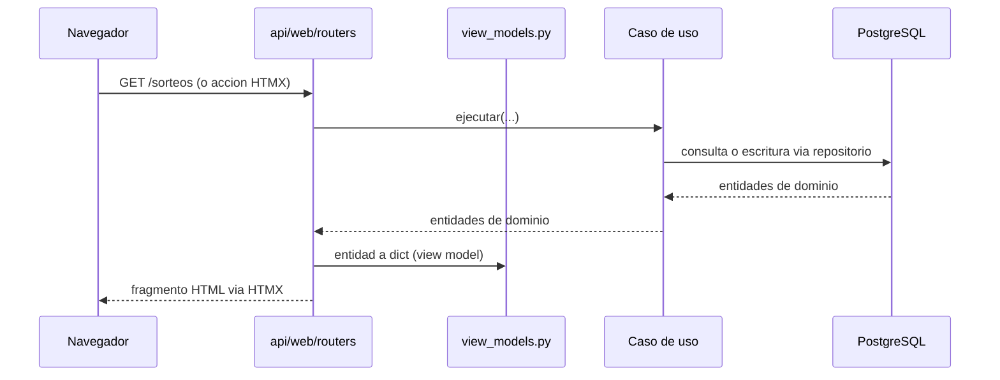

Las plantillas nunca reciben entidades de dominio directamente — siempre pasan por un view model (`api/web/view_models.py`).

---

## API REST

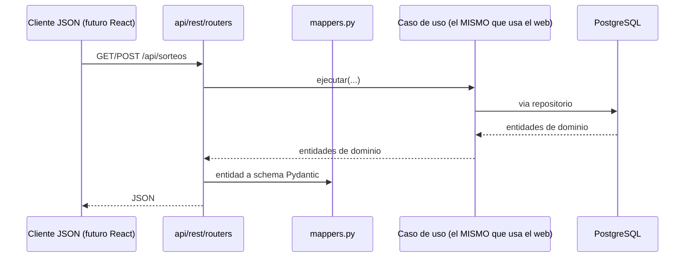

`api/web` y `api/rest` comparten exactamente los mismos casos de uso — reemplazar el frontend HTML por React en el futuro no requiere tocar `application/` ni `domain/`.

Fase 4: `GET /api/predicciones`, `GET /api/predicciones/{codigo}[?cartera=]` y `GET /api/predicciones/{codigo}/fiabilidad[?linea=&hasta=]` (solo lectura) devuelven lo mismo que el caso de uso `CentroDePredicciones` que usan la web y el comando. 404: juego o cartera inexistentes; 409: artefacto alterado o sin configuración; 422: parámetro no válido. Generar y explicar no están en la API: se piden con un POST web protegido o con el comando.

Fase 5: `GET /api/estadisticas/{codigo}/panel` y `GET /api/estadisticas/{codigo}/descriptivas/{metrica}` (solo lectura) devuelven el mismo contenido que `/estadisticas/{juego}/panel` y las páginas de cada métrica; `/api/estadisticas/{codigo}/resumen` (Producto 1) no cambia. 404: juego, métrica o combinación que no aplica (con su motivo); 422: parámetro inválido o ajeno a la métrica; 503: base no disponible.

---

## Fase 6: actualización y operación automática

El núcleo `application/use_cases/operacion_automatica.py` coordina puertos inyectados, reloj consciente de zona, política acotada y estados persistentes. `application/operacion_calendario.py` resuelve eventos en `America/Bogota`; las fuentes y su discrepancia MiLoto están en [fase6_fuentes.md](backend/docs/fase6_fuentes.md). El reloj no prueba celebración; inicio previsto alcanzado, celebración confirmada sin publicación, resultado validado y error de consulta son estados distintos. No existe hora oficial garantizada de publicación.

`api/automatizacion_dependencies.py` compone el adaptador y comprueba el arranque explícito: backend absoluto, destinos de archivos y SHA-256 de la URL de BD, sin guardar/imprimir el DSN. Las rutas relativas se resuelven contra el backend actual, no contra otro worktree. La preparación deja el núcleo pausado. Los modelos siguen elegidos en Carteras: el archivo operativo no los reemplaza ni los selecciona.

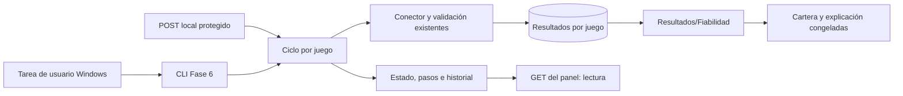

El ciclo obtiene su selección antes de consultar y conserva esa copia durante la ejecución. `infrastructure/operacion_automatica_adaptador.py` reutiliza `SincronizarSorteos`, repositorios, `CentroDeResultados`, `CarterasDeModelos` y `CentroDePredicciones`; no programa `GenerarPronosticoExperimental` de Producto 3 ni introduce otro motor. La recuperación tiene cursor persistente, máximo inicial de tres páginas y reconciliación de doce resultados por consulta; no relee todo el histórico. Validación fallida, huecos, revisión pendiente o versión registrada ausente/incompatible bloquean la emisión del juego y dejan diagnósticos.

El objetivo proviene de la numeración validada y el evento siguiente a la fecha del último resultado cargado. No se usa simplemente el siguiente evento desde «ahora»: una BD atrasada y publicación tardía no autorizan una emisión retroactiva. Antes de publicar se vuelven a comprobar reloj, objetivo y huecos. La guardia se transmite por los contratos de Predicciones y Carteras, manteniendo el comportamiento manual predeterminado. Se guardan versiones, corte, huellas, cartera y explicación; repetir entrada reutiliza, no reajusta. Las importaciones reconcilian seguimiento y, por separado, informes retrospectivos; no se suman clases de evidencia.

Las diferencias con un resultado ya cargado generan una propuesta de revisión inmutable. Después de importar y reconciliar, y antes de admitir la emisión, el núcleo consulta todas las revisiones persistidas del juego comprendidas entre el primer y último sorteo del histórico usado. Consulta sus decisiones explícitas: solo una decisión vigente `aceptada` o `rechazada`, sin ambigüedad de orden, resuelve la propuesta. Esta guarda no usa el límite de cien entradas del panel ni el presupuesto de páginas/reconciliación del proveedor; una propuesta antigua pendiente sigue bloqueando la emisión. Otros juegos y propuestas fuera de ese corte no la bloquean. Las revisiones se crean durante sincronización bajo los recursos del ciclo por juego; la comprobación mantiene esos recursos y conserva las guardas finales de plazo/base existentes. La decisión CLI explícita valida identidad, contenido actual y huellas antes de aceptar mediante `EditarSorteo`; conserva fecha original de creación y no reescribe emisiones. El repositorio elimina y confirma por `flush` las posiciones anteriores antes de insertar las nuevas dentro de la misma transacción, evitando colisiones de unicidad sin commits intermedios. Tras corregir se publican nuevos informes inmutables; los anteriores siguen disponibles. La decisión de rechazo se conserva y evita proponer indefinidamente el mismo cambio.

Las decisiones de una revisión se ordenan por `decision.en` normalizada a UTC cuando todas tienen un instante válido con zona. Si alguna no lo tiene, se conserva lectura compatible por mtime para el conjunto de esa revisión. Un máximo compartido por contenidos distintos se señala mediante `orden_ambiguo=True` en la proyección, calculado antes del límite de presentación. Los nombres SHA solo ordenan visualmente candidatos empatados: no deciden el estado efectivo. Panel, revisiones pendientes, sincronización y CLI usan ese mismo criterio; una observación posterior o una ambigüedad relevante mantiene el bloqueo. Una nueva decisión explícita puede resolverlo; no se reescriben decisiones/propuestas ni se introduce una migración de artefactos.

### Concurrencia, interrupción y alcance

`automatizacion_file_store.py` separa configuración operativa mutable, estado por juego, ejecuciones con pasos, avisos, propuestas y decisiones inmutables. Reutiliza la publicación atómica y lectura cooperante Windows existentes. Las lecturas no crean carpetas, cerrojos ni registros. El núcleo usa cerrojos de SO por juego entre procesos que comparten su directorio; los de Carteras/Predicciones siguen protegiendo sus propios recursos.

`operacion_advisory.py` añade PostgreSQL advisory por identidad estable de juego: el ciclo mantiene un bloqueo de sesión en la misma conexión durante todos sus commits; guardar/actualizar/eliminar en el repositorio manual toma el bloqueo de transacción correspondiente. Un conflicto se informa y el resto de juegos continúa. Coordinan escritores de aplicación que comparten BD, incluso con directorios operativos distintos; no impiden SQL externo que ignore el protocolo. SQLite se admite solo para fixtures y no acredita esta exclusión distribuida. Los ensayos de SQL controlado no sustituyen una prueba contra PostgreSQL nativo.

El registro antecede a los pasos irreversibles. La consulta distingue un cerrojo vivo, un cierre terminal y una ejecución interrumpida. Si leyó `en_curso` pero el cerrojo ya no está tomado, relee el registro: el escritor publica el cierre antes de liberar su cerrojo, por lo que no deriva una interrupción de una instantánea vieja. Una instantánea coherente aún `en_curso` puede ser válida durante el cierre. `recuperar` vuelve a comprobar estado y actividad bajo el recurso de escritura de esa ejecución y actualiza condicionalmente solo una interrupción confirmada; dos recuperaciones no sustituyen un cierre publicado ni vuelven a marcar un terminal. Se conserva la detección de procesos realmente muertos, sin sincronizar, emitir, promocionar temporales o borrar evidencia ajena. Un reintento puede reutilizar publicaciones ya completas. Los errores guardan tipo/paso seguro, sin DSN o contenido de `.env`. El panel `/automatizacion` y su historial muestran última comprobación/actualización, eventos, versión congelada, pendientes y resultado por paso. Sus GET son lectura; sus POST conservan origen/token local y una comprobación manual es un hilo puntual, no un programador web.

### Proceso y tarea Windows

`python -m scripts.operacion_automatica --config RUTA ciclo` funciona fuera del servidor. `scripts/windows/fase6_tarea.ps1` crea por defecto solo un plan XML; `-Instalar` registra una tarea deshabilitada del usuario actual y `-Activar` la habilita explícitamente. Usa intérprete, configuración y backend absolutos, `InteractiveToken`, privilegio mínimo, inicio de sesión y repetición cada cinco minutos, `IgnoreNew`, `StartWhenAvailable`, sin despertar el equipo y con límite de dos horas. La política del núcleo determina cuándo consultar, separada del disparo de tarea. No hay programa por proceso Uvicorn, contraseñas ni modificación de permisos globales.

Cerrar navegador/Uvicorn es compatible con la operación; cerrar sesión, suspender o apagar impide nuevas ejecuciones. La pausa de tarea impide disparos y la pausa del núcleo impide trabajo nuevo: no matan un ciclo entre pasos. Desinstalar solo retira la tarea propia inactiva, preservando datos. [Protocolo Windows](backend/docs/fase6_windows.md) y [control de tarea](backend/docs/fase6_tarea_windows.md).

La dependencia IANA `tzdata==2026.5` se añade solo en Windows, donde no se presupone tzdb. Se prepara un entorno Fase 6 separado con restricciones exportadas del entorno ML validado; este último no se actualiza. Sin Bogotá disponible, la operación se bloquea con un motivo accionable en vez de usar zona del equipo o un desplazamiento fijo silencioso.

El ensayo Python del controlador configura UTF-8 sin BOM para stdout/stderr solo dentro del PowerShell hijo (`-EncodedCommand` con programa UTF-16LE y wrappers UTF-8 con BOM para PS5.1). En v3.1 el lanzamiento exige `-OutputFormat Text` y fija `$ProgressPreference='SilentlyContinue'` antes de cualquier inicialización de módulos en el hijo: evita la serialización CLIXML y el progreso automático de PowerShell 5.1 en stderr sin filtrar su captura. Captura ambos streams como bytes y guarda su contenido y código de salida antes de decodificar UTF-8 estricto. Una infracción del contrato conserva esa evidencia y falla explícitamente, sin `None` convertido a vacío ni reemplazo de caracteres. No modifica consola, perfiles o variables globales del servidor; los cmdlets simulados siguen sin acreditar el Programador real.

### Validación y límites

**Fase 6 v3.4 — validación operativa del 23 de octubre de 2026:** tarea Windows y núcleo habilitados. MiLoto incorporó automáticamente el #628 y guardó la cartera/explicación para el #629; ColorLoto incorporó el #229 y guardó las del #230. Histórico canónico previo y selecciones conservados; doce copias HTML anteriores de MiLoto sí cambiaron al reconciliar. La publicación manual y Actions se completaron después en PR #96 (merge `fcadea6a08e8e6b52386a9055be16bb1873b9a29`, Actions `39939306600`); queda la revisión separada de restos históricos. [Evidencias, alcance y salvedades](backend/docs/fase6_validacion_operativa_2026-10-23.md).

### Antecedentes de validación y protocolos anteriores a la activación real

Daniel completó en Windows nativo la v3.1: **7.243 aprobadas**, cero fallos, errores u omisiones; OpenSSL `exigir` 7/7, demostración sintética de cuatro juegos y `pip check` limpio. Las **47 dirigidas Linux de v3.2** conservan su evidencia propia. Son antecedentes de esas versiones, no resultados v3.3, y no se suman grupos solapados. La demostración usa proveedor controlado y SQLite propio; no acredita recorrido con destinos reales o advisory PostgreSQL.

El ensayo nativo v3.2 ya superó el error de codificación: `Instalar` registró la tarea y falló después en `Assert-TareaPropia`. La tarea `LP6-f03df678192ac201` permanece `Disabled`, con `Enabled=false`; no hubo activación ni disparo. El ZIP del ensayo conserva planes; el segundo ZIP aporta el XML realmente exportado y CIM. De los 14 campos comparados, coinciden 11: Windows omite `RunLevel` y `WakeToRun` y expresa el usuario del desencadenador de sesión como cuenta local, mientras el plan usa SID. CIM informa `Limited` (0) y `WakeToRun=false`.

La v3.3 compara la semántica de la exportación: admite solo valores predeterminados documentados expresamente y resuelve las identidades mediante mecanismos nativos para comparar el SID esperado. Una omisión no autorizada, privilegio elevado, valor explícito incompatible o usuario distinto/no resoluble se rechaza. No usa nombre corto, sufijos ni excepciones por usuario. Revisa también vinculación, campos críticos, acciones y desencadenadores para conservar el rechazo de tareas ajenas o alteradas.

El XML exportado se archiva antes de validarlo, incluso cuando falla la comprobación posterior al registro, y se distingue del plan y del diagnóstico. Se conservan el contrato UTF-16LE con BOM, la captura binaria con decodificación estricta y las garantías de limpieza v3.2. La nueva evidencia Linux usa PowerShell real y simulaciones explícitas del Programador y la resolución nativa; no acredita Windows PowerShell 5.1, COM/MSXML, permisos o NTFS nativos. Referencias oficiales: [esquema del Programador](https://learn.microsoft.com/en-us/windows/win32/taskschd/task-scheduler-schema), [nivel de ejecución del principal](https://learn.microsoft.com/en-us/windows/win32/taskschd/principal-runlevel) y [traducción de cuenta a SID](https://learn.microsoft.com/en-us/dotnet/api/system.security.principal.ntaccount.translate). Los valores por defecto no convierten en opcionales los campos que el contrato de propiedad exige presentes.

No se activan ni retiran tareas del equipo del operador en esta entrega. Se conservan las raíces pendientes `C:\Users\danie\AppData\Local\Temp\f6t b08b6182` y `C:\Users\danie\AppData\Local\Temp\f6t 381c1b8b`, las tareas `LP6-f03df678192ac201` y `LP6-ae2dda9494895571` y los demás restos históricos. Su limpieza será una etapa posterior separada: verificar existencia, identidad/propiedad y ausencia de ejecución, archivar evidencia y comprobar la retirada antes de borrar una raíz. Consulta o permisos fallidos, tarea ajena/viva o retirada no verificable obligan a conservar y comunicar el pendiente; no autorizan elevar permisos.

El protocolo de esta entrega termina en aplicar v3.3 sobre v3.2 exacta → pruebas dirigidas en PowerShell 5.1 → devolver evidencia y detenerse. Conservar el worktree y el Python existentes. El nuevo ensayo real del Programador será posterior a la revisión; esta guía no lo inicia ni incluye una orden para ejecutarlo ahora. No se repiten completa, ML, demostración o presentación/PDF por rutina. Operación con destinos reales, PostgreSQL, activación/novedad observada, publicación manual, Actions y acreditación prospectiva mantienen pendientes separados. El supervisor verifica el inventario público y conserva bytes físicos LF/CRLF, sin cambios TEMP/TMP o `--basetemp`. Se mantienen `experimental_no_acreditado`, AE-39 **NO-GO** y `AUTORIZA_EVALUACION = False`.

## Orden futuro y límite de esta entrega

**6 Actualización y operación automática → 7 Simulaciones → 8 API pública → 9 React → 10 Despliegue → 11 Aplicación personal.** Fase 6 está activada y su prueba operativa con MiLoto/ColorLoto está verificada; fases 7–11 conservan su planificación propia. Las referencias originales 6/7/8/9 pasan a 7/8/9/10 sin renombrar evidencia o código históricos. Fase 11 consumirá servicios pertinentes sin duplicar ML; plataforma y empaquetado siguen pendientes. Objetivos y aceptación: [ROADMAP.md](ROADMAP.md).

---

## Base de datos

```mermaid
erDiagram
    JUEGOS ||--o{ SORTEOS : produce
    JUEGOS ||--o{ COLORES : define
    JUEGOS ||--o{ SINCRONIZACIONES : registra
    JUEGOS ||--o{ ESTADISTICAS : cachea
    SORTEOS ||--o{ SORTEO_NUMEROS : contiene
    SORTEOS ||--o| SORTEO_SUPERBALOTA : tiene
    SORTEOS ||--o{ SORTEO_COLOR_NUMERO : contiene
    COLORES ||--o{ SORTEO_COLOR_NUMERO : usado_en

    JUEGOS {
        uuid id PK
        string codigo
        int rango_min
        int rango_max
        boolean tiene_color
    }
    SORTEOS {
        uuid id PK
        uuid juego_id FK
        int numero_sorteo
        date fecha
    }
    SINCRONIZACIONES {
        uuid id PK
        uuid juego_id FK
        string estado
        int sorteos_nuevos
        int sorteos_duplicados
        int sorteos_incompletos
    }
    ESTADISTICAS {
        uuid id PK
        uuid juego_id FK
        string tipo_estadistica
        int hasta_numero_sorteo "NULL = histórico completo"
        char_64 parametros_hash
        jsonb parametros
        jsonb resultado
        timestamptz calculado_en
        timestamptz valido_hasta "NULL o futuro = vigente"
    }
```

Tablas normalizadas (no `INTEGER[]`) para números y colores: permite indexar y consultar por número individual eficientemente a escala (necesario para el análisis de frecuencia de la Fase 3).

**`modelos`, `metricas_modelo` y `predicciones` (esquema de la Fase 1).** Siguen sin escribirse.
- **Decisión formal sobre `predicciones` (Fase 4).** Queda reservada y no se escribe. La fuente canónica de cada predicción es el almacén inmutable: la cartera de Producto 5 (vector fuente congelado y combinaciones) y su explicación (`storage/predicciones`). `predicciones_explicacion.proyeccion_tabla()` muestra sus columnas en la página, la API y el comando: `juego_id` como código (el UUID no se resuelve sin la base), `modelo_id` vacío (las versiones se identifican por su clave), `numeros_fuertes`/`numeros_debiles` (pares en ColorLoto) y `nivel_confianza` vacío a propósito: la fiabilidad se presenta como rendimiento observado e incertidumbre por separado.
- Los modelos entrenados de la Fase 3 viven en el almacén del laboratorio (manifiesto sellado + estimador), como los informes y pronósticos inmutables de los Productos 3–6. Escribir además una fila en PostgreSQL crearía un segundo registro de la misma versión, sin una transacción común con los archivos.
- La ficha y `GET /api/laboratorio/modelos/{clave}` muestran la proyección a sus columnas. `activo` queda sin valor: el modelo de la operación diaria lo elige la configuración de carteras.

---

## Decisiones de diseño y por qué

| Decisión | Alternativa descartada | Por qué |
|---|---|---|
| UnitOfWork con commit por sorteo | Una transacción por sincronización completa | Un fallo a mitad de un lote de 1000 sorteos no debe perder los primeros 999 |
| Modelos registrados en el almacén del laboratorio (manifiesto sellado publicado el último + estimador por SHA-256) | Filas en `modelos`/`metricas_modelo` con el estimador en disco | Una sola fuente por versión; publicación atómica y exclusiva entre procesos sin una transacción mixta base-archivos (Fase 3) |
| Deserialización restringida tras comprobar entorno y SHA-256 | `pickle.load` directo o `skops` como dependencia nueva | Solo se cargan modelos propios; la lista cerrada de clases limita lo que se puede invocar al cargar, sin añadir dependencias (Fase 3) |
| Elegir la versión registrada en la configuración de carteras | Un «modelo vigente» propio del registro | Un único mecanismo de selección del operador; comparar o entrenar no cambia nada (Fase 3) |
| Temporal de publicación corto e independiente del destino (`.publicacion.<16 hex>.tmp`), un solo publicador para Productos 4–6 | `.<nombre final>.<16 hex>.tmp` | Si cabe el destino, cabe el temporal: en Windows sin rutas largas el nombre anterior hizo fallar la primera ejecución de la Fase 3 (temporales de 262 y 264 para destinos de 240 y 242) |
| La ficha lee la clasificación del informe de procedencia guardado y la separa de la evaluación de su receta | Guardar el ganador en el manifiesto, o recalcularlo al mostrar la ficha | Los manifiestos ya publicados no cambian, y la ficha no puede presentar como propio el resultado de otro modelo ni reordenar el informe (cierre de la Fase 3) |
| Compatibilidad sin el sistema operativo (se registra y se informa) | Bloquear la carga entre Linux y Windows | Lo que condiciona la carga del estimador son scikit-learn y las versiones menores de Python, NumPy y SciPy; el sistema sigue en la identidad, así que cada entorno de entrenamiento tiene su versión (Fase 3) |
| Centro de predicciones que coordina Producto 5, Producto 6 y la Fase 3 | Un motor nuevo de generación, carteras o evaluación | La elección del operador sigue siendo la configuración de carteras; la misma configuración da la misma cartera por cualquier camino; nada se entrena dos veces (Fase 4) |
| Tabla `predicciones` reservada; proyección de solo lectura | Escribir cada predicción también en PostgreSQL | Una sola fuente por predicción, inmutable y verificable, sin una transacción mixta base-archivos (Fase 4) |
| Fiabilidad como tres cantidades (emitida, observada, incertidumbre) con bootstrap de bloques por sorteo | Un «nivel de confianza» único o etiquetas alta/media/baja | Los candidatos de un sorteo no son independientes y la serie de sorteos tiene dependencia temporal; un número único ocultaría la muestra, el método y sus límites (Fase 4) |
| Importancias globales solo del estimador persistido, leídas con la carga restringida en el proceso trabajador | Reajustar el modelo o calcular importancias por permutación para explicar | Explicar no puede cambiar ni reentrenar lo emitido; la permutación exigiría volver a evaluar con datos (Fase 4) |
| Parsers separados de conectores | Parseo embebido en el conector | Testeable sin red; permite reprocesar HTML guardado con el mismo código |
| application/ nunca importa infrastructure/ | Logger de infraestructura importado directamente | logging.getLogger(nombre) es un registro global — se obtiene el mismo logger configurado sin la dependencia indebida |
| Tablas normalizadas para números/colores | INTEGER[] de PostgreSQL | Necesario para consultas de frecuencia por número individual a escala (Fase 3) |
| EjecucionSincronizacion separada del Data Quality Report | Todo en una sola entidad | El rango histórico y la cobertura son del estado actual de los datos, no de una corrida puntual |
| DrawSourceConnector como puerto único | Un cliente HTTP genérico sin abstracción | Permite intercambiar scraping por CSV o una futura API oficial sin tocar SincronizarSorteos |
| Baloto y Revancha como juegos independientes (Opción A) | Una entidad Sorteo con dos resultados embebidos (Opción B) | Cero cambios de esquema, reutiliza el 100% del dominio ya construido, fiel a que son productos regulatoriamente distintos -ver sección dedicada arriba |
| Dos índices únicos parciales en `estadisticas` | Un `UNIQUE` convencional sobre las 4 columnas | PostgreSQL nunca trata `NULL = NULL` como duplicado en un `UNIQUE` -el histórico completo (`hasta_numero_sorteo IS NULL`) habría podido duplicarse sin límite |
| Upsert (`ON CONFLICT DO UPDATE`) al recalcular una identidad existente | `INSERT` incondicional en cada cálculo | Recalcular una estadística previamente invalidada debe reemplazar esa fila, no intentar crear una segunda -evita `UniqueViolation` bajo concurrencia real, no solo en el caso feliz |

---

## Fase 7: simulaciones

Mismo patrón que Productos 4 y 5 y la Fase 4: un caso de uso común (`app/application/use_cases/simulaciones.py`, `SimulacionesFase7`) para web, API interna y comando; módulos puros en `app/application/fase7/` y adaptadores en infraestructura.

| Capa | Pieza | Responsabilidad |
|---|---|---|
| Aplicación (puro) | `fase7/motor.py` | mecanismo por juego, estadísticas fijadas (motor de Fase 5 para lo observado y versión vectorizada contrastada), RNG `PCG64(SeedSequence([semilla, 7, juego]))` con consumo fijo por iteración, lotes acotados, p-valores +1, Bonferroni del motor |
| Aplicación (puro) | `fase7/artefacto.py` | identidad y clave SHA-256 (serialización canónica de AE-52), resultado con huella de contenido e integridad, comprobación única de filas (`verificar_fila`: tipos, integridad y juego de `juego_id`) y exportaciones derivadas |
| Aplicación | `use_cases/simulaciones.py` | trabajo en segundo plano: lectura `READ ONLY` del histórico hasta el corte, reutilización por clave, ejecutor, publicación y relectura verificada, estados, lectura del progreso que relee el registro con el cerrojo libre, recuperación bajo el cerrojo de la ejecución, verificación |
| Puertos | `interfaces/simulaciones_repository.py`, `interfaces/ejecutor_simulaciones.py` | tabla `simulaciones` y proceso trabajador |
| Infraestructura | `repositories/simulaciones_repository_sqlalchemy.py` | filas `SimulacionORM` ↔ `Simulacion`; publicar con `pg_advisory_xact_lock` sobre `loteria:simulaciones:<clave>` y `lock_timeout = 10s`, buscar e insertar en la misma transacción |
| Infraestructura | `simulaciones_trabajador.py` | proceso `spawn` con tiempo máximo y progreso por cola; no escribe |
| Infraestructura | `storage/operacion_file_store.py` (existente) | registro de progreso y cerrojos en `DIRECTORIO_SIMULACIONES/operacion`; no es fuente del resultado |
| Entrada | `api/web/routers/simulaciones.py`, `api/rest/routers/simulaciones.py`, `scripts/simulaciones.py` | web con POST protegidos, API interna de solo lectura, comando |
| Presentación | `templates/simulaciones/_ejecucion_estado.html` | F7-VIS-01: un juego pendiente o activo se presenta interrumpido cuando la ejecución global está interrumpida; último avance como dato histórico, sin barra activa ni escritura del registro; estados cerrados y enlaces conservados |

Flujo: `iniciar` (cerrojo del juego y registro) → hilo (`get_lanzador_de_simulaciones`) → `ejecutar`: lectura de solo lectura (se cierra) → identidad → fila existente íntegra ⇒ reutilizar → trabajador (lotes, progreso) → transacción de publicación (advisory de la clave, búsqueda, inserción de la fila completa, commit) → relectura y verificación → cierre del registro, escrito antes de soltar el cerrojo de la ejecución. La tabla `simulaciones` es la fuente canónica sin cambio de esquema: identidad en `parametros`, resultado en `resultado_resumen`; `num_iteraciones`, `juego_id`, `ejecutado_en` y `duracion_ms` con su significado original. Detalle y justificación: [backend/docs/fase7_simulaciones.md](backend/docs/fase7_simulaciones.md).


Validación local completada: selección Windows consolidada de 3183 pruebas únicas, medición de veinte puntos y PostgreSQL 16.14 en un contenedor Linux propio con nueve controles. El ajuste de presentación se revalidó en Windows con 52 pruebas dirigidas, sonda 8/8 y 15 capturas de Brave. Estos resultados mantienen su procedencia y solapamientos en el [informe del operador](backend/docs/fase7_validacion_operador_2026-10-24.md); no se atribuyen al ajuste suites completas ni nuevas mediciones.
