# Arquitectura del sistema

Este documento explica cómo está construido el sistema, con suficiente detalle para que otro desarrollador lo entienda sin tener que leer el código primero.

## Índice

1. [Principios de diseño](#principios-de-diseño)
2. [Arquitectura general](#arquitectura-general)
3. [Clean Architecture: las 4 capas](#clean-architecture-las-4-capas)
4. [Dominio: los cuatro juegos](#dominio-los-cuatro-juegos)
5. [Baloto y Revancha: por qué son juegos independientes](#baloto-y-revancha-por-qué-son-juegos-independientes)
6. [Conectores y adquisición de datos](#conectores-y-adquisición-de-datos)
7. [Flujo de sincronización](#flujo-de-sincronización)
8. [Resiliencia de la sincronización](#resiliencia-de-la-sincronización)
9. [Reprocesamiento desde HTML](#reprocesamiento-desde-html)
10. [Data Quality Report](#data-quality-report)
11. [Motor estadístico y caché persistido](#motor-estadístico-y-caché-persistido)
12. [Visualizaciones web de estadísticas](#visualizaciones-web-de-estadísticas)
13. [Flujo de una petición web (HTMX)](#flujo-de-una-petición-web-htmx)
14. [API REST](#api-rest)
15. [Base de datos](#base-de-datos)
16. [Decisiones de diseño y por qué](#decisiones-de-diseño-y-por-qué)

---

## Principios de diseño

1. **La dirección de las dependencias siempre apunta hacia adentro.** `domain` no conoce a nadie. `application` solo conoce a `domain`. `infrastructure` implementa los puertos que `application` define. `api` orquesta todo pero no contiene lógica de negocio.
2. **Los casos de uso son la única puerta a la lógica de negocio.** Ningún router (web o REST) valida reglas de juego, construye combinaciones, ni decide si un sorteo es válido — eso vive exclusivamente en `domain/games` y se invoca a través de casos de uso.
3. **El scraping nunca se mezcla con las reglas de negocio.** Un conector devuelve DTOs neutrales (`DrawDetail`); la decisión de si eso es un sorteo válido para PostgreSQL la toma `RegistrarSorteo`, el mismo caso de uso que usa el formulario manual del dashboard.
4. **Todo origen de datos es intercambiable.** `SincronizarSorteos` no sabe si detrás hay HTML scrapeado, un CSV, o una futura API oficial — todos implementan el mismo puerto `DrawSourceConnector`.

---

## Arquitectura general

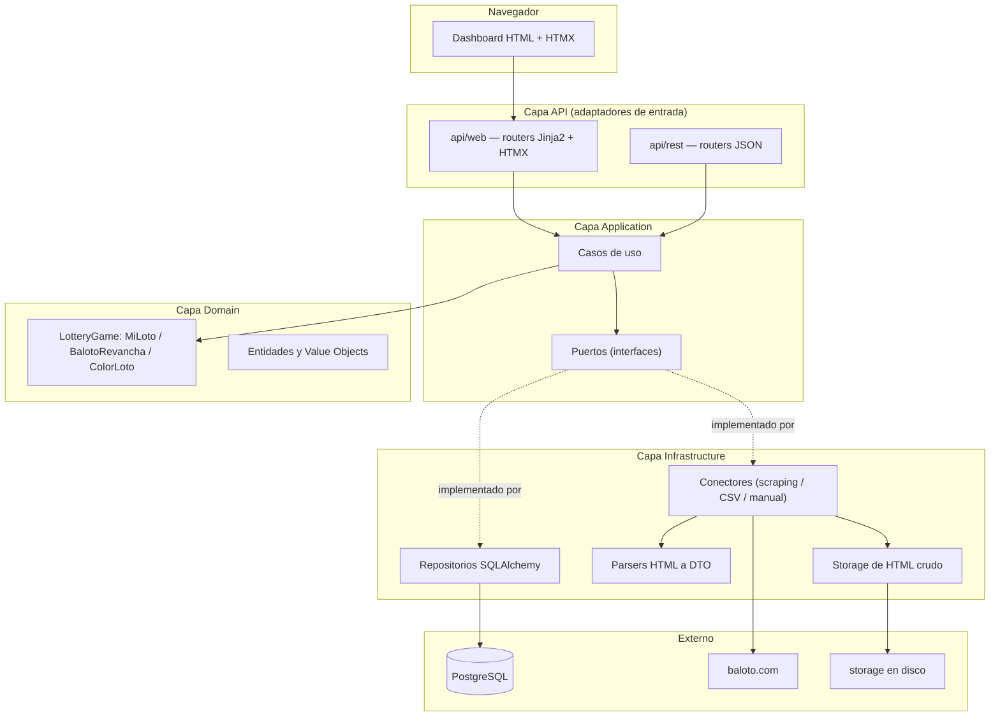

---

## Clean Architecture: las 4 capas

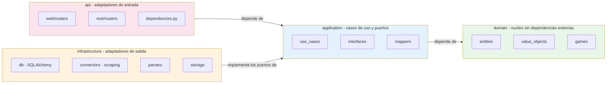

**Regla verificada activamente en la auditoría de Fase 2:** ningún archivo de `application/` importa de `infrastructure/`. La única forma en que `application/` usa infraestructura es a través de puertos (`SorteoRepository`, `DrawSourceConnector`, `UnitOfWork`, `HtmlStorage`), inyectados por `api/dependencies.py`.

---

## Dominio: los cuatro juegos

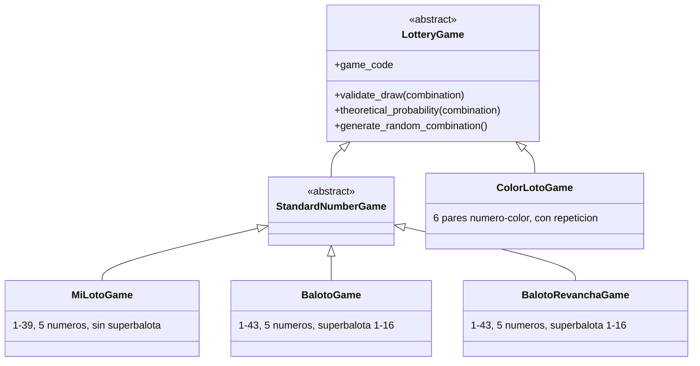

Cada juego encapsula sus propias reglas de validación y cálculo de probabilidades. `GameFactory` traduce la entidad persistida `Juego` (tabla `juegos`) a la instancia de dominio `LotteryGame` correspondiente. `BalotoGame` y `BalotoRevanchaGame` comparten exactamente la misma mecánica (misma clase base `StandardNumberGame`, mismos rangos), pero son juegos independientes -ver la siguiente sección.

---

## Baloto y Revancha: por qué son juegos independientes

**El problema real detectado:** hasta la revisión arquitectónica de agosto de 2026, el sistema solo modelaba `BALOTO_REVANCHA` -el resultado principal de Baloto clásico nunca se scrapeaba ni se guardaba. Al abrir un sorteo de la familia Baloto solo aparecía Revancha.

**Diagnóstico:** en `infrastructure/parsers/baloto_revancha_parser.py`, el filtro de listado (`_RE_DRAW_ID`) solo reconocía enlaces `/resultados-revancha/{id}`, descartando las filas de Baloto clásico. El conector solo pedía el detalle de Revancha. Fue una decisión de Fase 1 documentada pero incompleta: nunca se contempló capturar el resultado principal.

**Verificado contra el sitio real:** `/resultados-baloto/{id}` y `/resultados-revancha/{id}` son páginas de detalle *separadas*, cada una con solo su propio resultado y su propia tabla de premios -no existe una sola página con ambos. El listado (`/resultados`) sí trae ambas familias juntas, así que el descubrimiento de sorteos comparte un único recorrido de paginación; solo el detalle requiere una petición por familia.

**Decisión: Opción A — juegos independientes relacionados por `numero_sorteo`.** Se evaluaron dos alternativas:

| | Opción A (elegida): juegos independientes | Opción B (descartada): una entidad con dos resultados |
|---|---|---|
| Cambios de esquema | Ninguno -solo una fila nueva en `juegos` | Requiere romper la relación 1:1 `Sorteo` → `Combination`, o una tabla paralela completa |
| Reutilización de dominio | Total: `StandardNumberGame`, `RegistrarSorteo`, `ValidarIntegridadDatos`, paginación, Data Quality Report -todo funciona sin modificar | Ninguna: cada caso de uso tendría que saber manejar "uno o dos resultados" |
| Fidelidad al dominio real | Alta: Baloto y Revancha son productos regulatoriamente distintos (reglamentos y acumulados separados) | Baja: fusiona dos productos distintos en una sola entidad porque comparten fecha |
| Escalabilidad para Fase 3 | Cada juego es una serie temporal independiente, igual que MiLoto/ColorLoto -patrón ya probado | Cada consulta estadística tendría que desempaquetar la estructura combinada |

**Implementación:** `BalotoGame` (nuevo, `domain/games/baloto.py`) + fila `BALOTO` en `juegos` (migración `0004`, puramente de datos) + `BalotoConnector` (nuevo, comparte el listado con `BalotoRevanchaConnector` pero pide su propio detalle) + `ObtenerSorteoConPareja` (caso de uso que, dado un sorteo de cualquiera de las dos familias, busca el resultado del mismo `numero_sorteo` en el juego relacionado, para que la interfaz los muestre juntos).

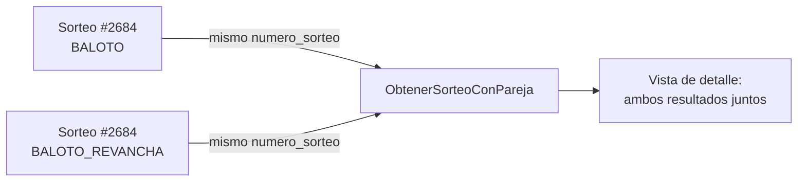

---

## Conectores y adquisición de datos

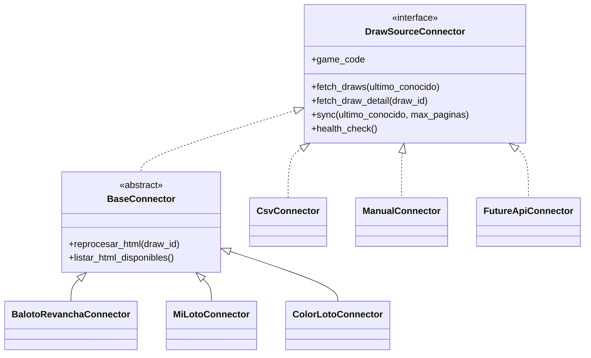

`BaseConnector` implementa una sola vez (patrón Template Method) la paginación, los reintentos con backoff exponencial, el guardado del HTML crudo y la tolerancia a fallos. Las subclases concretas solo aportan las URLs y delegan el parseo a un módulo de `infrastructure/parsers/` — así el conector responde "cómo llegar al dato" y el parser responde "qué significa el dato".

**Agregar un origen de datos nuevo no requiere tocar `SincronizarSorteos`:** basta con implementar `DrawSourceConnector` y registrar la clase en `ConnectorRegistry`.

---

## Flujo de sincronización

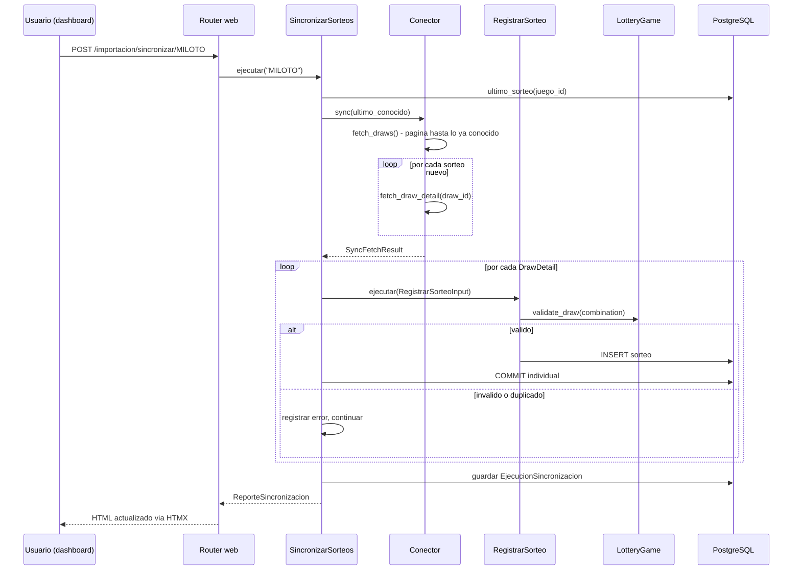

---

## Resiliencia de la sincronización

Documento completo: `backend/docs/resiliencia_sincronizacion.md`. Resumen:

- **El "último sorteo conocido" se recalcula desde PostgreSQL en cada corrida**, nunca desde el log de la corrida anterior.
- **Cada sorteo se confirma (commit) individualmente**, vía el puerto `UnitOfWork`. Antes de esta corrección, toda la sincronización corría en una sola transacción (una request = una Session = un commit al final); un fallo a mitad de camino habría revertido todo el lote. Ahora, si el sorteo 851 de 1000 falla, los 850 anteriores ya están confirmados y sobreviven.
- **Tres capas de protección contra duplicados**: el conector no vuelve a ofrecer lo ya conocido; `RegistrarSorteo` verifica `existe()` antes de escribir; la restricción UNIQUE de PostgreSQL es la última línea de defensa.
- **Un fallo individual nunca detiene el lote**: hay un catch-all deliberado además de los tipos de error anticipados.

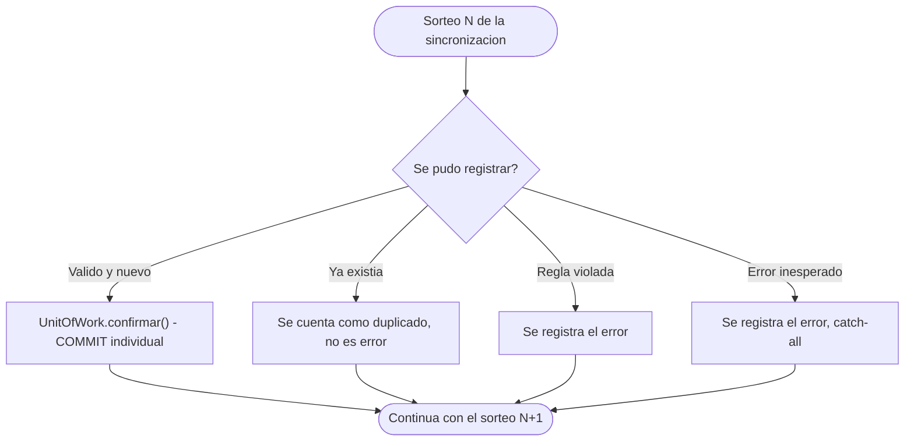

---

## Reprocesamiento desde HTML

Permite reconstruir la base de datos usando únicamente los archivos ya guardados en `storage/html/`, sin volver a depender del sitio oficial.

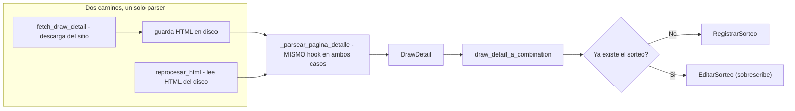

Reutiliza literalmente el mismo hook de parseo y el mismo mapper que la sincronización en vivo — no existe una segunda implementación que pueda desincronizarse de la primera.

---

## Data Quality Report

Combina dos fuentes a propósito:

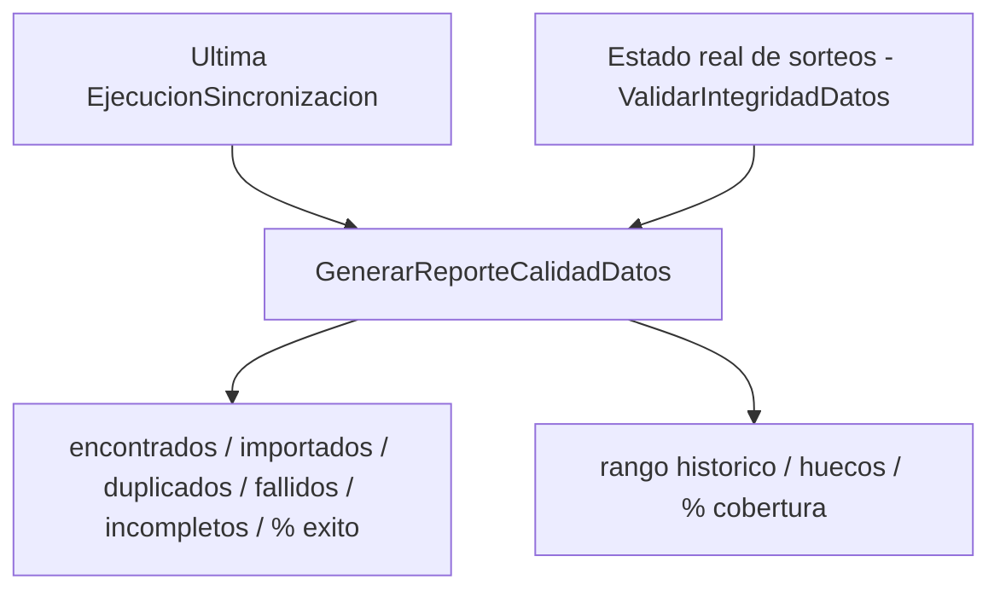

El rango histórico y la cobertura son propiedades del estado actual de los datos, no de una corrida puntual — por eso el reporte combina ambas fuentes en vez de fusionarlas en una sola entidad.

---

## Motor estadístico y caché persistido

**Motor puro (`application/estadisticas/motor/`):** un conjunto de módulos que calculan sobre `ResultadoNumerico` (DTO neutral: números, fecha, superbalota) sin importar nada de `infrastructure/` ni de `api/` — no conocen PostgreSQL, HTTP, ni de qué juego provienen los datos, solo reciben una secuencia de resultados y un rango. Esto los hace agnósticos por juego: el mismo código calcula frecuencias para MiLoto (1-39) o para Baloto/Revancha (1-43) sin ninguna rama condicional por juego. El motor incluye módulos para varios tipos de análisis (frecuencia, atrasos, distribuciones, coocurrencia, patrones temporales, entre otros); **solo un subconjunto de ellos está conectado al orquestador y expuesto en la web actualmente** (ver siguiente sección) — el resto existe como código de motor pero no forma parte de ninguna visualización todavía.

**Orquestador (`CalcularYPersistirEstadistica`, `application/use_cases/`):** único punto de entrada para calcular una estadística. Mantiene un catálogo cerrado de "recetas" (función de cálculo + función de serialización + fuente de histórico) por `tipo_estadistica`. Flujo: busca si ya existe una versión vigente (`EstadisticaRepository.buscar_vigente`) → si existe, la devuelve sin recalcular → si no, obtiene el histórico (`ResultadosHistoricosRepository`, con corte temporal aplicado tanto en SQL como de forma defensiva en Python — doble capa anti-fuga de datos futuros) → calcula con el motor puro → serializa → persiste (`EstadisticaRepository.guardar`).

**Fuente de histórico tipada (Etapas AE-1/AE-2/AE-3/AE-4/AE-5/AE-6/AE-7/AE-8/AE-9/AE-10/AE-11):** `_Receta.obtener_historico` es un campo `Callable` con default (`_obtener_historico_numerico`, reproduce exactamente el comportamiento anterior a esta extensión) — nunca un `if tipo_estadistica == ...` dentro del orquestador para elegir el repositorio. Las 9 recetas de juegos numéricos usan ese default sin ningún cambio de comportamiento; las once recetas de ColorLoto (`frecuencia_numeros_colorloto`, Etapa AE-1; `frecuencia_colores_colorloto`, Etapa AE-2; `frecuencia_pares_colorloto`, Etapa AE-3; `atrasos_numeros_colorloto`, Etapa AE-4; `atrasos_colores_colorloto`, Etapa AE-5; `atrasos_pares_colorloto`, Etapa AE-6; `repeticiones_entre_sorteos_colorloto`, Etapa AE-7; `distribucion_pares_impares_colorloto`, Etapa AE-8; `distribucion_altos_bajos_colorloto`, Etapa AE-9; `maximo_repeticion_color_por_sorteo_colorloto`, Etapa AE-10; `distribucion_pares_consecutivos_colorloto`, Etapa AE-11) declaran `_obtener_historico_colorloto`, que trae en dos consultas totales (nunca una por sorteo) tanto el histórico de pares número-color como el catálogo completo de colores del juego (`ColorRepository.listar_todos`, Etapa AE-0), empaquetados en un objeto compuesto (`_HistoricoColorLoto`) que las once recetas reutilizan para validar integridad en memoria contra `Color.esta_vigente_en`, sin duplicar la regla — patrón Strategy: el propio catálogo declara su fuente, el orquestador nunca bifurca por el tipo de estadística.

**Persistencia (`EstadisticaRepository` puerto + `EstadisticaRepositorySQLAlchemy`):** la identidad de cada estadística calculada es la tupla `(juego_id, tipo_estadistica, hasta_numero_sorteo, parametros_hash)`. `parametros_hash` es un SHA-256 de los parámetros de cálculo (rango, cantidad de números, etc.) canonicalizados de forma determinista (claves ordenadas, separadores fijos) — dos cálculos con parámetros distintos nunca colisionan, y el mismo cálculo repetido siempre produce el mismo hash. La tabla `estadisticas` usa **dos índices únicos parciales** en vez de un `UNIQUE` convencional, porque PostgreSQL nunca considera `NULL = NULL` en una restricción `UNIQUE` (así que un `UNIQUE` normal habría permitido múltiples filas "duplicadas" para histórico completo): uno para `hasta_numero_sorteo IS NOT NULL` (los 4 campos completos), otro para `hasta_numero_sorteo IS NULL` (los 3 campos restantes, el corte ya fijo por el propio índice).

**Invalidación selectiva:** `RegistrarSorteo`, `EditarSorteo` y `EliminarSorteo` — los tres casos de uso que mutan sorteos — llaman a `EstadisticaRepository.invalidar_por_juego(juego_id, desde_numero_sorteo)` inmediatamente después de una escritura exitosa (nunca antes: si la validación de dominio falla, no se invalida nada). La semántica: se invalidan las estadísticas con histórico completo (siempre incluyen cualquier sorteo nuevo) y las que tienen un corte `>= desde_numero_sorteo` (sus datos alcanzaban o hubieran alcanzado el sorteo mutado); las que tienen un corte anterior al sorteo mutado se conservan intactas, por ser históricas congeladas por definición. La invalidación siempre está aislada por `juego_id` — mutar un sorteo de Baloto Revancha nunca invalida el caché de MiLoto ni de Baloto clásico.

**Upsert al recalcular:** cuando una identidad ya existe (vigente o previamente invalidada) y se calcula de nuevo, `guardar()` usa un `INSERT ... ON CONFLICT ... DO UPDATE` de PostgreSQL — con dos ramas de conflicto, una por cada índice único parcial — en vez de intentar un `INSERT` incondicional. Esto reemplaza la fila existente (mismo `id`, `resultado`/`calculado_en`/`valido_hasta` actualizados) en lugar de crear una segunda fila para la misma identidad: nunca queda más de una fila por `(juego_id, tipo_estadistica, hasta_numero_sorteo, parametros_hash)`. La operación comparte la misma sesión/transacción que la escritura del sorteo que la disparó (mismo patrón de `UnitOfWork` de la Fase 2): si esa transacción no se confirma, ni el sorteo ni la invalidación/upsert quedan persistidos — atómico junto con la mutación, no una operación aparte que pueda quedar a medias.

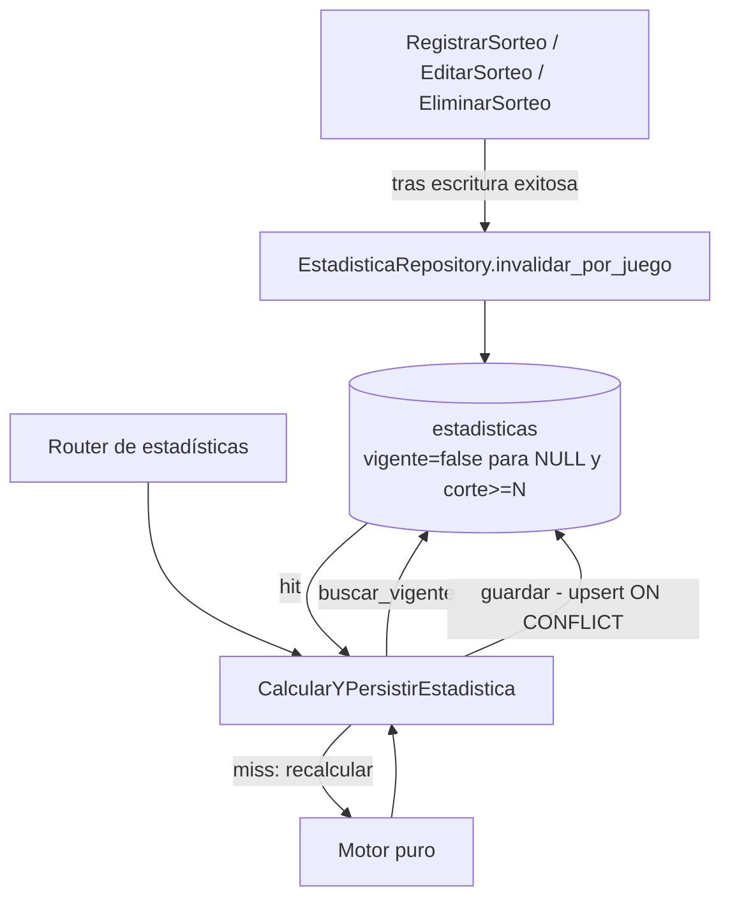

---

## Visualizaciones web de estadísticas

Veinte visualizaciones implementadas: nueve para los tres juegos numéricos ya soportados por esta sección (**Baloto**, **Baloto Revancha** y **MiLoto**), y once exclusivas de **ColorLoto** (Etapas AE-1/AE-2/AE-3/AE-4/AE-5/AE-6/AE-7/AE-8/AE-9/AE-10/AE-11) — ver semántica y aislamiento arquitectónico específico más abajo.

| Visualización | `tipo_estadistica` | Disponible para |
|---|---|---|
| Frecuencia de números principales | `frecuencia_numeros` | Baloto, Baloto Revancha, MiLoto |
| Frecuencia de superbalota | `frecuencia_superbalota` | Baloto, Baloto Revancha (MiLoto no tiene superbalota) |
| Frecuencia observada vs. esperada | `tabla_frecuencia_numeros` | Baloto, Baloto Revancha, MiLoto |
| Distancia desde la última aparición (Etapa W) | `atrasos_numeros` | Baloto, Baloto Revancha, MiLoto — números principales únicamente, sin superbalota en esta etapa |
| Distribución de números pares e impares (Etapa Y) | `distribucion_pares_impares` | Baloto, Baloto Revancha, MiLoto — números principales únicamente, sin superbalota |
| Distribución inferior/superior (Etapa Z) | `distribucion_altos_bajos` | Baloto, Baloto Revancha, MiLoto — números principales únicamente, sin superbalota |
| Distribución de pares consecutivos (Etapa AA) | `distribucion_pares_consecutivos` | Baloto, Baloto Revancha, MiLoto — números principales únicamente, sin superbalota |
| Racha máxima de números consecutivos (Etapa AB) | `distribucion_racha_maxima` | Baloto, Baloto Revancha, MiLoto — números principales únicamente, sin superbalota |
| Repeticiones entre sorteos consecutivos (Etapa AC) | `distribucion_repeticiones_entre_sorteos` | Baloto, Baloto Revancha, MiLoto — números principales únicamente, sin superbalota |
| Frecuencia de números (Etapa AE-1, validada) | `frecuencia_numeros_colorloto` | **ColorLoto** exclusivamente — cuenta números observados (1..7) ignorando color; magnitud "Apariciones promedio por sorteo", puede legítimamente superar 1.0 (repetición de número dentro de un mismo sorteo permitida por el dominio) |
| Frecuencia de colores (Etapa AE-2, validada) | `frecuencia_colores_colorloto` | **ColorLoto** exclusivamente — cuenta colores observados ignorando número; reutiliza el motor `calcular_frecuencia_colores` ya existente y la misma validación de integridad de AE-1, sin duplicarla; misma semántica de "Apariciones promedio por sorteo" |
| Frecuencia de pares número-color (Etapa AE-3, validada) | `frecuencia_pares_colorloto` | **ColorLoto** exclusivamente — cuenta cada par exacto (número, color) como unidad atómica, 42 categorías con el catálogo actual (7×6); reutiliza `calcular_frecuencia_pares_numero_color` ya existente, codificación `f"{numero}-{color}"` deserializada de forma inequívoca con `split("-", maxsplit=1)`; misma semántica de "Apariciones promedio por sorteo" |
| Atrasos de números (Etapa AE-4, validada) | `atrasos_numeros_colorloto` | **ColorLoto** exclusivamente — mide sorteos transcurridos desde la última aparición de cada número (1..7), ignorando color; reutiliza `calcular_atrasos_numeros_colorloto` y el serializador `_serializar_atrasos` ya existentes, sin modificarlos; el motor nunca recibe el corte directamente, mismo precedente ya validado por `atrasos_numeros` (Etapa W); magnitud distinta de "frecuencia"/"promedio", nunca llamada así |
| Atrasos de colores (Etapa AE-5, validada) | `atrasos_colores_colorloto` | **ColorLoto** exclusivamente — mide sorteos transcurridos desde la última aparición de cada color, ignorando número; reutiliza `calcular_atrasos_colores` y `_serializar_atrasos` ya existentes; reutiliza exactamente el contrato temporal de universo de colores ya validado por AE-4P (`_codigos_colores_vigentes_en_referencia`), sin política paralela; identidad de caché con el marcador estático de política, mismo criterio que AE-2/AE-3 |
| Atrasos de pares número-color (Etapa AE-6, validada) | `atrasos_pares_colorloto` | **ColorLoto** exclusivamente — mide sorteos transcurridos desde la última aparición del par exacto (número, color) como unidad atómica, distinto de atrasos de número y de color por separado; reutiliza `calcular_atrasos_pares_numero_color` y `_serializar_atrasos` ya existentes, sin modificar el motor; combina el patrón `rango_min`/`rango_max` de AE-4 con el helper temporal de colores ya validado por AE-4P/AE-5; 42 categorías (7×6); identidad de caché con el marcador estático de política, mismo criterio que AE-2/AE-3/AE-5 |
| Repeticiones entre sorteos (Etapa AE-7, validada) | `repeticiones_entre_sorteos_colorloto` | **ColorLoto** exclusivamente — cuenta cuántos números de las balotas (con multiplicidad, multiconjunto) coinciden entre cada par de sorteos numéricamente consecutivos, ignorando color por completo; reutiliza `calcular_repeticiones_entre_sorteos_colorloto` y `_serializar_frecuencia_observada` ya existentes, sin modificar el motor; 7 categorías fijas (0..6); `total_sorteos` del campo serializado representa transiciones válidas, no sorteos, presentado como "Transiciones analizadas"; identidad de caché de solo tres claves, **sin** el marcador de política de colores, porque la métrica nunca lee el color |
| Distribución de números pares e impares (Etapa AE-8, validada) | `distribucion_pares_impares_colorloto` | **ColorLoto** exclusivamente — cuenta cuántos de los 6 números de las balotas de cada sorteo son pares (2, 4, 6 en el dominio real 1-7), ignorando color por completo y con multiplicidad (un número par repetido vuelve a contar); reutiliza `calcular_distribucion_pares_impares_colorloto` y `_serializar_frecuencia_observada` ya existentes, sin modificar el motor; 7 categorías fijas (0..6); `total_sorteos` del campo serializado representa sorteos analizados, no transiciones; identidad de caché de **una sola clave** (`cantidad_numeros`), **sin** rango ni marcador de política de colores -el rango real y fijo de ColorLoto se usa como constante interna solo para la validación de integridad, ya que el resultado de paridad nunca depende de esos límites |
| Distribución de números bajos y altos (Etapa AE-9, validada) | `distribucion_altos_bajos_colorloto` | **ColorLoto** exclusivamente — cuenta cuántos de los 6 números de las balotas de cada sorteo son bajos (1, 2, 3 en el dominio real 1-7; el corte se calcula a partir de `rango_min`/`rango_max`), ignorando color por completo y con multiplicidad (un número bajo repetido vuelve a contar); reutiliza `calcular_distribucion_altos_bajos_colorloto` y `_serializar_frecuencia_observada` ya existentes, sin modificar el motor; 7 categorías fijas (0..6); `total_sorteos` del campo serializado representa sorteos analizados, no transiciones; identidad de caché de **tres claves** (`rango_min`, `rango_max`, `cantidad_numeros`), **sin** marcador de política de colores -a diferencia de AE-8, aquí el umbral bajos/altos sí depende materialmente del rango, por lo que ambos límites forman parte obligatoria de la identidad |
| Máximo color repetido por sorteo (Etapa AE-10, validada) | `maximo_repeticion_color_por_sorteo_colorloto` | **ColorLoto** exclusivamente — para cada sorteo, la mayor cantidad de balotas que compartieron un mismo color (usando `Counter` sobre los colores observados); reutiliza `calcular_maximo_repeticion_color_por_sorteo` y `_serializar_frecuencia_observada` ya existentes, sin modificar el motor; 6 categorías fijas (1..6, sin la categoría 0, filtrada por el propio motor); `total_sorteos` del campo serializado representa sorteos analizados; identidad de caché de **una sola clave** (`cantidad_numeros`), decisión M1 -**sin** marcador de política de colores: el motor sí lee y compara identidades de color, pero nunca construye su universo de categorías desde `colores_vigentes`, así que ningún cambio de política de universo de colores puede alterar el resultado matemático |
| Distribución de pares consecutivos (Etapa AE-11, validada) | `distribucion_pares_consecutivos_colorloto` | **ColorLoto** exclusivamente — para cada sorteo, cuántos pares de números adyacentes (diferencia exactamente 1) hay entre los números de las balotas, deduplicados antes de contar (comportamiento ya existente en el motor puro, no modificado por esta etapa) e ignorando color por completo; reutiliza `calcular_distribucion_pares_consecutivos_colorloto` y `_serializar_frecuencia_observada` ya existentes, sin modificar el motor; 6 categorías fijas (0..5, a diferencia de AE-10 SÍ incluye la categoría 0); `total_sorteos` del campo serializado representa sorteos analizados; identidad de caché de **una sola clave** (`cantidad_numeros`), decisión M1 -**sin** marcador de política de colores: a diferencia de AE-10, este motor sí exige `rango_min`/`rango_max` como argumentos posicionales, pero únicamente para su validación interna, nunca para el cálculo de categorías, conteos ni denominador |

**ColorLoto no está incluido en estas visualizaciones numéricas** (estructura de datos distinta, par número-color en vez de números simples) — queda fuera del alcance de esta etapa.

**Semántica de "distancia desde la última aparición"** (`atrasos_numeros`, reutiliza `calcular_atrasos_numeros` del motor sin ninguna modificación): `distancia = numero_sorteo_referencia − numero_sorteo_de_última_aparición`, usando siempre `numero_sorteo` real, nunca la posición ordinal en una lista. La referencia es **el máximo `numero_sorteo` realmente presente en el histórico ya filtrado por el corte** — nunca el valor aritmético de un corte que no corresponda a ningún sorteo real. Esta decisión se tomó deliberadamente para que la receta **no necesitara** recibir `hasta_numero_sorteo` como argumento explícito: el orquestador ya filtra el histórico antes de invocar la receta (mismo paso que las demás), y la función del motor deriva la referencia de ese histórico filtrado por su cuenta — así, `_Receta.calcular` no requirió ninguna generalización de su firma, y el corte sigue siendo exclusivamente su propia columna de identidad de caché, nunca duplicado dentro de `parametros_metrica`. Un número nunca observado tiene `atraso=None` (nunca `-1` ni `0` artificiales). La página incluye un aviso explícito de que esta cifra es descriptiva, no predictiva.

**Semántica de "distribución de números pares e impares"** (`distribucion_pares_impares`, reutiliza `calcular_distribucion_pares_impares` del motor sin ninguna modificación): para cada sorteo se cuenta cuántos de los `K` números principales son pares (`numero % 2 == 0`); la salida tabula, sobre todo el histórico filtrado, cuántos sorteos tuvieron 0, 1, 2, ..., `K` números pares -siempre las `K+1` categorías, incluidas las de cero apariciones. No es frecuencia individual de números pares ni coocurrencia de pares de números. `K` se obtiene de `juego_dominio.numbers_to_pick`, nunca hardcodeado, y forma parte de `parametros_hash` (distinto `K` es una identidad de caché distinta).

**Semántica de "distribución inferior/superior"** (`distribucion_altos_bajos`, reutiliza `calcular_distribucion_altos_bajos` del motor sin ninguna modificación): para cada sorteo se cuenta cuántos de los `K` números principales son "inferiores" (`numero <= punto_de_corte`); la salida tabula, igual que pares/impares, 0..K categorías, siempre incluidas las de cero. El punto de corte particiona el rango del juego lo más equilibradamente posible; **cuando el rango tiene longitud impar (el caso real de los 3 juegos hoy), el número sobrante siempre queda del lado superior** -Baloto/Revancha (1-43): inferior 1-21 (21 valores), superior 22-43 (22 valores); MiLoto (1-39): inferior 1-19 (19 valores), superior 20-39 (20 valores). **Los grupos no son mitades iguales** -el valor esperado teórico de "inferiores" por sorteo es ligeramente menor que `K/2` (≈2.44 en vez de 2.5, tanto en Baloto como en MiLoto), consecuencia directa de que hay menos números disponibles del lado inferior. La página explica esta asimetría junto a la definición de los grupos, nunca la presenta como mitades iguales ni la oculta en una tarjeta aparte. `rango_min`, `rango_max` y `cantidad_numeros` (los tres desde `juego_dominio`, nunca hardcodeados) forman parte de `parametros_metrica`/`parametros_hash`.

**Validación defensiva de integridad histórica (Etapa Y, generalizada en Etapa Z):** antes de invocar el motor, tanto `distribucion_pares_impares` como `distribucion_altos_bajos` verifican, mediante un helper privado compartido (`_validar_historico_consistente` en `calcular_y_persistir_estadistica.py` -no una validación global en todas las recetas, ni una modificación del motor), que el histórico sea consistente: cantidad exacta de números, sin duplicados y (solo para `distribucion_altos_bajos`, que sí depende del rango) dentro del rango del juego. Si alguna fila del histórico falla cualquiera de estos chequeos, se rechaza el **cálculo completo** -nunca se descartan filas individuales ni se persiste una distribución parcial. Esto cubre casos reales (no solo teóricos) encontrados durante la auditoría: si un resultado tuviera más números de los esperados y su conteo superara `K`, esa fila caería fuera del rango `0..K` que tabula el motor y se perdería en silencio (`total_sorteos` correcto pero la suma de apariciones no cuadraría); y, específicamente para `distribucion_altos_bajos`, un número fuera de rango se clasificaría silenciosamente como "superior" sin ningún aviso, ya que el motor no valida rango internamente para esta función. `StandardNumberGame.validate_draw` ya impide ambos casos con datos reales -las recetas simplemente no confían en eso ciegamente, dado que el camino de lectura (reconstrucción del histórico desde PostgreSQL) es un código completamente distinto, sin ninguna validación propia.

`ResultadoHistoricoInconsistenteError` (`app/application/exceptions.py`) representa las inconsistencias mediante un tipo **cerrado** (`TipoInconsistenciaHistorica`: `CANTIDAD`/`DUPLICADOS`/`RANGO` para números principales, más `SUPERBALOTA_AUSENTE`/`RANGO_SUPERBALOTA` agregados de forma aditiva en Etapa AD para endurecer `frecuencia_superbalota` -un `Enum`) -nunca una razón de texto libre interpolada en el mensaje. La firma posicional original de Etapa Y (`ResultadoHistoricoInconsistenteError(numeros_sorteo, cantidad_esperada)`) sigue siendo válida y produce exactamente el mismo mensaje que antes (compatibilidad hacia atrás verificada explícitamente, incluida tras la extensión de Etapa AD); los demás tipos se construyen con `por_duplicados()`/`por_rango()`/`por_superbalota_ausente()`/`por_rango_superbalota()`. El mensaje nunca expone la lista real de números mal formados (el registro corrupto en sí) -solo `numero_sorteo` y metadatos pequeños (cantidad/rango esperados); para listas largas de sorteos afectados, se trunca a una muestra de 10 más el total, en vez de listar todos sin límite.

**Etapa AD -endurecimiento de integridad, no una décima visualización:** la auditoría confirmó que `superbalota=None` para un juego con superbalota (Baloto/Revancha) nunca puede surgir de una operación legítima del sistema -`StandardNumberGame.validate_draw` la exige siempre, en las tres rutas de escritura reales (`RegistrarSorteo`, `SincronizarSorteos`, `EditarSorteo`). El motor `calcular_frecuencia_superbalota` excluía ese estado silenciosamente del denominador (reduciendo `total_sorteos` sin avisar) y dejaba un valor fuera de rango como un `ValueError` sin capturar por ningún handler. Un helper específico, `_validar_historico_superbalota_consistente` (deliberadamente separado de `_validar_historico_consistente`, que valida una responsabilidad distinta: `numeros`/`cantidad_numeros`), rechaza el cálculo completo antes de invocar el motor -mismo criterio "todo o nada" ya usado para números principales, ausencia evaluada antes que rango. `frecuencia_superbalota` conserva exactamente su ruta, `tipo_estadistica`, `parametros_metrica`, serializador, View Model, template y navegación -solo se endureció la validación previa al motor.

`ResultadoHistoricoInconsistenteError` se maneja con el mecanismo ya existente (`manejar_error_dominio` en `app/main.py`, registrada en `_STATUS_POR_EXCEPCION` con **500**, no un handler nuevo) -**deliberadamente no** mediante un manejador global de `ValueError`. Un primer intento de la Etapa Y sí registró `@app.exception_handler(ValueError)` para cerrar el mismo vacío; una auditoría posterior encontró más de 40 sitios en el proyecto (dominio, repositorios, conectores, y prácticamente todo el motor estadístico) que lanzan `ValueError` por razones completamente ajenas a esta receta -un manejador global habría convertido cualquiera de esos errores, incluidos bugs de programación genuinos, en una respuesta 422 de "dato inválido", ocultando fallos reales del sistema. El manejador global fue eliminado; solo esta excepción específica, con este significado preciso, produce una respuesta controlada.

**500, no 422 -y no es el mismo tipo de caso que `JuegoSinSuperbalotaError`**, pese a compartir el mecanismo genérico de `DominioError`. `JuegoSinSuperbalotaError` es responsabilidad del *request*: el usuario pidió una combinación juego/métrica que no existe, y puede elegir otra -422 (Unprocessable Entity) describe exactamente eso. `ResultadoHistoricoInconsistenteError` es responsabilidad del *servidor*: el request pudo ser perfectamente válido, y lo que falló es que los datos históricos persistidos resultaron inconsistentes -una condición que el usuario no puede corregir cambiando su solicitud. Devolver 422 le habría atribuido incorrectamente el problema al request. La respuesta sigue siendo controlada (mismo `manejar_error_dominio`, sin traceback, sin exponer paths/SQL/internals), solo que con el código HTTP semánticamente correcto para un fallo de integridad server-side.

**Semántica de "distribución de pares consecutivos"** (`distribucion_pares_consecutivos`, reutiliza `calcular_distribucion_pares_consecutivos` del motor sin ninguna modificación): para cada sorteo se cuenta cuántos pares de números adyacentes (diferencia exactamente 1, p. ej. `(4,5)`) hay entre los `K` números principales; la salida tabula, 0..K-1, cuántos sorteos tuvieron esa cantidad de pares. Los pares pueden solaparse -una racha de 3 números seguidos (p. ej. `1,2,3`) aporta 2 pares, no 1. `K-1` (no `K`) es el máximo teórico, porque un par consecutivo requiere dos números.

**Doble defensa deliberada (Etapa AA):** a diferencia de `distribucion_pares_impares` (que no valida rango porque la paridad no depende de él), el motor de `calcular_distribucion_pares_consecutivos` **sí** valida rango internamente (`_validar_rango`, mismo mecanismo ya usado por `distribucion_altos_bajos`) -pero ese `ValueError` interno del motor no está capturado por ningún handler (no existe manejador global de `ValueError`, deliberadamente, desde la corrección de Etapa Y). Si Application confiara únicamente en la validación del motor, un histórico con un número fuera de rango produciría un 500 sin controlar. Por eso la receta llama a `_validar_historico_consistente` (cantidad, duplicados, rango) **antes** de invocar el motor -la misma validación del motor sigue viva como última línea de defensa, nunca eliminada ni debilitada, solo que en el flujo real de la receta nunca llega a dispararse porque Application ya rechazó el histórico inconsistente primero.

**Semántica de "racha máxima de números consecutivos"** (`distribucion_racha_maxima`, reutiliza `calcular_distribucion_racha_maxima` del motor sin ninguna modificación): para cada sorteo se identifica el bloque más largo de números consecutivos (diferencia 1 entre valores adyacentes) entre los `K` números principales; la salida tabula 1..K -**nunca 0**, ya que todo sorteo válido tiene al menos una racha de longitud 1 (un número aislado ya cuenta como racha de longitud 1). **Distinta de "pares consecutivos" (Etapa AA)**, aunque ambas se calculan sobre el mismo tipo de estructura subyacente: `1,2,3` tiene 2 pares consecutivos (dos enlaces adyacentes, pueden solaparse), pero su racha máxima es 3 (la longitud del bloque). Mismo mecanismo de doble defensa que `distribucion_pares_consecutivos`: el motor valida rango internamente, pero la receta valida primero (cantidad, duplicados, rango) para garantizar siempre una respuesta controlada. La validación de cantidad exacta cubre además un caso límite real identificado en la auditoría previa a esta etapa: un sorteo con `numeros=()` (nunca alcanzable con datos reales, dado que `StandardNumberGame.validate_draw` ya lo impide, pero posible si algún código futuro invocara el motor directamente) produciría una racha de longitud 0 que el motor recorta silenciosamente -sin aparecer en ninguna categoría 1..K, sin ningún aviso. La validación de `_validar_historico_consistente` rechaza ese sorteo antes de llegar al motor, evitando esa pérdida silenciosa.

**Semántica de "repeticiones entre sorteos consecutivos"** (`distribucion_repeticiones_entre_sorteos`, reutiliza `calcular_repeticiones_entre_sorteos` del motor sin ninguna modificación): para cada **transición** (par de sorteos numéricamente consecutivos, `numero_sorteo_actual == numero_sorteo_anterior + 1`, nunca por posición en una lista, fecha, ni adyacencia tras ordenar) se cuenta cuántos números principales coinciden entre ambos sorteos -intersección de conjuntos, la posición dentro de cada sorteo es irrelevante. Un hueco en la numeración (p. ej. `100→102` si el sorteo 101 no se importó) **nunca genera una transición** -se excluye silenciosamente en vez de fabricar una comparación entre sorteos que en la realidad no son consecutivos; esto no es una limitación, es la semántica correcta (otras herramientas ya detectan y reportan huecos de importación por separado, este módulo simplemente evita usarlos incorrectamente). Con cero o un sorteo, o cuando todos los pares posibles están separados por huecos, hay cero transiciones válidas.

**`FrecuenciaObservada.total_sorteos` tiene un nombre engañoso para esta métrica específica**: aquí representa la cantidad de **transiciones válidas** (sorteos consecutivos reales, no la cantidad de sorteos del histórico) -confirmado exhaustivamente en la auditoría previa a esta etapa (histórico vacío→0, un sorteo→0, dos consecutivos→1, tres consecutivos→2, tres con un hueco→1). El campo **no se renombra** en la dataclass ni en el motor (mismo contrato compartido con las demás recetas basadas en `FrecuenciaObservada`); el renombrado a "Transiciones analizadas" vive exclusivamente en el View Model (`distribucion_repeticiones_entre_sorteos_a_vm`), nunca "Sorteos analizados" para esta página específica -sería objetivamente engañoso, dado que N sorteos consecutivos producen N-1 transiciones, y menos aún con huecos.

Mismo mecanismo de doble defensa ya usado 3 veces: el motor valida rango internamente (`_validar_rango`), pero no valida cantidad ni duplicados -confirmado con ejecución real que una intersección mayor que K se pierde silenciosamente de las categorías `0..K` (mismo riesgo ya resuelto en las 3 recetas anteriores), y que duplicados dentro de un sorteo inflan artificialmente la intersección. La receta valida primero (cantidad, duplicados, rango) vía `_validar_historico_consistente`, sin necesitar ninguna validación adicional para `numero_sorteo` duplicado o ausente -ya garantizados estructuralmente por `UNIQUE(juego_id, numero_sorteo)` y la columna `NOT NULL` del esquema real, confirmado por lectura directa de la migración.

**Rutas (`api/web/routers/estadisticas.py`):** un slug de juego en la URL, siete funciones (no veintiuno — el juego es un parámetro de ruta, no una copia de la función):

```
/estadisticas/{juego_slug}/frecuencia-numeros
/estadisticas/{juego_slug}/frecuencia-superbalota
/estadisticas/{juego_slug}/frecuencia-observada-esperada
/estadisticas/{juego_slug}/atrasos-numeros
```

Slugs válidos: `baloto`, `baloto-revancha`, `miloto` — un conjunto cerrado definido en `api/web/estadisticas_slugs.py` (sin dependencia de FastAPI/SQLAlchemy, aislado deliberadamente para poder probarse sin infraestructura). Un slug fuera de ese conjunto produce `404` antes de tocar la base de datos. Pedir la superbalota de MiLoto produce `422` de forma controlada (`JuegoSinSuperbalotaError`, mismo mecanismo de excepciones de dominio ya usado en el resto del sistema) — nunca un error 500 ni una gráfica vacía fabricada.

**View Models dinámicos (`api/web/view_models.py`):** las funciones que transforman el resultado calculado en el diccionario que consume la plantilla reciben la entidad `Juego` real resuelta por el router — nunca asumen un juego fijo. `construir_navegacion_estadisticas` arma, en el servidor, la navegación de dos niveles (juego + métrica) que consumen las plantillas; si la métrica activa es superbalota y se cambia a un juego sin superbalota, el enlace generado redirige a números principales en vez de reproducir una ruta que fallaría.

**Corte por número de sorteo (Etapa X, extendido progresivamente hasta AE-11):** `hasta_numero_sorteo` es un query parameter (`Query(default=None, ge=1)` en las 20 rutas -validación nativa de FastAPI, sin lógica duplicada en cada handler; `0` y negativos producen `422` en JSON antes de que el handler siquiera se ejecute, así que nunca se calcula ni se persiste caché para un corte inválido). `construir_navegacion_estadisticas` (usada exclusivamente por las 9 rutas numéricas, no por ColorLoto -ver aislamiento arquitectónico más abajo) decide, por diseño, **cuándo propagarlo y cuándo eliminarlo**: los enlaces de `metricas_nav` (cambiar de métrica dentro del mismo juego) lo conservan; los enlaces de `juegos_nav` (cambiar de juego) **nunca** lo llevan -la numeración de sorteos de Baloto/Baloto Revancha (p. ej. 2081-2695) no es comparable con la de MiLoto (p. ej. 532-589), son series temporales independientes, así que cambiar de juego siempre vuelve al histórico completo del juego destino. Esto no es una limitación accidental: es la semántica correcta dado que ambas numeraciones no son intercambiables. El formulario que aplica el corte (`templates/estadisticas/partials/control_corte_temporal.html`, incluido por `` en las 20 páginas -incluida ColorLoto, que reutiliza el mismo partial pese a tener su propia navegación aislada-, mismo patrón de partials ya usado en `sorteos/`/`colores/`/`importacion/`) es un `<form method="get">` sin JavaScript -un filtro de lectura no necesita `POST`. El corte sigue siendo exclusivamente su propia columna de identidad de caché (`hasta_numero_sorteo`), nunca una clave dentro de `parametros_metrica` -esto es independiente de que cada métrica defina sus propios `parametros_metrica` de identidad (por ejemplo, las tres claves de AE-9, `rango_min`/`rango_max`/`cantidad_numeros`): el corte y los parámetros propios de cada métrica son dos dimensiones separadas de la misma identidad de caché, y ninguna etapa mezcló una con la otra. Ninguna de estas etapas modificó `calcular_parametros_hash`, el motor, las recetas ya existentes, ni el upsert.

**Frontend:** las veinte plantillas (`templates/estadisticas/`) cargan Chart.js **localmente** desde `app/static/vendor/chartjs/chart.umd.min.js` (versión 4.4.4, licencia MIT conservada en el propio archivo) — no desde un CDN externo. Los datos de cada gráfica se serializan con el filtro `tojson` de Jinja2 dentro de un bloque `<script type="application/json">`, y se leen en el cliente con `JSON.parse` antes de pasarlos a Chart.js — nunca se interpola directamente en un `<script>` ejecutable.

**Aislamiento arquitectónico de ColorLoto (Etapas AE-1/AE-2/AE-3/AE-4/AE-5/AE-6/AE-7/AE-8/AE-9/AE-10/AE-11):** a diferencia de las 9 rutas numéricas, las once rutas de ColorLoto (`/estadisticas/colorloto/frecuencia-numeros`, `/estadisticas/colorloto/frecuencia-colores`, `/estadisticas/colorloto/frecuencia-pares-numero-color`, `/estadisticas/colorloto/atrasos-numeros`, `/estadisticas/colorloto/atrasos-colores`, `/estadisticas/colorloto/atrasos-pares-numero-color`, `/estadisticas/colorloto/repeticiones-entre-sorteos`, `/estadisticas/colorloto/distribucion-pares-impares`, `/estadisticas/colorloto/distribucion-altos-bajos`, `/estadisticas/colorloto/maximo-repeticion-color` y `/estadisticas/colorloto/distribucion-pares-consecutivos`) son **fijas**, no parametrizadas por `{juego_slug}`, deliberadamente **fuera** de `SLUG_A_CODIGO`/`CLASE_POR_SLUG`/`CAPACIDAD_SUPERBALOTA_POR_SLUG` -agregar "colorloto" a esos diccionarios compartidos habría expuesto las 9 métricas numéricas a un tipo de dato incompatible (`ResultadoColorLoto` vs. `ResultadoNumerico`) y habría intentado leer `has_superballot` de `ColorLotoGame`, que no lo tiene (no hereda de `StandardNumberGame`). Ningún handler construye `GameFactory`/`ColorLotoGame`: `rango_min`/`rango_max`/`cantidad_numeros` se leen directamente de la entidad `Juego` ya persistida. Un acceso a una métrica numérica genuinamente incompatible bajo el slug `colorloto` (p. ej. `/estadisticas/colorloto/frecuencia-superbalota`, ya que ColorLoto no tiene superbalota) nunca coincide con ninguna ruta registrada, produciendo `404` nativo de FastAPI -nunca un `AttributeError` ni un `500` no controlado. Las once rutas se registran agrupadas, antes de cualquier ruta genérica -para `frecuencia-numeros`, `atrasos-numeros`, `repeticiones-entre-sorteos`, `distribucion-pares-impares`, `distribucion-altos-bajos` y `distribucion-pares-consecutivos` esto es **obligatorio** (las seis colisionan con su ruta genérica homónima, mismo sufijo exacto: si la genérica apareciera primero, capturaría `juego_slug='colorloto'` y `_resolver_codigo` devolvería un `404` controlado antes de alcanzar el handler literal, dejándolo completamente inalcanzable -defecto crítico ya corregido en AE-1/AE-4/AE-7/AE-8/AE-9/AE-11, confirmado con simulación fiel del algoritmo de Starlette en cada caso -para AE-11, además, con el motor real de `starlette.routing.Route` instalado en el entorno de auditoría; la ruta genérica de Baloto para estas seis métricas permanece intacta y sigue respondiendo `200`); para las cinco rutas restantes -`frecuencia-colores`, `frecuencia-pares-numero-color`, `atrasos-colores`, `atrasos-pares-numero-color` (Etapas AE-2/AE-3/AE-5/AE-6) y `maximo-repeticion-color` (Etapa AE-10, otra más de este mismo grupo, no la primera: ningún juego numérico tiene el concepto de color, así que ninguna ruta genérica podría existir para ella, igual que para las cuatro anteriores)- se confirmó por simulación que ningún sufijo genérico coincide con ninguna de las cinco (`/estadisticas/baloto/maximo-repeticion-color` y su equivalente de Revancha no coinciden con ningún patrón registrado, produciendo `404` nativo de FastAPI por ausencia de match, mismo mecanismo estructural que el resto de rutas sin equivalente), pero se mantiene la misma posición por prudencia y consistencia con el patrón establecido. Descubribilidad: un enlace estable en la navegación global (`base.html`) hacia ColorLoto, con una sub-navegación propia entre sus once métricas (`partials/navegacion_colorloto.html`) que preserva el corte temporal -independiente de `juegos_nav`/`metricas_nav`.

---

## Flujo de una petición web (HTMX)

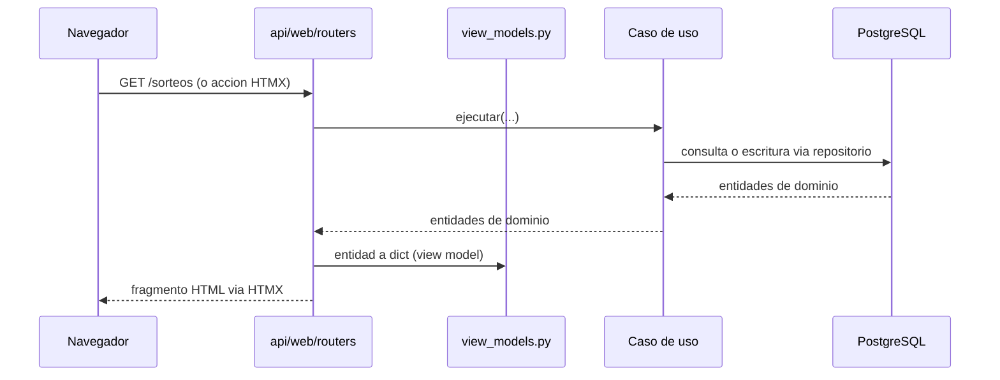

Las plantillas nunca reciben entidades de dominio directamente — siempre pasan por un view model (`api/web/view_models.py`).

---

## API REST

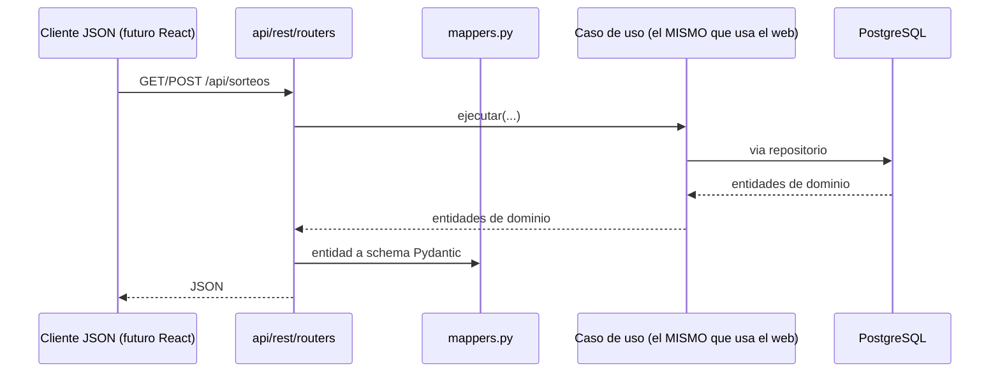

`api/web` y `api/rest` comparten exactamente los mismos casos de uso — reemplazar el frontend HTML por React en el futuro no requiere tocar `application/` ni `domain/`.

---

## Base de datos


Tablas normalizadas (no `INTEGER[]`) para números y colores: permite indexar y consultar por número individual eficientemente a escala (necesario para el análisis de frecuencia de la Fase 3).

---

## Decisiones de diseño y por qué

| Decisión | Alternativa descartada | Por qué |
|---|---|---|
| UnitOfWork con commit por sorteo | Una transacción por sincronización completa | Un fallo a mitad de un lote de 1000 sorteos no debe perder los primeros 999 |
| Parsers separados de conectores | Parseo embebido en el conector | Testeable sin red; permite reprocesar HTML guardado con el mismo código |
| application/ nunca importa infrastructure/ | Logger de infraestructura importado directamente | logging.getLogger(nombre) es un registro global — se obtiene el mismo logger configurado sin la dependencia indebida |
| Tablas normalizadas para números/colores | INTEGER[] de PostgreSQL | Necesario para consultas de frecuencia por número individual a escala (Fase 3) |
| EjecucionSincronizacion separada del Data Quality Report | Todo en una sola entidad | El rango histórico y la cobertura son del estado actual de los datos, no de una corrida puntual |
| DrawSourceConnector como puerto único | Un cliente HTTP genérico sin abstracción | Permite intercambiar scraping por CSV o una futura API oficial sin tocar SincronizarSorteos |
| Baloto y Revancha como juegos independientes (Opción A) | Una entidad Sorteo con dos resultados embebidos (Opción B) | Cero cambios de esquema, reutiliza el 100% del dominio ya construido, fiel a que son productos regulatoriamente distintos -ver sección dedicada arriba |
| Dos índices únicos parciales en `estadisticas` | Un `UNIQUE` convencional sobre las 4 columnas | PostgreSQL nunca trata `NULL = NULL` como duplicado en un `UNIQUE` -el histórico completo (`hasta_numero_sorteo IS NULL`) habría podido duplicarse sin límite |
| Upsert (`ON CONFLICT DO UPDATE`) al recalcular una identidad existente | `INSERT` incondicional en cada cálculo | Recalcular una estadística previamente invalidada debe reemplazar esa fila, no intentar crear una segunda -evita `UniqueViolation` bajo concurrencia real, no solo en el caso feliz |
