# Arquitectura del sistema

Este documento explica cómo está construido el sistema, con suficiente detalle para que otro desarrollador lo entienda sin tener que leer el código primero.

## Índice

1. [Principios de diseño](#principios-de-diseño)
2. [Arquitectura general](#arquitectura-general)
3. [Clean Architecture: las 4 capas](#clean-architecture-las-4-capas)
4. [Dominio: los cuatro juegos](#dominio-los-cuatro-juegos)
5. [Baloto y Revancha: por qué son juegos independientes](#baloto-y-revancha-por-qué-son-juegos-independientes)
6. [Conectores y adquisición de datos](#conectores-y-adquisición-de-datos)
7. [Flujo de sincronización](#flujo-de-sincronización)
8. [Resiliencia de la sincronización](#resiliencia-de-la-sincronización)
9. [Reprocesamiento desde HTML](#reprocesamiento-desde-html)
10. [Data Quality Report](#data-quality-report)
11. [Motor estadístico y caché persistido](#motor-estadístico-y-caché-persistido)
12. [Visualizaciones web de estadísticas](#visualizaciones-web-de-estadísticas)
13. [Flujo de una petición web (HTMX)](#flujo-de-una-petición-web-htmx)
14. [API REST](#api-rest)
15. [Base de datos](#base-de-datos)
16. [Decisiones de diseño y por qué](#decisiones-de-diseño-y-por-qué)

---

## Principios de diseño

1. **La dirección de las dependencias siempre apunta hacia adentro.** `domain` no conoce a nadie. `application` solo conoce a `domain`. `infrastructure` implementa los puertos que `application` define. `api` orquesta todo pero no contiene lógica de negocio.
2. **Los casos de uso son la única puerta a la lógica de negocio.** Ningún router (web o REST) valida reglas de juego, construye combinaciones, ni decide si un sorteo es válido — eso vive exclusivamente en `domain/games` y se invoca a través de casos de uso.
3. **El scraping nunca se mezcla con las reglas de negocio.** Un conector devuelve DTOs neutrales (`DrawDetail`); la decisión de si eso es un sorteo válido para PostgreSQL la toma `RegistrarSorteo`, el mismo caso de uso que usa el formulario manual del dashboard.
4. **Todo origen de datos es intercambiable.** `SincronizarSorteos` no sabe si detrás hay HTML scrapeado, un CSV, o una futura API oficial — todos implementan el mismo puerto `DrawSourceConnector`.

---

## Arquitectura general

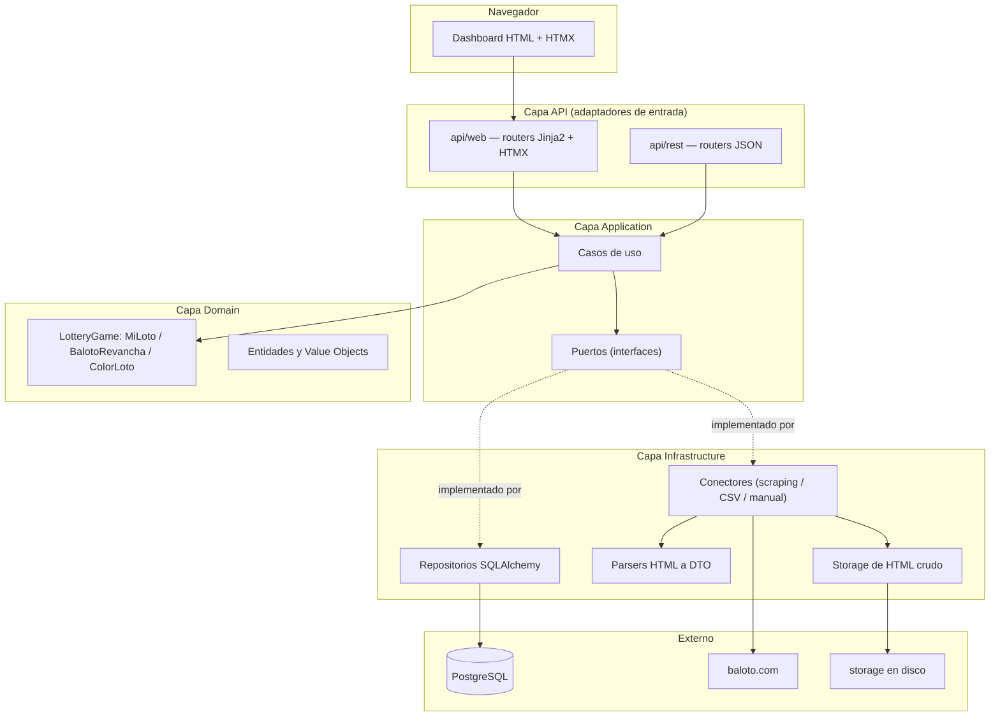

---

## Clean Architecture: las 4 capas

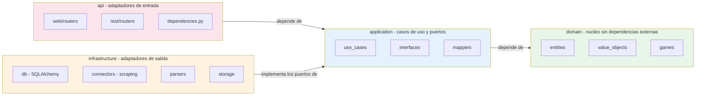

**Regla verificada activamente en la auditoría de Fase 2:** ningún archivo de `application/` importa de `infrastructure/`. La única forma en que `application/` usa infraestructura es a través de puertos (`SorteoRepository`, `DrawSourceConnector`, `UnitOfWork`, `HtmlStorage`), inyectados por `api/dependencies.py`.

---

## Dominio: los cuatro juegos

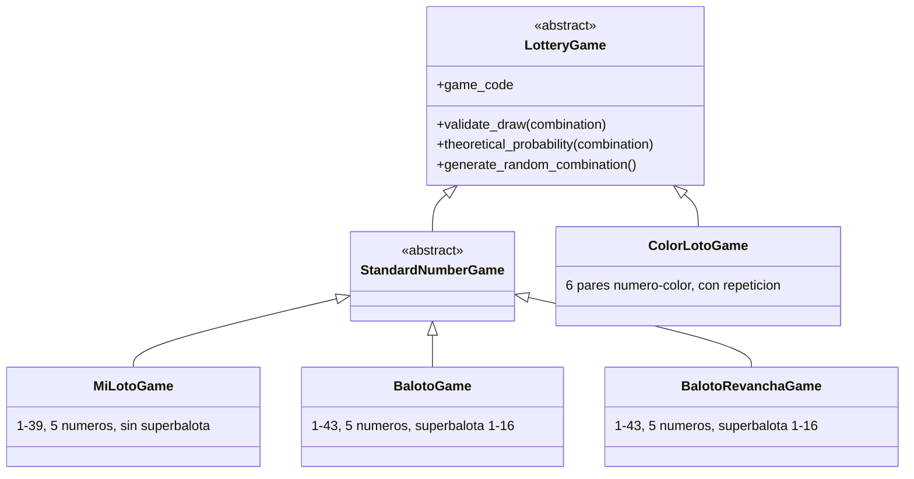

Cada juego encapsula sus propias reglas de validación y cálculo de probabilidades. `GameFactory` traduce la entidad persistida `Juego` (tabla `juegos`) a la instancia de dominio `LotteryGame` correspondiente. `BalotoGame` y `BalotoRevanchaGame` comparten exactamente la misma mecánica (misma clase base `StandardNumberGame`, mismos rangos), pero son juegos independientes -ver la siguiente sección.

---

## Baloto y Revancha: por qué son juegos independientes

**El problema real detectado:** hasta la revisión arquitectónica de agosto de 2026, el sistema solo modelaba `BALOTO_REVANCHA` -el resultado principal de Baloto clásico nunca se scrapeaba ni se guardaba. Al abrir un sorteo de la familia Baloto solo aparecía Revancha.

**Diagnóstico:** en `infrastructure/parsers/baloto_revancha_parser.py`, el filtro de listado (`_RE_DRAW_ID`) solo reconocía enlaces `/resultados-revancha/{id}`, descartando las filas de Baloto clásico. El conector solo pedía el detalle de Revancha. Fue una decisión de Fase 1 documentada pero incompleta: nunca se contempló capturar el resultado principal.

**Verificado contra el sitio real:** `/resultados-baloto/{id}` y `/resultados-revancha/{id}` son páginas de detalle *separadas*, cada una con solo su propio resultado y su propia tabla de premios -no existe una sola página con ambos. El listado (`/resultados`) sí trae ambas familias juntas, así que el descubrimiento de sorteos comparte un único recorrido de paginación; solo el detalle requiere una petición por familia.

**Decisión: Opción A — juegos independientes relacionados por `numero_sorteo`.** Se evaluaron dos alternativas:

| | Opción A (elegida): juegos independientes | Opción B (descartada): una entidad con dos resultados |
|---|---|---|
| Cambios de esquema | Ninguno -solo una fila nueva en `juegos` | Requiere romper la relación 1:1 `Sorteo` → `Combination`, o una tabla paralela completa |
| Reutilización de dominio | Total: `StandardNumberGame`, `RegistrarSorteo`, `ValidarIntegridadDatos`, paginación, Data Quality Report -todo funciona sin modificar | Ninguna: cada caso de uso tendría que saber manejar "uno o dos resultados" |
| Fidelidad al dominio real | Alta: Baloto y Revancha son productos regulatoriamente distintos (reglamentos y acumulados separados) | Baja: fusiona dos productos distintos en una sola entidad porque comparten fecha |
| Escalabilidad para Fase 3 | Cada juego es una serie temporal independiente, igual que MiLoto/ColorLoto -patrón ya probado | Cada consulta estadística tendría que desempaquetar la estructura combinada |

**Implementación:** `BalotoGame` (nuevo, `domain/games/baloto.py`) + fila `BALOTO` en `juegos` (migración `0004`, puramente de datos) + `BalotoConnector` (nuevo, comparte el listado con `BalotoRevanchaConnector` pero pide su propio detalle) + `ObtenerSorteoConPareja` (caso de uso que, dado un sorteo de cualquiera de las dos familias, busca el resultado del mismo `numero_sorteo` en el juego relacionado, para que la interfaz los muestre juntos).

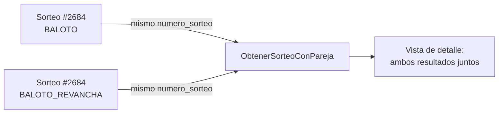

---

## Conectores y adquisición de datos

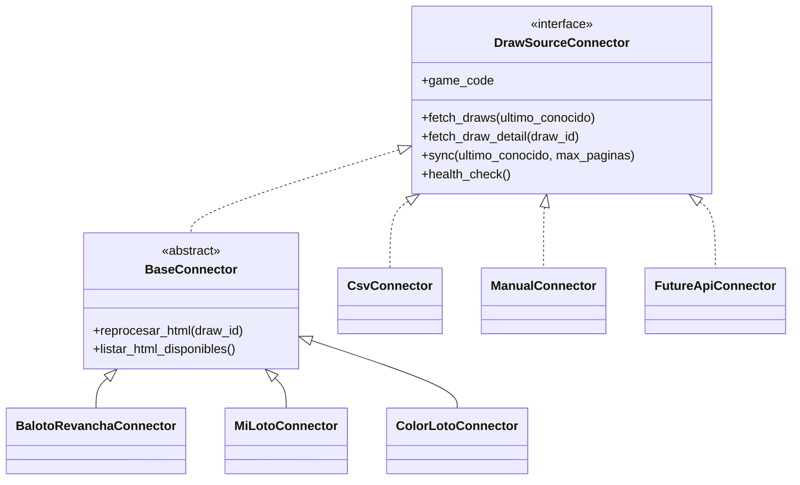

`BaseConnector` implementa una sola vez (patrón Template Method) la paginación, los reintentos con backoff exponencial, el guardado del HTML crudo y la tolerancia a fallos. Las subclases concretas solo aportan las URLs y delegan el parseo a un módulo de `infrastructure/parsers/` — así el conector responde "cómo llegar al dato" y el parser responde "qué significa el dato".

**Agregar un origen de datos nuevo no requiere tocar `SincronizarSorteos`:** basta con implementar `DrawSourceConnector` y registrar la clase en `ConnectorRegistry`.

---

## Flujo de sincronización

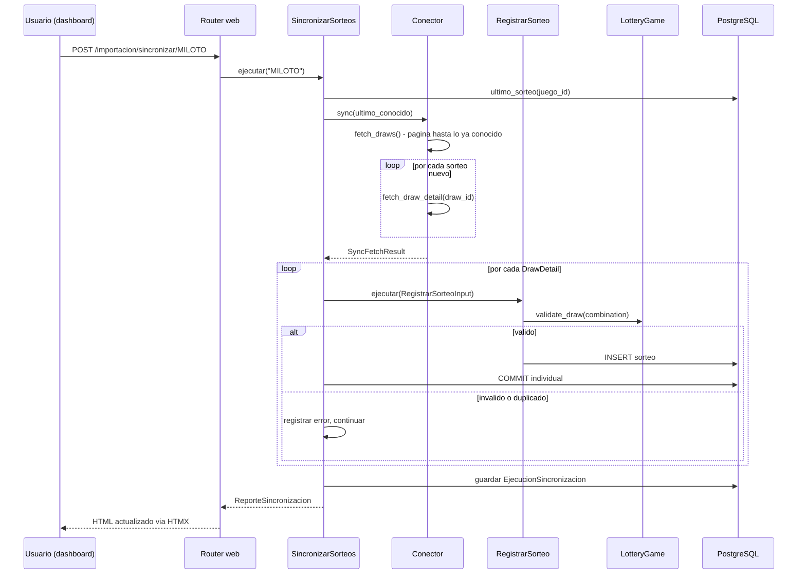

---

## Resiliencia de la sincronización

Documento completo: `backend/docs/resiliencia_sincronizacion.md`. Resumen:

- **El "último sorteo conocido" se recalcula desde PostgreSQL en cada corrida**, nunca desde el log de la corrida anterior.
- **Cada sorteo se confirma (commit) individualmente**, vía el puerto `UnitOfWork`. Antes de esta corrección, toda la sincronización corría en una sola transacción (una request = una Session = un commit al final); un fallo a mitad de camino habría revertido todo el lote. Ahora, si el sorteo 851 de 1000 falla, los 850 anteriores ya están confirmados y sobreviven.
- **Tres capas de protección contra duplicados**: el conector no vuelve a ofrecer lo ya conocido; `RegistrarSorteo` verifica `existe()` antes de escribir; la restricción UNIQUE de PostgreSQL es la última línea de defensa.
- **Un fallo individual nunca detiene el lote**: hay un catch-all deliberado además de los tipos de error anticipados.


---

## Reprocesamiento desde HTML

Permite reconstruir la base de datos usando únicamente los archivos ya guardados en `storage/html/`, sin volver a depender del sitio oficial.

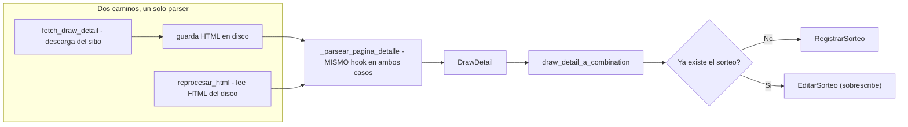

Reutiliza literalmente el mismo hook de parseo y el mismo mapper que la sincronización en vivo — no existe una segunda implementación que pueda desincronizarse de la primera.

---

## Data Quality Report

Combina dos fuentes a propósito:

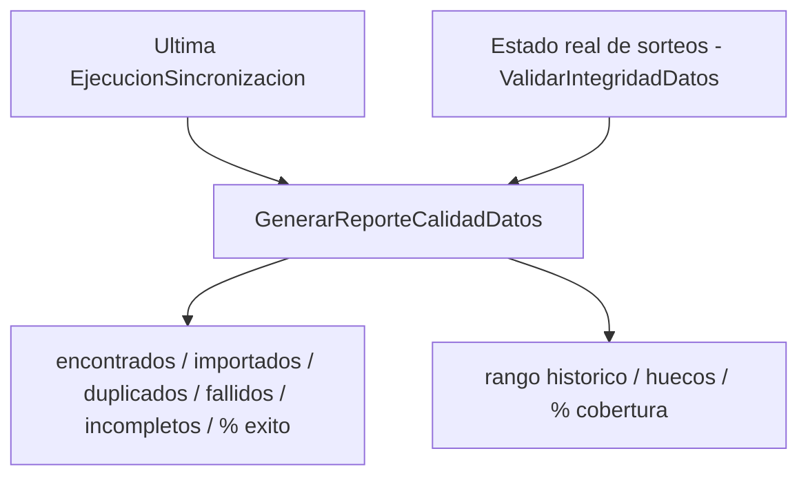

El rango histórico y la cobertura son propiedades del estado actual de los datos, no de una corrida puntual — por eso el reporte combina ambas fuentes en vez de fusionarlas en una sola entidad.

---

## Motor estadístico y caché persistido

**Motor puro (`application/estadisticas/motor/`):** un conjunto de módulos que calculan sobre `ResultadoNumerico` (DTO neutral: números, fecha, superbalota) sin importar nada de `infrastructure/` ni de `api/` — no conocen PostgreSQL, HTTP, ni de qué juego provienen los datos, solo reciben una secuencia de resultados y un rango. Esto los hace agnósticos por juego: el mismo código calcula frecuencias para MiLoto (1-39) o para Baloto/Revancha (1-43) sin ninguna rama condicional por juego. El motor incluye módulos para varios tipos de análisis (frecuencia, atrasos, distribuciones, coocurrencia, patrones temporales, entre otros); **solo un subconjunto de ellos está conectado al orquestador y expuesto en la web actualmente** (ver siguiente sección) — el resto existe como código de motor pero no forma parte de ninguna visualización todavía.

**Orquestador (`CalcularYPersistirEstadistica`, `application/use_cases/`):** único punto de entrada para calcular una estadística. Mantiene un catálogo cerrado de "recetas" (función de cálculo + función de serialización + fuente de histórico) por `tipo_estadistica`. Flujo: busca si ya existe una versión vigente (`EstadisticaRepository.buscar_vigente`) → si existe, la devuelve sin recalcular → si no, obtiene el histórico (`ResultadosHistoricosRepository`, con corte temporal aplicado tanto en SQL como de forma defensiva en Python — doble capa anti-fuga de datos futuros) → calcula con el motor puro → serializa → persiste (`EstadisticaRepository.guardar`).

**Fuente de histórico tipada (Etapas AE-1/AE-2/AE-3/AE-4/AE-5/AE-6/AE-7/AE-8/AE-9/AE-10/AE-11/AE-12/AE-13/AE-14/AE-15/AE-16/AE-17/AE-18/AE-19/AE-20/AE-21/AE-22/AE-23/AE-24/AE-25/AE-26/AE-27/AE-28/AE-29):** `_Receta.obtener_historico` es un campo `Callable` con default (`_obtener_historico_numerico`, reproduce exactamente el comportamiento anterior a esta extensión) — nunca un `if tipo_estadistica == ...` dentro del orquestador para elegir el repositorio. Las 9 recetas de juegos numéricos usan ese default sin ningún cambio de comportamiento; las veintinueve recetas de ColorLoto (`frecuencia_numeros_colorloto`, Etapa AE-1; `frecuencia_colores_colorloto`, Etapa AE-2; `frecuencia_pares_colorloto`, Etapa AE-3; `atrasos_numeros_colorloto`, Etapa AE-4; `atrasos_colores_colorloto`, Etapa AE-5; `atrasos_pares_colorloto`, Etapa AE-6; `repeticiones_entre_sorteos_colorloto`, Etapa AE-7; `distribucion_pares_impares_colorloto`, Etapa AE-8; `distribucion_altos_bajos_colorloto`, Etapa AE-9; `maximo_repeticion_color_por_sorteo_colorloto`, Etapa AE-10; `distribucion_pares_consecutivos_colorloto`, Etapa AE-11; `distribucion_racha_maxima_colorloto`, Etapa AE-12; `distribucion_trios_consecutivos_colorloto`, Etapa AE-13; `coocurrencia_pares_colorloto`, Etapa AE-14; `coocurrencia_trios_colorloto`, Etapa AE-15; `coocurrencia_pares_colores_colorloto`, Etapa AE-16; `coocurrencia_trios_colores_colorloto`, Etapa AE-17; `intervalos_historicos_colores_colorloto`, Etapa AE-18; `distribucion_sumas_colorloto`, Etapa AE-19; `intervalos_historicos_numeros_colorloto`, Etapa AE-20; `intervalos_historicos_pares_numero_color_colorloto`, Etapa AE-21; `frecuencia_colores_por_anio_colorloto`, Etapa AE-22; `frecuencia_colores_por_mes_colorloto`, Etapa AE-23; `frecuencia_colores_por_dia_semana_colorloto`, Etapa AE-24; `frecuencia_pares_numero_color_por_anio_colorloto`, Etapa AE-25; `frecuencia_pares_numero_color_por_mes_colorloto`, Etapa AE-26; `frecuencia_pares_numero_color_por_dia_semana_colorloto`, Etapa AE-27; `distribucion_conteo_color_colorloto`, Etapa AE-28; `comparacion_frecuencia_numeros_por_ventana_colorloto`, Etapa AE-29) declaran `_obtener_historico_colorloto`, que trae en dos consultas totales (nunca una por sorteo) tanto el histórico de pares número-color como el catálogo completo de colores del juego (`ColorRepository.listar_todos`, Etapa AE-0), empaquetados en un objeto compuesto (`_HistoricoColorLoto`) que las veintinueve recetas reutilizan para validar integridad en memoria contra `Color.esta_vigente_en`, sin duplicar la regla — patrón Strategy: el propio catálogo declara su fuente, el orquestador nunca bifurca por el tipo de estadística.

**Persistencia (`EstadisticaRepository` puerto + `EstadisticaRepositorySQLAlchemy`):** la identidad de cada estadística calculada es la tupla `(juego_id, tipo_estadistica, hasta_numero_sorteo, parametros_hash)`. `parametros_hash` es un SHA-256 de los parámetros de cálculo (rango, cantidad de números, etc.) canonicalizados de forma determinista (claves ordenadas, separadores fijos) — dos cálculos con parámetros distintos nunca colisionan, y el mismo cálculo repetido siempre produce el mismo hash. La tabla `estadisticas` usa **dos índices únicos parciales** en vez de un `UNIQUE` convencional, porque PostgreSQL nunca considera `NULL = NULL` en una restricción `UNIQUE` (así que un `UNIQUE` normal habría permitido múltiples filas "duplicadas" para histórico completo): uno para `hasta_numero_sorteo IS NOT NULL` (los 4 campos completos), otro para `hasta_numero_sorteo IS NULL` (los 3 campos restantes, el corte ya fijo por el propio índice).

**Invalidación selectiva:** `RegistrarSorteo`, `EditarSorteo` y `EliminarSorteo` — los tres casos de uso que mutan sorteos — llaman a `EstadisticaRepository.invalidar_por_juego(juego_id, desde_numero_sorteo)` inmediatamente después de una escritura exitosa (nunca antes: si la validación de dominio falla, no se invalida nada). La semántica: se invalidan las estadísticas con histórico completo (siempre incluyen cualquier sorteo nuevo) y las que tienen un corte `>= desde_numero_sorteo` (sus datos alcanzaban o hubieran alcanzado el sorteo mutado); las que tienen un corte anterior al sorteo mutado se conservan intactas, por ser históricas congeladas por definición. La invalidación siempre está aislada por `juego_id` — mutar un sorteo de Baloto Revancha nunca invalida el caché de MiLoto ni de Baloto clásico.

**Upsert al recalcular:** cuando una identidad ya existe (vigente o previamente invalidada) y se calcula de nuevo, `guardar()` usa un `INSERT ... ON CONFLICT ... DO UPDATE` de PostgreSQL — con dos ramas de conflicto, una por cada índice único parcial — en vez de intentar un `INSERT` incondicional. Esto reemplaza la fila existente (mismo `id`, `resultado`/`calculado_en`/`valido_hasta` actualizados) en lugar de crear una segunda fila para la misma identidad: nunca queda más de una fila por `(juego_id, tipo_estadistica, hasta_numero_sorteo, parametros_hash)`. La operación comparte la misma sesión/transacción que la escritura del sorteo que la disparó (mismo patrón de `UnitOfWork` de la Fase 2): si esa transacción no se confirma, ni el sorteo ni la invalidación/upsert quedan persistidos — atómico junto con la mutación, no una operación aparte que pueda quedar a medias.

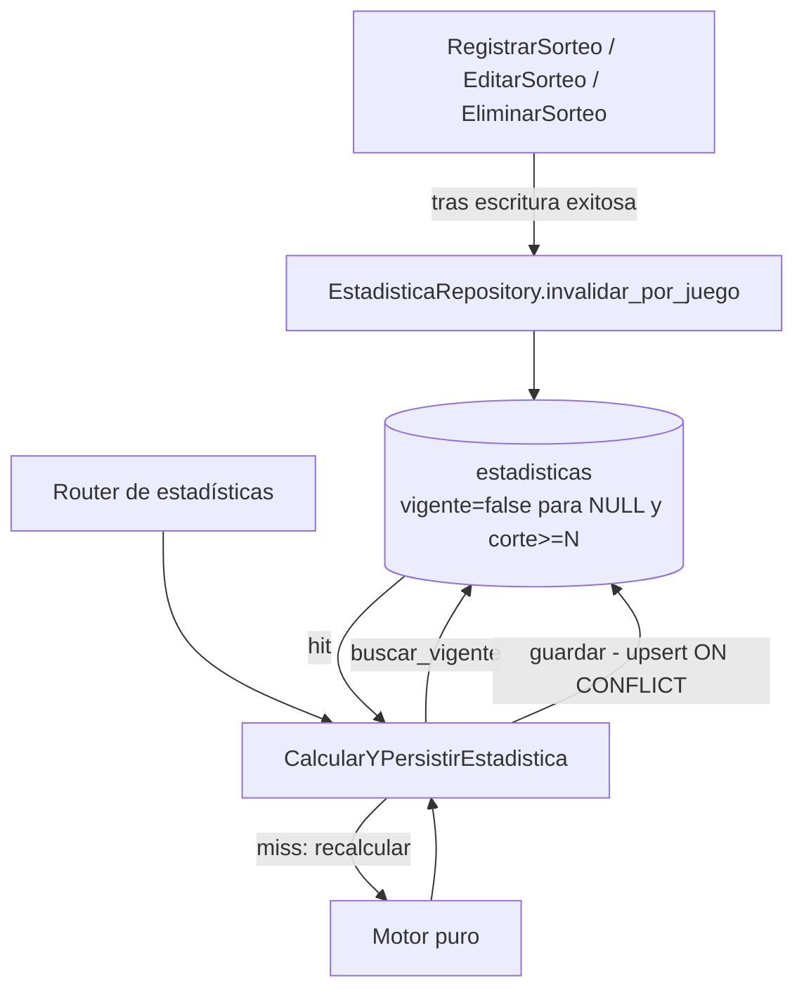

---

## Visualizaciones web de estadísticas

Treinta y ocho visualizaciones implementadas: nueve para los tres juegos numéricos ya soportados por esta sección (**Baloto**, **Baloto Revancha** y **MiLoto**), y veintinueve exclusivas de **ColorLoto** (Etapas AE-1/AE-2/AE-3/AE-4/AE-5/AE-6/AE-7/AE-8/AE-9/AE-10/AE-11/AE-12/AE-13/AE-14/AE-15/AE-16/AE-17/AE-18/AE-19/AE-20/AE-21/AE-22/AE-23/AE-24/AE-25/AE-26/AE-27/AE-28/AE-29) — ver semántica y aislamiento arquitectónico específico más abajo.

| Visualización | `tipo_estadistica` | Disponible para |
|---|---|---|
| Frecuencia de números principales | `frecuencia_numeros` | Baloto, Baloto Revancha, MiLoto |
| Frecuencia de superbalota | `frecuencia_superbalota` | Baloto, Baloto Revancha (MiLoto no tiene superbalota) |
| Frecuencia observada vs. esperada | `tabla_frecuencia_numeros` | Baloto, Baloto Revancha, MiLoto |
| Distancia desde la última aparición (Etapa W) | `atrasos_numeros` | Baloto, Baloto Revancha, MiLoto — números principales únicamente, sin superbalota en esta etapa |
| Distribución de números pares e impares (Etapa Y) | `distribucion_pares_impares` | Baloto, Baloto Revancha, MiLoto — números principales únicamente, sin superbalota |
| Distribución inferior/superior (Etapa Z) | `distribucion_altos_bajos` | Baloto, Baloto Revancha, MiLoto — números principales únicamente, sin superbalota |
| Distribución de pares consecutivos (Etapa AA) | `distribucion_pares_consecutivos` | Baloto, Baloto Revancha, MiLoto — números principales únicamente, sin superbalota |
| Racha máxima de números consecutivos (Etapa AB) | `distribucion_racha_maxima` | Baloto, Baloto Revancha, MiLoto — números principales únicamente, sin superbalota |
| Repeticiones entre sorteos consecutivos (Etapa AC) | `distribucion_repeticiones_entre_sorteos` | Baloto, Baloto Revancha, MiLoto — números principales únicamente, sin superbalota |
| Frecuencia de números (Etapa AE-1, validada) | `frecuencia_numeros_colorloto` | **ColorLoto** exclusivamente — cuenta números observados (1..7) ignorando color; magnitud "Apariciones promedio por sorteo", puede legítimamente superar 1.0 (repetición de número dentro de un mismo sorteo permitida por el dominio) |
| Frecuencia de colores (Etapa AE-2, validada) | `frecuencia_colores_colorloto` | **ColorLoto** exclusivamente — cuenta colores observados ignorando número; reutiliza el motor `calcular_frecuencia_colores` ya existente y la misma validación de integridad de AE-1, sin duplicarla; misma semántica de "Apariciones promedio por sorteo" |
| Frecuencia de pares número-color (Etapa AE-3, validada) | `frecuencia_pares_colorloto` | **ColorLoto** exclusivamente — cuenta cada par exacto (número, color) como unidad atómica, 42 categorías con el catálogo actual (7×6); reutiliza `calcular_frecuencia_pares_numero_color` ya existente, codificación `f"{numero}-{color}"` deserializada de forma inequívoca con `split("-", maxsplit=1)`; misma semántica de "Apariciones promedio por sorteo" |
| Atrasos de números (Etapa AE-4, validada) | `atrasos_numeros_colorloto` | **ColorLoto** exclusivamente — mide sorteos transcurridos desde la última aparición de cada número (1..7), ignorando color; reutiliza `calcular_atrasos_numeros_colorloto` y el serializador `_serializar_atrasos` ya existentes, sin modificarlos; el motor nunca recibe el corte directamente, mismo precedente ya validado por `atrasos_numeros` (Etapa W); magnitud distinta de "frecuencia"/"promedio", nunca llamada así |
| Atrasos de colores (Etapa AE-5, validada) | `atrasos_colores_colorloto` | **ColorLoto** exclusivamente — mide sorteos transcurridos desde la última aparición de cada color, ignorando número; reutiliza `calcular_atrasos_colores` y `_serializar_atrasos` ya existentes; reutiliza exactamente el contrato temporal de universo de colores ya validado por AE-4P (`_codigos_colores_vigentes_en_referencia`), sin política paralela; identidad de caché con el marcador estático de política, mismo criterio que AE-2/AE-3 |
| Atrasos de pares número-color (Etapa AE-6, validada) | `atrasos_pares_colorloto` | **ColorLoto** exclusivamente — mide sorteos transcurridos desde la última aparición del par exacto (número, color) como unidad atómica, distinto de atrasos de número y de color por separado; reutiliza `calcular_atrasos_pares_numero_color` y `_serializar_atrasos` ya existentes, sin modificar el motor; combina el patrón `rango_min`/`rango_max` de AE-4 con el helper temporal de colores ya validado por AE-4P/AE-5; 42 categorías (7×6); identidad de caché con el marcador estático de política, mismo criterio que AE-2/AE-3/AE-5 |
| Repeticiones entre sorteos (Etapa AE-7, validada) | `repeticiones_entre_sorteos_colorloto` | **ColorLoto** exclusivamente — cuenta cuántos números de las balotas (con multiplicidad, multiconjunto) coinciden entre cada par de sorteos numéricamente consecutivos, ignorando color por completo; reutiliza `calcular_repeticiones_entre_sorteos_colorloto` y `_serializar_frecuencia_observada` ya existentes, sin modificar el motor; 7 categorías fijas (0..6); `total_sorteos` del campo serializado representa transiciones válidas, no sorteos, presentado como "Transiciones analizadas"; identidad de caché de solo tres claves, **sin** el marcador de política de colores, porque la métrica nunca lee el color |
| Distribución de números pares e impares (Etapa AE-8, validada) | `distribucion_pares_impares_colorloto` | **ColorLoto** exclusivamente — cuenta cuántos de los 6 números de las balotas de cada sorteo son pares (2, 4, 6 en el dominio real 1-7), ignorando color por completo y con multiplicidad (un número par repetido vuelve a contar); reutiliza `calcular_distribucion_pares_impares_colorloto` y `_serializar_frecuencia_observada` ya existentes, sin modificar el motor; 7 categorías fijas (0..6); `total_sorteos` del campo serializado representa sorteos analizados, no transiciones; identidad de caché de **una sola clave** (`cantidad_numeros`), **sin** rango ni marcador de política de colores -el rango real y fijo de ColorLoto se usa como constante interna solo para la validación de integridad, ya que el resultado de paridad nunca depende de esos límites |
| Distribución de números bajos y altos (Etapa AE-9, validada) | `distribucion_altos_bajos_colorloto` | **ColorLoto** exclusivamente — cuenta cuántos de los 6 números de las balotas de cada sorteo son bajos (1, 2, 3 en el dominio real 1-7; el corte se calcula a partir de `rango_min`/`rango_max`), ignorando color por completo y con multiplicidad (un número bajo repetido vuelve a contar); reutiliza `calcular_distribucion_altos_bajos_colorloto` y `_serializar_frecuencia_observada` ya existentes, sin modificar el motor; 7 categorías fijas (0..6); `total_sorteos` del campo serializado representa sorteos analizados, no transiciones; identidad de caché de **tres claves** (`rango_min`, `rango_max`, `cantidad_numeros`), **sin** marcador de política de colores -a diferencia de AE-8, aquí el umbral bajos/altos sí depende materialmente del rango, por lo que ambos límites forman parte obligatoria de la identidad |
| Máximo color repetido por sorteo (Etapa AE-10, validada) | `maximo_repeticion_color_por_sorteo_colorloto` | **ColorLoto** exclusivamente — para cada sorteo, la mayor cantidad de balotas que compartieron un mismo color (usando `Counter` sobre los colores observados); reutiliza `calcular_maximo_repeticion_color_por_sorteo` y `_serializar_frecuencia_observada` ya existentes, sin modificar el motor; 6 categorías fijas (1..6, sin la categoría 0, filtrada por el propio motor); `total_sorteos` del campo serializado representa sorteos analizados; identidad de caché de **una sola clave** (`cantidad_numeros`), decisión M1 -**sin** marcador de política de colores: el motor sí lee y compara identidades de color, pero nunca construye su universo de categorías desde `colores_vigentes`, así que ningún cambio de política de universo de colores puede alterar el resultado matemático |
| Distribución de pares consecutivos (Etapa AE-11, validada) | `distribucion_pares_consecutivos_colorloto` | **ColorLoto** exclusivamente — para cada sorteo, cuántos pares de números adyacentes (diferencia exactamente 1) hay entre los números de las balotas, deduplicados antes de contar (comportamiento ya existente en el motor puro, no modificado por esta etapa) e ignorando color por completo; reutiliza `calcular_distribucion_pares_consecutivos_colorloto` y `_serializar_frecuencia_observada` ya existentes, sin modificar el motor; 6 categorías fijas (0..5, a diferencia de AE-10 SÍ incluye la categoría 0); `total_sorteos` del campo serializado representa sorteos analizados; identidad de caché de **una sola clave** (`cantidad_numeros`), decisión M1 -**sin** marcador de política de colores: a diferencia de AE-10, este motor sí exige `rango_min`/`rango_max` como argumentos posicionales, pero únicamente para su validación interna, nunca para el cálculo de categorías, conteos ni denominador |
| Distribución de racha máxima (Etapa AE-12, validada) | `distribucion_racha_maxima_colorloto` | **ColorLoto** exclusivamente — para cada sorteo, la longitud de su mayor racha de números consecutivos (diferencia exactamente 1), deduplicados antes de contar (comportamiento ya existente en el motor puro, no modificado por esta etapa) e ignorando color por completo; reutiliza `calcular_distribucion_racha_maxima_colorloto` y `_serializar_frecuencia_observada` ya existentes, sin modificar el motor; 6 categorías fijas (1..6, sin la categoría 0, igual que AE-10, a diferencia de AE-11); `total_sorteos` del campo serializado representa sorteos analizados; identidad de caché de **una sola clave** (`cantidad_numeros`), decisión M1 -**sin** marcador de política de colores: igual que AE-11, este motor sí exige `rango_min`/`rango_max` como argumentos posicionales, pero únicamente para su validación interna, nunca para el cálculo de categorías, conteos ni denominador |
| Distribución de tríos consecutivos (Etapa AE-13, validada) | `distribucion_trios_consecutivos_colorloto` | **ColorLoto** exclusivamente — para cada sorteo, cuántos tríos de números adyacentes (tres números con diferencia exactamente 1 entre cada par) hay entre los números de las balotas, deduplicados antes de contar (comportamiento ya existente en el motor puro, no modificado por esta etapa) e ignorando color por completo; los tríos superpuestos se cuentan por separado; reutiliza `calcular_distribucion_trios_consecutivos_colorloto` y `_serializar_frecuencia_observada` ya existentes, sin modificar el motor; 5 categorías fijas (0..4, incluye la categoría 0, igual que AE-11, a diferencia de AE-12); `total_sorteos` del campo serializado representa sorteos analizados; identidad de caché de **una sola clave** (`cantidad_numeros`), decisión M1 -**sin** marcador de política de colores: igual que AE-11/AE-12, este motor sí exige `rango_min`/`rango_max` como argumentos posicionales, pero únicamente para su validación interna, nunca para el cálculo de categorías, conteos ni denominador |
| Coocurrencia de pares (Etapa AE-14, validada) | `coocurrencia_pares_colorloto` | **ColorLoto** exclusivamente — a diferencia de las trece visualizaciones anteriores (todas distribuciones categóricas por sorteo), esta es una tabla de asociaciones agregada sobre TODO el histórico analizado: qué pares de números (dos números distintos presentes en el mismo sorteo, deduplicados antes de formar el par) coocurrieron y con qué soporte, ignorando color por completo; reutiliza `calcular_coocurrencia_pares_colorloto` sin modificar el motor; primera conexión del tipo `MetricaAsociacion` en todo el proyecto, con serializador dedicado nuevo `_serializar_metrica_asociacion` (convierte `elementos` a enteros reales, preserva `frecuencia_esperada`/`lift` como `None` sin sustituir por 0); reporta ÚNICAMENTE pares observados al menos una vez (nunca completa el universo teórico con soporte cero); máximo teórico C(7,2)=21 pares para ColorLoto; identidad de caché **VACÍA** (`{}`) -decisión M1 demostrada: `cantidad_balotas` nunca se usa matemáticamente en el cuerpo del motor, `rango_min`/`rango_max` solo alimentan la validación interna, ningún parámetro define la identidad matemática del resultado; sin canvas ni Chart.js -presentación tabular pura, una de las cuatro excepciones entre las 38 páginas estadísticas |
| Coocurrencia de tríos (Etapa AE-15, validada) | `coocurrencia_trios_colorloto` | **ColorLoto** exclusivamente — mismo patrón exacto que `coocurrencia_pares_colorloto` (AE-14), adaptado a tríos: tabla de asociaciones agregada sobre TODO el histórico analizado, qué tríos de números (tres números distintos presentes en el mismo sorteo, deduplicados antes de formar el trío) coocurrieron y con qué soporte, ignorando color por completo; reutiliza `calcular_coocurrencia_trios_colorloto` sin modificar el motor (ya existía en `motor/coocurrencia.py` desde antes de esta etapa); reutiliza `_serializar_metrica_asociacion` sin modificarlo (tres enteros reales por fila en `elementos`, `frecuencia_esperada`/`lift` preservados como `None`); reporta ÚNICAMENTE tríos observados al menos una vez; máximo teórico C(7,3)=35 tríos para ColorLoto, sin paginación ni truncamiento; identidad de caché **VACÍA** (`{}`), mismo criterio que AE-14; sin canvas ni Chart.js -presentación tabular pura, la segunda excepción entre las 38 páginas estadísticas |
| Coocurrencia de pares de colores (Etapa AE-16, validada) | `coocurrencia_pares_colores_colorloto` | **ColorLoto** exclusivamente — mismo patrón de tabla de asociaciones que AE-14/AE-15, esta vez sobre CÓDIGOS DE COLOR en vez de números: qué pares de colores (dos colores distintos presentes en el mismo sorteo, deduplicados antes de formar el par) coocurrieron y con qué soporte, ignorando los números de las balotas por completo; reutiliza `calcular_coocurrencia_pares_colores` sin modificar el motor (ya existía en `motor/coocurrencia.py` desde antes de esta etapa, con tests de motor propios); a diferencia de AE-14/AE-15, NO reutiliza `_serializar_metrica_asociacion` -esa función convierte cada elemento con `int()`, incompatible con códigos de color- sino un serializador nuevo y aislado, `_serializar_metrica_asociacion_texto` (`str()` en vez de `int()`, el serializador numérico permanece intacto y AE-14/AE-15 siguen produciendo enteros reales); reporta ÚNICAMENTE pares de colores observados al menos una vez; sin límite de filas fijo -la paleta de colores no está hardcodeada en el dominio (`ColorLotoGame`/`Color` permiten que el reglamento la modifique); identidad de caché **VACÍA** (`{}`), demostrado por la firma real del motor, que no acepta ningún parámetro de rango, cantidad ni catálogo; sin canvas ni Chart.js -presentación tabular pura, la tercera excepción entre las 38 páginas estadísticas |
| Coocurrencia de tríos de colores (Etapa AE-17, validada) | `coocurrencia_trios_colores_colorloto` | **ColorLoto** exclusivamente — mismo patrón de tabla de asociaciones que AE-16, esta vez con TRÍOS de códigos de color: qué tríos de colores (tres colores distintos presentes en el mismo sorteo, deduplicados antes de formar el trío) coocurrieron y con qué soporte, ignorando los números de las balotas por completo; reutiliza `calcular_coocurrencia_trios_colores` sin modificar el motor (ya existía en `motor/coocurrencia.py` desde antes de esta etapa, con tests de motor propios); reutiliza `_serializar_metrica_asociacion_texto` (Etapa AE-16) SIN NINGÚN CAMBIO -confirmado por hash AST idéntico antes/después de esta etapa- porque su comprensión de lista genérica acepta tres elementos igual que dos; reporta ÚNICAMENTE tríos de colores observados al menos una vez; sin límite de filas fijo en 20 -un histórico sintético con siete códigos distribuidos entre sorteos ya demostró 30 filas globales; identidad de caché **VACÍA** (`{}`); sin canvas ni Chart.js -presentación tabular pura, la cuarta excepción entre las 38 páginas estadísticas |
| Intervalos históricos de colores (Etapa AE-18, validada) | `intervalos_historicos_colores_colorloto` | **ColorLoto** exclusivamente — a diferencia de AE-14 a AE-17, estadísticos descriptivos de TODOS los intervalos históricos entre apariciones consecutivas de cada color (mínimo, máximo, promedio, mediana), ignorando los números de las balotas por completo; reutiliza `calcular_intervalos_historicos_colores` sin modificar el motor (vive en `motor/atrasos.py`, ya existía desde antes de esta etapa, con 6 tests de motor propios en `TestCalcularIntervalosHistoricosColores`); a diferencia de AE-14 a AE-17, SÍ deriva `colores_vigentes` -mismo patrón exacto ya validado por AE-5 (`_codigos_colores_vigentes_en_referencia`); reutiliza `_serializar_atrasos` (Etapa AE-4) SIN NINGÚN CAMBIO -confirmado por hash AST idéntico antes/después de esta etapa- porque `dataclasses.asdict` es genérico sobre cualquier dataclass, incluida la tupla `intervalos`, serializada como array JSON; identidad de caché `{"politica_universo_colores": POLITICA_UNIVERSO_COLORES_ACTUAL}`, demostrada -no copiada de AE-5, cuyo motor sí recibe rango/cantidad y por eso los incluye en su identidad, mientras este motor no los recibe en absoluto; **tabla Y gráfica**, mismo patrón que AE-5, no tabla pura como AE-14 a AE-17 -primer incremento de canvas desde AE-14, entre las 38 páginas estadísticas |
| Distribución de sumas (Etapa AE-19, validada) | `distribucion_sumas_colorloto` | **ColorLoto** exclusivamente — a diferencia de todas las etapas anteriores, estadísticos descriptivos (mínimo, máximo, media, mediana, desviación estándar, percentiles P10/P25/P50/P75/P90) de la suma de los NÚMEROS de las 6 balotas de cada sorteo, ignorando el color por completo -el color no influye en absoluto en el resultado, confirmado por ejecución real; reutiliza `calcular_distribucion_sumas_colorloto` sin modificar el motor (vive en `motor/distribuciones.py`, ya existía desde antes de esta etapa); a diferencia de AE-5/AE-18, NO deriva `colores_vigentes` -el motor no recibe ningún parámetro de color; identidad de caché **VACÍA** (`{}`), demostrada por ejecución real sin `KeyError`; `DistribucionSumas` es un objeto ÚNICO, no una lista de filas, por lo que requirió un serializador nuevo, `_serializar_distribucion_sumas` (NO usa `{"filas": [...]}"`, convierte las claves de `percentiles` a string explícitamente); reutiliza `_num_o_none` (Etapa AE-18) SIN NINGÚN CAMBIO -confirmado por hash AST idéntico antes/después de esta etapa- para normalizar `media`/`mediana`/`desviación_estándar` a `float` en el View Model; **tarjetas y gráfica**, distinto de la tabla pura de AE-14 a AE-17 y distinto también de la tabla-y-gráfica de filas de AE-5/AE-18: 7 tarjetas SIEMPRE visibles (incluso con histórico vacío) más 1 gráfica de percentiles condicionada a la existencia de datos -segundo incremento de canvas desde AE-14, entre las 38 páginas estadísticas |
| Intervalos históricos de números (Etapa AE-20, validada) | `intervalos_historicos_numeros_colorloto` | **ColorLoto** exclusivamente — para cada número (1 a 7), estadísticos descriptivos de TODOS los intervalos históricos entre apariciones consecutivas, ignorando el color por completo; reutiliza `calcular_intervalos_historicos_numeros_colorloto` sin modificar el motor (vive en `motor/atrasos.py`, ya existía desde antes de esta etapa, con 6 tests de motor propios); a diferencia de AE-14/AE-15/AE-16/AE-17/AE-19 (identidad VACÍA `{}`), este motor SÍ construye su universo de filas directamente desde `rango_min`/`rango_max` (`range(rango_min, rango_max+1)`, confirmado por lectura directa) -mismo criterio real ya demostrado por `frecuencia_numeros_colorloto` (AE-1) y `atrasos_numeros_colorloto` (AE-4); identidad `{"rango_min": 1, "rango_max": 7}`, construida por el router desde `juego.rango_min`/`juego.rango_max` (la entidad real, nunca la constante privada `_RANGO_REAL_COLORLOTO`, inaccesible fuera del caso de uso); `cantidad_numeros` excluida de la identidad -el motor no la recibe, solo se usa para validación defensiva; reutiliza `_validar_historico_colorloto_consistente` (18 de 19 recetas ColorLoto ya la usan, confirmado por AST) antes de invocar el motor; reutiliza `_serializar_atrasos` (Etapa AE-4) SIN NINGÚN CAMBIO -mismo tipo `list[IntervalosHistoricos]` exacto que AE-18; `cantidad_apariciones`/`cantidad_intervalos` son SIEMPRE enteros reales, nunca `None`; **tabla y gráfica**, mismo patrón que AE-5/AE-18: la tabla de 7 filas permanece siempre completa (universo fijo, no depende del histórico), el canvas se muestra siempre que existe conexión y estadística, sin condición adicional de "datos insuficientes" -tercer incremento de canvas desde AE-14, entre las 38 páginas estadísticas |
| Intervalos históricos de pares número-color (Etapa AE-21, validada) | `intervalos_historicos_pares_numero_color_colorloto` | **ColorLoto** exclusivamente — para cada PAR (número, color) como unidad atómica, estadísticos descriptivos de TODOS los intervalos históricos entre apariciones consecutivas del par completo; reutiliza `calcular_intervalos_historicos_pares_numero_color` sin modificar el motor (vive en `motor/atrasos.py`, ya existía desde antes de esta etapa, con 6 tests de motor propios); a diferencia de AE-20 (identidad solo con rango), este motor construye su universo con el producto cartesiano `range(rango_min, rango_max+1) × colores_a_reportar` (confirmado por lectura directa), por lo que la identidad `{"rango_min": 1, "rango_max": 7, "politica_universo_colores": "vigentes_ultimo_sorteo_mas_observados_v1"}` combina los criterios ya demostrados por AE-20 (rango, desde `juego.rango_min`/`juego.rango_max`) y AE-5/AE-18 (política de colores, desde `POLITICA_UNIVERSO_COLORES_ACTUAL`); `cantidad_numeros` excluida, el motor no la recibe; reutiliza `_validar_historico_colorloto_consistente` y `_codigos_colores_vigentes_en_referencia` (ambos protegidos, sin cambios) antes de invocar el motor -caracterización empírica con motor espiado realizada ANTES de escribir cualquier test, confirmando que un número fuera de rango es interceptado por la validación, el motor nunca se invoca; reutiliza `_serializar_atrasos` (Etapa AE-4) y `_deserializar_par_numero_color` (Etapa AE-6) SIN NINGÚN CAMBIO; `cantidad_apariciones`/`cantidad_intervalos` son SIEMPRE enteros reales, nunca `None`; **tabla y gráfica**, mismo patrón que AE-5/AE-18/AE-20: la tabla de 42 filas (7×6) permanece siempre completa, el canvas (1 dataset "Intervalo promedio", etiquetas `"<numero>-<color>"`) se muestra siempre que existe conexión y estadística -cuarto incremento de canvas desde AE-14, entre las 38 páginas estadísticas |
| Frecuencia de colores por año (Etapa AE-22, validada) | `frecuencia_colores_por_anio_colorloto` | **ColorLoto** exclusivamente — primera página con un control de interfaz adicional al corte temporal: selector visible de año, sin valor por defecto (decisión de producto autorizada tras auditoría exhaustiva de las diez candidatas pendientes, ninguna otra resoluble sin selector o agregador de motor en bucle); reutiliza `calcular_frecuencia_colores_por_anio` sin modificar el motor (vive en `motor/frecuencia_temporal.py`, ya existía desde antes de esta etapa, con 7 tests de motor propios); sin `anio`, la ruta responde `200` mostrando solo el formulario, sin ejecutar el orquestador ni el motor, sin consultar ni persistir caché -confirmado por AST real sobre la función del router: el bloque `if anio is None` no contiene ninguna llamada a `.ejecutar`; `anio` fuera de `1..9999` produce `422` nativo de FastAPI; año válido sin sorteos sigue siendo `200`, universo completo en cero, nunca `404`; identidad `{"anio": <entero>, "politica_universo_colores": "vigentes_ultimo_sorteo_mas_observados_v1"}` -primera receta ColorLoto que lee una clave real de `parametros` (`anio`), justificado por evidencia real: `ejecutar()` llama a `receta.calcular(historico, parametros_metrica)`, único canal por el que un valor variable por consulta puede llegar hasta la receta, confirmado por AST que lee únicamente esa clave; reutiliza `_validar_historico_colorloto_consistente`, `_codigos_colores_vigentes_en_referencia` y `_serializar_frecuencia_observada` (los tres protegidos, sin cambios) -mismo dataclass `FrecuenciaObservada` ya usado por `frecuencia_colores_colorloto` (AE-2); balotas físicas contadas individualmente, denominador = sorteos del año, universo = colores vigentes ∪ observados (mismo criterio semántico de AE-2, "apariciones promedio por sorteo", nunca "porcentaje"); **formulario y gráfica**: control HTML numérico con campo oculto de corte, el canvas (1 dataset `"Apariciones promedio por sorteo"` -corregido de una etiqueta inicial ambigua, `"Frecuencia relativa"`, que sugería incorrectamente una proporción acotada a `[0,1]` cuando el valor puede superar `1.0` legítimamente) solo se renderiza con año válido y estadística calculada -quinto incremento de canvas desde AE-14, entre las 38 páginas estadísticas |
| Frecuencia de colores por mes (Etapa AE-23, validada) | `frecuencia_colores_por_mes_colorloto` | **ColorLoto** exclusivamente — reutiliza exactamente el precedente de AE-22: selector visible de mes calendario, sin valor por defecto; "mes" combina el mismo mes calendario a través de TODOS los años del histórico, nunca un año-mes concreto (confirmado por lectura directa de `_filtrar_por_mes`, `r.fecha.month == mes`, y por ejecución real: marzo de 2022+2023 combinados en un único subconjunto, excluyendo correctamente un sorteo de junio); reutiliza `calcular_frecuencia_colores_por_mes` sin modificar el motor (vive en `motor/frecuencia_temporal.py`, ya existía desde antes de esta etapa); sin `mes`, la ruta responde `200` mostrando solo el formulario, sin ejecutar el orquestador ni el motor, sin consultar ni persistir caché -confirmado por AST real: el bloque `if mes is None` no contiene ninguna llamada a `.ejecutar`; `mes` fuera de `1..12` produce `422` nativo de FastAPI; mes válido sin sorteos sigue siendo `200`, universo completo en cero, nunca `404`; identidad `{"mes": <entero>, "politica_universo_colores": "vigentes_ultimo_sorteo_mas_observados_v1"}` -misma justificación exacta de AE-22 para leer `parametros["mes"]`, confirmado por AST que lee únicamente esa clave; reutiliza `_validar_historico_colorloto_consistente`, `_codigos_colores_vigentes_en_referencia` y `_serializar_frecuencia_observada` (protegidos, sin cambios); balotas físicas, denominador = sorteos del mes a través de todos los años, universo vigente ∪ observado, "apariciones promedio por sorteo", nunca "porcentaje"; **preservación bidireccional mes↔corte implementada desde el inicio** -mismo mecanismo exacto que `anio` en el partial compartido, ninguna página define ambos simultáneamente (confirmado por AST sobre las 32 funciones de router), el comportamiento año↔corte de AE-22 permanece intacto; **formulario y gráfica**: selector desplegable con los doce meses en español, sin preselección por defecto, el canvas (1 dataset `"Apariciones promedio por sorteo"`) solo se renderiza con mes válido y estadística calculada -sexto incremento de canvas desde AE-14, entre las 38 páginas estadísticas |
| Frecuencia de colores por día de semana (Etapa AE-24, validada) | `frecuencia_colores_por_dia_semana_colorloto` | **ColorLoto** exclusivamente — reutiliza exactamente el precedente de AE-22/AE-23: selector visible de día de la semana, sin valor por defecto; dominio real confirmado por auditoría: string literal en español, minúsculas, sin tildes (`{"lunes","martes","miercoles","jueves","viernes","sabado","domingo"}`, `_DIAS_SEMANA_VALIDOS`), NUNCA un entero -mismo dominio exacto ya almacenado en `ResultadoColorLoto.dia_semana`, poblado una única vez al registrar/editar un sorteo mediante `DIAS_SEMANA_ES[fecha.weekday()]` (`registrar_sorteo.py`/`editar_sorteo.py`, único uso real de `weekday()`, nunca dentro del motor de estadísticas); "día de la semana" agrega ese mismo día a través de TODOS los meses y años del histórico, nunca una fecha concreta (confirmado por lectura directa de `_filtrar_por_dia_semana`, `r.dia_semana == dia_semana`, y por ejecución real: lunes de 2022-03/2023-06/2024-01 agregados en 3 sorteos, excluyendo correctamente un martes); reutiliza `calcular_frecuencia_colores_por_dia_semana` sin modificar el motor (vive en `motor/frecuencia_temporal.py`, ya existía desde antes de esta etapa, con test de motor propio, `test_por_dia_semana`); `Literal[...]` en el tipo del `Query` produce `422` nativo de FastAPI para el dominio real, sin `ge`/`le`; sin `dia_semana`, la ruta responde `200` mostrando solo el formulario, sin ejecutar el orquestador ni el motor, sin consultar ni persistir caché -confirmado por AST real: el bloque `if dia_semana is None` no contiene ninguna llamada a `.ejecutar`; día válido sin sorteos sigue siendo `200`, universo completo en cero, nunca `404`; identidad `{"dia_semana": <string>, "politica_universo_colores": "vigentes_ultimo_sorteo_mas_observados_v1"}` -misma justificación exacta de AE-22/AE-23 para leer `parametros["dia_semana"]`, confirmado por AST que lee únicamente esa clave; reutiliza `_validar_historico_colorloto_consistente`, `_codigos_colores_vigentes_en_referencia` y `_serializar_frecuencia_observada` (protegidos, sin cambios); balotas físicas, denominador = sorteos del día a través de todos los meses y años, universo vigente ∪ observado, "apariciones promedio por sorteo", nunca "porcentaje"; **preservación bidireccional día↔corte implementada desde el inicio** -mismo mecanismo exacto que `anio`/`mes` en el partial compartido, ninguna página define más de uno de los tres simultáneamente (confirmado por renderizado Jinja2 real del partial en los cuatro contextos), los comportamientos año↔corte de AE-22 y mes↔corte de AE-23 permanecen intactos; **formulario y gráfica**: selector desplegable con los siete días en español, sin preselección por defecto, el canvas (1 dataset `"Apariciones promedio por sorteo"`) solo se renderiza con día válido y estadística calculada -séptimo incremento de canvas desde AE-14, entre las 38 páginas estadísticas |
| Frecuencia de pares número-color por año (Etapa AE-25, validada) | `frecuencia_pares_numero_color_por_anio_colorloto` | **ColorLoto** exclusivamente — reutiliza exactamente el precedente de selector de AE-22 (año) sobre el PAR (número, color) como unidad atómica, mismo formato `valor=f"{numero}-{color}"` ya usado por `frecuencia_pares_colorloto` (AE-3); motor real confirmado en `motor/frecuencia_temporal.py:181`, firma `(resultados, rango_min, rango_max, colores_vigentes, anio, hasta_numero_sorteo=None)`, 5 argumentos obligatorios, delega sin modificar en `calcular_frecuencia_pares_numero_color` (AE-3); a diferencia de `mes`/`dia_semana`, el motor NO valida `anio` internamente -confirmado por ejecución real con `0`/`-1`/`10000`, que no producen excepción propia, solo un universo en cero; el dominio real `1..9999` se aplica exclusivamente en el `Query` del router, mismo criterio de AE-22; el motor sí valida el rango de números (`_validar_rango`, `ValueError`), interceptado primero por la validación defensiva de la receta, mismo comportamiento de AE-20/AE-21; sin `anio`, la ruta responde `200` mostrando solo el formulario, sin ejecutar el orquestador ni el motor, sin consultar ni persistir caché -confirmado por AST real: el bloque `if anio is None` no contiene ninguna llamada a `.ejecutar`; año válido sin sorteos sigue siendo `200`, universo completo de 42 pares en cero, nunca `404`; **identidad con CUATRO claves** -a diferencia de AE-22/AE-23/AE-24-: `{"anio": <entero>, "rango_min": juego.rango_min, "rango_max": juego.rango_max, "politica_universo_colores": "vigentes_ultimo_sorteo_mas_observados_v1"}`, porque este motor sí construye su universo con el producto cartesiano rango×colores (mismo criterio de AE-20/AE-21), construida desde `juego.rango_min`/`juego.rango_max`, nunca la constante privada `_RANGO_REAL_COLORLOTO`; receta lee únicamente `parametros["anio"]`; reutiliza `_validar_historico_colorloto_consistente`, `_codigos_colores_vigentes_en_referencia`, `_serializar_frecuencia_observada` y `_deserializar_par_numero_color` (todos protegidos, sin cambios); balotas físicas, "apariciones promedio por sorteo", nunca "porcentaje"; **preservación bidireccional año↔corte reutilizando sin cambios el mecanismo ya validado por AE-22** -`control_corte_temporal.html` no fue modificado, el bloque `anio is defined` ya existente cubre esta etapa automáticamente; **formulario y gráfica**: control HTML numérico, VM replica de forma mínima el patrón de `frecuencia_pares_colorloto_a_vm` (AE-3, sin modificarlo): datasets agrupados dinámicamente por color, eje X con los números del rango real, el canvas solo se renderiza con año válido y estadística calculada -octavo incremento de canvas desde AE-14, entre las 38 páginas estadísticas |
| Frecuencia de pares número-color por mes (Etapa AE-26, validada) | `frecuencia_pares_numero_color_por_mes_colorloto` | **ColorLoto** exclusivamente — reutiliza exactamente el precedente de identidad con rango de AE-25 (pares) combinado con el selector de mes ya validado por AE-23; motor real confirmado en `motor/frecuencia_temporal.py:192`, firma `(resultados, rango_min, rango_max, colores_vigentes, mes, hasta_numero_sorteo=None)`, 5 argumentos obligatorios, delega sin modificar en `calcular_frecuencia_pares_numero_color` (AE-3/AE-25); a diferencia de `anio` (AE-25, sin validación interna), el motor de esta etapa SÍ valida `mes` internamente (`_validar_mes`, `ValueError` real confirmado con `0`/`-1`/`13`), independiente de la validación defensiva de la receta; el dominio real `1..12` se aplica también en el `Query` del router; sin `mes`, la ruta responde `200` mostrando solo el formulario, sin ejecutar el orquestador ni el motor, sin consultar ni persistir caché -confirmado por AST real: el bloque `if mes is None` no contiene ninguna llamada a `.ejecutar`; mes válido sin sorteos sigue siendo `200`, universo completo de 42 pares en cero, nunca `404`; **identidad con CUATRO claves** -mismo criterio de AE-25-: `{"mes": <entero>, "rango_min": juego.rango_min, "rango_max": juego.rango_max, "politica_universo_colores": "vigentes_ultimo_sorteo_mas_observados_v1"}`, construida desde `juego.rango_min`/`juego.rango_max`, nunca la constante privada `_RANGO_REAL_COLORLOTO`, confirmada por test real que el orden de las claves no afecta la identidad; receta lee únicamente `parametros["mes"]`; reutiliza `_validar_historico_colorloto_consistente`, `_codigos_colores_vigentes_en_referencia`, `_serializar_frecuencia_observada` y `_deserializar_par_numero_color` (todos protegidos, sin cambios); balotas físicas, "apariciones promedio por sorteo", nunca "porcentaje"; **preservación bidireccional mes↔corte reutilizando sin cambios el mecanismo ya validado por AE-23** -`control_corte_temporal.html` no fue modificado, el bloque `mes is defined` ya existente cubre esta etapa automáticamente, confirmado por diff completo del registro de hashes protegidos; **formulario y gráfica**: selector desplegable con los doce meses en español, sin preselección por defecto, VM replica de forma mínima el patrón de `frecuencia_pares_numero_color_por_anio_colorloto_a_vm` (AE-25, sin modificarlo) combinado con `_NOMBRES_MESES_ES` de AE-23: datasets agrupados dinámicamente por color, eje X con los números del rango real, el canvas solo se renderiza con mes válido y estadística calculada -noveno incremento de canvas desde AE-14, entre las 38 páginas estadísticas |
| Frecuencia de pares número-color por día de semana (Etapa AE-27, validada) | `frecuencia_pares_numero_color_por_dia_semana_colorloto` | **ColorLoto** exclusivamente — reutiliza exactamente el precedente de identidad con rango de AE-25/AE-26 (pares) combinado con el selector de día de la semana ya validado por AE-24; motor real confirmado en `motor/frecuencia_temporal.py:201`, firma `(resultados, rango_min, rango_max, colores_vigentes, dia_semana, hasta_numero_sorteo=None)`, 5 argumentos obligatorios, delega sin modificar en `calcular_frecuencia_pares_numero_color` (AE-3/AE-25/AE-26); mismo dominio real ya usado por AE-24 -string literal en español, minúsculas, sin tildes (`lunes`...`domingo`), NUNCA un entero; el motor de esta etapa SÍ valida `dia_semana` internamente (`_validar_dia_semana`, `ValueError` real confirmado con `"Lunes"`/`"miércoles"`/`"7"`), independiente de la validación defensiva de la receta, mismo comportamiento ya confirmado por AE-24 y AE-26; el dominio real se aplica también en el `Query` del router mediante `Literal[...]`; sin `dia_semana`, la ruta responde `200` mostrando solo el formulario, sin ejecutar el orquestador ni el motor, sin consultar ni persistir caché -confirmado por AST real: el bloque `if dia_semana is None` no contiene ninguna llamada a `.ejecutar`; día válido sin sorteos sigue siendo `200`, universo completo de 42 pares en cero, nunca `404`; **identidad con CUATRO claves** -mismo criterio de AE-25/AE-26-: `{"dia_semana": <string>, "rango_min": juego.rango_min, "rango_max": juego.rango_max, "politica_universo_colores": "vigentes_ultimo_sorteo_mas_observados_v1"}`, construida desde `juego.rango_min`/`juego.rango_max`, nunca la constante privada `_RANGO_REAL_COLORLOTO`, confirmada por test real que el orden de las claves no afecta la identidad; receta lee únicamente `parametros["dia_semana"]`; reutiliza `_validar_historico_colorloto_consistente`, `_codigos_colores_vigentes_en_referencia`, `_serializar_frecuencia_observada`, `_deserializar_par_numero_color` y `_NOMBRES_DIAS_SEMANA_ES` (todos protegidos, sin cambios); balotas físicas, "apariciones promedio por sorteo", nunca "porcentaje"; **preservación bidireccional día↔corte reutilizando sin cambios el mecanismo ya validado por AE-24** -`control_corte_temporal.html` no fue modificado, el bloque `dia_semana is defined` ya existente cubre esta etapa automáticamente, confirmado por diff completo del registro de hashes protegidos; **formulario y gráfica**: selector desplegable con los siete días en español, sin preselección por defecto, VM replica de forma mínima el patrón de `frecuencia_pares_numero_color_por_mes_colorloto_a_vm` (AE-26, sin modificarlo) combinado con `_NOMBRES_DIAS_SEMANA_ES` de AE-24: datasets agrupados dinámicamente por color, eje X con los números del rango real, el canvas solo se renderiza con día válido y estadística calculada -décimo incremento de canvas desde AE-14, entre las 38 páginas estadísticas |
| Distribución del conteo por color (Etapa AE-28, validada) | `distribucion_conteo_color_colorloto` | **ColorLoto** exclusivamente — primera etapa cuya auditoría inicial se DETUVO por contradicción material real (`calcular_distribucion_conteo_color` exige `color_objetivo: str` obligatorio, un selector de dominio genuinamente DINÁMICO -código de color real de la base de datos, a diferencia de `anio`/`mes`/`dia_semana`, cuyos dominios son estáticos y validables con `Query`/`Literal` nativos); autorizada explícitamente por el usuario con la Opción A (selector explícito), descartando la Opción B (receta agregadora en bucle sobre el motor, sin precedente en las 37 recetas conectadas); motor real confirmado en `motor/distribuciones.py:254`, firma `(resultados, color_objetivo, cantidad_balotas, hasta_numero_sorteo=None)`, 3 argumentos obligatorios, delega en `tabular_conteo_por_sorteo` (`motor/tabulacion.py`) sin modificar ninguno de los dos; **hallazgo semántico central, confirmado por ejecución real**: `frecuencia_relativa` aquí es una partición real de los sorteos (las 7 filas suman `1.0` con sorteos) -genuinamente distinta del "apariciones promedio por sorteo" de AE-2/AE-22 a AE-27 (que puede superar 1.0 y nunca sumaría 1.0); interfaz y VM usan deliberadamente lenguaje de "porcentaje/proporción de sorteos"; universo completo `0..cantidad_balotas` siempre presente, balotas físicas con multiplicidad real, histórico vacío y color sin apariciones ambos devuelven las 7 categorías en cero; **identidad con DOS claves, no tres** -corrección justificada del contrato candidato original: `{"color_objetivo": <string>, "cantidad_balotas": <entero>}`, `cantidad_balotas` construida desde `juego.cantidad_numeros` (mismo criterio ya establecido por AE-20/AE-21/AE-25/AE-26/AE-27 para rangos), `politica_universo_colores` EXCLUIDA con evidencia real: el motor de esta etapa nunca la recibe ni la consume, a diferencia de AE-2/AE-3/AE-5/AE-18/AE-21 a AE-27, que sí construyen un universo multi-color; **universo seleccionable dinámico construido en el router**: vigentes en la fecha de referencia (`_codigos_colores_vigentes_en_referencia`, protegida, sin cambios) unión observados dentro del corte -mismo criterio de unión ya usado internamente por los motores de AE-2/AE-3/AE-5/AE-18/AE-21 a AE-27, aplicado aquí para construir la lista de opciones del selector; esto exige que el router construya `historico` una vez para resolver el universo antes de invocar al orquestador -que construye su propio `historico` una segunda vez-, costo arquitectónico honesto y documentado, específico de este primer selector con dominio dinámico; sin `color_objetivo` se elige automáticamente el primero en orden alfabético del universo seleccionable (mismo criterio de orden de `sorted(...)` ya usado por `_codigos_colores_vigentes_en_referencia`), regla determinista y explícita, nunca se inventa un color; universo vacío responde `200` con estado explícito, sin invocar el orquestador; `color_objetivo` inválido (sin normalizar mayúsculas, tildes ni alias) produce `ColorNoVigenteError` -excepción de dominio protegida, ya existente en `exceptions.py` y ya mapeada a HTTP `422` en `main.py`, nunca antes utilizada en el código real, reutilizada sin ningún cambio a esos dos archivos; motor nunca invocado, caché nunca persistida en ese caso, confirmado por AST real; **`control_corte_temporal.html` NO se incluye en esta página, deliberadamente**: su formulario protegido no tiene ningún mecanismo para conservar `color_objetivo` al enviarse (reemplaza toda la query string con sus propios campos, y solo conoce `anio`/`mes`/`dia_semana`) -usarlo tal cual habría violado el requisito de conservar el color al aplicar o retirar el corte; la plantilla nueva construye en su lugar su propio formulario combinado (corte + color) en un único `<form method="get">`, con el mismo campo `hasta_numero_sorteo` y el mismo criterio de corte; confirmado por hash idéntico que el partial compartido permanece exactamente sin cambios, y por pruebas de regresión explícitas que AE-22 a AE-27 siguen intactas; **formulario y gráfica**: selector desplegable construido dinámicamente desde el universo real, nunca una lista fija de colores; el canvas (exactamente 1) usa un único dataset -no datasets agrupados por color como AE-25/AE-26/AE-27, porque aquí el color es un escalar ya elegido, no una dimensión de la gráfica: eje X = conteo de apariciones del color por sorteo (`0..cantidad_balotas`), eje Y = porcentaje de sorteos -undécimo incremento de canvas desde AE-14, entre las 38 páginas estadísticas |
| Comparación de frecuencia de números por ventana (Etapa AE-29, validada) | `comparacion_frecuencia_numeros_por_ventana_colorloto` | **ColorLoto** exclusivamente — primera etapa que conecta `motor/recencia.py`, hasta ahora sin integración web; reutiliza `comparar_frecuencia_numeros_colorloto_por_ventana` sin modificar (`motor/recencia.py:124`, firma real confirmada `(resultados, rango_min, rango_max, ventana, etiqueta_ventana, hasta_numero_sorteo=None) -> list[ComparacionRecencia]`, 5 argumentos obligatorios, llamada con exactamente 5 posicionales y cero kwargs); analiza el NÚMERO de la balota ignorando su color -nunca compara colores ni pares número-color, ambas etapas distintas y todavía sin conectar; decisiones de producto ya cerradas: selector cerrado de ventanas `{5, 10, 20, 50}` con valor por defecto `20`, etiqueta interna SIEMPRE derivada dentro de la receta (`f"ultimos_{ventana}"`), nunca aceptada desde HTTP, formulario ni VM, y nunca parte de `parametros_metrica` ni de la identidad de caché; **un parche provisional anterior de esta misma etapa fue auditado de forma independiente y quedó invalidado por dos defectos reales, ninguno cubierto correctamente por sus propias pruebas -ambos corregidos en esta versión, reconstruida directamente desde el ZIP base limpio**: **Defecto A -decimales enteros aceptados, afirmación falsa corregida**: la versión invalidada usaba `ventana: Annotated[int, AfterValidator(_validar_ventana), Query()]` y documentaba que "cualquier decimal produce 422" -afirmación FALSA, confirmada real con `TestClient` contra la versión real de FastAPI/Pydantic instalada en este sandbox (`fastapi 0.141.1`, `pydantic 2.13.5`): `ventana=5.0`, `ventana=5.00` y `ventana=20.0` respondían `200`, convertidos silenciosamente a `5`/`5`/`20`, porque `int` no es léxicamente estricto (Pydantic acepta primero como `float` y confirma que es un entero antes de convertir). **Corrección real aplicada**: `_validar_ventana` es ahora un `BeforeValidator` -corre ANTES de que Pydantic intente cualquier coacción de tipo, así que compara la representación LÉXICA exacta de la query string contra las cuatro cadenas canónicas `"5"`/`"10"`/`"20"`/`"50"`; cualquier otra representación de esos mismos números (`"5.0"`, `"05"`, `" 5"`, `"+5"`) se rechaza explícitamente con `422`, junto con `0`, negativos, texto, espacios y cadena vacía; los enteros `5`/`10`/`20`/`50` pasados directamente (uso interno de pruebas, nunca vía HTTP) también se aceptan mediante una rama separada del mismo validador; reverificado real y exhaustivamente tras la corrección, incluida una demostración explícita de que las pruebas nuevas fallan contra el código defectuoso antes de corregir. **Defecto B -la receta ignoraba dos claves de su propia identidad, corregido**: la identidad de caché guardaba correctamente `{"ventana", "rango_min", "rango_max"}`, pero la receta original leía únicamente `parametros["ventana"]` y rederivaba `rango_min`/`rango_max` desde la constante privada `_RANGO_REAL_COLORLOTO`, ignorando por completo los dos valores reales de la identidad -contradicción real: dos claves que supuestamente determinan matemáticamente la salida nunca eran consumidas por el cálculo, confirmado real con histórico vacío y `{"rango_min": 2, "rango_max": 3}`, que producía incorrectamente las 7 filas de `1` a `7` en vez de únicamente `2` y `3`. **Corrección real aplicada**: la receta lee ahora exactamente `parametros["rango_min"]`/`parametros["rango_max"]`, usados tanto para la validación defensiva (`_validar_historico_colorloto_consistente`) como para la llamada al motor -confirmado real con el mismo caso exacto de la auditoría, que ahora produce correctamente `["2", "3"]`; un motor espía confirma que recibe exactamente el rango suministrado en `parametros`, nunca la constante `1..7`; dos rangos distintos producen universos y resultados distintos, con identidades distintas; `_CANTIDAD_NUMEROS_COLORLOTO` se sigue usando exclusivamente para la validación de cantidad, nunca para el rango. Esta es la ÚNICA receta de ColorLoto que NO rederiva su rango desde la constante privada -a diferencia de AE-1/AE-4/AE-20/AE-21/AE-25/AE-26/AE-27/AE-28, cuya identidad y cálculo real coinciden siempre matemáticamente con `_RANGO_REAL_COLORLOTO` (así que rederivar es equivalente allí); aquí el contrato aprobado exige que la identidad sea la única fuente de verdad para el rango, así que rederivar sería estructuralmente incorrecto, no solo una preferencia de estilo -la justificación de "rederivar" que aplicaba a las 8 recetas anteriores NO se extiende a esta etapa. `frecuencia_relativa` es "apariciones promedio por sorteo" -puede superar 1.0, nunca se multiplica por 100 ni se le agrega "%"; la diferencia (`reciente - historica`) conserva signo y precisión completa, formateada con signo explícito solo para lectura (`+0.30`, `-0.10`), nunca una clasificación "subió/bajó" inventada. **Identidad de caché con TRES claves, las tres genuinamente consumidas por el cálculo**: `{"ventana": ventana, "rango_min": juego.rango_min, "rango_max": juego.rango_max}`, construida desde la entidad `Juego` real. `cantidad_numeros` y `politica_universo_colores` se excluyen deliberadamente -el motor de esta etapa no recibe la primera ni consume la segunda en ningún punto de su firma ni de su cuerpo. `hasta_numero_sorteo` permanece en su propia columna, nunca duplicado. **Formulario combinado ventana + corte, sin incluir `control_corte_temporal.html`** -ese partial no conoce `ventana`, mismo motivo exacto ya documentado en AE-28 para `color_objetivo`; "Histórico completo" retira únicamente el corte y conserva la ventana en la URL. Corrección textual menor en la plantilla: "Cada valor representa un promedio de apariciones por sorteo" (redacción gramatical corregida, sin rediseñar la página). **Un segundo parche corregido (273900 bytes, SHA-256 `7f9989fc...19e9aa83f`) también quedó invalidado por una auditoría independiente adicional**: seis docstrings que describían cuántas recetas/VM/rutas ANTERIORES existían decían incorrectamente "38" en vez de "37" -ya que AE-29 es el elemento número 38, no uno de los anteriores- una referencia a "38 VM anteriores", tres a "38 recetas anteriores" y dos a "38 rutas anteriores"; ninguna afirmación sobre el total posterior (38 rutas/recetas/páginas) estaba mal. Corregidas las seis frases exactas a "37", confirmado por AST real que las 37 recetas/VM/rutas anteriores permanecen byte a byte idénticas -la comparación independiente entre ambos parches corregidos confirmó exactamente seis bytes de diferencia textual y ningún otro cambio. Nuevo serializador `_serializar_comparacion_recencia` (`dataclasses.asdict` recursivo, confirmado real que preserva íntegramente los dos `FrecuenciaObservada` anidados sin aplanarlos) y nuevo View Model (ordena siempre ascendente por número independientemente del orden recibido, reconstruye cada fila desde el JSON serializado anidado, expone ambos denominadores/promedios/diferencia con signo explícito de solo lectura). **Formulario y gráfica**: selector cerrado con las cuatro ventanas fijas, gráfica de barras agrupadas con exactamente dos datasets fijos ("Histórico" y "Últimos N sorteos"), eje X número, eje Y apariciones promedio por sorteo -nunca "%", puede superar 1.0 por multiplicidad de balotas físicas- duodécimo incremento de canvas desde AE-14, entre las 38 páginas estadísticas |

**Corrección obligatoria de AE-28 -defecto real del formulario combinado, descubierto por validación visual en el navegador:** enviar el formulario con el corte vacío producía `422` (`int_parsing`) porque `Query(default=None, ge=1)` nativo no acepta una cadena vacía explícitamente presente en la query string -y todo `<form method="get">` con un `<input name="hasta_numero_sorteo">` la envía siempre, incluso vacía, algo que ninguna prueba anterior reprodujo (construían la URL omitiendo el parámetro). **Corrección exclusivamente del lado del servidor, sin JavaScript**: nuevo `BeforeValidator` local `_corte_vacio_a_none` (normaliza SOLO la cadena vacía exacta a `None`, nunca `"0"`/`"-1"`/`"texto"`/`" "`) aplicado mediante un nuevo alias de tipo local `_CorteDesdeFormularioCombinado = Annotated[Annotated[int, Field(ge=1)] | None, BeforeValidator(_corte_vacio_a_none), Query()]`, usado ÚNICAMENTE en el parámetro `hasta_numero_sorteo` de esta ruta -confirmado por AST real que las otras 36 rutas conservan exactamente su declaración `Query(default=None, ge=1)` nativa; `int | None` y `ge=1` preservados. Regresión real demostrada: revertida temporalmente la corrección, 4 pruebas nuevas fallan genuinamente (incluida la reproducción HTTP exacta de `?color_objetivo=BLANCO&hasta_numero_sorteo=`); restaurada, las 16 pruebas nuevas de esta corrección pasan. Pruebas HTTP reales vía `TestClient` (`fastapi`/`httpx`, disponibles en este sandbox -`httpx` no es dependencia declarada del proyecto, las pruebas se omiten con `pytest.importorskip` si falta) confirmaron los cuatro escenarios reales de envío del formulario (solo color, solo corte, ambos simultáneos, "Histórico completo") en `200`, y que los valores realmente inválidos (`0`/`-1`/`"texto"`) y una ruta de control (AE-22) siguen en `422`. **El parche provisional original de AE-28 queda invalidado.** El parche corregido fue validado realmente por el usuario en Windows con PostgreSQL y navegador: pruebas específicas `16 passed`, suite completa `3101 passed`, PostgreSQL real con 215 sorteos de ColorLoto y revisión `0006`, los quince escenarios HTTP reales con el resultado exacto esperado, auditoría real de caché con corte antifuga real (`numero_sorteo=108`) confirmando identidad exacta, cache hit real, y cero filas inválidas cacheadas, y revisión visual real del usuario. Con esa evidencia real completada, **AE-28 queda validada.**

**ColorLoto no está incluido en estas visualizaciones numéricas** (estructura de datos distinta, par número-color en vez de números simples) — queda fuera del alcance de esta etapa.

**Corrección obligatoria de AE-27 -esquema físico de `estadisticas.tipo_estadistica` (Etapa AE-27, corrección):** la validación HTTP real del usuario descubrió que las tres solicitudes válidas con selector fallaban con HTTP `500` (`psycopg.errors.StringDataRightTruncation: value too long for type character varying(50)`) al persistir en `EstadisticaRepositorySQLAlchemy.guardar()`. `estadisticas.tipo_estadistica` se declaró como `sa.String(50)` en la migración `0001_initial_schema.py` (línea 104) y en el modelo `EstadisticaORM` (`backend/app/infrastructure/db/models.py`); el identificador real de AE-27, `frecuencia_pares_numero_color_por_dia_semana_colorloto`, mide 54 caracteres -4 más de lo que la columna admitía. Auditoría real del inventario completo de `tipo_estadistica` (36 valores en `_CATALOGO`): el segundo más largo, `intervalos_historicos_pares_numero_color_colorloto` (AE-21), mide exactamente 50 -el límite original ya no tenía margen incluso antes de AE-27; ninguna otra declaración física del proyecto usa ese límite. Ninguna prueba anterior lo detectaba porque los repositorios de prueba (`_EstadisticaRepositoryEnMemoria`, `fakes.py`) almacenan `tipo_estadistica` como `str` de Python sin restricción de longitud -el dominio físico de PostgreSQL nunca se comparó contra el catálogo real en ninguna prueba. **Corrección**: nueva migración aditiva `0006_amplia_tipo_estadistica.py` (`down_revision="0005"`, la head real confirmada de AE-26 mediante inspección del árbol completo de revisiones), que amplía la columna a `varchar(100)` mediante `ALTER COLUMN ... TYPE` -capacidad justificada por el máximo real actual (54) y el candidato futuro más largo ya existente como función de motor sin conectar que sigue el patrón de nombres establecido (`comparar_frecuencia_pares_numero_color_por_ventana_colorloto`, 60 caracteres, sin `tipo_estadistica` asignado). El modelo SQLAlchemy se actualizó en paralelo a `String(100)`, confirmado por inspección real de metadatos (`EstadisticaORM.__table__.columns["tipo_estadistica"].type.length == 100`, sin conexión a PostgreSQL). Los cuatro índices que incluyen esta columna (`ix_estadisticas_tipo` y `ix_estadisticas_juego_tipo_corte`/`uq_estadisticas_con_corte`/`uq_estadisticas_sin_corte`, migraciones `0001` y `0005`) permanecen exactamente intactos -ampliar la longitud de un `VARCHAR` en PostgreSQL nunca reescribe filas existentes ni invalida un índice btree ya construido sobre esa columna; las migraciones históricas `0001` a `0005` no fueron modificadas, confirmado por diff completo de hash contra una extracción limpia de AE-26. `downgrade()` reduce de vuelta a `varchar(50)` pero primero verifica explícitamente, mediante una consulta real, que ninguna fila exceda 50 caracteres, abortando con un `RuntimeError` accionable en caso contrario -en vez de delegar en el mismo `StringDataRightTruncation` críptico que motivó esta corrección o arriesgar una truncación silenciosa según el dialecto. **PostgreSQL no está disponible en este sandbox de cierre documental** (sin binario `psql`/`postgres`, sin servidor; el driver `psycopg` está instalado pero no hay ninguna base a la que conectarse) -en esta sesión, la validación de la corrección se repitió mediante metadatos reales de SQLAlchemy y revisión estática real del código de la migración (AST/regex, confirmando el encadenamiento de revisiones y la ausencia de cambios a índices). Nuevo archivo de pruebas `test_migracion_0006_amplia_tipo_estadistica.py` (17 pruebas, ninguno de estos archivos existía antes de esta corrección, reconfirmadas en verde en este sandbox): confirmado real que 3 de sus pruebas fallan si se revierte temporalmente el modelo a `String(50)`, demostrando que detectan la regresión real y no son pruebas vacías. Suite completa reconfirmada en este sandbox: `3024 passed` (`3007 + 17`), incluidas las 62 pruebas originales de AE-27 sin ningún cambio de comportamiento. Árbol final: 257 archivos, 176 Python, **6 migraciones**. **La migración real (`alembic upgrade head`, `0005 -> 0006`) y la validación HTTP/PostgreSQL de cierre ya fueron ejecutadas realmente por el usuario en Windows con PostgreSQL en Docker**: revisión `0005 -> 0006` en el contenedor `loteria-predictor-fase2-final-postgres-1`, longitud física `50 -> 100`, **146 cachés preexistentes preservadas sin pérdida** (`146 -> 146`), checksum de la información almacenada sin cambios, los cuatro índices protegidos (`ix_estadisticas_tipo`, `ix_estadisticas_juego_tipo_corte`, `uq_estadisticas_con_corte`, `uq_estadisticas_sin_corte`) intactos, respaldo previo verificado (`loteria-predictor-antes-migracion-0006-20260906-011142.dump`, 401777 bytes, SHA-256 `4a7c010d...e68f83a7a`); HTTP real después de la corrección con los cuatro escenarios en `200` y **cero errores 500**, siete rechazos `422` y cuatro aislamientos `404` reales, comparación SQL independiente en `(0 rows)`, y revisión visual real del usuario ("no vi errores en las paginas"). Con esa evidencia real completada, **AE-27 queda validada.**

**Semántica de "distancia desde la última aparición"** (`atrasos_numeros`, reutiliza `calcular_atrasos_numeros` del motor sin ninguna modificación): `distancia = numero_sorteo_referencia − numero_sorteo_de_última_aparición`, usando siempre `numero_sorteo` real, nunca la posición ordinal en una lista. La referencia es **el máximo `numero_sorteo` realmente presente en el histórico ya filtrado por el corte** — nunca el valor aritmético de un corte que no corresponda a ningún sorteo real. Esta decisión se tomó deliberadamente para que la receta **no necesitara** recibir `hasta_numero_sorteo` como argumento explícito: el orquestador ya filtra el histórico antes de invocar la receta (mismo paso que las demás), y la función del motor deriva la referencia de ese histórico filtrado por su cuenta — así, `_Receta.calcular` no requirió ninguna generalización de su firma, y el corte sigue siendo exclusivamente su propia columna de identidad de caché, nunca duplicado dentro de `parametros_metrica`. Un número nunca observado tiene `atraso=None` (nunca `-1` ni `0` artificiales). La página incluye un aviso explícito de que esta cifra es descriptiva, no predictiva.

**Semántica de "distribución de números pares e impares"** (`distribucion_pares_impares`, reutiliza `calcular_distribucion_pares_impares` del motor sin ninguna modificación): para cada sorteo se cuenta cuántos de los `K` números principales son pares (`numero % 2 == 0`); la salida tabula, sobre todo el histórico filtrado, cuántos sorteos tuvieron 0, 1, 2, ..., `K` números pares -siempre las `K+1` categorías, incluidas las de cero apariciones. No es frecuencia individual de números pares ni coocurrencia de pares de números. `K` se obtiene de `juego_dominio.numbers_to_pick`, nunca hardcodeado, y forma parte de `parametros_hash` (distinto `K` es una identidad de caché distinta).

**Semántica de "distribución inferior/superior"** (`distribucion_altos_bajos`, reutiliza `calcular_distribucion_altos_bajos` del motor sin ninguna modificación): para cada sorteo se cuenta cuántos de los `K` números principales son "inferiores" (`numero <= punto_de_corte`); la salida tabula, igual que pares/impares, 0..K categorías, siempre incluidas las de cero. El punto de corte particiona el rango del juego lo más equilibradamente posible; **cuando el rango tiene longitud impar (el caso real de los 3 juegos hoy), el número sobrante siempre queda del lado superior** -Baloto/Revancha (1-43): inferior 1-21 (21 valores), superior 22-43 (22 valores); MiLoto (1-39): inferior 1-19 (19 valores), superior 20-39 (20 valores). **Los grupos no son mitades iguales** -el valor esperado teórico de "inferiores" por sorteo es ligeramente menor que `K/2` (≈2.44 en vez de 2.5, tanto en Baloto como en MiLoto), consecuencia directa de que hay menos números disponibles del lado inferior. La página explica esta asimetría junto a la definición de los grupos, nunca la presenta como mitades iguales ni la oculta en una tarjeta aparte. `rango_min`, `rango_max` y `cantidad_numeros` (los tres desde `juego_dominio`, nunca hardcodeados) forman parte de `parametros_metrica`/`parametros_hash`.

**Validación defensiva de integridad histórica (Etapa Y, generalizada en Etapa Z):** antes de invocar el motor, tanto `distribucion_pares_impares` como `distribucion_altos_bajos` verifican, mediante un helper privado compartido (`_validar_historico_consistente` en `calcular_y_persistir_estadistica.py` -no una validación global en todas las recetas, ni una modificación del motor), que el histórico sea consistente: cantidad exacta de números, sin duplicados y (solo para `distribucion_altos_bajos`, que sí depende del rango) dentro del rango del juego. Si alguna fila del histórico falla cualquiera de estos chequeos, se rechaza el **cálculo completo** -nunca se descartan filas individuales ni se persiste una distribución parcial. Esto cubre casos reales (no solo teóricos) encontrados durante la auditoría: si un resultado tuviera más números de los esperados y su conteo superara `K`, esa fila caería fuera del rango `0..K` que tabula el motor y se perdería en silencio (`total_sorteos` correcto pero la suma de apariciones no cuadraría); y, específicamente para `distribucion_altos_bajos`, un número fuera de rango se clasificaría silenciosamente como "superior" sin ningún aviso, ya que el motor no valida rango internamente para esta función. `StandardNumberGame.validate_draw` ya impide ambos casos con datos reales -las recetas simplemente no confían en eso ciegamente, dado que el camino de lectura (reconstrucción del histórico desde PostgreSQL) es un código completamente distinto, sin ninguna validación propia.

`ResultadoHistoricoInconsistenteError` (`app/application/exceptions.py`) representa las inconsistencias mediante un tipo **cerrado** (`TipoInconsistenciaHistorica`: `CANTIDAD`/`DUPLICADOS`/`RANGO` para números principales, más `SUPERBALOTA_AUSENTE`/`RANGO_SUPERBALOTA` agregados de forma aditiva en Etapa AD para endurecer `frecuencia_superbalota` -un `Enum`) -nunca una razón de texto libre interpolada en el mensaje. La firma posicional original de Etapa Y (`ResultadoHistoricoInconsistenteError(numeros_sorteo, cantidad_esperada)`) sigue siendo válida y produce exactamente el mismo mensaje que antes (compatibilidad hacia atrás verificada explícitamente, incluida tras la extensión de Etapa AD); los demás tipos se construyen con `por_duplicados()`/`por_rango()`/`por_superbalota_ausente()`/`por_rango_superbalota()`. El mensaje nunca expone la lista real de números mal formados (el registro corrupto en sí) -solo `numero_sorteo` y metadatos pequeños (cantidad/rango esperados); para listas largas de sorteos afectados, se trunca a una muestra de 10 más el total, en vez de listar todos sin límite.

**Etapa AD -endurecimiento de integridad, no una décima visualización:** la auditoría confirmó que `superbalota=None` para un juego con superbalota (Baloto/Revancha) nunca puede surgir de una operación legítima del sistema -`StandardNumberGame.validate_draw` la exige siempre, en las tres rutas de escritura reales (`RegistrarSorteo`, `SincronizarSorteos`, `EditarSorteo`). El motor `calcular_frecuencia_superbalota` excluía ese estado silenciosamente del denominador (reduciendo `total_sorteos` sin avisar) y dejaba un valor fuera de rango como un `ValueError` sin capturar por ningún handler. Un helper específico, `_validar_historico_superbalota_consistente` (deliberadamente separado de `_validar_historico_consistente`, que valida una responsabilidad distinta: `numeros`/`cantidad_numeros`), rechaza el cálculo completo antes de invocar el motor -mismo criterio "todo o nada" ya usado para números principales, ausencia evaluada antes que rango. `frecuencia_superbalota` conserva exactamente su ruta, `tipo_estadistica`, `parametros_metrica`, serializador, View Model, template y navegación -solo se endureció la validación previa al motor.

`ResultadoHistoricoInconsistenteError` se maneja con el mecanismo ya existente (`manejar_error_dominio` en `app/main.py`, registrada en `_STATUS_POR_EXCEPCION` con **500**, no un handler nuevo) -**deliberadamente no** mediante un manejador global de `ValueError`. Un primer intento de la Etapa Y sí registró `@app.exception_handler(ValueError)` para cerrar el mismo vacío; una auditoría posterior encontró más de 40 sitios en el proyecto (dominio, repositorios, conectores, y prácticamente todo el motor estadístico) que lanzan `ValueError` por razones completamente ajenas a esta receta -un manejador global habría convertido cualquiera de esos errores, incluidos bugs de programación genuinos, en una respuesta 422 de "dato inválido", ocultando fallos reales del sistema. El manejador global fue eliminado; solo esta excepción específica, con este significado preciso, produce una respuesta controlada.

**500, no 422 -y no es el mismo tipo de caso que `JuegoSinSuperbalotaError`**, pese a compartir el mecanismo genérico de `DominioError`. `JuegoSinSuperbalotaError` es responsabilidad del *request*: el usuario pidió una combinación juego/métrica que no existe, y puede elegir otra -422 (Unprocessable Entity) describe exactamente eso. `ResultadoHistoricoInconsistenteError` es responsabilidad del *servidor*: el request pudo ser perfectamente válido, y lo que falló es que los datos históricos persistidos resultaron inconsistentes -una condición que el usuario no puede corregir cambiando su solicitud. Devolver 422 le habría atribuido incorrectamente el problema al request. La respuesta sigue siendo controlada (mismo `manejar_error_dominio`, sin traceback, sin exponer paths/SQL/internals), solo que con el código HTTP semánticamente correcto para un fallo de integridad server-side.

**Semántica de "distribución de pares consecutivos"** (`distribucion_pares_consecutivos`, reutiliza `calcular_distribucion_pares_consecutivos` del motor sin ninguna modificación): para cada sorteo se cuenta cuántos pares de números adyacentes (diferencia exactamente 1, p. ej. `(4,5)`) hay entre los `K` números principales; la salida tabula, 0..K-1, cuántos sorteos tuvieron esa cantidad de pares. Los pares pueden solaparse -una racha de 3 números seguidos (p. ej. `1,2,3`) aporta 2 pares, no 1. `K-1` (no `K`) es el máximo teórico, porque un par consecutivo requiere dos números.

**Doble defensa deliberada (Etapa AA):** a diferencia de `distribucion_pares_impares` (que no valida rango porque la paridad no depende de él), el motor de `calcular_distribucion_pares_consecutivos` **sí** valida rango internamente (`_validar_rango`, mismo mecanismo ya usado por `distribucion_altos_bajos`) -pero ese `ValueError` interno del motor no está capturado por ningún handler (no existe manejador global de `ValueError`, deliberadamente, desde la corrección de Etapa Y). Si Application confiara únicamente en la validación del motor, un histórico con un número fuera de rango produciría un 500 sin controlar. Por eso la receta llama a `_validar_historico_consistente` (cantidad, duplicados, rango) **antes** de invocar el motor -la misma validación del motor sigue viva como última línea de defensa, nunca eliminada ni debilitada, solo que en el flujo real de la receta nunca llega a dispararse porque Application ya rechazó el histórico inconsistente primero.

**Semántica de "racha máxima de números consecutivos"** (`distribucion_racha_maxima`, reutiliza `calcular_distribucion_racha_maxima` del motor sin ninguna modificación): para cada sorteo se identifica el bloque más largo de números consecutivos (diferencia 1 entre valores adyacentes) entre los `K` números principales; la salida tabula 1..K -**nunca 0**, ya que todo sorteo válido tiene al menos una racha de longitud 1 (un número aislado ya cuenta como racha de longitud 1). **Distinta de "pares consecutivos" (Etapa AA)**, aunque ambas se calculan sobre el mismo tipo de estructura subyacente: `1,2,3` tiene 2 pares consecutivos (dos enlaces adyacentes, pueden solaparse), pero su racha máxima es 3 (la longitud del bloque). Mismo mecanismo de doble defensa que `distribucion_pares_consecutivos`: el motor valida rango internamente, pero la receta valida primero (cantidad, duplicados, rango) para garantizar siempre una respuesta controlada. La validación de cantidad exacta cubre además un caso límite real identificado en la auditoría previa a esta etapa: un sorteo con `numeros=()` (nunca alcanzable con datos reales, dado que `StandardNumberGame.validate_draw` ya lo impide, pero posible si algún código futuro invocara el motor directamente) produciría una racha de longitud 0 que el motor recorta silenciosamente -sin aparecer en ninguna categoría 1..K, sin ningún aviso. La validación de `_validar_historico_consistente` rechaza ese sorteo antes de llegar al motor, evitando esa pérdida silenciosa.

**Semántica de "repeticiones entre sorteos consecutivos"** (`distribucion_repeticiones_entre_sorteos`, reutiliza `calcular_repeticiones_entre_sorteos` del motor sin ninguna modificación): para cada **transición** (par de sorteos numéricamente consecutivos, `numero_sorteo_actual == numero_sorteo_anterior + 1`, nunca por posición en una lista, fecha, ni adyacencia tras ordenar) se cuenta cuántos números principales coinciden entre ambos sorteos -intersección de conjuntos, la posición dentro de cada sorteo es irrelevante. Un hueco en la numeración (p. ej. `100→102` si el sorteo 101 no se importó) **nunca genera una transición** -se excluye silenciosamente en vez de fabricar una comparación entre sorteos que en la realidad no son consecutivos; esto no es una limitación, es la semántica correcta (otras herramientas ya detectan y reportan huecos de importación por separado, este módulo simplemente evita usarlos incorrectamente). Con cero o un sorteo, o cuando todos los pares posibles están separados por huecos, hay cero transiciones válidas.

**`FrecuenciaObservada.total_sorteos` tiene un nombre engañoso para esta métrica específica**: aquí representa la cantidad de **transiciones válidas** (sorteos consecutivos reales, no la cantidad de sorteos del histórico) -confirmado exhaustivamente en la auditoría previa a esta etapa (histórico vacío→0, un sorteo→0, dos consecutivos→1, tres consecutivos→2, tres con un hueco→1). El campo **no se renombra** en la dataclass ni en el motor (mismo contrato compartido con las demás recetas basadas en `FrecuenciaObservada`); el renombrado a "Transiciones analizadas" vive exclusivamente en el View Model (`distribucion_repeticiones_entre_sorteos_a_vm`), nunca "Sorteos analizados" para esta página específica -sería objetivamente engañoso, dado que N sorteos consecutivos producen N-1 transiciones, y menos aún con huecos.

Mismo mecanismo de doble defensa ya usado 3 veces: el motor valida rango internamente (`_validar_rango`), pero no valida cantidad ni duplicados -confirmado con ejecución real que una intersección mayor que K se pierde silenciosamente de las categorías `0..K` (mismo riesgo ya resuelto en las 3 recetas anteriores), y que duplicados dentro de un sorteo inflan artificialmente la intersección. La receta valida primero (cantidad, duplicados, rango) vía `_validar_historico_consistente`, sin necesitar ninguna validación adicional para `numero_sorteo` duplicado o ausente -ya garantizados estructuralmente por `UNIQUE(juego_id, numero_sorteo)` y la columna `NOT NULL` del esquema real, confirmado por lectura directa de la migración.

**Rutas (`api/web/routers/estadisticas.py`):** un slug de juego en la URL, siete funciones (no veintiuno — el juego es un parámetro de ruta, no una copia de la función):

```
/estadisticas/{juego_slug}/frecuencia-numeros
/estadisticas/{juego_slug}/frecuencia-superbalota
/estadisticas/{juego_slug}/frecuencia-observada-esperada
/estadisticas/{juego_slug}/atrasos-numeros
```

Slugs válidos: `baloto`, `baloto-revancha`, `miloto` — un conjunto cerrado definido en `api/web/estadisticas_slugs.py` (sin dependencia de FastAPI/SQLAlchemy, aislado deliberadamente para poder probarse sin infraestructura). Un slug fuera de ese conjunto produce `404` antes de tocar la base de datos. Pedir la superbalota de MiLoto produce `422` de forma controlada (`JuegoSinSuperbalotaError`, mismo mecanismo de excepciones de dominio ya usado en el resto del sistema) — nunca un error 500 ni una gráfica vacía fabricada.

**View Models dinámicos (`api/web/view_models.py`):** las funciones que transforman el resultado calculado en el diccionario que consume la plantilla reciben la entidad `Juego` real resuelta por el router — nunca asumen un juego fijo. `construir_navegacion_estadisticas` arma, en el servidor, la navegación de dos niveles (juego + métrica) que consumen las plantillas; si la métrica activa es superbalota y se cambia a un juego sin superbalota, el enlace generado redirige a números principales en vez de reproducir una ruta que fallaría.

**Corte por número de sorteo (Etapa X, extendido progresivamente hasta AE-15/AE-16/AE-17/AE-18/AE-19/AE-20/AE-21/AE-22/AE-23/AE-24/AE-25/AE-26/AE-27/AE-28, unificado en la corrección de mantenimiento previa a AE-29):** `hasta_numero_sorteo` es un query parameter -desde la corrección de mantenimiento previa a AE-29 (VALIDADA -pytest, PostgreSQL y HTTP reales del usuario en Windows: `1044 passed`/`3115 passed`, `37/37` rutas sin y con corte vacío en `200` byte a byte idénticas, `111/111` valores inválidos en `422`, caché estable en `166`), las 38 rutas reales comparten un único alias de tipo local, `_CorteOpcional = Annotated[Annotated[int, Field(ge=1)] | None, BeforeValidator(_corte_vacio_a_none), Query()]`, en vez de repetir `Query(default=None, ge=1)` de forma independiente en cada handler; `_corte_vacio_a_none` normaliza EXCLUSIVAMENTE la cadena vacía (`""`) a `None` -tratada de forma idéntica a la ausencia total del parámetro- antes de que Pydantic intente convertirla a `int`, corrigiendo un patrón que resultó estar latente en las 36 rutas que antes usaban el `Query` nativo desnudo (el mismo defecto ya corregido en AE-28 para su propio formulario combinado). `0` y negativos siguen produciendo `422` en JSON antes de que el handler siquiera se ejecute, así que nunca se calcula ni se persiste caché para un corte inválido -validación nativa de FastAPI/Pydantic, sin lógica duplicada en cada handler. `construir_navegacion_estadisticas` (usada exclusivamente por las 9 rutas numéricas, no por ColorLoto -ver aislamiento arquitectónico más abajo) decide, por diseño, **cuándo propagarlo y cuándo eliminarlo**: los enlaces de `metricas_nav` (cambiar de métrica dentro del mismo juego) lo conservan; los enlaces de `juegos_nav` (cambiar de juego) **nunca** lo llevan -la numeración de sorteos de Baloto/Baloto Revancha (p. ej. 2081-2695) no es comparable con la de MiLoto (p. ej. 532-589), son series temporales independientes, así que cambiar de juego siempre vuelve al histórico completo del juego destino. Esto no es una limitación accidental: es la semántica correcta dado que ambas numeraciones no son intercambiables. El formulario que aplica el corte (`templates/estadisticas/partials/control_corte_temporal.html`, incluido por `` en 36 de las 38 páginas -incluida ColorLoto, que reutiliza el mismo partial pese a tener su propia navegación aislada-, mismo patrón de partials ya usado en `sorteos/`/`colores/`/`importacion/`) es un `<form method="get">` sin JavaScript -un filtro de lectura no necesita `POST`. Desde AE-22, este partial compartido también preserva bidireccionalmente `anio` -campo oculto emitido únicamente cuando el contexto de la ruta actual lo define (`anio is defined and anio is not none`, comprobación que nunca lanza error en las páginas que jamás pasan `anio` en su contexto) -sin que el partial conozca ni propague ningún otro parámetro arbitrario, y sin alterar el comportamiento de las páginas que no lo definen; el enlace "Histórico completo" se construye en el propio router (nunca con `|safe` en la plantilla) añadiendo `anio` a la URL cuando corresponde, ya que el router siempre dispone de un entero ya validado por FastAPI en ese punto. Desde AE-23, el mismo mecanismo exacto se replica para `mes` (`mes is defined and mes is not none`) -ambos bloques son independientes; ninguna página real define `anio` y `mes` simultáneamente en su contexto, y el comportamiento de `anio` permanece exactamente intacto tras esta extensión (confirmado con una prueba de regresión explícita). Desde AE-24, un tercer bloque independiente replica el mismo mecanismo para `dia_semana` (`dia_semana is defined and dia_semana is not none`) -confirmado por AST real sobre las funciones de router que ninguna define más de una de las tres claves simultáneamente en su contexto, y por renderizado Jinja2 real del partial en los cuatro contextos posibles (sin selector, con `anio`, con `mes`, con `dia_semana`) que los comportamientos de `anio` y `mes` permanecen exactamente intactos (pruebas de regresión explícitas para ambos). AE-25 reutiliza el bloque de `anio` YA EXISTENTE desde AE-22 sin ningún cambio -mismo motivo por el que `control_corte_temporal.html` no forma parte del alcance de AE-25, confirmado por comparación de hash byte a byte antes/después de la etapa; las pruebas de regresión de AE-22/AE-23/AE-24 se repitieron y confirmaron intactas. AE-26 reutiliza el bloque de `mes` YA EXISTENTE desde AE-23 sin ningún cambio, mismo motivo exacto -confirmado por diff completo del registro de hashes protegidos (6 motores, `control_corte_temporal.html`, 11 recetas, 7 VM y 4 funciones de ruta) antes/después de la etapa, con exit `0`; las pruebas de regresión de AE-22/AE-23/AE-24/AE-25 se repitieron y confirmaron intactas. AE-27 reutiliza el bloque de `dia_semana` YA EXISTENTE desde AE-24 sin ningún cambio, mismo motivo exacto -confirmado por diff completo del registro de hashes protegidos (6 motores, `control_corte_temporal.html`, 11 recetas, 8 VM y 5 funciones de ruta) antes/después de la etapa, con exit `0`; las pruebas de regresión de AE-22/AE-23/AE-24/AE-25/AE-26 se repitieron y confirmaron intactas. **AE-28 y AE-29 son las dos únicas excepciones**: ninguna de sus páginas incluye este partial en absoluto -el formulario compartido no tiene ningún mecanismo para conservar `color_objetivo` (AE-28) ni `ventana` (AE-29) al enviarse (reemplaza toda la query string con sus propios campos, y solo conoce `anio`/`mes`/`dia_semana`), así que reutilizarlo tal cual habría perdido el color o la ventana elegidos al aplicar o retirar el corte; en su lugar, cada plantilla construye su propio formulario combinado (corte + color, o corte + ventana) en un único `<form>`, con el mismo campo `hasta_numero_sorteo` y el mismo criterio de corte -mismo comportamiento funcional exacto, sin depender del partial compartido. `control_corte_temporal.html` permanece confirmado sin cambios (hash idéntico), y las pruebas de regresión de AE-22 a AE-28 y del mantenimiento global se repitieron y confirmaron intactas. El corte sigue siendo exclusivamente su propia columna de identidad de caché (`hasta_numero_sorteo`), nunca una clave dentro de `parametros_metrica` -esto es independiente de que cada métrica defina sus propios `parametros_metrica` de identidad (por ejemplo, las tres claves de AE-9, `rango_min`/`rango_max`/`cantidad_numeros`, o el diccionario VACÍO de AE-14/AE-15/AE-16/AE-17, o el diccionario con solo `politica_universo_colores` de AE-18, el diccionario VACÍO de AE-19, el diccionario `rango_min`/`rango_max` de AE-20, el diccionario `rango_min`/`rango_max`/`politica_universo_colores` de AE-21, el diccionario `anio`/`politica_universo_colores` de AE-22 -cuyo `anio` es el primer caso de un valor genuinamente variable por consulta dentro de la identidad, no una constante de juego-, el diccionario `mes`/`politica_universo_colores` de AE-23, el diccionario `dia_semana`/`politica_universo_colores` de AE-24, el diccionario de CUATRO claves `anio`/`rango_min`/`rango_max`/`politica_universo_colores` de AE-25 -este último combina un valor variable por consulta (`anio`) con un rango matemáticamente determinativo del universo (mismo criterio de AE-20/AE-21), construido desde `juego.rango_min`/`juego.rango_max`, nunca la constante privada-, el diccionario de CUATRO claves `mes`/`rango_min`/`rango_max`/`politica_universo_colores` de AE-26, mismo criterio exacto que AE-25 aplicado a `mes`, el diccionario de CUATRO claves `dia_semana`/`rango_min`/`rango_max`/`politica_universo_colores` de AE-27, mismo criterio exacto aplicado a `dia_semana`, el diccionario de DOS claves `color_objetivo`/`cantidad_balotas` de AE-28 -sin `politica_universo_colores`, la primera identidad de ColorLoto en excluirla: el motor de esta etapa nunca la recibe ni la consume, a diferencia de todas las etapas anteriores que sí construyen un universo multi-color; `cantidad_balotas` se incluye por el mismo criterio ya establecido para los rangos -determina matemáticamente el universo `0..cantidad_balotas`-, construida desde `juego.cantidad_numeros`, nunca una constante privada, o el diccionario de TRES claves `ventana`/`rango_min`/`rango_max` de AE-29 -sin `cantidad_numeros` ni `politica_universo_colores`: el motor de esta etapa no recibe la primera ni consume la segunda en ningún punto de su firma ni de su cuerpo (ignora el color por completo); `rango_min`/`rango_max` construidos desde `juego.rango_min`/`juego.rango_max`, mismo criterio de AE-20/AE-21/AE-25/AE-26/AE-27, pero -a diferencia de esas ocho recetas anteriores, que rederivan un rango equivalente desde la constante privada `_RANGO_REAL_COLORLOTO`- la receta de AE-29 lee `rango_min`/`rango_max` DIRECTAMENTE de `parametros`, nunca de la constante privada: corrección real de un defecto encontrado por auditoría independiente, que confirmó que rederivar producía un universo incorrecto cuando la identidad recibía un rango distinto al de la constante; `ventana` forma parte de la identidad porque cambia materialmente la muestra reciente comparada, mientras que su etiqueta interna derivada (`etiqueta_ventana`) nunca forma parte de `parametros_metrica` ni de la identidad -es presentación derivada, no una dimensión matemática del resultado): el corte y los parámetros propios de cada métrica son dos dimensiones separadas de la misma identidad de caché, y ninguna etapa mezcló una con la otra. Ninguna de estas etapas modificó `calcular_parametros_hash`, el motor, las recetas ya existentes, ni el upsert.

**Frontend:** las veintinueve plantillas (`templates/estadisticas/`) cargan Chart.js **localmente** desde `app/static/vendor/chartjs/chart.umd.min.js` (versión 4.4.4, licencia MIT conservada en el propio archivo) — no desde un CDN externo. Los datos de cada gráfica se serializan con el filtro `tojson` de Jinja2 dentro de un bloque `<script type="application/json">`, y se leen en el cliente con `JSON.parse` antes de pasarlos a Chart.js — nunca se interpola directamente en un `<script>` ejecutable.

**Aislamiento arquitectónico de ColorLoto (Etapas AE-1/AE-2/AE-3/AE-4/AE-5/AE-6/AE-7/AE-8/AE-9/AE-10/AE-11/AE-12/AE-13/AE-14/AE-15/AE-16/AE-17/AE-18/AE-19/AE-20/AE-21/AE-22/AE-23/AE-24/AE-25/AE-26/AE-27/AE-28/AE-29):** a diferencia de las 9 rutas numéricas, las veintinueve rutas de ColorLoto (`/estadisticas/colorloto/frecuencia-numeros`, `/estadisticas/colorloto/frecuencia-colores`, `/estadisticas/colorloto/frecuencia-pares-numero-color`, `/estadisticas/colorloto/atrasos-numeros`, `/estadisticas/colorloto/atrasos-colores`, `/estadisticas/colorloto/atrasos-pares-numero-color`, `/estadisticas/colorloto/repeticiones-entre-sorteos`, `/estadisticas/colorloto/distribucion-pares-impares`, `/estadisticas/colorloto/distribucion-altos-bajos`, `/estadisticas/colorloto/maximo-repeticion-color`, `/estadisticas/colorloto/distribucion-pares-consecutivos`, `/estadisticas/colorloto/distribucion-racha-maxima`, `/estadisticas/colorloto/distribucion-trios-consecutivos` y `/estadisticas/colorloto/coocurrencia-pares`, `/estadisticas/colorloto/coocurrencia-trios`, `/estadisticas/colorloto/coocurrencia-pares-colores`, `/estadisticas/colorloto/coocurrencia-trios-colores`, `/estadisticas/colorloto/intervalos-historicos-colores`, `/estadisticas/colorloto/distribucion-sumas`, `/estadisticas/colorloto/intervalos-historicos-numeros`, `/estadisticas/colorloto/intervalos-historicos-pares-numero-color`, `/estadisticas/colorloto/frecuencia-colores-por-anio`, `/estadisticas/colorloto/frecuencia-colores-por-mes`, `/estadisticas/colorloto/frecuencia-colores-por-dia-semana`, `/estadisticas/colorloto/frecuencia-pares-numero-color-por-anio`, `/estadisticas/colorloto/frecuencia-pares-numero-color-por-mes`, `/estadisticas/colorloto/frecuencia-pares-numero-color-por-dia-semana`, `/estadisticas/colorloto/distribucion-conteo-color`, `/estadisticas/colorloto/comparacion-frecuencia-numeros-por-ventana`) son **fijas**, no parametrizadas por `{juego_slug}`, deliberadamente **fuera** de `SLUG_A_CODIGO`/`CLASE_POR_SLUG`/`CAPACIDAD_SUPERBALOTA_POR_SLUG` -agregar "colorloto" a esos diccionarios compartidos habría expuesto las 9 métricas numéricas a un tipo de dato incompatible (`ResultadoColorLoto` vs. `ResultadoNumerico`) y habría intentado leer `has_superballot` de `ColorLotoGame`, que no lo tiene (no hereda de `StandardNumberGame`). Ningún handler construye `GameFactory`/`ColorLotoGame`: `rango_min`/`rango_max`/`cantidad_numeros` se leen directamente de la entidad `Juego` ya persistida. Un acceso a una métrica numérica genuinamente incompatible bajo el slug `colorloto` (p. ej. `/estadisticas/colorloto/frecuencia-superbalota`, ya que ColorLoto no tiene superbalota) nunca coincide con ninguna ruta registrada, produciendo `404` nativo de FastAPI -nunca un `AttributeError` ni un `500` no controlado. Las veintinueve rutas se registran agrupadas, antes de cualquier ruta genérica -para `frecuencia-numeros`, `atrasos-numeros`, `repeticiones-entre-sorteos`, `distribucion-pares-impares`, `distribucion-altos-bajos`, `distribucion-pares-consecutivos` y `distribucion-racha-maxima` esto es **obligatorio** (las siete colisionan con su ruta genérica homónima, mismo sufijo exacto: si la genérica apareciera primero, capturaría `juego_slug='colorloto'` y `_resolver_codigo` devolvería un `404` controlado antes de alcanzar el handler literal, dejándolo completamente inalcanzable -defecto crítico ya corregido en AE-1/AE-4/AE-7/AE-8/AE-9/AE-11/AE-12, confirmado con simulación fiel del algoritmo de Starlette en cada caso -desde AE-11, además, con el motor real de `starlette.routing.Route` instalado en el entorno de auditoría; la ruta genérica de Baloto para estas siete métricas permanece intacta y sigue respondiendo `200`); para las veintidós rutas restantes -`frecuencia-colores`, `frecuencia-pares-numero-color`, `atrasos-colores`, `atrasos-pares-numero-color` (Etapas AE-2/AE-3/AE-5/AE-6), `maximo-repeticion-color` (Etapa AE-10, otra más de este mismo grupo, no la primera: ningún juego numérico tiene el concepto de color, así que ninguna ruta genérica podría existir para ella, igual que para las cuatro anteriores), `distribucion-trios-consecutivos` (Etapa AE-13: el motor numérico equivalente `calcular_distribucion_trios_consecutivos` existe pero nunca fue conectado a `_CATALOGO` para ningún juego numérico, así que tampoco existe ninguna ruta genérica que pudiera colisionar) `coocurrencia-pares` (Etapa AE-14: mismo caso exacto, `calcular_coocurrencia_pares` existe en el motor numérico pero nunca fue conectado a `_CATALOGO` para ningún juego numérico) `coocurrencia-trios` (Etapa AE-15: mismo caso exacto, `calcular_coocurrencia_trios` existe en el motor numérico pero nunca fue conectado a `_CATALOGO` para ningún juego numérico) `coocurrencia-pares-colores` (Etapa AE-16: mismo caso exacto, no existe ningún motor numérico equivalente ya que los juegos numéricos no tienen concepto de color) `coocurrencia-trios-colores` (Etapa AE-17: mismo caso exacto) `intervalos-historicos-colores` (Etapa AE-18: mismo caso exacto, no existe ningún motor numérico equivalente ya que los juegos numéricos no tienen concepto de color) `distribucion-sumas` (Etapa AE-19: el motor numérico equivalente `calcular_distribucion_sumas` existe pero nunca fue conectado a `_CATALOGO` para ningún juego numérico, así que tampoco existe ninguna ruta genérica que pudiera colisionar) `intervalos-historicos-numeros` (Etapa AE-20: el motor numérico equivalente `calcular_intervalos_historicos_numeros` existe -a diferencia de las anteriores, sí recibe rango, mismo caso que `frecuencia-numeros`/`atrasos-numeros`- pero nunca fue conectado a `_CATALOGO` para ningún juego numérico bajo este sufijo, así que tampoco existe ninguna ruta genérica que pudiera colisionar) `intervalos-historicos-pares-numero-color` (Etapa AE-21: no existe ningún motor numérico equivalente ya que los juegos numéricos no tienen concepto de color) `frecuencia-colores-por-anio` (Etapa AE-22: no existe ningún motor numérico equivalente ya que los juegos numéricos no tienen concepto de color) `frecuencia-colores-por-mes` (Etapa AE-23: mismo caso exacto) `frecuencia-colores-por-dia-semana` (Etapa AE-24: mismo caso exacto) `frecuencia-pares-numero-color-por-anio` (Etapa AE-25: no existe ningún motor numérico equivalente ya que los juegos numéricos no tienen concepto de color) `frecuencia-pares-numero-color-por-mes` (Etapa AE-26: mismo caso exacto) `frecuencia-pares-numero-color-por-dia-semana` (Etapa AE-27: mismo caso exacto) `distribucion-conteo-color` (Etapa AE-28: no existe ningún motor numérico equivalente ya que los juegos numéricos no tienen concepto de color) e `comparacion-frecuencia-numeros-por-ventana` (Etapa AE-29: el motor numérico equivalente `comparar_frecuencia_numeros_por_ventana` existe en `motor/recencia.py` pero nunca fue conectado a `_CATALOGO` para ningún juego numérico, así que tampoco existe ninguna ruta genérica que pudiera colisionar)- se confirmó por simulación que ningún sufijo genérico coincide con ninguna de las veintidós (`/estadisticas/baloto/maximo-repeticion-color`, `/estadisticas/baloto/distribucion-trios-consecutivos`, `/estadisticas/baloto/coocurrencia-pares`, `/estadisticas/baloto/coocurrencia-trios`, `/estadisticas/baloto/coocurrencia-pares-colores`, `/estadisticas/baloto/coocurrencia-trios-colores`, `/estadisticas/baloto/intervalos-historicos-colores`, `/estadisticas/baloto/distribucion-sumas`, `/estadisticas/baloto/intervalos-historicos-numeros`, `/estadisticas/baloto/intervalos-historicos-pares-numero-color`, `/estadisticas/baloto/frecuencia-colores-por-anio`, `/estadisticas/baloto/frecuencia-colores-por-mes`, `/estadisticas/baloto/frecuencia-colores-por-dia-semana`, `/estadisticas/baloto/frecuencia-pares-numero-color-por-anio`, `/estadisticas/baloto/frecuencia-pares-numero-color-por-mes`, `/estadisticas/baloto/frecuencia-pares-numero-color-por-dia-semana`, `/estadisticas/baloto/distribucion-conteo-color`, `/estadisticas/baloto/comparacion-frecuencia-numeros-por-ventana` y sus equivalentes de Revancha no coinciden con ningún patrón registrado, produciendo `404` nativo de FastAPI por ausencia de match, mismo mecanismo estructural que el resto de rutas sin equivalente), pero se mantiene la misma posición por prudencia y consistencia con el patrón establecido. Descubribilidad: un enlace estable en la navegación global (`base.html`) hacia ColorLoto, con una sub-navegación propia entre sus veintinueve métricas (`partials/navegacion_colorloto.html`) que preserva el corte temporal -independiente de `juegos_nav`/`metricas_nav`.

---

## Flujo de una petición web (HTMX)

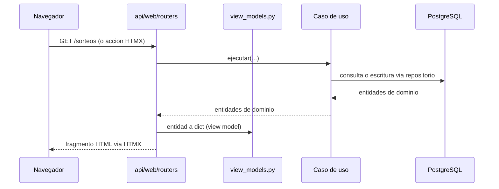

Las plantillas nunca reciben entidades de dominio directamente — siempre pasan por un view model (`api/web/view_models.py`).

---

## API REST

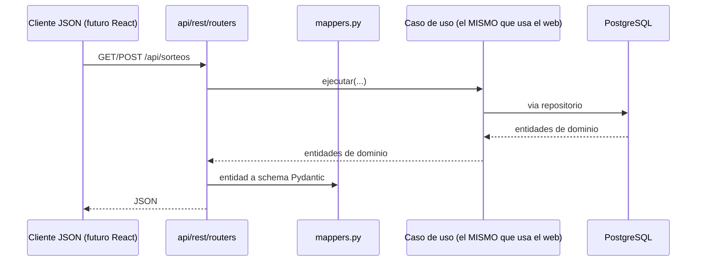

`api/web` y `api/rest` comparten exactamente los mismos casos de uso — reemplazar el frontend HTML por React en el futuro no requiere tocar `application/` ni `domain/`.

---

## Base de datos


Tablas normalizadas (no `INTEGER[]`) para números y colores: permite indexar y consultar por número individual eficientemente a escala (necesario para el análisis de frecuencia de la Fase 3).

---

## Decisiones de diseño y por qué

| Decisión | Alternativa descartada | Por qué |
|---|---|---|
| UnitOfWork con commit por sorteo | Una transacción por sincronización completa | Un fallo a mitad de un lote de 1000 sorteos no debe perder los primeros 999 |
| Parsers separados de conectores | Parseo embebido en el conector | Testeable sin red; permite reprocesar HTML guardado con el mismo código |
| application/ nunca importa infrastructure/ | Logger de infraestructura importado directamente | logging.getLogger(nombre) es un registro global — se obtiene el mismo logger configurado sin la dependencia indebida |
| Tablas normalizadas para números/colores | INTEGER[] de PostgreSQL | Necesario para consultas de frecuencia por número individual a escala (Fase 3) |
| EjecucionSincronizacion separada del Data Quality Report | Todo en una sola entidad | El rango histórico y la cobertura son del estado actual de los datos, no de una corrida puntual |
| DrawSourceConnector como puerto único | Un cliente HTTP genérico sin abstracción | Permite intercambiar scraping por CSV o una futura API oficial sin tocar SincronizarSorteos |
| Baloto y Revancha como juegos independientes (Opción A) | Una entidad Sorteo con dos resultados embebidos (Opción B) | Cero cambios de esquema, reutiliza el 100% del dominio ya construido, fiel a que son productos regulatoriamente distintos -ver sección dedicada arriba |
| Dos índices únicos parciales en `estadisticas` | Un `UNIQUE` convencional sobre las 4 columnas | PostgreSQL nunca trata `NULL = NULL` como duplicado en un `UNIQUE` -el histórico completo (`hasta_numero_sorteo IS NULL`) habría podido duplicarse sin límite |
| Upsert (`ON CONFLICT DO UPDATE`) al recalcular una identidad existente | `INSERT` incondicional en cada cálculo | Recalcular una estadística previamente invalidada debe reemplazar esa fila, no intentar crear una segunda -evita `UniqueViolation` bajo concurrencia real, no solo en el caso feliz |
